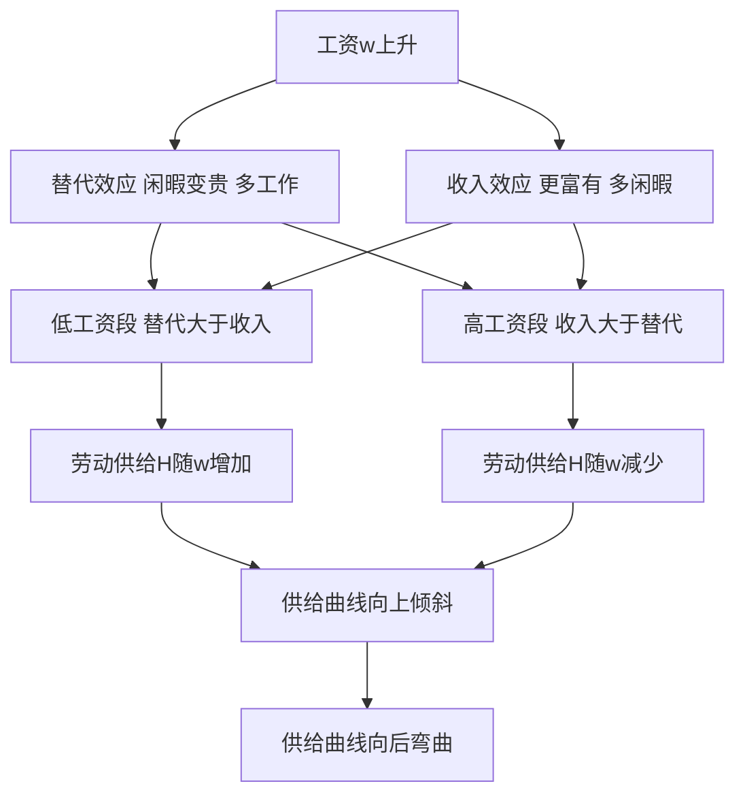

# KP03 劳动供给与工资决定

<a href="../../../../exam.html" target="_blank" style="display:inline-block;padding:6px 16px;background:#2563eb;color:#fff;border-radius:6px;text-decoration:none;font-size:14px;">📝 开始做题</a>

> 所属：[[00_章节总结|第6章 生产要素市场与收入分配]]

## 1. 一句话先懂（小白版）

工资低时，涨一点你愿意多加班；但工资高到一定程度，你会想"钱够花了，不如休假"。**劳动供给曲线是向后弯曲的——工资低时向上，工资高时向后弯。**

## 2. 严格定义

**劳动供给（Labor Supply）**：在不同工资水平下，劳动者愿意提供的劳动时间。

**替代效应**：工资上升 → 闲暇的机会成本上升 → 多工作少休假。
**收入效应**：工资上升 → 同样工作时间收入更高 → 可以多休假。

- 工资低时：替代效应 > 收入效应 → 工资涨，劳动供给增。
- 工资高时：收入效应 > 替代效应 → 工资涨，劳动供给减。

## 3. 怎么用（手把手算）

**场景**：小王时间分配。

| 日工资 w（元） | 每天工作小时 | 日收入 |
|---|---|---|
| 100 | 8 | 800 |
| 200 | 10 | 2000 |
| 400 | 10 | 4000 |
| 800 | 8 | 6400 |
| 1600 | 6 | 9600 |

**观察**：
- w 从 100 涨到 400：工作时间 8 → 10（替代效应主导）。
- w 从 400 涨到 1600：工作时间 10 → 6（收入效应主导）。

## 理论推导（一步步推）

> 本节补充：劳动供给曲线为什么向后弯曲——替代效应和收入效应的数学表达。

**假设起点**：
1. 消费者（劳动者）在"工作时间 H"和"闲暇 R"之间分配每天 24 小时：$H + R = 24$。
2. 效用来自闲暇 R 和消费 C（收入买的商品）。消费 $C = wH = w(24-R)$。
3. 效用函数 $U(R, C)$ 是拟凹的。

**推导过程**：
- 第一步：预算约束 $C = w(24 - R)$，即 $C + wR = 24w$。w 既是工资也是**闲暇的价格**（多休 1 小时少赚 w 元）。
- 第二步：工资 w 变化的影响可分解为替代效应和收入效应。
- 第三步（替代效应）：w 上升 → 闲暇变贵 → 消费者用"消费"替代"闲暇" → R 减少、H 增加。替代效应为正（w↑ → H↑）。
- 第四步（收入效应）：w 上升 → 总收入 $w\times 24$ 上升 → 消费者更富有 → 对所有正常商品需求增加，包括闲暇（闲暇是正常商品）→ R 增加、H 减少。收入效应为负（w↑ → H↓）。
- 第五步：两种效应方向相反。
  - 工资低时：替代效应 > 收入效应 → w↑ → H↑（供给曲线向上倾斜）。
  - 工资高时：收入效应 > 替代效应 → w↑ → H↓（供给曲线向后弯曲）。
- 结论：劳动供给曲线先向右上倾斜，到一定工资水平后向后弯曲。

## 数学推导（公式怎么来的）

> 每个符号第一次出现必须解释。

设效用函数为 $U(R, C) = R^\beta C^{1-\beta}$（柯布-道格拉斯，$\beta$ 是闲暇偏好参数）。

**第一步：预算约束**
$$C + wR = 24w$$

**第二步：构造拉格朗日函数**
$$\mathcal{L} = R^\beta C^{1-\beta} - \lambda(C + wR - 24w)$$

**第三步：一阶条件**
$$\frac{\partial\mathcal{L}}{\partial R} = \beta R^{\beta-1}C^{1-\beta} - \lambda w = 0$$
$$\frac{\partial\mathcal{L}}{\partial C} = (1-\beta) R^\beta C^{-\beta} - \lambda = 0$$

**第四步：两式相除消去 λ**
$$\frac{\beta C}{(1-\beta)R} = w \Rightarrow C = \frac{(1-\beta)wR}{\beta}$$

**第五步：代入预算约束**
$$\frac{(1-\beta)wR}{\beta} + wR = 24w$$
$$wR\left(\frac{1-\beta}{\beta} + 1\right) = 24w$$
$$R\cdot\frac{1}{\beta} = 24$$
$$R^* = 24\beta$$

**第六步：劳动供给**
$$H^* = 24 - R^* = 24(1-\beta)$$

**关键发现**：在柯布-道格拉斯效用函数下，劳动供给 H* = 24(1-β)，**与工资 w 无关**！这是因为替代效应和收入效应恰好抵消。

**第七步：更一般的效用函数**

若效用函数不是柯布-道格拉斯，比如 $U = R^\beta C$（线性于 C），则替代效应大于收入效应，H 随 w 上升；若 $U = \log R + \gamma\log C$，则取决于参数。

经验研究：工资较低时 H 随 w 上升（替代效应主导）；工资很高时（如 CEO、顶级球星）H 反而下降（收入效应主导）——这就是向后弯曲的实证基础。

**图形说明**：纵轴工资 w，横轴劳动时间 H。劳动供给曲线 S：在低工资段向右上倾斜（H 随 w 增加）；在高工资段向后弯（H 随 w 减少）。与向右下倾斜的 VMP（劳动需求曲线）交点决定均衡工资 $w^*$ 和就业 $H^*$。

**生活实例**：
- 时薪 20 元的小工：老板说"今晚加班多给 100 元"，他立刻答应——替代效应主导，闲暇太便宜，不如多赚。
- 时薪 2000 元的顶级律师：年入 200 万后，他开始每周休 3 天、带家人出国——收入效应主导，钱已经够多，闲暇更值钱。
这就是劳动供给曲线向后弯曲的现实版。

## 4. 工资决定

劳动需求（VMP）和劳动供给共同决定均衡工资：
$$w^* = \text{VMP}(L^*)$$

## 5. 工资差异的原因

1. **补偿性差异**：危险工作（矿工、高空作业）工资高。
2. **人力资本差异**：医生、程序员训练时间长，工资高。
3. **能力差异**：明星、CEO 能力稀缺。
4. **歧视**：性别、地域歧视导致同工不同酬。
5. **制度**：工会、最低工资法。

## 6. 现实意义

- 为啥硅谷程序员年薪百万？VMP 高 + 稀缺。
- 为啥建筑工人工资不低？危险、辛苦（补偿性差异）。
- 为啥欧洲人休假多？工资高到收入效应主导。

---

## 🔗 相关知识点

**同章关联：** [[KP01_引致需求与边际生产力|VMP]] ｜ [[KP04_地租与利息|地租利息]]

**跨章关联：** [[../../02_消费者选择/知识点/KP06_替代效应与收入效应|替代与收入效应]]

**📖 原书原文：** [[../../../../原文件/经济学/西方经济学上册_微观_全书#第三节 劳动和工资|原书·第六章第三节]]

---

## 🐮 小白教程入门

> 看不懂下面这个KP？先看通俗版教程建立直觉：

- [[../../../../经济统计学论文从0基础到精通/13_微观经济学基础/09_完全竞争市场是什么|🐮 教程·完全竞争市场是什么（相关延伸）]]

---

## 📝 考研真题（首经贸 801）

**配套主观题：** 见同目录 [[../考研真题集|本章考研真题集]]
**配套选择题：** 见同目录 [[../选择题集|本章选择题集]]

### 高频简答
- 用替代效应与收入效应解释劳动供给曲线向后弯曲 → 见 [[../考研真题集#s4|真题集·简答 4]]
- 简述工资差异的主要成因 → 见 [[../考研真题集#s5|真题集·简答 5]]

### 高频论述
- 结合中国劳动力市场实际，论述最低工资制度对就业与收入分配的影响 → 见 [[../考研真题集#l1|真题集·论述 1]]
- 结合"共同富裕"政策，论述要素收入分配理论对初次分配制度改革的启示 → 见 [[../考研真题集#l4|真题集·论述 4]]

### 易错选择
- 本知识点选择题见 [[../选择题集#KP03 劳动供给与工资决定|选择题集·KP03]]
