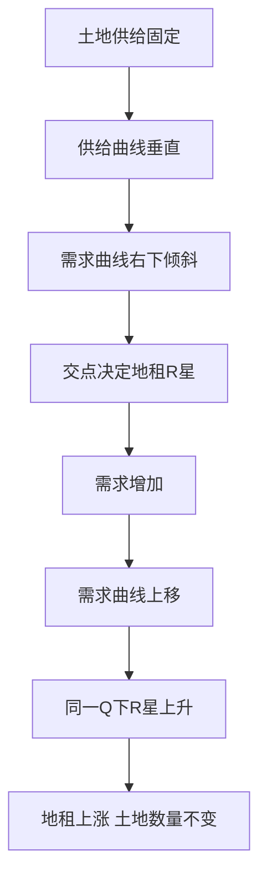

# KP04 地租与利息

<a href="../../../../exam.html" target="_blank" style="display:inline-block;padding:6px 16px;background:#2563eb;color:#fff;border-radius:6px;text-decoration:none;font-size:14px;">📝 开始做题</a>

> 所属：[[00_章节总结|第6章 生产要素市场与收入分配]]

## 1. 一句话先懂（小白版）

- **地租**：土地数量固定，不管价格多高都不能多产一亩。所以地租完全由需求决定。
- **利息**：钱的价格。你存钱银行给你利息，你贷款要付利息。

## 2. 严格定义

**地租（Rent）**：使用土地的价格。由于土地供给固定（垂直供给曲线），地租完全由需求曲线位置决定。

**经济租（Economic Rent）**：要素实际获得的报酬超过"让它被供给所必需的最低报酬"的部分。类似"要素的消费者剩余"。

**利息（Interest）**：使用资本的价格，即利率 $r$。

## 3. 怎么用（手把手算，地租）

**场景**：城市中心一块地，供给固定 100 亩。

需求曲线：$R = 1000 - 2Q$（R 是每亩租金，Q 是亩数）。

供给：$Q = 100$ 固定。

**第一步**：代入需求：
$$R^* = 1000 - 2 \times 100 = 800 \text{ 元/亩/月}$$

**第二步**：如果城市发展，需求外推到 $R = 1200 - 2Q$：
$$R^* = 1200 - 200 = 1000 \text{ 元/亩/月}$$

**结论**：供给不变，需求增加 → 地租涨。这就是城市地价越来越贵的原因。

## 理论推导（一步步推）

> 本节补充：为什么地租完全由需求决定、经济租怎么定义。

**假设起点**（地租）：
1. 土地总供给固定为 $\bar{Q}$（不能多生产一亩）。
2. 土地需求曲线由 VMP（土地边际产量价值）决定，向右下倾斜。
3. 土地所有者按市场价格出租。

**推导过程**：
- 第一步：供给曲线是垂直线 $Q = \bar{Q}$——不管地租多高，土地数量都不变。
- 第二步：需求曲线 $R = D(Q)$（向右下倾斜）。
- 第三步：均衡条件是供给 = 需求。供给固定在 $\bar{Q}$，所以均衡地租 $R^* = D(\bar{Q})$ 完全由需求曲线在 $\bar{Q}$ 处的高度决定。
- 第四步：如果需求增加（城市发展、商业繁华），需求曲线上移，在同一 $\bar{Q}$ 处 R* 上升。
- 结论：**地租不是成本，而是剩余**——地租上涨不影响土地供给，只影响土地所有者的收入。

**经济租的推导**：
- 供给曲线若完全无弹性（垂直），所有地租都是经济租。
- 供给曲线若向上倾斜，要素得到的报酬中，高于"吸引其进入市场所需最低报酬"的部分就是经济租——图形上是供给曲线上方、市场价格下方的三角形。

## 数学推导（公式怎么来的）

> 每个符号第一次出现必须解释。

**地租的决定**：

设土地反需求函数 $R = a - bQ$（R 是每亩地租，Q 是亩数），土地供给固定 $\bar{Q}$。

均衡：
$$R^* = a - b\bar{Q}$$

**比较静态**：
- 需求截距 a 上升（城市繁华、商业需求增加）→ R* 上升。
- 供给 $\bar{Q}$ 不变 → 不影响 R*。
- 若政府新开发一片土地使 $\bar{Q}$ 增加到 $\bar{Q}' > \bar{Q}$：$R^* = a - b\bar{Q}' < a - b\bar{Q}$，地租下降。

**经济租的数学定义**：

设供给曲线 $Q^s = c + dR$（向上倾斜），需求曲线 $Q^d = a - bQ$。

均衡 R* 由 $c + dR = a - bQ$ 决定（注意 Q 是数量，R 是价格）。

要素得到的总报酬 $= R^*\cdot Q^*$。

"吸引要素进入市场所需最低总报酬" = 供给曲线下方的面积（生产者剩余的反面）：
$$\text{最低必需报酬} = \int_0^{Q^*} R^s(Q)\,dQ$$

经济租：
$$\text{经济租} = R^*\cdot Q^* - \int_0^{Q^*} R^s(Q)\,dQ$$

**极端情况验证**：
- 供给垂直（d=0）：供给曲线下方面积 = 0，所有报酬都是经济租。
- 供给水平（d→∞）：供给曲线下方面积 = R*·Q*，经济租 = 0。

**利息的决定（可贷资金市场）**：

可贷资金需求：$I(r) = I_0 - hr$（投资随利率 r 上升而下降）。
可贷资金供给：$S(r) = S_0 + kr$（储蓄随利率 r 上升而上升）。

均衡：
$$I_0 - hr = S_0 + kr$$
$$r^* = \frac{I_0 - S_0}{h+k}$$

**比较静态**：
- 央行增加货币供给（$S_0$ 上升）→ r* 下降。
- 企业投资热情上升（$I_0$ 上升）→ r* 上升。

**图形说明**：地租图纵轴 R，横轴 Q。供给曲线垂直在 $\bar{Q}$；需求曲线向右下倾斜。两者交点决定 R*。需求曲线右移时，供给不动，R* 沿垂直供给曲线上移。利息图纵轴 r，横轴可贷资金量。S 向右上、I 向右下。

**生活实例**：
- 北京中关村一块地，1990 年地租 1000 元/平/月，2024 年涨到 50000 元。土地还是那块地（供给没变），但写字楼需求暴增——需求曲线右移，地租被推上去。
- 明星片酬 5000 万：他本来 100 万也愿意演（供给曲线很低），市场给了 5000 万，中间 4900 万都是经济租。
- 央行降息：房贷利率从 5% 降到 3.5%，可贷资金供给曲线右移，均衡利率下降——你房贷月供少了。

## 4. 利息怎么决定

- 可贷资金需求：企业借钱投资。
- 可贷资金供给：居民储蓄。
- 两者交点 = 均衡利率。

## 5. 现实例子

- 为啥北京中关村地价这么高？需求大，供给固定。
- 为啥明星片酬几千万？经济租——明星本来 100 万也愿意干，但市场给了 1000 万。
- 为啥房贷利率变化影响房价？利率是资本的价格。

## 6. 容易混淆什么

| 概念 | 区别 |
|---|---|
| 地租 vs 经济租 | 地租是土地的租金；经济租是所有要素"超过最低必需报酬"的部分。 |
| 利息 vs 利润 | 利息是资本的价格（给资本家的）；利润是企业家才能的报酬。 |

---

## 🔗 相关知识点

**同章关联：** [[KP03_劳动供给与工资决定|工资决定]]

**📖 原书原文：** [[../../../../原文件/经济学/西方经济学上册_微观_全书|原书·第六章第四、五节]]

---

## 🐮 小白教程入门

> 看不懂下面这个KP？先看通俗版教程建立直觉：

- [[../../../../经济统计学论文从0基础到精通/13_微观经济学基础/09_完全竞争市场是什么|🐮 教程·完全竞争市场是什么（相关延伸）]]

---

## 📝 考研真题（首经贸 801）

**配套主观题：** 见同目录 [[../考研真题集|本章考研真题集]]
**配套选择题：** 见同目录 [[../选择题集|本章选择题集]]

### 高频简答
- 为什么说地租完全由需求决定？作图说明 → 见 [[../考研真题集#s6|真题集·简答 6]]
- 区分经济租与准租金，并举例说明 → 见 [[../考研真题集#s7|真题集·简答 7]]
- 简述均衡利率的决定及其变动 → 见 [[../考研真题集#s10|真题集·简答 10]]

### 高频论述
- 结合中国房地产与土地财政实际，论述地租理论对理解城市地价与房价的意义 → 见 [[../考研真题集#l3|真题集·论述 3]]

### 易错选择
- 本知识点选择题见 [[../选择题集#KP04 地租与利息|选择题集·KP04]]
