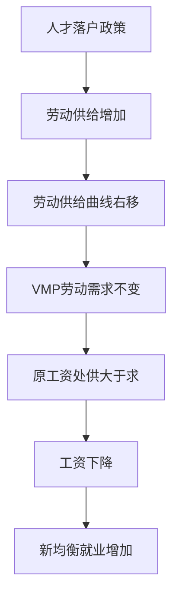
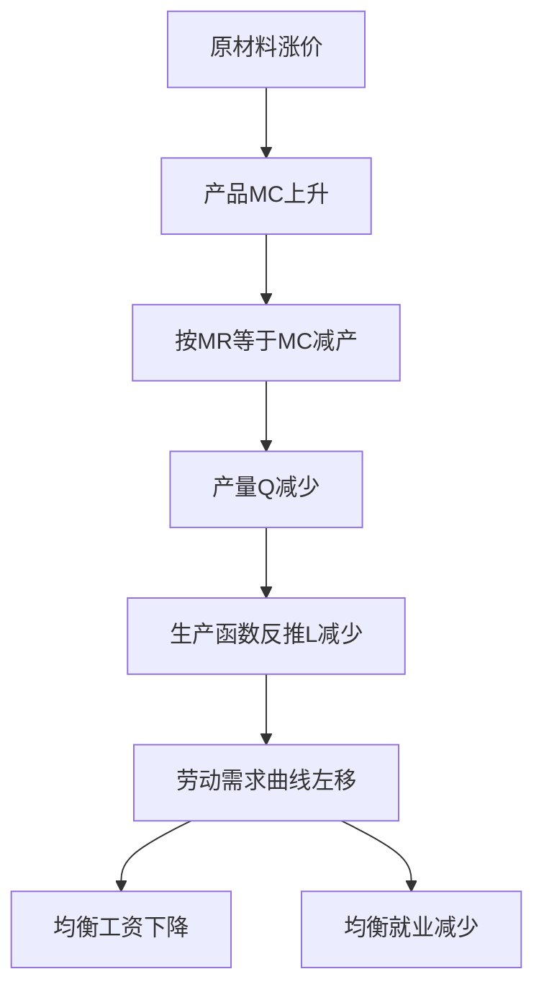
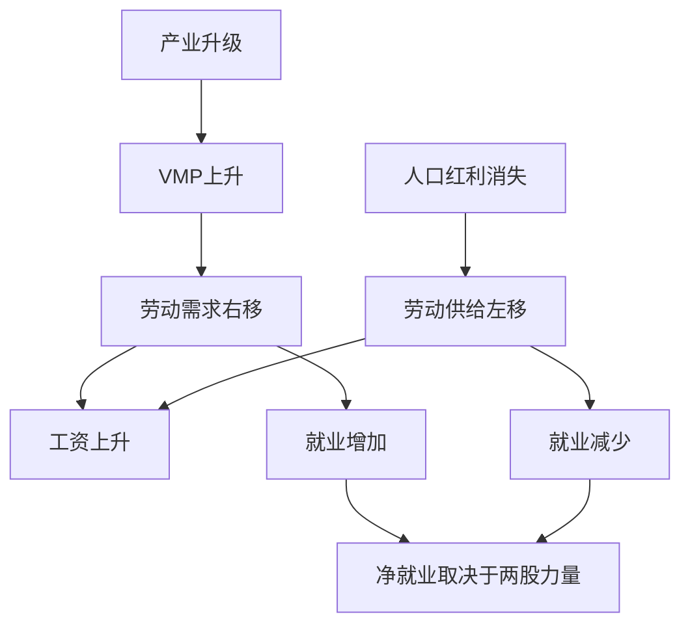
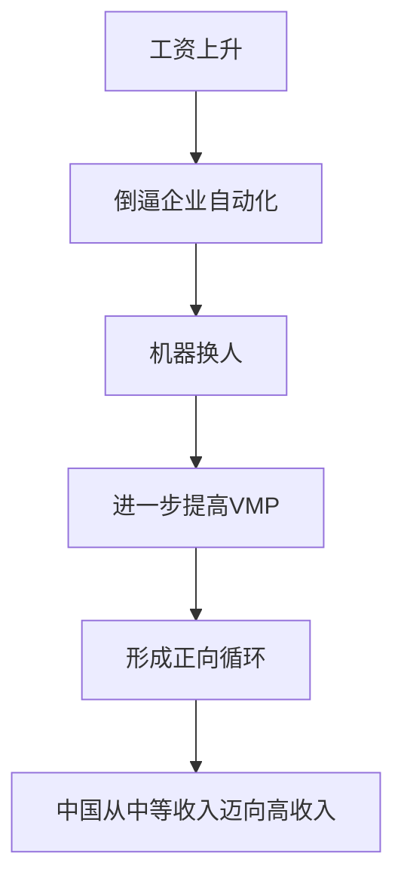

# 第 6 章 生产要素市场与收入分配 · 考研真题集（首经贸 801）

<a href="../../../exam.html" target="_blank" style="display:inline-block;padding:6px 16px;background:#2563eb;color:#fff;border-radius:6px;text-decoration:none;font-size:14px;">📝 开始做题</a>

> 本章共收录：简答题 10 道（每题 15 分）｜论述题 4 道（每题 30 分）
> 配套选择题见 [[选择题集|本章选择题集]]
> 对应大纲：马工程《西方经济学》（第二版）第六章"生产要素价格与收入分配"全部四节

## 📋 本题集目录

### 简答题
1. [[#简答 1：简述引致需求的含义及其与产品需求的区别|简述引致需求的含义及其与产品需求的区别]]
2. [[#简答 2：推导完全竞争厂商对单一可变要素的需求曲线并说明其形状|推导完全竞争厂商对单一可变要素的需求曲线并说明其形状]]
3. [[#简答 3：为什么厂商使用要素的原则是 VMP = w？若 VMP > w 应如何调整|为什么厂商使用要素的原则是 VMP = w？若 VMP > w 应如何调整]]
4. [[#简答 4：用替代效应与收入效应解释劳动供给曲线向后弯曲|用替代效应与收入效应解释劳动供给曲线向后弯曲]]
5. [[#简答 5：简述工资差异的主要成因|简述工资差异的主要成因]]
6. [[#简答 6：为什么说地租完全由需求决定？作图说明|为什么说地租完全由需求决定？作图说明]]
7. [[#简答 7：区分经济租与准租金，并举例说明|区分经济租与准租金，并举例说明]]
8. [[#简答 8：计算题：已知生产函数与产品价格求厂商要素需求量|计算题：已知生产函数与产品价格求厂商要素需求量]]
9. [[#简答 9：简述行业要素需求曲线与单个厂商要素需求曲线加总之间的关系|简述行业要素需求曲线与单个厂商要素需求曲线加总之间的关系]]
10. [[#简答 10：简述均衡利率的决定及其变动|简述均衡利率的决定及其变动]]

### 论述题
1. [[#论述 1：结合中国劳动力市场实际，论述最低工资制度对就业与收入分配的影响|结合中国劳动力市场实际，论述最低工资制度对就业与收入分配的影响]]
2. [[#论述 2：结合平台经济用工现象，论述引致需求原理如何解释互联网行业高工资与"996"现象|结合平台经济用工现象，论述引致需求原理如何解释互联网行业高工资与"996"现象]]
3. [[#论述 3：结合中国房地产与土地财政实际，论述地租理论对理解城市地价与房价的意义|结合中国房地产与土地财政实际，论述地租理论对理解城市地价与房价的意义]]
4. [[#论述 4：结合"共同富裕"政策，论述要素收入分配理论对初次分配制度改革的启示|结合"共同富裕"政策，论述要素收入分配理论对初次分配制度改革的启示]]

---

## 一、简答题（每题 15 分，建议 450–700 字）

### 简答 1：简述引致需求的含义及其与产品需求的区别

**【建议字数】450–700 字 ｜ 【建议时间】15 分钟 ｜ 【题型】概念简答**

**【考什么】** 对应知识点 [[知识点/KP01_引致需求与边际生产力|引致需求与边际生产力]]，对应大纲第六章第一节；题型属于概念简答。

**【答题框架】**
- 第 1 段：定义引致需求（2 分）
- 第 2 段：与产品需求的三点区别（6 分）
- 第 3 段：派生链条的传导机制（4 分）
- 第 4 段：现实举例（3 分）

**【参考答案】**

一、引致需求的含义

（一）引致需求（Derived Demand），又称派生需求，是指厂商对生产要素的需求并不是为了直接满足自身消费欲望，而是由消费者对最终产品的需求派生出来的。

（二）厂商之所以购买劳动、资本、土地等生产要素，是因为这些要素能够生产出供消费者购买的产品；如果消费者对产品没有需求，厂商对要素也就没有需求。

二、引致需求与产品需求的区别

（一）需求主体不同。产品需求的主体是消费者，目的是获得效用；要素需求的主体是厂商，目的是获得利润。

（二）需求目的不同。产品需求是"直接需求"，消费本身即目的；要素需求是"间接需求"，要素只是生产产品的手段。

（三）需求性质不同。产品需求由效用最大化决定，受边际效用递减规律支配；要素需求由利润最大化决定，受边际生产力递减规律支配，其需求曲线由边际产品价值 VMP 曲线给出。

三、派生链条

消费者对奶茶的需求增加 → 奶茶价格 P 上升 → 奶茶厂商边际产品价值 VMP = P·MP 上升 → 在既定工资下厂商对工人的需求增加 → 均衡工资与就业量上升。这一链条说明要素价格与就业量最终由产品市场需求决定。

四、现实举例

新冠疫情期间，居民对口罩、消毒液的需求骤增，口罩厂对工人和无纺布的需求随之暴增，工人加班加点、原材料价格飞涨；疫情缓和后需求回落，相关要素需求同步下降。这正是引致需求的典型表现。

**【解析·得分点】** 采分点：①引致需求定义 ②与产品需求的主体、目的、性质三点区别 ③VMP = P·MP 的派生链条 ④疫情口罩例。容易丢分：只写定义不写区别；漏掉"边际生产力递减"这一与产品需求（边际效用递减）的对照。

**【生活实例】** 学校门口的奶茶店开学季排长队，老板赶紧多招两个兼职；放寒假学生走了，老板又把兼职辞了。老板招不招人，根本不取决于老板喜不喜欢这些学生工，而是取决于学生买不买奶茶——这就是引致需求。

**【双链接】** 🔗 [[知识点/KP01_引致需求与边际生产力|回知识点]] ｜ 📖 [[../../../原文件/经济学/西方经济学上册_微观_全书|原书·第六章第一节]]

---

### 简答 2：推导完全竞争厂商对单一可变要素的需求曲线并说明其形状

**【建议字数】450–700 字 ｜ 【建议时间】15 分钟 ｜ 【题型】分析推导**

**【考什么】** 对应知识点 [[知识点/KP02_完全竞争厂商的要素需求|完全竞争厂商的要素需求]]，对应大纲第六章第二节；题型属于分析推导。

**【答题框架】**
- 第 1 段：完全竞争厂商的假设（2 分）
- 第 2 段：利润最大化一阶条件（5 分）
- 第 3 段：要素需求曲线即 VMP 曲线（5 分）
- 第 4 段：形状与原因（3 分）

**【参考答案】**

一、假设前提

（一）产品市场完全竞争，厂商是价格接受者，产品价格 P 既定。

（二）要素市场完全竞争，厂商也是要素价格接受者，工资 w 既定。

（三）短期内只有劳动 L 一种可变要素，资本 K 固定。

二、利润最大化一阶条件

厂商利润 $\pi(L) = P\cdot Q(L) - wL$，其中 $Q(L)$ 为生产函数。

对 L 求导并令其为零：

$$\frac{d\pi}{dL} = P\cdot \frac{dQ}{dL} - w = 0$$

即：

$$P\cdot MP_L = w \quad \text{或} \quad VMP = w$$

其经济含义为：多雇用一单位劳动所带来的边际收益（VMP）恰好等于多雇用一单位劳动所付出的边际成本（工资 w）。

三、要素需求曲线

（一）由于边际报酬递减规律，$MP_L$ 随 L 增加而递减；在产品价格 P 既定时，$VMP = P\cdot MP_L$ 曲线向右下方倾斜。

（二）对每一个工资水平 w，厂商都在 VMP 曲线上找到满足 VMP = w 的雇用量 L。因此，VMP 曲线本身就是完全竞争厂商对劳动的需求曲线。

四、形状与原因

要素需求曲线向右下方倾斜。原因在于边际生产力递减：随着雇用量增加，新增工人的边际产量不断下降，在产品价格不变的条件下，只有工资下降厂商才愿意多雇。

**【解析·得分点】** 采分点：①两个完全竞争假设 ②利润函数求导得 VMP = w ③要素需求曲线即 VMP 曲线 ④向右下倾斜源于边际报酬递减。容易丢分：忘记"产品价格 P 既定"这一前提，把 VMP 写成 MRP；混淆完全竞争与卖方垄断（后者应是 MR·MP）。

**【生活实例】** 奶茶店第一天雇 1 人，一天做 100 杯；第二天加 1 人，由于场地小、操作台挤，第二人只多做 80 杯；第三人只多做 50 杯。每杯卖 10 元，三人分别值 1000、800、500 元/天。日工资 800 元时老板雇 2 人，日工资 500 元时雇 3 人——把这些点连起来就是需求曲线。

**【双链接】** 🔗 [[知识点/KP02_完全竞争厂商的要素需求|回知识点]] ｜ 📖 [[../../../原文件/经济学/西方经济学上册_微观_全书|原书·第六章第二节]]

---

### 简答 3：为什么厂商使用要素的原则是 VMP = w？若 VMP > w 应如何调整

**【建议字数】450–700 字 ｜ 【建议时间】15 分钟 ｜ 【题型】原因分析**

**【考什么】** 对应知识点 [[知识点/KP01_引致需求与边际生产力|引致需求与边际生产力]]、[[知识点/KP02_完全竞争厂商的要素需求|完全竞争厂商的要素需求]]；题型属于原因分析。

**【答题框架】**
- 第 1 段：VMP 与 w 的含义（3 分）
- 第 2 段：利润最大化条件的推导（5 分）
- 第 3 段：VMP > w 与 VMP < w 的调整方向（5 分）
- 第 4 段：小结（2 分）

**【参考答案】**

一、概念含义

（一）边际产品价值 VMP = P·MP_L，是厂商多投入一单位劳动所获得的额外收益。

（二）工资 w 是厂商多雇用一单位劳动所付出的边际成本。

二、利润最大化条件

厂商利润为 $\pi = PQ(L) - wL$。利润最大要求：

$$\frac{d\pi}{dL} = P\cdot MP_L - w = 0$$

即 VMP = w。这与产品市场上"MR = MC"是同一个利润最大化逻辑在要素市场上的应用。

三、非均衡时的调整

（一）若 VMP > w，例如 VMP = 150 元而 w = 100 元，意味着多雇一人净赚 50 元。厂商应继续增雇工人，直到因边际产量递减使 VMP 降至等于 w。

（二）若 VMP < w，例如 VMP = 80 元而 w = 100 元，意味着多雇一人净亏 20 元。厂商应裁减工人，随着雇用量减少，留存工人的边际产量上升，VMP 回升至等于 w。

（三）只有在 VMP = w 时，厂商无论增雇还是减雇都不能再增加利润，此时达到利润最大。

四、小结

VMP = w 是完全竞争厂商要素使用的均衡条件，其本质是"边际收益 = 边际成本"这一通用原则在要素市场的具体形式。

**【解析·得分点】** 采分点：①VMP 与 w 的边际含义 ②求导过程 ③VMP > w 增雇、VMP < w 减雇的双向调整 ④边际报酬递减使调整收敛。容易丢分：只写等式不写不等式方向；漏掉"边际报酬递减"是收敛的原因。

**【生活实例】** 路边摊雇阿姨包饺子。第一个阿姨一天包 200 个，每个净赚 1 元，老板付给她 150 元/天，老板净赚 50 元。第二个阿姨手慢只包 100 个，值 100 元，但工资也是 150 元，老板反而亏 50 元。所以老板只雇 1 个——这就是 VMP = w。

**【双链接】** 🔗 [[知识点/KP01_引致需求与边际生产力|回知识点]] ｜ [[知识点/KP02_完全竞争厂商的要素需求|要素需求]] ｜ 📖 [[../../../原文件/经济学/西方经济学上册_微观_全书|原书·第六章第二节]]

---

### 简答 4：用替代效应与收入效应解释劳动供给曲线向后弯曲

**【建议字数】450–700 字 ｜ 【建议时间】15 分钟 ｜ 【题型】模型分析**

**【考什么】** 对应知识点 [[知识点/KP03_劳动供给与工资决定|劳动供给与工资决定]]，对应大纲第六章第三节；题型属于模型分析。

**【答题框架】**
- 第 1 段：劳动供给是收入与闲暇的选择（3 分）
- 第 2 段：替代效应（5 分）
- 第 3 段：收入效应（5 分）
- 第 4 段：两效应比较与曲线形状（2 分）

**【参考答案】**

一、劳动供给的本质

时间是既定资源，劳动者将其在"工作（获得收入）"与"闲暇（获得效用）"之间分配。工资 w 可以视为闲暇的价格——每享受一小时闲暇，就放弃一小时工资。

二、替代效应

工资上升意味着闲暇的机会成本上升。相对于其他商品，闲暇变得更贵，劳动者倾向于以工作替代闲暇，即多工作、少休假。替代效应使劳动供给量随工资上升而增加。

三、收入效应

工资上升也意味着：在同样工作时间下，劳动者收入更高、更富有。由于闲暇是正常品，收入上升会增加对闲暇的需求，劳动者倾向于少工作、多休假。收入效应使劳动供给量随工资上升而减少。

四、两效应比较与曲线形状

（一）工资水平较低时，劳动者收入尚未满足基本需要，替代效应大于收入效应：工资上涨，劳动供给增加，供给曲线向右上方倾斜。

（二）工资水平较高时，基本需要已满足，收入效应超过替代效应：工资再上涨，劳动者反而选择减少工作时间，供给曲线向后弯曲。

（三）把两阶段合起来，劳动供给曲线呈现"先向右上、后向左上"的向后弯曲形状。

**【解析·得分点】** 采分点：①闲暇价格 = 工资 ②替代效应方向（+）③收入效应方向（−）④低工资替代主导、高工资收入主导 ⑤曲线后弯。容易丢分：把收入效应方向写反；不解释"为什么低工资时替代主导"。

**【生活实例】** 刚毕业月薪 5000 元，你天天加班，因为加班费翻倍太香了（替代效应）。年薪涨到 100 万，你开始每年休两个月假、拒绝周末加班——钱已经够花了，时间比钱更值钱（收入效应）。这就是劳动供给曲线向后弯。

**【双链接】** 🔗 [[知识点/KP03_劳动供给与工资决定|回知识点]] ｜ 📖 [[../../../原文件/经济学/西方经济学上册_微观_全书|原书·第六章第三节]]

---

### 简答 5：简述工资差异的主要成因

**【建议字数】450–700 字 ｜ 【建议时间】15 分钟 ｜ 【题型】原因分析**

**【考什么】** 对应知识点 [[知识点/KP03_劳动供给与工资决定|劳动供给与工资决定]]；题型属于原因分析。

**【答题框架】**
- 第 1 段：工资差异的普遍性（2 分）
- 第 2–6 段：五类成因（10 分）
- 第 7 段：小结（3 分）

**【参考答案】**

一、补偿性工资差异

不同职业的工作条件不同。危险、肮脏、压力大、不稳定的工作（矿工、高空作业、外卖员）必须以更高工资补偿劳动者，否则无人愿意从事。这是"同工不同酬"中合理的一部分。

二、人力资本差异

教育、培训、经验构成人力资本。医生、律师、程序员需要长期学习和高额培训成本，其较高工资是对人力资本投资的回报，也包含机会成本补偿。

三、能力与租金差异

天赋稀缺的职业（顶尖运动员、明星、CEO）供给近乎固定，其工资中包含大量经济租——即使工资远低于实际水平，他们仍愿意从事该职业。

四、市场不完全与歧视

（一）工会力量、行业垄断造成不同行业工资差异。

（二）性别、地域、户籍歧视导致同等生产率的劳动者获得不同报酬。

五、制度因素

最低工资法、公务员薪酬制度、国企工资体系等制度安排也会造成工资差异。

六、小结

现实中工资差异是上述因素共同作用的结果。完全竞争模型预测的"同工同酬"只是长期趋势，短期工资差异普遍存在且部分具有经济合理性。

**【解析·得分点】** 采分点：①补偿性差异 ②人力资本 ③能力/经济租 ④歧视 ⑤制度。容易丢分：漏掉歧视这一马克思主义政治经济学也强调的维度；把工资差异简单归为"市场不公"。

**【生活实例】** 同样是体力活，工地师傅日薪 500 元但风吹日晒，超市理货员日薪 150 元但冬暖夏凉——差额是"吃苦补贴"。程序员月薪 2 万是因为四年大学+两年自学的本钱要收回来。明星拍一集戏拿 100 万，其实他 10 万也愿意干，多出来的 90 万是经济租。

**【双链接】** 🔗 [[知识点/KP03_劳动供给与工资决定|回知识点]] ｜ 📖 [[../../../原文件/经济学/西方经济学上册_微观_全书|原书·第六章第三节]]

---

### 简答 6：为什么说地租完全由需求决定？作图说明

**【建议字数】450–700 字 ｜ 【建议时间】15 分钟 ｜ 【题型】原因分析**

**【考什么】** 对应知识点 [[知识点/KP04_地租与利息|地租与利息]]；题型属于模型分析。

**【答题框架】**
- 第 1 段：土地供给的特殊性（3 分）
- 第 2 段：地租决定机制（5 分）
- 第 3 段：图形描述（5 分）
- 第 4 段：引申含义（2 分）

**【参考答案】**

一、土地供给的特殊性

（一）土地是自然界给定的，其总量不随地租高低而变化。

（二）因此土地供给曲线是一条垂直于横轴的直线，供给量 $\bar{Q}$ 固定。

二、地租的决定

由于供给完全无弹性，地租 R 完全由需求曲线的位置决定。土地需求曲线由土地的边际生产力（即土地的 VMP）决定，向右下方倾斜。地租的均衡水平由垂直供给曲线与向右下倾斜的需求曲线交点决定。

三、图形描述

（一）横轴为土地数量 Q，纵轴为地租 R。

（二）供给曲线 S 为垂直线 Q = $\bar{Q}$。

（三）需求曲线 D = VMP 向右下倾斜。

（四）两线交点决定均衡地租 R*。当经济发展、人口增加，土地需求从 D0 外移到 D1，供给不变，地租由 R0 上升到 R1；反之需求萎缩地租下降。

四、引申含义

地租不是决定产品价格的原因，而是产品价格高导致土地需求大、地租上升的结果。这就是李嘉图所说的"地租是价格的结果而非原因"。

**【解析·得分点】** 采分点：①土地供给垂直 ②地租由需求位置决定 ③VMP 即需求 ④需求外移地租上升 ⑤李嘉图"地租是结果"。容易丢分：把地租写成"成本加成"；不画图或不描述曲线移动方向。

**【生活实例】** 北京中关村那块地，1990 年一亩一年租金几万块；2020 年同一块地一年几个亿。地还是那块地，一平方米没多——涨的不是地，是中关村开公司、搞科研对这块地的需求。

**【双链接】** 🔗 [[知识点/KP04_地租与利息|回知识点]] ｜ 📖 [[../../../原文件/经济学/西方经济学上册_微观_全书|原书·第六章第四节]]

---

### 简答 7：区分经济租与准租金，并举例说明

**【建议字数】450–700 字 ｜ 【建议时间】15 分钟 ｜ 【题型】关系对比**

**【考什么】** 对应知识点 [[知识点/KP04_地租与利息|地租与利息]]；题型属于关系对比。

**【答题框架】**
- 第 1 段：经济租定义（5 分）
- 第 2 段：准租金定义（5 分）
- 第 3 段：两者区别与联系（3 分）
- 第 4 段：举例（2 分）

**【参考答案】**

一、经济租

（一）经济租（Economic Rent）是要素实际获得的报酬超过"使该要素愿意被供给所必需的最低报酬"的部分。

（二）类似于生产者剩余或要素的消费者剩余。用公式表示：

$$\text{经济租} = \text{要素实际收入} - \text{转移收入（机会成本）}$$

（三）土地地租是经济租的极端形式：土地供给垂直，转移收入为零，全部地租都是经济租。

二、准租金

（一）准租金（Quasi-rent）是指短期内供给固定的要素所获得的超额报酬，但长期内供给可以调整，这种报酬会消失。

（二）典型例子：短期内专用机器设备数量固定，其收益超过可变成本的部分即准租金；长期中厂商可以增购设备，准租金被竞争消除。

三、区别与联系

（一）相同点：都是要素报酬超过机会成本的部分。

（二）不同点：经济租源于要素供给长期固定（如土地、天赋）；准租金只在短期固定，长期供给可变。

四、举例

明星片酬 1000 万元，但其"次优职业"年收入仅 50 万元，则经济租 = 950 万元。某电影院在疫情前每年利润 500 万元（短期座位固定），这 500 万元是准租金；疫情后新影院不断开业，长期利润被竞争摊薄至零。

**【解析·得分点】** 采分点：①经济租 = 实际收入 − 转移收入 ②准租金短期固定、长期消失 ③土地是经济租极端形式 ④明星/电影院例。容易丢分：把准租金等同于地租；不区分长期短期。

**【生活实例】** 学校门口奶茶店，老板自己干，每月净赚 2 万。如果老板去打工，月薪 8000 元。那 1.2 万的差额就是他这个"创业老板"身份的经济租。新店开多了，奶茶打价格战，他每月净赚只剩 8000——准租金被竞争吃光。

**【双链接】** 🔗 [[知识点/KP04_地租与利息|回知识点]] ｜ 📖 [[../../../原文件/经济学/西方经济学上册_微观_全书|原书·第六章第四节]]

---

### 简答 8：计算题：已知生产函数与产品价格求厂商要素需求量

**【建议字数】450–700 字 ｜ 【建议时间】15 分钟 ｜ 【题型】分析推导**

**【考什么】** 对应知识点 [[知识点/KP02_完全竞争厂商的要素需求|完全竞争厂商的要素需求]]；题型属于分析推导（计算）。

**【答题框架】**
- 第 1 段：题意整理（2 分）
- 第 2 段：求 MP（5 分）
- 第 3 段：令 VMP = w 求解（6 分）
- 第 4 段：结果讨论（2 分）

**【参考答案】**

一、题意

某完全竞争厂商生产函数为 $Q = 20\sqrt{L}$，产品价格 P = 2 元，工资 w = 5 元/小时。求利润最大化时的劳动雇用量 L。

二、求边际产量

$$MP_L = \frac{dQ}{dL} = 20 \cdot \frac{1}{2\sqrt{L}} = \frac{10}{\sqrt{L}}$$

三、令 VMP = w

$$VMP = P\cdot MP_L = 2 \times \frac{10}{\sqrt{L}} = \frac{20}{\sqrt{L}}$$

令 VMP = w = 5：

$$\frac{20}{\sqrt{L}} = 5 \Rightarrow \sqrt{L} = 4 \Rightarrow L^* = 16$$

四、结果讨论

（一）最优雇用量为 16 小时。

（二）此时产量 $Q = 20\sqrt{16} = 80$，总收益 $TR = P\cdot Q = 160$ 元，总工资 $wL = 80$ 元。

（三）若工资上升到 w = 10 元，则 $\sqrt{L} = 2$，$L^* = 4$，验证了要素需求曲线向右下倾斜。

**【解析·得分点】** 采分点：①正确求导 MP = 10/√L ②VMP = 20/√L ③令等于 5 解出 L = 16 ④产量与收益核算。容易丢分：求导时忘记系数 20 的一半是 10；把 VMP 写成 MR·MP（产品市场完全竞争，MR = P）。

**【生活实例】** 奶茶店每杯卖 2 元（其实就是瓶装水），工人每小时工资 5 元。老板算到第 16 个小时，新工人刚好只多产 2.5 瓶水、值 5 元，再雇就亏了。

**【双链接】** 🔗 [[知识点/KP02_完全竞争厂商的要素需求|回知识点]] ｜ 📖 [[../../../原文件/经济学/西方经济学上册_微观_全书|原书·第六章第二节]]

---

### 简答 9：简述行业要素需求曲线与单个厂商要素需求曲线加总之间的关系

**【建议字数】450–700 字 ｜ 【建议时间】15 分钟 ｜ 【题型】关系对比**

**【考什么】** 对应知识点 [[知识点/KP02_完全竞争厂商的要素需求|完全竞争厂商的要素需求]]；题型属于关系对比。

**【答题框架】**
- 第 1 段：单个厂商加总的天真想法（3 分）
- 第 2 段：产品价格联动的修正（6 分）
- 第 3 段：行业曲线形状（4 分）
- 第 4 段：小结（2 分）

**【参考答案】**

一、初步想法

若假定产品价格 P 不变，行业要素需求曲线就是所有单个厂商 VMP 曲线的水平加总。

二、产品价格联动的修正

（一）当工资 w 下降时，所有厂商都增雇工人、扩大产量。

（二）整个行业产品供给增加，在产品需求不变的条件下，产品价格 P 下降。

（三）P 下降使每条 VMP = P·MP 曲线整体下移。

（四）因此，在更低工资下，实际行业雇用量增加的幅度小于"价格不变加总"所预测的幅度。

三、行业曲线形状

行业要素需求曲线比"单个厂商 VMP 水平加总"所得曲线更陡、更缺乏弹性。原因是工资下降→就业上升→产量上升→产品价格下降→VMP 下移，部分抵消了就业扩张。

四、小结

行业要素需求不是厂商需求的简单水平加总，必须考虑产品价格随行业产量变化的联动效应。这一修正类似于产品市场中"市场需求曲线"与"个人需求曲线"的关系，但方向相反。

**【解析·得分点】** 采分点：①价格不变时是水平加总 ②工资下降→行业扩产→P 下降→VMP 下移 ③行业曲线更陡。容易丢分：漏掉 P 随行业产量变化这一关键联动。

**【生活实例】** 全城奶茶店工资从 100 降到 80，每家都多招人。全城奶茶供应量暴增，奶茶从 15 元一杯跌到 10 元。老板一算，虽然工资便宜了，但奶茶卖不上价，多招的人又裁掉一部分——所以整条行业的用工需求没有简单加总那么弹性大。

**【双链接】** 🔗 [[知识点/KP02_完全竞争厂商的要素需求|回知识点]] ｜ 📖 [[../../../原文件/经济学/西方经济学上册_微观_全书|原书·第六章第二节]]

---

### 简答 10：简述均衡利率的决定及其变动

**【建议字数】450–700 字 ｜ 【建议时间】15 分钟 ｜ 【题型】模型分析**

**【考什么】** 对应知识点 [[知识点/KP04_地租与利息|地租与利息]]；题型属于模型分析。

**【答题框架】**
- 第 1 段：可贷资金供求（5 分）
- 第 2 段：均衡利率决定（4 分）
- 第 3 段：供求移动与利率变动（4 分）
- 第 4 段：现实举例（2 分）

**【参考答案】**

一、可贷资金需求与供给

（一）可贷资金需求来自企业投资和居民借贷。利率 r 是资本的使用价格，利率越高，投资成本越大，需求量越小，需求曲线向右下倾斜。

（二）可贷资金供给来自居民储蓄。利率越高，储蓄回报越大，供给量越大，供给曲线向右上倾斜。

二、均衡利率

可贷资金需求曲线与供给曲线交点决定均衡利率 r* 和均衡可贷资金量 L*。在该点，企业意愿投资等于居民意愿储蓄。

三、供求移动与利率变动

（一）经济繁荣、投资机会增加，需求曲线外移，利率上升。

（二）居民储蓄意愿增强，供给曲线外移，利率下降。

（三）央行扩张性货币政策增加货币供给，可贷资金供给外移，短期利率下降。

四、现实举例

中国 2014–2016 年央行多次降准降息，1 年期贷款基准利率从 6% 以上降至 4.35%，正是可贷资金供给外移推动利率下行的体现；2022 年美联储加息周期则是紧缩性政策推动利率上行。

**【解析·得分点】** 采分点：①可贷资金需求/供给曲线形状 ②交点决定 r* ③供求移动方向 ④中国/美国现实例。容易丢分：把利率写成"货币价格"而不区分可贷资金与货币供给；漏掉储蓄供给这一面。

**【生活实例】** 街坊邻居把钱存银行拿利息，银行把钱贷给开厂的老板。大家都爱存钱、贷款的老板不多，利率就低；老板们抢着借钱扩产，没人存钱，利率就被抢高。

**【双链接】** 🔗 [[知识点/KP04_地租与利息|回知识点]] ｜ 📖 [[../../../原文件/经济学/西方经济学上册_微观_全书|原书·第六章第五节]]

---

### 简答 11：（曲线移动·分析）某城市出台政策吸引年轻人才落户，短期内城市劳动供给大幅增加。请用 VMP 框架分析均衡工资和就业量如何变化，并画图说明

**【建议字数】450–700 字 ｜ 【建议时间】15 分钟 ｜ 【题型】曲线移动分析**

**【考什么】** 对应知识点 [[知识点/KP01_引致需求与边际生产力|引致需求]]、[[知识点/KP03_劳动供给与工资决定|劳动供给]]；题型属于劳动供给曲线移动分析。

**【答题框架】**
- 第 1 段：事件定性——供给侧冲击（5 分）
- 第 2 段：劳动供给曲线怎么移（5 分）
- 第 3 段：新均衡工资、就业变化 + 图形（5 分）

**【参考答案】**

一、事件定性。人才落户政策使每一工资水平下愿意在本市工作的人数增加，这是**劳动供给侧冲击**，不是需求侧冲击（VMP 没变）。

二、曲线移动。劳动供给曲线 S 向右移动（从 S1 到 S2）。劳动需求曲线 D（即 VMP = P·MP_L）不变——产品价格 P 和工人边际产量 MP_L 都没动。

三、新均衡。原均衡 E1（S1 与 D 交点）对应工资 w1、就业 L1。供给右移后，在原工资 w1 处劳动供给 > 劳动需求（失业），工资被向下压。直到新均衡 E2（S2 与 D 交点）：
- 新工资 w2 < w1（下降）
- 新就业 L2 > L1（增加）
- 沿 VMP 曲线向右下移动。

四、数学推导。设劳动需求 $w = a - bL$（由 VMP 决定），原劳动供给 $w = c + dL$。原均衡 $L_1 = (a-c)/(b+d)$，$w_1 = (ad+bc)/(b+d)$。

人才落户使供给截距从 c 降到 c' < c（同一工资下供给更多）。新均衡：
$$L_2 = \frac{a-c'}{b+d} > L_1$$
$$w_2 = a - bL_2 = \frac{ad+bc'}{b+d} < w_1$$

五、生活实例。杭州、成都、武汉先后出台"送户口、送钱、送房子"抢人大战。两年内新增几十万年轻人。结果：互联网、制造业岗位确实多了（就业 L 增加），但起薪增长放缓（w 下降）——供给右移的现实版。

**【解析·得分点】** 采分点：①判断为供给冲击（5 分）；②供给右移、需求不变（5 分）；③新均衡 w 降、L 升（5 分）。易丢分：把抢人政策当成需求冲击。

**【生活实例】** 深圳 1980 年代只是小渔村，无数年轻人南下。劳动供给曲线右移 100 倍——工资从 100 元/月涨到 10000 元/月，主要是 VMP 因产业升级右移更快，否则工资会被供给压得更狠。

---

### 简答 12：（曲线移动·判断）某垄断企业因原材料涨价导致边际成本 MC 上升。请用 VMP 框架分析该企业对劳动的需求会如何变化

**【建议字数】450–700 字 ｜ 【建议时间】15 分钟 ｜ 【题型】曲线移动分析**

**【考什么】** 对应知识点 [[知识点/KP01_引致需求与边际生产力|VMP]]、[[知识点/KP02_完全竞争厂商的要素需求|要素需求]]；题型属于产品市场冲击向要素市场传导。

**【参考答案】**

一、传导链条。原材料涨价 → 产品边际成本 MC 上升 → 垄断厂商按 MR = MC 减少产量 Q → 在生产函数 $Q = f(L)$ 下，雇用量 L 减少 → 对劳动的需求下降。

二、从 VMP 角度看。垄断厂商的劳动需求不是 VMP = P·MP_L，而是 **MRP = MR·MP_L**（因为垄断厂商 MR < P）。原材料涨价 → MC 上升 → 产量 Q 减少 → 按生产函数反推 L 减少。

三、图形。劳动需求曲线（MRP）本来就向右下倾斜。MC 上升使厂商在每一个工资 w 下愿意雇的人更少 → **劳动需求曲线整体左移**。劳动供给不变，新均衡工资下降、就业减少。

四、数学推导。设垄断厂商产品需求 P = a - bQ，生产函数 Q = L（简化），原 MC = c。原均衡 MR = a - 2bQ = c → Q* = (a-c)/2b → L* = Q*。

MC 升到 c' > c：新 Q** = (a-c')/2b < Q* → L** = Q** < L*。

在工资 w = MR·MP_L = (a - 2bL)·1（因 MP_L = 1）下，劳动需求曲线 w = a - 2bL。MC 上升不直接改 MRP 曲线，但因为厂商减产，实际雇佣量沿 MRP 曲线向左上移动——不是线移动，是点移动？这里要区分：
- 若原材料是独立投入品（与劳动并列），MC 上升只改产量选择，MRP 曲线本身不动，雇佣量沿曲线左移。
- 若原材料涨价改变了劳动的边际产量（如原材料不够导致工人闲着），则 MP_L 下降 → MRP 曲线本身左移。

五、生活实例。某奶茶店牛奶进货价涨了 30%。老板每杯成本多 2 元，于是每天少做 50 杯。做 50 杯需要的工时减少——从雇 4 个店员减到 3 个。这就是成本上升传导到劳动需求。

**【解析·得分点】** 采分点：①传导链 MC→减产→减雇（5 分）；②区分点移动与线移动（5 分）；③新均衡 w、L 变化（5 分）。

---

## 二、论述题（每题 30 分，建议 900–1200 字）

### 论述 1：结合中国劳动力市场实际，论述最低工资制度对就业与收入分配的影响

**【建议字数】900–1200 字 ｜ 【建议时间】30 分钟 ｜ 【题型】政策效应类**

**【考什么】** 跨 [[知识点/KP03_劳动供给与工资决定|劳动供给]]、[[知识点/KP02_完全竞争厂商的要素需求|要素需求]]，并联系劳动力市场买方垄断理论；题型属于政策效应类。

**【答题框架】**
- 第 1 段：定义与中国制度背景（4 分）
- 第 2–3 段：完全竞争模型下的就业效应（8 分）
- 第 4 段：买方垄断与效率工资的相反结论（6 分）
- 第 5 段：中国实证与收入分配效应（8 分）
- 第 6 段：政策评价与建议（4 分）

**【参考答案】**

一、最低工资制度与中国背景

（一）最低工资是政府以法律形式规定雇主支付给劳动者的最低小时工资或月工资。

（二）中国自 1995 年《劳动法》确立最低工资制度，目前各省（区、市）自行确定标准并每两至三年调整一次，2024 年上海、深圳等地月最低工资超过 2600 元。

二、完全竞争模型下的就业效应

（一）在完全竞争劳动力市场中，均衡工资 w* 由 VMP（劳动需求）与劳动供给共同决定。

（二）若政府规定最低工资 w̄ 高于 w*，如图所示，在 w̄ 水平下，厂商意愿雇用量沿需求曲线左移，劳动供给量沿供给曲线右移，两者之差即失业。

（三）传统观点据此认为最低工资降低就业、加剧失业。

三、买方垄断与效率工资的相反结论

（一）若劳动力市场是买方垄断（单一雇主或雇主合谋），厂商面临向上倾斜的劳动供给曲线，其边际要素成本 MFC 高于工资。

（二）此时厂商在 MFC = VMP 处决定雇用量，低于社会最优。适当提高最低工资反而可能使雇用量上升——因为厂商不再能通过压低工资来限制雇佣。

（三）效率工资理论也指出，工资上升可提高工人努力程度、降低离职率，从而提高 VMP，部分抵消工资成本上升。

四、中国实证与收入分配效应

（一）中国学者利用地级市面板数据的研究普遍发现，最低工资上调对整体就业的负效应很小，对农民工、低技能工人就业的负面影响在统计上不显著或仅在部分行业（如纺织、餐饮）出现。

（二）原因在于：第一，中国劳动力市场具有买方垄断特征，尤其在县域经济中工厂数量少；第二，低工资行业长期存在"拖欠工资""超长工时"等问题，最低工资具有矫正作用；第三，最低工资标准普遍低于市场均衡工资的 40%–50%，大部分岗位实际工资已高于标准。

（三）收入分配方面，最低工资上调显著提高了低收入家庭收入，降低了城乡收入差距，对共同富裕目标具有正向作用。

五、政策评价与建议

（一）最低工资制度在利与弊之间需要平衡。提高标准有利于保障低收入者基本生活、矫正买方垄断，但过高标准可能压缩中小企业利润、削弱就业吸纳能力。

（二）建议：第一，分地区、分行业制定差异化标准，避免一刀切；第二，加强执法，防止企业以"包吃包住"等形式变相规避；第三，配套社保、职业培训政策，从根本上提高低技能工人的 VMP。

**【解析·得分点】** 采分点：①完全竞争模型就业减少 ②买方垄断可能增加就业 ③效率工资视角 ④中国实证负效应小 ⑤收入分配改善 ⑥差异化标准建议。容易丢分：只背"最低工资导致失业"的单边结论；不结合中国各省标准差异与实证研究。

**【生活实例】** 县城里只有一家服装厂，老板知道工人除了来他这儿没别处去，就把工资压到 2000。政府规定最低 2500，老板本来以为要裁人，结果工人不跑了、干活更卖力，产量反而上去了——这就是买方垄断下的"最低工资反常识"。

**【双链接】** 🔗 [[知识点/KP03_劳动供给与工资决定|劳动供给]] ｜ [[知识点/KP02_完全竞争厂商的要素需求|要素需求]] ｜ 📖 [[../../../原文件/经济学/西方经济学上册_微观_全书|原书·第六章第三节]]

---

### 论述 2：结合平台经济用工现象，论述引致需求原理如何解释互联网行业高工资与"996"现象

**【建议字数】900–1200 字 ｜ 【建议时间】30 分钟 ｜ 【题型】现象类**

**【考什么】** 跨 [[知识点/KP01_引致需求与边际生产力|引致需求]]、[[知识点/KP03_劳动供给与工资决定|劳动供给]]；题型属于现象类。

**【答题框架】**
- 第 1 段：现象描述（4 分）
- 第 2–3 段：引致需求与 VMP 解释高工资（8 分）
- 第 4 段：劳动供给后弯解释"996"（6 分）
- 第 5 段：平台用工的特殊性（8 分）
- 第 6 段：政策含义（4 分）

**【参考答案】**

一、现象描述

过去十余年，中国互联网行业程序员、产品经理名义年薪普遍达到 30 万–100 万元，远高于社会平均工资；与此同时，"996"（早 9 点至晚 9 点、每周 6 天）工作制在头部大厂普遍存在，引发巨大社会争议。

二、引致需求与 VMP 解释高工资

（一）互联网产品的边际生产成本接近于零：一个 App 开发完成后，多服务一万用户几乎不增加成本，但带来巨额广告与交易收入。

（二）程序员的边际产量 MP 极高——一名优秀工程师写出的代码被数亿用户使用，其 VMP = P·MP 达到惊人水平。

（三）按 VMP = w 的均衡条件，厂商愿意支付与 VMP 相当的高工资。这就是互联网行业工资远高于传统制造业的根本原因。

（四）这正是引致需求原理的体现：对程序员的高需求最终源于数亿消费者对互联网服务的需求。

三、劳动供给后弯与"996"

（一）"996"看似与"高收入后应多闲暇"的后弯曲线矛盾，实则需要分层分析。

（二）基层程序员（25–35 岁）工资虽高但尚未达到"收入效应主导"的水平，替代效应仍占主导：加班费、股票期权对其具有强激励，愿意加班。

（三）35 岁以上资深员工收入效应逐渐主导，更倾向于减少工时，这也是"35 岁危机"的供给侧根源——劳动者主动退出高强度岗位。

四、平台用工的特殊性

（一）外卖骑手、网约车司机不与平台签订劳动合同，按单计酬，本质上是引致需求在服务业的延伸：消费者下单→平台派单→骑手收入上升。

（二）平台算法将骑手的边际产量精确量化（每单配送时长），并通过"超时扣罚"机制压低实际时薪，这是一种新型的买方垄断。

（三）骑手供给曲线在城市间高度流动，单个城市供给接近水平，工资被压在生存线附近。

五、政策含义

（一）对互联网高薪岗位：不应简单限薪，而应通过反垄断、数据要素市场化改革，使高 VMP 来自真实价值创造而非垄断租金。

（二）对平台用工：应明确劳动关系、设定最长工时、缴纳社保，矫正算法买方垄断。

（三）对"996"：最高人民法院、人力资源社会保障部 2021 年明确"996"违法，这既是劳动保护，也是让高工资劳动者在收入效应主导时能真正享受闲暇。

**【解析·得分点】** 采分点：①VMP = P·MP 中 MP 极高解释高工资 ②引致需求链条 ③基层替代效应主导解释 996 ④35 岁后收入效应主导 ⑤平台算法买方垄断 ⑥政策建议。容易丢分：把互联网高工资简单归为"垄断利润"，忽略边际生产力逻辑。

**【生活实例】** 一个程序员写的短视频滤镜，被 5 亿人每天用，每用一次广告主多付 0.001 元，一天就是 50 万。老板付他 100 万一年，其实只占他创造价值的零头——这就是 VMP = w。

**【双链接】** 🔗 [[知识点/KP01_引致需求与边际生产力|引致需求]] ｜ [[知识点/KP03_劳动供给与工资决定|劳动供给]] ｜ 📖 [[../../../原文件/经济学/西方经济学上册_微观_全书|原书·第六章]]

---

### 论述 3：结合中国房地产与土地财政实际，论述地租理论对理解城市地价与房价的意义

**【建议字数】900–1200 字 ｜ 【建议时间】30 分钟 ｜ 【题型】现象类**

**【考什么】** 跨 [[知识点/KP04_地租与利息|地租与利息]]、[[知识点/KP01_引致需求与边际生产力|引致需求]]；题型属于现象类。

**【答题框架】**
- 第 1 段：中国土地制度背景（4 分）
- 第 2–3 段：垂直供给下的地租决定（8 分）
- 第 4 段：房价与地租的关系（6 分）
- 第 5 段：土地财政与地方政府行为（8 分）
- 第 6 段：政策含义（4 分）

**【参考答案】**

一、中国土地制度背景

中国城市土地归国家所有，地方政府是唯一的土地出让方，住宅用地通过"招拍挂"出让 70 年使用权。这一制度使城市土地供给在法律上完全由政府控制，比完全竞争模型中的"自然垂直供给"更刚性。

二、垂直供给下的地租决定

（一）在土地供给完全无弹性的条件下，均衡地租（即土地出让金）完全由需求曲线位置决定。

（二）城市土地需求由两部分构成：工业需求（企业建厂）、住宅与商业需求（居民购房、企业办公）。

（三）当人口流入、经济繁荣，土地需求外移，地价上升；反之人口流出，地价下降。这解释了为什么北上广深地价持续上涨而东北部分城市地价下跌。

三、房价与地租的关系

（一）李嘉图地租理论指出：地租是价格的结果而非原因。具体到房地产，不是高地价推高房价，而是高房价推高地价。

（二）房价由住宅市场供求决定；开发商根据房价反算可承受的最高地价（"楼面价"），在招拍挂中竞拍。

（三）因此，限制地价而不控制房价，无法降低房价；相反，若房价预期下行，地价会自动回落。2021 年下半年以来中国多地"土地流拍"正是这一机制的体现。

四、土地财政与地方政府行为

（一）地方政府垄断土地一级市场，通过抬高出让价格获取巨额出让金。2020 年全国土地出让金超过 8.4 万亿元，占地方政府性基金收入的 80% 以上。

（二）地方政府既是土地供给的垄断者，又是"垂直供给曲线"的人为制定者。它通过控制年度供地量来维持地价，本质上是一种行政性卖方垄断。

（三）这种制度在城镇化初期为基础设施建设提供了资金，但也推高了房价、加重了居民杠杆、积累了地方政府债务风险。

五、政策含义

（一）"房住不炒"政策的核心是改变房价预期，从而从需求端降低地价，而非单纯限价。

（二）房地产税试点的意义在于对土地增值收益进行再分配，部分替代土地财政。

（三）完善土地二级市场、推动集体经营性建设用地入市，可以打破地方政府垄断、增加供给弹性，长期看有利于降低城市地租。

**【解析·得分点】** 采分点：①中国土地国有+地方垄断 ②垂直供给下地租由需求决定 ③李嘉图"地租是结果" ④楼面价反推机制 ⑤土地财政数据 ⑥房地产税与集体土地入市。容易丢分：把高地价说成高房价的原因；不区分自然垂直供给与行政垄断供给。

**【生活实例】** 一块地能盖 1000 套房，每套房卖 500 万，开发商算账：盖房成本 200 万/套，那我最多出 300 万/套买地。房价涨到 800 万，开发商就敢出 600 万买地——不是地贵了，是房子贵了。

**【双链接】** 🔗 [[知识点/KP04_地租与利息|地租与利息]] ｜ [[知识点/KP01_引致需求与边际生产力|引致需求]] ｜ 📖 [[../../../原文件/经济学/西方经济学上册_微观_全书|原书·第六章第四节]]

---

### 论述 4：结合"共同富裕"政策，论述要素收入分配理论对初次分配制度改革的启示

**【建议字数】900–1200 字 ｜ 【建议时间】30 分钟 ｜ 【题型】政策效应类**

**【考什么】** 跨本章全部四个 KP，并联系政治经济学按劳分配理论；题型属于政策效应类。

**【答题框架】**
- 第 1 段：共同富裕与初次分配地位（4 分）
- 第 2 段：要素分配理论核心（8 分）
- 第 3 段：中国初次分配现状（6 分）
- 第 4 段：改革方向（8 分）
- 第 5 段：马克思主义视角补充（4 分）

**【参考答案】**

一、共同富裕与初次分配地位

共同富裕是社会主义的本质要求。初次分配是国民收入在劳动、资本、土地、知识、技术、管理、数据等要素所有者之间的分配，是整个分配链条的基础。再分配、三次分配只能在初次分配形成的格局上进行调节。

二、要素分配理论核心

（一）按要素分配的理论基础是边际生产力理论：每种要素获得的报酬等于其边际产品价值 VMP。

（二）在完全竞争一般均衡下，这一分配方式同时实现效率与"耗竭性"——全部产品收入恰好分配给各要素（欧拉定理）。

（三）但现实中，市场不完全、垄断、信息不对称、要素流动受限等因素使实际分配偏离 VMP。

三、中国初次分配现状

（一）劳动报酬占 GDP 比重长期偏低。2022 年中国劳动者报酬占 GDP 约 52%，低于发达国家 60%–65% 的水平。

（二）资本收益占比偏高，尤其是房地产、金融、互联网平台领域。

（三）城乡、行业、群体间收入差距较大，基尼系数长期在 0.46 左右。

（四）数据作为新型生产要素，其收益分配规则尚未建立，平台企业与用户、劳动者之间存在明显的分配不公。

四、改革方向

（一）提高劳动的 VMP。通过职业教育、技能培训、产教融合，提高劳动者边际生产力，从根本上提高工资。

（二）矫正要素市场买方垄断。在县域制造业、平台用工领域，通过最低工资、集体协商、算法透明等制度提高劳动者议价能力。

（三）打破行业垄断。对金融、电信、互联网平台等垄断行业引入竞争，使超额利润回归社会。

（四）完善土地与资本收益分配。推进房地产税、资本利得税，调节地租与资本收益过高的问题。

（五）建立数据要素分配规则。明确数据产权、推动数据要素按贡献参与分配。

五、马克思主义视角补充

（一）边际生产力分配理论描述的是要素价格决定的表象，马克思主义政治经济学揭示了资本主义下劳动与资本分配对立的本质——剩余价值被资本无偿占有。

（二）中国实行按劳分配为主体、多种分配方式并存的制度，按要素分配是社会主义初级阶段的现实选择，但必须通过再分配、三次分配以及公有制主体地位，防止两极分化。

**【解析·得分点】** 采分点：①VMP = 要素报酬 ②中国劳动报酬占比数据 ③提高 VMP、矫正买方垄断、反垄断、房地产税 ④数据要素 ⑤马克思主义剩余价值视角。容易丢分：只讲西方要素分配，不联系政治经济学；不谈具体数据。

**【生活实例】** 一个工厂一年赚 1000 万，老板拿 800 万，工人分 200 万。工人不是不值钱，是工厂只有这一家、工人没地方去（买方垄断），加上工人没受过培训、干活慢（VMP 低）。共同富裕就是一边培训工人让他 VMP 上去，一边让别的厂开起来让工人有得选。

**【双链接】** 🔗 [[知识点/KP03_劳动供给与工资决定|劳动供给]] ｜ [[知识点/KP04_地租与利息|地租与利息]] ｜ 📖 [[../../../原文件/经济学/西方经济学上册_微观_全书|原书·第六章]]

---

### 论述 5：（曲线移动·大模型）结合中国"人口红利消失"与"产业升级"双重背景，用 VMP 框架和劳动供求模型分析未来 10 年中国工资、就业、地租、利率的变化趋势

**【建议字数】900–1200 字 ｜ 【建议时间】30 分钟 ｜ 【题型】大模型曲线移动论述**

**【考什么】** 跨 KP01（VMP）、KP03（劳动供求）、KP04（地租利息）；题型属于长期趋势下多市场联动分析。

**【答题框架】**
- 第 1 段：双重背景——人口红利消失（供给左移）+ 产业升级（VMP 右移）（4 分）
- 第 2 段：劳动市场均衡变化（8 分）
- 第 3 段：土地市场变化（6 分）
- 第 4 段：可贷资金市场变化（6 分）
- 第 5 段：政策含义与生活实例（6 分）

**【参考答案】**

一、双重背景。

1. **人口红利消失**：劳动年龄人口从 2010 年峰值开始下降，老龄化加速 → 劳动供给曲线左移。
2. **产业升级**：从劳动密集型（纺织、玩具）转向技术密集型（芯片、新能源）→ 工人 MP_L 提高，VMP = P·MP_L 上升 → 劳动需求曲线右移。

二、劳动市场均衡。

劳动需求（VMP）右移推高工资，劳动供给左移也推高工资——两股力量同向，**工资必然上升**。就业量变化不确定：需求右移倾向于增加就业，供给左移倾向于减少就业，净效果取决于两股力量对比。

设劳动需求 w = a - bL（a 因 VMP 上升而右移），劳动供给 w = c + dL（c 因人口减少而左移）。

原均衡 L1 = (a-c)/(b+d)。新均衡 L2 = (a'-c')/(b+d)，其中 a' > a（需求右移）、c' > c（供给左移，截距上升）。工资 w2 = a' - bL2 > w1。

三、土地市场。

1. 产业升级使商业繁华地段（CBD、产业园）需求增加 → 土地需求曲线右移 → 地租上升。
2. 但人口从三四线城市流向一二线 → 三四线土地需求左移 → 三四线房价下跌。
3. 总体：**核心城市地租上升、边缘城市地租下跌**，分化明显。

设土地供给固定 Q̄。需求 R = A - bQ。核心城市 A 上升 → R 上升；边缘城市 A 下降 → R 下降。

四、可贷资金市场。

1. 老龄化 → 储蓄率下降（老人消耗储蓄）→ 可贷资金供给左移。
2. 产业升级 → 企业投资需求增加（建厂、买设备）→ 可贷资金需求右移。
3. 两股力量都推高利率：**利率长期上升**。

设 I = I0 - hr（I0 因投资热情上升），S = S0 + kr（S0 因储蓄减少而下降）。新均衡 r' = (I0' - S0')/(h+k) > r。

五、政策含义。

1. 自动化：工资上升倒逼企业用机器人替代工人，进一步提升 MP_L。
2. 延迟退休：缓解劳动供给左移。
3. 开放移民：高端人才引进补充供给。
4. 房地产税：调节核心城市地租过高。
5. 鼓励创新：维持 VMP 上升势头。

六、生活实例。
- 东莞服装厂 2010 年月薪 3000 元招不到工人，2024 年月薪 6000 元还得配宿舍——劳动供给左移 + VMP 上升的现实版。
- 鹤岗房价从 5000 元/平跌到 2000 元/平（人口流出、土地需求左移）；上海内环房价从 5 万涨到 12 万（人口流入、产业升级、土地需求右移）。
- 余额宝收益率从 2013 年 6% 降到 2024 年 1.8%（短期），但长期看老龄化将推高利率——这是可贷资金市场的长期趋势。

**【解析·得分点】** 采分点：①双重背景识别（4 分）；②劳动供求双移分析工资（8 分）；③土地市场分化（6 分）；④可贷资金市场利率趋势（6 分）；⑤政策含义（6 分）。易丢分：只谈劳动市场，忽略土地和资本市场联动。

**【生活实例】** 你爸妈那代人（60 后）年轻时进工厂，月工资 50 元；你（95 后）毕业起薪 8000 元。30 年工资涨了 160 倍——主要是 VMP 因技术进步右移，供给虽然也右移（人口多）但赶不上。未来 10 年你的孩子起薪可能比你高 50%，但失业率会更高（供给左移效应）。

**【双链接】** 🔗 [[知识点/KP01_引致需求与边际生产力|VMP]] ｜ [[知识点/KP03_劳动供给与工资决定|劳动供求]] ｜ [[知识点/KP04_地租与利息|地租利息]] ｜ 📖 [[../../../原文件/经济学/西方经济学上册_微观_全书|原书·第六章]]
