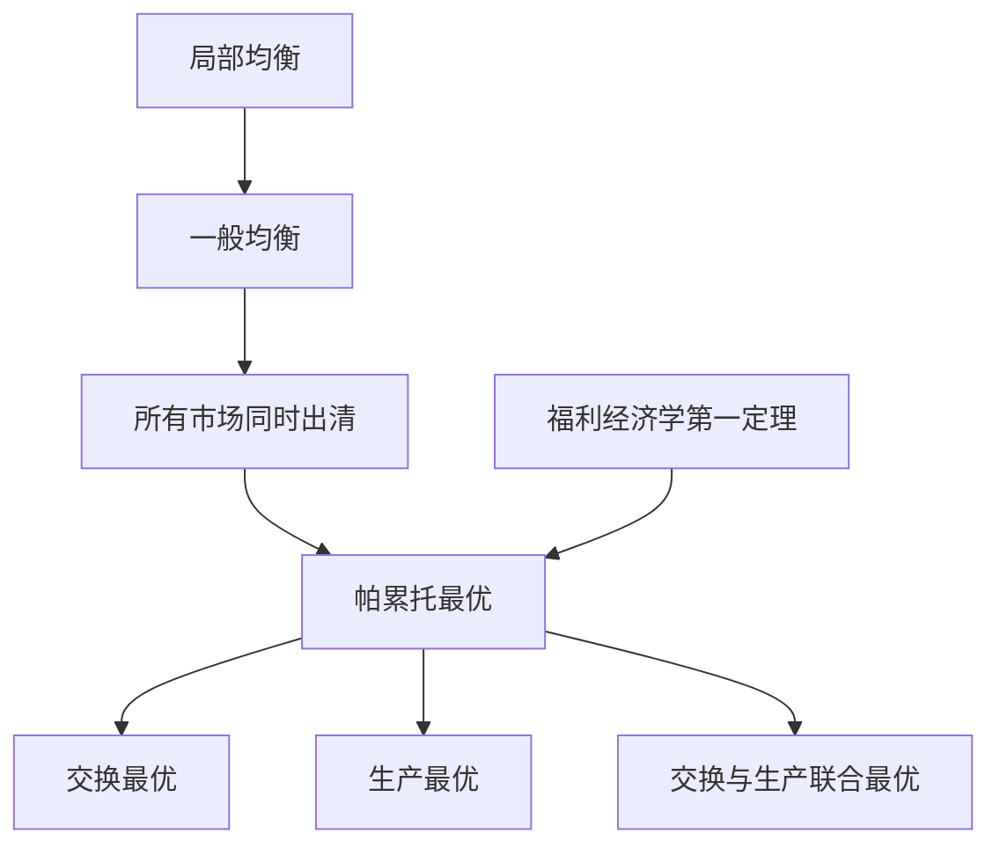

# 第七章 一般均衡与效率 章节总结

> 所属：[[../README|06 西方经济学]]

## 这一章在回答什么问题

前面我们每次只看一个市场（局部均衡）。但现实中，奶茶涨价会影响糖的需求、奶的供给、员工的工资……所有市场互相牵连。**能不能让所有市场同时达到均衡？这种状态下社会资源配置是最优的吗？**

## 核心概念清单

- **局部均衡**：单个市场单独看。
- **一般均衡**：所有市场同时达到均衡。
- **帕累托最优**：没人能更好而不损人。
- **福利经济学第一定理**：完全竞争均衡是帕累托最优。

## 框架图

## 本章 KP 列表

- [[KP01_局部均衡与一般均衡|KP01 局部均衡与一般均衡]]
- [[KP02_帕累托最优|KP02 帕累托最优]]
- [[KP03_交换的帕累托最优|KP03 交换的帕累托最优]]
- [[KP04_生产的帕累托最优|KP04 生产的帕累托最优]]

## 与前后章的关系

前面所有章节是局部均衡；本章把它们拼成完整拼图。第 8 章讲"什么情况下拼图会碎"（市场失灵）。
