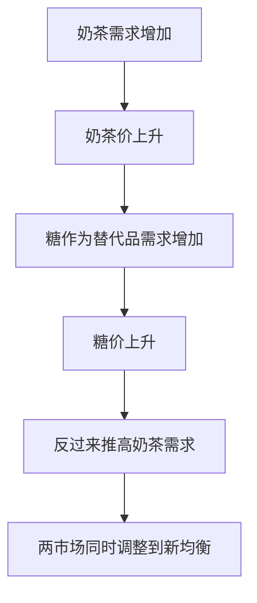

# KP01 局部均衡与一般均衡

<a href="../../../../exam.html" target="_blank" style="display:inline-block;padding:6px 16px;background:#2563eb;color:#fff;border-radius:6px;text-decoration:none;font-size:14px;">📝 开始做题</a>

> 所属：[[00_章节总结|第7章 一般均衡与效率]]

## 1. 一句话先懂（小白版）

- **局部均衡**：只看奶茶市场，假设糖、奶、工资都不变。
- **一般均衡**：奶茶涨价 → 糖需求涨 → 糖涨价 → 奶农收入变 → 奶茶工人要求涨工资 → 奶茶成本再涨……所有市场一起调整。

## 2. 严格定义

**局部均衡（Partial Equilibrium）**：在假定其他市场不变的情况下，单独分析某一市场的价格和产量决定。

**一般均衡（General Equilibrium）**：所有市场同时达到均衡，所有商品的价格和产量同时被决定。

## 3. 为什么（原理/机制）

现实中市场互相牵连：
- 产品市场之间（替代品、互补品）。
- 产品市场与要素市场（奶茶涨价 → 奶农收入变 → 奶茶工人工资变）。
- 要素市场之间（工资变 → 其他行业用工变）。

## 4. 怎么用（手把手算，一个简化例子）

**场景**：经济只有两个市场——奶茶和糖。

**第一步**：奶茶市场需求 $Q_m = 100 - P_m + 0.5 P_s$，供给 $Q_m = P_m$。
- $P_s$ 是糖价（糖是互补品，糖价涨奶茶需求降）。

**第二步**：糖市场需求 $Q_s = 50 - P_s + 0.2 P_m$，供给 $Q_s = P_s$。

**第三步**：两市场同时出清。

奶茶市场：$100 - P_m + 0.5 P_s = P_m \Rightarrow 2P_m = 100 + 0.5P_s \Rightarrow P_m = 50 + 0.25P_s$

糖市场：$50 - P_s + 0.2P_m = P_s \Rightarrow 2P_s = 50 + 0.2P_m \Rightarrow P_s = 25 + 0.1P_m$

**第四步**：联立求解。
代入：$P_s = 25 + 0.1(50 + 0.25P_s) = 25 + 5 + 0.025P_s = 30 + 0.025P_s$
$0.975P_s = 30 \Rightarrow P_s = 30.77$
$P_m = 50 + 0.25 \times 30.77 = 57.69$

**结论**：一般均衡下奶茶价 57.69，糖价 30.77。

## 理论推导（一步步推）

> 本节补充：一般均衡为什么要"所有市场同时出清"，以及联立方程怎么解。

**假设起点**：
1. 经济有 N 种商品，价格向量 $P = (p_1, p_2, ..., p_N)$。
2. 每种商品的总需求 $D_i(P)$ 和总供给 $S_i(P)$ 都是所有价格的函数（互相牵连）。
3. 一般均衡要求所有市场同时出清：$D_i(P) = S_i(P)$ 对所有 i 成立。

**推导过程**：
- 第一步：写出超额需求 $Z_i(P) = D_i(P) - S_i(P)$。
- 第二步：一般均衡条件 $Z_i(P) = 0$ 对所有 i。
- 第三步：瓦尔拉斯定律——所有超额需求的市场总值为零 $\sum p_i Z_i(P) = 0$。这意味着只要 N-1 个市场出清，第 N 个自动出清。
- 第四步：价格以"一般购买力"为单位（可任意缩放），所以真正需要决定的是 N-1 个相对价格。
- 结论：一般均衡是 N-1 个方程、N-1 个未知数（相对价格）的联立系统，在一定条件下存在解。

## 数学推导（公式怎么来的）

> 每个符号第一次出现必须解释。

**两市场一般均衡的标准解**（以奶茶 m 和糖 s 为例）：

设奶茶需求 $Q_m^d = a_0 - a_1 p_m + a_2 p_s$，奶茶供给 $Q_m^s = b_0 + b_1 p_m$。糖需求 $Q_s^d = c_0 - c_1 p_s + c_2 p_m$，糖供给 $Q_s^s = d_0 + d_1 p_s$。

**第一步：写出两个出清方程**
$$a_0 - a_1 p_m + a_2 p_s = b_0 + b_1 p_m$$
$$c_0 - c_1 p_s + c_2 p_m = d_0 + d_1 p_s$$

**第二步：整理为线性方程组**
$$(a_1+b_1)p_m - a_2 p_s = a_0 - b_0$$
$$-c_2 p_m + (c_1+d_1)p_s = c_0 - d_0$$

**第三步：克莱姆法则求解**

系数矩阵的行列式 $\Delta = (a_1+b_1)(c_1+d_1) - a_2 c_2$。

$$p_m^* = \frac{(a_0-b_0)(c_1+d_1) + a_2(c_0-d_0)}{\Delta}$$
$$p_s^* = \frac{(a_1+b_1)(c_0-d_0) + c_2(a_0-b_0)}{\Delta}$$

**第四步：比较静态**（糖需求增加如何影响奶茶价）

若糖需求截距 $c_0$ 上升：
$$\frac{\partial p_m^*}{\partial c_0} = \frac{a_2}{\Delta}$$

- 若 $a_2 > 0$（替代品）：糖需求增加 → 糖价涨 → 奶茶需求也涨 → 奶茶价涨。
- 若 $a_2 < 0$（互补品）：糖需求增加 → 糖价涨 → 奶茶需求减少 → 奶茶价跌。

**生活实例**：2020 年口罩需求暴增。局部均衡只看口罩市场，价格从 1 元涨到 5 元。一般均衡还要看：熔喷布需求暴增 → 熔喷布价涨 → 口罩成本上升 → 服装厂转产熔喷布 → 服装供给减少 → 服装价涨。一个市场的冲击涟漪式传导到所有关联市场。

## 5. 现实意义

- 为啥油价上涨会推高所有物价？一般均衡效应——油是运输成本，运输成本涨所有商品都涨。
- 为啥加息会打压房价？利率是资本价格，影响所有投资市场。
- 为啥疫情封城时奶茶店倒闭，但糖价也跌？联动效应。

---

## 🔗 相关知识点

**同章关联：** [[KP02_帕累托最优|帕累托最优]]

**跨章关联：** [[../../01_需求供给与均衡价格/知识点/KP03_均衡价格与供求变动|局部均衡]]

**📖 原书原文：** [[../../../../原文件/经济学/西方经济学上册_微观_全书|原书·第七章第一节]]

---

## 🐮 小白教程入门

> 看不懂下面这个KP？先看通俗版教程建立直觉：

- [[../../../../经济统计学论文从0基础到精通/13_微观经济学基础/09_完全竞争市场是什么|🐮 教程·完全竞争市场是什么（相关延伸）]]
- [[../../../../经济统计学论文从0基础到精通/13_微观经济学基础/12_外部性与公共品是什么|🐮 教程·外部性与公共品是什么（相关延伸）]]

---

## 📝 考研真题（首经贸 801）

**配套主观题：** 见同目录 [[../考研真题集|本章考研真题集]]
**配套选择题：** 见同目录 [[../选择题集|本章选择题集]]

### 高频简答
- 简述局部均衡与一般均衡的区别，并说明两者的联系 → 见 [[../考研真题集#s1|真题集·简答 1]]
- 为什么说完全竞争市场的一般均衡是帕累托最优 → 见 [[../考研真题集#s10|真题集·简答 10]]

### 高频论述
- 结合"双循环"新发展格局，论述一般均衡理论对理解国内市场联动与产业政策的意义 → 见 [[../考研真题集#l1|真题集·论述 1]]

### 易错选择
- 本知识点选择题见 [[../选择题集#KP01 局部均衡与一般均衡|选择题集·KP01]]
