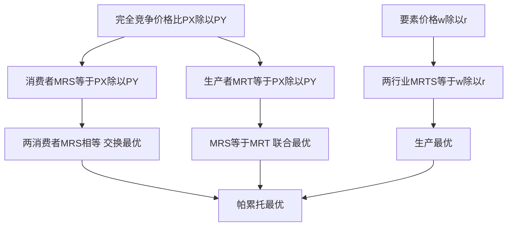

# KP02 帕累托最优

<a href="../../../../exam.html" target="_blank" style="display:inline-block;padding:6px 16px;background:#2563eb;color:#fff;border-radius:6px;text-decoration:none;font-size:14px;">📝 开始做题</a>

> 所属：[[00_章节总结|第7章 一般均衡与效率]]

## 1. 一句话先懂（小白版）

**帕累托最优**：资源分配到"已经没法让一个人更好而不损害另一个人"的程度。如果还能让小王多喝一杯奶茶而不让小李少喝，那现在就不是帕累托最优。

## 2. 严格定义

**帕累托改进（Pareto Improvement）**：某种变化让至少一个人变好，而不损害任何人。

**帕累托最优（Pareto Optimum）**：不存在任何帕累托改进的状态。

**帕累托最优的三个条件**：
1. **交换最优**：两个消费者的 MRS 相等。
2. **生产最优**：两个生产者的 MRTS 相等。
3. **交换与生产联合最优**：MRT = MRS。

## 3. 福利经济学两大定理

**第一定理**：完全竞争市场的一般均衡是帕累托最优。
**第二定理**：任何帕累托最优配置，都可以通过初始禀赋的再分配 + 完全竞争市场来实现。

## 4. 怎么用（手把手算）

**场景**：小王和小李分 10 杯奶茶、10 块炸鸡。

- 状态 A：小王 10 奶茶 0 炸鸡，小李 0 奶茶 10 炸鸡。
- 小王的 MRS = 5（愿意用 5 炸鸡换 1 奶茶）。
- 小李的 MRS = 1（愿意用 1 炸鸡换 1 奶茶）。

**判断**：MRS 不相等 → 存在帕累托改进。

**改进**：小王给小李 2 炸鸡，小李给小王 1 奶茶。
- 小王多 1 奶茶、少 2 炸鸡：效用变化 = +1×5 - 2×1 = +3（变好）。
- 小李少 1 奶茶、多 2 炸鸡：效用变化 = -1×1 + 2×1 = +1（变好）。

两人都变好 → 状态 A 不是帕累托最优。

## 理论推导（一步步推）

> 本节补充：帕累托最优的三个条件（交换、生产、联合）怎么从消费者和生产者的最优化行为推出来。

**假设起点**：
1. 经济有两个消费者 A、B，两种商品 X、Y，两种要素 L、K。
2. 消费者效用最大化 $MRS_{XY}^i = P_X/P_Y$（完全竞争下）。
3. 生产者成本最小化 $MRTS_{LK}^j = w/r$（完全竞争下）。
4. 生产者利润最大化 $MRT_{XY} = MC_X/MC_Y = P_X/P_Y$（完全竞争下）。

**推导过程**：
- 第一步（交换最优）：完全竞争下所有消费者面对同一价格比 $P_X/P_Y$，各自效用最大化要求 $MRS_{XY}^A = P_X/P_Y = MRS_{XY}^B$。所以 $MRS^A = MRS^B$ 自动成立。
- 第二步（生产最优）：完全竞争下所有生产者面对同一要素价格比 $w/r$，各自成本最小化要求 $MRTS_{LK}^X = w/r = MRTS_{LK}^Y$。所以 $MRTS^X = MRTS^Y$ 自动成立。
- 第三步（联合最优）：生产者利润最大化要求 $MRT_{XY} = MC_X/MC_Y$。完全竞争长期均衡 $P = MC$，所以 $MRT = P_X/P_Y$。而消费者 $MRS = P_X/P_Y$。故 $MRS = MRT$。
- 结论：完全竞争市场的一般均衡自动满足帕累托最优三条件——这就是福利经济学第一定理。

**反方向**（福利经济学第二定理）：任何帕累托最优点（MRS^A=MRS^B、MRTS^X=MRTS^Y、MRS=MRT）都对应一组价格比，只要初始禀赋调整到该点附近，完全竞争市场就能到达。

## 数学推导（公式怎么来的）

> 每个符号第一次出现必须解释。

**交换最优的数学表达**：

设总禀赋 $X = \bar X$、$Y = \bar Y$。消费者 A 效用 $U_A(X_A, Y_A)$，消费者 B 效用 $U_B(X_B, Y_B)$，其中 $X_B = \bar X - X_A$、$Y_B = \bar Y - Y_A$。

固定 B 的效用在某一水平 $\bar U_B$，最大化 A 的效用：
$$\max U_A(X_A, Y_A) \quad \text{s.t.} \quad U_B(\bar X-X_A, \bar Y-Y_A) = \bar U_B$$

构造拉格朗日：
$$\mathcal{L} = U_A(X_A, Y_A) - \lambda[U_B(\bar X-X_A, \bar Y-Y_A) - \bar U_B]$$

一阶条件：
$$\frac{\partial\mathcal{L}}{\partial X_A} = \frac{\partial U_A}{\partial X_A} - \lambda\frac{\partial U_B}{\partial X_B} = 0$$
$$\frac{\partial\mathcal{L}}{\partial Y_A} = \frac{\partial U_A}{\partial Y_A} - \lambda\frac{\partial U_B}{\partial Y_B} = 0$$

两式相除：
$$\frac{\partial U_A/\partial X_A}{\partial U_A/\partial Y_A} = \frac{\partial U_B/\partial X_B}{\partial U_B/\partial Y_B}$$

即 $MRS_{XY}^A = MRS_{XY}^B$。证毕。

**生产最优的数学表达**：

类似地，固定 Y 行业产量 $\bar Q_Y$，最大化 X 行业产量 $Q_X = f_X(L_X, K_X)$，约束 $L_Y = \bar L - L_X$、$K_Y = \bar K - K_X$。

一阶条件给出 $MRTS_{LK}^X = MRTS_{LK}^Y$。

**联合最优的数学表达**：

PPF 方程 $Q_Y = T(Q_X)$（给定 $Q_X$ 时最大可能的 $Q_Y$）。帕累托最优要求同时最大化消费者效用 $U(Q_X, Q_Y)$：
$$\max U(Q_X, Q_Y) \quad \text{s.t.} \quad Q_Y = T(Q_X)$$

一阶条件：
$$\frac{dU}{dQ_X} + \frac{dU}{dQ_Y}\cdot T'(Q_X) = 0$$
$$-\frac{T'(Q_X)}{1} = \frac{dU/dQ_X}{dU/dQ_Y}$$

左边 $-T'(Q_X) = MRT_{XY}$（多生产一单位 X 放弃的 Y），右边 $= MRS_{XY}$。故 $MRT = MRS$。

**图形说明**：埃奇沃思盒内，两消费者无差异曲线切点轨迹是契约曲线（交换最优）；两行业等产量曲线切点轨迹是生产契约曲线（生产最优）；PPF 上 MRT 与无差异曲线 MRS 相切（联合最优）。

**生活实例**：
- 交换最优：小王和小李换奶茶炸鸡，直到两人觉得"1 杯奶茶值几块炸鸡"一样。
- 生产最优：奶茶店和炸鸡厂分工人机器，直到两厂觉得"1 个工人值几台机器"一样。
- 联合最优：社会生产的奶茶炸鸡比例，正好等于大家想吃的比例。

## 5. 现实意义

- 为啥自由贸易是帕累托改进？两国都能消费更多。
- 为啥关税不是帕累托最优？政府和生产者赚，消费者亏。
- 为啥"做大蛋糕"和"分蛋糕"要分开？第一定理说竞争能做大蛋糕（效率），第二定理说初始分配决定公平。

---

## 🔗 相关知识点

**同章关联：** [[KP01_局部均衡与一般均衡|一般均衡]] ｜ [[KP03_交换的帕累托最优|交换最优]]

**跨章关联：** [[../../08_市场失灵与微观经济政策/知识点/KP02_外部性|外部性破坏帕累托最优]]

**📖 原书原文：** [[../../../../原文件/经济学/西方经济学上册_微观_全书#第二节 竞争性均衡与经济效率|原书·第七章第二节]]

---

## 🐮 小白教程入门

> 看不懂下面这个KP？先看通俗版教程建立直觉：

- [[../../../../经济统计学论文从0基础到精通/13_微观经济学基础/09_完全竞争市场是什么|🐮 教程·完全竞争市场是什么（相关延伸）]]
- [[../../../../经济统计学论文从0基础到精通/13_微观经济学基础/12_外部性与公共品是什么|🐮 教程·外部性与公共品是什么（相关延伸）]]

---

## 📝 考研真题（首经贸 801）

**配套主观题：** 见同目录 [[../考研真题集|本章考研真题集]]
**配套选择题：** 见同目录 [[../选择题集|本章选择题集]]

### 高频简答
- 简述帕累托最优与帕累托改进的含义 → 见 [[../考研真题集#s2|真题集·简答 2]]
- 简述福利经济学第一定理及其政策含义 → 见 [[../考研真题集#s6|真题集·简答 6]]
- 简述福利经济学第二定理及其与第一定理的区别 → 见 [[../考研真题集#s7|真题集·简答 7]]

### 高频论述
- 结合共同富裕与房地产税改革，论述福利经济学第二定理对中国再分配政策的启示 → 见 [[../考研真题集#l3|真题集·论述 3]]

### 易错选择
- 本知识点选择题见 [[../选择题集#KP02 帕累托最优|选择题集·KP02]]
