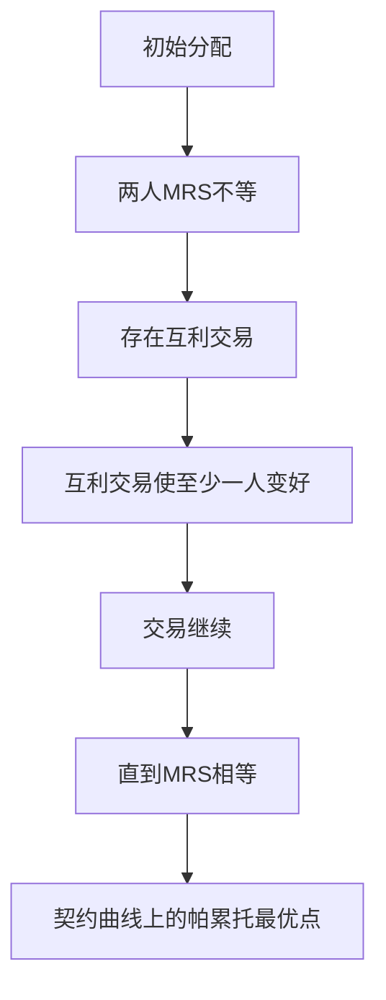

# KP03 交换的帕累托最优

<a href="../../../../exam.html" target="_blank" style="display:inline-block;padding:6px 16px;background:#2563eb;color:#fff;border-radius:6px;text-decoration:none;font-size:14px;">📝 开始做题</a>

> 所属：[[00_章节总结|第7章 一般均衡与效率]]

## 1. 一句话先懂（小白版）

小王和小李手里有奶茶和炸鸡。如果小王觉得"1 杯奶茶 = 5 块炸鸡"，小李觉得"1 杯奶茶 = 1 块炸鸡"，那两人做笔交易（小王给炸鸡换奶茶）就都变好。**直到两人对奶茶和炸鸡的"主观交换率"相等，交易才停止——这就是交换的帕累托最优。**

## 2. 严格定义

**交换的帕累托最优条件**：任意两个消费者对任意两种商品的边际替代率相等。

$$MRS_{XY}^A = MRS_{XY}^B$$

**几何工具**：埃奇沃思盒状图（Edgeworth Box）——横轴总奶茶量，纵轴总炸鸡量，盒内任一点是两人的分配。两人无差异曲线的切点轨迹叫**契约曲线（Contract Curve）**，上面每一点都是交换帕累托最优点。

## 3. 怎么用（手把手算）

**场景**：总奶茶 10 杯，总炸鸡 10 块。

- 小王效用函数 $U_A = Q_{mA} Q_{cA}$，$MRS_A = Q_{cA}/Q_{mA}$。
- 小李效用函数 $U_B = Q_{mB} Q_{cB}$，$MRS_B = Q_{cB}/Q_{mB}$。

**第一步**：交换最优条件 $MRS_A = MRS_B$：
$$\frac{Q_{cA}}{Q_{mA}} = \frac{Q_{cB}}{Q_{mB}}$$

**第二步**：代入总量约束。
- $Q_{mB} = 10 - Q_{mA}$
- $Q_{cB} = 10 - Q_{cA}$

$$\frac{Q_{cA}}{Q_{mA}} = \frac{10 - Q_{cA}}{10 - Q_{mA}}$$

**第三步**：交叉相乘。
$$Q_{cA}(10 - Q_{mA}) = Q_{mA}(10 - Q_{cA})$$
$$10Q_{cA} - Q_{cA}Q_{mA} = 10Q_{mA} - Q_{mA}Q_{cA}$$
$$10Q_{cA} = 10Q_{mA}$$
$$Q_{cA} = Q_{mA}$$

**结论**：契约曲线是对角线——小王的奶茶 = 炸鸡，小李的也一样。

## 理论推导（一步步推）

> 本节补充：为什么交换的帕累托最优要求两人 MRS 相等，以及不等时怎么改进。

**假设起点**：
1. 两个消费者 A、B，两种商品 X、Y，总量固定 $\bar X$、$\bar Y$。
2. 分配 $(X_A, Y_A)$ 和 $(X_B, Y_B) = (\bar X - X_A, \bar Y - Y_A)$。
3. 已知当前分配下两人 MRS 不等：$MRS_{XY}^A > MRS_{XY}^B$。

**推导过程**：
- 第一步：解释 MRS 含义。$MRS_{XY}^A$ 是 A 愿意用多少 Y 换一单位 X（主观交换率）。
- 第二步：若 $MRS_A = 5$（A 觉得 1 杯 X 值 5 单位 Y），$MRS_B = 1$（B 觉得 1 杯 X 值 1 单位 Y）。
- 第三步：A 看重 X、B 看重 Y（相对而言）。让 A 给 B 一些 Y，B 给 A 一些 X。
- 第四步：具体交易——B 给 A 1 单位 X，A 给 B 2 单位 Y。
  - A：多 1 单位 X（值 5）、少 2 单位 Y（损失 2）→ 净效用变化 +3（变好）。
  - B：少 1 单位 X（损失 1）、多 2 单位 Y（获益 2）→ 净效用变化 +1（变好）。
- 第五步：两人都变好 → 当前分配不是帕累托最优。
- 第六步：交易继续直到 $MRS_A = MRS_B$。此时任何交易都至少损害一方。
- 结论：交换的帕累托最优条件是 $MRS_A = MRS_B$。

**几何意义**：埃奇沃思盒内，两人无差异曲线相切的点（MRS 相等）是帕累托最优点；所有切点连成契约曲线。

## 数学推导（公式怎么来的）

> 每个符号第一次出现必须解释。

**推导 MRS 相等的一阶条件**：

固定 B 的效用在 $\bar U_B$，最大化 A 的效用：
$$\max_{X_A, Y_A} U_A(X_A, Y_A)$$
$$\text{s.t.} \quad U_B(\bar X - X_A, \bar Y - Y_A) = \bar U_B$$

构造拉格朗日：
$$\mathcal{L} = U_A(X_A, Y_A) - \lambda\left[U_B(\bar X-X_A, \bar Y-Y_A) - \bar U_B\right]$$

对 $X_A$、$Y_A$ 求偏导：
$$\frac{\partial\mathcal{L}}{\partial X_A} = \frac{\partial U_A}{\partial X_A} - \lambda\cdot\frac{\partial U_B}{\partial X_B} = 0 \quad (1)$$
$$\frac{\partial\mathcal{L}}{\partial Y_A} = \frac{\partial U_A}{\partial Y_A} - \lambda\cdot\frac{\partial U_B}{\partial Y_B} = 0 \quad (2)$$

(1)/(2) 消去 λ：
$$\frac{\partial U_A/\partial X_A}{\partial U_A/\partial Y_A} = \frac{\partial U_B/\partial X_B}{\partial U_B/\partial Y_B}$$

左边 $= MRS_{XY}^A$（边际效用比），右边 $= MRS_{XY}^B$。故 $MRS_A = MRS_B$。

**契约曲线的方程**（以柯布-道格拉斯为例）：

设 $U_A = X_A^\alpha Y_A^{1-\alpha}$，则 $MRS_A = \frac{\alpha}{1-\alpha}\cdot\frac{Y_A}{X_A}$。
设 $U_B = X_B^\beta Y_B^{1-\beta}$，则 $MRS_B = \frac{\beta}{1-\beta}\cdot\frac{Y_B}{X_B}$。

令 $MRS_A = MRS_B$：
$$\frac{\alpha}{1-\alpha}\cdot\frac{Y_A}{X_A} = \frac{\beta}{1-\beta}\cdot\frac{Y_B}{X_B}$$

代入 $X_B = \bar X - X_A$、$Y_B = \bar Y - Y_A$：
$$\frac{\alpha}{1-\alpha}\cdot\frac{Y_A}{X_A} = \frac{\beta}{1-\beta}\cdot\frac{\bar Y-Y_A}{\bar X-X_A}$$

这是 $X_A$-$Y_A$ 平面上的一条曲线——契约曲线。特殊地，若 $\alpha = \beta$，契约曲线是对角线 $Y_A/X_A = \bar Y/\bar X$。

**图形说明**：埃奇沃思盒横轴 $\bar X$、纵轴 $\bar Y$。A 的原点在左下角，B 的原点在右上角。A 的无差异曲线凸向左下，B 的无差异曲线凸向右上。切点轨迹从 A 原点延伸到 B 原点——这就是契约曲线。契约曲线外的点（两曲线相交不切）存在帕累托改进。

**生活实例**：你和室友分披萨和可乐。你饿了（MRS：1 块披萨值 3 杯可乐），室友刚喝过可乐（MRS：1 块披萨值 0.5 杯可乐）。你给室友 2 杯可乐，室友给你 1 块披萨——你觉得赚了（披萨值 3 杯可乐，只给了 2 杯），室友也觉得赚了（多 2 杯可乐，只损失半块披萨）。继续换到两人觉得"1 块披萨值几杯可乐"一样为止。

## 4. 现实意义

- 为啥自由贸易能双赢？两国 MRS 不同，贸易让 MRS 趋同。
- 为啥电商撮合交易？让不同偏好的人互相交换，直到 MRS 相等。
- 为啥计划经济效率低？中央计划者不知道每个人的 MRS，分配不在契约曲线上。

---

## 🔗 相关知识点

**同章关联：** [[KP02_帕累托最优|帕累托最优]] ｜ [[KP04_生产的帕累托最优|生产最优]]

**跨章关联：** [[../../02_消费者选择/知识点/KP03_无差异曲线|无差异曲线]]

**📖 原书原文：** [[../../../../原文件/经济学/西方经济学上册_微观_全书#第二节 竞争性均衡与经济效率|原书·第七章第二节]]

---

## 🐮 小白教程入门

> 看不懂下面这个KP？先看通俗版教程建立直觉：

- [[../../../../经济统计学论文从0基础到精通/13_微观经济学基础/09_完全竞争市场是什么|🐮 教程·完全竞争市场是什么（相关延伸）]]
- [[../../../../经济统计学论文从0基础到精通/13_微观经济学基础/12_外部性与公共品是什么|🐮 教程·外部性与公共品是什么（相关延伸）]]

---

## 📝 考研真题（首经贸 801）

**配套主观题：** 见同目录 [[../考研真题集|本章考研真题集]]
**配套选择题：** 见同目录 [[../选择题集|本章选择题集]]

### 高频简答
- 试述交换的帕累托最优条件，并说明其几何含义 → 见 [[../考研真题集#s3|真题集·简答 3]]
- 计算题：两消费者效用函数给定，求交换契约曲线 → 见 [[../考研真题集#s8|真题集·简答 8]]
- 简述埃奇沃思盒状图与契约曲线的关系 → 见 [[../考研真题集#s9|真题集·简答 9]]

### 高频论述
- 结合"一带一路"与自由贸易，论述帕累托最优理论对理解国际贸易利益分配的意义 → 见 [[../考研真题集#l4|真题集·论述 4]]

### 易错选择
- 本知识点选择题见 [[../选择题集#KP03 交换的帕累托最优|选择题集·KP03]]
