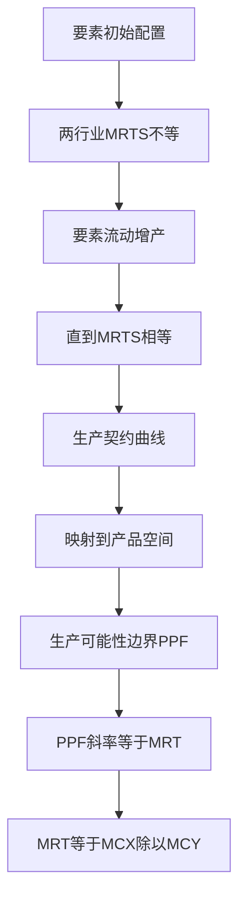

# KP04 生产的帕累托最优

<a href="../../../../exam.html" target="_blank" style="display:inline-block;padding:6px 16px;background:#2563eb;color:#fff;border-radius:6px;text-decoration:none;font-size:14px;">📝 开始做题</a>

> 所属：[[00_章节总结|第7章 一般均衡与效率]]

## 1. 一句话先懂（小白版）

两个行业（奶茶和炸鸡）分劳动和资本。如果奶茶行业觉得"1 个工人 = 2 台机器"，炸鸡行业觉得"1 个工人 = 4 台机器"，那把工人从炸鸡调到奶茶，社会总产量会上升。**直到两行业对"工人 vs 机器"的替代率相等，生产才最优。**

## 2. 严格定义

**生产的帕累托最优条件**：任意两个生产者对任意两种要素的边际技术替代率相等。

$$MRTS_{LK}^A = MRTS_{LK}^B$$

**几何工具**：同样用埃奇沃思盒，横轴总劳动，纵轴总资本。两行业等产量曲线的切点轨迹叫**生产契约曲线**。

## 3. 怎么用（手把手算）

**场景**：总劳动 100 人，总资本 100 台。

- 奶茶厂 $Q_m = L_m^{0.5} K_m^{0.5}$，$MRTS_m = K_m/L_m$。
- 炸鸡厂 $Q_c = L_c^{0.5} K_c^{0.5}$，$MRTS_c = K_c/L_c$。

**第一步**：最优条件 $MRTS_m = MRTS_c$：
$$\frac{K_m}{L_m} = \frac{K_c}{L_c}$$

**第二步**：代入总量。
- $L_c = 100 - L_m$
- $K_c = 100 - K_m$

$$\frac{K_m}{L_m} = \frac{100 - K_m}{100 - L_m}$$

**第三步**：解得 $K_m = L_m$。

**结论**：生产契约曲线也是对角线——奶茶厂的劳动 = 资本，炸鸡厂也一样。

## 理论推导（一步步推）

> 本节补充：为什么生产的帕累托最优要求两行业 MRTS 相等，以及 PPF 怎么从生产契约曲线推出。

**假设起点**：
1. 两行业 X、Y，两种要素 L、K，总量固定 $\bar L$、$\bar K$。
2. 要素分配 $(L_X, K_X)$ 和 $(L_Y, K_Y) = (\bar L - L_X, \bar K - K_X)$。
3. 当前分配下两行业 MRTS 不等：$MRTS_{LK}^X > MRTS_{LK}^Y$。

**推导过程**：
- 第一步：MRTS 含义。$MRTS_{LK}^X$ 是 X 行业愿意用多少 K 替代一单位 L（保持产量不变）。
- 第二步：若 $MRTS_X = 4$（X 厂觉得 1 个工人值 4 台机器），$MRTS_Y = 2$（Y 厂觉得 1 个工人值 2 台机器）。
- 第三步：X 厂更"看重"劳动（相对 K）。把 1 个工人从 Y 调到 X，同时把 3 台机器从 X 调到 Y。
  - X 厂：多 1 工人（值 4 台机器）、少 3 台机器（损失 3）→ 产量净增加。
  - Y 厂：少 1 工人（损失 2 台机器的量）、多 3 台机器（获益 3）→ 产量净增加。
- 第四步：两行业产量都增加 → 当前配置不是生产帕累托最优。
- 第五步：要素流动继续直到 $MRTS_X = MRTS_Y$。
- 结论：生产帕累托最优条件是 $MRTS_{LK}^X = MRTS_{LK}^Y$。

**PPF 的推导**：生产契约曲线上每一点 $(L_X, K_X)$ 对应 X 产量 $Q_X = f_X(L_X, K_X)$、Y 产量 $Q_Y = f_Y(\bar L-L_X, \bar K-K_X)$。把这些 $(Q_X, Q_Y)$ 组合画在坐标系中，就是 PPF——社会能生产的最大产品组合。

## 数学推导（公式怎么来的）

> 每个符号第一次出现必须解释。

**MRTS 相等的一阶条件**：

固定 Y 行业产量 $\bar Q_Y$，最大化 X 行业产量：
$$\max_{L_X, K_X} Q_X = f_X(L_X, K_X)$$
$$\text{s.t.} \quad f_Y(\bar L-L_X, \bar K-K_X) = \bar Q_Y$$

构造拉格朗日：
$$\mathcal{L} = f_X(L_X, K_X) - \lambda[f_Y(\bar L-L_X, \bar K-K_X) - \bar Q_Y]$$

对 $L_X$、$K_X$ 求偏导：
$$\frac{\partial f_X}{\partial L_X} - \lambda\cdot\frac{\partial f_Y}{\partial L_Y} = 0$$
$$\frac{\partial f_X}{\partial K_X} - \lambda\cdot\frac{\partial f_Y}{\partial K_Y} = 0$$

两式相除：
$$\frac{\partial f_X/\partial L_X}{\partial f_X/\partial K_X} = \frac{\partial f_Y/\partial L_Y}{\partial f_Y/\partial K_Y}$$

左边 $= MRTS_{LK}^X = MP_L^X/MP_K^X$，右边 $= MRTS_{LK}^Y$。故 $MRTS^X = MRTS^Y$。

**PPF 与 MRT 的推导**：

PPF 方程 $Q_Y = T(Q_X)$。沿 PPF 移动：
$$dQ_Y = T'(Q_X)\,dQ_X$$

边际转换率：
$$MRT_{XY} = -\frac{dQ_Y}{dQ_X} = -T'(Q_X)$$

**MRT 等于边际成本之比**：

沿 PPF，要素从 X 转到 Y。多生产 $dQ_X$ 的 X 需要 $dL_X$ 劳动，成本 $MC_X\cdot dQ_X = w\cdot dL_X$。少生产 $dQ_Y$ 的 Y 释放 $dL_Y$ 劳动，节省 $MC_Y\cdot |dQ_Y| = w\cdot dL_Y$。

要素总量不变 $dL_X = dL_Y$，故：
$$\frac{MC_X}{MC_Y} = \frac{|dQ_Y|}{dQ_X} = MRT_{XY}$$

**柯布-道格拉斯下的 PPF**：

设 $Q_X = L_X^{0.5}K_X^{0.5}$，$Q_Y = L_Y^{0.5}K_Y^{0.5}$，$\bar L = \bar K = 100$。

生产帕累托最优要求 $K_X/L_X = K_Y/L_Y$。代入约束解得生产契约曲线是对角线 $K_X = L_X$。

沿对角线：$Q_X = L_X$（因 $K_X = L_X$），$Q_Y = L_Y = 100 - L_X = 100 - Q_X$。

故 PPF 方程：
$$Q_Y = 100 - Q_X$$

是直线，MRT = 1（常数）。这是因为两行业规模报酬不变且要素密集度相同。

**图形说明**：左图埃奇沃思盒（要素配置），右图 PPF（产品组合）。生产契约曲线左图上每一点映射到右图 PPF 上一点。PPF 凹向原点（机会成本递增）。

**生活实例**：
- 户籍限制使农村和城市 MRTS 不等：农村劳动多、边际产量低；城市劳动少、边际产量高。放开户籍→农民进城→两行业 MRTS 趋同→全国总产量上升。
- 中美贸易：中国劳动密集（MRTS 中 K/L 低）、美国资本密集。各自生产优势产品再交换，社会总产品组合在 PPF 之外（贸易利益）。

## 4. 生产可能性边界（PPF）

从生产契约曲线可以推出**生产可能性边界**——社会能生产的奶茶和炸鸡最大组合。

**边际转换率（MRT）**：多生产一单位奶茶要放弃的炸鸡数量：
$$MRT = -\frac{\Delta Q_c}{\Delta Q_m} = \frac{MC_m}{MC_c}$$

## 5. 交换与生产联合最优

最终条件：
$$MRS = MRT$$

即消费者主观替代率 = 生产者技术转换率。此时社会达到完全帕累托最优。

## 6. 现实意义

- 为啥劳动力要自由流动？让不同行业 MRTS 趋同，总产量最大。
- 为啥户籍限制降低效率？劳动不能自由流动，MRTS 不相等。
- 为啥中美贸易双赢？中国劳动密集、美国资本密集，各自生产优势产品再交换。

---

## 🔗 相关知识点

**同章关联：** [[KP02_帕累托最优|帕累托最优]] ｜ [[KP03_交换的帕累托最优|交换最优]]

**跨章关联：** [[../../03_生产与成本/知识点/KP03_等产量曲线与边际技术替代率|等产量曲线]]

**📖 原书原文：** [[../../../../原文件/经济学/西方经济学上册_微观_全书|原书·第七章第二节]]

---

## 🐮 小白教程入门

> 看不懂下面这个KP？先看通俗版教程建立直觉：

- [[../../../../经济统计学论文从0基础到精通/13_微观经济学基础/09_完全竞争市场是什么|🐮 教程·完全竞争市场是什么（相关延伸）]]
- [[../../../../经济统计学论文从0基础到精通/13_微观经济学基础/12_外部性与公共品是什么|🐮 教程·外部性与公共品是什么（相关延伸）]]

---

## 📝 考研真题（首经贸 801）

**配套主观题：** 见同目录 [[../考研真题集|本章考研真题集]]
**配套选择题：** 见同目录 [[../选择题集|本章选择题集]]

### 高频简答
- 试述生产的帕累托最优条件 → 见 [[../考研真题集#s4|真题集·简答 4]]
- 试述交换与生产联合的帕累托最优条件（MRT = MRS） → 见 [[../考研真题集#s5|真题集·简答 5]]

### 高频论述
- 结合户籍制度改革与劳动力自由流动，论述生产的帕累托最优对资源配置效率的意义 → 见 [[../考研真题集#l2|真题集·论述 2]]
- 结合"一带一路"与自由贸易，论述帕累托最优理论对理解国际贸易利益分配的意义 → 见 [[../考研真题集#l4|真题集·论述 4]]

### 易错选择
- 本知识点选择题见 [[../选择题集#KP04 生产的帕累托最优|选择题集·KP04]]
