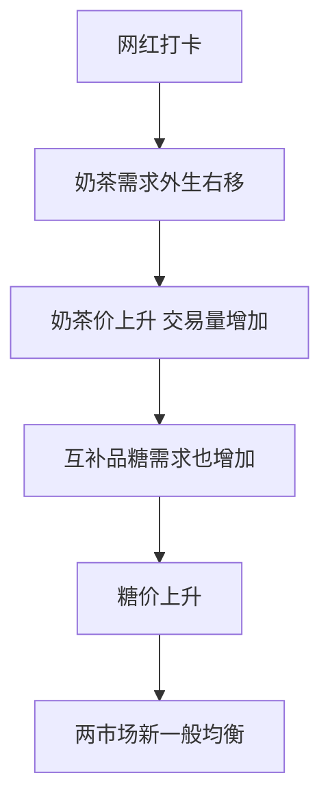
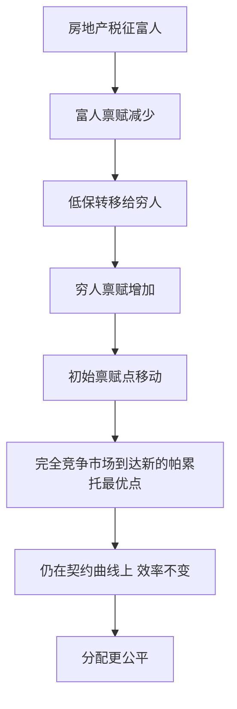
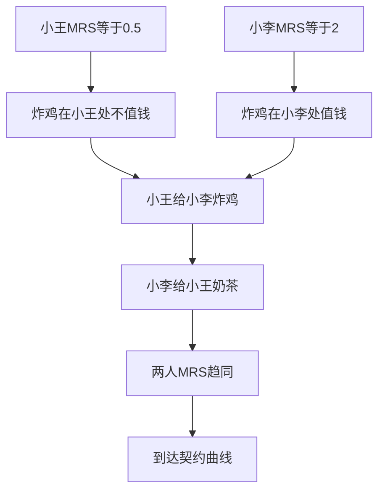
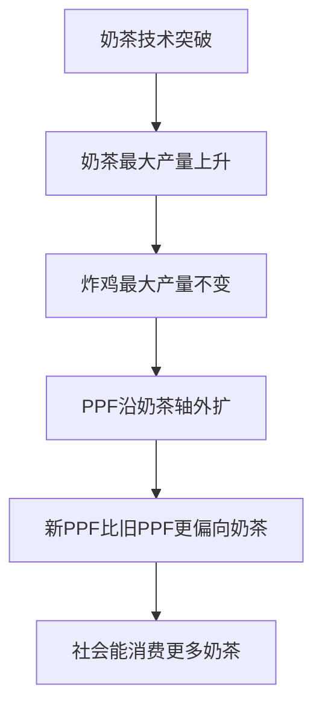

# 第 7 章 一般均衡与效率 · 选择题集（首经贸 801 巩固用）

<a href="../../../exam.html" target="_blank" style="display:inline-block;padding:6px 16px;background:#2563eb;color:#fff;border-radius:6px;text-decoration:none;font-size:14px;">📝 开始做题</a>

> 每个知识点 9 道单选，共 36 道。
> 题目方向：概念辨析、公式计算、易混淆点、反向考法。
> 配套主观题见 [[考研真题集|本章考研真题集]]

## 📋 目录
- [[#KP01 局部均衡与一般均衡|KP01]] — 9 题
- [[#KP02 帕累托最优|KP02]] — 9 题
- [[#KP03 交换的帕累托最优|KP03]] — 9 题
- [[#KP04 生产的帕累托最优|KP04]] — 9 题

---

## KP01 局部均衡与一般均衡（[[知识点/KP01_局部均衡与一般均衡|回知识点]]）

**1. 局部均衡分析的代表人物是（ ）**
A. 瓦尔拉斯
B. 马歇尔
C. 凯恩斯
D. 李嘉图

> **✅ 答案：B**
> **解析：** 马歇尔是局部均衡奠基人；瓦尔拉斯是一般均衡奠基人。

**2. 一般均衡分析的核心问题是（ ）**
A. 单一市场价格决定
B. 所有市场同时出清的价格体系是否存在
C. 货币供应量决定
D. 经济增长动力

> **✅ 答案：B**
> **解析：** 瓦尔拉斯一般均衡理论研究是否存在一组价格使所有产品与要素市场同时供求相等。

**3. 局部均衡分析假定（ ）**
A. 其他市场价格与供求不变
B. 所有市场相互影响
C. 货币供给外生
D. 预期完全理性

> **✅ 答案：A**
> **解析：** 局部均衡"假定其他条件不变"，单独分析一个市场。

**4. 石油价格上涨推高所有商品价格，这一现象最适合用（ ）分析**
A. 局部均衡
B. 一般均衡
C. 福利经济学
D. 博弈论

> **✅ 答案：B**
> **解析：** 石油作为中间投入品，价格变动通过运输、生产成本传导到所有市场，是一般均衡效应。

**5. 下列哪种情况不属于市场间的相互依存关系（ ）**
A. 奶茶涨价引起糖需求变动
B. 工资变动影响消费品需求
C. 政府财政政策影响总需求
D. 某企业内部排班调整

> **✅ 答案：D**
> **解析：** 企业内部排班是微观管理决策，不涉及市场间联动。

**6. 一般均衡理论的方法论特征是（ ）**
A. 局部均衡加总
B. 联立方程组求解
C. 成本收益分析
D. 统计回归

> **✅ 答案：B**
> **解析：** 一般均衡用 n 个市场的供求方程联立求解 n 个价格。

**7. 下列关于局部均衡与一般均衡的说法，错误的是（ ）**
A. 局部均衡是一般均衡的简化
B. 一般均衡强调市场间联动
C. 局部均衡在任何情况下都劣于一般均衡
D. 货币政策研究通常需要一般均衡视角

> **✅ 答案：C**
> **解析：** 当市场间联系较弱时，局部均衡是良好近似，并非"任何情况下都劣于"。

**8. 疫情封城期间，奶茶店倒闭与糖价下跌同时发生，体现了（ ）**
A. 局部均衡
B. 一般均衡联动
C. 货币中性
D. 理性预期

> **✅ 答案：B**
> **解析：** 奶茶需求崩溃→糖需求崩溃，是市场间联动。

**9. 一般均衡理论的开创性著作《纯粹经济学要义》作者是（ ）**
A. 马歇尔
B. 瓦尔拉斯
C. 帕累托
D. 希克斯

> **✅ 答案：B**
> **解析：** 瓦尔拉斯 1874 年出版《纯粹经济学要义》，创立一般均衡理论。

**10. （曲线移动·分析）奶茶和糖是互补品。若奶茶需求因网红打卡整体右移，在一般均衡框架下（　）**
A. 奶茶价上升，糖价也上升
B. 奶茶价上升，糖价下降
C. 奶茶价不变
D. 只有糖价变化

> **✅ 答案：A**
> **解析：** 互补品意味着糖需求函数中奶茶价格系数 $a_2 < 0$（奶茶价涨→糖需求降）。但网红打卡是奶茶需求外生右移（截距 $a_0$ 上升）→奶茶价先涨。奶茶价上涨通过互补关系使糖需求减少？不对——网红打卡是偏好变化，奶茶和糖一起消费。奶茶价上升沿糖需求曲线移动，但奶茶消费量增加直接使糖需求增加。
>
> 更准确：奶茶需求外生增加 → 奶茶价上升、奶茶交易量增加 → 对互补品糖的需求也增加 → 糖价上升。一般均衡下两市场价格同时上升。
>

>
> **数学推导**：用前面 KP01 的线性方程组。奶茶需求 $Q_m^d = a_0 - a_1 p_m + a_2 p_s$，互补品 $a_2 < 0$。网红打卡使 $a_0$ 增加 $\Delta a_0$。由克莱姆法则，$\partial p_m^*/\partial a_0 = (c_1+d_1)/\Delta > 0$，$\partial p_s^*/\partial a_0 = c_2/\Delta$。若 $c_2 > 0$（奶茶是糖的替代品）或糖与奶茶消费联动，糖价也上升。
>
> **生活实例**：喜茶联名甄嬛传爆火，奶茶销量翻倍。连带糖、奶、珍珠的需求量都上升，批发市场上白糖价格一周涨了 5%。

**11. （曲线移动·判断）两市场一般均衡中，若外生冲击使奶茶供给整体左移（如茶叶涨价），则（　）**
A. 奶茶价上升、交易量减少；糖作为互补品需求也减少、糖价下降
B. 奶茶价下降
C. 糖价上升
D. 两市场都不变

> **✅ 答案：A**
> **解析：** 茶叶涨价是奶茶供给冲击，奶茶供给曲线左移 → 奶茶价上升、交易量减少。因为奶茶和糖互补，奶茶消费量减少连带糖需求减少 → 糖价下降。
>
> **生活实例**：2021 年纸吸管成本暴涨，奶茶普遍涨价 1-2 元。奶茶消费量下降，连带全糖奶茶里的黑糖原料需求下降，云南黑糖产地收购价跌了 10%。

---

## KP02 帕累托最优（[[知识点/KP02_帕累托最优|回知识点]]）

**1. 帕累托改进是指（ ）**
A. 所有人境况同时改善
B. 至少一人境况改善且无人受损
C. 社会福利总量增加
D. 收入分配更公平

> **✅ 答案：B**
> **解析：** 帕累托改进不要求所有人都改善，只要求无人受损、至少一人改善。

**2. 帕累托最优是指（ ）**
A. 社会福利最大的状态
B. 不存在任何帕累托改进的状态
C. 收入分配最公平的状态
D. 产出最大的状态

> **✅ 答案：B**
> **解析：** 帕累托最优只要求"无法再帕累托改进"，不涉及公平或社会福利函数。

**3. 帕累托最优的条件有（ ）**
A. 一个
B. 两个
C. 三个
D. 四个

> **✅ 答案：C**
> **解析：** 交换最优（MRS 相等）、生产最优（MRTS 相等）、联合最优（MRT = MRS）。

**4. 福利经济学第一定理是指（ ）**
A. 任何帕累托最优都可由竞争均衡实现
B. 竞争一般均衡是帕累托最优
C. 市场总是失灵的
D. 政府干预总能改善福利

> **✅ 答案：B**
> **解析：** 第一定理：竞争均衡→帕累托最优。A 是第二定理。

**5. 福利经济学第二定理是指（ ）**
A. 竞争均衡是帕累托最优
B. 任何帕累托最优都可通过初始禀赋再分配 + 竞争市场实现
C. 市场失灵需要政府干预
D. 公平与效率不可兼得

> **✅ 答案：B**
> **解析：** 第二定理强调效率与公平可分离：先再分配初始财富，再让市场配置。

**6. 下列哪种情况属于帕累托改进（ ）**
A. 劫富济贫
B. 两人自愿交换各自不需要的物品
C. 政府提高最低工资
D. 企业裁员降本

> **✅ 答案：B**
> **解析：** 自愿交换使双方效用提高且无人受损。A 使富人受损；C、D 都有受损方。

**7. 帕累托最优状态（ ）**
A. 唯一
B. 不唯一，对应不同收入分配
C. 总是公平的
D. 总是效率与公平兼顾的

> **✅ 答案：B**
> **解析：** 契约曲线上每一点都是帕累托最优，对应不同分配格局。

**8. 福利经济学第一定理成立的前提不包括（ ）**
A. 完全竞争
B. 无外部性
C. 信息完全
D. 收入分配公平

> **✅ 答案：D**
> **解析：** 第一定理只讲效率，不要求分配公平；分配公平是第二定理的议题。

**9. 下列关于帕累托最优的说法，错误的是（ ）**
A. 它是效率的中性标准
B. 它不涉及价值判断
C. 它等同于社会福利最大化
D. 契约曲线上每一点都是帕累托最优

> **✅ 答案：C**
> **解析：** 社会福利最大化需要社会福利函数（涉及价值判断），帕累托最优只是效率标准，两者不等同。

**10. （曲线移动·分析）某国政府通过房地产税向富人征税，再通过低保转移给穷人。这一政策（　）**
A. 是帕累托改进
B. 不是帕累托改进（富人受损），但可能提高社会福利
C. 必然降低效率
D. 使经济离开生产可能性边界

> **✅ 答案：B**
> **解析：** 富人受损、穷人受益——不是帕累托改进（有人变差）。但根据福利经济学第二定理，通过禀赋再分配 + 完全竞争市场，可以到达另一个帕累托最优点（在契约曲线上移动）。效率没变（仍在 PPF 上），但分配更公平。
>

>
> **数学推导**：契约曲线是 $MRS^A = MRS^B$ 的所有点。初始禀赋点 E1 决定了竞争均衡在契约曲线上的位置 P1。房地产税改变禀赋到 E2，新竞争均衡在契约曲线上另一点 P2。P1 和 P2 都是帕累托最优，但 P2 处穷人效用更高。
>
> **生活实例**：上海对二套房征房产税 100 万，发给低保户每人 1 万。富人少了 100 万（受损），但 100 个低保户每人多 1 万（受益）。社会总效用可能上升（边际效用递减），但不是帕累托改进。

**11. （曲线移动·判断）若政府完全不干预经济，完全竞争市场的一般均衡（　）**
A. 必然在契约曲线上
B. 必然在契约曲线外
C. 与分配无关
D. 必然不公平

> **✅ 答案：A**
> **解析：** 福利经济学第一定理：完全竞争一般均衡自动满足 MRS^A=MRS^B、MRTS^X=MRTS^Y、MRS=MRT，即在契约曲线上。但具体在契约曲线哪一点，取决于初始禀赋分配——可能公平也可能极端不公平。
>
> **生活实例**：菜市场完全竞争，最终交换比例必然让所有摊主和食客的边际替代率相等（在契约曲线上）。但如果一开始张三就拥有全部蔬菜（禀赋极不公平），那均衡点也是"张三撑死、李四饿死"——效率最高但分配最差。

---

## KP03 交换的帕累托最优（[[知识点/KP03_交换的帕累托最优|回知识点]]）

**1. 交换的帕累托最优条件是（ ）**
A. MRS^A = MRS^B
B. MRTS^A = MRTS^B
C. MRT = MRS
D. P = MC

> **✅ 答案：A**
> **解析：** 交换最优：两消费者 MRS 相等。

**2. 埃奇沃思盒中，两人无差异曲线切点的轨迹称为（ ）**
A. 收入消费曲线
B. 契约曲线
C. 生产可能性边界
D. 恩格尔曲线

> **✅ 答案：B**
> **解析：** 切点轨迹即契约曲线，上面每一点都是交换帕累托最优点。

**3. 若 $MRS^A = 5$，$MRS^B = 1$，则（ ）**
A. 已达到交换最优
B. 存在互利交换空间
C. A 应停止消费
D. B 应停止消费

> **✅ 答案：B**
> **解析：** MRS 不相等，两人可通过交换互利。

**4. 两消费者效用函数均为 $U = XY$，商品 X、Y 总量均为 10，则交换契约曲线为（ ）**
A. $X_A = Y_A$
B. $X_A = 2Y_A$
C. $X_A + Y_A = 10$
D. $X_A = 5$

> **✅ 答案：A**
> **解析：** MRS = Y/X，令相等得 Y_A/X_A = Y_B/X_B，代入约束得 Y_A = X_A。

**5. 交换契约曲线外的点（ ）**
A. 是帕累托最优点
B. 两条无差异曲线相交，存在帕累托改进区域
C. 两人效用都最低
D. 无法交换

> **✅ 答案：B**
> **解析：** 非契约曲线上的点，两无差异曲线相交，围成的透镜区域即帕累托改进区。

**6. 完全竞争市场下，所有消费者面对同一价格比 $P_X/P_Y$，各自效用最大化要求（ ）**
A. MRS = P_X/P_Y
B. MRTS = w/r
C. MRT = MRS
D. P = MC

> **✅ 答案：A**
> **解析：** 消费者均衡条件 MRS = P_X/P_Y，故所有消费者 MRS 相等，实现交换最优。

**7. 下列哪种情况破坏了交换的帕累托最优（ ）**
A. 两人对同一商品有不同偏好
B. 价格歧视使不同消费者面对不同价格
C. 消费者收入不同
D. 商品数量固定

> **✅ 答案：B**
> **解析：** 价格歧视使各消费者 MRS 不等，交换不在契约曲线上。

**8. 自由贸易使两国 MRS 趋同，这对应（ ）**
A. 交换的帕累托改进
B. 生产的帕累托改进
C. 收入再分配
D. 经济增长

> **✅ 答案：A**
> **解析：** 贸易使各国 MRS 向统一国际价格靠拢，实现交换效率。

**9. 关于交换的帕累托最优，下列说法错误的是（ ）**
A. 它要求所有消费者 MRS 相等
B. 契约曲线上每一点都是最优点
C. 它意味着收入分配公平
D. 完全竞争可实现这一条件

> **✅ 答案：C**
> **解析：** 交换最优只讲效率，不涉及分配公平；极端分配（一人 99%、另一人 1%）也可能在契约曲线上。

**10. （曲线移动·分析）小王和小李分 10 杯奶茶、10 块炸鸡。初始分配：小王 9 奶茶 1 炸鸡，小李 1 奶茶 9 炸鸡。小王的 MRS = 0.5（1 炸鸡换 0.5 奶茶），小李的 MRS = 2（1 炸鸡换 2 奶茶）。为达到交换帕累托最优（　）**
A. 小王应给小李炸鸡，小李给小王奶茶
B. 小王应给小李奶茶，小李给小王炸鸡
C. 不需要交易
D. 无法判断

> **✅ 答案：A**
> **解析：** MRS^王 = 0.5（炸鸡便宜、奶茶贵），MRS^李 = 2（炸鸡贵、奶茶便宜）。两人对炸鸡的主观评价不同：小王觉得炸鸡不值钱（0.5 杯奶茶），小李觉得炸鸡值钱（2 杯奶茶）。让小王给小李炸鸡，小李给小王奶茶，两人 MRS 趋同。
>

>
> **数学推导**：MRS^王 = Δ奶茶/Δ炸鸡 = 0.5，MRS^李 = 2。让小王给小李 1 炸鸡，小李给小王 1 奶茶。小王效用变化 = +1 奶茶 - 0.5 炸鸡 = +1 - 0.5×2 = 0？不对——小王的 MRS 是 0.5 意味着 1 炸鸡 = 0.5 奶茶，所以给 1 炸鸡损失 0.5 奶茶价值，得到 1 奶茶，净 +0.5。小李得到 1 炸鸡（值 2 奶茶），失去 1 奶茶，净 +1。两人都变好。
>
> **生活实例**：你吃不了那么多炸鸡（MRS 低），室友喝不下那么多奶茶（MRS 低）。你分室友炸鸡，室友分你奶茶——双方都舒服。

**11. （曲线移动·绘图）若社会总奶茶量从 10 杯增加到 20 杯（总禀赋增加），在埃奇沃思盒中（　）**
A. 盒沿横轴扩大，契约曲线整体外移
B. 盒不变
C. 契约曲线缩到一点
D. 无法判断

> **✅ 答案：A**
> **解析：** 埃奇沃思盒的大小由总禀赋决定。总奶茶增加 → 盒沿 X 轴扩大 → 两消费者无差异曲线切点轨迹（契约曲线）整体向外扩展。
>
> **生活实例**：双十一奶茶原料大减价，社会总奶茶量从 10 杯变 20 杯。原来两人抢 10 杯，现在能分 20 杯——盒变大了，可能的帕累托最优点更多了。

---

## KP04 生产的帕累托最优（[[知识点/KP04_生产的帕累托最优|回知识点]]）

**1. 生产的帕累托最优条件是（ ）**
A. MRS^A = MRS^B
B. MRTS^A = MRTS^B
C. MRT = MRS
D. P = MC

> **✅ 答案：B**
> **解析：** 生产最优：两生产者 MRTS 相等。

**2. 生产可能性边界（PPF）的斜率绝对值是（ ）**
A. MRS
B. MRTS
C. MRT
D. 边际成本

> **✅ 答案：C**
> **解析：** PPF 斜率绝对值 = 边际转换率 MRT = MC_X/MC_Y。

**3. 交换与生产联合的帕累托最优条件是（ ）**
A. MRS^A = MRS^B
B. MRTS^A = MRTS^B
C. MRT = MRS
D. P = AR

> **✅ 答案：C**
> **解析：** 联合最优：技术转换率 = 主观替代率。

**4. 完全竞争下长期均衡 P = MC，故 MRT = MC_X/MC_Y = P_X/P_Y，而消费者 MRS = P_X/P_Y，因此（ ）**
A. MRT = MRS
B. MRT > MRS
C. MRT < MRS
D. 无法判断

> **✅ 答案：A**
> **解析：** 这正是福利经济学第一定理中证明联合帕累托最优的关键一步。

**5. 若奶茶厂 MRTS = 2，炸鸡厂 MRTS = 4，则（ ）**
A. 已达生产最优
B. 把劳动从炸鸡厂调到奶茶厂可增加总产出
C. 把资本从奶茶厂调到炸鸡厂可增加总产出
D. B 和 C 都对

> **✅ 答案：D**
> **解析：** MRTS 不等，重新配置要素可帕累托改进。

**6. 从生产契约曲线可以推出（ ）**
A. 交换契约曲线
B. 生产可能性边界
C. 收入消费曲线
D. 洛伦兹曲线

> **✅ 答案：B**
> **解析：** 生产契约曲线每一点对应一组最大产量组合，描出即 PPF。

**7. PPF 以内的点表示（ ）**
A. 生产帕累托最优
B. 生产无效率
C. 交换最优
D. 经济增长

> **✅ 答案：B**
> **解析：** PPF 内点可在不减少一种产品的条件下增加另一种，存在生产无效率。

**8. MRT = MC_X/MC_Y 的经济含义是（ ）**
A. 多生产一单位 X 的机会成本
B. 消费者对 X 的主观评价
C. 要素替代比率
D. 产品相对价格

> **✅ 答案：A**
> **解析：** MRT 是技术上多生产一单位 X 所必须放弃的 Y 数量。

**9. 户籍限制使农村与城市 MRTS 不相等，这造成（ ）**
A. 交换无效率
B. 生产无效率
C. 消费无效率
D. 货币无效率

> **✅ 答案：B**
> **解析：** 要素（劳动）不能自由流动，两行业 MRTS 不等，社会生产不在 PPF 上。

**10. （曲线移动·分析）某国奶茶行业技术突破（自动奶茶机普及），炸鸡行业技术不变。在生产可能性边界 PPF 上（　）**
A. PPF 整体等比例外扩
B. PPF 沿奶茶轴外扩，炸鸡轴不变
C. PPF 整体内缩
D. PPF 形状不变

> **✅ 答案：B**
> **解析：** 技术进步只发生在奶茶行业 → 把所有资源都用来生产奶茶时，最大产量上升；但把所有资源都用来生产炸鸡时，最大产量不变。PPF 不是整体外扩，而是**沿奶茶轴外扩**（X 轴截距变大，Y 轴截距不变）。
>

>
> **数学推导**：原 PPF $Q_Y = T(Q_X)$，当 $Q_X = 0$ 时 $Q_Y = \bar Q_Y^{max}$。奶茶技术进步使生产函数 $Q_X = A f_X(L, K)$，A 上升。当 $Q_X$ 最大时（所有资源给奶茶），新 $Q_X^{max} = A\cdot f_X(\bar L, \bar K) > $ 旧值。但 $Q_Y^{max}$（所有资源给炸鸡）不变。PPF 从 $(Q_X^{max}, 0)$ 到 $(0, Q_Y^{max})$，前者外推。
>
> **生活实例**：中国 1990 年代轻工（奶茶）技术突飞猛进，但重工业（炸鸡）技术停滞。PPF 沿轻工轴大幅外扩，重工业轴几乎不动——这就是"轻工业优先发展"的图形化。

**11. （曲线移动·判断）自然灾害使某国劳动人口减少 20%（战争、瘟疫）。PPF 会（　）**
A. 整体内缩
B. 整体外扩
C. 不变
D. 只沿一个轴移动

> **✅ 答案：A**
> **解析：** 劳动是两行业共同的投入品。劳动减少 → 无论生产奶茶还是炸鸡，最大产量都下降 → PPF 整体向原点内缩。
>
> **数学推导**：生产函数 $Q_X = L_X^\alpha$、$Q_Y = L_Y^{1-\alpha}$，总劳动 $\bar L$ 减少 → 两行业最大产量都下降。
>
> **生活实例**：14 世纪黑死病使欧洲人口减少 1/3。整个欧洲的粮食、手工业产出都下降——PPF 整体内缩。但人均产出反而上升（劳动稀缺、工资上涨）。

**12. （曲线移动·绘图）若资本积累使奶茶和炸鸡行业的资本都增加 50%，且两行业都是资本密集型，则 PPF（　）**
A. 整体外扩，偏向资本密集型产品
B. 整体内缩
C. 不变
D. 只沿奶茶轴移动

> **✅ 答案：A**
> **解析：** 资本增加使两行业最大产量都上升（整体外扩）。但资本密集型行业受益更大——PPF 外扩偏向资本密集产品。这就是罗勃津斯基定理（Rybczynski Theorem）。
>
> **生活实例**：中国 2000-2020 年资本积累突飞猛进。钢铁、化工（资本密集）产能暴增，劳动密集型的纺织业占比下降——PPF 偏向重工业外扩。

---
