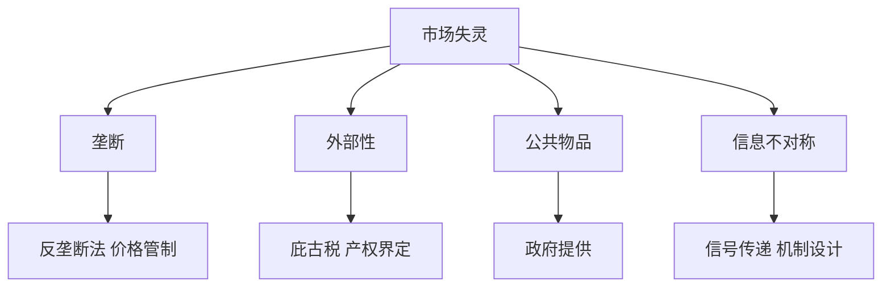

# 第八章 市场失灵和微观经济政策 章节总结

> 所属：[[../README|06 西方经济学]]

## 这一章在回答什么问题

看不见的手什么时候不灵？为什么市场会生产太多污染、太少路灯、太多垃圾广告？本章讲四类市场失灵和政府的应对。

## 核心概念清单

- **垄断**：P > MC，产量太少。
- **外部性**：生产/消费影响第三方，私人成本 ≠ 社会成本。
- **公共物品**：非排他、非竞争，市场不愿提供。
- **信息不对称**：逆向选择（二手车）、道德风险（保险）。

## 框架图

## 本章 KP 列表

- [[KP01_垄断与政府管制|KP01 垄断与政府管制]]
- [[KP02_外部性|KP02 外部性]]
- [[KP03_公共物品|KP03 公共物品]]
- [[KP04_信息不对称与逆向选择道德风险|KP04 信息不对称]]

## 与前后章的关系

这是微观部分的收尾——前面讲"理想市场怎么最优"，本章讲"现实怎么不完美、政府该做什么"。
