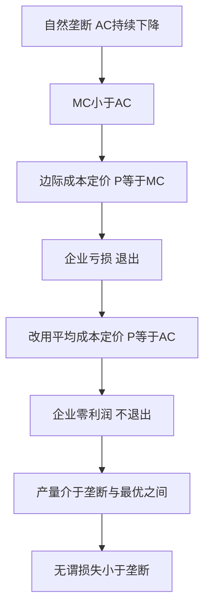

# KP01 垄断与政府管制

<a href="../../../../exam.html" target="_blank" style="display:inline-block;padding:6px 16px;background:#2563eb;color:#fff;border-radius:6px;text-decoration:none;font-size:14px;">📝 开始做题</a>

> 所属：[[00_章节总结|第8章 市场失灵和微观经济政策]]

## 1. 一句话先懂（小白版）

自来水公司垄断，水价定得比成本高 3 倍，老百姓骂。政府怎么办？要么拆成多家（反垄断），要么直接管价（价格上限）。

## 2. 严格定义

**垄断的效率损失**：P > MC，产量低于社会最优，产生无谓损失。

**政府应对**：
1. **反垄断法**：禁止合谋、禁止滥用市场地位。
2. **价格管制**：规定垄断企业最高限价。
3. **国有化**：把垄断行业收归国有（如地铁、邮政）。
4. **引入竞争**：拆分垄断企业（如电信、石油）。

## 3. 价格管制的两种定价

- **边际成本定价**：P = MC。理论上最优，但自然垄断企业 AC 下降，MC < AC，按 MC 定价会亏。
- **平均成本定价**：P = AC。企业不亏不赚，但价格仍高于 MC。

## 4. 怎么用（手把手算）

**场景**：自然垄断企业需求 $P = 100 - Q$，$AC = 50$（常数），$MC = 50$。

**第一步**：垄断定价（MR = MC）。
- MR = 100 - 2Q = 50 → Q = 25，P = 75。
- 利润 = (75 - 50) × 25 = 625。

**第二步**：政府按边际成本定价 P = MC = 50。
- 需求 Q = 100 - 50 = 50。
- 企业利润 = (50 - 50) × 50 = 0。
- 效率最优（P = MC）。

**第三步**：政府按平均成本定价 P = AC = 50（本例 AC = MC 相同）。
- 结果一样，Q = 50，利润 = 0。

## 理论推导（一步步推）

> 本节补充：为什么自然垄断适合平均成本定价而非边际成本定价。

**假设起点**：
1. 自然垄断：平均成本 AC 随产量增加持续下降（规模经济），故 MC < AC。
2. 需求曲线向右下倾斜。
3. 政府要让企业不亏损（避免退出），同时尽量减少无谓损失。

**推导过程**：
- 第一步：垄断厂商自主定价（MR = MC），产量 Qm、价格 Pm，利润最大但有无谓损失。
- 第二步：政府若按边际成本定价 P = MC，产量 Qc > Qm，效率最优。但因 AC > MC（自然垄断），P = MC < AC，企业每单位亏损 (AC - MC)，总亏损 = (AC - MC)·Qc。长期企业会退出。
- 第三步：政府若按平均成本定价 P = AC，产量 Qac 介于 Qm 和 Qc 之间。企业利润 = 0（不亏不赚），不会退出。但 P = AC > MC，仍有无谓损失（小于垄断时）。
- 结论：自然垄断管制 = 在"企业不退出"约束下选择最高效率（最低无谓损失），即 P = AC。

## 数学推导（公式怎么来的）

> 每个符号第一次出现必须解释。

设自然垄断需求 $P = a - bQ$，总成本 $TC = F + cQ$（F 是固定成本，c 是常数边际成本）。

**第一步：平均成本**
$$AC = \frac{F}{Q} + c$$

当 Q 增大时，$F/Q$ 减小 → AC 持续下降。MC = c < AC。

**第二步：垄断定价（MR = MC）**
$$MR = a - 2bQ = c \Rightarrow Q_m = \frac{a-c}{2b}, \quad P_m = \frac{a+c}{2}$$

**第三步：边际成本定价（P = MC = c）**
$$Q_c = \frac{a-c}{b}, \quad P_c = c$$

企业利润：
$$\pi_c = (c - AC_c)\cdot Q_c = \left(c - \left(\frac{F}{Q_c} + c\right)\right)\cdot Q_c = -F < 0$$

亏损额 = 固定成本 F。企业长期退出。

**第四步：平均成本定价（P = AC）**
$$a - bQ = \frac{F}{Q} + c$$
$$(a-c)Q - bQ^2 = F$$
$$bQ^2 - (a-c)Q + F = 0$$

解二次方程：
$$Q_{ac} = \frac{(a-c) + \sqrt{(a-c)^2 - 4bF}}{2b}$$

（取较大根，因为较小根在 AC 递减段不合理）。

**第五步：无谓损失对比**

- 垄断 DWL：$\frac{(a-c)^2}{8b}$（最大）。
- 边际成本定价 DWL：0（但企业退出）。
- 平均成本定价 DWL：介于两者之间。

**图形说明**：纵轴 P/成本，横轴 Q。需求曲线 P=a-bQ、MR 曲线、MC 水平线 c、AC 曲线（U 形但此处持续下降）。AC 在 MC 上方。垄断均衡在 MR 与 MC 交点；边际成本定价在 P=MC（需求曲线与 MC 交点）——AC 在该点上方，企业亏损；平均成本定价在需求曲线与 AC 交点——企业零利润。

**生活实例**：自来水公司。
- 垄断自主定价：5 元/吨，每年利润 1 亿。
- 强制按边际成本定价：1 元/吨，但管网固定成本 5 亿收不回，公司破产，全城停水。
- 按平均成本定价：3 元/吨，公司不亏不赚，正常运营。这就是听证会反复讨论的价格。

## 5. 现实例子

- 中国电信 1999 年拆成移动、电信、联通。
- 电力改革：发电、输电、配电分开。
- 地铁、自来水：国有 + 价格听证会。

## 6. 容易混淆什么

| 概念 | 区别 |
|---|---|
| 反垄断 vs 价格管制 | 前者针对人为垄断（拆企业）；后者针对自然垄断（管价格）。 |
| 边际成本定价 vs 平均成本定价 | 前者效率高但企业亏；后者企业不亏但效率次优。 |

---

## 🔗 相关知识点

**同章关联：** [[KP02_外部性|外部性]] ｜ [[KP03_公共物品|公共物品]]

**跨章关联：** [[../../05_不完全竞争市场/知识点/KP02_垄断厂商的短期与长期均衡|垄断均衡]]

**📖 原书原文：** [[../../../../原文件/经济学/西方经济学上册_微观_全书#第一节 垄断|原书·第八章第一节]]

---

## 🐮 小白教程入门

> 看不懂下面这个KP？先看通俗版教程建立直觉：

- [[../../../../经济统计学论文从0基础到精通/13_微观经济学基础/10_完全垄断与价格歧视是什么|🐮 教程·完全垄断与价格歧视是什么]]
- [[../../../../经济统计学论文从0基础到精通/13_微观经济学基础/12_外部性与公共品是什么|🐮 教程·外部性与公共品是什么]]

---

## 📝 考研真题（首经贸 801）

**配套主观题：** 见同目录 [[../考研真题集|本章考研真题集]]
**配套选择题：** 见同目录 [[../选择题集|本章选择题集]]

### 高频简答
- 简述垄断的效率损失及其政府管制手段 → 见 [[../考研真题集#s1|真题集·简答 1]]
- 比较边际成本定价与平均成本定价在自然垄断管制中的应用 → 见 [[../考研真题集#s2|真题集·简答 2]]

### 高频论述
- 结合平台经济反垄断实践，论述垄断的效率损失与中国反垄断政策 → 见 [[../考研真题集#l1|真题集·论述 1]]
- 综合论述市场失灵的四种类型，并结合中国实际论述社会主义市场经济中政府与市场的关系 → 见 [[../考研真题集#l5|真题集·论述 5]]

### 易错选择
- 本知识点选择题见 [[../选择题集#KP01 垄断与政府管制|选择题集·KP01]]
