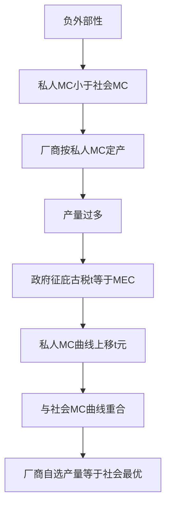

# KP02 外部性

<a href="../../../../exam.html" target="_blank" style="display:inline-block;padding:6px 16px;background:#2563eb;color:#fff;border-radius:6px;text-decoration:none;font-size:14px;">📝 开始做题</a>

> 所属：[[00_章节总结|第8章 市场失灵和微观经济政策]]

## 1. 一句话先懂（小白版）

化工厂排污水，成本由谁担？工厂自己只算原料和人工（私人成本），但下游鱼死了、居民得病了（社会成本）。**私人成本 ≠ 社会成本——这就是外部性。**

## 2. 严格定义

**外部性（Externality）**：生产或消费行为对第三方（未参与交易的人）产生的未计入价格的影响。

**负外部性**：给第三方带来成本（污染、噪音）。
- 私人成本 < 社会成本 → 产量过多。

**正外部性**：给第三方带来收益（打疫苗、教育、种花）。
- 私人收益 < 社会收益 → 产量过少。

## 3. 政府怎么应对

1. **庇古税**：对负外部性征税 $t = $ 边际外部成本，让私人成本 = 社会成本。
2. **补贴**：对正外部性补贴。
3. **科斯定理**：只要产权清晰、交易成本为零，私下协商也能达到最优（不一定要政府干预）。
4. **管制**：规定排放标准。

## 4. 怎么用（手把手算）

**场景**：化工厂需求 $P = 100 - Q$，私人成本 MC = 20，每单位污染造成外部成本 10。

**第一步**：私人最优（不管外部性）。
- 令 P = MC：100 - Q = 20 → Q = 80。

**第二步**：社会最优（社会成本 = MC + 外部成本 = 30）。
- 令 100 - Q = 30 → Q = 70。

**第三步**：政府征庇古税 t = 10。
- 企业面对的 MC = 20 + 10 = 30。
- 企业自己选 Q = 70——和社会最优一致。

## 理论推导（一步步推）

> 本节补充：为什么负外部性导致市场产量过多，以及庇古税怎么把私人成本曲线移到社会成本曲线。

**假设起点**：
1. 厂商生产有负外部性（排污）。
2. 私人边际成本 $MC_{priv}$ 只含厂商自己的成本（原料、人工）。
3. 边际外部成本 $MEC$（下游鱼死、居民治病）。
4. 社会边际成本 $MC_{soc} = MC_{priv} + MEC$。

**推导过程**：
- 第一步：厂商决策只看私人成本。令需求 $P = MC_{priv}$，得私人最优产量 $Q_{priv}$。
- 第二步：社会最优要求把外部成本也算进去。令 $P = MC_{soc} = MC_{priv} + MEC$，得社会最优产量 $Q_{soc}$。
- 第三步：因为 $MC_{soc} > MC_{priv}$，所以 $Q_{soc} < Q_{priv}$——市场均衡产量过多。
- 第四步：政府征庇古税 $t = MEC$（每单位产量征等于外部成本的税）。
- 第五步：厂商面对的税后成本 = $MC_{priv} + t = MC_{priv} + MEC = MC_{soc}$。
- 第六步：厂商自己利润最大化的产量 $Q'$ 满足 $P = MC_{priv} + t = MC_{soc}$，正好等于社会最优 $Q_{soc}$。
- 结论：庇古税把**私人成本曲线向上移动 t 元**，与社会成本曲线重合，市场自己到达最优产量。

## 数学推导（公式怎么来的）

> 每个符号第一次出现必须解释。

设市场需求 $P = a - bQ$，私人边际成本 $MC_{priv} = c$（常数），边际外部成本 $MEC = d$（每单位产量造成 d 元外部损失）。

**第一步：私人最优（无干预）**
$$a - bQ = c \Rightarrow Q_{priv} = \frac{a-c}{b}$$

**第二步：社会最优**
$$MC_{soc} = c + d$$
$$a - bQ = c + d \Rightarrow Q_{soc} = \frac{a-c-d}{b} < Q_{priv}$$

**第三步：过度生产的量**
$$Q_{priv} - Q_{soc} = \frac{d}{b}$$

**第四步：庇古税**

政府征从量税 $t = d$。厂商面对的税后成本：
$$MC_{firm} = c + t = c + d = MC_{soc}$$

厂商自己选择：
$$a - bQ = c + d \Rightarrow Q = \frac{a-c-d}{b} = Q_{soc}$$

无需政府命令产量，市场自己到达最优。

**第五步：无谓损失**

私人最优与社会最优之间，需求曲线（消费者边际评价）高于社会成本的三角形：
$$DWL = \frac{1}{2}\cdot d\cdot(Q_{priv} - Q_{soc}) = \frac{1}{2}\cdot d\cdot\frac{d}{b} = \frac{d^2}{2b}$$

征税后 DWL = 0。

**正外部性的对称推导**：

若有正外部性（教育、疫苗），社会收益 $MB_{soc} = MB_{priv} + MEB$（MEB 是边际外部收益）。市场只看 $MB_{priv}$，产量过少。政府补贴 $s = MEB$，使私人需求曲线（=私人收益）上移到社会收益曲线。

**图形说明**：纵轴 P/成本，横轴 Q。私人 MC 曲线较低；社会 MC 曲线在其上方（垂直距离 = MEC）。需求曲线向下倾斜。私人均衡在需求与私人 MC 交点；社会最优在需求与社会 MC 交点。庇古税使私人 MC 上移 t 元，与社会 MC 重合，均衡自动移到社会最优点。

**生活实例**：化工厂排污 1 吨造成下游 1000 元治污损失。
- 无税：化工厂私人成本 5000 元/吨，卖 6000 元/吨，年产 1000 吨。
- 征庇古税 1000 元/吨：化工厂税后成本 6000 元/吨，年产 600 吨（社会最优）。
- 政府用 60 万税收补贴下游渔民。

## 5. 现实例子

| 行为 | 外部性 | 应对 |
|---|---|---|
| 化工厂排污 | 负 | 环保税、排污许可证 |
| 打疫苗 | 正（群体免疫） | 免费疫苗、补贴 |
| 教育 | 正 | 义务教育、奖学金 |
| 在楼道堆杂物 | 负 | 物业、城管 |

## 6. 容易混淆什么

| 概念 | 区别 |
|---|---|
| 外部性 vs 公共物品 | 外部性是"一个人的行为影响别人"；公共物品是"大家共用、没法排他"。 |
| 庇古税 vs 管制 | 前者靠市场调节（企业自己选产量）；后者直接命令。 |

---

## 🔗 相关知识点

**同章关联：** [[KP01_垄断与政府管制|垄断管制]] ｜ [[KP03_公共物品|公共物品]]

**跨章关联：** [[../../07_一般均衡与效率/知识点/KP02_帕累托最优|外部性破坏帕累托最优]]

**📖 原书原文：** [[../../../../原文件/经济学/西方经济学上册_微观_全书#第二节 外部性|原书·第八章第二节]]

---

## 🐮 小白教程入门

> 看不懂下面这个KP？先看通俗版教程建立直觉：

- [[../../../../经济统计学论文从0基础到精通/13_微观经济学基础/12_外部性与公共品是什么|🐮 教程·外部性与公共品是什么]]

---

## 📝 考研真题（首经贸 801）

**配套主观题：** 见同目录 [[../考研真题集|本章考研真题集]]
**配套选择题：** 见同目录 [[../选择题集|本章选择题集]]

### 高频简答
- 简述外部性的含义及其分类 → 见 [[../考研真题集#s3|真题集·简答 3]]
- 用图形说明负外部性如何导致市场产量过多 → 见 [[../考研真题集#s4|真题集·简答 4]]
- 简述庇古税的原理及其在环境治理中的应用 → 见 [[../考研真题集#s5|真题集·简答 5]]
- 简述科斯定理及其成立条件 → 见 [[../考研真题集#s6|真题集·简答 6]]
- 计算题：已知需求与外部成本求社会最优产量与庇古税 → 见 [[../考研真题集#s12|真题集·简答 12]]

### 高频论述
- 结合碳排放权交易与"双碳"目标，论述外部性理论在中国环境治理中的应用 → 见 [[../考研真题集#l2|真题集·论述 2]]

### 易错选择
- 本知识点选择题见 [[../选择题集#KP02 外部性|选择题集·KP02]]
