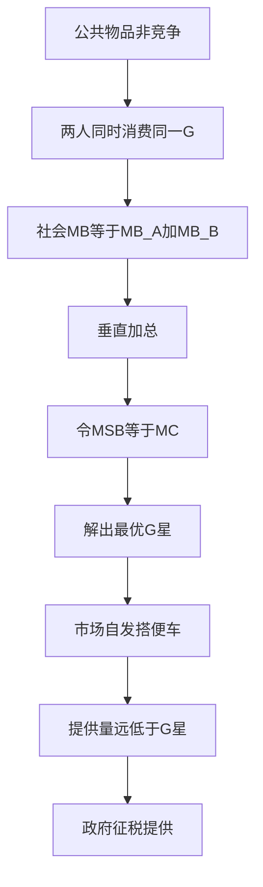

# KP03 公共物品

<a href="../../../../exam.html" target="_blank" style="display:inline-block;padding:6px 16px;background:#2563eb;color:#fff;border-radius:6px;text-decoration:none;font-size:14px;">📝 开始做题</a>

> 所属：[[00_章节总结|第8章 市场失灵和微观经济政策]]

## 1. 一句话先懂（小白版）

路灯为什么没人愿意自己装？因为你装了，路过的人都能用，你收不到钱。**"大家都能用、你没法不让别人用"的东西就是公共物品，市场不会提供，只能政府来。**

## 2. 严格定义

两个关键属性：
- **非排他性（Non-excludable）**：没法不让别人用。
- **非竞争性（Non-rival）**：多一个人用不减少别人用。

| | 竞争 | 非竞争 |
|---|---|---|
| **排他** | 私人物品（奶茶、衣服） | 俱乐部物品（电影院、有线电视） |
| **非排他** | 公共资源（海洋鱼、公共牧场） | **纯公共物品**（国防、路灯、空气） |

## 3. 搭便车问题（Free Rider）

- 公共物品非排他 → 你没法强制别人付费。
- 每个人都想"别人出钱我用"。
- 结果：市场提供量远低于最优，甚至为零。

## 4. 怎么用（手把手算）

**场景**：一条街上 100 户人家，装路灯每户愿意出 50 元，总成本 3000 元。

**第一步**：总支付意愿 = 100 × 50 = 5000 元 > 成本 3000 元 → 社会最优应该装。

**第二步**：但每户都想"等别人装"。
- 如果每户单独出：每户出 30 元（3000/100），但别人不出怎么办？
- 理性选择：不付钱，等别人装。
- 结果：路灯装不起来。

**第三步**：政府出面，按户收税 30 元，统一装路灯。
- 社会福利 = 5000 - 3000 = 2000 元。

## 理论推导（一步步推）

> 本节补充：为什么公共物品的市场需求曲线是垂直加总（而不是私人物品的水平加总）。

**假设起点**：
1. 两个消费者 A、B，公共物品 G（非竞争非排他）。
2. A 对公共物品的支付意愿（边际收益）$MB_A(G)$，B 的 $MB_B(G)$。
3. 公共物品供给的边际成本 $MC(G)$。

**推导过程**：
- 第一步（私人物品对比）：私人物品两人消费量不同（$X_A$、$X_B$），总需求是同一价格下两人消费量加总——**水平加总**。
- 第二步（公共物品）：公共物品两人消费量相同（都消费全部 G），但边际评价不同。社会边际收益 = $MB_A(G) + MB_B(G)$（每单位公共物品同时给两人带来收益）——**垂直加总**。
- 第三步：社会最优条件 $MB_A(G) + MB_B(G) = MC(G)$。
- 第四步：市场自发提供时，每人只愿按自己的 $MB_i$ 付费。若 A 先买，B 搭便车不付。结果市场提供量远低于社会最优。
- 结论：公共物品的需求曲线是两人边际收益曲线垂直相加；最优量由垂直加总后的 MB 与 MC 交点决定。

## 数学推导（公式怎么来的）

> 每个符号第一次出现必须解释。

**私人物品 vs 公共物品的加总对比**：

设 A 的需求 $P_A = a - bX_A$，B 的需求 $P_B = c - dX_B$。

**私人物品（水平加总）**：

同一价格 P 下，A 需求 $X_A = (a-P)/b$，B 需求 $X_B = (c-P)/d$。
市场总需求：
$$X = X_A + X_B = \frac{a-P}{b} + \frac{c-P}{d}$$

**公共物品（垂直加总）**：

同一公共物品量 G 下，A 的边际收益 $MB_A = a - bG$，B 的 $MB_B = c - dG$。
社会边际收益：
$$MSB = MB_A + MB_B = (a+c) - (b+d)G$$

**最优公共物品量**：

设边际成本 $MC = k$（常数）。社会最优：
$$MSB = MC$$
$$(a+c) - (b+d)G = k$$
$$G^* = \frac{a+c-k}{b+d}$$

**市场自发提供（搭便车）**：

若 A 先决定购买量 $G_A$（按 $MB_A = MC$）：$a - bG_A = k \Rightarrow G_A = (a-k)/b$。
B 观察到 A 已提供 $G_A$，自己愿额外购买多少？$MB_B(G_A + G_B) = MC$：$c - d(G_A + G_B) = k$。若 $MB_B(G_A) < k$，B 不购买任何额外量（搭便车）。

结果：市场提供量 $G_{market} = G_A = (a-k)/b$。
社会最优 $G^* = (a+c-k)/(b+d)$。

对比：若 $c > k$（B 也有支付意愿），则 $G^* > G_{market}$——市场提供不足。

**图形说明**：纵轴 P/MB，横轴 G。私人物品需求曲线是两人需求曲线**水平**相加（左右加）。公共物品社会边际收益曲线是两人 MB 曲线**垂直**相加（上下加）。与 MC 交点决定最优量 G*。

**生活实例**：街道装路灯。
- A 愿意为第 1 盏灯付 100 元，B 愿意付 80 元。
- 社会边际收益 = 180 元/盏。
- 装 1 盏灯成本 150 元 → 社会最优装。
- 但 A 单独装：A 觉得 100 < 150，不装。B 单独装：80 < 150，不装。
- 结果：没人装。政府按户收税 75 元，装 1 盏，社会福利 = 180 - 150 = 30 元。

## 5. 现实例子

| 公共物品 | 为什么市场不提供 |
|---|---|
| 国防 | 没人能被排除在保护之外 |
| 路灯 | 没法让"不交钱的人"不走这条街 |
| 基础研究 | 知识人人可用 |
| 公共防疫 | 疫苗打了别人也受益 |

## 6. 容易混淆什么

| 概念 | 区别 |
|---|---|
| 公共物品 vs 公共资源 | 公共物品非竞争；公共资源有竞争（鱼少了）。 |
| 公共物品 vs 政府提供的物品 | 政府提供的不一定是公共物品（公立学校可以收费排他）。 |

---

## 🔗 相关知识点

**同章关联：** [[KP02_外部性|外部性]] ｜ [[KP04_信息不对称与逆向选择道德风险|信息不对称]]

**📖 原书原文：** [[../../../../原文件/经济学/西方经济学上册_微观_全书|原书·第八章第三节]]

---

## 🐮 小白教程入门

> 看不懂下面这个KP？先看通俗版教程建立直觉：

- [[../../../../经济统计学论文从0基础到精通/13_微观经济学基础/12_外部性与公共品是什么|🐮 教程·外部性与公共品是什么]]

---

## 📝 考研真题（首经贸 801）

**配套主观题：** 见同目录 [[../考研真题集|本章考研真题集]]
**配套选择题：** 见同目录 [[../选择题集|本章选择题集]]

### 高频简答
- 简述公共物品的特征与搭便车问题 → 见 [[../考研真题集#s7|真题集·简答 7]]
- 区分公共物品、公共资源、俱乐部物品与私人物品 → 见 [[../考研真题集#s8|真题集·简答 8]]

### 高频论述
- 结合共享单车、社区团购与城市公共资源，论述公共物品与搭便车问题 → 见 [[../考研真题集#l3|真题集·论述 3]]
- 结合中国基本医疗保险制度改革，论述信息不对称下的逆向选择与道德风险及其治理 → 见 [[../考研真题集#l4|真题集·论述 4]]

### 易错选择
- 本知识点选择题见 [[../选择题集#KP03 公共物品|选择题集·KP03]]
