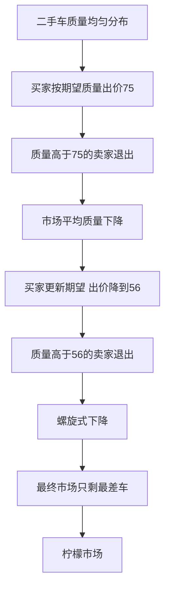

# KP04 信息不对称与逆向选择道德风险

<a href="../../../../exam.html" target="_blank" style="display:inline-block;padding:6px 16px;background:#2563eb;color:#fff;border-radius:6px;text-decoration:none;font-size:14px;">📝 开始做题</a>

> 所属：[[00_章节总结|第8章 市场失灵和微观经济政策]]

## 1. 一句话先懂（小白版）

- **二手车市场**：卖家知道车有毛病，买家不知道。结果好车不敢卖（卖不上价），烂车充斥市场——这叫**逆向选择**。
- **买了保险后**：你觉得有保险兜底，开车变莽——这叫**道德风险**。

## 2. 严格定义

**信息不对称（Asymmetric Information）**：交易一方比另一方知道更多信息。

**逆向选择（Adverse Selection）**：交易前信息不对称，导致市场被劣质品充斥。
- 经典例子：二手车（阿克洛夫 1970）、保险（健康人不买保险，病人抢着买）。

**道德风险（Moral Hazard）**：交易后信息不对称，一方行为变得更冒险。
- 经典例子：买了车险后开车更莽；职业经理人拿股东钱冒险。

**信号传递（Signaling）**：拥有信息的一方主动发信号（学历、保修证书、品牌）。
**信息甄别（Screening）**：缺乏信息的一方设计合同让对方自选（保险的不同套餐）。

## 3. 怎么用（手把手算，二手车）

**场景**：二手车市场，好车价值 10 万，烂车价值 4 万。买家不知道车况，只知道一半概率好一半概率烂。

**第一步**：买家愿意出的期望价 = 0.5×10 + 0.5×4 = 7 万。

**第二步**：好车车主觉得 7 万太低（他知道车值 10 万），退出市场。

**第三步**：市场上只剩烂车（值 4 万）。买家预期到这点，出价降到 4 万。

**结果**：好车全部退出，市场变成"柠檬市场"（只有烂车）。

## 理论推导（一步步推）

> 本节补充：为什么二手车市场会变成"柠檬市场"——逆向选择的数学推导。

**假设起点**（阿克洛夫 1970 年模型）：
1. 二手车质量均匀分布在 $[0, 100]$（0 是最差，100 是最好）。
2. 卖家知道自己车的真实质量 $v$，对车的保留价就是 $v$（低于 $v$ 不卖）。
3. 买家不知道车的真实质量，只知道质量分布均匀。
4. 买家对车的评价比卖家高 50%（买家愿意为质量 $v$ 付 $1.5v$）——否则贸易没有互利空间。

**推导过程**：
- 第一步：在完全信息下，任意质量 $v$ 的车都能成交（买家愿付 $1.5v$ > 卖家要价 $v$），所有车都上市。
- 第二步：信息不对称下，买家只知道期望质量。若市场上车质量均匀分布 $[0, 100]$，期望质量 $E[v] = 50$。
- 第三步：买家愿付价 $P = 1.5 \times 50 = 75$。
- 第四步：卖家看价格 75。质量 $v > 75$ 的卖家觉得"我车值 90，只卖 75 太亏"→ 退出市场。质量 $v \le 75$ 的卖家留下。
- 第五步：现在市场上只有 $v \in [0, 75]$ 的车。买家更新期望质量 $E[v | v \le 75] = 37.5$。
- 第六步：买家愿付价 $P' = 1.5 \times 37.5 = 56.25$。
- 第七步：质量 $v > 56.25$ 的卖家又退出。市场上车的质量进一步下降到 $[0, 56.25]$。
- 第八步：这个过程持续，直到市场上车的质量趋近于 0，价格趋近于 0——**好车全部退出，市场萎缩到只剩最差车**。
- 结论：逆向选择使高质量商品退出，市场变成"柠檬市场"（lemons = 烂车）。

## 数学推导（公式怎么来的）

> 每个符号第一次出现必须解释。

**稳态均衡**：设买家出价 $P$，卖家只在 $v \le P$ 时出售。市场上车辆质量服从 $[0, P]$ 均匀分布。

买家期望质量：
$$E[v | v \le P] = \frac{P}{2}$$

买家愿意付价：
$$P = 1.5 \times E[v | v \le P] = 1.5 \times \frac{P}{2} = 0.75 P$$

这对任意 $P > 0$ 都成立？不对——$P = 0.75 P$ 只有 $P = 0$ 是解。

**关键结论**：唯一均衡是 $P^* = 0$，市场完全崩溃。

**更一般的推导**（保留部分市场）：

若买家对车的评价是 $v + \alpha$（固定加价，非比例），且 $\alpha > 0$。买家愿付价 $P = E[v] + \alpha$。

设市场上车辆质量分布在 $[0, v_{max}]$，$E[v] = v_{max}/2$。卖家在 $v \le P$ 时出售。

$$P = \frac{v_{max}}{2} + \alpha$$

且 $v_{max} = P$（市场上车辆最高质量等于价格）：
$$P = \frac{P}{2} + \alpha$$
$$\frac{P}{2} = \alpha$$
$$P^* = 2\alpha$$

**含义**：只有当买家对车的评价高于卖家一个固定 $\alpha$ 时，市场才能存活；均衡价格 $P = 2\alpha$，市场上车辆质量在 $[0, 2\alpha]$。

**保险市场的应用**：

设投保人健康状态 $h$ 均匀分布 $[0, 100]$（100 最健康，0 最差）。保险公司不知道 $h$，按平均期望医疗成本定价。

- 定价 $P$：健康人（$h$ 高）觉得保费高于自己预期医疗支出 → 不投保。
- 只有高风险人（$h$ 低）投保 → 保险公司理赔率上升 → 保费再涨 → 更多健康人退出 → 螺旋式崩溃。

**信号传递（斯宾塞模型）**：

设工人能力 $\theta \in [\theta_L, \theta_H]$。教育成本 $c(e, \theta)$ 随能力下降（高能力者教育成本低）。分离均衡下，高能力者选择教育水平 $e_H$，低能力者选 $e_L < e_H$。雇主根据 edu 付工资：$w(e_H) = \theta_H$、$w(e_L) = \theta_L$。

**图形说明**：左图二手车市场——纵轴价格 P，横轴平均质量。45 度线 P=E[v] 表示"卖家愿意出售的最高质量"。需求曲线 P=1.5E[v] 表示"买家愿付价"。两线交点唯一在原点——市场崩溃。

**生活实例**：
- 医保：健康人不参保（觉得保费贵），只有病人抢着参保 → 保险公司赔付率飙升 → 保费上涨 → 更多健康人退出 → 医保基金穿底。这就是中国 2000 年代新农合之前的状态。
- 招聘：名校学历不是为了学知识，是"我能扛下四年苦读"的信号——高能力者读名校成本低（聪明、能毕业），低能力者读名校成本高（容易退学）。雇主用学历筛选能力。
- 淘宝：好评率高的店铺更容易卖出去——好评是质量信号，解决逆向选择。

## 4. 现实例子

| 场景 | 信息优势方 | 问题 | 解决方案 |
|---|---|---|---|
| 二手车 | 卖家 | 逆向选择 | 保修证书、第三方检测 |
| 保险 | 投保人 | 逆向选择 + 道德风险 | 体检、免赔额、无赔款优待 |
| 招聘 | 求职者 | 逆向选择 | 学历、试用期、背景调查 |
| 医疗 | 医生 | 道德风险 | 医保共付、审计 |
| 众筹 | 项目方 | 道德风险 | 分期付款、信息披露 |

## 5. 容易混淆什么

| 概念 | 区别 |
|---|---|
| 逆向选择 vs 道德风险 | 前者交易前（隐藏信息）；后者交易后（隐藏行为）。 |
| 信号传递 vs 信息甄别 | 前者是信息优势方主动；后者是信息劣势方设计。 |

## 6. 现实意义

- 为啥名校学历值钱？不是因为课教得多好，而是"能力信号"。
- 为啥保险公司要查健康？防止逆向选择。
- 为啥贷款要抵押？防止道德风险。
- 为啥淘宝要好评体系？解决信息不对称。

---

## 🔗 相关知识点

**同章关联：** [[KP01_垄断与政府管制|垄断]] ｜ [[KP03_公共物品|公共物品]]

**跨章关联：** [[../../07_一般均衡与效率/知识点/KP02_帕累托最优|信息不对称破坏帕累托最优]]

**📖 原书原文：** [[../../../../原文件/经济学/西方经济学上册_微观_全书|原书·第八章第四节]]

---

## 🐮 小白教程入门

> 看不懂下面这个KP？先看通俗版教程建立直觉：

- [[../../../../经济统计学论文从0基础到精通/13_微观经济学基础/13_信息不对称是什么|🐮 教程·信息不对称是什么]]

---

## 📝 考研真题（首经贸 801）

**配套主观题：** 见同目录 [[../考研真题集|本章考研真题集]]
**配套选择题：** 见同目录 [[../选择题集|本章选择题集]]

### 高频简答
- 简述信息不对称的含义及其对市场效率的影响 → 见 [[../考研真题集#s9|真题集·简答 9]]
- 区分逆向选择与道德风险，并举例说明 → 见 [[../考研真题集#s10|真题集·简答 10]]
- 简述信号传递与信息甄别的区别与联系 → 见 [[../考研真题集#s11|真题集·简答 11]]

### 高频论述
- 结合中国基本医疗保险制度改革，论述信息不对称下的逆向选择与道德风险及其治理 → 见 [[../考研真题集#l4|真题集·论述 4]]
- 结合平台经济反垄断实践，论述垄断的效率损失与中国反垄断政策 → 见 [[../考研真题集#l1|真题集·论述 1]]

### 易错选择
- 本知识点选择题见 [[../选择题集#KP04 信息不对称与逆向选择道德风险|选择题集·KP04]]
