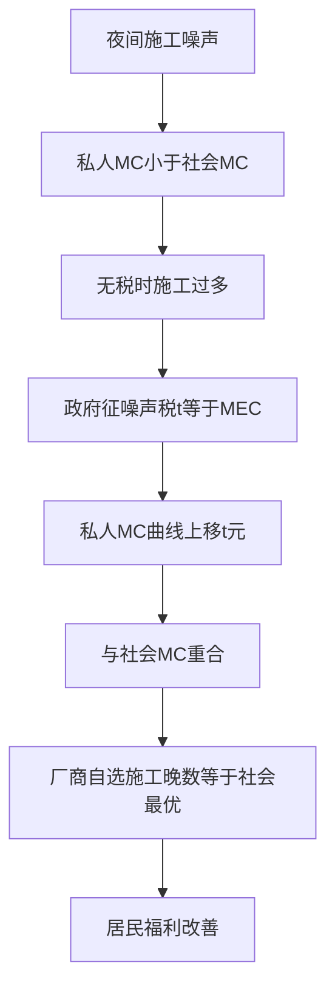
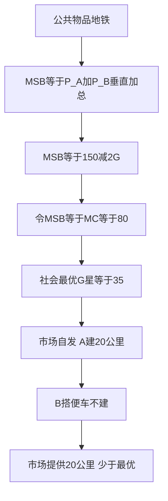
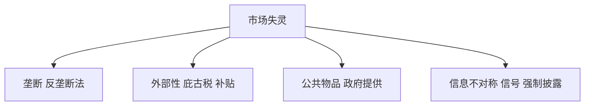

# 第 8 章 市场失灵与微观经济政策 · 考研真题集（首经贸 801）

<a href="../../../exam.html" target="_blank" style="display:inline-block;padding:6px 16px;background:#2563eb;color:#fff;border-radius:6px;text-decoration:none;font-size:14px;">📝 开始做题</a>

> 本章共收录：简答题 12 道（每题 15 分）｜论述题 5 道（每题 30 分）
> 配套选择题见 [[选择题集|本章选择题集]]
> 对应大纲：马工程《西方经济学》（第二版）第八章"市场失灵和微观经济政策"全部四节
> 本章为微观部分极高频考点，外部性、公共物品、信息不对称三部分几乎年年必考。

## 📋 本题集目录

### 简答题
1. [[#简答 1：简述垄断的效率损失及其政府管制手段|简述垄断的效率损失及其政府管制手段]]
2. [[#简答 2：比较边际成本定价与平均成本定价在自然垄断管制中的应用|比较边际成本定价与平均成本定价在自然垄断管制中的应用]]
3. [[#简答 3：简述外部性的含义及其分类|简述外部性的含义及其分类]]
4. [[#简答 4：用图形说明负外部性如何导致市场产量过多|用图形说明负外部性如何导致市场产量过多]]
5. [[#简答 5：简述庇古税的原理及其在环境治理中的应用|简述庇古税的原理及其在环境治理中的应用]]
6. [[#简答 6：简述科斯定理及其成立条件|简述科斯定理及其成立条件]]
7. [[#简答 7：简述公共物品的特征与搭便车问题|简述公共物品的特征与搭便车问题]]
8. [[#简答 8：区分公共物品、公共资源、俱乐部物品与私人物品|区分公共物品、公共资源、俱乐部物品与私人物品]]
9. [[#简答 9：简述信息不对称的含义及其对市场效率的影响|简述信息不对称的含义及其对市场效率的影响]]
10. [[#简答 10：区分逆向选择与道德风险，并举例说明|区分逆向选择与道德风险，并举例说明]]
11. [[#简答 11：简述信号传递与信息甄别的区别与联系|简述信号传递与信息甄别的区别与联系]]
12. [[#简答 12：计算题：已知需求与外部成本求社会最优产量与庇古税|计算题：已知需求与外部成本求社会最优产量与庇古税]]

### 论述题
1. [[#论述 1：结合平台经济反垄断实践，论述垄断的效率损失与中国反垄断政策|结合平台经济反垄断实践，论述垄断的效率损失与中国反垄断政策]]
2. [[#论述 2：结合碳排放权交易与"双碳"目标，论述外部性理论在中国环境治理中的应用|结合碳排放权交易与"双碳"目标，论述外部性理论在中国环境治理中的应用]]
3. [[#论述 3：结合共享单车、社区团购与城市公共资源，论述公共物品与搭便车问题|结合共享单车、社区团购与城市公共资源，论述公共物品与搭便车问题]]
4. [[#论述 4：结合中国基本医疗保险制度改革，论述信息不对称下的逆向选择与道德风险及其治理|结合中国基本医疗保险制度改革，论述信息不对称下的逆向选择与道德风险及其治理]]
5. [[#论述 5：综合论述市场失灵的四种类型，并结合中国实际论述社会主义市场经济中政府与市场的关系|综合论述市场失灵的四种类型，并结合中国实际论述社会主义市场经济中政府与市场的关系]]

---

## 一、简答题（每题 15 分，建议 450–700 字）

### 简答 1：简述垄断的效率损失及其政府管制手段

**【建议字数】450–700 字 ｜ 【建议时间】15 分钟 ｜ 【题型】原因分析**

**【考什么】** 对应知识点 [[知识点/KP01_垄断与政府管制|垄断与政府管制]]，对应大纲第八章第一节；题型属于原因分析。

**【核心推导】**
**第一步，写出垄断均衡。** 垄断厂商面临市场需求 $P(Q)$，总收益 $TR=P(Q)Q$，边际收益
$$MR=P+Q\frac{dP}{dQ}=P\left(1-\frac{1}{|\varepsilon|}\right)<P.$$
利润最大化 $MR=MC$ 给出垄断产量 $Q_m$ 与价格 $P_m=MC/(1-1/|\varepsilon|)$，故 $P_m>MC$。

**第二步，算无谓损失。** 社会最优要求 $P=MC$，对应 $Q_c$。在 $[Q_m,Q_c]$ 区间内，每多生产一单位，消费者边际评价 $P$ 高于边际成本 $MC$，差额 $P-MC>0$ 未被实现，累积即
$$DWL=\int_{Q_m}^{Q_c}\left[P(Q)-MC(Q)\right]dQ.$$
线性情形下 $DWL=\tfrac12(P_m-MC_m)(Q_c-Q_m)$，是一个三角形面积。

**第三步，算例。** 设 $P=100-2Q$、$MC=4$（$AC=MC$）：$MR=100-4Q$，$MR=MC\Rightarrow Q_m=24$、$P_m=52$；竞争 $P=MC\Rightarrow Q_c=48$；$DWL=\tfrac12\times(52-4)\times(48-24)=\tfrac12\times48\times24=576$。消费者剩余从竞争的 $\tfrac12\times96\times48=2304$ 降为 $\tfrac12\times48\times24=576$。

**第四步，补充三角形的三类额外损失。** ①**寻租损失**：$DWL$ 只是静态损失，厂商为维持垄断地位投入游说、专利诉讼的资源构成额外社会浪费，塔洛克指出寻租可能吞掉全部垄断利润；②**X-无效率**：缺乏竞争压力使实际成本高于最小成本，莱本斯坦估计可达成本的 3%–10%；③**动态损失**：垄断者可能延缓创新以避免自我淘汰（阿罗的替代效应）。三者之和可能超过静态 $DWL$。

**第五步，管制手段及其经济学逻辑。** ①**反垄断法**：禁止合谋（横向）、禁止滥用市场支配地位（纵向）、控制经营者集中；②**价格管制**：对自然垄断实行 $P=MC$（需补贴）或 $P=AC$（次优），或最高限价（拉姆齐定价）；③**公有化/国有化**：以社会福利为目标，但面临软预算约束与效率问题；④**引入竞争**：特许经营权拍卖（德姆塞茨）、业务分拆（电信、电力）、互联互通义务（平台）。四种手段的成本与信息要求依次不同，选择取决于垄断类型（自然垄断 vs 行为性垄断）。

**第六步，给出判据。** 若垄断源于规模经济（$AC$ 递减、$MC<AC$），拆分将带来成本上升，应选价格管制；若源于行为性排他（二选一、扼杀式收购），应选行为救济与结构性拆分。判据是"垄断来自技术还是行为"，这是从 $AC$ 曲线形状直接读出的。

**【为什么要答这几点】**
**第一，垄断均衡与 $P>MC$（约 4 分）。** 写出 $MR<P$ 的推导或 $MR=P(1-1/|\varepsilon|)$。

**第二，无谓损失（约 5 分）。** $DWL$ 的积分或三角形表达，最好给数值。

**第三，三类额外损失（约 4 分）。** 寻租、X-无效率、动态损失。只写 DWL 会遗漏一半分数。

**第四，管制手段（约 5 分）。** 反垄断、价格管制、国有化、引入竞争，并说明各自的适用条件。

**第五，判据（约 2 分）。** 自然垄断拆分会导致成本上升，宜用管制；行为性垄断宜用行为救济。

**第六，失分点。** ①只写"垄断导致效率损失"不给 $DWL$ 三角形；②把价格管制一律说成 $P=MC$ 而不提自然垄断下的亏损问题；③忽略寻租与 X-无效率。

**【如何分析题目】**
**审题：** 两问——"效率损失"与"管制手段"。损失要给度量（三角形 + 三类额外损失），手段要分类并给适用条件。

**第一步，先算垄断均衡与竞争均衡。** 两个产量一对比，损失从哪来就清楚了。

**第二步，用面积表示损失。** $\int(P-MC)dQ$ 或 $\tfrac12\Delta P\Delta Q$。数字例比纯公式更有说服力。

**第三步，超出三角形的部分要单独讲。** 寻租（塔洛克）、X-无效率（莱本斯坦）、动态损失（阿罗）。这三条是区分"背教材"与"真理解"的地方。

**第四步，管制手段按"信息要求"排序。** 反垄断需要举证、价格管制需要成本信息、国有化需要激励设计、引入竞争需要市场结构可行。信息要求越高，越难执行——这是很实用的判断维度。

**答题节奏：** 均衡 2 段、$DWL$ 1 段、三类额外损失 1 段、手段 1 段、判据 1 句。15 分题 600–800 字。

**【答题框架】****【答题框架】**
- 第 1 段：垄断均衡特征（4 分）
- 第 2 段：效率损失（4 分）
- 第 3 段：政府管制手段（5 分）
- 第 4 段：小结（2 分）

**【参考答案】**

一、垄断均衡特征

（一）垄断厂商面临向右下倾斜的需求曲线，边际收益 MR < P。

（二）利润最大化条件 MR = MC，决定垄断产量 Qm，对应价格 Pm。

（三）与完全竞争相比，Pm > MC，Qm < Qc（社会最优产量）。

二、效率损失

（一）无谓损失（Deadweight Loss）：在 Qm 与 Qc 之间，消费者对产品的评价（P）高于生产的边际成本（MC），但这些产品没有被生产出来，形成社会福利净损失。

（二）寻租损失：垄断厂商为维持垄断地位，花费资源游说、贿赂，这部分资源不创造社会财富。

（三）管理松懈：缺乏竞争压力，垄断企业内部 X-无效率，成本高于最低水平。

三、政府管制手段

（一）反垄断法：禁止合谋定价、禁止滥用市场支配地位、必要时拆分垄断企业。

（二）价格管制：对自然垄断企业规定最高限价（边际成本定价或平均成本定价）。

（三）国有化：将地铁、自来水、邮政等自然垄断行业收归国有，以社会福利最大化为目标。

（四）引入竞争：拆分垄断企业、放开市场准入（如电信、石油行业改革）。

四、小结

垄断造成配置无效率与动态无效率，政府管制的目标是使价格向 MC 靠拢、产量向社会最优靠拢，但需权衡管制成本与信息问题。

**【解析·得分点】** 采分点：①Pm > MC、Qm < Qc ②无谓损失 + 寻租 + X-无效率 ③四种管制手段。容易丢分：只讲无谓损失，漏掉寻租与 X-无效率。

**【生活实例】** 学校只有一家食堂，红烧肉卖 25 元一份，成本其实 8 元。学生吃不起少吃两份，这两份本来学生愿意出 15 元、食堂成本 8 元，双赢但没成交——这就是无谓损失。

**【双链接】** 🔗 [[知识点/KP01_垄断与政府管制|回知识点]] ｜ 📖 [[../../../原文件/经济学/西方经济学上册_微观_全书|原书·第八章第一节]]

---

### 简答 2：比较边际成本定价与平均成本定价在自然垄断管制中的应用

**【建议字数】450–700 字 ｜ 【建议时间】15 分钟 ｜ 【题型】关系对比**

**【考什么】** 对应知识点 [[知识点/KP01_垄断与政府管制|垄断与政府管制]]；题型属于关系对比。

**【核心推导】**
**第一步，刻画自然垄断。** 成本函数满足规模经济：$AC$ 单调下降、$MC<AC$（因 $MC=AC+Q\cdot dAC/dQ$，$dAC/dQ<0$ 时 $MC<AC$）。设 $AC(Q)=F/Q+c$，则 $MC=c$、$AC=F/Q+c>MC$。由一家企业供应的成本低于多家分别供应（次可加性），故自然垄断有其技术效率基础。

**第二步，边际成本定价的效率。** 规定 $P=MC$，满足帕累托最优条件 $P=MC$，产量 $Q_{MC}=Q^*$ 达到社会最优，$DWL=0$。但定价低于平均成本：
$$P=MC<AC(Q_{MC})\Rightarrow\pi=MC\cdot Q-F-cQ=-F<0,$$
企业每期亏损固定成本 $F$。若政府不给补贴，企业退出；若给补贴，则补贴资金来自税收，税收本身有边际成本（边际公共资金成本 $MCF\approx1.2\sim1.3$），产生**二次扭曲**：真实的边际成本不是 $MC$ 而是 $MCF\cdot MC$，于是最优条件应改为 $P=(1+\lambda)MC$，即**次优定价应高于边际成本**。

**第三步，平均成本定价的效率。** 规定 $P=AC$，企业收支平衡（$\pi=0$），无需补贴。但 $P=AC>MC$，产量 $Q_{AC}<Q^*$，仍有 $DWL_{AC}=\int_{Q_{AC}}^{Q^*}(P-MC)dQ>0$。这是**次优（second-best）**结果：在"必须有补贴才能达到最优"的约束下，$P=AC$ 是次优中的最优。

**第四步，数值对比。** 设 $D$：$P=100-Q$，$AC=400/Q+10$，故 $MC=10$、固定成本 $F=400$。
- $P=MC=10$：$Q^*=90$，$TR=900$，$TC=400+900=1300$，亏损 $400$。
- $P=AC$：$100-Q=400/Q+10\Rightarrow Q^2-90Q+400=0\Rightarrow Q=85$（取大根；小根 $Q=5$ 为不稳定分支），$P=15$。
- 剩余 $DWL$：$\int_{85}^{90}(100-Q-10)dQ=\int_{85}^{90}(90-Q)dQ=\left[90Q-\tfrac{Q^2}{2}\right]_{85}^{90}=12.5$。
故平均成本定价的 $DWL$ 为 12.5，而边际成本定价的 $DWL=0$ 但需补贴 400。

**第五步，拉姆齐定价的中间路线。** 若必须自我筹资，最优是拉姆齐—布瓦托定价：
$$\frac{P_i-MC_i}{P_i}=\frac{\lambda}{1+\lambda}\cdot\frac{1}{|\varepsilon_i|},$$
即需求弹性越小、加价幅度越大。对居民用电（弹性小）征高加价、对工业用电（弹性大）征低加价，可在 $\pi=0$ 约束下最小化 $DWL$。这是对"统一 $P=AC$"的改进。

**第六步，现实选择。** 各国实践多采用"公正报酬率"或价格上限（$RPI-X$，李特查尔德）管制：允许企业在通胀率 $RPI$ 减去效率因子 $X$ 的幅度内调价，既保证不亏损，又给降本留激励。中国对电网、供水、燃气普遍采用"准许成本加合理收益"的收益率管制，属 $P=AC$ 思路的精细化版本。**判据是：财政补贴的边际成本与 $DWL$ 的边际减少之间如何权衡——即 $\lambda$ 的大小。**

**【为什么要答这几点】**
**第一，自然垄断的成本特征（约 4 分）。** $AC$ 递减、$MC<AC$、次可加性。这是全题前提，不能省。

**第二，边际成本定价（约 5 分）。** $P=MC$ 达帕累托最优、$DWL=0$，但 $P<AC$ 导致亏损，需财政补贴，补贴带来二次扭曲。

**第三，平均成本定价（约 5 分）。** $P=AC$ 收支平衡、无需补贴，但 $P>MC$、仍有 $DWL$，属次优。

**第四，比较与选择（约 4 分）。** 效率 vs 可行性；拉姆齐定价作为中间路线。

**第五，失分点。** ①只说"边际成本定价最优"而不说亏损与补贴；②不知道补贴本身有影子成本（$MCF>1$）从而次优定价应高于 $MC$；③把 $P=AC$ 说成"最优"。

**【如何分析题目】**
**审题：** "比较"意味着要给判据，不能各说一段就完。判据应落在"补贴的边际成本"这一关键变量上。

**第一步，先写清 $MC<AC$ 的来源。** 规模经济是自然垄断的技术基础，也是所有矛盾的根源。

**第二步，各算一个均衡。** $P=MC$ 与 $P=AC$ 分别对应什么产量、什么盈亏，用数字最快说清。

**第三步，点出"补贴不是免费的"。** 边际公共资金成本 $MCF>1$——这一条是把答案从教材水平拉高的关键。

**第四步，引出拉姆齐定价。** 它是 $P=AC$ 与 $P=MC$ 之间的连续统，显示你理解"次优"的完整逻辑。

**第五步，补现实制度。** 价格上限 $RPI-X$、准许成本加合理收益。制度细节让答案落地。

**答题节奏：** 特征 1 段、两种定价各 1 段、数值对比 1 段、拉姆齐 1 段、现实 1 段。15 分题 700–900 字。

**【答题框架】****【答题框架】**
- 第 1 段：自然垄断特征（3 分）
- 第 2 段：边际成本定价（5 分）
- 第 3 段：平均成本定价（5 分）
- 第 4 段：比较与选择（2 分）

**【参考答案】**

一、自然垄断特征

自然垄断行业（自来水、电力、地铁）具有规模经济：AC 随产量扩大持续下降，因此 MC < AC。由一家企业供应整个市场成本最低，多家竞争反而浪费。

二、边际成本定价

（一）规定 P = MC。

（二）这是帕累托最优条件，产量达到社会最优，无谓损失为零。

（三）但由于 MC < AC，按 MC 定价 P = MC < AC，企业亏损。

（四）要维持运营，政府必须给企业补贴，补贴资金来自税收，又产生新的扭曲。

三、平均成本定价

（一）规定 P = AC。

（二）企业收支相抵，不亏不赚，无需补贴。

（三）但 P = AC > MC，产量仍低于社会最优，存在少量无谓损失。

（四）这是"次优"方案。

四、比较与选择

（一）效率上：边际成本定价最优，平均成本定价次优。

（二）可行性上：平均成本定价不需补贴，政府易操作；边际成本定价需要财政补贴。

（三）现实中各国多采用平均成本定价或"公正报酬率"管制，兼顾企业生存与效率。

**【解析·得分点】** 采分点：①自然垄断 AC 下降、MC < AC ②P = MC 最优但亏损 ③P = AC 不亏但次优 ④现实选择。容易丢分：不画图；忘记 MC < AC 这一关键。

**【生活实例】** 地铁公司修一条线花 100 亿，每多载一个人成本 1 元。按边际成本定价，票价 1 元，公司永远收不回 100 亿；按平均成本定价，票价算上折旧可能要 10 元，公司不亏，但挤地铁的人少了。

**【双链接】** 🔗 [[知识点/KP01_垄断与政府管制|回知识点]] ｜ 📖 [[../../../原文件/经济学/西方经济学上册_微观_全书|原书·第八章第一节]]

---

### 简答 3：简述外部性的含义及其分类

**【建议字数】450–700 字 ｜ 【建议时间】15 分钟 ｜ 【题型】概念简答**

**【考什么】** 对应知识点 [[知识点/KP02_外部性|外部性]]；题型属于概念简答。

**【核心推导】**
**第一步，写出外部性的形式化定义。** 设个体 $i$ 的行为 $a_i$ 影响他人效用：$U_j=U_j(\dots,a_i,\dots)$，$j\ne i$。若 $\partial U_j/\partial a_i\ne0$ 而这一影响未通过价格补偿，即存在外部性。核心特征是
$$MPC\ne MSC\quad\text{或}\quad MPB\ne MSB.$$

**第二步，按方向分类。** ①**负外部性**：$MSC>MPC$（生产）或 $MSB<MPB$（消费），如排污、噪音、二手烟、醉驾。②**正外部性**：$MSC<MPC$ 或 $MSB>MPB$，如疫苗接种（群体免疫）、教育（社会文明）、研发（知识溢出）、种花美化。

**第三步，按环节分类。** ①**生产的外部性**：化工厂排污（负）、果园养蜂为邻园授粉（正）、上游伐木导致下游洪水（负）；②**消费的外部性**：装修噪音（负）、阳台种花（正）、接种疫苗（正）。

**第四步，用福利学表达损失。** 负外部性下社会最优产量 $Q^*$ 满足 $MSB=MSC$，市场产量 $Q_m$ 满足 $MPB=MPC$，$Q_m>Q^*$，损失
$$DWL=\int_{Q^*}^{Q_m}\left[MSC(Q)-MSB(Q)\right]dQ.$$
正外部性下 $Q_m<Q^*$，损失为 $\int_{Q_m}^{Q^*}[MSB-MPB]dQ$。**两者方向相反，但结构完全对称。**

**第五步，区分外部性与相关概念。** ①**外部性 vs 公共物品**：公共物品是非排他且非竞争的物品（所有人同时受益），外部性是"交易之外的第三方影响"（可针对特定人）；②**外部性 vs 垄断**：垄断是价格与边际成本偏离，外部性是私人成本与社会成本偏离；③**金钱外部性（pecuniary externality）**：通过价格变动影响他人（如我多买推高价格），不构成市场失灵，因为它已被价格机制内化。

**第六步，治理工具按"科斯 vs 庇古"两条路线分。** ①庇古路线：税收/补贴，需要知道 $MEC$ 的大小；②科斯路线：界定产权 + 允许交易，需要交易成本足够低；③管制路线：标准、配额、技术强制；④信息路线：披露、认证、标签。选择依据是"受影响人数"（人数多则交易成本高，宜用庇古税）与"外部成本的可测性"。

**【为什么要答这几点】**
**第一，定义与核心（约 4 分）。** "未计入市场价格、影响第三方"，以及 $MPC\ne MSC$ 或 $MPB\ne MSB$。

**第二，正负分类（约 4 分）。** 各自的机制（负：过度生产；正：供给不足）与例子。只举例不说机制扣分。

**第三，生产与消费分类（约 4 分）。** 四种组合各举一例最稳。

**第四，福利损失表达（约 3 分）。** 积分或三角形，并指出正负外部性的方向相反。

**第五，失分点。** ①把金钱外部性（价格变动）当成市场失灵；②把外部性与公共物品混为一谈；③只举例不给"私人 vs 社会"的判据。

**【如何分析题目】**
**审题：** "含义 + 分类"。含义要给判据（私人 vs 社会不一致），分类要两个维度交叉。

**第一步，先给判据而不是先举例。** 判据是"未通过价格补偿的第三方影响"，有了判据，例子才不会是罗列。

**第二步，用 2×2 表格把四类铺开。** 生产/消费 × 正/负，每格一个例子。表格在考卷上比段落清晰，也便于阅卷。

**第三步，用福利公式统一说明。** 负外部性过度生产、正外部性供给不足，写成一个积分就够，不必两套推导。

**第四步，做概念辨析。** 金钱外部性、公共物品两条辨析最能体现理解深度，也常是压轴小问。

**第五步，顺带铺出治理工具。** 庇古、科斯、管制、信息四条路线，为后续题目（庇古税、科斯定理）做铺垫。

**答题节奏：** 定义 2 句、四类表格、损失 1 式、辨析 2 条。15 分题 450–600 字。

**【答题框架】****【答题框架】**
- 第 1 段：外部性定义（4 分）
- 第 2 段：负外部性（4 分）
- 第 3 段：正外部性（4 分）
- 第 4 段：生产/消费划分（3 分）

**【参考答案】**

一、外部性定义

外部性（Externality）是指生产或消费行为对未参与交易的第三方所产生的、未计入市场价格的影响。其核心特征是：行为主体的私人成本/私人收益与社会成本/社会收益不一致。

二、负外部性

（一）定义：给第三方带来未补偿的成本。

（二）私人成本 < 社会成本，厂商按私人成本决策，产量高于社会最优，造成过度生产。

（三）例子：工厂排污、夜间施工噪音、吸烟二手烟。

三、正外部性

（一）定义：给第三方带来未获补偿的收益。

（二）私人收益 < 社会收益，居民按私人收益决策，消费量低于社会最优，造成供给不足。

（三）例子：打疫苗（群体免疫）、教育（邻居孩子受教育带来社会文明）、种花美化环境。

四、生产/消费划分

（一）生产的外部性：化工厂生产排污（负）、果园主养蜂帮助附近果农授粉（正）。

（二）消费的外部性：居家装修噪音（负）、在阳台种花让路人欣赏（正）。

**【解析·得分点】** 采分点：①未计入价格、第三方受影响 ②负外部性：私人成本 < 社会成本、过度生产 ③正外部性：私人收益 < 社会收益、供给不足 ④生产/消费划分。容易丢分：把外部性等同于公共物品；不区分正负。

**【生活实例】** 你在宿舍通宵打游戏开外放，自己爽了（私人收益），但室友睡不着（外部成本）——这是负外部性。你在宿舍看书学习，室友耳濡目染也开始学（外部收益）——这是正外部性。

**【双链接】** 🔗 [[知识点/KP02_外部性|回知识点]] ｜ 📖 [[../../../原文件/经济学/西方经济学上册_微观_全书|原书·第八章第二节]]

---

### 简答 4：用图形说明负外部性如何导致市场产量过多

**【建议字数】450–700 字 ｜ 【建议时间】15 分钟 ｜ 【题型】模型分析**

**【考什么】** 对应知识点 [[知识点/KP02_外部性|外部性]]；题型属于模型分析。

**【核心推导】**
**第一步，设定成本与收益曲线。** 厂商的私人边际成本 $MPC(Q)$ 只含投入成本；边际外部成本 $MEC(Q)>0$（设排污量与产量同比例）；社会边际成本
$$MSC(Q)=MPC(Q)+MEC(Q).$$
需求曲线同时是私人边际收益与社会边际收益（假设消费侧无外部性）：$MPB=MSB=P(Q)$。

**第二步，求市场均衡。** 厂商按 $MPC=MPB$ 决策：$MPC(Q_m)=P(Q_m)$，得 $Q_m$。

**第三步，求社会最优。** 社会最优满足 $MSC(Q^*)=MSB(Q^*)$，即 $MPC(Q^*)+MEC(Q^*)=P(Q^*)$。由于 $MSC>MPC$，同一价格水平下 $Q^*<Q_m$——**市场产量过多**。

**第四步，几何表述。** 横轴 $Q$、纵轴 $P$。$MSC$ 曲线位于 $MPC$ 上方，垂直距离为 $MEC$。$D=MSB$ 与 $MSC$ 交于 $(Q^*,P^*)$，与 $MPC$ 交于 $(Q_m,P_m)$。$Q^*<Q_m$，且 $P^*>P_m$：市场既生产过多、又定价过低（因为价格未包含外部成本）。

**第五步，算效率损失。** 在 $[Q^*,Q_m]$ 区间，每单位的社会成本 $MSC$ 高于社会收益 $MSB$，净损失
$$DWL=\int_{Q^*}^{Q_m}\left[MSC(Q)-MSB(Q)\right]dQ,$$
线性情形下为三角形，面积 $=\tfrac12\cdot MEC(Q_m)\cdot(Q_m-Q^*)$（当 $MEC$ 为常数时精确）。

**第六步，算例与现实的对应。** 设 $P=100-Q$、$MPC=20$、$MEC=10$（常数）：$Q_m=80$ 满足 $100-80=20$；$Q^*=70$ 满足 $100-70=30$；$DWL=\tfrac12\times10\times(80-70)=50$。现实对应：排污企业不承担治理成本、夜间施工不补偿居民睡眠、网约车不承担拥堵成本。**注意 $MEC$ 通常随产量递增**（环境吸收能力有限），此时 $MSC$ 更陡，$DWL$ 更大。

**【为什么要答这几点】**
**第一，三条曲线的设定（约 4 分）。** $MPC$、$MEC$、$MSC=MPC+MEC$，以及 $D=MPB=MSB$。

**第二，两个均衡（约 5 分）。** 市场 $MPC=MPB$ 得 $Q_m$，社会 $MSC=MSB$ 得 $Q^*$，并明确 $Q_m>Q^*$。

**第三，图形说明（约 4 分）。** $MSC$ 在 $MPC$ 上方、垂直距离 $MEC$、两交点位置。题目要求"用图形说明"，不给图或图错扣分多。

**第四，效率损失（约 3 分）。** 三角形面积或积分，并指出价格过低与产量过多是同一枚硬币的两面。

**第五，失分点。** ①把 $MSC$ 画在 $MPC$ 下方（正负外部性搞反）；②只说"产量过多"不指出"价格过低"；③忘记假设消费侧无外部性（否则 $MSB$ 也要移动）。

**【如何分析题目】**
**审题：** "用图形说明"，所以必须有图；且要说明"如何导致"，即从 $MPC$ 到 $MSC$ 的推导链，而不是直接宣布结论。

**第一步，先设三条曲线。** 图形题的分数大头在建模：$MPC$、$MSC=MPC+MEC$、$D=MSB$。

**第二步，两次求交。** $MPC$ 交 $D$ 得市场产量，$MSC$ 交 $D$ 得社会产量。两个交点标在同一张图上，对比自然呈现。

**第三步，标出三角形。** 两条曲线与需求线围成的三角形就是 $DWL$，用阴影画出，标注"过度生产部分"。

**第四步，解释两个偏离方向。** 产量过多 + 价格过低。很多答案只写前者，写全才是完整。

**第五步，补一句 $MEC$ 递增的现实含义。** 环境容量有限，$MEC$ 随排污量上升，故 $MSC$ 比 $MPC$ 更陡，损失比线性估计更大。

**答题节奏：** 模型 3 句、两交点 4 句、图形 1 幅 + 标注、$DWL$ 2 句、现实 2 句。

**【答题框架】****【答题框架】**
- 第 1 段：私人成本与社会成本（4 分）
- 第 2 段：图形描述（6 分）
- 第 3 段：效率损失（3 分）
- 第 4 段：结论（2 分）

**【参考答案】**

一、私人成本与社会成本

（一）厂商私人边际成本 MC_private 只包含原料、人工等直接成本。

（二）社会边际成本 MC_social = MC_private + 边际外部成本 MEC。

（三）在负外部性下，MC_social 曲线位于 MC_private 上方。

二、图形描述

（一）横轴为产量 Q，纵轴为价格/成本。

（二）需求曲线 D = MPB（私人边际收益）= MSB（社会边际收益，假设无消费外部性）。

（三）厂商按 MC_private = MPB 决策，私人最优产量 Q_private。

（四）社会最优产量由 MC_social = MSB 决定，Q_social。

（五）由于 MC_social > MC_private，Q_social < Q_private。

三、效率损失

（一）在 Q_social 与 Q_private 之间，每多生产一单位，社会成本高于社会收益。

（二）这些"过度生产"的产品形成三角形无谓损失。

四、结论

负外部性使私人成本低估社会成本，市场产量从社会角度看过多，资源被过度配置到污染行业。矫正方向是使私人成本等于社会成本。

**【解析·得分点】** 采分点：①MC_social = MC_private + MEC ②Q_private > Q_social ③三角形无谓损失 ④矫正方向。容易丢分：画反两条曲线；不标无谓损失。

**【生活实例】** 化工厂算成本只算原料 20 元/吨，但下游鱼死了、居民看病，社会实际成本 30 元/吨。工厂按 20 元成本卖，一天生产 80 吨；社会最优只该生产 70 吨——多出来的 10 吨就是浪费。

**【双链接】** 🔗 [[知识点/KP02_外部性|回知识点]] ｜ 📖 [[../../../原文件/经济学/西方经济学上册_微观_全书|原书·第八章第二节]]

---

### 简答 5：简述庇古税的原理及其在环境治理中的应用

**【建议字数】450–700 字 ｜ 【建议时间】15 分钟 ｜ 【题型】解决对策**

**【考什么】** 对应知识点 [[知识点/KP02_外部性|外部性]]；题型属于政策效应类。

**【核心推导】**
**第一步，原理的形式化。** 设厂商产量 $Q$、私人成本 $C(Q)$、外部成本 $E(Q)$，社会成本 $SC(Q)=C(Q)+E(Q)$。厂商最大化 $PQ-C(Q)$，最优条件 $P=C'(Q)=MPC$；社会最优条件 $P=C'(Q)+E'(Q)=MSC$。二者相差 $E'(Q)=MEC$。

**第二步，税的设计。** 对每单位产量征 $t$，厂商税后成本 $C(Q)+tQ$，一阶条件 $P=C'(Q)+t$。若令
$$t=MEC(Q^*),$$
则厂商自发选择 $Q=Q^*$。**关键点：税率应等于社会最优产量处的边际外部成本，而不是市场产量处的 $MEC$。** 若 $MEC$ 递增，用 $MEC(Q_m)$ 会征税过度。

**第三步，图形机制。** 税后私人成本曲线 $MPC+t$ 向上垂直平移 $t$，与 $MSC$ 在 $Q^*$ 处重合。交点从 $(Q_m,P_m)$ 移到 $(Q^*,P^*)$：产量下降、价格上升（消费者承担部分成本，承担比例取决于需求与供给弹性：$\dfrac{\varepsilon_S}{\varepsilon_S+|\varepsilon_D|}$）。

**第四步，福利核算。** 征税后：①环境损失减少（等于减少的 $MEC$ 之和）；②生产的消费者剩余与生产者剩余减少；③政府税收 $t\cdot Q^*$。净变化恰为 $DWL$ 的消除。**庇古税不创造净负担，它只是把外部成本内部化**——这一点常在考卷上被误解为"税就是损失"。

**第五步，中国环境保护税实践。** 2018 年 1 月 1 日《环境保护税法》施行，取代排污费。要素：①税基为应税污染物（大气、水、固废、噪声）实际排放量；②税额幅度由省级政府在国家标准内确定（如大气污染物每污染当量 1.2–12 元）；③"多排多缴、少排少缴、不排不缴"；④对达标排放、综合利用给予减征。这一设计正是 $t=MEC$ 思路的制度化，但现实中 $t$ 普遍低于真实 $MEC$（据测算约为治理成本的 1/3–1/2），故矫正力度不足。

**第六步，庇古税的三个局限。** ①**信息要求高**：政府需知道 $MEC$ 曲线，而污染损害难以货币化；②**不确定性下的选择**：Weitzman 指出，若边际成本曲线比边际损害曲线更陡，数量工具（排污权）优于价格工具（税），反之亦然；③**分配效应**：税负可能转嫁给消费者，对低收入群体影响更大（需配套返还机制）。这三点解释了为什么现实中税与交易并存。

**【为什么要答这几点】**
**第一，原理与税率（约 5 分）。** $t=MEC$ 使得 $MPC+t=MSC$，厂商自发选社会最优产量。税率取社会最优点的 $MEC$ 这一细节要写。

**第二，图形机制（约 4 分）。** $MPC$ 上移 $t$、与 $MSC$ 重合、交点移动、价格上升。

**第三，福利核算（约 3 分）。** 政府税收 + 环境改善 + 生产者与消费者剩余减少 = 消除 $DWL$；庇古税不是净损失。

**第四，中国实践（约 4 分）。** 2018 年环境保护税、税额幅度、多排多缴、减征政策，并指出实际税率偏低。

**第五，局限（约 3 分）。** 信息要求、Weitzman 不确定性下的价格 vs 数量工具、分配效应。

**第六，失分点。** ①把庇古税说成"增加企业负担、造成损失"；②用 $MEC(Q_m)$ 而非 $MEC(Q^*)$ 定税；③只说征税不说税收用途。

**【如何分析题目】**
**审题：** "原理 + 在环境治理中的应用"。原理要给税率公式与图形，应用要落到中国制度并指出不足。

**第一步，先用两个最优化问题对比。** 厂商的 $P=MPC$ 与社会的 $P=MSC$，差额就是税率的来源。这一步做完，税率公式是推出来的而不是背的。

**第二步，强调"最优点的 $MEC$"。** 若 $MEC$ 递增，用错点会过度矫正，这是很典型的失分细节。

**第三步，画平移图。** $MPC$ 垂直上移 $t$ 与 $MSC$ 重合——"重合"这个词要写出来，它意味着完全矫正。

**第四步，把福利账算平。** 很多人以为征税就是损失，写出"税+环境改善=消费者与生产者剩余减少"的等式即可纠正。

**第五步，落到中国环境保护税。** 2018 年立法、税额幅度、多排多缴、减征。再加一句"实际税率低于治理成本"，显示你了解真实政策效果。

**第六步，用 Weitzman 收尾。** 价格工具 vs 数量工具在不确定性下的选择，是把答案从"介绍庇古税"升级为"评价庇古税"的关键。

**答题节奏：** 原理 1 段、图形 1 段、福利 1 段、中国实践 1 段、局限 1 段。15 分题 650–850 字。

**【答题框架】****【答题框架】**
- 第 1 段：庇古税原理（5 分）
- 第 2 段：图形机制（4 分）
- 第 3 段：在环境治理中的应用（4 分）
- 第 4 段：局限（2 分）

**【参考答案】**

一、庇古税原理

（一）庇古税（Pigouvian Tax）是由英国经济学家庇古提出的矫正性税收。

（二）对产生负外部性的厂商征税，税率 t 等于边际外部成本 MEC。

（三）征税后，厂商面对的私人成本从 MC_private 上升到 MC_private + t = MC_social。

（四）厂商按新的私人成本决策，自发选择社会最优产量。

二、图形机制

（一）征税前：MC_private 与 D 交于 Q_private。

（二）征税 t = MEC 后，MC 曲线向上平移 t 个单位，与 D 交于 Q_social。

（三）产量自动从 Q_private 减少到 Q_social，无谓损失消失。

（四）政府获得税收收入 t·Q_social，可用于治理污染或补偿受害者。

三、在环境治理中的应用

（一）中国环境保护税（2018 年 1 月 1 日开征）正是庇古税的实践：对大气污染物、水污染物、固体废物、噪声按排放量征税。

（二）碳税、成品油消费税、排污费都是庇古税的具体形式。

（三）与行政命令（排放标准）相比，庇古税给企业灵活性：减排成本低的企业多减排，减排成本高的企业缴税继续排放，社会总减排成本最低。

四、局限

（一）政府难以准确测量 MEC，税率定高了抑制生产，定低了治理不足。

（二）污染企业可能搬迁到无税地区（污染避难所效应）。

（三）对失业、物价的负面影响需要配套政策。

**【解析·得分点】** 采分点：①t = MEC ②MC 曲线平移 ③产量自动调整到社会最优 ④环保税实践 ⑤信息局限。容易丢分：把庇古税说成"禁止污染"；不对比排放标准。

**【生活实例】** 排污一吨政府收 10 元税。工厂算：我花 5 元装净化设备就能少排一吨，那就装设备；如果净化要 20 元，那宁愿交 10 元税。这样全社会用最低成本减了最多污染。

**【双链接】** 🔗 [[知识点/KP02_外部性|回知识点]] ｜ 📖 [[../../../原文件/经济学/西方经济学上册_微观_全书|原书·第八章第二节]]

---

### 简答 6：简述科斯定理及其成立条件

**【建议字数】450–700 字 ｜ 【建议时间】15 分钟 ｜ 【题型】概念简答**

**【考什么】** 对应知识点 [[知识点/KP02_外部性|外部性]]；题型属于理论类。

**【核心推导】**
**第一步，陈述定理。** 若产权界定清晰且交易成本为零（或足够低），则不论初始产权如何分配，当事人之间的自愿协商都能实现资源的帕累托最优配置；初始产权的分配只影响收入分配，不影响资源配置效率。

**第二步，用数值例验证。** 上游工厂排污使下游渔场每年损失 10 万元；工厂安装治污设备成本 6 万元。①产权归渔场（工厂无权排污）：工厂面临 10 万元赔偿，选择花 6 万治污，净省 4 万 → 治污发生；②产权归工厂（有权排污）：渔场愿付最高 10 万买工厂治污，工厂要价至少 6 万，成交区间 [6,10]，治污同样发生。**两种产权下的治污结果相同，区别只在 6 万–10 万之间的转移支付归谁。**

**第三步，几何表达。** 在埃奇沃思盒中，初始产权决定禀赋点；无交易成本时，双方沿互利交换路径到达契约曲线上某点。**不同初始产权到达契约曲线的不同点——但都在契约曲线上**，即都帕累托最优。这就是"效率不变、分配变"的精确含义。

**第四步，讲清两个成立条件。** ①**产权清晰**：必须明确"谁有权做什么"，且产权可执行、可转让（若产权界定模糊，如公海、大气、频谱，协商无从开始）；②**交易成本为零**：包括搜寻成本、谈判成本、签约成本、监督与执行成本。科斯本人强调的恰恰是"交易成本不为零时产权安排就重要"——这与"科斯定理"的常见简化表述方向相反，是高频考点。

**第五步，说明科斯的真实主张。** 科斯《社会成本问题》（1960）的结论不是"市场万能"，而是：**当交易成本为正时，产权的初始界定会影响资源配置效率，因此法律应把权利配置给"交易成本阻碍最大的那一方"**——即"最便宜的避免者"（cheapest cost avoider）。这为排污权交易、碳排放权、频谱拍卖提供了理论依据。

**第六步，局限与延伸。** ①**人数众多**：受害者成千上万时，组织谈判成本极高（大气、公海）；②**产权界定争议**：清洁空气的产权归谁本身无法自然确定；③**策略行为（hold-out）**：一方故意抬高要价；④**不公平**：把排污权无偿给工厂，等于把环境容量送给污染者（故现实中多用拍卖而非无偿分配）。这四条解释了为什么科斯方案常需与庇古税并用。

**【为什么要答这几点】**
**第一，定理陈述（约 4 分）。** "产权清晰 + 交易成本为零 → 协商达到帕累托最优，且资源配置与初始产权无关"。

**第二，数值例（约 4 分）。** 两种产权安排下结果相同、分配不同。没有例子很难拿满。

**第三，两条件（约 4 分）。** 产权清晰（可执行、可转让）、交易成本为零。缺一不可。

**第四，科斯的真实主张（约 3 分）。** 交易成本为正时产权配置重要，应给"最便宜避免者"。

**第五，局限（约 3 分）。** 人数众多、产权界定争议、策略行为、分配不公。

**第六，失分点。** ①把科斯定理说成"市场能解决一切外部性"；②只说"产权重要"而漏掉"交易成本为零"；③不知道科斯本人的结论其实是强调交易成本。

**【如何分析题目】**
**审题：** "定理 + 成立条件"。定理要陈述 + 例证，条件要讲清为什么必要（缺了会怎样）。

**第一步，先写一句完整陈述。** 产权清晰、交易成本为零、结果与产权归属无关，三个要素缺一不可。

**第二步，做数值例子。** 损害 10 万 vs 治污成本 6 万，两个产权归属各算一遍，结果相同。数字比论述有力十倍。

**第三步，用盒状图说明"效率相同、分配不同"。** 不同禀赋点到达契约曲线的不同点，这是定理的几何表达。

**第四步，反过来说科斯本人的主张。** "交易成本为正时产权配置会影响效率"，这是对"科斯定理"最重要也最常被漏掉的补充。

**第五步，列局限。** 大气、公海、人数众多、策略行为、分配不公。每条都对应现实中的制度设计（拍卖、配额、责任规则）。

**答题节奏：** 陈述 2 句、例子 2 段、条件 2 段、真实主张 1 段、局限 1 段。15 分题 600–800 字。

**【答题框架】****【答题框架】**
- 第 1 段：科斯定理陈述（5 分）
- 第 2 段：两个成立条件（5 分）
- 第 3 段：政策含义（3 分）
- 第 4 段：局限（2 分）

**【参考答案】**

一、科斯定理陈述

科斯定理（Coase Theorem）：只要产权清晰界定、交易成本为零，无论初始产权赋予哪一方，当事人之间的自愿协商都能达到帕累托最优配置。

二、两个成立条件

（一）产权清晰。必须明确"谁有权做什么"——例如河流污染权属于上游工厂还是下游居民。

（二）交易成本为零（或足够小）。双方协商、签约、执行不花成本，否则谈判破裂。

三、政策含义

（一）科斯定理挑战了"外部性必须靠政府征税"的传统观点。

（二）只要产权清晰，市场本身就能解决外部性：

- 若产权归下游居民，工厂想排污就必须付钱给居民，居民可接受补偿后让渡部分权利；
- 若产权归工厂，居民想让工厂减排就付钱给工厂。

（三）两种情况最终都达到社会最优产量，区别只在收入分配。

四、局限

（一）现实中交易成本不为零：涉及成千上万受害者时，组织谈判成本极高。

（二）产权界定本身可能有争议（如空气、公海）。

（三）当一方人数众多时，搭便车问题使协商失败。

（四）因此科斯定理适用于当事人少、产权明确的场合；大规模污染仍需庇古税或管制。

**【解析·得分点】** 采分点：①定理陈述 ②产权清晰 + 交易成本为零 ③两种产权归属结果相同 ④大规模失败。容易丢分：把科斯定理说成"不需要政府"；漏掉交易成本。

**【生活实例】** 半夜隔壁宿舍打游戏吵。如果学校规定"11 点后宿舍必须安静"，那打游戏的同学可能出钱请被吵的同学戴耳塞；如果规定"宿舍可自由活动"，那被吵的同学可能出钱请打游戏的同学戴耳机。两种规则下最终都是"吵到双方都能接受的程度"——只要谈判不花钱。

**【双链接】** 🔗 [[知识点/KP02_外部性|回知识点]] ｜ 📖 [[../../../原文件/经济学/西方经济学上册_微观_全书|原书·第八章第二节]]

---

### 简答 7：简述公共物品的特征与搭便车问题

**【建议字数】450–700 字 ｜ 【建议时间】15 分钟 ｜ 【题型】概念简答**

**【考什么】** 对应知识点 [[知识点/KP03_公共物品|公共物品]]；题型属于概念简答。

**【核心推导】**
**第一步，两个特征的形式化。** 设公共物品供给量为 $G$、消费者数量为 $n$。①**非排他性**：技术上无法（或成本极高）阻止他人消费，即排他成本 $> $ 收益；②**非竞争性**：对任意 $i$，$\partial U_j/\partial G$ 不因 $j$ 消费而减少，即多一人消费的边际成本为零（$MC_{\text{增设}}=0$）。

**第二步，写出最优供给条件。** 与私人物品不同，公共物品的边际收益要**垂直加总**：
$$\sum_{i=1}^{n}MB_i(G)=MC(G).$$
私人物品的需求是水平加总 $\sum D_i(P)=S(P)$，因为一份物品只能给一个人；公共物品是同一份给所有人，故边际收益相加。**这是公共物品理论最核心的一个公式。**

**第三步，写出搭便车的博弈。** 两人、公共物品成本 $c$、每人收益 $v$，且 $v<c<2v$（两人合出才划算）。每人选择"出钱/不出钱"：①双方出，各得 $v-c/2>0$；②我出你不下，我得 $v-c<0$、你得 $v$；③都不出，各得 0。**纳什均衡是（不出，不出）**，尽管（出，出）对双方都更好——这是典型的囚徒困境。

**第四步，说明市场提供量的偏离。** 由于 $\sum MB_i>MC$ 时仍无人自愿出钱，市场供给量 $G_m<G^*$，极端情形 $G_m=0$。福利损失
$$DWL=\int_{G_m}^{G^*}\left[\sum_i MB_i(G)-MC(G)\right]dG.$$
若每人只在"自己的 $MB_i=MC$"处出钱，则 $G_m$ 由 $MB_i(G)=MC$ 决定，远小于由 $\sum MB_i=MC$ 决定的 $G^*$。

**第五步，政府提供的逻辑与其局限。** 政府用强制税收筹资，等价于把"自愿出资"改为"强制出资"（林达尔均衡的思想：每人按其边际收益分摊税负 $t_i=MB_i$）。但局限有三：①**偏好显示问题**：政府不知道每个人真实的 $MB_i$，且个人有低报动机（机制设计中的"显示原理"）；②**政府失灵**：财政支出效率、官僚预算最大化（尼斯坎南）；③**拥挤与排队**：非竞争性在拥挤时失效，公共物品可能退化为公共资源。

**第六步，算例与治理创新。** 一条街 100 户，每户愿出 50 元，路灯总成本 3000 元：总意愿支付 $5000>3000$，社会最优是建；但自愿捐献时每户都指望别人出，实际可能凑不满 3000 → 需要物业统一收取或政府提供。现实中的替代机制：①俱乐部（排他后收费，如收费公园）；②蒂布特模型（用脚投票选社区）；③众筹与公益基金；④公私合作（PPP）。

**【为什么要答这几点】**
**第一，两个特征（约 4 分）。** 非排他、非竞争，各给一句定义与例子。

**第二，最优供给条件（约 5 分）。** 垂直加总 $\sum MB_i=MC$，并与私人物品的水平加总对比。这是最容易被考的公式。

**第三，搭便车机制（约 4 分）。** 博弈或直觉论证：个人贡献对总量影响极小，故最优策略是不贡献；结果是供给不足甚至为零。

**第四，政府提供与局限（约 3 分）。** 强制税收筹资；偏好显示、政府失灵等局限。

**第五，失分点。** ①把需求加总写成水平加总；②只说"公共物品由政府提供"不给搭便车的博弈论证；③认为政府提供一定有效率。

**【如何分析题目】**
**审题：** "特征 + 搭便车问题"。特征是定义，搭便车是机制，必须从特征逻辑地推出搭便车，而不是并列陈述。

**第一步，先定义两个特征。** 非排他是"不能排"，非竞争是"不用排"。这两句的区分要写清楚。

**第二步，用垂直加总写最优条件。** 这是全部公共物品理论的枢纽。写出 $\sum MB_i=MC$ 并与私人物品对比，答案立刻专业。

**第三步，用囚徒困境写搭便车。** 设 $v<c<2v$，说明个人理性导致集体非理性。有博弈矩阵最好，没有也要写出四个结果。

**第四步，说明供给如何偏离。** 个人按 $MB_i=MC$ 决策，社会按 $\sum MB_i=MC$ 决策，差距就是供给不足的量化。

**第五步，补政府提供的局限。** 偏好显示问题与政府失灵，避免答案停留在"政府来提供就行"。

**答题节奏：** 特征 2 段、最优条件 1 段、搭便车 1 段、政府 1 段、例子 1 段。15 分题 550–750 字。

**【答题框架】****【答题框架】**
- 第 1 段：两大特征（5 分）
- 第 2 段：搭便车问题（5 分）
- 第 3 段：市场失灵与政府提供（3 分）
- 第 4 段：例子（2 分）

**【参考答案】**

一、两大特征

（一）非排他性（Non-excludable）：无法或成本极高地不让他人使用。路灯、国防、空气。

（二）非竞争性（Non-rival）：多一个人使用不减少他人使用的数量与质量。你呼吸空气不影响我呼吸。

二、搭便车问题

（一）由于非排他，人人都想"别人出钱我享受"。

（二）理性个人在公共物品自愿捐献博弈中，最优策略是不捐献（搭便车），因为自己的捐献对总量影响微乎其微。

（三）结果：所有人都等别人出钱，公共物品市场提供量远低于社会最优，甚至为零。

三、市场失灵与政府提供

（一）搭便车使价格机制失效：无法向使用者收费，私人企业无动力提供。

（二）政府通过强制性税收筹资，统一提供公共物品，克服搭便车。

（三）国防、路灯、基础研究、公共防疫、法治秩序都是政府提供的典型。

四、例子

（一）一条街上 100 户人家装路灯，每户愿出 50 元，总成本 3000 元，社会应装。

（二）但每户都等别人装，结果装不起来。

（三）政府按户收税 30 元，统一安装，社会福利 5000 − 3000 = 2000 元实现。

**【解析·得分点】** 采分点：①非排他 + 非竞争 ②搭便车 = 等别人出钱 ③自愿捐献失败 ④税收筹资。容易丢分：把公共物品等同于政府提供的物品；漏掉非竞争。

**【生活实例】** 班级凑钱买公共扫把。每个人都想：我不出钱，别人买了我照样用。结果全班都不出，扫把没人买，教室垃圾堆成山——这就是搭便车。最后班长强行每人收 5 块买了扫把。

**【双链接】** 🔗 [[知识点/KP03_公共物品|回知识点]] ｜ 📖 [[../../../原文件/经济学/西方经济学上册_微观_全书|原书·第八章第三节]]

---

### 简答 8：区分公共物品、公共资源、俱乐部物品与私人物品

**【建议字数】450–700 字 ｜ 【建议时间】15 分钟 ｜ 【题型】关系对比**

**【考什么】** 对应知识点 [[知识点/KP03_公共物品|公共物品]]；题型属于关系对比。

**【核心推导】**
**第一步，给出两个判定维度。** ①**排他性**：能否以低成本阻止他人消费；②**竞争性**：多一人消费是否减少他人可得的数量或质量。两维度交叉成四象限，构成物品分类的完整框架。

**第二步，四象限定位。**

| | 竞争 | 非竞争 |
|---|---|---|
| **排他** | 私人物品（奶茶、衣服） | 俱乐部物品（电影院、有线电视、收费公路） |
| **非排他** | 公共资源（海洋鱼群、牧场、拥堵道路） | 纯公共物品（国防、路灯、空气） |

**第三步，逐一分析治理逻辑。** ①**私人物品**：排他 + 竞争，价格机制有效，市场提供即达帕累托最优；②**俱乐部物品**：可排他故能收费，但非竞争性意味着边际成本为零，最优价格应为零——收费会造成"使用不足"，故最优是"收固定会费（会员费）而非按次收费"，即两步定价；③**公共资源**：非排他 + 竞争，问题不是供给不足而是**过度使用**（公地悲剧），治理靠配额、产权界定、可交易许可证；④**纯公共物品**：两特征齐备，市场无法收费且边际成本为零，故应免费提供、由税收筹资。

**第四步，推导公地悲剧。** 牧场承载量 $K$，第 $i$ 户养 $x_i$ 头牛，总 $X=\sum x_i$，每头牛的收益 $v(X)$ 随 $X$ 递减。农户最大化 $v(X)x_i$ 的一阶条件
$$v(X)+x_i v'(X)=0,$$
而社会最优要求 $v(X)+Xv'(X)=0$。由于 $x_i<X$，私人一阶条件中忽略了他人的损失项，故私人均衡 $X_m>X^*$——**过度放牧**。这就是"竞争性 + 非排他"导致的租值耗散。

**第五步，分析边界与动态变化。** ①排他性由技术决定：加密、扫码、围栏可以改变排他成本，故许多"公共物品"可转化为俱乐部物品（如加密电视）；②竞争性由拥挤程度决定：一条不拥堵的高速公路是非竞争的，拥堵时变为公共资源——**同一物品在不同时段属于不同类别**；③俱乐部物品的最优规模：成员数 $n$ 增加摊薄固定成本但增加拥挤成本，最优 $n^*$ 由两者边际相等决定（布坎南的俱乐部理论）。

**第六步，给出政策对应表。** 私人物品 → 市场；俱乐部 → 收费 + 会员制；公共资源 → 配额/产权/自治（奥斯特罗姆的公共池塘资源治理八原则）；纯公共物品 → 税收筹资的政府提供。**分类的目的不是贴标签，而是确定治理工具。**

**【为什么要答这几点】**
**第一，两个维度（约 3 分）。** 排他性、竞争性，各一句定义。维度不清则分类无从展开。

**第二，四象限表（约 5 分）。** 四类各给定义 + 两个例子。表格是最省分的形式。

**第三，公地悲剧（约 4 分）。** 公共资源的过度使用；最好给出 $v(X)+x_iv'(X)=0$ 与 $v(X)+Xv'(X)=0$ 的对比。

**第四，治理方式（约 4 分）。** 四类物品对应四种治理工具，特别是俱乐部物品的两步定价。

**第五，边界（约 2 分）。** 技术改变排他性、拥挤改变竞争性。

**第六，失分点。** ①把俱乐部物品归入私人物品；②把公共资源当成纯公共物品（少了竞争性这一维）；③只说分类不给治理。

**【如何分析题目】**
**审题：** "区分"四个概念，最有效的形式就是 2×2 表格，然后逐格解释治理逻辑。

**第一步，先立两个维度。** 一切分类都源于"排他 + 竞争"两个问题。不立维度直接罗列四类，会被判为背书。

**第二步，填表。** 四格八例，一格不落。

**第三步，用公地悲剧讲公共资源。** 公共资源的特殊性在于"过度使用"而不是"供给不足"——这一区分是本題的档次分。

**第四步，用两步定价讲俱乐部。** 非竞争意味着边际成本为零，按次收费造成使用不足，故收会员费。这一条最能体现经济学直觉。

**第五步，讲分类的相对性。** 技术进步改变排他性、拥挤改变竞争性。有这一层，答案就从静态分类变成动态分析。

**答题节奏：** 维度 2 句、表格、四段解释、动态性 2 句、治理表 1 段。15 分题 600–800 字。

**【答题框架】****【答题框架】**
- 第 1 段：两个维度（3 分）
- 第 2 段：四象限表（6 分）
- 第 3 段：公共资源的公地悲剧（4 分）
- 第 4 段：小结（2 分）

**【参考答案】**

一、两个维度

（一）排他性：能否不让他人使用。

（二）竞争性：多一个人使用是否减少他人使用。

二、四象限分类

| | 竞争 | 非竞争 |
|---|---|---|
| **排他** | 私人物品（奶茶、衣服、面包） | 俱乐部物品（电影院、有线电视、收费公路） |
| **非排他** | 公共资源（海洋鱼、公共牧场、公共池塘） | 纯公共物品（国防、路灯、空气） |

三、公共资源的公地悲剧

（一）公共资源有竞争性但无排他性：海里的鱼，我多捕一条你就少一条，但谁都能去捕。

（二）每个渔民只算私人成本，不考虑"我多捕一条鱼导致鱼群减少"的外部成本。

（三）结果过度捕捞，资源枯竭——这就是哈丁所说的"公地悲剧"。

（四）解决方案：配额限制、可交易捕捞许可证、社区自治、产权界定。

四、小结

四类物品对应不同治理方式：私人物品由市场提供；俱乐部物品可由俱乐部或企业收费提供；公共物品由政府税收提供；公共资源需政府管制或产权界定。

**【解析·得分点】** 采分点：①排他性 × 竞争性两维度 ②四象限表 ③公地悲剧 ④治理方式对应。容易丢分：把公共资源与公共物品混为一谈；漏掉俱乐部物品。

**【生活实例】** 你买的奶茶喝一杯少一杯、别人喝不到——私人物品。电影院买票才能进，但一个影院坐 100 人还是 101 人对别人没影响——俱乐部物品。海里的鱼谁都能捕，但你捕了我就少了——公共资源。国防谁都受益、多一人不影响——纯公共物品。

**【双链接】** 🔗 [[知识点/KP03_公共物品|回知识点]] ｜ 📖 [[../../../原文件/经济学/西方经济学上册_微观_全书|原书·第八章第三节]]

---

### 简答 9：简述信息不对称的含义及其对市场效率的影响

**【建议字数】450–700 字 ｜ 【建议时间】15 分钟 ｜ 【题型】概念简答**

**【考什么】** 对应知识点 [[知识点/KP04_信息不对称与逆向选择道德风险|信息不对称]]；题型属于概念简答。

**【核心推导】**
**第一步，定义与形式化。** 交易双方中一方掌握对方无法观测的信息。设卖方类型 $\theta\in\{\theta_H,\theta_L\}$（好/坏），买方只知道先验概率 $\Pr(\theta_H)=q$。信息不对称即买方无法观测 $\theta$。

**第二步，用柠檬市场推导市场萎缩。** 卖方对好车保留价 10 万、坏车 4 万；买方愿付 $V_H=12$ 万（好）、$V_L=6$ 万（坏）。若买方无法区分，只愿出期望价 $\bar V=q\cdot12+(1-q)\cdot6$。设 $q=0.5$，则 $\bar V=9$ 万。
- 好车卖方（保留价 10 万）不愿卖 → 退出；
- 只剩坏车，买方重新定价 $\bar V=6$ 万；
- 均衡只剩坏车，市场质量下降。这就是**逆向选择**与"劣币驱逐良币"。

**第三步，说明极端情形下的市场消失。** 若买方最高愿付低于所有卖方的保留价，则交易量降至零——**市场彻底消失**（阿克洛夫 1970《柠檬市场》，2001 年诺贝尔奖）。这解释了为什么二手车、保险、信贷、劳动力市场都需要信号与甄别制度。

**第四步，区分两类不对称及其后果。** ①**事前（隐藏信息）**：签约前一方知道自己的类型 → **逆向选择**（adverse selection）；②**事后（隐藏行为）**：签约后一方采取不可观测的行动 → **道德风险**（moral hazard）。两者的共同后果都是均衡偏离帕累托最优，但治理工具方向相反：前者靠信号与甄别，后者靠激励合同与监督。

**第五步，写出效率损失的来源。** 信息不对称使**高质量交易无法达成**，损失的正是那些"本应发生但未发生"的互利交易，即
$$DWL=\sum_{\theta:\ V_\theta\ge c_\theta\ \text{但未成交}} (V_\theta-c_\theta).$$
注意这与外部性的 $DWL$ 不同：那里是"生产了不该生产的"，这里是"没生产该生产的"。

**第六步，治理工具图谱。** ①**信号传递**（Spence）：优势方主动发送 costly signal；②**信息甄别**（Stiglitz）：劣势方设计自选合同；③**强制披露**：监管要求信息公开（证券招股书、食品标签）；④**担保与声誉**：重复博弈中的品牌；⑤**强制参保**：把风险池合并（医保）；⑥**激励合同**：绩效工资、免赔额、共保比例。

**【为什么要答这几点】**
**第一，定义与两类（约 4 分）。** 事前隐藏信息 → 逆向选择；事后隐藏行为 → 道德风险。

**第二，柠檬市场推导（约 6 分）。** 期望定价 → 好车退出 → 质量下降 → 市场萎缩或消失。要给出数字。

**第三，效率损失的独特形式（约 3 分）。** 损失的是"本应成交而未成交"的交易，与外部性的过度生产方向相反。

**第四，治理工具（约 4 分）。** 信号、甄别、披露、担保、强制参保、激励合同。

**第五，失分点。** ①把逆向选择与道德风险混为一谈；②只说"信息不对称导致市场失灵"而不给柠檬市场的推导；③把效率损失说成"生产过多"。

**【如何分析题目】**
**审题：** "含义 + 对市场效率的影响"。含义要给两类划分，影响要给柠檬市场的完整推导与效率损失的性质。

**第一步，先立类型与概率。** 买方只知道分布 $q$，这是信息不对称的数学表达。

**第二步，用期望定价推演两轮。** 保留价 10 万 vs 4 万，买方先出 9 万，好车退出，再出 6 万。两轮就能把"劣币驱逐良币"讲透。

**第三步，指出损失的独特方向。** 外部性是"生产过多"，信息不对称是"成交过少"。这个对比是本题最亮的点。

**第四步，把治理工具按事前/事后分组。** 事前用信号与甄别，事后用激励与监督。分组比罗列清楚。

**第五步，举中国现实例子。** 二手车限迁与第三方检测、医保强制参保、网贷征信。有现实例子，答案才有分量。

**答题节奏：** 定义 1 段、柠檬市场 2 段、损失性质 1 段、治理 1 段。15 分题 600–800 字。

**【答题框架】****【答题框架】**
- 第 1 段：信息不对称定义（4 分）
- 第 2 段：两种类型（5 分）
- 第 3 段：市场效率影响（4 分）
- 第 4 段：例子（2 分）

**【参考答案】**

一、信息不对称定义

信息不对称（Asymmetric Information）是指交易一方比另一方拥有更多关于商品或交易的信息。例如卖家知道二手车真实车况，买家不知道；投保人知道自己健康状况，保险公司不知道。

二、两种类型

（一）事前信息不对称：交易前一方隐藏信息，导致逆向选择。

（二）事后信息不对称：交易后一方隐藏行为，导致道德风险。

三、对市场效率的影响

（一）逆向选择使劣质品驱逐优质品，市场萎缩甚至消失。

（二）道德风险使合同对方行为扭曲，增加交易成本。

（三）两者都使价格机制不能正常发挥作用，市场达不到帕累托最优。

（四）阿克洛夫 1970 年"柠檬市场"论文开创信息经济学，获 2001 年诺贝尔经济学奖。

四、例子

（一）二手车市场：好车退出，只剩烂车。

（二）医疗保险：健康人不买，病人抢着买，保险公司亏损、保费上涨，更驱逐健康人。

（三）招聘：求职者隐藏能力，企业只能按平均质量定工资，高素质人才退出。

**【解析·得分点】** 采分点：①一方信息更多 ②事前逆向选择 + 事后道德风险 ③市场萎缩 ④阿克洛夫诺奖。容易丢分：只讲一种类型；不联系帕累托最优。

**【生活实例】** 你在网上买手机，卖家知道这手机是不是翻新机，你不知道。你不敢出高价，卖家就不卖原装正品，最后网上只剩翻新机——这就是柠檬市场。

**【双链接】** 🔗 [[知识点/KP04_信息不对称与逆向选择道德风险|回知识点]] ｜ 📖 [[../../../原文件/经济学/西方经济学上册_微观_全书|原书·第八章第四节]]

---

### 简答 10：区分逆向选择与道德风险，并举例说明

**【建议字数】450–700 字 ｜ 【建议时间】15 分钟 ｜ 【题型】关系对比**

**【考什么】** 对应知识点 [[知识点/KP04_信息不对称与逆向选择道德风险|信息不对称]]；题型属于关系对比。

**【核心推导】**
**第一步，用统一框架区分。** 设代理人拥有私人类型 $\theta$ 与私人行动 $a$。①**逆向选择**：$\theta$ 在签约前不可观测（隐藏信息）；②**道德风险**：$a$ 在签约后不可观测（隐藏行动）。**时间（事前/事后）与对象（信息/行动）是两条判据，二者同时成立才区分得干净。**

**第二步，用保险市场统一说明。** 设投保人患病概率 $\theta\in\{0.1,0.5\}$，医疗支出 $L=1$ 万元，公平保费按期望损失收取。①**逆向选择**：投保人知道自己的 $\theta$，保险公司不知道 → 高风险者更愿意买 → 保费上升 → 低风险者退出 → 保费再升，形成"死亡螺旋"。②**道德风险**：投保后 $\theta$ 上升（疏于预防）或支出 $L$ 上升（过度治疗）→ 保险公司承担额外成本。**同一市场、同一交易对手，两类问题同时存在，但发生在不同时点。**

**第三步，给出治理工具的对应关系。**
- 逆向选择（事前）：①**信号传递**：优势方主动披露（体检报告、学历）；②**信息甄别**：设计自选合同菜单（高低免赔额）；③**强制参保**：合并风险池（医保）；④**风险分级定价**：按年龄、职业定价。
- 道德风险（事后）：①**激励合同**：绩效工资、佣金、股权；②**共保与免赔额**：让投保人承担部分成本；③**监督与审计**：查勘、病历审核、智能监控；④**重复博弈与声誉**：长期关系抑制机会主义。

**第四步，给出委托—代理模型的形式化（道德风险）。** 委托人设计合同 $w(x)$（$x$ 为可观测产出），代理人选择努力 $a$，产出 $x=a+\varepsilon$。最优合同满足
$$w'(x)=\frac{1}{1+r\cdot\dfrac{\sigma^2}{c}}$$
（霍尔姆斯特伦—米尔格罗姆形式）：$r$ 为代理人的绝对风险规避系数，$\sigma^2$ 为噪声方差，$c$ 为努力成本曲率。**含义：噪声越大（$\sigma^2$ 大）越不该用强激励，因为绩效里努力信号太少；代理人越厌恶风险（$r$ 大）越应给固定工资。** 这一公式把"计件 vs 计时"的选择讲清楚了。

**第五步，区分两者的边界。** ①**隐藏信息 vs 隐藏行动**：前者是"我是谁"（类型），后者是"我做了什么"（行为）。②**是否存在签约后的行为改变**：逆向选择即使投保后行为不变也存在；道德风险必须有事后的行为变化。③**同一现象的两种解释**：健康险中"健康人不买"是逆向选择；"买了就乱看病"是道德风险；实践中两者叠加，故医保同时采用强制参保（对前者）与共付比例（对后者）。

**第六步，给典型例证。** ①二手车（逆向选择）、车险后开车更莽（道德风险）；②企业招聘中的学历信号（逆向选择）、职业经理人拿股东钱冒险（道德风险，詹森—麦克林）；③银行挤兑前的"隐性坏账"（逆向选择）、存款保险后的过度放贷（道德风险）。

**【为什么要答这几点】**
**第一，两条判据（约 4 分）。** 时间（事前/事后）+ 对象（隐藏信息/隐藏行动）。两条判据同时给出，区分才干净。

**第二，逆向选择的机制与例子（约 4 分）。** 二手车、健康险；"劣质驱逐优质"。

**第三，道德风险的机制与例子（约 4 分）。** 车险后开车更莽、以药养医、经理人冒险。

**第四，治理工具的分组（约 4 分）。** 事前：信号、甄别、强制参保；事后：激励合同、共保、监督。

**第五，失分点。** ①只按"时间"区分，忽略"隐藏信息 vs 隐藏行动"；②把"买了保险更不爱惜身体"说成逆向选择；③举不出具体例子。

**【如何分析题目】**
**审题：** "区分 + 举例"。区分要给可操作的判据，例子要一一对应，不能混着举。

**第一步，先立两条判据。** 事前/事后、信息/行动。有了判据，区分就是机械操作。

**第二步，用保险市场把两者放进同一个故事。** 买之前挑不挑（逆向选择）、买之后惜不惜（道德风险）。一个场景讲透两个概念，效率最高。

**第三步，治理工具成对写。** 事前靠"让类型暴露"（信号、甄别、强制），事后靠"让行为对齐"（激励、共保、监督）。

**第四步，给一个模型。** 委托—代理的最优合同公式能显示你不是只会背概念。噪声大则弱激励，这一条尤其好用。

**第五步，讲清"同一现象两种解释"。** 医保里同时存在两类问题，故需两套工具并用。这一句是整合分。

**答题节奏：** 判据 2 条、逆向选择 1 段、道德风险 1 段、工具对照表、模型 1 段。15 分题 650–850 字。

**【答题框架】****【答题框架】**
- 第 1 段：逆向选择（5 分）
- 第 2 段：道德风险（5 分）
- 第 3 段：区别对比（3 分）
- 第 4 段：例子（2 分）

**【参考答案】**

一、逆向选择

（一）发生时间：交易前。

（二）本质：隐藏信息——一方知道自己的类型（好坏、风险高低），另一方不知道。

（三）后果：高质量一方退出市场，低质量一方充斥市场，市场萎缩。

（四）典型例：二手车好车退出、健康人不买医保。

二、道德风险

（一）发生时间：交易后。

（二）本质：隐藏行为——一方在合同签订后采取对方观察不到的冒险行为。

（三）后果：合同对方承担额外风险，交易成本上升。

（四）典型例：买了车险后开车更莽；职业经理人拿股东钱冒险。

三、区别对比

（一）时间：逆向选择在交易前，道德风险在交易后。

（二）信息类型：逆向选择是隐藏"特征"，道德风险是隐藏"行为"。

（三）解决思路：逆向选择靠信号传递、信息甄别（事前）；道德风险靠激励合同、监督（事后）。

四、例子

（一）买医保前：知道自己有慢性病的人更积极买保险（逆向选择）。

（二）买医保后：有保险的人更不在意身体、小病大养（道德风险）。

**【解析·得分点】** 采分点：①事前 vs 事后 ②隐藏信息 vs 隐藏行为 ③不同解决思路 ④医保例子。容易丢分：把两者混为一谈；举例只举一个。

**【生活实例】** 你买二手车前，卖家知道这是事故车你不知道（逆向选择）。你买了全险后，车停路边不锁了（道德风险）。

**【双链接】** 🔗 [[知识点/KP04_信息不对称与逆向选择道德风险|回知识点]] ｜ 📖 [[../../../原文件/经济学/西方经济学上册_微观_全书|原书·第八章第四节]]

---

### 简答 11：简述信号传递与信息甄别的区别与联系

**【建议字数】450–700 字 ｜ 【建议时间】15 分钟 ｜ 【题型】关系对比**

**【考什么】** 对应知识点 [[知识点/KP04_信息不对称与逆向选择道德风险|信息不对称]]；题型属于关系对比。

**【核心推导】**
**第一步，区分两种方向。** ①**信号传递（signaling）**：信息优势方**先**行动，主动发送一个可被观测的信号；②**信息甄别（screening）**：信息劣势方**先**行动，设计一组合同让优势方自选。方向相反，是二者最本质的区别。

**第二步，给出信号传递的模型（斯宾塞劳动市场）。** 工人能力 $\theta\in\{\theta_L,\theta_H\}$，教育年限 $e$。获取 $e$ 的成本 $c(e,\theta)=e/\theta$（高能力者成本低）。企业按教育水平定价 $w(e)$。**分离均衡存在的条件（单交叉条件 + 激励相容）：**
$$w_H-w_L\ \ge\ \frac{e_H}{\theta_H}-\frac{e_L}{\theta_L}\quad\text{且}\quad \frac{e_H}{\theta_H}\le\frac{e_H}{\theta_L}-\frac{e_L}{\theta_L}.$$
核心是**成本差异必须足够大**（$1/\theta_H\ll1/\theta_L$），否则低能力者会模仿，信号失效。教育在此模型中的价值不在于学到知识，而在于"能低成本地完成学业"这一筛选功能——这就是**筛选假说**与**人力资本假说**的分歧。

**第三步，给出信息甄别的模型（罗斯柴尔德—斯蒂格利茨保险）。** 保险公司提供两组合同：高保费 + 全额赔付（$C_1$）、低保费 + 高免赔额（$C_2$）。高风险者偏好 $C_1$（会生病，愿多付保费），低风险者偏好 $C_2$（少付保费、自担小风险）。**通过"自选"实现分离（自我选择机制）**，即激励相容约束 $U_i(C_i)\ge U_i(C_j)$ 对各自类型成立。

**第四步，数学上的共同结构。** 两者都是**机制设计**的特例，核心约束都是"激励相容"：
$$\text{IC}:\ U_\theta(x(\theta))\ \ge\ U_\theta(x(\theta'))\quad\forall\theta,\theta'.$$
信号传递中，类型决定"发多少信号最划算"；甄别中，类型决定"选哪个合同最划算"。**数学上等价，只是决策者不同。**

**第五步，比较两者的成本与效率含义。** ①**信号传递的社会成本**：教育支出本身若不提高生产率，则是纯社会浪费（斯宾塞的"信号成本"），故私人最优的教育水平可能高于社会最优；②**甄别的分配效应**：甄别会排除部分低风险者（他们被高免赔额劝退），导致部分效率损失；③**信息租金**：两种机制下，优势方都能获得信息租金，甄别中保险公司通过扭曲合同（提高免赔额）来降低租金——这就是"租金抽取与效率的权衡"。

**第六步，现实对应。** ①信号传递：学历、品牌、保修、企业家自己持股、钻石订婚戒指、平台信用分；②信息甄别：保险套餐、航空舱位、手机资费套餐、菜单定价（二级价格歧视）、银行对不同客户设计不同授信额度。**注意：价格歧视的"二级"就是甄别，"三级"是按可观测特征分组，前者用自选、后者用外生标签。**

**【为什么要答这几点】**
**第一，方向差异（约 4 分）。** 优势方先动（信号）vs 劣势方先动（甄别）。这是最核心的区分。

**第二，信号传递模型（约 4 分）。** 斯宾塞教育模型；分离条件（成本差异足够大）；教育的筛选假说。

**第三，信息甄别模型（约 4 分）。** 罗斯柴尔德—斯蒂格利茨保险；自选机制、激励相容。

**第四，共同结构（约 3 分）。** 两者都是激励相容机制设计，只是决策者不同。

**第五，成本与效率含义（约 3 分）。** 信号的社会浪费、甄别的租金抽取与效率权衡。

**第六，失分点。** ①方向写反；②只说例子不说分离条件；③不知道信号若人人可获得就失效（信号必须有成本差异）。

**【如何分析题目】**
**审题：** "区别与联系"。区别在方向和决策者，联系在激励相容的数学结构。

**第一步，先用一句话敲定区别。** "谁先动"——优势方还是劣势方。这一句是全题骨架。

**第二步，各配一个经典模型。** 斯宾塞（教育信号）与罗斯柴尔德—斯蒂格利茨（保险甄别）。两个模型是标准答案。

**第三步，写出分离条件的直觉。** 成本差异足够大，才能防止模仿。不必写出全部不等式，但"成本差异"这个关键词必须有。

**第四步，指出共同的数学结构。** 都是激励相容，只是决策者不同。这一层能显示你理解机制设计的统一框架。

**第五步，讨论社会成本。** 信号可能是纯浪费（教育只筛选不生产），这是斯宾塞模型最深刻的推论。

**答题节奏：** 方向 1 段、信号模型 1 段、甄别模型 1 段、统一结构 1 段、成本 1 段、例子 1 段。15 分题 650–850 字。

**【答题框架】****【答题框架】**
- 第 1 段：信号传递（4 分）
- 第 2 段：信息甄别（4 分）
- 第 3 段：区别与联系（5 分）
- 第 4 段：例子（2 分）

**【参考答案】**

一、信号传递（Signaling）

（一）由信息优势方主动发送信号。

（二）斯宾塞劳动市场模型：学历之所以值钱，不是因为学的知识直接有用，而是因为高能力者获得学历的成本（时间、智力）低，低能力者成本高，学历因此成为可信的能力信号。

（三）其他信号：保修证书、品牌、钻石订婚戒指、企业家自己持股。

二、信息甄别（Screening）

（一）由信息劣势方设计合同，让信息优势方自选。

（二）保险公司设计不同套餐：低保费高免赔额 vs 高保费零免赔额，让高风险者选后者、低风险者选前者。

（三）其他例子：航空公司商务舱与经济舱、菜单上不同价位套餐。

三、区别与联系

（一）方向相反：信号传递是信息优势方先动；信息甄别是信息劣势方先动。

（二）共同点：都通过"自我选择"机制分离不同类型，解决逆向选择。

（三）有效信号必须满足"分离条件"：不同类型发送信号的成本差异足够大，否则低能力者也能模仿，信号失效。

四、例子

（一）信号传递：求职者主动出示名校毕业证、考证。

（二）信息甄别：招聘方设计试用期、笔试、试用期工资差异，让求职者自我暴露能力。

**【解析·得分点】** 采分点：①信息优势方主动 vs 劣势方设计 ②斯宾塞学历模型 ③保险套餐 ④分离条件。容易丢分：把两者方向写反；漏掉"成本差异"这一信号可信条件。

**【生活实例】** 男生追女生主动送花、表白（信号传递）；女生列三条择偶标准让男生自己对号入座（信息甄别）。

**【双链接】** 🔗 [[知识点/KP04_信息不对称与逆向选择道德风险|回知识点]] ｜ 📖 [[../../../原文件/经济学/西方经济学上册_微观_全书|原书·第八章第四节]]

---

### 简答 12：计算题：已知需求与外部成本求社会最优产量与庇古税

**【建议字数】450–700 字 ｜ 【建议时间】15 分钟 ｜ 【题型】分析推导**

**【考什么】** 对应知识点 [[知识点/KP02_外部性|外部性]]；题型属于分析推导（计算）。

**【核心推导】**
**第一步，题意整理。** 需求 $P=100-Q$，私人边际成本 $MPC=20$（常数），每单位外部成本 $MEC=10$。求私人最优产量、社会最优产量、最优庇古税、无谓损失。

**第二步，私人最优。** 竞争性厂商按 $P=MPC$ 决策：
$$100-Q=20\Rightarrow Q_p=80,\quad P=20.$$

**第三步，社会最优。** $MSC=MPC+MEC=20+10=30$：
$$100-Q=30\Rightarrow Q_s=70,\quad P=30.$$

**第四步，最优庇古税。** 因 $MEC$ 为常数，$t=MEC=10$（若 $MEC$ 递增，须取 $MEC(Q_s)$）。征税后厂商面对 $MC=20+10=30$，自发选择 $Q=70$，与社会最优重合。**税收收入** $=t\cdot Q_s=10\times70=700$。

**第五步，无谓损失。** 在 $[70,80]$ 区间，每单位的社会成本比社会评价高 10 元（$MSC-MSB$ 从 10 线性降到 0）：
$$DWL=\tfrac12\times(Q_p-Q_s)\times( MSC(Q_p)-MSB(Q_p))=\tfrac12\times10\times(30-20)=50.$$
也可写成 $\int_{70}^{80}\left[(Q-70)\right]dQ=\tfrac12\times10\times10=50$。同理庇古税带来的福利改善恰为 50。

**第六步，扩展讨论。** ①**税负归宿**：价格为 20 → 30，全部 10 元由消费者承担（因 $MPC$ 为常数、供给完全弹性）。若供给有斜率，则由双方按弹性分担。②**若税率定错**：设误取 $t=5$，则 $100-Q=25\Rightarrow Q=75$，$DWL=\tfrac12\times5\times5=12.5$，仅消除一半损失；设 $t=20$（过度矫正），$Q=60$，产量低于社会最优，产生反向 $DWL$。③**若改用排污权**：政府发放 70 单位配额，配额价格由市场决定，若边际成本曲线稳定则与税等价（Weitzman：成本曲线陡则数量工具优）。④**若厂商有市场势力**：$MR=MC$ 与 $MR=MSC$ 给出不同结果，"双重扭曲"使最优税率低于 $MEC$（ Buchanan 的第二优结论）。

**【为什么要答这几点】**
**第一，私人最优（约 3 分）。** $100-Q=20\Rightarrow Q=80$、$P=20$。

**第二，社会最优（约 3 分）。** $100-Q=30\Rightarrow Q=70$、$P=30$。

**第三，庇古税（约 3 分）。** $t=10$；说明"税后成本 = 社会成本"。

**第四，无谓损失（约 3 分）。** 三角形面积 50，给出计算过程。

**第五，扩展（约 3 分）。** 税负归宿、税率定错的后果、与排污权的比较、双重扭曲。

**第六，失分点。** ①把 $Q_s$ 算错（忘记加上 $MEC$）；②$DWL$ 用错底边或高（应为 $\Delta Q$ 与 $MEC$）；③漏算税收收入 $700$。

**【如何分析题目】**
**审题：** 计算题 + 三小问。计算必须写清每步依据，最后再补扩展讨论提升档次。

**第一步，先抄准数据。** $P=100-Q$、$MPC=20$、$MEC=10$。数据抄错全盘皆输。

**第二步，两个均衡分别求。** 厂商用 $MPC$、社会用 $MSC$，两个方程各三行。

**第三步，税率与税收收入。** $t=MEC=10$，收入 $=10\times70=700$。收入常被漏算。

**第四步，三角形面积。** 底 $=80-70=10$，高 $=MEC=10$，面积 $=50$。

**第五步，加扩展。** 税负归宿、税率定错的两种方向、排污权等价性、双重扭曲。四选二即可，不必全写。

**答题节奏：** 数据 1 行、两均衡各 3 行、税 2 行、DWL 3 行、扩展 3 句。

**【答题框架】****【答题框架】**
- 第 1 段：题意（2 分）
- 第 2 段：私人最优（4 分）
- 第 3 段：社会最优（5 分）
- 第 4 段：庇古税（4 分）

**【参考答案】**

一、题意

某化工厂需求曲线 P = 100 − Q，私人边际成本 MC = 20，每生产一单位造成外部成本 10 元。求：(1) 私人最优产量；(2) 社会最优产量；(3) 最优庇古税。

二、私人最优

（一）厂商按 MC_private = P 决策：

$$100 - Q = 20 \Rightarrow Q_p = 80$$

（二）此时价格 P = 20。

三、社会最优

（一）社会边际成本 MC_social = 20 + 10 = 30。

（二）社会最优产量由 MC_social = P 决定：

$$100 - Q = 30 \Rightarrow Q_s = 70$$

（三）社会最优价格 P = 30。

四、庇古税

（一）最优庇古税 t = 边际外部成本 = 10 元/单位。

（二）征税后厂商面对 MC = 20 + 10 = 30，自发选择 Q = 70，与社会最优一致。

（三）政府税收收入 = t·Q_s = 10 × 70 = 700 元，可用于补偿下游居民或治理污染。

**【解析·得分点】** 采分点：①Q_p = 80 ②MC_social = 30 ③Q_s = 70 ④t = 10。容易丢分：把外部成本加到需求曲线上；不计算税收收入。

**【生活实例】** 工厂每吨药卖 100 元减产量。私人成本 20 元，它会生产 80 吨；但污染让下游多花 10 元，社会成本 30 元，社会只该生产 70 吨。政府每吨收 10 元税，工厂自己就减到 70 吨。

**【双链接】** 🔗 [[知识点/KP02_外部性|回知识点]] ｜ 📖 [[../../../原文件/经济学/西方经济学上册_微观_全书|原书·第八章第二节]]

---

### 简答 13：（曲线移动·分析）某城市噪声污染严重。政府对夜间施工征收噪声税 t=5000 元/晚。请用私人成本与社会成本曲线分析这一政策如何使均衡回到社会最优

**【建议字数】450–700 字 ｜ 【建议时间】15 分钟 ｜ 【题型】曲线移动分析**

**【考什么】** 对应知识点 [[知识点/KP02_外部性|外部性]]；题型属于庇古税的曲线移动分析。

**【核心推导】**
**第一步，识别外部性类型。** 夜间施工噪声属于**生产的负外部性**（施工方在夜间作业获利，居民承担睡眠损失）。设每延长一晚施工的外部成本 $MEC=5000$ 元，则
$$MSC=MPC+5000.$$

**第二步，画无税均衡。** 施工服务的需求来自开发商支付的工程款，需求曲线 $D$ 向下倾斜（施工单价越高，愿意夜间赶工的项目越少）。厂商按 $MPC=D$ 决策，产量（夜间施工晚数）$Q_{priv}$ 过大，此时 $MSC>MSB$，存在社会净损失。

**第三步，征税的曲线移动。** 征 $t=5000$ 元/晚：
$$MPC'\ (Q)=MPC(Q)+5000=MSC(Q).$$
即**私人成本曲线整体向上垂直平移 5000 元**，与社会成本曲线完全重合。注意"垂直平移"这个词：固定税额不会改变曲线斜率，故是平行上移而非旋转。

**第四步，新均衡与福利变化。** 厂商按 $MPC'=D$ 决策，$Q$ 从 $Q_{priv}$ 降到 $Q^*$（社会最优）。福利变化：①环境（安静）改善，减少的 $MEC$ 之和为正；②施工量减少，生产者剩余与消费者剩余下降；③政府税收 $=5000\times Q^*$。三者相加恰等于消除的 $DWL$。

**第五步，几何量化。** 设 $D$：$P=20000-Q$（元/晚，$Q$ 为晚数）、$MPC=10000$、$MEC=5000$。
- 无税：$20000-Q=10000\Rightarrow Q_{priv}=10000$（单位：0.1 万晚）；为便于计算，改写为 $P=2000-0.1Q$（元/晚），$MPC=1000$：$Q_{priv}=10000$ 晚。
- 有税：$2000-0.1Q=1500\Rightarrow Q^*=5000$ 晚。
- $DWL=\tfrac12\times5000\times500=1250000$ 元 $=125$ 万元。
征税后税收 $=5000\times5000=2500$ 万元，远超 $DWL$——**因为税收大部分是对原产量的转移，不是新增负担。**

**第六步，讨论政策的现实设计。** ①**税率是否等于 $MEC$**：噪声损害难以货币化（健康、睡眠、房价），$t$ 需通过"支付意愿调查（CVM）"或" hedonic 房价法"估计；②**时段与差异税率**：夜间 22:00–6:00 的 $MEC$ 更高，宜累进；③**例外与豁免**：抢修、重点工程可申请减免，否则会造成过大的效率损失；④**执法成本**：噪声税需要监测，监测成本可能超过税额本身，故实践中常用"施工许可 + 限时"的数量管制替代，两者的差别正是 Weitzman 的"价格 vs 数量"权衡。

**【为什么要答这几点】**
**第一，外部性识别（约 3 分）。** 夜间施工是生产的负外部性，$MSC=MPC+5000$。

**第二，无税均衡（约 3 分）。** $MPC=D$ 得 $Q_{priv}$，且 $Q_{priv}>Q^*$、$MSC>MSB$。

**第三，曲线移动（约 4 分）。** 私人成本曲线上移 5000、与 $MSC$ 重合。必须写"垂直平移"，而非旋转。

**第四，新均衡与福利（约 4 分）。** 产量下降至 $Q^*$；福利账三项相加等于消除的 $DWL$。

**第五，现实设计（约 3 分）。** 税率估计、时段差异、豁免、执法成本与数量管制替代。

**第六，失分点。** ①把噪声税说成消费税而不是生产税；②曲线平移写成旋转；③只算 $DWL$ 不算税收。

**【如何分析题目】**
**审题：** 已给出 $t=5000$，要分析"如何"起作用。主线是"成本曲线上移 → 交点左移 → 产量下降"，再补福利账与现实设计。

**第一步，先归类。** 生产/消费 × 正/负，答案是"生产的负外部性"。归类错，后面全错。

**第二步，画平移图。** 私人成本上移 5000，与社会成本重合。写上"重合"两个字，意义是"完全矫正"。

**第三步，交点移动。** 从 $Q_{priv}$ 到 $Q^*$，价格上升、产量下降。

**第四步，把福利账算平。** 税收 = 转移，不是损失。这一条是本题最容易被误解的地方。

**第五步，讨论现实难点。** 噪声的货币化、时段差异、豁免、执法成本。四条让答案落地。

**答题节奏：** 归类 2 句、图 1 幅、移动 3 句、福利 3 句、现实 3 句。

**【答题框架】****【答题框架】**
- 第 1 段：私人成本与社会成本的关系（5 分）
- 第 2 段：庇古税使私人成本曲线如何移动（5 分）
- 第 3 段：新均衡产量、价格、社会福利（5 分）

**【参考答案】**

一、私人成本与社会成本。建筑公司夜间施工的私人成本 $MC_{priv}$ 只含电费、人工。但附近居民被噪声影响、睡不好觉——这是外部成本 $MEC$。社会成本 $MC_{soc} = MC_{priv} + MEC$。

二、无税时的均衡。厂商按私人成本决策：令 $P = MC_{priv}$，产量（施工晚数）过多 $Q_{priv}$。此时 $MC_{soc} > P$——每多施工一晚给社会造成的成本大于消费者（开发商）的支付意愿，社会净损失。

三、庇古税的曲线移动。政府征 t = MEC = 5000 元/晚。厂商面对的税后成本：
$$MC_{firm} = MC_{priv} + t = MC_{priv} + MEC = MC_{soc}$$

在图上，**私人成本曲线向上垂直移动 5000 元**，与社会成本曲线重合。

四、新均衡。厂商自己按 $P = MC_{firm} = MC_{soc}$ 决策，施工晚数从 $Q_{priv}$ 降到 $Q_{soc}$（社会最优）。价格（开发商支付）上升。税收收入 = t·Q_soc，可用于补贴受影响居民或加装隔音窗。

五、数学推导。设需求 $P = 10000 - 100Q$（Q 是每晚施工次数），私人 MC = 2000，MEC = 5000（常数）。

- 私人最优：10000 - 100Q = 2000 → Q_priv = 80 晚。
- 社会最优：10000 - 100Q = 2000+5000=7000 → Q_soc = 30 晚。
- 征税 t=5000：厂商面对 MC=7000，自选 Q=30 晚。
- 政府税收 = 5000×30 = 15 万/月。

六、生活实例。深圳福田中心区夜间施工扰民投诉爆炸。政府对夜间施工证收费 5000 元/晚，开发商掂量"这钱值不值"——很多项目主动改成白天施工。居民终于能睡好觉。

**【解析·得分点】** 采分点：①私人 MC < 社会 MC（5 分）；②税后私人 MC 上移 t 元（5 分）；③新均衡 Q 下降到社会最优（5 分）。易丢分：把税加到需求曲线上。

---

### 简答 14：（曲线移动·判断）某城市地铁项目，居民对地铁的支付意愿因人而异。假设两位居民 A、B 对地铁的需求分别为 $P_A = 100 - G$、$P_B = 50 - G$（G 是地铁里程），地铁边际成本 MC = 80。求社会最优地铁里程。若完全由市场自发提供会怎样？

**【建议字数】450–700 字 ｜ 【建议时间】15 分钟 ｜ 【题型】公共物品需求加总**

**【考什么】** 对应知识点 [[知识点/KP03_公共物品|公共物品]]；题型属于公共物品垂直加总。

**【核心推导】**
**第一步，判断物品属性。** 地铁在未拥挤时同时具备非排他（难以阻止沿线居民受益）与非竞争（多一人乘坐不减少他人可得运力），可视为准公共物品；题目按公共物品处理，故需求采用**垂直加总**：
$$MSB(G)=P_A(G)+P_B(G)=(100-G)+(50-G)=150-2G.$$
注意 $G<50$ 时才两段都有效；若 $G>50$，B 的边际收益为零（不参与），$MSB=100-G$。本题 $G^*=35<50$，落在共同区间内，故加总式成立。

**第二步，社会最优。** 令 $MSB=MC$：
$$150-2G=80\Rightarrow G^*=35\ \text{公里}.$$
此时 $P_A=65$、$P_B=15$，两者之和 $=80=MC$ ✓（林达尔均衡的税负分担）。

**第三步，序贯市场提供（A 先动）。** A 按自身边际收益定价：$100-G=80\Rightarrow G_A=20$ 公里。此时 A 的剩余 $=\tfrac12\times(100-80)\times20=200$。

**第四步，B 的决策（搭便车的严格推导）。** B 观察到 $G_A=20$，自己额外提供的边际收益为 $P_B(20+G_B)=50-20-G_B=30-G_B$。令其等于 $MC=80$：
$$30-G_B=80\Rightarrow G_B=-50<0.$$
**负值意味着 B 一公里都不愿加建**——因为已有 20 公里时，B 的边际收益 30 元已低于 80 元的边际成本。故 $G_B=0$，市场提供 $G_m=20$ 公里。

**第五步，效率损失。** $G_m=20<G^*=35$，缺口 15 公里。福利损失
$$DWL=\int_{20}^{35}\left[MSB(G)-MC\right]dG=\int_{20}^{35}(70-2G)\,dG=\left[70G-G^2\right]_{20}^{35}=(2450-1225)-(1400-400)=1225-1000=225.$$

**第六步，讨论与治理。** ①**若 B 先动**：$50-G=80\Rightarrow G_B<0$，B 单独一公里都不建，市场提供 0，损失更大——这解释了"谁先动谁吃亏"的先行者劣势；②**若两人同时决策（古诺式）**：各按自身 $MB=MC$ 贡献，总量仍小于 $G^*$；③**合作（林达尔均衡）**：按 $t_A=65$、$t_B=15$ 分摊成本，$G^*=35$ 可达，但要求偏好真实显示；④**政府提供**：用税收筹资直接建 35 公里，克服搭便车，但面临偏好显示与财政效率问题；⑤**俱乐部化**：设闸机收费使排他成为可能，可转为收费公路模式，但会因非竞争性造成使用不足。

**【为什么要答这几点】**
**第一，垂直加总（约 4 分）。** $MSB=150-2G$，并说明为何是垂直而非水平加总。这是本题第一道坎。

**第二，社会最优（约 3 分）。** $G^*=35$，并验证 $P_A+P_B=MC$。

**第三，市场提供（约 4 分）。** A 先建 20；B 的 $G_B=-50<0$ 故不建；$G_m=20$。

**第四，效率损失（约 3 分）。** 缺口 15 公里，$DWL=225$。

**第五，讨论（约 3 分）。** 先行者劣势、同时决策、林达尔均衡、政府提供、俱乐部化。

**第六，失分点。** ①用水平加总（会得到错误答案）；②B 的负值解释成"拆掉 50 公里"而非"一公里不建"；③漏掉 $G<50$ 的分段条件。

**【如何分析题目】**
**审题：** 给出两人的需求曲线，问公共物品的市场提供与社会最优。关键是识别"垂直加总"与"序贯决策"。

**第一步，先判物品类型。** 公共物品 → 垂直加总。这一句决定了后面所有计算。

**第二步，检查分段。** $G^*=35<50$，两人都在有效区间内，加总式 $150-2G$ 成立。这个检查常被忽略，但正是严谨之处。

**第三步，算社会最优。** $150-2G=80\Rightarrow G^*=35$，再验证 $P_A+P_B=80$。

**第四步，算序贯均衡。** A 先按自身 $MB=MC$ 建 20；B 面对剩余需求 $30-G_B$，与 80 比较得负值，故不建。

**第五步，算 DWL。** 积分 $\int_{20}^{35}(70-2G)dG=225$。

**第六步，讨论先行者劣势。** 若 B 先动则提供更少，这个对称性分析能显示你理解了搭便车的本质。

**答题节奏：** 加总 2 行、最优 2 行、市场 4 行、DWL 3 行、讨论 4 句。

**【参考答案】**

一、公共物品需求加总。地铁是公共物品（一旦修好，A、B 同时享用同一里程 G）。社会边际收益 = 两人边际收益垂直加总：
$$MSB = P_A + P_B = (100-G) + (50-G) = 150 - 2G$$

二、社会最优。令 MSB = MC：
$$150 - 2G = 80 \Rightarrow G^* = 35 \text{ 公里}$$

三、市场自发提供。若 A 先决定：按 $P_A = MC$：100 - G = 80 → G_A = 20 公里。
B 观察到 A 已建 20 公里，自己愿额外建多少？按 $P_B(G_A + G_B) = MC$：50 - (20+G_B) = 80 → G_B = -50。

B 觉得"已有 20 公里够用了，再多建我不值 80 元/公里"→ B 不建任何额外里程（搭便车）。

结果：市场自发提供 20 公里，社会最优 35 公里——**市场少建 15 公里**。

四、数学对比。
- 社会最优：G* = 35，社会总福利 = ∫MSB dG - MC·G = 三角形面积 = 1/2×(150-80)×35 = 1225 元。
- 市场自发：G=20，社会总福利 = ∫0²⁰(150-2G)dG - 80×20 = (150×20 - 2×400/2) - 1600 = 2600 - 1600 = 1000 元。
- 市场损失社会福利 225 元。

五、生活实例。地铁 35 公里覆盖全城最优。但开发商 A 只愿出钱建 20 公里（A 家在沿线），B 想"等 A 建好我蹭"。结果地铁只建 20 公里，B 家附近没地铁。政府按税收出资补建 15 公里，达到社会最优。

**【解析·得分点】** 采分点：①垂直加总 MSB = 150-2G（5 分）；②G*=35（5 分）；③市场搭便车只建 20（5 分）。易丢分：用水平加总（私人物品逻辑）。

---

## 二、论述题（每题 30 分，建议 900–1200 字）

### 论述 1：结合平台经济反垄断实践，论述垄断的效率损失与中国反垄断政策

**【建议字数】900–1200 字 ｜ 【建议时间】30 分钟 ｜ 【题型】政策效应类**

**【考什么】** 跨 [[知识点/KP01_垄断与政府管制|垄断管制]]、[[知识点/KP04_信息不对称与逆向选择道德风险|信息不对称]]；题型属于政策效应类。

**【核心推导】**
**第一步，平台经济的市场结构特征。** 平台具有三个区别于传统行业的技术属性：①**网络效应**：用户效用随同侧/异侧用户数上升，$U_i=U_i(n^s,n^b)$，$\partial U_i/\partial n>0$；②**规模经济与近零边际成本**：多服务一个用户的成本趋零，$MC\approx0$；③**数据与算法的范围经济**。三者叠加导致"赢者通吃"：市场份额集中于少数平台，$HHI$ 显著上升。这使平台在很多细分市场近似自然垄断或垄断竞争，$P>MC$。

**第二步，写出平台垄断的效率损失。** 与传统垄断相同的部分：$MR=MC$ 给出 $Q_m<Q_c$、$P_m>MC$、$DWL=\int_{Q_m}^{Q_c}(P-MC)dQ$。平台的特殊之处有三：
- **双边市场的价格结构扭曲**：平台对补贴侧（消费者）定价可低于 $MC$，对收费侧（商家）定价高于 $MC$。判据不是"某一侧是否低于成本"，而要看**总价格水平**是否超过总边际成本：$\dfrac{P^s+P^b}{MC^s+MC^b}$。这是平台反垄断区别于传统行业的关键分析原则。
- **排他性行为的进入壁垒**：二选一使商家面临"要么独家、要么失去流量"的选择，等于提高竞争对手的成本（raising rivals' cost），长期看削弱竞争。
- **扼杀式收购（killer acquisition）**：收购潜在进入者并关停，消除未来竞争。动态损失无法用静态 $DWL$ 衡量。

**第三步，量化中国实践。** ①2021 年 4 月，市场监管总局对阿里巴巴"二选一"处以 2019 年中国境内销售额 4% 的罚款，计 **182.28 亿元**；②2021 年 10 月，美团"二选一"被罚 2018 年境内销售额 3%，计 **34.42 亿元**，并被要求退还独家合作保证金 12.89 亿元；③2020 年 12 月中央经济工作会议首次提出"强化反垄断和防止资本无序扩张"；④2022 年修改《反垄断法》，新增"数据、算法、技术、资本优势"考量，并引入"安全港"与"停钟"制度；⑤经营者集中申报标准下调（2024 年新标准）。这些是平台反垄断的制度化落地。

**第四步，说明救济工具的经济学。** ①**行为救济**：停止二选一、开放 API、互联互通、禁止自我优待。对应理论是"必要设施原则"（essential facilities doctrine）：若某设施是竞争的必需投入且无法复制，则应强制开放。②**结构救济**：业务剥离、拆分。适用于行为救济难以监督的情形。③**价格管制**：对平台佣金率设上限，等价于 $P=AC$ 管制，但会抑制投资。④**算法与数据规制**：禁止算法合谋、要求数据可携带，降低进入壁垒。

**第五步，评估政策的边界与风险。** ①**假阳性风险**：平台效率来自网络效应，错误的拆分可能摧毁规模经济，$AC$ 上升；②**动态效率权衡**：反垄断若过度抑制平台投资，会损害创新（阿罗 vs 熊彼特的争论）；③**双边市场的错误基准**：用单边市场逻辑判断"低于成本定价=掠夺性定价"会误判补贴侧；④**监管能力约束**：算法合谋的举证难度远高于传统价格合谋，需要"举证责任倒置"等制度创新。**故平台反垄断应遵循"行为优先、结构谨慎、动态效率优先于静态效率"的原则。**

**第六步，给出规范结论。** 平台垄断的治理目标不是消灭规模，而是**保持可竞争性（contestability）**：只要潜在进入者能够进入，即使市场高度集中，垄断者也会受约束。故政策重心应放在降低进入壁垒（数据可携带、互联互通、互操作义务）而非拆分现有企业。这是鲍莫尔"可竞争市场理论"在数字时代的应用。

**【为什么要答这几点】**
**第一，平台的市场结构特征（约 6 分）。** 网络效应、近零边际成本、数据范围经济，共同导致赢者通吃。

**第二，效率损失（约 6 分）。** 传统 $DWL$ + 平台特有的双边价格结构、排他行为、扼杀式收购。

**第三，中国实践（约 6 分）。** 阿里巴巴 182.28 亿、美团 34.42 亿、2022 年修法、集中申报标准调整。数据必须准确。

**第四，救济工具（约 5 分）。** 行为救济（必要设施、互联互通）、结构救济、价格管制、数据规制。

**第五，政策边界（约 4 分）。** 假阳性、动态效率、双边市场错误基准、监管能力。

**第六，规范结论（约 3 分）。** 保持可竞争性优于拆分；降壁垒优于改结构。

**第七，失分点。** ①只谈传统垄断不讲网络效应；②用单边市场逻辑判定平台"低于成本定价"；③罚款数字写错；④只讲执法不讲理论依据。

**【如何分析题目】**
**审题：** 30 分论述，"平台经济反垄断实践 + 垄断的效率损失 + 中国反垄断政策"。理论—实践—评价三段，缺一段就成政策作文。

**第一步，先讲清平台为什么特殊。** 网络效应 + 近零边际成本 + 数据范围经济。这三条决定了后面所有分析都不同于传统垄断。

**第二步，用双边市场原则纠正常见误判。** 判断平台是否掠夺性定价要看**总价格水平**，而不是看补贴侧是否低于成本。这一句最能体现专业度。

**第三步，写清三类平台特有的损失。** 排他性壁垒、扼杀式收购、算法合谋。三条都是静态 $DWL$ 覆盖不到的。

**第四步，数据要准。** 182.28 亿（阿里 4%）、34.42 亿（美团 3%）、2022 年修法。数字错会被直接扣分。

**第五步，评价政策。** 假阳性、动态效率、双边基准、监管能力，四条风险让答案有分寸。

**第六步，收在"可竞争性"。** 治理目标是保持可竞争而非追求分散。这一句是整篇的立论高点。

**答题节奏：** 特征 1 段、损失 1 段、中国实践 1 段、工具 1 段、评价 1 段、结论 1 段。30 分题 1400–1800 字。

**【答题框架】****【答题框架】**
- 第 1 段：平台经济现象（4 分）
- 第 2–3 段：平台垄断的特殊效率损失（8 分）
- 第 4 段：中国反垄断实践（6 分）
- 第 5 段：政策评价（8 分）
- 第 6 段：结论（4 分）

**【参考答案】**

一、平台经济现象

过去十余年，中国电商、本地生活、网约车、外卖等平台迅速集中，形成"赢者通吃"格局。阿里巴巴、腾讯、美团、滴滴等头部平台占据 70% 以上市场份额。2020 年以来，国家市场监管总局对平台企业密集启动反垄断调查。

二、平台垄断的特殊效率损失

（一）传统垄断：P > MC、产量不足、无谓损失。

（二）平台垄断叠加网络效应：用户越多平台价值越大，新进入者难以竞争，形成"天然垄断"。

（三）"二选一"：平台要求商家只能在本平台经营，剥夺商家多平台经营权利，扭曲竞争。

（四）大数据杀熟：利用信息不对称，对老用户、高支付意愿用户定高价，是垄断 + 信息不对称的结合。

（五）扼杀式收购：平台收购潜在竞争者（如脸书收购 Instagram、WhatsApp），消除未来竞争。

（六）算法合谋：平台算法使价格协同，传统反垄断难以举证。

三、中国反垄断实践

（一）2021 年 4 月，国家市场监管总局对阿里巴巴"二选一"行为处以 182.28 亿元罚款（2019 年销售额 4%）。

（二）2021 年 7 月，滴滴因数据安全与反垄断问题被网络安全审查，App 下架。

（三）2021 年 2 月，国务院反垄断委员会发布《关于平台经济领域的反垄断指南》。

（四）2022 年，美团因"二选一"被罚 34.42 亿元。

（五）同时推动互联互通：要求腾讯放开外链、阿里开放支付。

四、政策评价

（一）积极意义：

- 矫正垄断定价，降低商家与消费者成本；
- 保护中小商家多平台经营权利；
- 防止数据集中形成的新型权力。

（二）争议与挑战：

- 反垄断可能削弱平台创新激励——平台巨额利润部分来自创新；
- 过度监管可能使中国平台企业在全球竞争中落后于美国；
- 平台经济具有双边市场特征，传统反垄断框架需调整。

（三）合理方向：

- 反垄断应聚焦"滥用市场支配地位"，而非"企业规模大"本身；
- 对创新型垄断应有"安全港"，避免误伤；
- 重点保护商家与消费者，而非压制竞争企业。

五、结论

平台经济是数字时代的新型垄断，其效率损失既包括传统 P > MC 的配置无效率，也包括网络效应、数据权力、算法合谋等新型问题。中国反垄断政策既要矫正市场失灵，又要保持创新活力，在有效市场与有为政府间寻求平衡。

**【解析·得分点】** 采分点：①二选一、大数据杀熟、扼杀式收购 ②阿里 182 亿、美团 34 亿 ③双边市场特征 ④创新激励权衡。容易丢分：把反垄断简单说成"打压大企业"；不区分传统垄断与平台垄断。

**【生活实例】** 你在淘宝开店，淘宝说"你敢去拼多多开店就封你店"——这就是二选一。你用美团订酒店，老用户看到的价格比新用户贵 30 元——这就是大数据杀熟。

**【双链接】** 🔗 [[知识点/KP01_垄断与政府管制|垄断管制]] ｜ [[知识点/KP04_信息不对称与逆向选择道德风险|信息不对称]] ｜ 📖 [[../../../原文件/经济学/西方经济学上册_微观_全书|原书·第八章]]

---

### 论述 2：结合碳排放权交易与"双碳"目标，论述外部性理论在中国环境治理中的应用

**【建议字数】900–1200 字 ｜ 【建议时间】30 分钟 ｜ 【题型】政策效应类**

**【考什么】** 跨 [[知识点/KP02_外部性|外部性]]、[[../07_一般均衡与效率/知识点/KP02_帕累托最优|帕累托最优]]；题型属于政策效应类。

**【核心推导】**
**第一步，把碳排放写成负外部性。** 企业燃烧化石燃料的私人成本 $MPC$ 只含燃料与设备，社会成本 $MSC=MPC+MEC$，其中 $MEC$ 是气候损害的边际成本（农业减产、海平面上升、极端天气、健康损失）。碳的社会成本（SCC）估计值差异巨大：$\text{SCC}\in[50,200]$ 美元/吨 CO$_2$（取决于贴现率）。市场均衡排放 $E_m>E^*$，$DWL=\int_{E^*}^{E_m}(MSC-MSB)dE$。

**第二步，说明为何这是最复杂的外部性。** ①**跨时间**：CO$_2$ 在大气中存留数百年，贴现率的选择直接决定 $MSC$（斯特恩用 1.4%、诺德豪斯用 4%–5%，结果相差数倍）；②**跨空间**：全球公共物品，减排收益全球共享；③**搭便车**：任何一国减排使全球受益，故单边减排激励不足——这是"公地悲剧"的国际版；④**不确定性**：气候临界点（tipping point）使损害函数高度非线性。因此碳排放不能靠科斯式的双边协商，必须靠国际协定 + 国内政策组合。

**第三步，比较庇古税与排污权交易。** 设边际减排成本曲线 $MAC(E)$ 上升、边际损害曲线 $MD(E)$ 上升。
- **碳税（价格工具）**：政府定 $t$，企业自主选 $E$ 使 $MAC(E)=t$。优点是价格确定（企业可预期投资），缺点是减排量不确定。
- **碳交易（数量工具）**：政府定总量 $\bar E$，配额价格由市场出清 $MAC(E)=\lambda$ 决定。优点是总量确定（环境目标确定），缺点是价格波动（欧盟碳价从 5 欧元涨到 100 欧元/吨）。
- **Weitzman 定理**：若 $MAC$ 比 $MD$ 更陡，价格工具福利损失更小（宜用碳税）；若 $MD$ 更陡（存在临界点），数量工具更优（宜用碳交易）。气候损害存在临界点，故**数量工具在理论上更优**。

**第四步，写清中国实践的制度设计。** ①2021 年 7 月全国碳市场上线，首批覆盖电力行业 2162 家重点排放单位，年覆盖约 45 亿吨 CO$_2$，是全球最大碳市场；②2024 年扩围至钢铁、水泥、电解铝；③配额以免费分配为主（基准法），逐步引入有偿分配；④2025 年《碳排放权交易管理暂行条例》施行，确立法律地位；⑤CCER（国家核证自愿减排量）重启。**碳市场的核心难题是配额总量设定与 MRV（监测—报告—核查）体系。**

**第五步，评价双重工具组合的效率。** 单一工具难以应对多重市场失灵（外部性 + 信息不对称 + 创新外部性）。故"碳市场 + 碳税 + 补贴 + 标准"组合有其道理：碳价解决外部性，补贴解决创新的正外部性（研发知识溢出），标准解决信息与承诺问题。但工具叠加会产生**工具交互效应**（policy interaction）：碳价与补贴补贴同一减排行为，可能导致减排成本极高（$MAC$ 高的项目被补贴），反而抬高总成本。**故工具箱不是越多越好，而要按"边际减排成本"排序使用。**

**第六步，落到"双碳"目标的现实约束。** ①中国 2023 年 CO$_2$ 排放约 105 亿吨，占全球 30%，从碳达峰到碳中和仅 30 年（欧美 50–70 年），斜率更陡；②能源结构以煤为主（约 55%），转型成本高；③区域差异大（山西、内蒙古依赖煤电），需公正转型（just transition）；④碳边境调节机制（CBAM）等国际压力使出口行业面临碳成本。**这些约束决定了中国必须走"先立后破"的路径：先建立新能源供给能力，再退煤，而非反过来。**

**【为什么要答这几点】**
**第一，碳排放的外部性本质（约 6 分）。** $MSC>MPC$；四重复杂性（跨时间、跨空间、搭便车、不确定性）。

**第二，碳税与碳交易的比较（约 6 分）。** 价格工具 vs 数量工具；Weitzman 判据；气候损害有临界点故数量工具更优。

**第三，中国实践（约 7 分）。** 2021 年全国碳市场、45 亿吨覆盖、2024 年扩围、2025 年条例、CCER 重启。数据要准确。

**第四，工具组合与交互效应（约 5 分）。** 多重失灵需要组合工具，但工具叠加会产生交互损失，应按 $MAC$ 排序。

**第五，双碳的现实约束（约 3 分）。** 排放量、时间短、煤为主、区域差异、CBAM。

**第六，失分点。** ①把碳税与碳交易说成"完全等价"；②不知道 Weitzman 判据；③中国碳市场数据写错（如覆盖行业、时间）；④忽略贴现率对 SCC 的决定性作用。

**【如何分析题目】**
**审题：** 30 分论述，"外部性理论 + 中国环境治理"。必须讲透"为什么碳排放是特殊的外部性"以及"为什么用碳市场而非纯碳税"。

**第一步，从定义出发。** $MSC=MPC+MEC$，一句话讲清外部性，然后立刻转向它的特殊性。

**第二步，用四条特殊性解释为什么不能靠庇古税单独解决。** 跨时间（贴现率）、跨空间（全球）、搭便车、不确定性。这四条是本题的理论纵深。

**第三步，用 Weitzman 定理回答"税还是交易"。** 损害曲线陡（临界点）→ 数量工具更优。这一结论有理论支撑，不是想当然。

**第四步，写准中国碳市场的事实。** 2021 年上线、电力行业、45 亿吨、2024 扩围、2025 年条例。事实错则全篇可信度下降。

**第五步，讨论工具交互。** 碳价 + 补贴 + 标准叠加会产生交互损失，这是很多人不知道的前沿结论。

**第六步，收在现实约束与路径。** 30 年 vs 50–70 年、煤为主、区域差异、CBAM → "先立后破"。

**答题节奏：** 定义 1 段、特殊性 1 段、工具比较 1 段、中国实践 1 段、交互 1 段、约束 1 段。30 分题 1500–1900 字。

**【答题框架】****【答题框架】**
- 第 1 段：双碳目标背景（4 分）
- 第 2 段：碳排放的外部性本质（6 分）
- 第 3 段：庇古税与排污权交易比较（8 分）
- 第 4 段：中国碳市场实践（8 分）
- 第 5 段：评价与挑战（4 分）

**【参考答案】**

一、双碳目标背景

2020 年 9 月，中国向世界承诺"二氧化碳排放力争于 2030 年前达到峰值，努力争取 2060 年前实现碳中和"。这是中国应对气候变化的国家战略，也是外部性理论在全球公共事务中的重大实践。

二、碳排放的外部性本质

（一）碳排放是典型的负外部性：企业燃烧化石燃料获得私人收益，但全球承担气候变化成本（海平面上升、极端天气、农业减产）。

（二）私人成本远低于社会成本，市场均衡排放量远高于社会最优。

（三）大气是全球公共物品，任何国家减排都使全世界受益，存在强烈搭便车动机。

（四）因此气候变化是最复杂的外部性问题：跨时间（影响子孙后代）、跨空间（全球）、多主体（各国政府）。

三、庇古税与排污权交易比较

（一）庇古税（碳税）：政府定税率，企业自主选择排放量。优点是价格确定，缺点是减排量不确定。

（二）排污权交易（科斯思路）：政府定总量，企业间交易配额。优点是总量确定，缺点是价格波动。

（三）两者本质都是"让排碳有价格"，使私人成本 = 社会成本。

（四）信息成本：政府不知道企业真实减排成本时，排污权交易更优——减排成本低的企业多减、卖出配额；减排成本高的企业买入配额继续排，社会总减排成本最低。

四、中国碳市场实践

（一）2013 年起，北京、上海、广东、深圳等 7 个省市试点碳交易。

（二）2021 年 7 月，全国碳排放权交易市场正式上线，首批覆盖电力行业 2162 家企业，排放量约 45 亿吨二氧化碳，占全国 40% 以上。

（三）未来逐步扩大到钢铁、有色、化工、建材等行业。

（四）同时配套：中央环保督察、环境保护税、绿色金融、新能源补贴。

（五）2022 年中国新能源投资超过 5000 亿美元，占全球一半；光伏、风电装机容量世界第一。

五、评价与挑战

（一）成就：以市场机制降碳，避免行政命令的高成本；同时推动产业升级。

（二）挑战：

- 碳价偏低（全国碳市场开盘价 48 元/吨，远低于欧盟 80 欧元/吨），激励不足；
- 免费配额发放过多，企业无动力减排；
- 跨区域、跨行业数据核查困难；
- 发达国家历史排放责任与发展中国家发展权的国际博弈。

（三）方向：逐步收紧配额、引入拍卖、扩大行业覆盖、对接国际碳市场。

**【解析·得分点】** 采分点：①全球公共物品 + 跨期外部性 ②碳税 vs 碳交易 ③全国碳市场数据 ④碳价偏低挑战。容易丢分：把碳交易说成"政府命令"；不比较碳税与碳交易。

**【生活实例】** 一家电厂减排一吨花 50 元，另一家花 20 元。碳市场里，花 20 元的那家多减一吨，把配额以 35 元卖给花 50 元的那家。两家都赚了，全社会也减了一吨碳——这就是排污权交易的效率。

**【双链接】** 🔗 [[知识点/KP02_外部性|外部性]] ｜ [[../07_一般均衡与效率/知识点/KP02_帕累托最优|帕累托最优]] ｜ 📖 [[../../../原文件/经济学/西方经济学上册_微观_全书|原书·第八章第二节]]

---

### 论述 3：结合共享单车、社区团购与城市公共资源，论述公共物品与搭便车问题

**【建议字数】900–1200 字 ｜ 【建议时间】30 分钟 ｜ 【题型】现象类**

**【考什么】** 跨 [[知识点/KP03_公共物品|公共物品]]、[[知识点/KP02_外部性|外部性]]；题型属于现象类。

**【核心推导】**
**第一步，界定物品属性。** 共享单车的车体是私人物品（可排他、竞争），但**城市道路与停放空间**是公共资源（非排他、竞争）；共享单车一旦投放于公共空间，其使用过程就消耗了公共资源。故本题的治理对象是"公共资源 + 搭便车"的复合问题。用两维度定位：车辆本身 = 俱乐部物品（扫码可排他）；车道与路侧停车位 = 公共资源。

**第二步，写出过度投放的机制。** 设城市可容纳车辆总量 $K$（由道路与人行道容量决定），第 $i$ 家企业投放 $q_i$，总投放 $Q=\sum q_i$。企业的边际收益随 $Q$ 上升而下降（车辆密度越高，周转率越低）：单辆车的收益 $v(Q)$ 递减。企业最大化 $v(Q)q_i$ 的一阶条件
$$v(Q)+q_i v'(Q)=0,$$
而社会最优要求 $v(Q)+Qv'(Q)=0$。因 $q_i<Q$，企业忽略了"我多投一辆车会降低他人车辆的收益"这一负外部性，故 $Q_m>Q^*$——**过度投放**。这与公地悲剧的数学结构完全相同（Gordon-Hardin 模型）。

**第三步，区分三个层面的搭便车。** ①**用户层面**：骑行便利由个人享受，乱停乱放的成本由行人、市容承担 → 用户搭便车；②**企业层面**：占用公共道路停车，把"占道成本"转嫁给城市与其他企业 → 企业间搭便车；③**政府层面**：初期不设总量控制、不收费，等于免费提供公共空间 → 政府补贴了企业。三者叠加导致"投放—废弃—坟场"的循环。

**第四步，量化社会成本。** 一辆废弃单车的处置成本约 100–200 元，高峰期全国投放超 3000 万辆，其中相当比例成为"僵尸车"。若按 20% 废弃率、150 元/辆计，社会处置成本约 9 亿元；加上占道造成的通行效率损失、市容损失，总社会成本可达数十亿元。而共享出行的社会收益（替代短途机动车、减少碳排放）也需计入，故净福利取决于两者的比较。

**第五步，说明治理工具的选择逻辑。** ①**总量控制 + 配额**（数量工具）：特许经营、投放配额、电子围栏，直接限制 $Q$；②**价格工具**：占道费、停放费，把公共资源的使用成本内部化；③**产权界定（科斯路线）**：把停车位经营权拍卖给企业，明确"谁占用谁付费"；④**自治治理（奥斯特罗姆路线）**：企业联盟 + 政府 + 社区共治，八项原则中的"边界清晰、集体选择、监督、分级制裁"在此适用；⑤**技术手段**：蓝牙道钉、电子围栏、信用分，降低排他成本，把公共资源变为俱乐部物品。

**第六步，评价治理效果与教训。** ①2017 年多地出台"禁投令"，直接冻结新增投放，属数量工具，但缺乏退出机制导致存量僵尸车堆积；②2019 年《交通运输新业态用户资金管理办法》要求押金专户存管，解决"押金挪用"这一信息不对称问题；③社区团购（2020–2021）的"九不得"规定，限制低于成本倾销，属价格行为规制；④根本教训是：**公共资源的治理必须在准入阶段就设定容量与退出规则，事后再补救的成本远高于事前设计。** 这正是奥斯特罗姆"边界清晰"原则的现实验证。

**【为什么要答这几点】**
**第一，物品属性界定（约 5 分）。** 车辆是俱乐部物品、道路与停车空间是公共资源，需分别分析。

**第二，过度投放的模型（约 6 分）。** $v(Q)q_i$ 最大化与 $v(Q)+Qv'(Q)=0$ 的对比，说明私人投放量超过社会最优。

**第三，三层搭便车（约 5 分）。** 用户、企业、政府三个层面，缺一层扣分。

**第四，社会成本量化（约 3 分）。** 废弃车辆的处置成本、占道损失，以及社会收益的对照。

**第五，治理工具（约 6 分）。** 数量（配额）、价格（占道费）、产权（拍卖经营）、自治（奥斯特罗姆）、技术（电子围栏）。

**第六，评价与教训（约 3 分）。** 禁投令的局限、押金监管、社区团购九不得、事前设定的重要性。

**第七，失分点。** ①把共享单车简单归为私人物品或纯公共物品；②只讲"乱停乱放"不给模型；③治理工具只列不比较。

**【如何分析题目】**
**审题：** 30 分论述，"公共物品与搭便车 + 共享单车、社区团购与城市公共资源"。题眼是"公共资源"，不能一律按纯公共物品处理。

**第一步，先做物品分类。** 车体（可排他、竞争）= 俱乐部物品；道路与停车空间 = 公共资源。分类不同，治理工具就不同。

**第二步，用公地悲剧模型算过度投放。** $v(Q)q_i$ 对 $v(Q)+Qv'(Q)$ 的对比，是本题最硬的理论部分。

**第三步，把搭便车拆成三层。** 用户、企业、政府。三层结构清晰，也解释了为什么问题会失控。

**第四步，量化社会成本。** 3000 万辆、20% 废弃、150 元/辆 ≈ 9 亿元。数不要乱编，给出估算口径即可。

**第五步，治理工具成体系。** 数量、价格、产权、自治、技术五条路线，各说一句适用条件。奥斯特罗姆八原则是亮点。

**第六步，从真实政策里提炼教训。** 禁投令、押金监管、社区团购九不得。最后落在"事前设定容量与退出规则"。

**答题节奏：** 分类 1 段、模型 1 段、三层搭便车 1 段、量化 1 段、工具 1 段、教训 1 段。30 分题 1400–1800 字。

**【答题框架】****【答题框架】**
- 第 1 段：共享单车现象（4 分）
- 第 2 段：公共资源属性分析（6 分）
- 第 3 段：搭便车与过度使用（8 分）
- 第 4 段：社区团购与公共池塘（6 分）
- 第 5 段：治理方案（6 分）

**【参考答案】**

一、共享单车现象

2015 年以来，ofo、摩拜、哈啰等共享单车快速扩张，高峰期全国投放超过 3000 万辆。随后出现"共享单车坟场"——大量车辆被遗弃、破坏、堆积。这一现象是公共资源治理困境的典型案例。

二、公共资源属性分析

（一）共享单车由企业投放，看似私人物品，但在城市公共道路上使用时具有公共资源特征：

- 非排他：一旦投放街头，谁都能扫码使用，企业难以限制；
- 竞争：一辆车被一人占用，他人不能同时使用。

（二）城市道路、人行道本身是公共资源，共享单车占用公共空间。

三、搭便车与过度使用

（一）用户层面：乱停乱放、恶意破坏、私自加锁，本质是搭便车——享受便利但不承担维护成本。

（二）企业层面：早期为抢市场份额，超量投放车辆，把"占道成本"转嫁给城市与其他企业，是企业间搭便车。

（三）政府层面：初期不设总量控制，让企业自由竞争，结果城市人行道被堵塞，形成"公地悲剧"。

（四）最终 ofo 破产、大量车辆废弃，社会资源巨大浪费。

四、社区团购与公共池塘

（一）2020 年社区团购兴起，互联网巨头以低价补贴抢市场，挤压菜市场小商贩。

（二）社区团购平台利用数据优势和资本优势"降维打击"，其低价战略本质是利用资本市场补贴抢占市场，长期靠垄断获利。

（三）2020 年 12 月，市场监管总局联合商务部召开"规范社区团购秩序行政指导会"，提出"九不得"，禁止低价倾销、禁止大数据杀熟。

（四）这是政府对"私人企业利用公共数据资源搭便车"的矫正。

五、治理方案

（一）总量控制：每个城市设定共享单车投放上限，牌照管理。

（二）电子围栏：指定停车区域，违规调度收费。

（三）企业主体责任：车辆运维、报废回收由企业负责。

（四）押金监管：防止企业挪用用户押金（ofo 押金难退教训）。

（五）社区团购：要求平台公平对待小商贩、保护消费者数据、禁止低价倾销。

**【解析·得分点】** 采分点：①公共资源属性（非排他 + 竞争） ②用户/企业/政府三层搭便车 ③ofo 教训 ④九不得 ⑤治理方案。容易丢分：把共享单车说成纯私人物品；不联系公地悲剧。

**【生活实例】** 校门口一排共享单车，你骑完随手扔路边，别人要骑就得自己找。每个人都"反正不是我家的车"，结果车倒在地上没人扶、坏了没人修——这就是公共资源被滥用。

**【双链接】** 🔗 [[知识点/KP03_公共物品|公共物品]] ｜ [[知识点/KP02_外部性|外部性]] ｜ 📖 [[../../../原文件/经济学/西方经济学上册_微观_全书|原书·第八章第三节]]

---

### 论述 4：结合中国基本医疗保险制度改革，论述信息不对称下的逆向选择与道德风险及其治理

**【建议字数】900–1200 字 ｜ 【建议时间】30 分钟 ｜ 【题型】政策效应类**

**【考什么】** 跨 [[知识点/KP04_信息不对称与逆向选择道德风险|信息不对称]]、[[知识点/KP03_公共物品|公共物品]]；题型属于政策效应类。

**【核心推导】**
**第一步，把医保市场的信息结构写清。** 三方主体：参保人（知道自身健康状况 $\theta$）、医疗机构（知道诊疗必要性与质量）、保险方（不知道 $\theta$，也难以观测医疗行为的必要性）。故存在**双重信息不对称**：保险方 vs 参保人（健康险的经典问题），保险方 vs 医疗机构（医疗服务的专业性与诱导需求）。这是医保区别于普通保险的核心难点。

**第二步，推导逆向选择与死亡螺旋。** 设参保人风险类型 $\theta\sim F$，期望医疗支出 $E[L|\theta]$。若保费按平均风险定价 $p=\int E[L|\theta]dF$，则低风险者（$E[L|\theta]<p$）退出，剩余人群平均风险上升，$p$ 需上调，再驱逐一批，如此反复：
$$p_{t+1}=\int_{\{\theta:\ E[L|\theta]>p_t\}}E[L|\theta]\,dF>p_t.$$
极限情形下只有最高风险者留存，市场崩溃。**这就是中国基本医保必须强制参保的理论依据**：强制把低风险者留在风险池，打断螺旋。

**第三步，推导道德风险的三个层次。** ①**患者侧**：参保后自付比例下降（价格从 $p$ 降为 $\alpha p$，$\alpha<1$），需求曲线上移，出现"小病大养"——这是价格扭曲导致的过度需求，其超额支出等于 $\int_{Q_0}^{Q_1}(P-MC)dQ$ 中由保险承担的部分；②**医生侧**：医生同时是患者的代理人（应最大化患者效用）与服务的提供者（收入与服务量挂钩），存在**供给诱导需求（SID）**，其根源是"代理人—委托人利益冲突"；③**医院侧**：按项目付费（FFS）下，多做项目多收入，形成"以药养医""以检查养医"。

**第四步，分析中国改革的两条主线。** ①**支付方式改革（针对道德风险）**：从按项目付费转向**总额预算、按病种付费（DRG）、按病种分值付费（DIP）**、按人头付费。经济学逻辑是把医院的边际收入从 $\partial R/\partial q=P$ 改为固定，使医院有动力降低成本（"结余留用、超支分担"）。②**集中采购与价格谈判（针对信息不对称）**：国家组织药品集中带量采购（2018 年"4+7"试点，11 个城市 25 个品种），通过承诺采购量换取降价，本质是用**买方垄断力量**对抗**卖方信息优势**；医保药品目录谈判（"灵魂砍价"）同理。

**第五步，评估改革效果与遗留问题。** ①集采使中选药品降价 50%–90%，但可能出现"降价死"（企业放弃生产低价药）与质量担忧，需配套供应保障与疗效一致性评价；②DRG/DIP 抑制了过度服务，但可能诱发**推诿重症患者**（分解住院、高套编码），需配套监管与除外支付；③强制参保解决了逆向选择，但居民医保中年轻人参保率仍偏低、老龄化使基金收支压力加大（2022 年职工医保基金支出 1.5 万亿元）；④医生侧的激励扭曲需靠薪酬制度改革（年薪制、体现技术劳务价值）解决，而不仅是支付方式。

**第六步，给出制度设计的规范结论。** 医保市场的三重失灵（逆向选择、道德风险、供给诱导）无法用单一工具解决，需**组合拳**：①强制参保 + 财政补贴 → 解决逆向选择；②共付比例 + 起付线 + 封顶线 → 约束患者道德风险；③DRG/DIP + 结余留用 → 约束医院道德风险；④集采 + 目录谈判 → 对抗信息不对称与垄断定价；⑤智能监控 + 飞检 → 事后监督。**这正是"政府—市场—社会"三方协同在医疗保障领域的典型体现：政府定规则与筹资，市场配置医疗服务，社会（家庭与社区）承担部分照护。**

**【为什么要答这几点】**
**第一，双重信息不对称（约 5 分）。** 保险方 vs 参保人、保险方 vs 医疗机构。医保的特殊性在于第二重。

**第二，逆向选择与死亡螺旋（约 6 分）。** 期望定价 → 低风险退出 → 保费上调 → 螺旋；强制参保的理论依据。

**第三，道德风险的三个层次（约 6 分）。** 患者、医生（供给诱导需求）、医院（按项目付费）。

**第四，中国改革主线（约 6 分）。** 支付方式改革（总额预算、DRG、DIP）+ 集中带量采购与目录谈判，并说明其经济学逻辑。

**第五，遗留问题（约 4 分）。** 降价死、推诿重症、年轻人参保率、医生薪酬激励。

**第六，规范结论（约 3 分）。** 组合拳：强制参保、共付、DRG、集采、监管五件套。

**第七，失分点。** ①只谈逆向选择不谈供给诱导需求；②不知道 DRG/DIP 的经济学逻辑（把边际收入固定化）；③把集采简单说成"行政降价"而不知其买方垄断原理；④忽略医生侧激励。

**【如何分析题目】**
**审题：** 30 分论述，"信息不对称 + 逆向选择与道德风险 + 中国医保改革"。必须做两层不对称分析，并落到 DRG/DIP 与集采这两个真实制度。

**第一步，先把三方主体与信息结构画出来。** 参保人、医院、保险方，谁不知道谁。这一层决定后面所有分析。

**第二步，用死亡螺旋讲清强制参保的必要性。** 写出 $p_{t+1}>p_t$ 的迭代，机理一目了然。

**第三步，道德风险分三层。** 患者（价格扭曲）、医生（代理人冲突）、医院（付费方式）。三层结构是本题最容易被忽略也最容易得分的部分。

**第四步，把 DRG/DIP 讲成激励机制改革。** FFS 下 $\partial R/\partial q=P$，DRG 下变成固定支付——这才是它的经济学本质，而不是"行政手段"。

**第五步，把集采讲成买方垄断对抗信息优势。** 承诺采购量换降价，逻辑清楚，也解释了为什么能降 90%。

**第六步，讲清改革的副作用。** 降价死、推诿重症、编码高套。承认副作用，答案才可信。

**答题节奏：** 信息结构 1 段、逆向选择 1 段、道德风险 1 段、改革 1 段、问题 1 段、结论 1 段。30 分题 1500–1900 字。

**【答题框架】****【答题框架】**
- 第 1 段：医保制度背景（4 分）
- 第 2 段：医保市场的逆向选择（6 分）
- 第 3 段：医保市场的道德风险（8 分）
- 第 4 段：中国医保改革治理（8 分）
- 第 5 段：评价（4 分）

**【参考答案】**

一、医保制度背景

中国已建成世界最大基本医疗保障网：职工医保、居民医保参保人数超过 13.6 亿，覆盖率 95% 以上。但医保基金压力巨大：2022 年职工医保基金支出 1.5 万亿元，部分省份当期穿底。信息不对称是医保市场的核心难题。

二、医保市场的逆向选择

（一）在自愿商业保险市场上，健康人觉得保费贵、不买；慢性病人、老年人积极买。

（二）保险公司预期到这点，提高保费；保费提高又驱逐更多健康人，形成"死亡螺旋"。

（三）这就是为什么中国基本医保采用**强制参保**：通过税收或单位代扣，把健康人也纳入风险池，避免逆向选择。

（四）即使如此，居民医保中年轻人参保率仍偏低，老年人口占比上升使基金压力加大。

三、医保市场的道德风险

（一）参保后患者行为变化：小病大养、过度检查、滥用抗生素。

（二）医生行为变化：由于信息优势（医生知道病情，患者不知道），医生倾向多开检查、多开药品，以增加收入（"以药养医"）。

（三）医院行为变化：推诿重症病人（DRG 付费前）、过度医疗。

（四）2009 年新医改前，"看病贵、看病难"很大程度上是道德风险的表现。

四、中国医保改革治理

（一）强制参保：基本医保全覆盖，从制度上消除逆向选择。

（二）报销机制设计：

- 起付线（免赔额）：低于起付线自付，减少小病大养；
- 共付比例：患者自付一定比例，约束过度消费；
- 封顶线：超过部分不报销，控制大病风险。

（三）支付方式改革：从"按项目付费"（医生多开多赚）转向"按病种付费 DRG/DIP"（医院按病种打包收费，节约归己）。

（四）药品集中采购：2018 年"4+7 带量采购"，药品价格平均下降 53%，挤掉流通环节水分。

（五）医保智能监控：大数据审核异常处方、异常就医，打击骗保。

（六）分级诊疗：引导首诊在社区，减少大医院挤兑。

五、评价

（一）中国医保改革通过强制参保解决逆向选择，通过起付线、共付、DRG、集采治理道德风险，是信息不对称理论的大规模实践。

（二）但仍面临：人口老龄化加深、慢性病增加、新技术新药昂贵、异地就医结算等挑战。

（三）未来方向：商业健康保险作为补充、长期护理保险试点、医保基金精算平衡。

**【解析·得分点】** 采分点：①自愿保险死亡螺旋 ②强制参保 ③医生/患者/医院三层道德风险 ④起付线/共付/DRG/集采 ⑤数据。容易丢分：只讲患者道德风险，漏掉医生与医院；不联系逆向选择。

**【生活实例】** 你买了百万医疗险，感冒也去大医院挂专家号（道德风险）。医生知道你有医保，开 CT、开进口药不手软（医生道德风险）。年轻人觉得自己健康不交医保，老人抢着交（逆向选择）。所以国家强制人人都交，再用报销比例约束你别乱看病。

**【双链接】** 🔗 [[知识点/KP04_信息不对称与逆向选择道德风险|信息不对称]] ｜ [[知识点/KP03_公共物品|公共物品]] ｜ 📖 [[../../../原文件/经济学/西方经济学上册_微观_全书|原书·第八章第四节]]

---

### 论述 5：综合论述市场失灵的四种类型，并结合中国实际论述社会主义市场经济中政府与市场的关系

**【建议字数】900–1200 字 ｜ 【建议时间】30 分钟 ｜ 【题型】理论类**

**【考什么】** 跨本章全部四 KP 与 [[../07_一般均衡与效率/知识点/KP02_帕累托最优|帕累托最优]]；题型属于理论类 + 政策类综合。

**【核心推导】**
**第一步，从福利经济学第一定理反推四种失灵。** 第一定理的证明依赖五条前提：完全竞争、无外部性、信息完全、无公共物品、凸性。**每一条前提失效，就对应一种市场失灵**：
$$\underbrace{\text{完全竞争失效}}_{P>MC\Rightarrow\text{垄断}}\quad\underbrace{\text{无外部性失效}}_{MPC\ne MSC\Rightarrow\text{外部性}}\quad\underbrace{\text{无公共物品失效}}_{\text{搭便车}\Rightarrow\text{公共物品}}\quad\underbrace{\text{信息完全失效}}_{\text{逆向选择/道德风险}\Rightarrow\text{信息不对称}}.$$
故四类失灵并非并列罗列，而是从定理前提逐条推出的分类。这是本题最核心的结构。

**第二步，统一用"边际条件偏离"刻画四类失灵。** 帕累托最优要求 $MRS=MRT$。①垄断：$P>MC$ 使 $MRT>MRS$，产量不足；②负外部性：$MSC>MPC$ 使 $MRT$ 低估真实成本，产量过多；③公共物品：无法收费使 $P=0<MC$ 的"最优"无法实现，供给不足；④信息不对称：高质量交易无法达成，**成交量为零而本应为正**。四类失灵的 $DWL$ 方向与性质不同，这是精确的区分方式。

**第三步，逐类给出治理工具与其理论依据。** ①垄断 → 反垄断法（行为规制）、价格管制（$P=MC$ 或 $P=AC$）、国有化、引入竞争；②外部性 → 庇古税（$t=MEC$）、科斯（产权 + 低交易成本）、标准与配额；③公共物品 → 税收筹资的政府提供、俱乐部化、PPP；④信息不对称 → 信号传递、信息甄别、强制披露、激励合同、强制参保。

**第四步，用中国实践逐一对照。** ①垄断：1999 年电信拆分、2002 年电力厂网分开、2021 年平台反垄断（阿里 182.28 亿、美团 34.42 亿）；②外部性：2018 年环境保护税、2021 年全国碳市场、河长制、中央环保督察；③公共物品：高铁网络、5G 基站、义务教育、基本医保、脱贫攻坚、国防；④信息不对称：食品药品监管、征信体系、上市公司强制披露、医保智能监控、学历认证。

**第五步，论述政府与市场的关系（这是本题的核心命题）。** ①**市场决定性作用**：在私人物品与竞争性领域，价格机制的信息效率无可替代（哈耶克"分散知识"论），政府不应替代市场配置资源；②**政府补位而非替代**：政府的作用是修复失灵的条件（维护竞争、界定产权、提供公共品、披露信息），使市场机制能够运作，而非直接配置资源；③**政府失灵同样存在**：信息约束（不知道 $MEC$、$MB_i$）、激励扭曲（预算最大化、寻租）、时滞与刚性。故"市场失灵"不等于"政府万能"，需比较两者的实际成本（**比较制度分析**）；④**中国实践的第三条道路**："有效市场 + 有为政府"，通过产业政策、五年规划、国企在战略性领域发挥作用，同时推进"放管服"改革、负面清单、统一大市场建设以扩大市场作用范围。

**第六步，给出边界与规范结论。** ①**能用市场用市场**：可排他、可定价、竞争可行的领域一律交给市场（如共享经济、平台服务）；②**必须政府提供的**：纯公共物品与自然垄断的基础网络（国防、法治、基础研究、电网、铁路路网）；③**政府与市场协同的**：外部性与信息不对称领域（碳市场是典型：政府定总量、市场定价格）；④**评价标准是"比较制度成本"**：不是抽象地说"市场好"或"政府好"，而是比较在具体领域里两种机制的信息要求、激励效果与执行成本。**这正是社会主义市场经济"使市场在资源配置中起决定性作用，更好发挥政府作用"的经济学表述。**

**【为什么要答这几点】**
**第一，四类失灵的推导（约 7 分）。** 从第一定理的五条前提逐条失效推出四类失灵。这是本题的结构分，不能写成四个并列段落。

**第二，用边际条件统一刻画（约 6 分）。** $MRS=MRT$ 的偏离方向与性质，四类各不相同。

**第三，治理工具与理论依据（约 6 分）。** 四类各配工具，且工具要与其失灵的性质匹配。

**第四，中国实践（约 6 分）。** 四类各举 2 个实例，含关键数据（182.28 亿、2018 年环保税、2021 年碳市场）。

**第五，政府与市场的关系（约 5 分）。** 市场决定性作用、政府补位、政府失灵、比较制度分析、有效市场加有为政府。

**第六，失分点。** ①四类失灵并列罗列、无统一框架；②只说"市场失灵需要政府"而不提政府失灵；③举不出中国实例；④把"政府作用"理解成直接配置资源。

**【如何分析题目】**
**审题：** 30 分综合论述，两块——四类失灵的理论框架 + 中国实践中政府与市场的关系。前者考结构，后者考depth。

**第一步，用第一定理的前提失效来组织四类失灵。** 这是本题最高级的一句话：四类失灵不是罗列，而是从定理前提推出的。写出这句话，答案立刻区别于背教材的答卷。

**第二步，用 $MRS=MRT$ 的偏离方向区分四类。** 垄断是产量不足、外部性是产量过多、公共物品是供给不足、信息不对称是成交不足。四个"不足/过多"一对比，精确度立刻显现。

**第三步，工具与失灵的性质要匹配。** 每类失灵对应一套工具，不能张冠李戴。

**第四步，实践部分给具体制度与数字。** 182.28 亿、2018 年环保税、2021 年碳市场、13.6 亿参保人。数字让论述有重量。

**第五步，重点写政府失灵。** 这是区分高分的分水岭：承认政府也受信息与激励约束，才能引出"比较制度分析"。

**第六步，收在"有效市场 + 有为政府"。** 用四个"能用/必须/协同/评判"的层次收束，最后一句落到社会主义市场经济的经济学表述。

**答题节奏：** 框架 1 段、统一刻画 1 段、工具 1 段、实践 1 段、政市关系 1 段、结论 1 段。30 分题 1600–2000 字。

**【答题框架】****【答题框架】**
- 第 1 段：市场失灵理论框架（4 分）
- 第 2–5 段：四种失灵（8 分）
- 第 6 段：中国实践（8 分）
- 第 7 段：政府与市场关系（6 分）
- 第 8 段：结论（4 分）

**【参考答案】**

一、市场失灵理论框架

福利经济学第一定理证明，完全竞争市场一般均衡是帕累托最优。但现实中存在四类偏离——市场失灵——使价格机制不能实现最优配置。

二、四种市场失灵

（一）垄断：P > MC、产量不足、无谓损失。治理：反垄断法、价格管制、国有化、引入竞争。

（二）外部性：私人成本 ≠ 社会成本。治理：庇古税/补贴、科斯协商、管制。

（三）公共物品：非排他 + 非竞争导致搭便车。治理：政府税收筹资提供。

（四）信息不对称：逆向选择与道德风险使市场萎缩。治理：信号传递、信息甄别、强制信息披露、监管。

三、中国实践

（一）垄断：1999 年电信拆分、2015 年电力改革、2021 年以来平台反垄断。

（二）外部性：2018 年环境保护税、2021 年全国碳市场、河长制、中央环保督察。

（三）公共物品：高铁网络、5G 基站、义务教育、基本医疗、脱贫攻坚。

（四）信息不对称：食品药品监管、消费者权益保护法、学历认证、征信体系、医保智能监控。

四、政府与市场关系

（一）党的十八届三中全会提出："使市场在资源配置中起决定性作用和更好发挥政府作用。"

（二）市场起决定性作用：在私人物品领域，价格机制最有效率，政府不直接干预。

（三）更好发挥政府作用：在市场失灵领域——反垄断、外部性、公共物品、信息不对称——政府必须补位。

（四）两者不是对立，而是互补：市场效率 + 政府矫正失灵。

（五）社会主义市场经济的特色：以公有制为主体、共同富裕为目标，政府不仅矫正失灵，还通过产业政策、发展规划引导长期发展。

五、结论

市场失灵理论界定了政府干预的边界：凡是市场能有效配置的，交给市场；凡是市场失灵的，政府补位。中国改革开放四十余年的经验，正是在"有效市场 + 有为政府"的结合中不断探索。这既不同于新自由主义的"市场万能"，也不同于计划经济的"政府全包"，而是中国特色社会主义政治经济学的实践结晶。

**【解析·得分点】** 采分点：①四类失灵与治理 ②每类配中国实例 ③十八届三中全会表述 ④有效市场 + 有为政府 ⑤共同富裕目标。容易丢分：只列失灵不联系中国；把政府与市场对立。

**【生活实例】** 奶茶店充分竞争，政府别管；化工厂排污，政府要征税；路灯没人装，政府要建；二手车市场骗子多，政府要立规矩。这就是"该市场的归市场，该政府的归政府"。

**【双链接】** 🔗 [[知识点/KP01_垄断与政府管制|垄断]] ｜ [[知识点/KP02_外部性|外部性]] ｜ [[知识点/KP03_公共物品|公共物品]] ｜ [[知识点/KP04_信息不对称与逆向选择道德风险|信息不对称]] ｜ 📖 [[../../../原文件/经济学/西方经济学上册_微观_全书|原书·第八章]]

---

### 论述 6：（曲线移动·大模型）结合"双碳"目标与数字平台治理，用市场失灵理论的四种类型（垄断、外部性、公共物品、信息不对称）分析政府与市场的边界，并评价中国近年相关政策

**【建议字数】900–1200 字 ｜ 【建议时间】30 分钟 ｜ 【题型】大模型综合论述**

**【考什么】** 跨 KP01-KP04；题型属于市场失灵理论的综合应用。

**【核心推导】**
**第一步，先立统一框架。** 详见前述推导：四类失灵可视为福利经济学第一定理四条前提的逐条失效。本答案用"前提失效 → 边际条件偏离 → 治理工具"三段式贯穿全篇，避免写成政策罗列。

**第二步，垄断 + 数字平台治理。** ①**机理**：平台网络效应 + 近零边际成本 → 赢者通吃 → $P>MC$ → $DWL=\int_{Q_m}^{Q_c}(P-MC)dQ$；叠加二选一（提高对手成本）、大数据杀熟（一级价格歧视）、扼杀式收购（消除未来竞争）。②**曲线移动**：垄断均衡从 $P>MC$ 向 $P=AC$ 方向推（价格管制），或通过互联互通义务增加替代品、使需求曲线更富弹性（$|\varepsilon|$ 上升 → 加成 $\dfrac{P-MC}{P}=\dfrac{1}{|\varepsilon|}$ 下降）。**后者是数字时代更重要的工具：不是压价格，而是增加竞争压力。** ③**政策**：2021 年阿里 182.28 亿、美团 34.42 亿罚款；《反垄断法》2022 年修订；经营者集中申报标准下调；互联互通与"屏蔽网址链接"整治。

**第三步，外部性 + 双碳。** ①**机理**：碳排放 $MSC=MPC+MEC$，$E_m>E^*$；特殊性在于跨时间（贴现率决定 SCC）、跨空间（全球公共物品）、搭便车、临界点不确定性。②**曲线移动**：庇古税使 $MPC$ 上移 $t=MEC$ 与 $MSC$ 重合；碳市场则通过配额总量直接限定 $E^*$，价格由 $MAC(E)=\lambda$ 内生出。**两者都会使高碳产品的供给曲线左上移，产出下降、价格上升，同时使低碳替代品需求曲线右上移。** ③**政策**：2021 年全国碳市场（电力 2162 家、45 亿吨）、2024 年扩围钢铁水泥电解铝、2025 年《碳排放权交易管理暂行条例》、CCER 重启。

**第四步，公共物品 + 数字公共基础设施。** ①**机理**：非排他 + 非竞争 → 垂直加总 $\sum MB_i=MC$ → 搭便车 → 供给不足。②**曲线移动**：公共物品没有市场价格，其"需求曲线"需通过显示机制（投票、支付意愿调查）获得；政府提供相当于把垂直加总的需求曲线与 $MC$ 交点作为供给量。③**政策**：5G 基站共建共享（铁塔公司，避免重复建设，正是公共资源治理）、高铁网络、国家算力枢纽（"东数西算"）、政务数据平台。**特别地，数据作为新型"准公共物品"：非竞争（可复制）但可排他（加密），故最优是"可用不可见"的确权与共享机制，而非纯政府提供或纯市场售卖。**

**第五步，信息不对称 + 平台与食品药品治理。** ①**机理**：事前逆向选择（柠檬市场）、事后道德风险（以次充好、虚假宣传）。②**曲线移动**：信息不对称使高质量产品的"有效需求曲线"左移（买方只愿出平均价），优质供给退出，市场质量下降。治理相当于重建质量信号，使需求曲线回移。③**政策**：食品药品"四个最严"、网络交易平台主体责任、信用监管与"双随机一公开"、算法推荐备案、大数据杀熟的禁止性规定（《个人信息保护法》第 24 条、《互联网信息服务算法推荐管理规定》）。

**第六步，四类失灵的交互与政府—市场边界。** ①**交互**：平台垄断与信息不对称叠加形成"算法杀熟"；公共数据与外部性叠加形成"数据要素市场"难题；碳市场则同时涉及外部性（配额）与信息不对称（MRV 核算）。故治理必须组合工具。②**政府失灵的四种来源**：信息约束（不知 $MEC$、$MB_i$）、激励扭曲（部门利益、寻租）、时滞（认知—决策—执行）、能力约束（算法监管人才稀缺）。③**边界原则**：能用市场用市场（可排他可定价）；必须政府提供的是纯公共物品与自然垄断网络；协同领域用"政府定规则、市场定价格"（碳市场为范本）；评价标准是比较制度成本，而非抽象偏好。**这正是"使市场在资源配置中起决定性作用，更好发挥政府作用"的具体化。**

**【为什么要答这几点】**
**第一，统一框架（约 5 分）。** 四类失灵 = 第一定理四条前提失效；用"前提—偏离—工具"三段式结构。

**第二，垄断 + 平台（约 6 分）。** 网络效应、$P>MC$、二选一、杀熟、扼杀式收购；罚款数据；特别是"增加需求弹性降低加成"这一工具逻辑。

**第三，外部性 + 双碳（约 6 分）。** $MSC>MPC$；庇古税与碳市场两条路径的曲线移动；中国碳市场数据。

**第四，公共物品 + 数字基础设施（约 5 分）。** 垂直加总、搭便车；5G 共建共享、东数西算；数据的准公共物品属性。

**第五，信息不对称 + 平台与食药治理（约 5 分）。** 逆向选择与道德风险；强制披露、信用监管、算法备案。

**第六，交互与政府失灵（约 3 分）。** 失灵叠加、政府失灵的四种来源、边界四原则。

**第七，失分点。** ①四种失灵各写一段、互不关联；②只列政策不做曲线移动分析（题目明确要求"用市场失灵理论的四种类型"）；③不提政府失灵；④数据错误。

**【如何分析题目】**
**审题：** 30 分大模型题，要求"用四种类型分析政府与市场的边界"。题眼是"四种类型"与"边界"，不能写成两个案例的堆叠。

**第一步，先立统一框架。** 四类失灵来自第一定理的四条前提失效。这一句是整篇的骨架，必须写在开头。

**第二步，每一类都做"机理 + 曲线移动 + 政策"三步。** 题目明确要求曲线移动，缺这一步会明显扣分。

**第三步，选两个当下最强的案例。** 平台（垄断 + 信息不对称）与双碳（外部性 + 公共物品）。案例新、数据准，答案就有时代感。

**第四步，把"增加需求弹性"讲成数字时代的新工具。** 传统反垄断压价格，数字时代更该增加竞争压力。这一条是本题最亮的观点。

**第五步，承认失灵叠加与政府失灵。** 平台杀熟是垄断 + 信息不对称；碳市场同时涉及外部性与 MRV 信息问题。承认政府也有信息与激励约束，才谈得上"边界"。

**第六步，收在四原则。** 能用市场用市场、必须政府提供、协同定规则、比较制度成本。最后一句落到社会主义市场经济的经济学表述。

**答题节奏：** 框架 1 段、四类各 1 段（含曲线移动）、交互 1 段、政府失灵 1 段、边界 1 段。30 分题 1800–2200 字。

**【答题框架】****【答题框架】**
- 第 1 段：市场失灵四类型的统一框架（4 分）
- 第 2 段：垄断与平台经济反垄断（8 分）
- 第 3 段：外部性与"双碳"（8 分）
- 第 4 段：公共物品与新基建（6 分）
- 第 5 段：信息不对称与数字信任（4 分）

**【参考答案】**

一、统一框架。市场失灵理论认为：完全竞争、无外部性、无公共物品、信息完全时，市场自动达到帕累托最优。任一条件不满足，市场失灵，需要政府补位。四种失灵对应四种工具。

二、垄断与平台经济反垄断。

- 表现：平台（阿里、美团）通过网络效应形成自然垄断，滥用市场地位（二选一、大数据杀熟）。
- 曲线移动：平台自主定价 P>MC，产量过低，产生无谓损失。
- 政策：2021 年阿里"二选一"被罚 182 亿、美团被罚 34 亿。强制平台开放生态、不得"二选一"。
- 理论：把垄断均衡从 MR=MC 推向 P=AC（平均成本定价），减少无谓损失。

三、外部性与"双碳"。

- 表现：碳排放是负外部性。企业私人 MC < 社会 MC（气候变化成本），市场产量（碳排放）过多。
- 曲线移动：庇古税（碳税）或排污权交易使私人 MC 曲线上移，与社会 MC 重合。
- 政策：2021 年全国碳市场上线，发电行业配额交易。2030 碳达峰、2060 碳中和。
- 理论：碳价 = 边际外部成本，企业自选减碳量达到社会最优。

四、公共物品与新基建。

- 表现：5G 基站、充电桩、航天基础研究是非排他非竞争的公共物品。市场自发提供不足（搭便车）。
- 曲线移动：公共物品 MSB 是两人 MB 垂直加总，与 MC 交点决定最优量。市场只按私人 MB 决策，提供过少。
- 政策：政府主导建 5G 基站（2023 年全国 350 万个）、特高压电网。
- 理论：通过税收强制融资，达到社会最优公共物品量。

五、信息不对称与数字信任。

- 表现：电商平台、外卖、网约车存在信息不对称。卖家隐藏质量、平台隐藏算法。
- 逆向选择：好商家退出，烂商家充斥（柠檬市场）。
- 道德风险：骑手为了平台算法超速、闯红灯。
- 政策：《电子商务法》强制披露、平台好评体系、算法透明化。
- 理论：信号传递（商家提供质保）+ 信息甄别（平台设计不同套餐）。

六、政府与市场边界的中国经验。

1. **该市场的归市场**：竞争性行业（奶茶、外卖、服装）交给市场，政府不干预。
2. **该政府的归政府**：
   - 垄断行业（电网、铁路）：价格管制 + 国有化。
   - 外部性（污染、碳排放）：庇古税 + 排污权交易。
   - 公共物品（国防、路灯、5G）：政府出资。
   - 信息不对称：强制披露 + 消费者保护。
3. **"有效市场 + 有为政府"**：不是非此即彼，而是在不同领域、不同环节组合使用。

七、生活实例。
- 你点外卖：竞争性行业（多家平台竞争），市场决定价格。
- 但平台"二选一"是垄断，政府罚。
- 外卖骑手电动车充电是公共物品，政府建充电桩。
- 餐品质量是信息不对称，平台强制好评体系。
- 骑手超速是道德风险，平台算法要透明。
一个外卖订单，串起四种市场失灵——都需要政府和市场配合。

**【解析·得分点】** 采分点：①四类型统一框架（4 分）；②每类配中国政策实例（16 分）；③政府与市场边界（10 分）。易丢分：只列理论不联系中国实际；把四种政策混为一谈。

**【生活实例】** 早上你用 5G 手机刷新闻（公共物品政府建基站），点外卖（市场竞争），外卖员骑车经过有噪音的装修工地（外部性政府管），商家招牌写"100% 好评"（信息不对称的信号）。一个早上串起四种市场失灵。

**【双链接】** 🔗 [[知识点/KP01_垄断与政府管制|垄断]] ｜ [[知识点/KP02_外部性|外部性]] ｜ [[知识点/KP03_公共物品|公共物品]] ｜ [[知识点/KP04_信息不对称与逆向选择道德风险|信息不对称]] ｜ 📖 [[../../../原文件/经济学/西方经济学上册_微观_全书|原书·第八章]]
