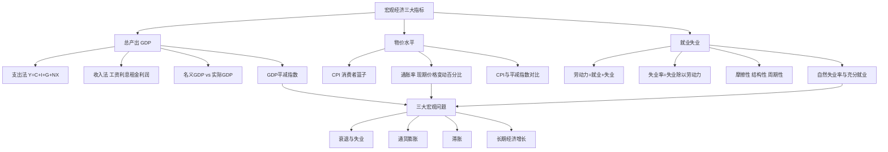

# 第九章 宏观经济基本指标及其衡量 · 章节总结

> 本章回答一个问题：**我们怎么知道一个国家的经济好不好？** 答案是三个指标：总产出（GDP）、物价（CPI）、就业（失业率）。

## 一、本章地图

## 二、核心公式速查

| 公式 | 含义 |
|---|---|
| $Y = C + I + G + NX$ | 支出法 GDP |
| $\text{GDP平减指数} = \dfrac{\text{名义GDP}}{\text{实际GDP}} \times 100$ | 物价总水平 |
| $CPI_t = \dfrac{\text{现期篮子费用}}{\text{基期篮子费用}} \times 100$ | 消费者物价 |
| $\pi_t = \dfrac{CPI_t - CPI_{t-1}}{CPI_{t-1}} \times 100\%$ | 通胀率 |
| $\text{失业率} = \dfrac{\text{失业人数}}{\text{劳动力人数}} \times 100\%$ | 失业率 |
| $\text{实际失业率} = \text{自然失业率} + \text{周期性失业率}$ | 失业分解 |

## 三、一句话记住每个 KP

- **KP01 GDP**：一年里中国境内新生产的所有最终产品按市价加总，支出法 = C + I + G + NX。
- **KP02 名义 vs 实际 GDP**：名义会骗人（价格涨也涨），实际 GDP 用基年价格才算真实产出。
- **KP03 CPI**：一篮子年货贵了多少，三大偏差：替代、新产品、质量。
- **KP04 失业率**：分母是劳动力不是总人口，躺平的人不算失业。
- **KP05 自然失业率**：摩擦+结构消灭不了，充分就业 = 周期性失业为零。

## 四、本章与后续章节的关系

- GDP 和物价 → 是 [[../12_AD-AS模型/知识点/KP01_AD总需求曲线|AD-AS 模型]] 的纵轴（价格）和横轴（产出）。
- 失业率与通胀率的关系 → [[../13_失业通胀与经济周期/知识点/KP03_菲利普斯曲线|菲利普斯曲线]]。
- GDP 的长期增长 → [[../16_经济增长/知识点/KP01_增长核算方程|经济增长理论]]。
- 政府怎么把实际 GDP 拉回潜在 GDP → [[../15_宏观经济政策/知识点/KP01_财政政策工具与自动稳定器|财政政策]]、[[../15_宏观经济政策/知识点/KP02_货币政策工具与货币乘数|货币政策]]。

---

## 🔗 相关知识点

**本章 KP：** [[知识点/KP01_GDP的含义与核算|KP01 GDP核算]] ｜ [[知识点/KP02_名义GDP与实际GDP|KP02 名义与实际GDP]] ｜ [[知识点/KP03_CPI消费价格指数|KP03 CPI]] ｜ [[知识点/KP04_失业的衡量|KP04 失业衡量]] ｜ [[知识点/KP05_失业类型与自然失业率|KP05 失业类型与自然失业率]]

**跨章：** [[../10_收入支出模型/00_章节总结|第十章 收入-支出模型]] ｜ [[../11_IS-LM模型/00_章节总结|第十一章 IS-LM]]

**📖 原书原文：** [[../../../原文件/经济学/西方经济学下册_宏观_全书|《西方经济学》下册 第九章]]
