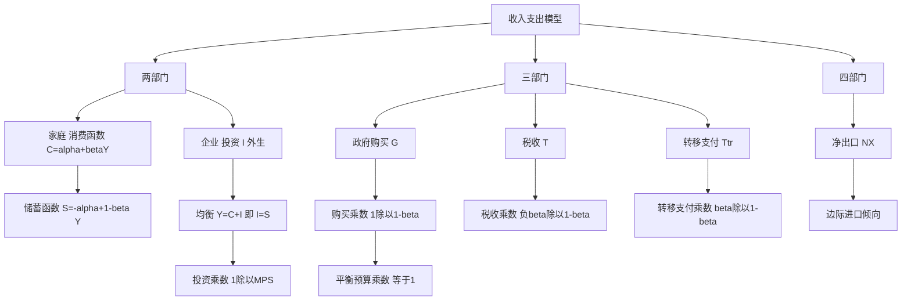

# 第十章 国民收入的决定：收入-支出模型 · 章节总结

> 本章是凯恩斯主义宏观经济学的"母模型"：**短期里，需求决定产出**。核心工具是消费函数和乘数。

## 一、本章地图

## 二、核心公式速查

| 公式 | 含义 |
|---|---|
| $C = \alpha + \beta Y$ | 线性消费函数，$\beta$ 是 MPC |
| $S = -\alpha + (1-\beta)Y$ | 储蓄函数 |
| $MPC + MPS = 1$，$APC + APS = 1$ | 互补关系 |
| $Y^* = (\alpha + I)/(1-\beta)$ | 两部门均衡收入 |
| $k_i = 1/(1-MPC) = 1/MPS$ | 投资乘数 |
| $k_G = 1/(1-\beta)$ | 政府购买乘数 |
| $k_T = -\beta/(1-\beta)$ | 税收乘数 |
| $k_{tr} = \beta/(1-\beta)$ | 转移支付乘数 |
| $k_b = 1$ | 平衡预算乘数 |

## 三、一句话记住每个 KP

- **KP01 均衡国民收入**：需求决定产出，企业根据意愿购买量调整产量，直到非计划存货 = 0。
- **KP02 消费函数**：$C = \alpha + \beta Y$，MPC 递减，APC > MPC。
- **KP03 两部门均衡**：$Y^* = (\alpha+I)/(1-\beta)$，等于自发支出除以 MPS。
- **KP04 投资乘数**：花 1 块钱能变出 1/(1-MPC) 块钱 GDP，一轮一轮花出去。
- **KP05 政府乘数**：购买乘数 > 转移支付乘数 = 税收乘数绝对值。
- **KP06 平衡预算乘数**：同时等额加税和支出，GDP 等额增加，乘数 = 1。

## 四、本章与后续章节的关系

- 本章假设投资外生、利率不变 → 下一章 [[../11_IS-LM模型/00_章节总结|IS-LM 模型]] 引入利率，让投资内生。
- 本章假设价格不变 → 再下一章 [[../12_AD-AS模型/00_章节总结|AD-AS 模型]] 引入价格变化。
- 本章的乘数是 [[../15_宏观经济政策/00_章节总结|宏观经济政策]] 的理论基础。

---

## 🔗 相关知识点

**本章 KP：** [[知识点/KP01_均衡国民收入与有效需求|KP01 均衡国民收入]] ｜ [[知识点/KP02_消费函数与储蓄函数|KP02 消费储蓄函数]] ｜ [[知识点/KP03_两部门均衡收入决定|KP03 两部门均衡]] ｜ [[知识点/KP04_投资乘数|KP04 投资乘数]] ｜ [[知识点/KP05_政府购买与税收乘数|KP05 政府乘数]] ｜ [[知识点/KP06_平衡预算乘数|KP06 平衡预算乘数]]

**跨章：** [[../09_宏观经济基本指标/00_章节总结|第九章 基本指标]] ｜ [[../11_IS-LM模型/00_章节总结|第十一章 IS-LM]]

**📖 原书原文：** [[../../../../原文件/经济学/西方经济学下册_宏观_全书|《西方经济学》下册 第十章]]
