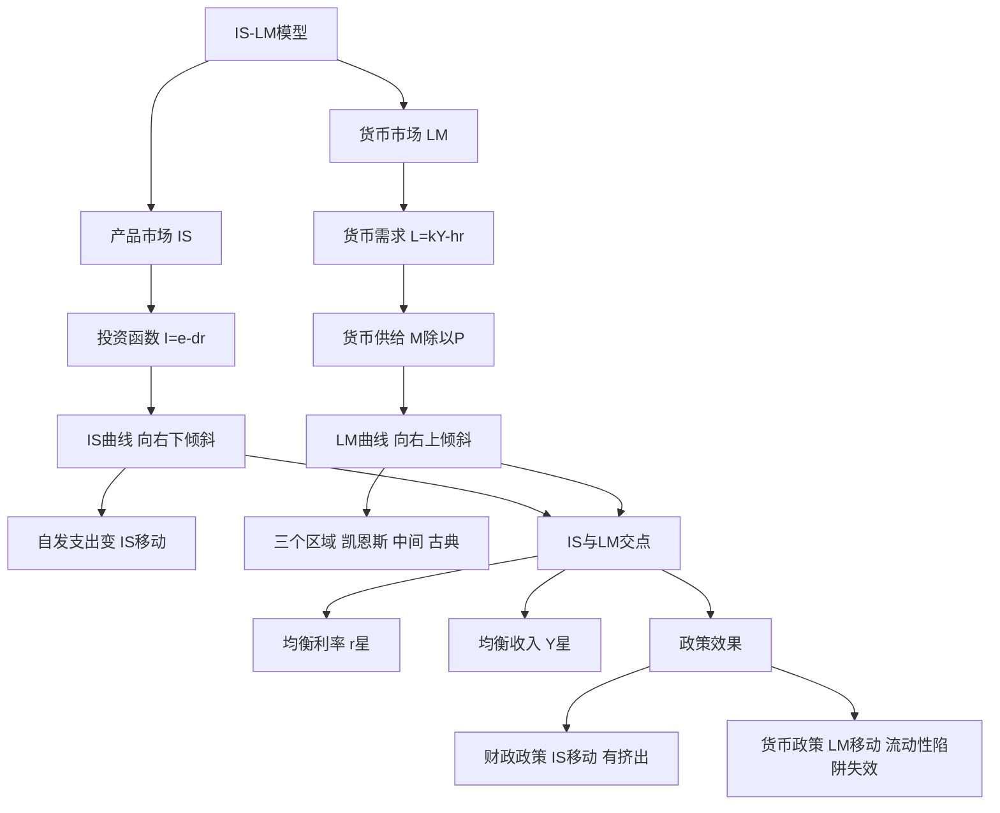

# 第十一章 国民收入的决定：IS-LM模型 · 章节总结

> 本章把产品市场和货币市场连起来：利率由货币市场决定，投资由利率决定，收入由产品市场决定。两条曲线的交点决定均衡 $Y$ 和 $r$。

## 一、本章地图

## 二、核心公式速查

| 公式 | 含义 |
|---|---|
| $I = e - dr$ | 投资函数，利率减函数 |
| IS：$Y = (\alpha + e - dr)/(1-\beta)$ | 产品市场均衡 |
| $L = kY - hr$ | 货币需求 |
| LM：$Y = (M/P)/k + (h/k)r$ | 货币市场均衡 |
| 联立 IS-LM | 解出 $Y^*, r^*$ |

## 三、一句话记住每个 KP

- **KP01 IS 曲线**：利率高 → 投资少 → 收入低，右下倾斜；自发支出右移。
- **KP02 货币需求**：交易 + 预防看收入，投机看利率；债券价格与利率反向。
- **KP03 LM 曲线**：收入高 → 交易需求大 → 利率高，右上倾斜；三个区域。
- **KP04 IS-LM 均衡**：两线交点决定 $Y^*, r^*$；财政推高利率有挤出。
- **KP05 流动性陷阱与挤出**：凯恩斯区域财政最有效，古典区域货币最有效。

## 四、本章与后续章节的关系

- IS-LM 假设价格不变 → 引入价格就得到 [[../12_AD-AS模型/00_章节总结|AD-AS 模型]]。
- IS-LM 是 [[../15_宏观经济政策/00_章节总结|财政与货币政策]] 效果分析的工具。
- 本章的货币市场均衡是 [[../15_宏观经济政策/知识点/KP02_货币政策工具与货币乘数|货币政策]] 的理论基础。

---

## 🔗 相关知识点

**本章 KP：** [[知识点/KP01_IS曲线|KP01 IS曲线]] ｜ [[知识点/KP02_货币需求与流动性偏好|KP02 货币需求]] ｜ [[知识点/KP03_LM曲线|KP03 LM曲线]] ｜ [[知识点/KP04_ISLM共同均衡|KP04 共同均衡]] ｜ [[知识点/KP05_流动性陷阱与挤出效应|KP05 陷阱与挤出]]

**跨章：** [[../10_收入支出模型/00_章节总结|第十章 收入-支出]] ｜ [[../12_AD-AS模型/00_章节总结|第十二章 AD-AS]]

**📖 原书原文：** [[../../../原文件/经济学/西方经济学下册_宏观_全书|《西方经济学》下册 第十一章]]
