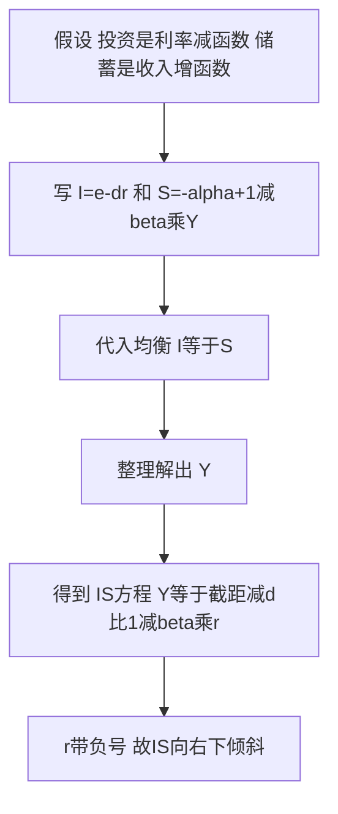

# KP01 IS曲线：产品市场均衡

<a href="../../../../exam.html" target="_blank" style="display:inline-block;padding:6px 16px;background:#2563eb;color:#fff;border-radius:6px;text-decoration:none;font-size:14px;">📝 开始做题</a>

> 所属：[[00_章节总结|第十一章 IS-LM模型]]

## 1. 一句话先懂（小白版）

上一章我们假设投资 $I$ 是固定的。现实里企业投不投资，要看**利率**——利率 5% 时借 100 万一年利息 5 万，企业觉得划算就投；利率涨到 10%，利息 10 万，很多项目就不划算了。

**IS 曲线**就是把"利率 → 投资 → 国民收入"这条链子画出来：利率越高，投资越少，均衡收入越低。所以 IS 曲线是向右下方倾斜的。

## 2. 严格定义

**IS 曲线**：产品市场达到均衡（计划投资 = 计划储蓄，或 $Y = C + I + G$）时，**利率 $r$ 与国民收入 $Y$** 各种组合的轨迹。

推导（两部门，线性）：

- 投资函数：$I = e - dr$（$e$ 是自主投资，$d$ 是投资对利率的敏感度）
- 储蓄函数：$S = -\alpha + (1-\beta)Y$
- 均衡条件：$I = S$

$$e - dr = -\alpha + (1-\beta)Y$$

解出 $Y$：

$$Y = \frac{\alpha + e - dr}{1-\beta}$$

这就是 IS 曲线方程。$r$ 前面系数是负的 → $r$ 上升 → $Y$ 下降。

## 3. 图形直觉

横轴 $Y$，纵轴 $r$：
- IS 曲线向右下倾斜。
- IS 曲线**左边**的点：$I > S$（投资 > 储蓄）→ 产品供不应求 → 企业增产 → $Y$ 上升。
- IS 曲线**右边**的点：$I < S$ → 产品供过于求 → 企业减产 → $Y$ 下降。

## 4. IS 曲线怎么移动？

任何**自发支出**变化都会让 IS 整条移动：

| 变动 | IS 移动方向 | 原因 |
|---|---|---|
| 政府购买 $G$ 增加 | 右移 | 扩张性财政政策 |
| 减税 $T$ | 右移 | 老百姓可支配收入多了，消费增加 |
| 自主投资 $e$ 增加 | 右移 | 企业对未来乐观 |
| 自主消费 $\alpha$ 增加 | 右移 | 老百姓更敢花钱 |
| 政府购买 $G$ 减少 | 左移 | 紧缩性财政政策 |

移动幅度 = 乘数 × 自发支出变动量。

## 5. IS 曲线斜率由什么决定？

从方程 $Y = (\alpha + e - dr)/(1-\beta)$ 看：

- **$\beta$ 越大（MPC 越大）**：乘数越大，利率变动引起的投资变动会被放大成更大的收入变动 → IS 曲线越**平缓**。
- **$d$ 越大（投资对利率越敏感）**：利率变一点，投资变很多 → IS 曲线越**平缓**。
- 反之，$d$ 小（企业对利率不敏感，比如困难时期再降息也没人投资）→ IS 曲线很**陡**。

## 5.5 理论推导（一步步推）

> 本结论从什么假设出发，怎么一步步走到"IS 向右下倾斜"。

**假设起点**：
1. 两部门经济（先不考虑政府和外贸），产品市场均衡即计划投资 = 计划储蓄 $I=S$。
2. 投资不是固定数，而是利率的减函数：利率越高，借钱成本越大，企业越不愿投资。
3. 储蓄是收入的增函数：收入越高，存下来的越多。

**推导过程**：
- 第一步：写出两条行为方程。投资 $I=e-dr$（$e$ 自主投资，$d>0$ 投资对利率敏感系数）；储蓄 $S=-\alpha+(1-\beta)Y$（$\alpha$ 自主消费，$\beta$ 边际消费倾向，$1-\beta$ 是边际储蓄倾向）。
- 第二步：代入均衡条件 $I=S$：$e-dr=-\alpha+(1-\beta)Y$。
- 第三步：把 $Y$ 解到左边：$(1-\beta)Y=\alpha+e-dr$。
- 第四步：两边除以 $(1-\beta)$：$Y=\dfrac{\alpha+e-dr}{1-\beta}$。
- **结论**：$r$ 在分子里带负号 → $r$ 上升则 $Y$ 下降 → 在横轴 $Y$、纵轴 $r$ 的图上，IS 曲线**向右下方倾斜**。

**一句话记住**：利率升 → 投资降 → 通过乘数把收入拉低，所以 r 和 Y 反方向走。

## 5.6 数学推导（公式怎么来的）

> 每个符号第一次出现都解释。

设：$Y$ 国民收入；$C=\alpha+\beta Y_d$ 消费函数（$Y_d$ 可支配收入，两部门即 $Y$）；$S=Y-C=-\alpha+(1-\beta)Y$；$I=e-dr$。

均衡条件 $I=S$：

$$e-dr=-\alpha+(1-\beta)Y$$

把含 $Y$ 的项留在右边、其余移到左边：

$$(1-\beta)Y=\alpha+e-dr$$

两边除以 $(1-\beta)$：

$$\boxed{Y=\frac{\alpha+e}{1-\beta}-\frac{d}{1-\beta}\,r}$$

这就是 IS 方程。它是一条直线：纵轴 $r$、横轴 $Y$。

- **纵截距**（$Y=0$ 时）：$r=\dfrac{\alpha+e}{d}$。
- **斜率**：写成 $r=\dfrac{\alpha+e}{d}-\dfrac{1-\beta}{d}Y$，故斜率为 $-\dfrac{1-\beta}{d}$。$\beta$ 越大（乘数大）或 $d$ 越大（投资怕利率），斜率绝对值越小，IS 越平缓。
- **移动**：自主支出 $\alpha+e$（或三部门里加上 $G$、减去 $\beta T$）变化时，纵截距变 → IS 整条平移，水平移动量 $=\dfrac{\Delta(\alpha+e+G)}{1-\beta}$。

**图形说明**：横轴 $Y$，纵轴 $r$。IS 从左上到右下。IS **左上方**任一点：同一 $Y$ 下 $r$ 偏高 → 投资偏少 → $I<S$，产品供过于求，收入有下降压力；IS **右下方**任一点相反。

## 6. 手算例子

**题目**：已知 $\alpha = 100$，$\beta = 0.8$，$e = 200$，$d = 50$。写出 IS 方程，并算 $r = 5$（%）和 $r = 10$（%）时的 $Y$。

**第一步：写 IS 方程**

$$Y = \frac{100 + 200 - 50r}{1-0.8} = \frac{300 - 50r}{0.2} = 1500 - 250r$$

**第二步：代入利率**

- $r = 5$：$Y = 1500 - 250 \times 5 = 1500 - 1250 = \mathbf{250}$
- $r = 10$：$Y = 1500 - 250 \times 10 = 1500 - 2500 = \mathbf{-1000}$（经济上不合理，说明利率太高时投资为负，模型失效）

（注：这里数字是示意，实际经济中 $r$ 用小数表示，比如 5% = 0.05，那么 $d=5000$，$Y = 1500 - 25000r$，$r=0.05$ 时 $Y=250$。考试时注意单位。）

## 7. 容易混淆

- **IS 曲线本身是产品市场均衡点的集合**，不是"投资和储蓄的曲线"。
- **沿 IS 移动 vs IS 移动**：利率变 → 沿 IS 移动；自发支出变 → IS 整条移动。
- **IS 曲线不包含价格**：这是短期模型，价格还没引入。

## 8. 现实意义

央行降息，就是想沿着 IS 曲线把 $r$ 往下走，从而把 $Y$ 拉起来。但如果 IS 曲线很陡（企业对利率不敏感），降息效果就差——这就是"推绳子"，经济衰退时货币政策效果有限。

---

## 🔗 相关知识点

**同章关联：** [[KP02_货币需求与流动性偏好|货币需求]] ｜ [[KP03_LM曲线|LM曲线]] ｜ [[KP04_ISLM共同均衡|IS-LM共同均衡]]

**跨章关联：** [[../../10_收入支出模型/知识点/KP03_两部门均衡收入决定|两部门均衡]] ｜ [[../../10_收入支出模型/知识点/KP04_投资乘数|投资乘数]] ｜ [[../../15_宏观经济政策/知识点/KP01_财政政策工具与自动稳定器|财政政策]]

**📖 原书原文：** [[../../../../原文件/经济学/西方经济学下册_宏观_全书|《西方经济学》下册 第十一章]]

---

## 🐮 小白教程入门

> 看不懂下面这个KP？先看通俗版教程建立直觉：

- [[../../../../经济统计学论文从0基础到精通/14_宏观经济学基础/06_IS曲线是什么|🐮 教程·IS曲线是什么]]

---

## 📝 考研真题（首经贸 801）

**配套主观题：** 见同目录 [[../考研真题集|本章考研真题集]]
**配套选择题：** 见同目录 [[../选择题集|本章选择题集]]

### 高频简答
- 简述 IS 曲线的推导、斜率与移动 → 见 [[../考研真题集#s1|真题集·简答 1]]
- 简述 IS 曲线斜率的影响因素 → 见 [[../考研真题集#s2|真题集·简答 2]]

### 高频论述
- 用 IS-LM 模型分析当前中国积极财政政策与稳健货币政策的搭配 → 见 [[../考研真题集#l1|真题集·论述 1]]

### 易错选择
- 本知识点选择题见 [[../选择题集#KP01 IS 曲线|选择题集·KP01]]
