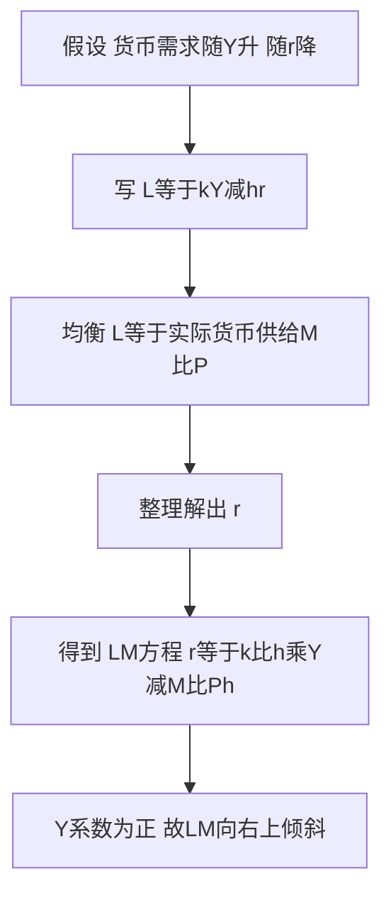

# KP03 LM曲线：货币市场均衡

<a href="../../../../exam.html" target="_blank" style="display:inline-block;padding:6px 16px;background:#2563eb;color:#fff;border-radius:6px;text-decoration:none;font-size:14px;">📝 开始做题</a>

> 所属：[[00_章节总结|第十一章 IS-LM模型]]

## 1. 一句话先懂（小白版）

IS 曲线讲产品市场，LM 曲线讲**货币市场**：钱的供给（央行印的）和钱的需求（老百姓想持有的）什么时候相等？

货币市场均衡条件：$L = M/P$（货币需求 = 货币供给）。

代入 $L = kY - hr$：

$$kY - hr = \frac{M}{P}$$

解出 $Y$ 和 $r$ 的关系：

$$Y = \frac{1}{k}\frac{M}{P} + \frac{h}{k}r$$

**$r$ 前面系数是正的**：利率越高，收入越高。所以 LM 曲线是**向右上方倾斜**的。

## 2. 严格定义

**LM 曲线**：货币市场达到均衡（货币需求 = 货币供给）时，利率 $r$ 与国民收入 $Y$ 各种组合的轨迹。

推导：

$$\frac{M}{P} = L_1(Y) + L_2(r) = kY - hr$$

移项：

$$kY = \frac{M}{P} + hr$$

$$Y = \frac{M/P}{k} + \frac{h}{k}r$$

或者解出 $r$：

$$r = \frac{k}{h}Y - \frac{1}{h}\frac{M}{P}$$

## 3. 为什么 LM 向右上倾斜？（直觉）

- 收入 $Y$ 上升 → 交易需求 $L_1$ 增加 → 在货币供给不变的情况下，钱被交易需求占走了 → 为了让老百姓愿意少持有投机货币（把钱腾出来给交易用），利率 $r$ 必须上升。
- 所以 $Y$ 高 → $r$ 高，正向关系。

## 4. LM 曲线的三个区域

LM 曲线不是一条直线，它有三段：

| 区域 | 形状 | 含义 | 货币政策效果 |
|---|---|---|---|
| **凯恩斯区域（左下角）** | 水平 | 利率极低，流动性陷阱，货币需求无穷大 | **无效**（发多少货币都被持有） |
| **中间区域** | 向右上倾斜 | 正常情况 | 部分有效 |
| **古典区域（左上角）** | 垂直 | 利率极高，投机货币需求 = 0，货币需求只看收入 | **极有效** |

**为什么古典区域垂直？** 古典学派认为利率足够高时，人们不持有任何投机货币（全买债券），货币需求只由交易需求 $kY$ 决定，跟利率无关。所以给定 $M/P$，$Y$ 就唯一确定，LM 垂直。

## 5. LM 曲线怎么移动？

只有**实际货币供给**变化才会移动 LM：

| 变动 | LM 移动方向 | 原因 |
|---|---|---|
| 央行增加货币供给 $M$ | 右移 | 扩张性货币政策 |
| 价格水平 $P$ 下降 | 右移 | 实际货币余额增加 |
| 央行收紧货币 | 左移 | 紧缩性货币政策 |

注意：收入 $Y$ 变化 → 沿 LM 移动；货币供给变 → LM 整条移动。

## 5.5 理论推导（一步步推）

> LM 描述"货币市场均衡时 r 与 Y 的组合"，为什么它向右上方倾斜。

**假设起点**：
1. 人们持币有两种动机：交易/预防动机（随收入 $Y$ 增加而增加，要更多钱买东西）和投机动机（利率 $r$ 越高，越不想持有不生息的现金，宁愿买债券）。
2. 实际货币需求 $L$ 是 $Y$ 的增函数、$r$ 的减函数。
3. 实际货币供给 $\dfrac{M}{P}$ 由央行外生决定（短期 P 不变）。

**推导过程**：
- 第一步：写出货币需求方程 $L=kY-hr$（$k>0$ 交易需求对收入敏感系数，$h>0$ 投机需求对利率敏感系数）。
- 第二步：货币市场均衡要求实际需求 = 实际供给：$kY-hr=\dfrac{M}{P}$。
- 第三步：把 $r$ 解出来：$hr=kY-\dfrac{M}{P}$，即 $r=\dfrac{k}{h}Y-\dfrac{M}{Ph}$。
- **结论**：$Y$ 的系数 $\dfrac{k}{h}>0$ → $Y$ 上升则 $r$ 上升 → LM 在横轴 $Y$、纵轴 $r$ 图上**向右上方倾斜**。直觉：收入高了要买更多东西，货币需求上升，在货币供给不变时，必须靠利率上升把投机性货币需求挤出来，才能重新出清。

## 5.6 数学推导（公式怎么来的）

> 符号首次出现即解释。

设：$M$ 名义货币供给（央行定）；$P$ 价格水平；$\dfrac{M}{P}$ 实际货币供给；$L$ 实际货币需求。

凯恩斯货币需求函数（流动性偏好）：

$$L=\underbrace{kY}_{\text{交易需求}}-\underbrace{hr}_{\text{投机需求}}$$

- $k$：收入每增加 1 单位，多需要多少货币做交易（$k>0$）。
- $h$：利率每上升 1 单位，人们少持有多少投机性现金（$h>0$）。

货币市场均衡 $L=\dfrac{M}{P}$：

$$kY-hr=\frac{M}{P}$$

解出 $r$：

$$hr=kY-\frac{M}{P}$$

$$\boxed{r=\frac{k}{h}Y-\frac{M}{Ph}}$$

这就是 LM 方程。

- **斜率** $\dfrac{k}{h}>0$ → LM 向右上倾斜。$k$ 越大（花钱越离不开现金）或 $h$ 越小（利率对持币意愿不敏感），LM 越陡。
- **截距** $-\dfrac{M}{Ph}$。**$M$ 增大或 $P$ 下降**，截距更负 → 同一 $Y$ 对应更低 $r$ → **LM 右移**；反之 $M$ 减小或 $P$ 上升 → LM 左移。
- **三个区域**：$h\to\infty$（流动性陷阱，利率极低大家都持币）时斜率 $\dfrac{k}{h}\to0$，LM **水平**（凯恩斯区域）；$h\to0$（古典情形，货币需求对利率毫无弹性）时斜率 $\to\infty$，LM **垂直**（古典区域）；中间向右上倾斜。

**图形说明**：横轴 $Y$，纵轴 $r$，LM 从左下到右上。LM **左上方**任一点：同一 $Y$ 下 $r$ 偏高 → 货币需求过少 → $\dfrac{M}{P}>L$，人们买债券，$r$ 有下降压力。

## 6. 手算例子

**题目**：已知 $k = 0.5$，$h = 100$，实际货币供给 $M/P = 200$。写出 LM 方程，并算 $Y = 600$ 时的均衡利率。

**第一步：写 LM 方程**

$$0.5Y - 100r = 200$$

$$Y = 400 + 200r$$

$$r = 0.005Y - 2$$

**第二步：代入 $Y = 600$**

$$r = 0.005 \times 600 - 2 = 3 - 2 = 1$$

（这里 $r$ 的单位是百分点，即 1%。如果用小数，$r = 0.01$。）

**第三步：如果央行把 $M/P$ 增加到 300**

$$0.5Y - 100r = 300 \Rightarrow Y = 600 + 200r$$

同样 $Y = 600$ 时，$r = 0.005 \times 600 - 3 = 0$——利率降到 0，LM 右移了。

## 7. 容易混淆

- **IS 右下倾斜，LM 右上倾斜**，方向相反。
- **LM 的 L 代表 Liquidity preference（流动性偏好），M 代表 Money supply（货币供给）**——两个单词的首字母。
- **LM 移动只跟货币供求有关**，财政政策不移动 LM（但财政政策会移动 IS，间接影响均衡）。
- **凯恩斯区域货币政策无效，古典区域财政政策无效**（后面讲政策效果时会用到）。

## 8. 现实意义

央行降息刺激经济，就是想在 LM 曲线上让 $r$ 往下走。但如果经济已经在凯恩斯区域（流动性陷阱），LM 水平，降息到底了，货币政策失效——这就是为什么 2008 年后各国央行拼命搞"非常规货币政策"（QE、负利率）。

---

## 🔗 相关知识点

**同章关联：** [[KP02_货币需求与流动性偏好|货币需求]] ｜ [[KP05_流动性陷阱与挤出效应|流动性陷阱]] ｜ [[KP04_ISLM共同均衡|IS-LM共同均衡]]

**跨章关联：** [[../../15_宏观经济政策/知识点/KP02_货币政策工具与货币乘数|货币政策]] ｜ [[../../12_AD-AS模型/知识点/KP01_AD总需求曲线|AD曲线推导]]

**📖 原书原文：** [[../../../../原文件/经济学/西方经济学下册_宏观_全书#第十一章 国民收入的决定：IS-LM 模型|《西方经济学》下册 第十一章]]

---

## 🐮 小白教程入门

> 看不懂下面这个KP？先看通俗版教程建立直觉：

- [[../../../../经济统计学论文从0基础到精通/14_宏观经济学基础/07_LM曲线与货币需求|🐮 教程·LM曲线与货币需求]]

---

## 📝 考研真题（首经贸 801）

**配套主观题：** 见同目录 [[../考研真题集|本章考研真题集]]
**配套选择题：** 见同目录 [[../选择题集|本章选择题集]]

### 高频简答
- 简述 LM 曲线的推导与三个区域 → 见 [[../考研真题集#s5|真题集·简答 5]]
- 【计算】已知 L=0.2y−10r，m=200，推导 LM 方程并画 LM 曲线 → 见 [[../考研真题集#s6|真题集·简答 6]]
- 简述 LM 曲线三个区域的政策含义 → 见 [[../考研真题集#s7|真题集·简答 7]]

### 高频论述
- 试述 LM 曲线三个区域的经济含义，结合日本"失去的二十年"分析流动性陷阱 → 见 [[../考研真题集#l2|真题集·论述 2]]

### 易错选择
- 本知识点选择题见 [[../选择题集#KP03 LM 曲线|选择题集·KP03]]
