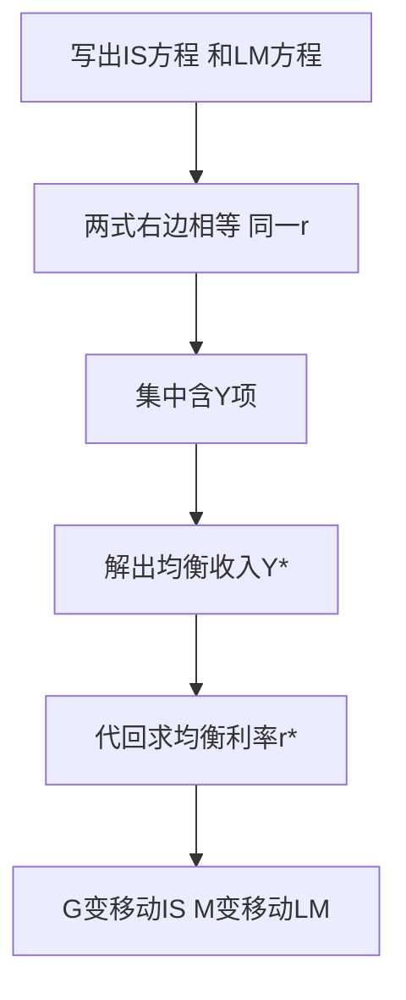

# KP04 IS-LM共同均衡：产品市场与货币市场同时均衡

<a href="../../../../exam.html" target="_blank" style="display:inline-block;padding:6px 16px;background:#2563eb;color:#fff;border-radius:6px;text-decoration:none;font-size:14px;">📝 开始做题</a>

> 所属：[[00_章节总结|第十一章 IS-LM模型]]

## 1. 一句话先懂（小白版）

IS 曲线是产品市场均衡点的集合，LM 曲线是货币市场均衡点的集合。**两条线的交点**就是两个市场同时均衡的点——这个点决定了整个经济的均衡利率 $r^*$ 和均衡收入 $Y^*$。

## 2. 严格定义

联立 IS 和 LM 两个方程：

$$\text{IS: } Y = \frac{\alpha + e - dr}{1-\beta}$$

$$\text{LM: } Y = \frac{M/P}{k} + \frac{h}{k}r$$

两个方程两个未知数（$Y, r$），解出来就是共同均衡。

## 3. 失衡怎么调整？

四个区域的失衡：

| 区域 | 产品市场 | 货币市场 | 调整方向 |
|---|---|---|---|
| IS 左、LM 左 | $I > S$（产品短缺） | $L > M$（货币短缺） | $Y$ 上升、$r$ 上升 |
| IS 左、LM 右 | $I > S$ | $L < M$（货币过剩） | $Y$ 上升、$r$ 下降 |
| IS 右、LM 左 | $I < S$（产品过剩） | $L > M$ | $Y$ 下降、$r$ 上升 |
| IS 右、LM 右 | $I < S$ | $L < M$ | $Y$ 下降、$r$ 下降 |

经济会自动向交点移动。

## 4. 财政政策和货币政策怎么移动均衡？

### 扩张性财政政策（增 G、减税）

- IS 右移 → 新交点 $Y$ 上升、$r$ 上升。
- 但 $r$ 上升会**挤出**私人投资（企业觉得利率高不投了），所以 $Y$ 的增加比简单乘数模型算的要少。
- 这就是**挤出效应**。

### 扩张性货币政策（央行放水）

- LM 右移 → 新交点 $r$ 下降、$Y$ 上升。
- $r$ 下降刺激私人投资，$Y$ 增加。

### 政策组合

| 组合 | IS | LM | $r$ | $Y$ | 适用场景 |
|---|---|---|---|---|---|
| 双扩张 | 右移 | 右移 | 不确定 | 大增 | 严重衰退 |
| 扩财政 + 紧货币 | 右移 | 左移 | 大升 | 小变 | 要增长但防泡沫 |
| 紧财政 + 扩货币 | 左移 | 右移 | 大降 | 小变 | 降利率促投资 |
| 双紧缩 | 左移 | 左移 | 不确定 | 大降 | 严重通胀 |

## 4.5 理论推导与数学推导（IS-LM 联立怎么解）

> 两个市场同时均衡，就是 IS 方程和 LM 方程联立，两个未知数 $Y$、$r$。

**第一步：写出两条方程**

$$\text{IS:}\quad Y=\frac{\alpha+\bar A-br}{1-\beta}\quad\Longleftrightarrow\quad r=\frac{\alpha+\bar A}{b}-\frac{1-\beta}{b}Y$$

$$\text{LM:}\quad r=\frac{k}{h}Y-\frac{M}{Ph}$$

其中 $\bar A=e+G-\beta T$（自主支出）。

**第二步：两式右边相等**（同一均衡 $r$）

$$\frac{\alpha+\bar A}{b}-\frac{1-\beta}{b}Y=\frac{k}{h}Y-\frac{M}{Ph}$$

**第三步：把含 $Y$ 的项集中**

$$\frac{\alpha+\bar A}{b}+\frac{M}{Ph}=\left(\frac{k}{h}+\frac{1-\beta}{b}\right)Y$$

解出均衡收入：

$$\boxed{Y^*=\frac{\frac{\alpha+\bar A}{b}+\frac{M}{Ph}}{\frac{k}{h}+\frac{1-\beta}{b}}}$$

代回任一式得均衡利率 $r^*$。

**第四步：用这个式子看政策效果**（曲线移动的数学本质）
- $G$ 上升 → $\bar A$ 上升 → 分子变大 → $Y^*$ 上升；同时 $r^*$ 上升（IS 右移）。
- $M$ 上升 → $\dfrac{M}{Ph}$ 变大 → $Y^*$ 上升、$r^*$ 下降（LM 右移）。
- $G$、$M$ 同时上升：分子两项都增大 → $Y^*$ 必升；但 $\bar A$ 抬 $r$、$M$ 压 $r$ → $r^*$ 方向不定（见论述 6）。

**图形说明**：横轴 $Y$、纵轴 $r$，IS 向右下、LM 向右上，两线交点即 $(Y^*,r^*)$。交点左上方：$I<S$ 且 $M/P>L$，产品过剩但货币过剩，调整方向由谁相对失衡更大决定。

## 5. 手算例子

**题目**：已知：
- IS：$Y = 1500 - 250r$
- LM：$Y = 500 + 250r$

求均衡 $Y^*$ 和 $r^*$。

**第一步：联立方程**

$$1500 - 250r = 500 + 250r$$

**第二步：解 r**

$$1500 - 500 = 250r + 250r$$
$$1000 = 500r$$
$$r^* = 2$$

**第三步：代入求 Y**

$$Y^* = 1500 - 250 \times 2 = 1500 - 500 = \mathbf{1000}$$

（验证 LM：$Y = 500 + 250 \times 2 = 1000$ ✓）

**解读**：均衡利率 2%，均衡收入 1000。

**第四步：如果政府购买增加，IS 右移到 $Y = 2000 - 250r$**

$$2000 - 250r = 500 + 250r$$
$$1500 = 500r$$
$$r = 3$$
$$Y = 500 + 250 \times 3 = 1250$$

$Y$ 从 1000 涨到 1250（+250），$r$ 从 2 涨到 3。如果没有挤出效应（利率不变），按乘数 $k_G = 1/(1-0.8) = 5$，IS 右移应该是 $\Delta G \times 5$。这里 IS 右移了 500（从 1500 到 2000），对应 $\Delta G = 100$，无挤出时 $Y$ 应该涨 500 到 1500；实际只涨到 1250——有 250 被利率上升挤掉了。

## 6. 容易混淆

- **IS-LM 交点是短期均衡**，不一定是充分就业均衡。如果 $Y^* < Y_{\text{潜在}}$，经济萧条，需要扩张政策。
- **挤出效应的大小取决于 LM 斜率**：LM 越陡（古典区域），挤出越完全；LM 水平（凯恩斯区域），完全没挤出。
- **IS-LM 是短期模型**，价格不变；引入价格就变成 AD-AS 模型。

## 7. 现实意义

2008 年中国搞"四万亿"（IS 右移），同时央行降息（LM 也右移）——双管齐下，$Y$ 大涨，$r$ 没涨。这就是为什么那年 GDP 增长 9%。2015 年中国经济下行，央行多次降息（LM 右移），但财政没大动作，效果有限——因为企业预期差，IS 曲线本身在左移。

---

## 🔗 相关知识点

**同章关联：** [[KP01_IS曲线|IS曲线]] ｜ [[KP03_LM曲线|LM曲线]] ｜ [[KP05_流动性陷阱与挤出效应|流动性陷阱]]

**跨章关联：** [[../../12_AD-AS模型/知识点/KP01_AD总需求曲线|AD曲线]] ｜ [[../../15_宏观经济政策/知识点/KP01_财政政策工具与自动稳定器|财政政策]] ｜ [[../../15_宏观经济政策/知识点/KP02_货币政策工具与货币乘数|货币政策]]

**📖 原书原文：** [[../../../../原文件/经济学/西方经济学下册_宏观_全书#第十一章 国民收入的决定：IS-LM 模型|《西方经济学》下册 第十一章]]

---

## 🐮 小白教程入门

> 看不懂下面这个KP？先看通俗版教程建立直觉：

- [[../../../../经济统计学论文从0基础到精通/14_宏观经济学基础/08_IS-LM均衡与挤出效应|🐮 教程·IS-LM均衡与挤出效应]]

---

## 📝 考研真题（首经贸 801）

**配套主观题：** 见同目录 [[../考研真题集|本章考研真题集]]
**配套选择题：** 见同目录 [[../选择题集|本章选择题集]]

### 高频简答
- 简述 IS-LM 共同均衡的含义与失衡调整 → 见 [[../考研真题集#s8|真题集·简答 8]]
- 比较财政政策与货币政策在流动性陷阱与古典区域的效果 → 见 [[../考研真题集#s11|真题集·简答 11]]

### 高频论述
- 用 IS-LM 模型分析当前中国积极财政政策与稳健货币政策的搭配 → 见 [[../考研真题集#l1|真题集·论述 1]]

### 易错选择
- 本知识点选择题见 [[../选择题集#KP04 IS-LM 共同均衡|选择题集·KP04]]
