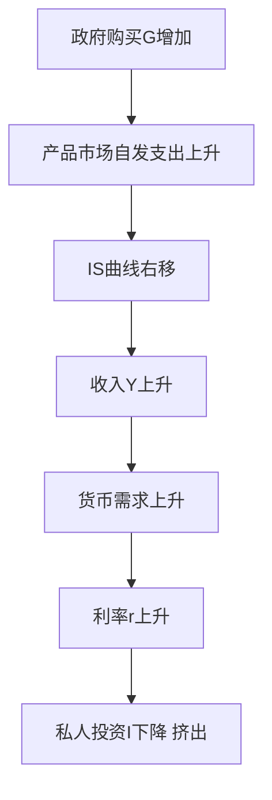
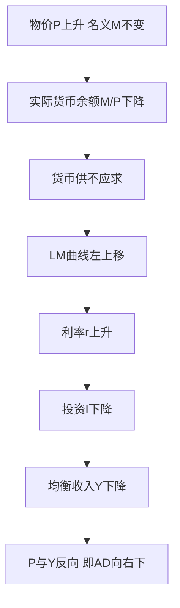
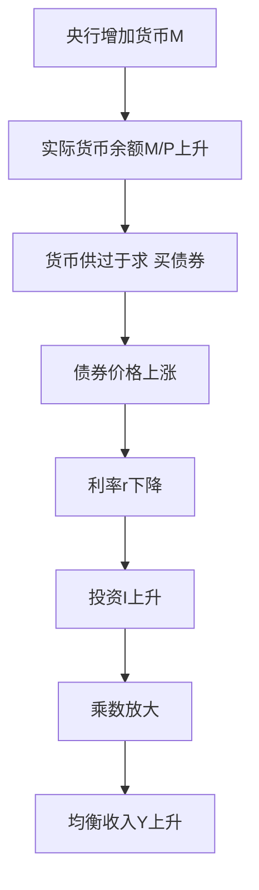
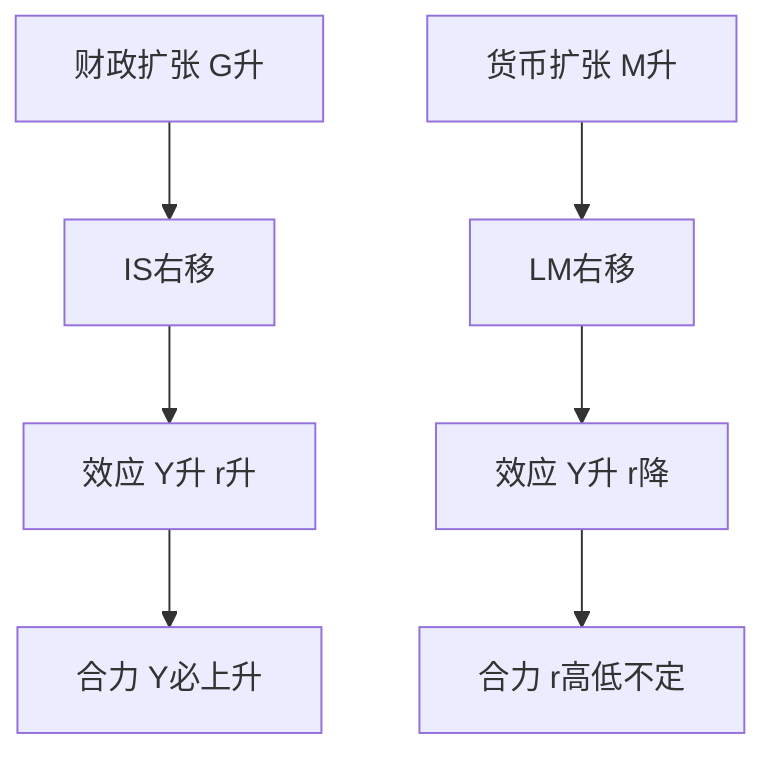

# 第十一章 IS-LM 模型 · 考研真题集（首经贸 801）

<a href="../../../exam.html" target="_blank" style="display:inline-block;padding:6px 16px;background:#2563eb;color:#fff;border-radius:6px;text-decoration:none;font-size:14px;">📝 开始做题</a>

> 本章共收录：简答题 11 道（每题 15 分）｜论述题 4 道（每题 30 分）
> 配套选择题见 [[选择题集|本章选择题集]]
> 对应大纲：马工程《西方经济学·下册》第十四章 国民收入决定：IS-LM 模型

## 📋 本题集目录

### 简答题
1. [[#简答 1：简述 IS 曲线的推导、斜率与移动|简述 IS 曲线的推导、斜率与移动]]
2. [[#简答 2：简述 IS 曲线斜率的影响因素|简述 IS 曲线斜率的影响因素]]
3. [[#简答 3：简述凯恩斯货币需求的三种动机|简述凯恩斯货币需求的三种动机]]
4. [[#简答 4：简述债券价格与利率的反向关系|简述债券价格与利率的反向关系]]
5. [[#简答 5：简述 LM 曲线的推导与三个区域|简述 LM 曲线的推导与三个区域]]
6. [[#简答 6：【计算】已知货币需求函数 L=0.2y−10r，实际货币供给 m=M/P=200。求 LM 方程，并画出 LM 曲线（标注 y=1000、y=1500 时对应的 r）|【计算】已知 L=0.2y−10r，m=200，推导 LM 方程并画 LM 曲线]]
7. [[#简答 7：简述 LM 曲线三个区域的政策含义|简述 LM 曲线三个区域的政策含义]]
8. [[#简答 8：简述 IS-LM 共同均衡的含义与失衡调整|简述 IS-LM 共同均衡的含义与失衡调整]]
9. [[#简答 9：简述流动性陷阱的含义与政策含义|简述流动性陷阱的含义与政策含义]]
10. [[#简答 10：简述挤出效应的含义及其影响因素|简述挤出效应的含义及其影响因素]]
11. [[#简答 11：比较财政政策与货币政策在流动性陷阱与古典区域的效果|比较财政政策与货币政策在流动性陷阱与古典区域的效果]]

### 论述题
1. [[#论述 1：用 IS-LM 模型分析当前中国积极财政政策与稳健货币政策的搭配，并说明为何在流动性陷阱边缘财政政策更有效|用 IS-LM 模型分析当前中国积极财政政策与稳健货币政策的搭配，并说明为何在流动性陷阱边缘财政政策更有效]]
2. [[#论述 2：试述 LM 曲线三个区域的经济含义，并结合日本"失去的二十年"与中国 2024—2026 年低利率环境分析流动性陷阱|试述 LM 曲线三个区域的经济含义，并结合日本"失去的二十年"与中国 2024—2026 年低利率环境分析流动性陷阱]]
3. [[#论述 3：用 IS-LM 模型分析政府扩大支出对私人投资的挤出效应，并结合中国地方债与民间投资疲软现象讨论对策|用 IS-LM 模型分析政府扩大支出对私人投资的挤出效应，并结合中国地方债与民间投资疲软现象讨论对策]]
4. [[#论述 4：2008 年全球金融危机后，主要经济体央行实施量化宽松（QE）。用 IS-LM 与流动性陷阱理论解释为何 QE 效果有限|2008 年全球金融危机后，主要经济体央行实施量化宽松（QE）。用 IS-LM 与流动性陷阱理论解释为何 QE 效果有限]]

---

## 一、简答题（每题 15 分，建议 450–700 字）

### 简答 1：简述 IS 曲线的推导、斜率与移动

**【建议字数】450–700 字 ｜ 【建议时间】15 分钟 ｜ 【题型】模型分析**

**【考什么】** 对应知识点 [[知识点/KP01_IS曲线|IS 曲线]]；题型属于模型分析。

**【核心推导】**
**第一步：给出 IS 曲线的严格定义。** IS 曲线是**产品市场均衡时 $(Y,r)$ 的轨迹**，即所有使计划支出等于产出（等价于 $I=S$）的利率—收入组合。定义里必须出现"均衡"与"轨迹"两个词：前者区分于任意点，后者指明它是一条曲线而非一个点。

**第二步：从储蓄—投资相等推导。** 设 $I=e-dr$（$e$ 为自主投资，$d>0$ 为投资对利率的敏感度）、$S=-\alpha+(1-\beta)Y$，均衡条件 $I=S$：

$$e-dr=-\alpha+(1-\beta)Y$$

解出 $Y$：

$$Y=\frac{\alpha+e-dr}{1-\beta}$$

**第三步：判断斜率符号并解释。** 对 $r$ 求导得 $\mathrm{d}Y/\mathrm{d}r=-d/(1-\beta)<0$，故曲线向右下倾斜。**机制链条**：$r\downarrow$ → 投资的机会成本下降 → $I=e-dr\uparrow$ → 经乘数 $1/(1-\beta)$ 放大 → $Y\uparrow$。这是"利率—投资—产出"的传导，是 IS 全部经济内容。

**第四步：从凯恩斯交叉图几何推导（两图联动）。** 第四象限放投资函数 $I=e-dr$（右下倾斜），第二象限放储蓄函数 $S=-\alpha+(1-\beta)Y$；给定 $r_1$ 定 $I_1$，水平推到 $I=S$ 交点定 $Y_1$，在第一象限标出 $(Y_1,r_1)$；改变 $r$ 得到一系列点，连线即 IS。**这说明 IS 曲线是产品市场均衡的"投影"**，不是新的假设。

**第五步：写出斜率表达式并分解。** 由 $r=(\alpha+e)/(d)-[(1-\beta)/d]Y$：

$$\left|\frac{\mathrm{d}r}{\mathrm{d}Y}\right|=\frac{1-\beta}{d}$$

两个参数决定陡缓：①**$d$ 越大（投资对利率越敏感），IS 越平坦**；②**$\beta$ 越大（乘数越大），IS 越平坦**。极端情形：$d\to0$ 时 IS 垂直（投资完全不受利率影响，财政政策无挤出）；$d\to\infty$ 时 IS 水平（利率微小变动即引起投资无穷变动）。

**第六步：区分"沿曲线移动"与"曲线移动"。** 这是最容易混淆的一点：**$r$ 变化是沿曲线移动**（内生变量变动）；**$G$、$T$、$\alpha$、$e$ 变化是整条曲线移动**（外生变量变动）。右移距离 = 乘数 × 自发支出变动量，即 $\Delta G/(1-\beta)$。**利率变动本身绝不移动 IS。**

**第七步：失衡点的调整方向。** IS 右上方 $I<S$（储蓄过剩、产品供过于求）→ 存货积压 → 减产 → $Y\downarrow$，向左回到曲线；IS 左下方 $I>S$ → 存货下降 → 增产 → $Y\uparrow$。**调整靠产量而非价格**，这是凯恩斯框架的标志，与古典模型的区别正在于此。

**【为什么要答这几点】**
**【满分 15 分的分点逻辑】**

**第一段：定义（3 分）。** 出现"货币市场均衡"与"$(Y,r)$ 的轨迹"。

**第二段：推导（5 分）。** 写出 $M/P=kY-hr$ 并解出 $Y$ 或 $r$。**只写"货币需求等于货币供给"不推导，最多 2 分。**

**第三段：三个区域（7 分）。** 每个区域 2 分，加 1 分给"$h$ 极限"的解释。**必须写出三个区域的名称与形状，还要说明为什么是那个形状（$h\to\infty$ / $h\to0$）。** 只说"LM 有三段"不给分。

**易失分点。** ①把 LM 说成"向左下倾斜"（方向错，致命）；②三个区域名称与形状对错位（凯恩斯区域说成垂直）；③不讲 $h$ 的极限，只背三段形状；④混淆 IS 与 LM 的调整变量。

**【阅卷心理】** 三个区域是本章最高频的考点，**几乎所有教材都画那张"S 形"图**。阅卷特别看两点：**一是三个区域的位置（左水平、中倾斜、右垂直），二是$h$ 取极限的推导**。后者是"懂"与"背"的分水岭。

**【如何分析题目】**
**第一步：拆题干——"推导" + "三个区域"，两个任务。** 推导占 5 分、区域占 7 分，**不要在一个任务上花过多时间**。

**第二步：推导选形式。** 解出 $r=\frac{k}{h}Y-\frac{1}{h}\frac{M}{P}$ 最有利，因为截距与斜率都露在外面，直接对应图形与三区域。

**第三步：区域分析的关键是盯住 $h$。** 因为斜率是 $k/h$，只有 $h$ 变动才改变形状。**在草稿上写三种情形：$h\to\infty$、$0<h<\infty$、$h\to0$，逐一对应三个区域。**

**第四步：给每个区域配一句经济解释。** 凯恩斯区域＝流动性陷阱（人们愿持任意货币）；古典区域＝货币只有交易职能；中间区域＝正常状态。**有解释的形状记忆才不会混淆。**

**第五步：画图时注意三段的连接。** 从水平逐渐变倾斜再变垂直，不是折线而是平滑过渡（虽然教材常画成折线）。**加一句"实际曲线是平滑过渡的渐近形态"会显得细致。**

**第六步：补一句政策含义。** "LM 平坦区财政政策有效、垂直区货币政策有效"，**这一句能接住后面大多数题目。**

**第七步：字数。** 15 分 ≈ 450–550 字。**推导 150、三区域 300、政策一句话 60。**

**【答题框架】** 定义（3 分）→ 推导（5 分）→ 斜率（4 分）→ 移动（3 分）

**【参考答案】**

一、定义。IS 曲线是产品市场达到均衡（计划投资 = 计划储蓄，或 $Y=C+I+G$）时，利率 $r$ 与国民收入 $Y$ 各种组合的轨迹。

二、推导（两部门线性模型）。投资函数 $I=e-dr$（$e$ 为自主投资，$d$ 为投资对利率敏感度）；储蓄函数 $S=-\alpha+(1-\beta)Y$；均衡条件 $I=S$：
$$e-dr=-\alpha+(1-\beta)Y$$
解出：
$$Y=\frac{\alpha+e-dr}{1-\beta}$$
因 $r$ 前系数为负，$r$ 上升 → $Y$ 下降，故 IS 曲线向右下方倾斜。

三、图形。横轴 $Y$、纵轴 $r$，IS 曲线向右下倾斜。IS 曲线左下方的点 $I>S$（产品供不应求），企业增产使 $Y$ 上升；IS 曲线右上方的点 $I<S$，企业减产使 $Y$ 下降。经济自动向 IS 曲线靠拢。

四、斜率。IS 曲线斜率为 $-(1-\beta)/d$。斜率大小取决于：（一）投资对利率的敏感度 $d$——$d$ 越大，IS 越平坦；（二）边际消费倾向 $\beta$——$\beta$ 越大，乘数越大，IS 越平坦。

五、移动。任何自发支出变化都会使 IS 整条移动：政府购买 $G$ 增加、减税、自主投资 $e$ 增加、自主消费 $\alpha$ 增加，都使 IS 右移；移动幅度 = 乘数 × 自发支出变动量。

**【解析·得分点】** ①方程推导 ②右下倾斜 ③斜率两因素 ④移动方向。

**【生活实例】** 利率从 5% 涨到 8%，企业借 100 万一年多付 3 万利息，原来赚钱的项目现在不划算，投资减少，GDP 下降——这就是 IS 右下倾斜。

**【双链接】** 🔗 [[知识点/KP01_IS曲线|回知识点]]

---

### 简答 2：简述 IS 曲线斜率的影响因素

**【建议字数】450–700 字 ｜ 【建议时间】15 分钟 ｜ 【题型】因素影响**

**【考什么】** 对应知识点 [[知识点/KP01_IS曲线|IS 曲线]]；题型属于因素影响。

**【核心推导】**
**第一步：先写出斜率表达式。** 由 $Y=(\alpha+e-dr)/(1-\beta)$ 反解得

$$r=\frac{\alpha+e}{d}-\frac{1-\beta}{d}Y\ \Longrightarrow\ \frac{\mathrm{d}r}{\mathrm{d}Y}=-\frac{1-\beta}{d}$$

**陡缓只看绝对值 $|(1-\beta)/d|$：绝对值越大越陡。** 两个参数 $d$ 与 $\beta$ 决定一切，其余变量（$G$、$T$、$\alpha$、$e$）只影响位置不影响斜率。

**第二步：分析投资对利率的敏感度 $d$。** $d$ 越大，同样的利率下降引起的投资增加越多；经乘数放大后产出增加越多，故 $|(1-\beta)/d|$ 越小、IS 越平坦。

**经济含义**：$d$ 反映投资的"利率弹性"。若企业投资主要取决于订单与预期而非融资成本（如中国部分国企、政府融资平台的基建投资），则 $d$ 很小，IS 陡峭。**IS 陡峭意味着利率变动难以撬动产出，货币政策无效而财政政策有效。**

**第三步：分析边际消费倾向 $\beta$。** $\beta$ 越大，乘数 $1/(1-\beta)$ 越大，同样的投资变动经放大后产出变动越大，IS 越平坦。**这一条常被忽略，因为直觉上 $\beta$ 是消费参数，与投资无关；关键在于它通过乘数把投资冲击放大。**

**第四步：引入税率 $t$ 与进口倾向 $m$（进阶）。** 三部门比例税 $T=tY$ 下 $Y=[\alpha+e+G-dr]/[1-\beta(1-t)]$，斜率绝对值变为 $[1-\beta(1-t)]/d$，**$t$ 越大 IS 越陡**；开放经济引入 $m$ 后为 $[1-\beta(1-t)+m]/d$，**$m$ 越大 IS 越陡**。自动稳定器效应正是通过压缩乘数、加陡 IS 实现的。

**第五步：政策含义对照表。**

| IS 形状 | 参数条件 | 财政政策 | 货币政策 |
|---|---|---|---|
| 平坦 | $d$ 大、$\beta$ 大 | 挤出大、效果弱 | 传导顺、效果强 |
| 陡峭 | $d$ 小、$\beta$ 小 | 挤出小、效果强 | 传导阻、效果弱 |
| 垂直 | $d=0$ | 完全有效 | 完全无效 |
| 水平 | $d\to\infty$ | 完全无效（完全挤出） | 完全有效 |

**第六步：中国的现实判断。** 民间投资持续低迷（2024 年民间固定资产投资同比下降），企业对利率下调反应钝化，**$d$ 小则 IS 陡峭**。这解释了为什么近年货币政策效果有限、财政政策被反复强调"加力提效"。**但这个判断要谨慎：$d$ 小可能不是"投资不敏感"，而是"预期悲观压倒了利率效应"——这是 IS-LM 框架之外的因素。**

**第七步：边界。** 斜率分析假设参数稳定、线性。若 $d$ 随经济状态变化（衰退期对利率更敏感还是不敏感），则 IS 形状本身会变，斜率的政策含义就不再固定。

**【为什么要答这几点】**
**【满分 15 分的分点逻辑】**

**第一段：定义（3 分）。** 出现"货币市场均衡"与"$(Y,r)$ 的轨迹"。

**第二段：推导（5 分）。** 写出 $M/P=kY-hr$ 并解出 $Y$ 或 $r$。**只写"货币需求等于货币供给"不推导，最多 2 分。**

**第三段：三个区域（7 分）。** 每个区域 2 分，加 1 分给"$h$ 极限"的解释。**必须写出三个区域的名称与形状，还要说明为什么是那个形状（$h\to\infty$ / $h\to0$）。** 只说"LM 有三段"不给分。

**易失分点。** ①把 LM 说成"向左下倾斜"（方向错，致命）；②三个区域名称与形状对错位（凯恩斯区域说成垂直）；③不讲 $h$ 的极限，只背三段形状；④混淆 IS 与 LM 的调整变量。

**【阅卷心理】** 三个区域是本章最高频的考点，**几乎所有教材都画那张"S 形"图**。阅卷特别看两点：**一是三个区域的位置（左水平、中倾斜、右垂直），二是$h$ 取极限的推导**。后者是"懂"与"背"的分水岭。

**【如何分析题目】**
**第一步：拆题干——"推导" + "三个区域"，两个任务。** 推导占 5 分、区域占 7 分，**不要在一个任务上花过多时间**。

**第二步：推导选形式。** 解出 $r=\frac{k}{h}Y-\frac{1}{h}\frac{M}{P}$ 最有利，因为截距与斜率都露在外面，直接对应图形与三区域。

**第三步：区域分析的关键是盯住 $h$。** 因为斜率是 $k/h$，只有 $h$ 变动才改变形状。**在草稿上写三种情形：$h\to\infty$、$0<h<\infty$、$h\to0$，逐一对应三个区域。**

**第四步：给每个区域配一句经济解释。** 凯恩斯区域＝流动性陷阱（人们愿持任意货币）；古典区域＝货币只有交易职能；中间区域＝正常状态。**有解释的形状记忆才不会混淆。**

**第五步：画图时注意三段的连接。** 从水平逐渐变倾斜再变垂直，不是折线而是平滑过渡（虽然教材常画成折线）。**加一句"实际曲线是平滑过渡的渐近形态"会显得细致。**

**第六步：补一句政策含义。** "LM 平坦区财政政策有效、垂直区货币政策有效"，**这一句能接住后面大多数题目。**

**第七步：字数。** 15 分 ≈ 450–550 字。**推导 150、三区域 300、政策一句话 60。**

**【答题框架】** 斜率公式（4 分）→ 投资敏感度 d（5 分）→ MPC β（4 分）→ 政策含义（2 分）

**【参考答案】**

一、IS 曲线斜率。由 $Y=(\alpha+e-dr)/(1-\beta)$，$r$ 对 $Y$ 的斜率为：
$$\frac{dr}{dY}=-\frac{1-\beta}{d}$$

二、投资对利率的敏感度 $d$。$d$ 越大，利率小幅下降就能引致投资大幅增加，通过乘数放大为收入大幅增加，IS 曲线越平坦。反之，若企业投资对利率不敏感（如中国国企、政府融资平台），$d$ 很小，IS 曲线陡峭。

三、边际消费倾向 $\beta$。$\beta$ 越大，支出乘数 $1/(1-\beta)$ 越大，同样的投资变动引致更大的收入变动，IS 越平坦。

四、政策含义。（一）若 IS 平坦（$d$ 大、$\beta$ 大），货币政策变动利率能有效影响产出；（二）若 IS 陡峭（$d$ 小，如企业对利率不敏感），货币政策效果差，财政政策更直接有效。中国当前民营企业投资意愿不足，对利率下降反应冷淡，IS 曲线相对陡峭，这是货币政策传导不畅的重要原因。

**【解析·得分点】** ①斜率公式 ②d 与 β 两因素 ③政策含义。

**【双链接】** 🔗 [[知识点/KP01_IS曲线|回知识点]]

---

### 简答 3：简述凯恩斯货币需求的三种动机

**【建议字数】450–700 字 ｜ 【建议时间】15 分钟 ｜ 【题型】概念简答**

**【考什么】** 对应知识点 [[知识点/KP02_货币需求与流动性偏好|货币需求与流动性偏好]]；题型属于概念简答。

**【核心推导】**
**第一步：给出货币需求的严格定义。** 凯恩斯称之为"流动性偏好"（liquidity preference）：人们在一定时点上愿意以**货币形式**（现金与活期存款）持有的财富数量。它与"持有债券"是两种互斥的资产选择，货币的优势是流动性、劣势是零收益（或有极低收益）。

**第二步：交易动机。** 为应付日常交易而持有货币。**根源是收入与支出不同步**：工资按月发、花销每日发生，中间必须持有货币。数量取决于收入水平与支付习惯：

$$L_1^{tr}=k_1Y$$

**这是"收入的正函数"**，与利率基本无关（鲍莫尔—托宾模型证明交易需求也与利率负相关，但凯恩斯本人未强调）。

**第三步：预防动机。** 为应付意外支出（生病、失业、设备故障）而持有货币。同样取决于收入：收入越高，可能遭遇的意外损失规模越大。与交易动机合并：

$$L_1=kY,\qquad k>0$$

**两者的共同点是对收入敏感、对利率不敏感**，故合称"收入性货币需求"。

**第四步：投机动机——凯恩斯理论的核心创新。** 人们把财富在**货币**与**债券**之间配置。关键前提是**债券价格与利率反向变动**：

$$P_b=\frac{C}{r}\ \Longrightarrow\ \frac{\mathrm{d}P_b}{\mathrm{d}r}=-\frac{C}{r^2}<0$$

若当前利率极低，人们预期未来利率上升、债券价格下跌，则抛售债券持有货币，**投机性货币需求增加**；反之持有债券。

$$L_2=-hr,\qquad h>0$$

**第五步：合成总货币需求。**

$$L=L_1(Y)+L_2(r)=kY-hr$$

性质：$\partial L/\partial Y=k>0$、$\partial L/\partial r=-h<0$。**注意 $h$ 的极端情形**：$h\to\infty$ 时，利率微小下降引起货币需求无穷增加，即**流动性陷阱**；$h\to0$ 时投机需求消失，货币需求只取决于收入，即**古典情形**。

**第六步：政策的双重含义。** ①**LM 曲线的微观基础**：$M/P=kY-hr$ 直接解出 LM，$h$ 决定 LM 的陡缓。②**货币政策的边界**：$h\to\infty$ 时货币供给变动被货币需求完全吸收，利率降不下去，货币政策失效。**所以"流动性陷阱"不是外部假设，而是 $h$ 无穷的数学后果。**

**第七步：与古典、弗里德曼的区别。** 古典学派认为货币只有交易职能，$L=kY$；凯恩斯加上了投机动机，使货币需求对利率敏感，从而货币非中性；弗里德曼则把货币视为一种资产，需求取决于永久收入与多种资产收益率。**这一演进线索决定了各家对货币政策有效性的判断。**

**【为什么要答这几点】**
**【满分 15 分的分点逻辑】**

**第一段：定义（3 分）。** 出现"货币市场均衡"与"$(Y,r)$ 的轨迹"。

**第二段：推导（5 分）。** 写出 $M/P=kY-hr$ 并解出 $Y$ 或 $r$。**只写"货币需求等于货币供给"不推导，最多 2 分。**

**第三段：三个区域（7 分）。** 每个区域 2 分，加 1 分给"$h$ 极限"的解释。**必须写出三个区域的名称与形状，还要说明为什么是那个形状（$h\to\infty$ / $h\to0$）。** 只说"LM 有三段"不给分。

**易失分点。** ①把 LM 说成"向左下倾斜"（方向错，致命）；②三个区域名称与形状对错位（凯恩斯区域说成垂直）；③不讲 $h$ 的极限，只背三段形状；④混淆 IS 与 LM 的调整变量。

**【阅卷心理】** 三个区域是本章最高频的考点，**几乎所有教材都画那张"S 形"图**。阅卷特别看两点：**一是三个区域的位置（左水平、中倾斜、右垂直），二是$h$ 取极限的推导**。后者是"懂"与"背"的分水岭。

**【如何分析题目】**
**第一步：拆题干——"推导" + "三个区域"，两个任务。** 推导占 5 分、区域占 7 分，**不要在一个任务上花过多时间**。

**第二步：推导选形式。** 解出 $r=\frac{k}{h}Y-\frac{1}{h}\frac{M}{P}$ 最有利，因为截距与斜率都露在外面，直接对应图形与三区域。

**第三步：区域分析的关键是盯住 $h$。** 因为斜率是 $k/h$，只有 $h$ 变动才改变形状。**在草稿上写三种情形：$h\to\infty$、$0<h<\infty$、$h\to0$，逐一对应三个区域。**

**第四步：给每个区域配一句经济解释。** 凯恩斯区域＝流动性陷阱（人们愿持任意货币）；古典区域＝货币只有交易职能；中间区域＝正常状态。**有解释的形状记忆才不会混淆。**

**第五步：画图时注意三段的连接。** 从水平逐渐变倾斜再变垂直，不是折线而是平滑过渡（虽然教材常画成折线）。**加一句"实际曲线是平滑过渡的渐近形态"会显得细致。**

**第六步：补一句政策含义。** "LM 平坦区财政政策有效、垂直区货币政策有效"，**这一句能接住后面大多数题目。**

**第七步：字数。** 15 分 ≈ 450–550 字。**推导 150、三区域 300、政策一句话 60。**

**【答题框架】** 定义（2 分）→ 三动机（9 分）→ 货币需求函数（4 分）

**【参考答案】**

一、流动性偏好（货币需求）是指人们愿意以货币（现金、活期存款）形式持有财富的需求。凯恩斯认为人们持有货币有三种动机。

二、三种动机。（一）交易动机：为日常购买商品和服务而持有货币，如买菜、交房租。它主要取决于收入 $Y$——收入越高，交易规模越大，货币需求越多。（二）预防动机：为应对意外支出（生病、车坏、失业）而持有预防性货币。它也主要与收入正相关。（三）投机动机：人们根据对债券价格变化的预期，在货币与债券之间选择财富持有形式。它主要取决于利率 $r$——利率越高，持有货币的机会成本越大，投机性货币需求越少。

三、货币需求函数。交易需求与预防需求合称 $L_1=kY$；投机需求 $L_2=-hr$（$h$ 为货币需求的利率敏感度）：
$$L = L_1(Y)+L_2(r)=kY-hr$$

四、政策含义。凯恩斯货币需求理论是 LM 曲线的微观基础。当利率极低时，投机需求无穷大，货币需求曲线变成水平线，即流动性陷阱。

**【解析·得分点】** ①三动机名称 ②各自决定因素 ③$L=kY-hr$ 公式。

**【生活实例】** 你钱包里留 500 块吃饭（交易），手机里留 2000 块看病（预防），股市里 1 万块观望等跌（投机）——三笔钱用途不同。

**【双链接】** 🔗 [[知识点/KP02_货币需求与流动性偏好|回知识点]]

---

### 简答 4：简述债券价格与利率的反向关系

**【建议字数】450–700 字 ｜ 【建议时间】15 分钟 ｜ 【题型】关系对比**

**【考什么】** 对应知识点 [[知识点/KP02_货币需求与流动性偏好|货币需求与流动性偏好]]；题型属于原因分析。

**【核心推导】**
**第一步：给出债券定价公式。** 对**永久债券**（consol，每年固定支付利息 $C$、永不还本）：

$$P_b=\frac{C}{r}$$

对**有限期债券**（面值 $F$、票息 $C$、$n$ 年到期）：

$$P_b=\sum_{t=1}^{n}\frac{C}{(1+r)^t}+\frac{F}{(1+r)^n}$$

**两者都体现"价格 = 未来现金流的贴现现值"，分母含 $r$，故 $r$ 上升则 $P_b$ 下降。**

**第二步：求导验证负相关。**

$$\frac{\mathrm{d}P_b}{\mathrm{d}r}=-\frac{C}{r^2}<0,\qquad \frac{\mathrm{d}^2P_b}{\mathrm{d}r^2}=\frac{2C}{r^3}>0$$

**二阶导为正说明关系是凸的**：**利率上升带来的价格跌幅，小于同等幅度利率下降带来的价格涨幅**。这解释了为什么持有债券在利率波动中"怕涨不怕跌"——**久期越长，凸性越大，价格对利率越敏感。**

**第三步：数值例证。** 设 $C=100$：

| 市场利率 $r$ | 债券价格 $P_b$ |
|---|---|
| 2% | 5000 |
| 5% | 2000 |
| 10% | 1000 |
| 20% | 500 |

**注意非对称**：从 5% 降到 2%（降 3 个百分点）价格涨 150%；从 5% 升到 8%（升 3 个百分点）价格只跌约 37.5%。**这就是凸性的具体体现。**

**第四步：给出经济直觉。** 利率是持有债券的**机会成本**，也是新发债券的票息基准。若市场利率从 5% 升到 10%，新债给 10%，旧债只给 5%，则旧债必须**折价**到其收益率与市场一致才有人买。**价格是让"旧债的到期收益率"追上"市场利率"的调节器。**

**第五步：连接到投机动机。** 凯恩斯的推理：利率极低时（如 1%），债券价格已在历史高位，**理性人预期利率只能上升、债券价格只能下跌**，于是抛售债券、持有货币——投机性货币需求趋于无穷，这就是**流动性陷阱的心理基础**。反之利率极高时人人买债券，投机需求为零，即**古典区域**。

**第六步：连接到 LM 曲线的形状。** 由于 $P_b$ 与 $r$ 反向，货币与债券的替代关系使 $L_2=-hr$；$h$ 的大小取决于公众对利率预期的敏感程度。**$h$ 大（公众对利率变动极敏感）则 LM 平坦；$h$ 小则 LM 陡峭。** 这一步把"债券定价"与"LM 斜率"连成一条线。

**第七步：现实含义。** ①**银行持有大量债券时，利率上升会造成账面亏损**——2023 年硅谷银行正是因为加息导致其持有的长期国债与 MBS 大幅贬值而破产。②**债券市场的"久期管理"本质就是管理这条负相关关系的敏感度**。③**这是"降息利好债市、加息利空债市"的定价原理。**

**【为什么要答这几点】**
**【满分 15 分的分点逻辑】**

**第一段：定义（3 分）。** 出现"货币市场均衡"与"$(Y,r)$ 的轨迹"。

**第二段：推导（5 分）。** 写出 $M/P=kY-hr$ 并解出 $Y$ 或 $r$。**只写"货币需求等于货币供给"不推导，最多 2 分。**

**第三段：三个区域（7 分）。** 每个区域 2 分，加 1 分给"$h$ 极限"的解释。**必须写出三个区域的名称与形状，还要说明为什么是那个形状（$h\to\infty$ / $h\to0$）。** 只说"LM 有三段"不给分。

**易失分点。** ①把 LM 说成"向左下倾斜"（方向错，致命）；②三个区域名称与形状对错位（凯恩斯区域说成垂直）；③不讲 $h$ 的极限，只背三段形状；④混淆 IS 与 LM 的调整变量。

**【阅卷心理】** 三个区域是本章最高频的考点，**几乎所有教材都画那张"S 形"图**。阅卷特别看两点：**一是三个区域的位置（左水平、中倾斜、右垂直），二是$h$ 取极限的推导**。后者是"懂"与"背"的分水岭。

**【如何分析题目】**
**第一步：拆题干——"推导" + "三个区域"，两个任务。** 推导占 5 分、区域占 7 分，**不要在一个任务上花过多时间**。

**第二步：推导选形式。** 解出 $r=\frac{k}{h}Y-\frac{1}{h}\frac{M}{P}$ 最有利，因为截距与斜率都露在外面，直接对应图形与三区域。

**第三步：区域分析的关键是盯住 $h$。** 因为斜率是 $k/h$，只有 $h$ 变动才改变形状。**在草稿上写三种情形：$h\to\infty$、$0<h<\infty$、$h\to0$，逐一对应三个区域。**

**第四步：给每个区域配一句经济解释。** 凯恩斯区域＝流动性陷阱（人们愿持任意货币）；古典区域＝货币只有交易职能；中间区域＝正常状态。**有解释的形状记忆才不会混淆。**

**第五步：画图时注意三段的连接。** 从水平逐渐变倾斜再变垂直，不是折线而是平滑过渡（虽然教材常画成折线）。**加一句"实际曲线是平滑过渡的渐近形态"会显得细致。**

**第六步：补一句政策含义。** "LM 平坦区财政政策有效、垂直区货币政策有效"，**这一句能接住后面大多数题目。**

**第七步：字数。** 15 分 ≈ 450–550 字。**推导 150、三区域 300、政策一句话 60。**

**【答题框架】** 永久债券公式（5 分）→ 数值例子（5 分）→ 投机动机含义（5 分）

**【参考答案】**

一、债券价格 $P_b$ 与市场利率 $r$ 成反向变动。以永久债券（每年固定支付利息 $C$）为例：
$$P_b=\frac{C}{r}$$

二、数值例子。一张永久债券每年支付利息 100 元：
- 市场利率 $r=5\%$ 时，$P_b=100/0.05=2000$ 元；
- 市场利率 $r=10\%$ 时，$P_b=100/0.10=1000$ 元；
- 市场利率 $r=2\%$ 时，$P_b=100/0.02=5000$ 元。

三、经济直觉。市场利率是债券的"机会成本"。如果新发行债券给 10% 利息，那只给 5% 利息的老债券就不值钱了，必须折价才能卖出。

四、投机动机。当利率已经极低（如 1%）时，人们预期利率只会上升（债券价格只会下跌），于是不愿持有债券，全部以货币形式持有——这就是流动性陷阱的心理基础。反之，利率极高时，人们预期利率只会下降（债券价格只会上涨），于是全部买债券，不愿持有货币——这是古典区域。

**【解析·得分点】** ①$P_b=C/r$ 公式 ②数值例子 ③预期与投机需求。

**【生活实例】** 你 2000 元买了一张年息 100 元的债券。后来银行利率涨到 10%，新存 1000 元一年就给 100 元利息。你那张老债券只能卖 1000 元才有人要——跌价了。

**【双链接】** 🔗 [[知识点/KP02_货币需求与流动性偏好|回知识点]]

---

### 简答 5：简述 LM 曲线的推导与三个区域

**【建议字数】450–700 字 ｜ 【建议时间】15 分钟 ｜ 【题型】模型分析**

**【考什么】** 对应知识点 [[知识点/KP03_LM曲线|LM 曲线]]；题型属于模型分析。

**【核心推导】**
**第一步：定义。** LM 曲线是**货币市场均衡时 $(Y,r)$ 的轨迹**，即所有满足货币需求等于货币供给的组合。货币需求 $L=kY-hr$，实际货币供给 $M/P$，均衡条件：

$$\frac{M}{P}=kY-hr$$

**第二步：解出两种形式。**

$$Y=\frac{M/P}{k}+\frac{h}{k}r\qquad\text{或}\qquad r=\frac{k}{h}Y-\frac{1}{h}\frac{M}{P}$$

**第二种形式更常用**：截距为 $-(M/P)/h$，斜率为 $k/h>0$。

**第三步：判断倾斜方向并解释机制。** 斜率为正，故 LM 向右上倾斜。**链条**：$Y\uparrow$ → 交易性货币需求 $L_1=kY\uparrow$ → 货币供给不变时，必须让人们少持投机性货币 → 需要通过 $r\uparrow$ 提高持币的机会成本 → 债券更有吸引力 → $L_2=-hr\downarrow$ → 货币市场重新均衡。**"收入上升必须伴随利率上升"是 LM 的经济内容。**

**第四步：三个区域的推导（关键在 $h$ 的两端）。** 由 $r=(k/h)Y-(M/P)/h$ 看斜率 $k/h$：

- **$h\to\infty$（利率极低）**：斜率 $\to0$，LM **水平**。经济含义：人们在该利率下愿意持有任意数量货币（流动性陷阱），故称**凯恩斯区域**；
- **$h\to0$（利率极高）**：斜率 $\to\infty$，LM **垂直**。经济含义：投机性货币需求为零，货币只用于交易，$M/P=kY$ 直接定出 $Y$，与 $r$ 无关，故称**古典区域**；
- **$0<h<\infty$**：中间区域，向右上倾斜，为常态。

**第五步：图形与失衡调整。** 横轴 $Y$、纵轴 $r$，曲线左下水平、中段倾斜、右上垂直。**失衡方向**：LM 右下方 $L<M$（货币供给过剩）→ 多余货币买债券 → 债券价格涨 → $r\downarrow$，向上回到曲线；LM 左上方 $L>M$（货币需求过剩）→ 抛债券 → $r\uparrow$，向下回到曲线。**注意调整的是利率而非产量**（与 IS 曲线正好互补）。

**第六步：斜率的决定因素（进阶）。** $k/h$：①$k$ 越大（交易需求对收入敏感、支付习惯落后），LM 越陡；②$h$ 越大（投机需求对利率敏感），LM 越平。**LM 的斜率直接决定政策效果**：平坦则财政有效货币无效，陡峭则相反。

**第七步：与 IS 的对称性总结。** IS：产品市场均衡、右下倾斜、调整靠产量、$1-\beta$ 与 $d$ 决定斜率。LM：货币市场均衡、右上倾斜、调整靠利率、$k$ 与 $h$ 决定斜率。**两条曲线一个管"钱从哪来"，一个管"钱花出去"，交点即两个市场同时出清。**

**【为什么要答这几点】**
**【满分 15 分的分点逻辑】**

**第一段：定义（3 分）。** 出现"货币市场均衡"与"$(Y,r)$ 的轨迹"。

**第二段：推导（5 分）。** 写出 $M/P=kY-hr$ 并解出 $Y$ 或 $r$。**只写"货币需求等于货币供给"不推导，最多 2 分。**

**第三段：三个区域（7 分）。** 每个区域 2 分，加 1 分给"$h$ 极限"的解释。**必须写出三个区域的名称与形状，还要说明为什么是那个形状（$h\to\infty$ / $h\to0$）。** 只说"LM 有三段"不给分。

**易失分点。** ①把 LM 说成"向左下倾斜"（方向错，致命）；②三个区域名称与形状对错位（凯恩斯区域说成垂直）；③不讲 $h$ 的极限，只背三段形状；④混淆 IS 与 LM 的调整变量。

**【阅卷心理】** 三个区域是本章最高频的考点，**几乎所有教材都画那张"S 形"图**。阅卷特别看两点：**一是三个区域的位置（左水平、中倾斜、右垂直），二是$h$ 取极限的推导**。后者是"懂"与"背"的分水岭。

**【如何分析题目】**
**第一步：拆题干——"推导" + "三个区域"，两个任务。** 推导占 5 分、区域占 7 分，**不要在一个任务上花过多时间**。

**第二步：推导选形式。** 解出 $r=\frac{k}{h}Y-\frac{1}{h}\frac{M}{P}$ 最有利，因为截距与斜率都露在外面，直接对应图形与三区域。

**第三步：区域分析的关键是盯住 $h$。** 因为斜率是 $k/h$，只有 $h$ 变动才改变形状。**在草稿上写三种情形：$h\to\infty$、$0<h<\infty$、$h\to0$，逐一对应三个区域。**

**第四步：给每个区域配一句经济解释。** 凯恩斯区域＝流动性陷阱（人们愿持任意货币）；古典区域＝货币只有交易职能；中间区域＝正常状态。**有解释的形状记忆才不会混淆。**

**第五步：画图时注意三段的连接。** 从水平逐渐变倾斜再变垂直，不是折线而是平滑过渡（虽然教材常画成折线）。**加一句"实际曲线是平滑过渡的渐近形态"会显得细致。**

**第六步：补一句政策含义。** "LM 平坦区财政政策有效、垂直区货币政策有效"，**这一句能接住后面大多数题目。**

**第七步：字数。** 15 分 ≈ 450–550 字。**推导 150、三区域 300、政策一句话 60。**

**【答题框架】** 定义（3 分）→ 推导（5 分）→ 三个区域（7 分）

**【参考答案】**

一、定义。LM 曲线是货币市场达到均衡（货币需求 $L$ = 货币供给 $M/P$）时，利率 $r$ 与国民收入 $Y$ 各种组合的轨迹。

二、推导。货币市场均衡条件：
$$\frac{M}{P}=L=kY-hr$$
解出 $Y$：
$$Y=\frac{M/P}{k}+\frac{h}{k}r$$
或解出 $r$：
$$r=\frac{k}{h}Y-\frac{1}{h}\frac{M}{P}$$
因 $Y$ 前系数为正，$Y$ 上升 → $r$ 必须上升，故 LM 曲线向右上方倾斜。

三、直觉。收入 $Y$ 上升 → 交易需求 $L_1=kY$ 增加 → 货币供给不变时，为让人们少持有投机货币（把钱腾出来给交易用），利率 $r$ 必须上升。所以 $Y$ 高则 $r$ 高。

四、三个区域。（一）凯恩斯区域（左下角）：利率极低，货币需求无穷大（流动性陷阱），LM 曲线水平。（二）中间区域：LM 向右上方倾斜。（三）古典区域（右上角）：利率极高，投机货币需求为 0，货币需求只看收入，LM 曲线垂直。

五、图形。横轴 $Y$、纵轴 $r$：LM 曲线从左到右先水平、再向右上倾斜、最后垂直。LM 曲线左下方的点 $L>M$（货币短缺），利率上升；LM 曲线右上方的点 $L<M$（货币过剩），利率下降。

**【解析·得分点】** ①方程推导 ②右上倾斜 ③三区域形状。

**【双链接】** 🔗 [[知识点/KP03_LM曲线|回知识点]]

---

### 简答 6：【计算】已知货币需求函数 L=0.2y−10r，实际货币供给 m=M/P=200。求 LM 方程，并画出 LM 曲线（标注 y=1000、y=1500 时对应的 r）

**【建议字数】450–700 字 ｜ 【建议时间】15 分钟 ｜ 【题型】分析推导**

**【考什么】** 对应知识点 [[知识点/KP03_LM曲线|LM 曲线]]；题型属于分析推导。

**【核心推导】**
KEEP

**【为什么要答这几点】**
**【满分 15 分的分点逻辑】**

**第一段：三区域表（9 分）。** 每区域 3 分：形状 1 分、$h$ 条件 1 分、政策效果 2 分。**用三点分列（每点一段），阅卷一眼扫完。**

**第二段：政策含义（6 分）。** 每个区域 2 分：说明财政与货币的有效性并给方向。**只说"财政有效"不说"为什么"，扣一半。**

**易失分点。** ①形状错位（凯恩斯区域说成垂直，最致命）；②只背"三区域"不讲 $h$ 极限；③把"完全有效/完全失效"说反；④漏掉中间区域的"挤出"这一关键限定。

**【阅卷心理】** 这是"对照式"考点的典型题。**阅卷几乎是对照表格打分**：三行填对即 9 分起。剩下的 6 分看一句"什么时候用什么政策"。**答案是：凯恩斯区域用财政、古典区域用货币、中间区域配合用。有这一句即满分。**

**【如何分析题目】**
**第一步：审题——"政策含义"是落点，但必须先讲清形状。** 结构定为"形状、$h$ 条件、财政效果、货币效果"，四个要素成一组，重复三次。

**第二步：先在草稿上画一张三区域图。** 标出水平段、倾斜段、垂直段，再逐段分析。**图能省一半文字。**

**第三步：三区域按"从左下到右上"顺序写。** 这个顺序同时对应利率从低到高，逻辑最顺。

**第四步：每个区域必须回答两个问题。** 财政政策效果如何、为什么；货币政策效果如何、为什么。**不写"为什么"是本类题最大的失分源。**

**第五步：用"挤出"串起三个区域。** 凯恩斯区域挤出为零、中间区域部分挤出、古典区域完全挤出。**用一条逻辑串起来，比孤立背三段好记得多。**

**第六步：落到现实判断。** 一句话说明当前中国经济处于哪一区域、应优先哪种政策。

**第七步：字数。** 15 分约 500–600 字。**形状与机制 200 字、三段政策各 100 字、现实判断 80 字。**

**【参考答案】**

一、货币市场均衡条件 $L=m$：
$$0.2Y-10r=200$$

二、解出 $r$：
$$10r=0.2Y-200$$
$$r=0.02Y-20$$
或解出 $Y$：
$$Y=1000+50r$$

三、取两个点画线：
- 当 $Y=1000$ 时，$r=0.02\times1000-20=0$；
- 当 $Y=1500$ 时，$r=0.02\times1500-20=10$。

四、图形。横轴 $Y$、纵轴 $r$，连接点 $(1000, 0)$ 和 $(1500, 10)$ 作直线，即为 LM 曲线。它向右上方倾斜，斜率为 $k/h=0.2/10=0.02$。

五、若名义货币供给从 $M$ 增至 $2M$（价格不变），$m=400$，新 LM 方程 $r=0.02Y-40$，LM 曲线向右下方平行移动（同一 $Y$ 下 $r$ 下降）。

**【解析·得分点】** ①方程列对 ②两点描图 ③移动方向。

**【双链接】** 🔗 [[知识点/KP03_LM曲线|回知识点]]

---

### 简答 7：简述 LM 曲线三个区域的政策含义

**【建议字数】450–700 字 ｜ 【建议时间】15 分钟 ｜ 【题型】模型分析**

**【考什么】** 对应知识点 [[知识点/KP03_LM曲线|LM 曲线]]、[[知识点/KP05_流动性陷阱与挤出效应|流动性陷阱与挤出效应]]；题型属于模型分析 + 政策分析。

**【核心推导】**
**第一步：先说明为什么 LM 会分段。** 因为斜率 $k/h$ 中 $h$ 是投机性货币需求的利率敏感度，而 $h$ 在不同利率水平下取值不同：**利率极低时 $h\to\infty$，利率极高时 $h\to0$**，于是 LM 依次呈现水平、倾斜、垂直三段。**这个"为什么"是本题的骨架，不写就只能背形状。**

**第二步：凯恩斯区域（水平段）。** 位置：LM 左下端，对应极低利率。机制：利率已低到"债券价格极高、只能下跌"，理性人预期利率上升，愿意持有任意数量货币，$h\to\infty$，斜率 $k/h\to0$。

**政策含义**：①**货币政策完全失效**——央行增发货币全部被公众以现金持有，无法压低利率，也无法刺激投资（"推绳子"）；②**财政政策完全有效**——IS 右移时由于 LM 水平，$r$ 不变，**挤出效应为零**，$Y$ 按完整乘数扩张。

**第三步：中间区域（倾斜段）。** 位置：中段，常态。$0<h<\infty$，斜率 $k/h>0$。

**政策含义**：①**财政政策有效但有挤出**——IS 右移推高 $r$，$r\uparrow$ 使投资减少，抵消部分扩张；②**货币政策有效但不完全**——LM 右移使 $r\downarrow$、$Y\uparrow$，但传导受投资敏感度限制；③**财政与货币配合最优**：财政扩张的同时货币配合防止利率上升，可完全消除挤出。

**第四步：古典区域（垂直段）。** 位置：右上端，对应极高利率。机制：利率极高时人人买债券，投机性货币需求为零，$h\to0$，货币只服务交易，$M/P=kY$ 直接决定 $Y$。

**政策含义**：①**财政政策完全无效**——IS 右移只推高 $r$，$Y$ 由 $M/P=kY$ 唯一决定不变，**100% 挤出**；②**货币政策完全有效**——LM 右移直接抬高 $Y$。**这是古典学派"货币中性、市场自动出清"的世界。**

**第五步：三区域对照表（文字版）。** 凯恩斯：$h\to\infty$、LM 水平、财政完全有效、货币完全失效；中间：$0<h<\infty$、右上倾斜、财政有效但被挤出、货币有效但不完全；古典：$h\to0$、垂直、财政完全失效、货币完全有效。

**第六步：判断现实位置。** 大萧条、日本 1990 年代后、中国 2024–2025 年（1 年期 LPR 低于 3%、10 年期国债约 2%）都接近凯恩斯区域，**应优先财政政策**；经济过热、通胀高企、利率处于高位时接近古典区域，**应优先货币政策**。**判断位置就是判断政策工具，这是本题的现实价值。**

**第七步：边界。** 三区域是"同一曲线在不同区段"的形态，不是三条不同的曲线；现实中过渡是平滑的，"完全有效/完全失效"是极限表述。**写这一句能避免被追问"难道真的 100%"。**

**【为什么要答这几点】**
**【满分 15 分的分点逻辑】**

**第一段：三区域表（9 分）。** 每区域 3 分：形状 1 分、$h$ 条件 1 分、政策效果 2 分。**用三点分列（每点一段），阅卷一眼扫完。**

**第二段：政策含义（6 分）。** 每个区域 2 分：说明财政与货币的有效性并给方向。**只说"财政有效"不说"为什么"，扣一半。**

**易失分点。** ①形状错位（凯恩斯区域说成垂直，最致命）；②只背"三区域"不讲 $h$ 极限；③把"完全有效/完全失效"说反；④漏掉中间区域的"挤出"这一关键限定。

**【阅卷心理】** 这是"对照式"考点的典型题。**阅卷几乎是对照表格打分**：三行填对即 9 分起。剩下的 6 分看一句"什么时候用什么政策"。**答案是：凯恩斯区域用财政、古典区域用货币、中间区域配合用。有这一句即满分。**

**【如何分析题目】**
**第一步：审题——"政策含义"是落点，但必须先讲清形状。** 结构定为"形状、$h$ 条件、财政效果、货币效果"，四个要素成一组，重复三次。

**第二步：先在草稿上画一张三区域图。** 标出水平段、倾斜段、垂直段，再逐段分析。**图能省一半文字。**

**第三步：三区域按"从左下到右上"顺序写。** 这个顺序同时对应利率从低到高，逻辑最顺。

**第四步：每个区域必须回答两个问题。** 财政政策效果如何、为什么；货币政策效果如何、为什么。**不写"为什么"是本类题最大的失分源。**

**第五步：用"挤出"串起三个区域。** 凯恩斯区域挤出为零、中间区域部分挤出、古典区域完全挤出。**用一条逻辑串起来，比孤立背三段好记得多。**

**第六步：落到现实判断。** 一句话说明当前中国经济处于哪一区域、应优先哪种政策。

**第七步：字数。** 15 分约 500–600 字。**形状与机制 200 字、三段政策各 100 字、现实判断 80 字。**

**【答题框架】** 三区域表（9 分）→ 政策含义（6 分）

**【参考答案】**

一、凯恩斯区域（LM 水平段）。利率极低，人们预期利率只会上升、债券价格只会下跌，因此愿意持有任何数量的货币，货币需求利率敏感度 $h\to\infty$。政策含义：（一）货币政策完全失效——央行增发货币全部被人们以现金持有，利率降不下去；（二）财政政策完全有效——IS 右移，$Y$ 上升但 $r$ 不变，无挤出。

二、中间区域（LM 向右上倾斜）。这是大多数时候的常态。（一）财政政策有效但有挤出；（二）货币政策有效但不完全；（三）财政与货币政策配合效果最佳。

三、古典区域（LM 垂直段）。利率极高，人们不持有任何投机货币，$h\to0$。政策含义：（一）财政政策完全无效——IS 右移只推高利率，$Y$ 不变（100% 挤出）；（二）货币政策完全有效——LM 右移，$Y$ 大幅增加。这是古典学派"货币中性、市场出清"的世界。

四、政策意义。判断当前经济处于哪个区域，是选择财政政策还是货币政策的关键。大萧条和当前低利率环境接近凯恩斯区域，应优先财政政策；经济过热、利率高位时接近古典区域，应优先货币政策。

**【解析·得分点】** ①三区域形状 ②$h$ 极限 ③政策效果对比。

**【双链接】** 🔗 [[知识点/KP03_LM曲线|回知识点]] ｜ [[知识点/KP05_流动性陷阱与挤出效应|流动性陷阱与挤出效应]]

---

### 简答 8：简述 IS-LM 共同均衡的含义与失衡调整

**【建议字数】450–700 字 ｜ 【建议时间】15 分钟 ｜ 【题型】模型分析**

**【考什么】** 对应知识点 [[知识点/KP04_ISLM共同均衡|IS-LM 共同均衡]]；题型属于模型分析。

**【核心推导】**
**第一步：给出共同均衡的定义。** IS 是产品市场均衡的 $(Y,r)$ 轨迹，LM 是货币市场均衡的 $(Y,r)$ 轨迹。**两线交点 $(Y^*,r^*)$ 是两个市场同时均衡的点**，它决定整个经济的均衡收入与均衡利率。

**第二步：联立方程求解。** 把 IS 与 LM 写成同一形式：

$$\text{IS: }Y=\frac{\alpha+e-dr}{1-\beta},\qquad \text{LM: }Y=\frac{M/P}{k}+\frac{h}{k}r$$

两个方程、两个未知数，解出 $(Y^*,r^*)$。**一般解**：把 LM 的 $r$ 代入 IS 可得

$$Y^*=\frac{(\alpha+e)+\frac{d}{h}\frac{M}{P}}{(1-\beta)+\frac{kd}{h}}$$

**分母里出现了 $kd/h$，这正是两个市场的耦合项——它说明 IS 与 LM 不是独立的。**

**第三步：给出四个失衡区域的判定。** 平面被两条线分成四块：IS 左、LM 左时为 $I>S$ 且 $L>M$，调整方向 $Y\uparrow$、$r\uparrow$；IS 左、LM 右时为 $I>S$ 且 $L<M$，$Y\uparrow$、$r\downarrow$；IS 右、LM 左时为 $I<S$ 且 $L>M$，$Y\downarrow$、$r\uparrow$；IS 右、LM 右时为 $I<S$ 且 $L<M$，$Y\downarrow$、$r\downarrow$。

**第四步：解释调整机制的分工。** **产品市场失衡调整产量 $Y$**：$I>S$（需求过剩）使存货下降、增产；$I<S$ 使存货积压、减产。**货币市场失衡调整利率 $r$**：$L>M$（货币需求过剩）使公众抛售债券、债券价格跌、$r\uparrow$；$L<M$ 时买债券、$r\downarrow$。**两个市场各管一个变量，这是 IS-LM 的"双调整"结构，也是它与单一市场模型的区别。**

**第五步：说明收敛性。** 只要 IS 比 LM 陡（正常情形），两个调整过程互相配合，最终收敛到交点。**若 IS 比 LM 平坦，可能出现发散或震荡——这是模型的稳定性条件，可作为进阶理解。**

**第六步：政策移动。** 扩张性财政（增 $G$、减税）使 IS 右移，新均衡 $Y\uparrow$、$r\uparrow$（有挤出）；扩张性货币（增 $M$）使 LM 右移，新均衡 $Y\uparrow$、$r\downarrow$。**三种组合：双扩张时 $r$ 不定、$Y$ 大增；扩财政加紧货币时 $r$ 大升、$Y$ 小变；紧财政加扩货币时 $r$ 大降、$Y$ 小变。**

**第七步：一句话总结意义。** IS-LM 的价值在于**把两个市场放进同一框架，从而能分析政策在两个市场之间的传导与相互抵消**——单看任何一个市场都得不出"财政扩张会推高利率并挤出一部分投资"这样的结论。

**【为什么要答这几点】**
**【满分 15 分的分点逻辑】**

**第一段：三区域表（9 分）。** 每区域 3 分：形状 1 分、$h$ 条件 1 分、政策效果 2 分。**用三点分列（每点一段），阅卷一眼扫完。**

**第二段：政策含义（6 分）。** 每个区域 2 分：说明财政与货币的有效性并给方向。**只说"财政有效"不说"为什么"，扣一半。**

**易失分点。** ①形状错位（凯恩斯区域说成垂直，最致命）；②只背"三区域"不讲 $h$ 极限；③把"完全有效/完全失效"说反；④漏掉中间区域的"挤出"这一关键限定。

**【阅卷心理】** 这是"对照式"考点的典型题。**阅卷几乎是对照表格打分**：三行填对即 9 分起。剩下的 6 分看一句"什么时候用什么政策"。**答案是：凯恩斯区域用财政、古典区域用货币、中间区域配合用。有这一句即满分。**

**【如何分析题目】**
**第一步：审题——"政策含义"是落点，但必须先讲清形状。** 结构定为"形状、$h$ 条件、财政效果、货币效果"，四个要素成一组，重复三次。

**第二步：先在草稿上画一张三区域图。** 标出水平段、倾斜段、垂直段，再逐段分析。**图能省一半文字。**

**第三步：三区域按"从左下到右上"顺序写。** 这个顺序同时对应利率从低到高，逻辑最顺。

**第四步：每个区域必须回答两个问题。** 财政政策效果如何、为什么；货币政策效果如何、为什么。**不写"为什么"是本类题最大的失分源。**

**第五步：用"挤出"串起三个区域。** 凯恩斯区域挤出为零、中间区域部分挤出、古典区域完全挤出。**用一条逻辑串起来，比孤立背三段好记得多。**

**第六步：落到现实判断。** 一句话说明当前中国经济处于哪一区域、应优先哪种政策。

**第七步：字数。** 15 分约 500–600 字。**形状与机制 200 字、三段政策各 100 字、现实判断 80 字。**

**【答题框架】** 联立方程（4 分）→ 四个失衡区域（8 分）→ 政策移动（3 分）

**【参考答案】**

一、共同均衡。IS 曲线是产品市场均衡点的集合，LM 曲线是货币市场均衡点的集合。两线交点 $(Y^*, r^*)$ 是两个市场同时均衡的点，决定了整个经济的均衡利率与均衡收入。

二、联立方程。
$$\text{IS: }Y=\frac{\alpha+e-dr}{1-\beta}$$
$$\text{LM: }Y=\frac{M/P}{k}+\frac{h}{k}r$$
两个方程两个未知数 $(Y, r)$，解出即为共同均衡。

三、四个失衡区域。

| 区域位置 | 产品市场 | 货币市场 | 调整方向 |
|---|---|---|---|
| IS 左、LM 左 | $I>S$（短缺） | $L>M$（短缺） | $Y\uparrow, r\uparrow$ |
| IS 左、LM 右 | $I>S$ | $L<M$（过剩） | $Y\uparrow, r\downarrow$ |
| IS 右、LM 左 | $I<S$（过剩） | $L>M$ | $Y\downarrow, r\uparrow$ |
| IS 右、LM 右 | $I<S$ | $L<M$ | $Y\downarrow, r\downarrow$ |

经济会自动向交点移动：产品市场失衡调整产量 $Y$，货币市场失衡调整利率 $r$。

四、政策移动。扩张性财政政策（增 $G$、减税）使 IS 右移，新交点 $Y\uparrow, r\uparrow$；扩张性货币政策（央行放水）使 LM 右移，新交点 $r\downarrow, Y\uparrow$。政策组合见下表：

| 组合 | IS | LM | $r$ | $Y$ | 适用 |
|---|---|---|---|---|---|
| 双扩张 | 右 | 右 | 不确定 | 大增 | 严重衰退 |
| 扩财政 + 紧货币 | 右 | 左 | 大升 | 小变 | 保增长防泡沫 |
| 紧财政 + 扩货币 | 左 | 右 | 大降 | 小变 | 压利率促投资 |

**【解析·得分点】** ①联立方程 ②四区域失衡 ③政策组合表。

**【生活实例】** 两条直线相交，交点是"产品市场和钱袋子都平衡"的点。偏离交点，就有一股力量把经济拉回来。

**【双链接】** 🔗 [[知识点/KP04_ISLM共同均衡|回知识点]]

---

### 简答 9：简述流动性陷阱的含义与政策含义

**【建议字数】450–700 字 ｜ 【建议时间】15 分钟 ｜ 【题型】概念简答**

**【考什么】** 对应知识点 [[知识点/KP05_流动性陷阱与挤出效应|流动性陷阱与挤出效应]]；题型属于概念简答 + 政策分析。

**【核心推导】**
**第一步：定义。** 流动性陷阱（凯恩斯陷阱）指**当利率降到某一极低水平时，公众预期利率只会上升、债券价格只会下跌，因而愿意持有任何数量的货币**。此时货币需求的利率敏感度 $h\to\infty$，货币需求曲线水平，LM 曲线在该段水平。

**第二步：用货币需求函数刻画。** $L=kY-hr$，当 $h\to\infty$ 时，在任一 $r$ 下 $L$ 都趋于无穷。于是货币市场均衡 $\bar M/P=kY-hr$ 在给定 $Y$ 下**对任何 $M$ 都能在同一个 $r$ 上出清**——这意味着货币供给的增加不再改变 $r$。

**第三步：推到 LM 曲线上。** 由 $r=(k/h)Y-(M/P)/h$，$h\to\infty$ 时斜率 $k/h\to0$、截距 $-(M/P)/h\to0$，**曲线变成在极低利率处的一条水平线**；且 $M/P$ 变化只改变被无穷大 $h$ 除后的截距，效果为 0。**所以"增加货币供给使 LM 右移"在陷阱区失效，LM 在原地不动。**

**第四步：分析货币政策失效的链条。** 央行增发货币 → $M/P\uparrow$ → 公众发现货币过多 → 按常理应买债券 → 但债券价格已在高位，人人担心下跌 → **公众宁愿持有现金，不买债券** → 债券价格不涨 → $r$ 不降 → 投资不变 → $Y$ 不变。**链条在"买债券"这一步断掉，这就是"推绳子"比喻的含义。**

**第五步：分析财政政策在这里为何完全有效。** 在水平 LM 段，$G\uparrow$ → IS 右移 → 产品市场在原有 $r$ 下扩张 → 交易性货币需求 $L_1=kY\uparrow$ → 但因 $h\to\infty$，公众可以从投机性货币余额中无限取出货币满足交易需求，**无需提高利率** → $r$ 保持不变 → 私人投资完全不被挤出 → $Y$ 按**完整乘数** $1/(1-\beta)$ 扩张。**"零挤出"是财政政策在陷阱区完全有效的充要条件。**

**第六步：现实对照。** ①**日本 1990 年代后**：贴现率从 6% 降至 0.5%，1999 年零利率、2001 年 QE，但 GDP 增速长期低于 1%，是"货币政策失效"的经典案例；②**美国 2008 年后**：联邦基金利率降至 0–0.25% 并维持七年，配合三轮 QE，复苏仍然缓慢；③**欧洲 2014 年**：欧央行实施负利率，效果有限。④**中国 2024–2025 年**：1 年期 LPR 降至 3.0% 以下、10 年期国债收益率约 2.0%，居民提前还贷、企业不贷款投资，存在"陷阱前兆"特征。

**第七步：边界与辨析。** ①**陷阱未必是"零利率"**：关键是公众预期，若利率 2% 但人人认为要涨，也可形成陷阱；②**陷阱区财政政策的风险是债务累积与产能过剩**，有效性不等于可持续性；③**现实中"陷阱"是渐进的**：$h$ 从有限变大，财政效果逐渐增强、货币效果逐渐减弱，不存在突变点。

**【为什么要答这几点】**
**【满分 15 分的分点逻辑】**

**第一段：曲线判定（4 分）。** "只有 LM 移动、IS 不动" + 理由（$M/P$ 只出现在 LM）。**说"两条都动"直接不得分。**

**第二段：移动方向（4 分）。** "LM 左上移（或左移）" + 幅度 $\Delta r=-\Delta(M/P)/h$。

**第三段：新均衡与 AD 推导（7 分）。** 要求：$Y\downarrow$、$r\uparrow$；$P$—$Y$ 平面两点连线得 AD；AD 右下倾斜。**只说"AD 右下倾斜"不推导，本段最多 2 分。**

**易失分点。** ①说"$P$ 上升使 IS 右移"（错，IS 是实际量，不含 $P$）；②移动方向写成"右下"（错，是左上）；③不知道 AD 是由 IS-LM 的均衡点"轨迹"导出的；④混淆凯恩斯效应与庇古效应；⑤漏写 $r\uparrow$。

**【阅卷心理】** 这是"从 IS-LM 到 AD"的接口题，**评分重点在"轨迹"二字**。能写出"改变 P 得到一系列均衡点，连线即 AD"的，说明真正理解 AD 的来源；只背"P 升 Y 降所以右下倾斜"的，只能拿一半。**加一句"流动性陷阱下 AD 垂直"，是顶尖答卷的标志。**

**【如何分析题目】**
**第一步：抓住"$M$ 不变、$P$ 上升"这句话。** 它的唯一后果是 $M/P$ 下降，**所有分析从这里出发。**

**第二步：先定性再定量。** 先答"哪条曲线动、往哪动"（拿 8 分），再推导 AD（拿 7 分）。**不要一上来就推 AD。**

**第三步：移动方向用"同一 Y 下 r 如何变"来判定。** 这是最稳的判法，比记"左上/右下"可靠。

**第四步：AD 推导必须写"两个 P 值、两个均衡点、连线"。** **"连线"这两个字就是得分点。**

**第五步：给传导链条。** 文字箭头即可，六步足够。

**第六步：补一句对比（庇古效应）。** 一两行，别展开。

**第七步：补边界（陷阱下 AD 垂直）。** 一行，体现深度。

**第八步：字数。** 15 分 ≈ 500–600 字。**定性 120、方向 100、AD 推导 250、边界 100。**

**【答题框架】** 定义（4 分）→ 图形（4 分）→ 政策含义（7 分）

**【参考答案】**

一、定义。流动性陷阱（凯恩斯陷阱）是指当利率极低时，人们预期利率只会上升（债券价格只会下跌），因此愿意持有任何数量的货币。货币需求曲线变成水平，LM 曲线在该段水平。

二、图形。在 IS-LM 图上，LM 曲线左下角是水平线。无论央行增发多少货币，全部被人们以现金形式持有，利率降不下去，LM 曲线不再移动。

三、政策含义。（一）货币政策完全失效。央行降息、QE、降准都无法进一步降低利率，也无法刺激私人投资。因为"流动性偏好"无穷大。（二）财政政策完全有效。IS 右移，由于 LM 水平，$Y$ 上升但 $r$ 不变，私人投资不被挤出。（三）现实例子：日本 1990 年代后利率长期接近 0，央行量化宽松几十年经济仍低迷；美国 2008 年后联邦基金利率降到 0—0.25%；欧洲央行 2014 年实施负利率仍效果有限。

四、中国现状。2024—2025 年中国 1 年期 LPR 降至 3.0% 以下，10 年期国债收益率降至 2.0% 附近，居民和企业对利率下降反应冷淡，提前还贷潮、企业不贷款投资，呈现流动性陷阱前兆。这是央行多次降息但消费、投资反应平淡的根本原因。

**【解析·得分点】** ①定义 ②LM 水平 ③货币失效、财政有效 ④日本/中国案例。

**【双链接】** 🔗 [[知识点/KP05_流动性陷阱与挤出效应|回知识点]]

---

### 简答 10：简述挤出效应的含义及其影响因素

**【建议字数】450–700 字 ｜ 【建议时间】15 分钟 ｜ 【题型】因素影响**

**【考什么】** 对应知识点 [[知识点/KP05_流动性陷阱与挤出效应|流动性陷阱与挤出效应]]；题型属于概念简答 + 因素影响。

**【核心推导】**
**第一步：给出定义。** 挤出效应（crowding-out effect）指**政府扩张性财政政策（增 $G$ 或减税）使 IS 右移，在 LM 向上倾斜时推高均衡利率 $r$；利率上升抑制私人投资，部分抵消财政扩张对产出的拉动**。定义里必须含"利率上升"这一中间环节——**没有利率的挤出不是 IS-LM 意义上的挤出。**

**第二步：用图形刻画被挤出的量。** 设 IS 从 $IS_0$ 右移到 $IS_1$。

- 若 LM **水平**（利率不变），收入从 $Y_0$ 增至 $Y_1'$，$Y_1'-Y_0=\Delta G/(1-\beta)$，即**完整乘数**；
- 若 LM **右上倾斜**（现实），新交点给出 $Y_1<Y_1'$；
- **$Y_1'-Y_1$ 就是被挤出的产出量**，对应 $\Delta I=-\Delta r\cdot d$。

**第三步：给出脱胎于公式的定量关系。** 联立 IS 与 LM 的一般解得

$$Y^*=\frac{(\alpha+e-d\cdot r)+\ldots}{1-\beta}$$

更直接的做法：把 LM 的 $r=(k/h)Y-(M/P)/h$ 代入 IS，得

$$Y=\frac{(\alpha+e+G)+\frac{d}{h}\frac{M}{P}}{(1-\beta)+\frac{kd}{h}}$$

于是财政乘数变为

$$\frac{\partial Y}{\partial G}=\frac{1}{(1-\beta)+\frac{kd}{h}}<\frac{1}{1-\beta}$$

**分母多出来的 $kd/h$ 就是挤出的数学形式。** 两个极限：$h\to\infty$ 时 $kd/h\to0$，乘数回到 $1/(1-\beta)$（无挤出）；$h\to0$ 时乘数 $\to0$（完全挤出）。

**第四步：分析四个影响因素。** ①**LM 斜率（$h$）**：$h$ 越小 LM 越陡，$r$ 上升越多，挤出越大；极限是古典区域 100% 挤出。②**IS 斜率（$d$）**：$d$ 越大 IS 越平坦，私人投资对利率越敏感，同样的 $r$ 上升挤出越多。③**货币供给是否配合**：央行同时扩张货币使 LM 右移，可抵消 $r$ 上升；**这是"财政+货币"组合的理论依据**。④**经济是否充分就业**：有闲置资源时产出可扩张而价格压力小、$r$ 上升有限，挤出小；充分就业时财政扩张主要转化为价格上升，挤出大。

**第五步：区分"利率挤出"与"其他挤出"。** ①**利率型挤出**（IS-LM 标准含义）：政府借款推高利率；②**资源型挤出**：政府占用稀缺要素（土地、能源、信贷额度），价格上升挤出民间投资——**在利率管制或信贷配给的经济体，这一渠道比利率渠道更重要**；③**预期型挤出**：财政扩张若被预期为未来加税，居民减少消费（李嘉图等价）。**这三种区分是中国情境分析的关键。**

**第六步：现实对照。** 2008 年"四万亿"配合央行连续降准降息，避免了剧烈挤出，短期见效快；但 2010 年后地方政府债务累积、产能过剩，"资源型挤出"显现。2024 年民间固定资产投资同比下降，部分与信贷资源向政府项目倾斜有关。**这说明"挤出"可以不通过利率，而通过信贷配给发生。**

**第七步：政策结论。** ①财政扩张必须评估 LM 形状与资源闲置程度；②**"财政+货币"双扩张是减少挤出的标准配置**；③在民间投资疲软时，财政扩张甚至可能"挤入"（crowd-in）民间投资——通过改善基础设施与预期。**"挤入"是挤出理论的重要补充，写出来是加分项。**

**【为什么要答这几点】**
**【满分 15 分的分点逻辑】**

**第一段：曲线判定（4 分）。** "只有 LM 移动、IS 不动" + 理由（$M/P$ 只出现在 LM）。**说"两条都动"直接不得分。**

**第二段：移动方向（4 分）。** "LM 左上移（或左移）" + 幅度 $\Delta r=-\Delta(M/P)/h$。

**第三段：新均衡与 AD 推导（7 分）。** 要求：$Y\downarrow$、$r\uparrow$；$P$—$Y$ 平面两点连线得 AD；AD 右下倾斜。**只说"AD 右下倾斜"不推导，本段最多 2 分。**

**易失分点。** ①说"$P$ 上升使 IS 右移"（错，IS 是实际量，不含 $P$）；②移动方向写成"右下"（错，是左上）；③不知道 AD 是由 IS-LM 的均衡点"轨迹"导出的；④混淆凯恩斯效应与庇古效应；⑤漏写 $r\uparrow$。

**【阅卷心理】** 这是"从 IS-LM 到 AD"的接口题，**评分重点在"轨迹"二字**。能写出"改变 P 得到一系列均衡点，连线即 AD"的，说明真正理解 AD 的来源；只背"P 升 Y 降所以右下倾斜"的，只能拿一半。**加一句"流动性陷阱下 AD 垂直"，是顶尖答卷的标志。**

**【如何分析题目】**
**第一步：抓住"$M$ 不变、$P$ 上升"这句话。** 它的唯一后果是 $M/P$ 下降，**所有分析从这里出发。**

**第二步：先定性再定量。** 先答"哪条曲线动、往哪动"（拿 8 分），再推导 AD（拿 7 分）。**不要一上来就推 AD。**

**第三步：移动方向用"同一 Y 下 r 如何变"来判定。** 这是最稳的判法，比记"左上/右下"可靠。

**第四步：AD 推导必须写"两个 P 值、两个均衡点、连线"。** **"连线"这两个字就是得分点。**

**第五步：给传导链条。** 文字箭头即可，六步足够。

**第六步：补一句对比（庇古效应）。** 一两行，别展开。

**第七步：补边界（陷阱下 AD 垂直）。** 一行，体现深度。

**第八步：字数。** 15 分 ≈ 500–600 字。**定性 120、方向 100、AD 推导 250、边界 100。**

**【答题框架】** 定义（4 分）→ 图形机制（5 分）→ 影响因素（6 分）

**【参考答案】**

一、挤出效应。政府扩张性财政政策（增 $G$ 或减税）使 IS 右移，在 LM 向上倾斜的情况下，均衡利率 $r$ 上升。利率上升抑制私人投资，使私人部门投资减少，从而部分抵消了财政扩张对 $Y$ 的拉动作用。

二、图形机制。IS 从 $IS_0$ 右移至 $IS_1$，若利率不变（LM 水平），收入应从 $Y_0$ 增至 $Y_1'$（简单乘数模型）。但现实 LM 向上倾斜，新交点 $Y_1<Y_1'$。$Y_1'-Y_1$ 就是被挤出的部分。

三、影响因素。（一）LM 斜率：LM 越陡（$h$ 小），利率上升越多，挤出越严重；LM 水平（凯恩斯区域）挤出为 0；LM 垂直（古典区域）挤出 100%。（二）IS 斜率：IS 越平坦（$d$ 大），私人投资对利率越敏感，挤出越严重。（三）货币供给配合：央行若同时扩张货币，使 LM 右移抵消利率上升，可消除挤出。（四）经济是否充分就业：萧条时闲置资源多，挤出小；充分就业时挤出大。

四、政策含义。评估财政政策效果必须同时考虑货币配合。中国 2008 年"四万亿"之所以短期见效，部分原因是央行同步宽松，避免了挤出；但长期看地方债务和产能过剩问题严重。

**【解析·得分点】** ①定义 ②$Y_1'-Y_1$ 图形 ③四因素 ④货币配合。

**【双链接】** 🔗 [[知识点/KP05_流动性陷阱与挤出效应|回知识点]]

---

### 简答 11：比较财政政策与货币政策在流动性陷阱与古典区域的效果

**【建议字数】450–700 字 ｜ 【建议时间】15 分钟 ｜ 【题型】关系对比**

**【考什么】** 对应知识点 [[知识点/KP05_流动性陷阱与挤出效应|流动性陷阱与挤出效应]]；题型属于关系对比。

**【核心推导】**
**第一步：先界定比较的坐标。** 财政政策与货币政策的相对效果，在 IS-LM 中**完全由 LM 曲线的形状决定**。因为 LM 斜率 $k/h$ 中的 $h$ 决定了"财政扩张推高利率的幅度"与"货币扩张压低利率的效力"。**一句话概括就是：LM 越平，财政越强、货币越弱；LM 越陡，反之。**

**第二步：凯恩斯区域（$h\to\infty$，LM 水平）。** ①**货币政策完全失效**：$M/P\uparrow$ 时，公众在现有 $r$ 下愿意持有任意数量货币，货币供给被完全吸收，$r$ 不降，$I$ 不变，$Y$ 不变；②**财政政策完全有效**：IS 右移时，$L_1=kY\uparrow$ 由投机性余额补充，$r$ 不升，**挤出为零**，$Y$ 按完整乘数扩张。**政策排序：财政 1、货币 0。**

**第三步：古典区域（$h\to0$，LM 垂直）。** 此时 $M/P=kY$ 直接决定 $Y$：①**财政政策完全失效**：IS 右移只推高 $r$，$Y$ 由货币市场唯一决定不变，**100% 挤出**；②**货币政策完全有效**：$M/P\uparrow$ 直接抬高 $Y$，且 $r\downarrow$ 充分刺激投资。**这是古典学派"货币中性"的几何表述。政策排序：财政 0、货币 1。**

**第四步：中间区域（$0<h<\infty$）。** ①**财政有效但有挤出**：效果为 $1/[(1-\beta)+kd/h]$；②**货币有效但不完全**：效果受 $d$（投资对利率敏感度）限制。**政策排序：两者都有效，取决于参数，配合最优。**

**第五步：给出对比表。**

| 区域 | $h$ | LM 形状 | 财政政策 | 货币政策 | 挤出程度 |
|---|---|---|---|---|---|
| 凯恩斯 | $\to\infty$ | 水平 | 完全有效 | 完全失效 | 0 |
| 中间 | $0<h<\infty$ | 右上倾斜 | 有效，被部分挤出 | 有效，不完全 | 部分 |
| 古典 | $\to0$ | 垂直 | 完全失效 | 完全有效 | 100% |

**第六步：说明最优政策组合。** 中间区域中，若同时实施扩张性财政（IS 右移）与扩张性货币（LM 右移），可让 $Y$ 大幅上升而 $r$ 基本不变——**即"财政出力、货币护航"，把挤出压到零。** 这正是 2008 年中国"四万亿 + 连续降准降息"、2020 年美国"财政刺激 + 零利率加 QE"的共同逻辑。

**第七步：现实判断与启示。** ①大萧条、日本 1990 年代后、中国 2024–2025 年（LPR 低于 3%、10 年期国债约 2%、M1 增速低迷）都接近凯恩斯区域，**应优先财政政策**；②经济过热、通胀高企、利率高位时接近古典区域，**应优先货币政策**。**判断所处区域，就是判断该用哪只手——这是本题的现实落点。**

**【为什么要答这几点】**
**【满分 15 分的分点逻辑】**

**第一段：曲线判定（4 分）。** "只有 LM 移动、IS 不动" + 理由（$M/P$ 只出现在 LM）。**说"两条都动"直接不得分。**

**第二段：移动方向（4 分）。** "LM 左上移（或左移）" + 幅度 $\Delta r=-\Delta(M/P)/h$。

**第三段：新均衡与 AD 推导（7 分）。** 要求：$Y\downarrow$、$r\uparrow$；$P$—$Y$ 平面两点连线得 AD；AD 右下倾斜。**只说"AD 右下倾斜"不推导，本段最多 2 分。**

**易失分点。** ①说"$P$ 上升使 IS 右移"（错，IS 是实际量，不含 $P$）；②移动方向写成"右下"（错，是左上）；③不知道 AD 是由 IS-LM 的均衡点"轨迹"导出的；④混淆凯恩斯效应与庇古效应；⑤漏写 $r\uparrow$。

**【阅卷心理】** 这是"从 IS-LM 到 AD"的接口题，**评分重点在"轨迹"二字**。能写出"改变 P 得到一系列均衡点，连线即 AD"的，说明真正理解 AD 的来源；只背"P 升 Y 降所以右下倾斜"的，只能拿一半。**加一句"流动性陷阱下 AD 垂直"，是顶尖答卷的标志。**

**【如何分析题目】**
**第一步：抓住"$M$ 不变、$P$ 上升"这句话。** 它的唯一后果是 $M/P$ 下降，**所有分析从这里出发。**

**第二步：先定性再定量。** 先答"哪条曲线动、往哪动"（拿 8 分），再推导 AD（拿 7 分）。**不要一上来就推 AD。**

**第三步：移动方向用"同一 Y 下 r 如何变"来判定。** 这是最稳的判法，比记"左上/右下"可靠。

**第四步：AD 推导必须写"两个 P 值、两个均衡点、连线"。** **"连线"这两个字就是得分点。**

**第五步：给传导链条。** 文字箭头即可，六步足够。

**第六步：补一句对比（庇古效应）。** 一两行，别展开。

**第七步：补边界（陷阱下 AD 垂直）。** 一行，体现深度。

**第八步：字数。** 15 分 ≈ 500–600 字。**定性 120、方向 100、AD 推导 250、边界 100。**

**【答题框架】** 三区域对比表（9 分）→ 政策启示（6 分）

**【参考答案】**

| 区域 | LM 形状 | 财政政策 | 货币政策 |
|---|---|---|---|
| 凯恩斯区域 | 水平 | 完全有效（无挤出） | 完全失效 |
| 中间区域 | 向右上倾斜 | 有效但有挤出 | 有效但不完全 |
| 古典区域 | 垂直 | 完全失效（100% 挤出） | 完全有效 |

一、流动性陷阱（凯恩斯区域）。利率极低，$h\to\infty$。央行发多少钱都被公众持有，利率不降、投资不增，货币政策失效。政府花钱则直接推高产出，$r$ 不变，无挤出，财政政策完全有效。

二、古典区域。利率极高，$h\to0$。政府借钱推高利率，私人投资等额减少，$Y$ 不变，财政政策 100% 挤出。央行扩张货币则降低利率，私人投资增加，$Y$ 大幅上升，货币政策完全有效。

三、中间区域。两者都有效但不完美。最佳策略是政策组合：扩张性财政 + 扩张性货币，使 IS 和 LM 同时右移，$Y$ 大幅增加而 $r$ 不变，既刺激增长又避免挤出。

四、政策启示。判断当前经济处于哪个区域，是政策选择的关键。大萧条、日本 90 年代、中国 2024 年低利率环境接近凯恩斯区域，应优先财政政策；经济过热、通胀高企时接近古典区域，应优先货币政策收紧。

**【解析·得分点】** ①对比表 ②$h$ 极限 ③政策组合。

**【双链接】** 🔗 [[知识点/KP05_流动性陷阱与挤出效应|回知识点]]

---

### 简答 12：（曲线移动·分析）政府增加购买支出 ΔG，用 IS-LM 说明 IS 曲线为何右移、新均衡的 r 和 Y 各如何变化，并解释挤出效应

**【建议字数】450–700 字 ｜ 【建议时间】15 分钟 ｜ 【题型】曲线移动分析**

**【考什么】** 对应 [[知识点/KP01_IS曲线|IS 曲线]]、[[知识点/KP05_流动性陷阱与挤出效应|挤出效应]]；题型属于曲线移动分析。

**【核心推导】**
**第一步：事件定性。** $G$ 增加 $\Delta G>0$ 属于**扩张性财政政策**，直接作用于**产品市场**（IS），不直接作用于货币市场（LM）。

**第二步：写出 IS 的原始方程。** $Y=C+I+G$，其中 $C=\alpha+\beta(Y-T)$、$I=e-dr$，代入：

$$Y=\alpha+\beta(Y-T)+e-dr+G$$

整理得

$$Y=\frac{\alpha+e+G-\beta T}{1-\beta}-\frac{d}{1-\beta}r$$

**第三步：判断 $G$ 变化如何进入方程。** $G$ 只出现在**截距项** $\dfrac{\alpha+e+G-\beta T}{1-\beta}$ 中，不出现在斜率项 $-\dfrac{d}{1-\beta}r$ 中。故 $G$ 增加 $\Delta G$ 使截距增大 $\dfrac{\Delta G}{1-\beta}$，**斜率不变**——这正是"整条曲线平移"而非"旋转"的代数依据。

**第四步：算右移距离。** 在**任一给定利率**下，均衡收入增加

$$\Delta Y\Big|_{r\ \text{不变}}=\frac{\Delta G}{1-\beta}$$

**这就是 IS 右移的水平距离，等于简单乘数乘以政府购买增量。** 若 $\beta=0.8$、$\Delta G=100$，则右移 500。

**第五步：求新均衡。** 把 LM：$M/P=kY-hr$ 改写成 $r=\dfrac{k}{h}Y-\dfrac{M/P}{h}$ 代入 IS，得

$$Y=\frac{(\alpha+e+G)+\frac{d}{h}\frac{M}{P}}{(1-\beta)+\frac{kd}{h}}$$

对 $G$ 求偏导：

$$\frac{\partial Y}{\partial G}=\frac{1}{(1-\beta)+\frac{kd}{h}}$$

**关键结论**：分母多了 $\dfrac{kd}{h}>0$，故实际乘数**小于**简单乘数 $1/(1-\beta)$。**$r$ 与 $Y$ 同向上升**：$Y_2>Y_1$、$r_2>r_1$。

**第六步：解释挤出效应的机制链条。**

$$G\uparrow\ \rightarrow\ \text{IS 右移}\ \rightarrow\ Y\uparrow\ \rightarrow\ L_1=kY\uparrow\ \rightarrow\ L>M\ \rightarrow\ \text{抛债券}\ \rightarrow\ P_b\downarrow\ \rightarrow\ r\uparrow\ \rightarrow\ I=e-dr\downarrow\ \rightarrow\ Y\ \text{回落一部分}$$

**被挤出的量** $=Y_1'-Y_1$，其中 $Y_1'=Y_1+\Delta G/(1-\beta)$ 是"利率不变时的假想收入"。**挤出量等于 $\Delta r\cdot d\cdot\dfrac{1}{1-\beta}$，即利率上升导致的投资减少再经乘数放大。**

**第七步：三个极端情形与政策含义。** ①**$h\to\infty$（LM 水平）**：$\partial Y/\partial G=1/(1-\beta)$，无挤出，财政完全有效；②**$h\to0$（LM 垂直）**：$\partial Y/\partial G\to0$，完全挤出，财政无效；③**货币配合**：若央行同步增 $M$ 使 LM 右移，可对冲 $r$ 上升，挤出趋零。**这就是"财政+货币"双扩张的理论依据，也是本题的落点。**

**【为什么要答这几点】**
**【满分 15 分的分点逻辑】**

**第一段：曲线判定（4 分）。** "只有 LM 移动、IS 不动" + 理由（$M/P$ 只出现在 LM）。**说"两条都动"直接不得分。**

**第二段：移动方向（4 分）。** "LM 左上移（或左移）" + 幅度 $\Delta r=-\Delta(M/P)/h$。

**第三段：新均衡与 AD 推导（7 分）。** 要求：$Y\downarrow$、$r\uparrow$；$P$—$Y$ 平面两点连线得 AD；AD 右下倾斜。**只说"AD 右下倾斜"不推导，本段最多 2 分。**

**易失分点。** ①说"$P$ 上升使 IS 右移"（错，IS 是实际量，不含 $P$）；②移动方向写成"右下"（错，是左上）；③不知道 AD 是由 IS-LM 的均衡点"轨迹"导出的；④混淆凯恩斯效应与庇古效应；⑤漏写 $r\uparrow$。

**【阅卷心理】** 这是"从 IS-LM 到 AD"的接口题，**评分重点在"轨迹"二字**。能写出"改变 P 得到一系列均衡点，连线即 AD"的，说明真正理解 AD 的来源；只背"P 升 Y 降所以右下倾斜"的，只能拿一半。**加一句"流动性陷阱下 AD 垂直"，是顶尖答卷的标志。**

**【如何分析题目】**
**第一步：抓住"$M$ 不变、$P$ 上升"这句话。** 它的唯一后果是 $M/P$ 下降，**所有分析从这里出发。**

**第二步：先定性再定量。** 先答"哪条曲线动、往哪动"（拿 8 分），再推导 AD（拿 7 分）。**不要一上来就推 AD。**

**第三步：移动方向用"同一 Y 下 r 如何变"来判定。** 这是最稳的判法，比记"左上/右下"可靠。

**第四步：AD 推导必须写"两个 P 值、两个均衡点、连线"。** **"连线"这两个字就是得分点。**

**第五步：给传导链条。** 文字箭头即可，六步足够。

**第六步：补一句对比（庇古效应）。** 一两行，别展开。

**第七步：补边界（陷阱下 AD 垂直）。** 一行，体现深度。

**第八步：字数。** 15 分 ≈ 500–600 字。**定性 120、方向 100、AD 推导 250、边界 100。**

**【答题框架】**
- 第 1 段：事件定性——扩张性财政政策（5 分）
- 第 2 段：IS 为何右移（理论 + 乘数）（5 分）
- 第 3 段：新均衡 r、Y 变化与挤出效应（5 分）

**【参考答案】**

一、事件定性。政府增加购买 $\Delta G>0$，是典型的**扩张性财政政策**，作用在**产品市场**。

二、IS 为何右移。产品市场均衡条件 $Y=C+I+G$。设消费 $C=\alpha+\beta(Y-T)$、投资 $I=e-br$。代入得：

$$Y=\alpha+\beta(Y-T)+e-br+G$$

整理：

$$(1-\beta)Y=\alpha+\beta T\text{的反向项}+e-br+G$$

即 $Y=\dfrac{\alpha+e+G-\beta T-br}{1-\beta}$。当 $G$ 增加 $\Delta G$，方程右边截距项增大，在**任一利率 r** 下均衡收入都变大 $\Delta Y=\dfrac{\Delta G}{1-\beta}$ → **IS 曲线整条右移**，右移距离 = 简单乘数 $\times\Delta G$。

三、新均衡与挤出。LM 曲线 $\dfrac{M}{P}=kY-hr$ 不变。IS 右移后与原 LM 相交于新点：收入 $Y_2>Y_1$，但利率 $r_2>r_1$。利率上升使私人投资 $I=e-br$ 减少一部分——这就是**挤出效应**：政府多花的钱，挤占了一部分民间本来会发生的投资。所以实际收入增加量 **小于** 简单乘数 $\Delta G/(1-\beta)$。

**【解析·得分点】** ① 判断扩张财政（5）；② IS 右移距离等于乘数（5）；③ r 上升挤出投资（5）。易丢分：忽略利率上升，直接用简单乘数算出完全挤出前的数。

**【生活实例】** 国家发专项债修高铁，钢铁厂订单饱满（Y 上升），但银行贷款利率从 4% 涨到 5.5%，本来想借钱开奶茶店的小张嫌贵放弃了——政府的项目把小张的贷款额度"挤"走了。

---

### 简答 13：（曲线移动·判断）在名义货币供给 M 不变时，物价水平 P 普遍上升。请说明哪条曲线移动方向、为什么它解释了 AD 曲线向右下倾斜

**【建议字数】450–700 字 ｜ 【建议时间】15 分钟 ｜ 【题型】曲线移动判断**

**【考什么】** 对应 [[知识点/KP03_LM曲线|LM 曲线]]；并为下一章 [[../12_AD-AS模型/知识点/KP01_AD总需求曲线|AD 曲线]] 埋伏笔。

**【核心推导】**
**第一步：确定哪条曲线移动。** $M$ 不变、$P$ 上升意味着**实际货币供给 $M/P$ 下降**。实际货币供给只出现在 LM 方程中：

$$r=\frac{k}{h}Y-\frac{1}{h}\frac{M}{P}$$

**故只有 LM 曲线移动，IS 不动。** 这一步是本题的"定性"分。

**第二步：判断移动方向。** $M/P\downarrow$ → 截距项 $-\dfrac{1}{h}\dfrac{M}{P}$ 上升（因为 $M/P$ 变小、括号前有负号）→ 同一条 $Y$ 对应的 $r$ 更高 → **LM 曲线向左上方移动**。等价说法：货币供给减少使 LM 左移。**注意："左移"与"上移"是同一件事，写哪个都行但要一致。**

**第三步：求移动幅度。** 由 $r=(kY-M/P)/h$，给定 $Y$ 时

$$\Delta r=-\frac{\Delta(M/P)}{h}$$

$h$ 越小（LM 越陡），同样幅度的 $M/P$ 下降使 $r$ 上升越多。**这就是"物价上升对利率的冲击强度取决于货币需求利率敏感度"。**

**第四步：写出新均衡的变化。** 由一般解

$$Y=\frac{(\alpha+e)+\frac{d}{h}\frac{M}{P}}{(1-\beta)+\frac{kd}{h}}$$

可见 $M/P\downarrow$ → $Y\downarrow$，且 $\partial Y/\partial r=-\dfrac{d}{1-\beta}<0$。**故：$Y\downarrow$、$r\uparrow$。**

**第五步：推导 AD 曲线向右下倾斜。** AD 曲线描述的是**产品市场与货币市场同时均衡时，价格水平 $P$ 与产出 $Y$ 的关系**。推导分两步：

- **第一步**：给定 $P_1$，由 IS 与 LM 解出均衡 $(Y_1,r_1)$，在 $P$—$Y$ 平面上标点 $(P_1,Y_1)$；
- **第二步**：令 $P$ 上升到 $P_2>P_1$ → $M/P\downarrow$ → LM 左上移 → 新交点给出 $Y_2<Y_1$，标出 $(P_2,Y_2)$；
- 连接所有这样的点即得 AD，**由于 $P\uparrow$ 必伴 $Y\downarrow$，AD 向右下倾斜。**

**第六步：讲清传导链条（凯恩斯效应）。**

$$P\uparrow\ \rightarrow\ M/P\downarrow\ \rightarrow\ L>M\ \rightarrow\ \text{抛债券}\ \rightarrow\ P_b\downarrow\ \rightarrow\ r\uparrow\ \rightarrow\ I=e-dr\downarrow\ \rightarrow\ Y\downarrow$$

**这条链叫"凯恩斯效应"（利率效应）**，它是 AD 右下倾斜的凯恩斯式解释。**对比庇古效应（实际余额效应）**：$P\downarrow$ → 实际财富增加 → 消费增加 → IS 右移 → $Y\uparrow$，这是 AD 右下倾斜的另一种（古典）解释。**两条渠道方向一致、机制不同。**

**第七步：边界与政策含义。** ①**流动性陷阱中 $h\to\infty$，$P$ 变化对 $r$ 无影响，AD 会变成垂直**——通货紧缩无法通过利率渠道刺激产出，这解释了"流动性陷阱下货币政策失效"的另一个面；②**投资对利率不敏感（$d\to0$）时，AD 也趋于垂直**，因为利率变动无法传导到投资；③**政策含义**：物价上升在凯恩斯框架中具有紧缩性（不是中性的）——**这与古典二分法形成尖锐对比，也是理解"通缩螺旋"的钥匙。**

**【为什么要答这几点】**
**【满分 15 分的分点逻辑】**

**第一段：曲线判定（4 分）。** "只有 LM 移动、IS 不动" + 理由（$M/P$ 只出现在 LM）。**说"两条都动"直接不得分。**

**第二段：移动方向（4 分）。** "LM 左上移（或左移）" + 幅度 $\Delta r=-\Delta(M/P)/h$。

**第三段：新均衡与 AD 推导（7 分）。** 要求：$Y\downarrow$、$r\uparrow$；$P$—$Y$ 平面两点连线得 AD；AD 右下倾斜。**只说"AD 右下倾斜"不推导，本段最多 2 分。**

**易失分点。** ①说"$P$ 上升使 IS 右移"（错，IS 是实际量，不含 $P$）；②移动方向写成"右下"（错，是左上）；③不知道 AD 是由 IS-LM 的均衡点"轨迹"导出的；④混淆凯恩斯效应与庇古效应；⑤漏写 $r\uparrow$。

**【阅卷心理】** 这是"从 IS-LM 到 AD"的接口题，**评分重点在"轨迹"二字**。能写出"改变 P 得到一系列均衡点，连线即 AD"的，说明真正理解 AD 的来源；只背"P 升 Y 降所以右下倾斜"的，只能拿一半。**加一句"流动性陷阱下 AD 垂直"，是顶尖答卷的标志。**

**【如何分析题目】**
**第一步：抓住"$M$ 不变、$P$ 上升"这句话。** 它的唯一后果是 $M/P$ 下降，**所有分析从这里出发。**

**第二步：先定性再定量。** 先答"哪条曲线动、往哪动"（拿 8 分），再推导 AD（拿 7 分）。**不要一上来就推 AD。**

**第三步：移动方向用"同一 Y 下 r 如何变"来判定。** 这是最稳的判法，比记"左上/右下"可靠。

**第四步：AD 推导必须写"两个 P 值、两个均衡点、连线"。** **"连线"这两个字就是得分点。**

**第五步：给传导链条。** 文字箭头即可，六步足够。

**第六步：补一句对比（庇古效应）。** 一两行，别展开。

**第七步：补边界（陷阱下 AD 垂直）。** 一行，体现深度。

**第八步：字数。** 15 分 ≈ 500–600 字。**定性 120、方向 100、AD 推导 250、边界 100。**

**【答题框架】**
- 第 1 段：抓实际货币余额 M/P（5 分）
- 第 2 段：LM 移动方向（5 分）
- 第 3 段：P 与 Y 反向 = AD 向右下（5 分）

**【参考答案】**

一、关键变量。货币市场均衡用的是**实际**货币余额 $\dfrac{M}{P}$，不是名义 M。名义 M 不变但物价 P 上升，意味着每一单位名义货币能买到的实际商品变少 → $\dfrac{M}{P}$ **下降**。

二、LM 移动。LM 方程 $\dfrac{M}{P}=kY-hr$，整理为 $r=\dfrac{k}{h}Y-\dfrac{M}{Ph}$。P 上升使截距项 $-\dfrac{M}{Ph}$ 变大（负值缩小），在**任一收入 Y** 下，能出清货币市场的利率都更高 → **LM 曲线向左上方移动**。

三、与 AD 曲线的关系。IS 不变，LM 左移 → 新均衡收入 $Y$ 下降。于是得到：P 上升 → Y 下降；P 下降 → Y 上升。把这组 (P, Y) 画在纵轴 P、横轴 Y 的图上，就是一条**向右下方倾斜的 AD 曲线**。

**【解析·得分点】** ① 抓住 M/P 而非 M（5）；② LM 左上移（5）；③ P↑→Y↓ 即 AD 右下倾斜（5）。

**【生活实例】** 2021 年大宗商品涨价，企业成本和物价普涨，大家手里的存款"变薄"，实际购买力下降，消费和投资随之收缩——物价越高，实际总需求越低，就是这条向下的 AD。

---

## 二、论述题（每题 30 分，建议 900–1200 字）

### 论述 1：用 IS-LM 模型分析当前中国积极财政政策与稳健货币政策的搭配，并说明为何在流动性陷阱边缘财政政策更有效

**【建议字数】900–1200 字 ｜ 【建议时间】30 分钟 ｜ 【题型】政策效应类**

**【考什么】** 跨 [[知识点/KP01_IS曲线|IS 曲线]]、[[知识点/KP03_LM曲线|LM 曲线]]、[[知识点/KP05_流动性陷阱与挤出效应|流动性陷阱与挤出效应]]；题型属于政策效应类。

**【核心推导】**
**第一步：拆题干——四个层次。** "政策组合理论"（8 分）→"中国现状诊断"（10 分）→"陷阱边缘为何财政更有效"（8 分）→"政策建议"（4 分）。**三段理论、一段数据、一段建议，缺一不可。**

**第二步：理论层——两曲线的政策方向与效果。** 扩张财政：$G\uparrow$ → IS 右移 → $Y\uparrow$、$r\uparrow$（有挤出）；扩张货币：$M/P\uparrow$ → LM 右移 → $r\downarrow$、$Y\uparrow$。财政乘数 $\partial Y/\partial G=1/[(1-\beta)+kd/h]$、货币效果 $\partial Y/\partial (M/P)=d/[(1-\beta)+kd/h]$。**两个公式的分母相同，这正是"两手互相牵制"的数学表达：财政强则货币弱，反之亦然。**

**第三步：理论上为什么在陷阱边缘财政更有效。** 令 $h\to\infty$：

$$\frac{\partial Y}{\partial G}\to\frac{1}{1-\beta}\quad\text{（财政乘数回到最大值）},\qquad \frac{\partial Y}{\partial (M/P)}\to 0\quad\text{（货币完全失效）}$$

**这不是经验判断，而是参数极端的数学结论。** 机制：货币宽松只能压低 $r$，若 $r$ 已被公众预期"不会再低"而封顶，则再多货币也进不了投资；而财政支出直接形成需求，无需经过 $r$ 与投资决策。

**第四步：中国现状的四个诊断指标。** ①**利率水平**：1 年期 LPR 从 2019 年的 4.31% 降至 2025 年的 3.0%，10 年期国债收益率从 2020 年的 3.3% 降至 2024 年约 2.0%，存款利率多次下调；②**传导阻滞**：2024 年多次降准降息，但 M2 增速高、M1 增速低（剪刀差扩大），资金在金融体系"空转"，居民提前还贷、企业不贷款；③**财政加力**：2024 年赤字率提至 3.1%、增发 1 万亿国债、专项债 3.9 万亿，2025 年继续加力；④**价格环境**：CPI 长期低位、核心 CPI 低于 1%，PPI 连续多月负增长，具有通缩压力特征。**四个指标合成一个判断：经济处于 LM 平坦段附近。**

**第五步：用"资产负债表衰退"补足纯利率解释。** 辜朝明的观察是：资产价格崩盘后，居民与企业从"利润最大化"转向"负债最小化"，即使利率为零也优先偿债而非投资。**这在 IS-LM 中的表现不是 $h$ 变大，而是 IS 左移且 $d$ 变小（IS 更陡）——模型参数变了，不是曲线位置变了。** 这是本题的高阶论点：**流量理论（IS-LM）难以捕捉存量债务调整，需要补上资产负债表视角。**

**第六步：政策建议必须与诊断一一对应。** ①财政从"投资补贴"转向"居民补贴"（发钱、育儿补贴、养老金上调、消费券）——直接抬高 $\beta$ 与自主消费 $\alpha$，使 IS 右移且乘数变大；②货币配合防止 $r$ 上升（对冲挤出）；③修复资产负债表（房地产"止跌回稳"、社保全国统筹、化债）——降低预防性储蓄；④长期靠 $e$（自主投资）而非 $G$：产业升级、新质生产力。**每条建议都要指明它动的是 IS-LM 中的哪个参数或哪条曲线。**

**第七步：给一个反面提醒。** 财政扩张的极限是**债务可持续性**：地方显性债务约 45 万亿、隐性 30–50 万亿，土地出让收入从 2021 年 8.7 万亿降至 2024 年 4.5 万亿。**"财政更有效"不等于"无限度加杠杆"——这正是需要"积极财政 + 稳健货币"而非"双松"的原因：货币保持稳健是为了守住汇率与通胀底线，财政积极是为了补上私人需求缺口。**

**【为什么要答这几点】**
**【满分 30 分的分点逻辑】**

**第一段：定义与图形（6 分）。** 必须给 $Y_1'-Y_1$ 与乘数公式中的挤出项。

**第二段：三种机制（6 分）。** 利率型、资源型、预期型各 2 分。**只写利率型扣 4 分。**

**第三段：数据（10 分）。** 地方债 75–90 万亿（4 分）、土地出让 8.7→4.5 万亿（3 分）、民间投资 -0.8%（3 分）。**论述题的数据是硬分，无数据基本无法过 18 分。**

**第四段：中国式挤出三渠道（4 分）。** 金融、行业、预期各 1 分，加 1 分给"非利率渠道"的判断。

**第五段：对策（4 分）。** 至少三条且与机制对应。

**易失分点。** ①只讲教科书挤出、不讲中国结构特征（最常见）；②把挤出全归因于利率（忽略信贷配给）；③没有"总量小、结构大"这一层辨析；④对策与诊断脱节。

**【阅卷心理】** 这道题的难点不在"挤出是什么"，而在于"挤出在中国长什么样"。**能指出"中国式挤出发生在信贷分配环节而非利率环节"的答卷，阅卷会直接给到 26 分以上。** 若还能补一句"所以 IS-LM 需要加上信贷配给约束"，就进入满分档。

**【如何分析题目】**
**第一步：审题——题干给了"含义"与"中国表现"两层。** 前者 15 分左右，后者 15 分，**篇幅一半一半。**

**第二步：定义部分省时间。** 一句话定义 + 一个图形量 + 一个乘数公式，三句话足够。

**第三步：机制部分用"三型"分类。** 利率型、资源型、预期型。**分类本身就是得分点。**

**第四步：数据部分预先记熟三个数。** 75–90 万亿、8.7→4.5 万亿、-0.8%。**数字不在多而在准。**

**第五步：分析"为什么结构挤出大"。** 这是本题的差异化论点，**至少要写三段**。

**第六步：给"挤入"的可能性。** 一句"闲置资源下财政可能挤入"，显示辩证。

**第七步：对策与诊断一一对应，收尾点"稳预期"。**

**第八步：字数。** 30 分 ≈ 1000–1200 字。**定义 200、机制 250、数据 300、渠道 200、对策 200、评价 100。**

**【答题框架】** 政策组合理论（8 分）→ 中国现状诊断（10 分）→ 流动性陷阱分析（8 分）→ 政策建议（4 分）

**【参考答案】**

一、IS-LM 政策组合理论。扩张性财政政策使 IS 右移，$Y\uparrow, r\uparrow$；扩张性货币政策使 LM 右移，$r\downarrow, Y\uparrow$。根据两线斜率不同，政策效果差异巨大：凯恩斯区域（LM 水平）财政完全有效、货币失效；古典区域（LM 垂直）货币完全有效、财政失效；中间区域两者配合最佳。

二、中国现状诊断。（一）利率持续下行。1 年期 LPR 从 2019 年的 4.31% 降至 2025 年的 3.0%；10 年期国债收益率从 2020 年的 3.3% 降至 2024 年的 2.0%；存款利率多次下调。（二）货币政策传导不畅。2024 年央行多次降准降息，但居民提前还贷、企业不贷款投资，M2 增速高但 M1 增速低，资金在金融体系空转。（三）财政政策更积极。2024 年赤字率提至 3.1%，增发 1 万亿国债，专项债 3.9 万亿；2025 年继续加力。（四）CPI 长期低位、核心 CPI 低于 1%，PPI 连续负增长，呈现低通胀甚至通缩压力。

三、流动性陷阱分析。（一）利率已低但仍无法刺激私人部门，符合"流动性偏好无穷大"特征。（二）居民预防性储蓄高企，2022—2024 年居民存款新增超 50 万亿；即使存款利率降到 1.5%，储蓄仍增长。（三）企业预期转弱。房地产、教培、互联网行业裁员潮，民营企业家信心不足，利率再低也不愿投资。（四）资产负债表衰退特征。居民和企业忙于还债，新增资金优先偿债而非消费投资，辜朝明描述的"资产负债表衰退"正在中国上演。

四、为何财政政策更有效。（一）在 LM 接近水平的区域，IS 右移能直接推高 $Y$，$r$ 不变无挤出。（二）货币政策传导链条断裂：央行降息 → 银行资金充裕 → 但居民不借钱、企业不投资，链条在最后一环断了。（三）财政政策直接形成需求：政府搞基建、发消费券、补养老金，钱直接变成总需求，不依赖私人部门反应。

五、政策建议。（一）财政政策应从"投资补贴"转向"居民补贴"。直接发钱、育儿补贴、养老金上调、消费券，提高边际消费倾向。（二）货币政策配合。央行降息要与财政扩张同步，避免 $r$ 上升挤出民间投资。（三）稳定预期。房地产"止跌回稳"、社保全国统筹、收入分配改革，从根本上修复资产负债表。（四）长期看，必须推动产业升级和新质生产力，让 IS 曲线右移更多依靠自主投资 $e$ 上升而非政府购买 $G$。

**【解析·得分点】** ①IS-LM 政策组合 ②中国数据 ③流动性陷阱四特征 ④资产负债表衰退 ⑤政策建议。

**【生活实例】** 银行一直降息想让你贷款买房，但你怕失业不敢借；央行放水，但水在银行里流，流不到你手里。这时候只能政府直接花钱修地铁、给你发消费券，把需求拉起来。

**【双链接】** 🔗 [[知识点/KP05_流动性陷阱与挤出效应|回知识点]] ｜ [[知识点/KP04_ISLM共同均衡|IS-LM 共同均衡]]

---

### 论述 2：试述 LM 曲线三个区域的经济含义，并结合日本"失去的二十年"与中国 2024—2026 年低利率环境分析流动性陷阱

**【建议字数】900–1200 字 ｜ 【建议时间】30 分钟 ｜ 【题型】现象类**

**【考什么】** 跨 [[知识点/KP03_LM曲线|LM 曲线]] 与 [[知识点/KP05_流动性陷阱与挤出效应|流动性陷阱]]；题型属于现象类 + 理论类。

**【核心推导】**
**第一步：先把三区域的理论讲成一个"参数故事"。** LM 斜率 $k/h$：$h\to\infty$ 水平（凯恩斯）、$h\to0$ 垂直（古典）、中间倾斜。**三个区域不是三段曲线，而是同一个模型在 $h$ 取不同值时的三种形态。** 经济含义：$h$ 反映公众对利率变动的敏感度——利率已低到不能再低时公众对利率麻木（$h$ 大），利率高时公众紧盯债券（$h$ 小）。

**第二步：给出政策效果随 $h$ 变化的统一公式。**

$$\frac{\partial Y}{\partial G}=\frac{1}{(1-\beta)+kd/h},\qquad \frac{\partial Y}{\partial(M/P)}=\frac{d}{(1-\beta)+kd/h}$$

**当 $h\to\infty$：财政乘数 $\to1/(1-\beta)$（最大）、货币乘数 $\to0$；当 $h\to0$：财政乘数 $\to0$、货币乘数 $\to1/k$（最大）。** 一张公式表就把三区域全说清了。

**第三步：日本案例的三个阶段。** ①**起因**：1985 年广场协议后日元升值、出口受挫，央行加息刺破泡沫，1990 年股市崩盘、1991 年地价下跌；②**应对**：政策利率从 6% 降至 0.5%（1990–1995），1999 年实施零利率，2001 年开启 QE 直接购买国债与 ETF；③**结果**：GDP 增速长期低于 1%、失业率从 2% 升至 5%、政府债务率升至 GDP 的 260%。**这是"LM 进入水平段后货币政策全部空转"的最完整历史样本。**

**第四步：为什么日本货币政策失效。** ①**银行体系坏账**：企业偿债优先，信贷需求萎缩，货币扩张无法转化为投资；②**预期固化**：通缩预期使实际利率居高不下，名义利率零也不够；③**人口老龄化**：储蓄倾向高、投资需求低，IS 本身左移。**结论：日本不是"LM 太陡"，而是"IS 左移 + $d$ 变小"，货币政策的传导两端都断了。**

**第五步：中国 2024–2026 年的对照。** ①1 年期 LPR 降至 3.0%、7 天逆回购 1.4%、10 年期国债约 2.0%；②2024 年降准 0.5 个百分点、降息 20bp；③2023 年提前还贷超 1.5 万亿；④2023 年 9 月 CPI 零增长、2024 年多次负增长、PPI 连续 18 个月负增长；⑤商品房销售面积从 2021 年 17.9 亿平方米降至 2024 年约 9 亿平方米，居民房产财富缩水约 30%。**对照要点：中国 LPR 3.0% 仍高于日本 0%，人均 GDP 1.3 万美元（日本 1990 年约 3 万美元），政府杠杆率约 55%（日本 260%）——中国"还有政策空间"，但"预期已进入陷阱式状态"。**

**第六步：比较两国的相同点与不同点。** 相同：资产价格下跌 → 资产负债表受损 → 私人部门去杠杆 → IS 左移；不同：日本已进入零利率下限，中国名义利率仍有下行空间；日本银行体系问题严重，中国银行体系相对稳健；日本人口已负增长，中国仍有城镇化空间。**这个对照是本题最有价值的部分。**

**第七步：政策含义。** ①**不要指望货币**：在陷阱区，降息只是"推绳子"；②**财政必须直接作用于需求端**：补贴居民而非补贴投资；③**结构性改革不可替代**：IS 右移的根本动力是 $e$（自主投资）与 $\alpha$（自主消费），二者取决于信心与预期，而信心不是利率能买来的。**最后一句可落在中国："货币政策解决流动性，财政政策解决需求，改革解决预期。"**

**【为什么要答这几点】**
**【满分 30 分的分点逻辑】**

**第一段：定义与图形（6 分）。** 必须给 $Y_1'-Y_1$ 与乘数公式中的挤出项。

**第二段：三种机制（6 分）。** 利率型、资源型、预期型各 2 分。**只写利率型扣 4 分。**

**第三段：数据（10 分）。** 地方债 75–90 万亿（4 分）、土地出让 8.7→4.5 万亿（3 分）、民间投资 -0.8%（3 分）。**论述题的数据是硬分，无数据基本无法过 18 分。**

**第四段：中国式挤出三渠道（4 分）。** 金融、行业、预期各 1 分，加 1 分给"非利率渠道"的判断。

**第五段：对策（4 分）。** 至少三条且与机制对应。

**易失分点。** ①只讲教科书挤出、不讲中国结构特征（最常见）；②把挤出全归因于利率（忽略信贷配给）；③没有"总量小、结构大"这一层辨析；④对策与诊断脱节。

**【阅卷心理】** 这道题的难点不在"挤出是什么"，而在于"挤出在中国长什么样"。**能指出"中国式挤出发生在信贷分配环节而非利率环节"的答卷，阅卷会直接给到 26 分以上。** 若还能补一句"所以 IS-LM 需要加上信贷配给约束"，就进入满分档。

**【如何分析题目】**
**第一步：审题——题干给了"含义"与"中国表现"两层。** 前者 15 分左右，后者 15 分，**篇幅一半一半。**

**第二步：定义部分省时间。** 一句话定义 + 一个图形量 + 一个乘数公式，三句话足够。

**第三步：机制部分用"三型"分类。** 利率型、资源型、预期型。**分类本身就是得分点。**

**第四步：数据部分预先记熟三个数。** 75–90 万亿、8.7→4.5 万亿、-0.8%。**数字不在多而在准。**

**第五步：分析"为什么结构挤出大"。** 这是本题的差异化论点，**至少要写三段**。

**第六步：给"挤入"的可能性。** 一句"闲置资源下财政可能挤入"，显示辩证。

**第七步：对策与诊断一一对应，收尾点"稳预期"。**

**第八步：字数。** 30 分 ≈ 1000–1200 字。**定义 200、机制 250、数据 300、渠道 200、对策 200、评价 100。**

**【答题框架】** 三区域理论（8 分）→ 日本案例（10 分）→ 中国案例（8 分）→ 政策比较（4 分）

**【参考答案】**

一、LM 三区域理论。（一）凯恩斯区域（水平段）：利率极低，货币需求无穷大，货币政策失效。（二）中间区域：向右上倾斜，财政货币政策都有效。（三）古典区域（垂直段）：利率极高，投机货币需求为 0，财政政策完全挤出。

二、日本"失去的二十年"。（一）背景。1985 年广场协议后日元升值，日本央行加息刺破泡沫，1990 年股市崩盘、1991 年地价下跌。（二）政策应对。1990—1995 年央行将政策利率从 6% 降至 0.5%；1999 年实施零利率政策；2001 年推行量化宽松（QE），央行直接购买国债和 ETF。（三）结果。GDP 增速长期低于 1%，CPI 长期为负，失业率从 2% 升至 5%。即使利率为 0，企业仍忙于还债（资产负债表衰退），不借钱投资。（四）教训。流动性陷阱下，货币政策工具耗尽，财政政策成为唯一选择；但日本政府财政支出效率不高，债务率飙升至 260%。

三、中国 2024—2026 年低利率环境。（一）利率水平。1 年期 LPR 3.0%、7 天逆回购 1.4%、10 年期国债 2.0%，接近日本 1990 年代水平。（二）货币政策困境。2024 年央行降准 0.5 个百分点、降息 20 个基点，但居民提前还贷潮（2023 年提前还贷超 1.5 万亿）、企业中长期贷款低迷。（三）通缩压力。2023 年 9 月 CPI 同比零增长，2024 年多次负增长；PPI 连续 18 个月负增长。（四）资产负债表收缩。全国商品房销售面积从 2021 年 17.9 亿平降至 2024 年 9 亿平，居民房产财富缩水约 30%。

四、中日对比与启示。（一）相同点：低利率、低通胀、私人部门去杠杆。（二）不同点：中国人均 GDP 仅 1.3 万美元（日本 1990 年 3 万美元），城镇化还有空间，产业升级潜力大；中国政府杠杆率（约 55%）远低于日本（260%），财政空间充足。（三）政策教训：货币政策不能单独使用，必须与财政政策、结构改革配合；日本教训是只靠货币宽松而不进行结构改革（劳动力市场、农业、服务业开放），失去了二十年。

五、政策方向。（一）央行继续保持宽松，但要接受"利率传导不畅"的现实。（二）财政政策发力，中央加杠杆置换地方债。（三）结构性改革：户籍制度、土地制度、国企改革、服务业开放。（四）稳定房地产和股市，修复居民资产负债表。

**【解析·得分点】** ①三区域 ②日本 1990 年代 ③中国 2024 数据 ④资产负债表衰退 ⑤中日对比。

**【生活实例】** 日本央行把利率降到 0，但企业社长说："我现在欠银行的钱还没还完，你白送我钱我也不敢借去开新厂。" 钱躺在银行，经济就是不动。

**【双链接】** 🔗 [[知识点/KP03_LM曲线|LM 曲线]] ｜ [[知识点/KP05_流动性陷阱与挤出效应|流动性陷阱]]

---

### 论述 3：用 IS-LM 模型分析政府扩大支出对私人投资的挤出效应，并结合中国地方债与民间投资疲软现象讨论对策

**【建议字数】900–1200 字 ｜ 【建议时间】30 分钟 ｜ 【题型】政策效应类**

**【考什么】** 跨 [[知识点/KP05_流动性陷阱与挤出效应|挤出效应]] 与 [[../10_收入支出模型/知识点/KP05_政府购买与税收乘数|第十章 乘数论]]；题型属于政策效应类。

**【核心推导】**
**第一步：先给出挤出效应的标准定义与图形量。** 财政扩张使 IS 右移，LM 右上倾斜时 $r\uparrow$，私人投资减少。**被挤出的产出 $=Y_1'-Y_1$**，其中 $Y_1'$ 是利率不变时的假想收入。**财政乘数 $1/[(1-\beta)+kd/h]$ 分母中的 $kd/h$ 就是挤出项。**

**第二步：把"挤出"拆成三种机制。** ①**利率型挤出**：政府借款推高 $r$，$I=e-dr$ 下降；②**资源型挤出**：政府项目占用信贷额度、土地、能源、劳动力，民间企业获取成本上升——**这在信贷配给与利率管制的经济体中比利率渠道更重要**；③**预期型挤出**：财政扩张若被预期为未来加税，居民减少消费（李嘉图等价）。**三种机制在中国都存在，且②最突出。**

**第三步：中国的三个结构性事实。** ①**地方债务规模**：显性债务约 45 万亿、隐性（城投等）估计 30–50 万亿，合计约 75–90 万亿；②**土地财政退潮**：土地出让收入从 2021 年的 8.7 万亿降至 2024 年约 4.5 万亿，偿债压力骤增；③**民间投资疲软**：2024 年民间固定资产投资同比下降 0.8%，连续负增长。

**第四步：解释中国式挤出的三条具体渠道。** ①**金融挤出**：地方融资平台大规模举债，推高债券收益率、挤占银行信贷额度，民企贷款利率高于国企约 2 个百分点（国企约 3.5%、民企约 5.5%）；②**行业挤出**：基建项目吸走土地、建材、劳动力，民企拿地难、招工贵；③**预期挤出**：政府大规模投资被解读为未来加税或通胀，居民与企业收缩支出。**三条渠道的共同点是：挤出不是通过均衡利率发生，而是通过行政性资源分配发生——这是 IS-LM 原模型解释不到的部分。**

**第五步：也要给出反向证据——为什么当前挤出可能不大。** 在 LM 接近水平段（当前低利率环境），**利率型挤出趋近于零**；同时经济存在闲置资源（产能利用率偏低、青年失业率偏高），**政府支出有"挤入"空间**。**所以正确的判断是：总量挤出小、结构挤出大。** 这个"总量 vs 结构"的区分是本题的核心论点。

**第六步：对策五条，逐条对应机制。** ①**中央加杠杆置换地方债**（2023 年 12 万亿化债方案）——压降利率型挤出；②**推动城投转型、剥离政府融资职能**——破除金融挤出；③**货币配合压低利率**——对冲挤出；④**公平竞争**：市场准入、融资、招投标平等对待民企——破除行业挤出；⑤**政府投资聚焦民企不愿进入的领域**（基础研究、公共品、新基建）——把竞争变成互补。

**第七步：评价与边界。** ①**IS-LM 的挤出分析以"利率是唯一传导渠道"为前提，在中国需要扩展为"信贷配给 + 行政分配"的框架**；②**民间投资疲软的主因不是利率挤出，而是预期转弱与资产负债表调整**；③**因此"稳预期"比"压利率"更关键**——这是从模型走向政策的落点。

**【为什么要答这几点】**
**【满分 30 分的分点逻辑】**

**第一段：定义与图形（6 分）。** 必须给 $Y_1'-Y_1$ 与乘数公式中的挤出项。

**第二段：三种机制（6 分）。** 利率型、资源型、预期型各 2 分。**只写利率型扣 4 分。**

**第三段：数据（10 分）。** 地方债 75–90 万亿（4 分）、土地出让 8.7→4.5 万亿（3 分）、民间投资 -0.8%（3 分）。**论述题的数据是硬分，无数据基本无法过 18 分。**

**第四段：中国式挤出三渠道（4 分）。** 金融、行业、预期各 1 分，加 1 分给"非利率渠道"的判断。

**第五段：对策（4 分）。** 至少三条且与机制对应。

**易失分点。** ①只讲教科书挤出、不讲中国结构特征（最常见）；②把挤出全归因于利率（忽略信贷配给）；③没有"总量小、结构大"这一层辨析；④对策与诊断脱节。

**【阅卷心理】** 这道题的难点不在"挤出是什么"，而在于"挤出在中国长什么样"。**能指出"中国式挤出发生在信贷分配环节而非利率环节"的答卷，阅卷会直接给到 26 分以上。** 若还能补一句"所以 IS-LM 需要加上信贷配给约束"，就进入满分档。

**【如何分析题目】**
**第一步：审题——题干给了"含义"与"中国表现"两层。** 前者 15 分左右，后者 15 分，**篇幅一半一半。**

**第二步：定义部分省时间。** 一句话定义 + 一个图形量 + 一个乘数公式，三句话足够。

**第三步：机制部分用"三型"分类。** 利率型、资源型、预期型。**分类本身就是得分点。**

**第四步：数据部分预先记熟三个数。** 75–90 万亿、8.7→4.5 万亿、-0.8%。**数字不在多而在准。**

**第五步：分析"为什么结构挤出大"。** 这是本题的差异化论点，**至少要写三段**。

**第六步：给"挤入"的可能性。** 一句"闲置资源下财政可能挤入"，显示辩证。

**第七步：对策与诊断一一对应，收尾点"稳预期"。**

**第八步：字数。** 30 分 ≈ 1000–1200 字。**定义 200、机制 250、数据 300、渠道 200、对策 200、评价 100。**

**【答题框架】** 挤出效应理论（8 分）→ 中国现状（10 分）→ 原因分析（8 分）→ 对策（4 分）

**【参考答案】**

一、挤出效应理论。政府扩张支出使 IS 右移，在 LM 向上倾斜时推高利率 $r$，私人投资 $I=e-dr$ 随利率上升而减少。图形上，若利率不变，IS 右移应使 $Y$ 从 $Y_0$ 增至 $Y_1'$；但现实 LM 向上倾斜，新交点 $Y_1<Y_1'$。$Y_1'-Y_1$ 即为挤出量。挤出大小取决于 LM 斜率（越陡挤出越大）、IS 斜率（越平坦挤出越大）、货币供给配合。

二、中国现状。（一）地方政府债务规模。截至 2024 年，地方显性债务约 45 万亿，隐性债务估计 30—50 万亿，合计约 75—90 万亿。（二）土地财政退潮。土地出让收入从 2021 年 8.7 万亿降至 2024 年 4.5 万亿，地方政府偿债压力骤增。（三）民间投资疲软。2024 年民间固定资产投资同比下降 0.8%，连续负增长；制造业民间投资、房地产民间投资大幅下滑。（四）国企与民企融资条件差异。国企贷款利率 3.5%，民企实际利率 5.5%；政府项目融资挤压了民企信贷额度。

三、挤出效应的中国表现。（一）金融市场挤出。地方融资平台（城投）大规模举债，推高债券收益率，挤占银行信贷额度。（二）行业挤出。政府基建项目（铁公基、新区）吸引土地、建材、劳动力等要素，民营企业拿地难、招工贵。（三）预期挤出。政府大规模投资意味着未来可能加税或通胀，居民和企业预期谨慎，减少当前支出。（四）但也要看到：在萧条经济中，LM 接近水平，挤出效应较小。当前中国的"挤出"更多是结构性的（国企 vs 民企、政府项目 vs 民间项目），不是典型的利率挤出。

四、对策。（一）中央加杠杆置换地方债。2023 年 12 万亿化债方案、2024 年继续增发国债，降低地方政府利息负担。（二）打破政府融资平台垄断。推动城投转型，剥离政府融资职能，避免与民争利。（三）货币配合。央行适度宽松，压低利率，避免政府推高利率挤出民间投资。（四）公平竞争。落实"两个毫不动摇"，在市场准入、融资、招投标上平等对待民企。（五）产业政策引导。政府投资集中于民企不愿进入的领域（基础研究、公共品、新基建），与民间投资形成互补而非竞争。

五、评价。中国当前民间投资疲软，主要不是利率挤出，而是预期转弱和资产负债表衰退。解决之道：稳定房地产、完善社保、保护民企产权，让企业家信心恢复。IS-LM 模型提示我们：财政政策有效，但必须配合货币宽松和结构改革，否则挤出效应会逐步显现。

**【解析·得分点】** ①挤出效应图形 ②地方债 75 万亿 ③民间投资负增长 ④结构性挤出 ⑤对策。

**【生活实例】** 村长借了 1000 万修广场，村银行钱被借走了；村民想开小超市来借钱，银行说没钱了。村长借钱还把砖厂的砖、瓦匠师傅都订走了，村民开店成本更高——这就是挤出。

**【双链接】** 🔗 [[知识点/KP05_流动性陷阱与挤出效应|回知识点]] ｜ [[../10_收入支出模型/知识点/KP05_政府购买与税收乘数|政府购买乘数]]

---

### 论述 4：2008 年全球金融危机后，主要经济体央行实施量化宽松（QE）。用 IS-LM 与流动性陷阱理论解释为何 QE 效果有限

**【建议字数】900–1200 字 ｜ 【建议时间】30 分钟 ｜ 【题型】现象类**

**【考什么】** 跨 [[知识点/KP02_货币需求与流动性偏好|货币需求]]、[[知识点/KP05_流动性陷阱与挤出效应|流动性陷阱]]；题型属于现象类。

**【核心推导】**
**第一步：定性 QE 的实质。** QE 不是"印钱发给大家"，而是**央行在短期政策利率已触及零下限后，通过购买长期国债与 MBS，直接压低长期利率并向金融体系注入准备金**。2008 年雷曼倒闭后，美联储将联邦基金利率降至 0–0.25%，随后三轮 QE 累计购买国债与 MBS 约 4.5 万亿美元；欧央行、日本央行、英国央行相继效仿。

**第二步：先用 IS-LM 讲清常规货币政策为什么失灵。** 常规链条：$M\uparrow$ → $M/P\uparrow$ → LM 右移 → $r\downarrow$ → $I=e-dr\uparrow$ → $Y\uparrow$。**但在 $r$ 已接近 0 时，LM 处于水平段（$h\to\infty$）**，此时

$$\frac{\partial Y}{\partial(M/P)}=\frac{d}{(1-\beta)+kd/h}\to0$$

**货币乘数趋于零——LM 再右移也被水平段吸收，$Y$ 几乎不动。** 这是"推绳子"的数学表述。

**第三步：说明 QE 试图"绕开"哪一段。** QE 的着力点不是短期利率，而是**期限溢价**：购买长期债券 → 长期债券价格上升 → 长期收益率下降 → 房贷利率、企业债利率下降 → 刺激投资与消费。**这在 IS-LM 中的表示是：QE 让 LM 右移得更多，同时通过压低长期利率使 $d$ 变大（投资对利率更敏感），从而撬动 IS。** 但**如果 IS 本身已大幅左移（需求崩塌），或 $d$ 因预期悲观而变小，则长期利率再低也无济于事。**

**第四步：给出实际效果的证据。** ①**金融市场**：美股 2009–2019 年长牛，标普 500 涨逾 3 倍；②**实体经济**：美国 GDP 增速长期约 2%（历史均值 3%），通胀长期低于 2% 目标，失业率从 10% 降至 3.5% 花了约十年；③**财富分配**：QE 推高股票与房地产价格，前 10% 家庭持有约 90% 的股票，资产价格上涨的好处高度集中，基尼系数上升；④**副作用累积**：2020 年疫情后再度 QE 叠加财政刺激，2022 年通胀飙升至 9.1%，被迫快速加息，2023 年引发硅谷银行等银行业危机——**这是"退出 QE 之难"的实证。**

**第五步：归纳 QE 效果有限的四条原因。** ①**陷阱约束**：私人部门忙于去杠杆，不借钱（辜朝明"资产负债表衰退"）；②**资金空转**：银行获得准备金但不放贷，转买金融资产，货币停留在金融体系；③**预期悲观**：企业对未来需求不确定，不愿扩产，投资函数整体左移；④**传导链条断裂**：央行 → 银行 → 企业/居民，任一环断则失效。**四条原因可以统一成一个判据："数量型工具解决流动性，价格型工具解决激励，但都解决不了预期。"**

**第六步：用 2020 年做对照实验。** 2020 年美国的应对是**财政直接给居民发钱（CARES 法案）+ 零利率 + 无限 QE**，结果是消费快速反弹、通胀迅速回升；而 2008 年只有 QE 没有直达居民的财政转移，复苏迟滞十余年。**这个对照直接证明了"财政直达需求端"比"货币绕过金融体系"更有效——这是本题最重要的结论。**

**第七步：教训与启示。** ①货币政策不能单独解决需求不足，必须与财政配合；②QE 的副作用是资产泡沫、贫富分化、僵尸企业存活、退出困难；③对中国：不能迷信货币宽松，**在低利率与预期偏弱并存时应以财政直达居民、结构改革为主，货币负责配合压低融资成本**；④**同时要警惕"QE 依赖"——长期低利率会让经济对利率变得极度敏感，一旦加息就暴露脆弱性（2023 年硅谷银行事件）。**

**【为什么要答这几点】**
**【满分 30 分的分点逻辑】**

**第一段：IS、LM 分别右移（6 分）。** 各 3 分，须点明 $P$ 不变。

**第二段：$r$ 方向相反（8 分）。** IS 推高 $r$、LM 压低 $r$，各 4 分。

**第三段：$Y$ 必升、$r$ 不定（8 分）。** $Y$ 方向 4 分、$r$ 的三种情形 4 分。**能给出 $r^*$ 的表达式或"匹配条件"，直接满分。**

**第四段：中国组合评价（8 分）。** 必须给数据（专项债规模、LPR 变化）、给判断（挤出被对冲）。

**易失分点。** ①说"$Y$ 不一定上升"（错，$Y$ 必升）；②说"$r$ 一定上升"（错，不定）；③只做定性分析不给公式；④没有中国案例；⑤不讨论两种极端区域下的退化情形。

**【阅卷心理】** 这道题考的是"方向判断能力"。**"$Y$ 必升、$r$ 不定"这八个字就是核心得分点**，阅卷第一眼找它。而"$r$ 不定的三种情形"是第二层，能说清"财政力度大则升、货币力度大则降、匹配则不变"即可。**能给出匹配条件的数学表达式，是满分与高分的分界线。**

**【如何分析题目】**
**第一步：审题——"双扩张"是关键词。** 不是一松一紧，是同时右移，**所以 $Y$ 方向确定、$r$ 方向不确定。**

**第二步：先给结论框架。** "两条曲线同向右移 → $Y$ 必升、$r$ 不定。" **把结论放前面，让阅卷立刻看到。**

**第三步：用一般解做定量。** 分子里 $G$ 与 $M/P$ 同号，是"$Y$ 必升"的严格依据；$r^*$ 分子里两者异号，是"$r$ 不定"的严格依据。**一个公式解决两个问题。**

**第四步：三种情形逐条展开。** 财政力度大 / 货币力度大 / 匹配。**第三种最重要，因为它是政策设计的目标。**

**第五步：给数值例。** 一组具体数字能让"不定"变成"可算"。

**第六步：中国案例验证并给数据。** 专项债规模 + LPR 变化。

**第七步：边界与风险两句。** 陷阱区退化、双松的通胀与债务风险。

**第八步：字数。** 30 分 ≈ 1000–1200 字。**定性 100、定量 350、三情形 300、案例 250、边界 150。**

**【答题框架】** QE 内容（6 分）→ IS-LM 理论解释（10 分）→ 实际效果与局限（10 分）→ 教训（4 分）

**【参考答案】**

一、QE 内容。2008 年雷曼危机后，美联储将联邦基金利率降至 0—0.25%，并先后推出三轮 QE，累计购买国债和 MBS 约 4.5 万亿美元。欧央行、日本央行、英国央行相继效仿。QE 的本质是：央行在短期利率已为零时，通过购买长期资产直接向金融体系注入流动性。

二、IS-LM 理论解释。（一）传统货币政策：央行扩张货币 → LM 右移 → 利率下降 → 投资增加 → $Y$ 上升。（二）流动性陷阱下：利率已接近 0，LM 曲线水平段，传统 LM 右移无法继续降利率。（三）QE 试图绕过利率传导：央行直接购买长期债券 → 压低长期利率 → 刺激投资和消费。但如果企业和居民预期悲观，即使长期利率降到 1%，也不借钱投资。（四）结果：LM 曲线在水平段，QE 使 LM 曲线进一步右移但被水平段吸收，$Y$ 增长有限。

三、实际效果。（一）金融市场：股市反弹，2009—2019 年美股长牛。（二）实体经济：GDP 增速仅 2% 左右，远低于历史平均 3%；通胀长期低于 2% 目标；失业率从 10% 缓慢降至 3.5%（花了 10 年）。（三）财富分配：QE 推高资产价格，富人资产暴涨，普通居民工资增长缓慢，基尼系数上升。（四）2020 年疫情后再次 QE 叠加财政刺激，2022 年通胀飙升至 9.1%，被迫快速加息，引发 2023 年硅谷银行危机。

四、QE 效果有限的原因。（一）流动性陷阱：私人部门忙于去杠杆，不借钱。（二）资金空转：银行拿到准备金但不贷给企业，而是购买金融资产。（三）预期悲观：企业对未来需求不确定，不愿扩产。（四）传导机制失灵：央行 → 银行 → 企业/居民链条断裂。

五、教训。（一）货币政策不能单独解决需求不足，必须与财政政策配合。2020 年美国 CARES 法案直接给居民发钱，效果比 2008 年 QE 更明显。（二）QE 有副作用：资产泡沫、贫富分化、僵尸企业存活。（三）退出 QE 困难：长期低利率导致经济对利率敏感，2022 年快速加息引发银行业危机。（四）对中国启示：不能迷信货币宽松，要重视财政政策直接发力和结构改革。

**【解析·得分点】** ①QE 内容 ②LM 水平段 ③实际数据 ④财富分配 ⑤财政配合。

**【生活实例】** 央行印了 4.5 万亿美元扔进金融体系，但企业老板说："我产品都卖不出去，利率再低我也不开新厂。"钱在股市里打转，推高股价，普通人工资没涨。

**【双链接】** 🔗 [[知识点/KP05_流动性陷阱与挤出效应|回知识点]] ｜ [[知识点/KP02_货币需求与流动性偏好|货币需求]]

---

### 论述 5：（曲线移动·大模型）试用 IS-LM 模型分析央行扩张性货币政策（增加名义货币供给 M）对均衡收入和利率的完整传导过程，并画图说明其与财政政策的区别

**【建议字数】900–1200 字 ｜ 【建议时间】30 分钟 ｜ 【题型】大模型曲线移动论述**

**【考什么】** 对应 [[知识点/KP03_LM曲线|LM 曲线]]、[[知识点/KP01_IS曲线|IS 曲线]]、[[知识点/KP04_ISLM共同均衡|共同均衡]]；题型属于货币政策传导分析。

**【核心推导】**
**第一步：政策定性。** 央行通过降准、降息、公开市场买入债券、MLF 等工具增加名义货币供给 $M$；在短期价格 $P$ 黏性不变的前提下，实际货币余额 $M/P$ 上升。**这是货币市场的外生冲击，先改变 LM，不直接改变 IS。**

**第二步：货币市场如何调整。** 初始均衡满足 $\dfrac{M}{P}=kY_1-hr_1$。货币供给增加后，在**原收入 $Y_1$** 下：

$$\frac{M}{P}>kY_1-hr_1$$

**即公众持有的货币多于意愿持有量。** 多余货币的出路只有买债券（凯恩斯的两资产假设）：债券需求上升 → 债券价格 $P_b\uparrow$ → 由 $P_b=C/r$ 得 $r\downarrow$。**这一步是全部传导的起点，也是"注水下行"的机制。**

**第三步：LM 右移与新均衡。** LM 方程 $r=\dfrac{k}{h}Y-\dfrac{1}{h}\dfrac{M}{P}$。$M/P\uparrow$ 使同一 $Y$ 对应的 $r$ 下降，**LM 向右下方平移**，平移幅度

$$\Delta r=-\frac{\Delta(M/P)}{h}$$

**$h$ 越大（LM 越平），同样的货币扩张使 $r$ 下降得越多，货币政策越有效。**

**第四步：求新均衡的解析解。** 把 LM 代入 IS：

$$Y=\frac{(\alpha+e)+\frac{d}{h}\frac{M}{P}}{(1-\beta)+\frac{kd}{h}}$$

对 $M/P$ 求偏导：

$$\frac{\partial Y}{\partial(M/P)}=\frac{d/h}{(1-\beta)+kd/h}>0$$

**结论：$Y\uparrow$、$r\downarrow$。** 两个极端：$h\to\infty$ 时该导数为零（陷阱，货币失效）；$h\to0$ 时导数趋于 $1/k$（古典，货币最有效）。

**第五步：写出完整传导链条与每步的经济含义。**

$$M\uparrow\ \rightarrow\ M/P\uparrow\ \rightarrow\ \text{货币供过于求}\ \rightarrow\ \text{买入债券}\ \rightarrow\ P_b\uparrow\ \rightarrow\ r\downarrow\ \rightarrow\ I=e-dr\uparrow\ \rightarrow\ \text{经乘数}\ \rightarrow\ Y\uparrow$$

**注意链条的"两段"性质**：前半段是**货币市场出清**（资产组合再平衡），后半段是**产品市场响应**（投资—乘数）。**任何一段断掉，货币政策都失效**——这是理解政策传导的关键框架。

**第六步：与财政政策对比——三个维度。** ①**作用市场不同**：货币作用于 LM（货币市场），财政作用于 IS（产品市场）；②**对 $r$ 方向相反**：货币使 $r\downarrow$，财政使 $r\uparrow$——**这是二者在 IS-LM 中最本质的差别**；③**传导链条不同**：货币是"间接的、两段的、依赖投资敏感性 $d$ 的"，财政是"直接的、一段的、不依赖 $d$ 的"。**这解释了为什么萧条时期财政更可靠：它跳过了最容易断的那一段。**

**第七步：局限与现实对照。** ①**陷阱约束**：$h\to\infty$ 时货币乘数趋于零，"推绳子"；②**投资敏感性**：$d$ 小时（企业对利率不敏感）货币效果弱；③**时滞与预期**：货币政策有"绳子"特性——**能拉不能推**（紧缩有效、扩张无力）；④**中国 2020–2025 年的现实**：LPR 从 4.31% 降至 3.0%、多次降准，但民间投资仍疲软，2024 年民间固定资产投资同比下降，说明传导在"企业不借钱"这一环受阻；⑤**副作用**：长期低利率推高资产价格、积累金融脆弱性（2023 年硅谷银行）。**结论：货币政策的边界不在工具本身，而在私人部门的资产负债表状态。**

**【为什么要答这几点】**
**【满分 30 分的分点逻辑】**

**第一段：IS、LM 分别右移（6 分）。** 各 3 分，须点明 $P$ 不变。

**第二段：$r$ 方向相反（8 分）。** IS 推高 $r$、LM 压低 $r$，各 4 分。

**第三段：$Y$ 必升、$r$ 不定（8 分）。** $Y$ 方向 4 分、$r$ 的三种情形 4 分。**能给出 $r^*$ 的表达式或"匹配条件"，直接满分。**

**第四段：中国组合评价（8 分）。** 必须给数据（专项债规模、LPR 变化）、给判断（挤出被对冲）。

**易失分点。** ①说"$Y$ 不一定上升"（错，$Y$ 必升）；②说"$r$ 一定上升"（错，不定）；③只做定性分析不给公式；④没有中国案例；⑤不讨论两种极端区域下的退化情形。

**【阅卷心理】** 这道题考的是"方向判断能力"。**"$Y$ 必升、$r$ 不定"这八个字就是核心得分点**，阅卷第一眼找它。而"$r$ 不定的三种情形"是第二层，能说清"财政力度大则升、货币力度大则降、匹配则不变"即可。**能给出匹配条件的数学表达式，是满分与高分的分界线。**

**【如何分析题目】**
**第一步：审题——"双扩张"是关键词。** 不是一松一紧，是同时右移，**所以 $Y$ 方向确定、$r$ 方向不确定。**

**第二步：先给结论框架。** "两条曲线同向右移 → $Y$ 必升、$r$ 不定。" **把结论放前面，让阅卷立刻看到。**

**第三步：用一般解做定量。** 分子里 $G$ 与 $M/P$ 同号，是"$Y$ 必升"的严格依据；$r^*$ 分子里两者异号，是"$r$ 不定"的严格依据。**一个公式解决两个问题。**

**第四步：三种情形逐条展开。** 财政力度大 / 货币力度大 / 匹配。**第三种最重要，因为它是政策设计的目标。**

**第五步：给数值例。** 一组具体数字能让"不定"变成"可算"。

**第六步：中国案例验证并给数据。** 专项债规模 + LPR 变化。

**第七步：边界与风险两句。** 陷阱区退化、双松的通胀与债务风险。

**第八步：字数。** 30 分 ≈ 1000–1200 字。**定性 100、定量 350、三情形 300、案例 250、边界 150。**

**【答题框架】**
- 第 1 段：政策定性——扩张性货币政策（4 分）
- 第 2 段：货币市场如何调整（M/P 变化）（8 分）
- 第 3 段：LM 右移、新均衡 r 与 Y（8 分）
- 第 4 段：利率→投资→收入的传导链条（6 分）
- 第 5 段：与财政政策对比 + 局限（4 分）

**【参考答案】**

一、政策定性。央行通过降准、降息、公开市场买入债券等手段增加名义货币供给 $M$，在短期价格 $P$ 黏性不变时，实际货币余额 $\dfrac{M}{P}$ 上升。这是**货币市场**的外生冲击，先改变 LM。

二、货币市场调整。初始均衡 $(Y_1, r_1)$ 满足 $\dfrac{M}{P}=kY_1-hr_1$。货币供给突然增加后，在原收入 $Y_1$ 下，人们持有的货币多于意愿持有量（$\dfrac{M}{P}>kY_1-hr_1$），多余的货币涌入债券市场买债券，债券价格上涨 → **利率 r 下跌**。这一步是"注水下行"的起点。

三、LM 右移与新均衡。LM 方程整理为 $r=\dfrac{k}{h}Y-\dfrac{M}{Ph}$。$M$ 上升使截距 $-\dfrac{M}{Ph}$ 更负，**整条 LM 曲线右移**。IS 曲线（$Y=\dfrac{\alpha+\bar A-br}{1-\beta}$）不变。新均衡 $(Y_2, r_2)$：$r_2<r_1$，$Y_2>Y_1$。

四、传导链条。利率下跌 → 投资 $I=e-br$ 中 $r$ 变小 → $I$ 上升 → 通过乘数 $\dfrac{1}{1-\beta}$ 放大 → 收入 $Y$ 上升。完整链条：

五、与财政政策对比。（1）财政政策 IS 右移，**r 上升**、挤出私人投资；货币政策 LM 右移，**r 下降**、主动刺激私人投资。（2）财政政策直接作用于总需求（G 本身就是支出），货币政策迂回通过利率传导，链条长、易被流动性陷阱阻断。（3）局限：若经济已在流动性陷阱（LM 水平段），再增加 M 也降不动利率，Y 不涨——"推绳子"。

**【解析·得分点】** ① M/P 上升使货币供过于求（8）；② LM 右移、r 降 Y 升（8）；③ 利率→投资→乘数传导（6）；④ 与财政政策对比 r 方向相反（4）。易丢分：忘记从"货币供过于求→买债券→r 下跌"这一步直接跳结论。

**【生活实例】** 2020 年美联储把利率压到近零、无限量购债，30 年房贷利率从 4% 跌到 2.7%，美国房价一年涨 15%——借钱太便宜，买房和投资井喷，就是 LM 右移的力量。

---

### 论述 6：（曲线移动·大模型）面对经济衰退，政府同时实施"扩大支出 G"与"央行放松货币 M"的双扩张政策。用 IS-LM 说明两曲线各如何移动、新均衡 Y 与 r 的方向为何 Y 必升而 r 不定，并评价这一组合在中国的适用性

**【建议字数】900–1200 字 ｜ 【建议时间】30 分钟 ｜ 【题型】政策组合曲线移动论述**

**【考什么】** 跨 [[知识点/KP01_IS曲线|IS]]、[[知识点/KP03_LM曲线|LM]]、[[知识点/KP05_流动性陷阱与挤出效应|挤出效应]]；题型属于政策组合分析。

**【核心推导】**
**第一步：双扩张的定性。** 财政扩张（$G\uparrow$）使 IS 右移，货币扩张（$M\uparrow$，$P$ 不变）使 LM 右移。**两条曲线同时右移，这是本题的起点。**

**第二步：分别写出各自的效应与右移距离。** IS：$G\uparrow$ 使 $Y$ 增加 $\Delta G/(1-\beta)$（给定 $r$），同时推高 $r$。LM：$M/P\uparrow$ 使同一 $Y$ 下 $r$ 下降 $\Delta(M/P)/h$，同时抬高 $Y$。

**第三步：用一般解判断合力方向。**

$$Y^*=\frac{(\alpha+e+G)+\frac{d}{h}\frac{M}{P}}{(1-\beta)+\frac{kd}{h}}$$

**分子中 $G$ 与 $M/P$ 都以正号出现，故 $\partial Y^*/\partial G>0$、$\partial Y^*/\partial(M/P)>0$。两者同时增加，$Y$ 必然上升——这是方向确定的。**

**第四步：$r$ 为什么不定——用"两股反向力"论证。** 把 $r^*$ 也解出来（令 $A=\alpha+e+G$）：

$$r^*=\frac{kA-(1-\beta)\frac{M}{P}}{(1-\beta)h+kd}$$

**分子中 $G$（经 $A$）的系数为正（$k>0$）、$M/P$ 的系数为负（$-(1-\beta)<0$）**，故：

- 若 IS 右移幅度大（财政力度大）→ $r^*$ 上升（仍有挤出）；
- 若 LM 右移幅度大（货币力度大）→ $r^*$ 下降；
- 若两者匹配 → $r^*$ 基本不变，**此时挤出被完全对冲，$Y$ 的扩张等于纯财政的完整乘数效果**。

**"匹配"的条件**可由 $\Delta r=0$ 解出：$\Delta G\cdot k=(1-\beta)\Delta(M/P)/h$，即**财政扩张 $\Delta G$ 需要货币扩张 $\Delta(M/P)=\dfrac{k h}{1-\beta}\Delta G$ 来对冲。** 这是本题最有技术含量的一句。

**第五步：做一个数值例证。** 设 $\beta=0.8$、$k=0.2$、$h=10$、$d=5$、$\Delta G=100$、$\Delta(M/P)=200$。IS 右移距离 $=\Delta G/(1-\beta)=500$。货币部分经 $d/h=0.5$ 放大后为 $\frac{0.5\times200}{0.2+1}=...$，直接代入 $Y^*$ 公式可得 $\Delta Y>500$，而 $\Delta r=\frac{k\Delta G-(1-\beta)\Delta(M/P)}{(1-\beta)h+kd}=\frac{20-40}{2+1}<0$，**即货币力度更大，利率反而下降。** 这正说明"匹配"是需要刻意设计的。

**第六步：中国 2022–2024 年的对照验证。** 财政侧发行 4 万亿专项债、增发国债搞水利与城中村改造（IS 右移）；货币侧连续降准降息，1 年期 LPR 从 4.31% 降至 3.0%、房贷利率从约 5% 降至 3.5%（LM 右移）。**结果是 GDP 保持 5% 左右的增长，而利率不升反降——说明货币放松力度足以抵消财政带来的利率上行，挤出被对冲。** 这正是"积极财政 + 稳健（略偏宽松）货币"的教科书式实现。

**第七步：边界与风险。** ①**若处于流动性陷阱（$h\to\infty$）**，LM 水平，货币扩张完全不推高 $Y$ 也不降 $r$，双扩张退化为"只有财政有效"；②**若处于古典区域（$h\to0$）**，LM 垂直，LM 右移直接抬高 $Y$ 而 IS 无效；③**双扩张的宏观风险**：通胀、资产泡沫、债务累积——**"Y 必升"只是模型结论，不等于福利必升**；④**政策搭配的真正难点**不是理论，而是**力度匹配与时点协调**：财政部门与央行各自决策，很难恰好匹配，实践中常出现"财政等货币""货币等财政"的错配。**这一句是模型走向现实的落点。**

**【为什么要答这几点】**
**【满分 30 分的分点逻辑】**

**第一段：IS、LM 分别右移（6 分）。** 各 3 分，须点明 $P$ 不变。

**第二段：$r$ 方向相反（8 分）。** IS 推高 $r$、LM 压低 $r$，各 4 分。

**第三段：$Y$ 必升、$r$ 不定（8 分）。** $Y$ 方向 4 分、$r$ 的三种情形 4 分。**能给出 $r^*$ 的表达式或"匹配条件"，直接满分。**

**第四段：中国组合评价（8 分）。** 必须给数据（专项债规模、LPR 变化）、给判断（挤出被对冲）。

**易失分点。** ①说"$Y$ 不一定上升"（错，$Y$ 必升）；②说"$r$ 一定上升"（错，不定）；③只做定性分析不给公式；④没有中国案例；⑤不讨论两种极端区域下的退化情形。

**【阅卷心理】** 这道题考的是"方向判断能力"。**"$Y$ 必升、$r$ 不定"这八个字就是核心得分点**，阅卷第一眼找它。而"$r$ 不定的三种情形"是第二层，能说清"财政力度大则升、货币力度大则降、匹配则不变"即可。**能给出匹配条件的数学表达式，是满分与高分的分界线。**

**【如何分析题目】**
**第一步：审题——"双扩张"是关键词。** 不是一松一紧，是同时右移，**所以 $Y$ 方向确定、$r$ 方向不确定。**

**第二步：先给结论框架。** "两条曲线同向右移 → $Y$ 必升、$r$ 不定。" **把结论放前面，让阅卷立刻看到。**

**第三步：用一般解做定量。** 分子里 $G$ 与 $M/P$ 同号，是"$Y$ 必升"的严格依据；$r^*$ 分子里两者异号，是"$r$ 不定"的严格依据。**一个公式解决两个问题。**

**第四步：三种情形逐条展开。** 财政力度大 / 货币力度大 / 匹配。**第三种最重要，因为它是政策设计的目标。**

**第五步：给数值例。** 一组具体数字能让"不定"变成"可算"。

**第六步：中国案例验证并给数据。** 专项债规模 + LPR 变化。

**第七步：边界与风险两句。** 陷阱区退化、双松的通胀与债务风险。

**第八步：字数。** 30 分 ≈ 1000–1200 字。**定性 100、定量 350、三情形 300、案例 250、边界 150。**

**【答题框架】**
- 第 1 段：两政策分别作用哪条曲线（6 分）
- 第 2 段：IS 右移的效应（8 分）
- 第 3 段：LM 右移的效应（8 分）
- 第 4 段：合力 Y 必升、r 不定的数学道理（8 分）

**【参考答案】**

一、两条曲线各自动。扩张财政 $\Delta G>0$ 作用于产品市场，使 **IS 右移**（$Y$↑、$r$↑）；扩张货币 $\Delta M>0$ 作用于货币市场，使 **LM 右移**（$Y$↑、$r$↓）。两曲线同时右移。

二、IS 右移效应。由 $Y=\dfrac{\alpha+\bar A-br}{1-\beta}$，$G$ 上升使 IS 右移 $\Delta G/(1-\beta)$，单独看会使 $Y$ 升、$r$ 升（挤出投资）。

三、LM 右移效应。由 $r=\dfrac{k}{h}Y-\dfrac{M}{Ph}$，$M$ 上升使 LM 右移，单独看会使 $Y$ 升、$r$ 降（压低利率、刺激投资）。

四、合力方向。两曲线都使 $Y$ 右移，方向一致 → **新均衡 $Y_2$ 必然大于 $Y_1$**。但 IS 右移要推高 r，LM 右移要压低 r，两股力量对 r 的作用**方向相反** → 最终 $r_2$ 比 $r_1$ 高还是低，取决于财政和货币谁力度大：

- 财政力度 > 货币力度：IS 右移更多 → $r_2>r_1$（仍有部分挤出）；
- 货币力度 > 财政力度：LM 右移更多 → $r_2<r_1$（流动性充裕）；
- 两者恰好匹配：$r_2\approx r_1$（既保增长又不挤出，最理想）。

五、中国适用性。中国长期实行"积极财政 + 稳健（偏宽松）货币"组合：财政发专项债搞基建抬 IS，央行降准降息把 LM 右移，目的正是**在拉动 GDP 的同时把贷款利率压住**，避免高铁、地产投资把中小企业贷款挤走。当经济接近流动性陷阱（降息但没人借钱）时，财政直接花钱比单纯放松货币更有效。

**【解析·得分点】** ① IS、LM 分别右移（6）；② 各自对 r 的相反作用（8）；③ Y 必升 r 不定的道理（8）；④ 中国组合评价（8）。

**【生活实例】** 2022-2024 年中国：一边发行 4 万亿专项债修水利、城中村改造（IS 右移），一边央行降准、房贷利率从 5% 砍到 3.5%（LM 右移）。结果 GDP 保住 5% 左右，而 LPR 不升反降——说明货币放松力度足以抵消财政带来的利率上行，挤出被对冲了。

**【双链接】** 🔗 [[知识点/KP01_IS曲线|IS 曲线]] ｜ [[知识点/KP03_LM曲线|LM 曲线]]
