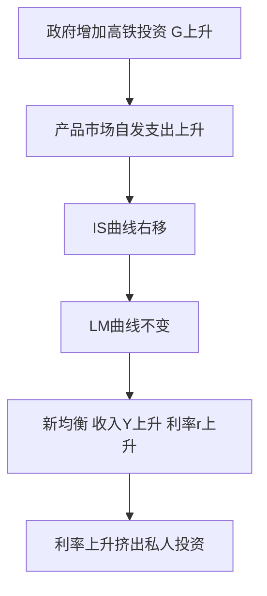
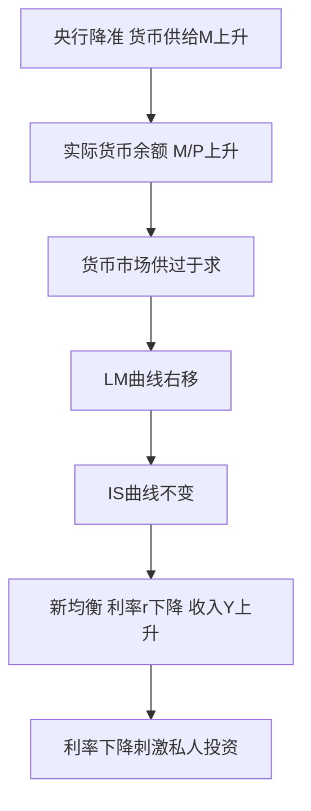
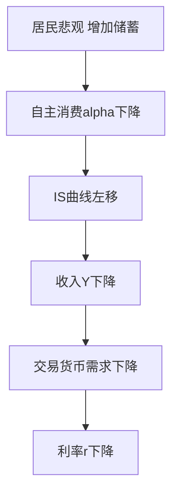
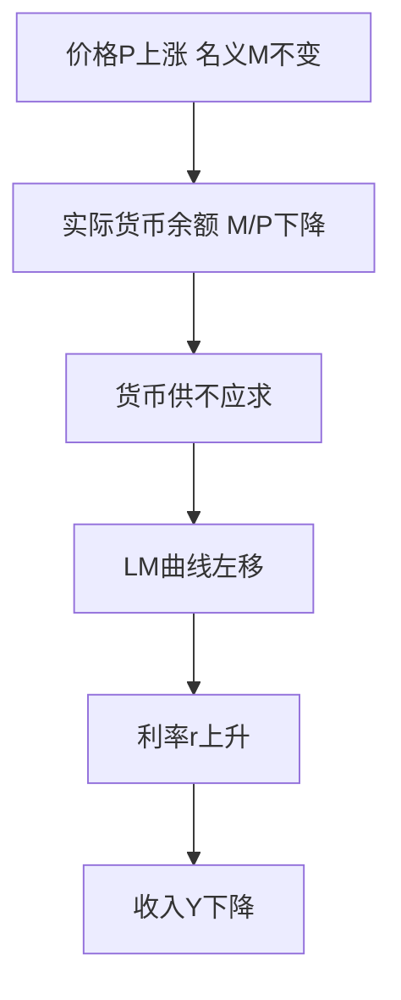
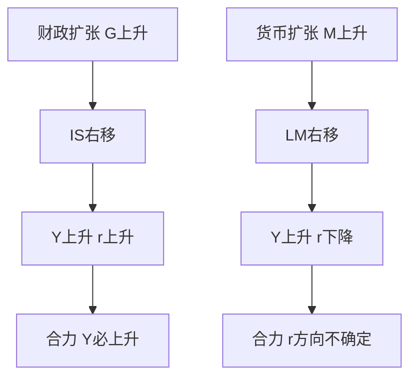
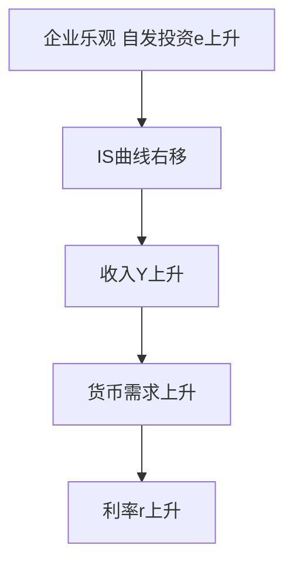

# 第十一章 IS-LM 模型 · 选择题集（首经贸 801 巩固用）

<a href="../../../exam.html" target="_blank" style="display:inline-block;padding:6px 16px;background:#2563eb;color:#fff;border-radius:6px;text-decoration:none;font-size:14px;">📝 开始做题</a>

> 每个知识点 8–10 道单选，共 45 道。
> 题目方向：曲线推导、三区域判断、政策效果、图形移动。
> 配套主观题见 [[考研真题集|本章考研真题集]]

## 📋 目录
- [[#KP01 IS 曲线|KP01]] — 9 题
- [[#KP02 货币需求与流动性偏好|KP02]] — 9 题
- [[#KP03 LM 曲线|KP03]] — 9 题
- [[#KP04 IS-LM 共同均衡|KP04]] — 9 题
- [[#KP05 流动性陷阱与挤出效应|KP05]] — 9 题

---

## KP01 IS 曲线（[[知识点/KP01_IS曲线|回知识点]]）

**1. IS 曲线描述的是哪个市场的均衡？**
A. 货币市场
B. 产品市场
C. 劳动市场
D. 外汇市场

> **✅ 答案：B**
> **解析：** IS = Investment-Saving，产品市场均衡轨迹。

**2. IS 曲线向右下方倾斜是因为？**
A. 利率上升 → 投资减少 → 收入下降
B. 利率上升 → 储蓄增加 → 收入上升
C. 收入上升 → 货币需求增加 → 利率上升
D. 价格上升 → 需求下降

> **✅ 答案：A**
> **解析：** 投资函数 $I=e-dr$，$r\uparrow\Rightarrow I\downarrow\Rightarrow Y\downarrow$。

**3. IS 曲线方程 $Y=(\alpha+e-dr)/(1-\beta)$ 中，$d$ 表示？**
A. 边际消费倾向
B. 投资对利率的敏感度
C. 货币需求利率敏感度
D. 自发投资

> **✅ 答案：B**
> **解析：** $I=e-dr$，$d$ 越大投资对利率越敏感。

**4. 下列哪种情况使 IS 曲线右移？**
A. 政府购买增加
B. 货币供给增加
C. 自主投资减少
D. 税收增加

> **✅ 答案：A**
> **解析：** 自发支出增加（G↑、T↓、e↑、α↑）使 IS 右移。B 影响 LM。

**5. IS 曲线斜率为 $-(1-\beta)/d$。若 MPC 增大，IS 曲线？**
A. 更平坦
B. 更陡峭
C. 不变
D. 向右移

> **✅ 答案：A**
> **解析：** β 增大 → 乘数增大 → 同样利率变动引致更大收入变动。

**6. IS 曲线右上方的点表示？**
A. $I>S$，产品短缺
B. $I<S$，产品过剩
C. $I=S$，均衡
D. $L>M$，货币短缺

> **✅ 答案：B**
> **解析：** IS 右上方 $I<S$，企业减产，$Y$ 下降回 IS 曲线。

**7. 若投资对利率完全无反应（d=0），IS 曲线？**
A. 水平
B. 垂直
C. 向右下倾斜
D. 向右上倾斜

> **✅ 答案：B**
> **解析：** $d=0$ 时利率不影响投资，$Y$ 与 $r$ 无关，IS 垂直。

**8. 【反向】下列哪种情况不会使 IS 曲线移动？**
A. 政府购买增加
B. 减税
C. 央行在公开市场买债券
D. 消费者信心下降

> **✅ 答案：C**
> **解析：** 公开市场操作是货币政策，影响 LM 曲线。

**9. 【结合现实】中国当前民营企业投资对利率下降反应冷淡，这意味着？**
A. d 大，IS 平坦
B. d 小，IS 陡峭
C. β 大，IS 平坦
D. β 小，IS 垂直

> **✅ 答案：B**
> **解析：** 投资对利率不敏感 → d 小 → IS 陡峭 → 货币政策传导不畅。

---

## KP02 货币需求与流动性偏好（[[知识点/KP02_货币需求与流动性偏好|回知识点]]）

**1. 凯恩斯认为人们持有货币的动机不包括？**
A. 交易动机
B. 预防动机
C. 投机动机
D. 增值动机

> **✅ 答案：D**
> **解析：** 三大动机：交易、预防、投机。

**2. 交易动机和预防动机的货币需求主要取决于？**
A. 利率
B. 收入
C. 价格
D. 汇率

> **✅ 答案：B**
> **解析：** $L_1=kY$。

**3. 投机动机的货币需求主要取决于？**
A. 收入
B. 利率
C. 价格
D. 财富

> **✅ 答案：B**
> **解析：** $L_2=-hr$，利率越高持币机会成本越大。

**4. 货币需求函数 $L=kY-hr$ 中，$h$ 表示？**
A. 货币需求的收入敏感度
B. 货币需求的利率敏感度
C. 投资对利率敏感度
D. 边际消费倾向

> **✅ 答案：B**
> **解析：** $h$ 越大，货币需求对利率越敏感。

**5. 永久债券每年付息 100 元，市场利率 5%，其价格为？**
A. 1000 元
B. 2000 元
C. 500 元
D. 5000 元

> **✅ 答案：B**
> **解析：** $P_b=100/0.05=2000$。

**6. 市场利率上升，债券价格将？**
A. 上升
B. 下降
C. 不变
D. 无法判断

> **✅ 答案：B**
> **解析：** $P_b=C/r$，$r$ 上升则 $P_b$ 下降。

**7. 当利率极低时，人们预期利率只会上升，于是？**
A. 全部买债券
B. 全部持有货币
C. 增加投资
D. 减少储蓄

> **✅ 答案：B**
> **解析：** 债券价格预期下跌，持货币观望 → 流动性陷阱。

**8. 【反向】下列关于货币需求的说法错误的是？**
A. 交易需求随收入增加
B. 预防需求随收入增加
C. 投机需求随利率上升而增加
D. 货币需求是 $L=kY-hr$

> **✅ 答案：C**
> **解析：** 投机需求随利率上升而减少（机会成本高）。

**9. 【结合现象】2024 年中国居民提前还贷潮反映了？**
A. 货币交易需求增加
B. 预防动机增强、投资意愿下降
C. 投机需求增加
D. 利率上升

> **✅ 答案：B**
> **解析：** 居民对未来悲观，优先还债、减少投资和消费。

---

## KP03 LM 曲线（[[知识点/KP03_LM曲线|回知识点]]）

**1. LM 曲线描述的是哪个市场的均衡？**
A. 产品市场
B. 货币市场
C. 劳动市场
D. 国际收支

> **✅ 答案：B**
> **解析：** LM = Liquidity preference-Money supply。

**2. LM 曲线向右上方倾斜是因为？**
A. 收入上升 → 交易需求增加 → 利率上升
B. 利率上升 → 投资减少 → 收入下降
C. 价格上升 → 货币供给增加
D. 收入上升 → 储蓄增加

> **✅ 答案：A**
> **解析：** $Y\uparrow\Rightarrow L_1=kY\uparrow\Rightarrow$ 在 $M/P$ 不变下 $r$ 必须上升以减少投机需求。

**3. LM 方程 $r=(k/h)Y-(1/h)(M/P)$，其斜率为？**
A. $k/h$
B. $h/k$
C. $1/h$
D. $k$

> **✅ 答案：A**
> **解析：** $Y$ 前系数即斜率。

**4. 已知 $L=0.2Y-10r$，$M/P=200$，LM 方程为？**
A. $r=0.02Y-20$
B. $r=0.2Y-10$
C. $Y=1000-50r$
D. $r=0.02Y+20$

> **✅ 答案：A**
> **解析：** $0.2Y-10r=200\Rightarrow r=0.02Y-20$。

**5. 上题中，当 $Y=1000$ 时，$r$ 为？**
A. 0
B. 10
C. 20
D. 5

> **✅ 答案：A**
> **解析：** $r=0.02\times1000-20=0$。

**6. 货币供给增加，LM 曲线？**
A. 左移
B. 右移
C. 不变
D. 变陡

> **✅ 答案：B**
> **解析：** $M/P$ 增大 → 同一 $Y$ 下 $r$ 下降 → LM 右移。

**7. LM 曲线的三个区域从左到右依次是？**
A. 凯恩斯区域、中间区域、古典区域
B. 古典区域、中间区域、凯恩斯区域
C. 中间区域、凯恩斯区域、古典区域
D. 凯恩斯区域、古典区域、中间区域

> **✅ 答案：A**
> **解析：** 左（低 r，水平）→ 中（右上倾斜）→ 右（高 r，垂直）。

**8. 【反向】下列关于 LM 曲线三个区域的说法错误的是？**
A. 凯恩斯区域 LM 水平
B. 古典区域 LM 垂直
C. 中间区域 LM 向右上倾斜
D. 凯恩斯区域货币政策完全有效

> **✅ 答案：D**
> **解析：** 凯恩斯区域货币政策完全失效。

**9. 若货币需求对利率极度敏感（h→∞），LM 曲线？**
A. 水平
B. 垂直
C. 向右上倾斜
D. 向右下倾斜

> **✅ 答案：A**
> **解析：** $h\to\infty$，斜率 $k/h\to0$，LM 水平，即流动性陷阱。

---

## KP04 IS-LM 共同均衡（[[知识点/KP04_ISLM共同均衡|回知识点]]）

**1. IS-LM 交点决定了？**
A. 均衡利率和均衡收入
B. 均衡价格和均衡产出
C. 均衡工资和就业
D. 均衡汇率和贸易余额

> **✅ 答案：A**
> **解析：** 两市场同时均衡的 $(Y^*, r^*)$。

**2. IS 右移（扩张财政）在中间区域使？**
A. $Y\uparrow, r\uparrow$
B. $Y\uparrow, r\downarrow$
C. $Y\downarrow, r\uparrow$
D. $Y\downarrow, r\downarrow$

> **✅ 答案：A**
> **解析：** 财政扩张，收入上升引致货币需求上升，利率上升。

**3. LM 右移（扩张货币）使？**
A. $Y\uparrow, r\uparrow$
B. $Y\uparrow, r\downarrow$
C. $Y\downarrow, r\uparrow$
D. $Y\downarrow, r\downarrow$

> **✅ 答案：B**
> **解析：** 货币宽松，利率下降刺激投资，收入上升。

**4. 扩张财政 + 扩张货币的政策组合，对 $Y$ 和 $r$ 的影响是？**
A. $Y$ 大增，$r$ 不确定
B. $Y$ 大减，$r$ 大升
C. $Y$ 不变，$r$ 大升
D. $Y$ 大增，$r$ 大升

> **✅ 答案：A**
> **解析：** IS 右移推 $r\uparrow$，LM 右移压 $r\downarrow$，净效应不确定；但 $Y$ 都增。

**5. IS 左上方的点（$I<S$）且 LM 左下方的点（$L>M$），调整方向是？**
A. $Y\uparrow, r\uparrow$
B. $Y\uparrow, r\downarrow$
C. $Y\downarrow, r\uparrow$
D. $Y\downarrow, r\downarrow$

> **✅ 答案：C**
> **解析：** 产品过剩 $Y\downarrow$；货币短缺 $r\uparrow$。

**6. 政府增税同时央行紧缩货币，属于？**
A. 双紧组合
B. 双松组合
C. 紧财政 + 松货币
D. 松财政 + 紧货币

> **✅ 答案：A**
> **解析：** 增税 = 紧财政，紧货币 = LM 左移，双紧使 $Y$ 下降。

**7. 严重衰退时应采用的政策组合是？**
A. 紧财政 + 紧货币
B. 松财政 + 松货币
C. 紧财政 + 松货币
D. 松财政 + 紧货币

> **✅ 答案：B**
> **解析：** 双扩张快速推高 $Y$，适用于大萧条。

**8. 【反向】下列哪种组合会使 $r$ 大幅上升但 $Y$ 变化不大？**
A. IS 右移 + LM 右移
B. IS 右移 + LM 左移
C. IS 左移 + LM 右移
D. IS 左移 + LM 左移

> **✅ 答案：B**
> **解析：** 松财政 + 紧货币，推高利率但收入互抵。

**9. 【计算】IS: $Y=1000-20r$；LM: $Y=500+30r$。均衡 $Y$ 和 $r$ 为？**
A. $Y=800, r=10$
B. $Y=700, r=10$
C. $Y=800, r=20$
D. $Y=600, r=5$

> **✅ 答案：A**
> **解析：** $1000-20r=500+30r\Rightarrow 500=50r\Rightarrow r=10$；$Y=1000-200=800$。

---

## KP05 流动性陷阱与挤出效应（[[知识点/KP05_流动性陷阱与挤出效应|回知识点]]）

**1. 流动性陷阱是指？**
A. 利率极高，人们不持有货币
B. 利率极低，货币需求无穷大
C. 货币供给不足
D. 货币需求为零

> **✅ 答案：B**
> **解析：** LM 水平段，央行发多少货币都被持有。

**2. 在流动性陷阱中，下列说法正确的是？**
A. 货币政策完全有效
B. 财政政策完全有效
C. 财政政策完全无效
D. 财政货币政策都有效

> **✅ 答案：B**
> **解析：** LM 水平，IS 右移 $Y$ 上升 $r$ 不变，无挤出。

**3. 在古典区域（LM 垂直），财政政策？**
A. 完全有效
B. 完全无效（100% 挤出）
C. 部分有效
D. 不确定

> **✅ 答案：B**
> **解析：** IS 右移只推高利率，$Y$ 不变。

**4. 挤出效应是指？**
A. 政府支出增加推高利率，减少私人投资
B. 货币供给增加推高物价
C. 出口减少减少 GDP
D. 税收增加减少消费

> **✅ 答案：A**
> **解析：** IS 右移在 LM 向上倾斜时推高 $r$，挤出 $I$。

**5. 下列哪种情况挤出效应最大？**
A. LM 水平
B. LM 垂直
C. LM 向右上倾斜
D. IS 水平

> **✅ 答案：B**
> **解析：** 古典区域 100% 挤出。

**6. 为减少挤出效应，央行应？**
A. 同步紧缩货币
B. 同步扩张货币
C. 保持货币不变
D. 提高准备金率

> **✅ 答案：B**
> **解析：** 货币配合扩张，LM 右移抵消利率上升。

**7. 日本 1990 年代后利率长期接近 0，经济仍低迷，这是？**
A. 古典区域
B. 流动性陷阱
C. 工资刚性
D. 通货膨胀

> **✅ 答案：B**
> **解析：** 典型流动性陷阱，货币政策失效。

**8. 【反向】下列哪种情况不会增强挤出效应？**
A. LM 更陡
B. 投资对利率更敏感
C. 央行同步扩张货币
D. 经济已充分就业

> **✅ 答案：C**
> **解析：** 货币扩张使 LM 右移，压低利率，减少挤出。

**9. 【结合现实】2024 年中国央行多次降息但居民仍不贷款消费，这最接近？**
A. 古典区域
B. 流动性陷阱前兆
C. 工资刚性
D. 挤出效应

> **✅ 答案：B**
> **解析：** 利率低但私人部门不反应，符合流动性偏好无穷大特征。

---

## KP99 曲线移动专项

> 本组专门训练"给一个事件 → 判断哪条曲线怎么移 → 新均衡 Y 和 r 怎么变"。

**1. （曲线移动·判断题）政府增发国债、扩大高铁建设投资，在其他条件不变时，IS-LM 模型中会发生什么？（　）**
A. IS 曲线右移，利率上升，收入增加
B. IS 曲线左移，利率下降，收入减少
C. LM 曲线右移，利率下降，收入增加
D. LM 曲线左移，利率上升，收入减少

> **✅ 答案：A**
> **解析：** 高铁投资是政府购买 $G$（或自主支出），属于**产品市场**的自发支出增加。$G$ 直接进入 $Y=C+I+G$，在每一利率 $r$ 下均衡收入都变大 → **IS 曲线整条右移**。货币市场没动（央行没发钞），LM 不变。新均衡沿 LM 向右上走：**收入 $Y$ 增加、利率 $r$ 上升**。利率上升会反过来压私人投资，这就是挤出效应。
>

>
> **数学推导**：IS 方程 $Y=\dfrac{\alpha+\bar A-br}{1-\beta}$，其中 $\bar A=e+G$。$G$ 从 $G_1$ 增到 $G_2$，IS 右移量 $=\dfrac{\Delta G}{1-\beta}$（乘数）。LM：$\dfrac{M}{P}=kY-hr$ 不变。联立解出新 $r_2>r_1$、$Y_2>Y_1$。
>
> **生活实例**：2020 年抗疫特别国债 1 万亿 + 地方专项债 3.75 万亿修桥修路，钢铁水泥订单暴涨、GDP 增速回正——但同时 LPR 一度上行，中小企业贷款变贵，就是挤出效应的现实版。

**2. （曲线移动·判断题）央行降准释放流动性、增加货币供给 M，在其他条件不变时会发生什么？（　）**
A. IS 右移，利率上升
B. LM 右移，利率下降，收入上升
C. LM 左移，利率上升
D. IS 左移，收入下降

> **✅ 答案：B**
> **解析：** 降准是央行**货币政策**，增加实际货币供给 $M/P$。这改变的是**货币市场**均衡 → **LM 曲线右移**（在每一收入 $Y$ 下，能出清货币市场的利率更低了）。产品市场没动，IS 不变。新均衡沿 IS 向右下走：**利率 $r$ 下降、投资 $I$ 上升、收入 $Y$ 上升**。
>

>
> **数学推导**：LM 方程 $\dfrac{M}{P}=kY-hr$，整理为 $r=\dfrac{k}{h}Y-\dfrac{M}{Ph}$。$M$ 上升使截距 $-\dfrac{M}{Ph}$ 变小（更负）→ 同一 $Y$ 对应更低 $r$ → LM 右移。与不变的 IS 联立，$r$ 降、$Y$ 升。
>
> **生活实例**：2024 年央行两次降准共释放约 1 万亿长期资金，房贷利率从 4.3% 降到 3.5%，开发商和购房者成本下降——钱变便宜了，就是 LM 右移。

**3. （曲线移动·分析题）居民对未来收入预期悲观，纷纷增加储蓄、减少自主消费 α。这会让哪条曲线怎么移？新均衡如何？（　）**
A. IS 右移，收入上升
B. IS 左移，利率下降，收入下降
C. LM 右移，利率下降
D. LM 左移，收入上升

> **✅ 答案：B**
> **解析：** 减少自主消费 $\alpha$ 是**产品市场**自发支出下降 → **IS 曲线左移**。LM 不变。新均衡：$Y$ 下降、$r$ 下降。注意——收入下降时货币需求也下降，所以利率反而**降**，但这拦不住衰退（因为消费信心垮了，再低利率老百姓也不花）。
>

>
> **数学推导**：IS $Y=\dfrac{\alpha+\bar A-br}{1-\beta}$，$\alpha$ 下降使 IS 整条左移 $\dfrac{\Delta\alpha}{1-\beta}$。LM 不变，联立得 $Y_2<Y_1$、$r_2<r_1$。
>
> **生活实例**：2022-2023 年疫情后居民"超额储蓄"激增、不敢消费，央行一路降息但消费仍弱——利率降了却拉不动经济，就是 IS 左移 + 接近流动性陷阱。

**4. （曲线移动·判断题）价格水平 P 普遍上涨（通货膨胀），在名义货币 M 不变时，IS-LM 中哪条曲线怎么移？（　）**
A. IS 右移
B. LM 左移
C. LM 右移
D. IS 不动且 LM 不动

> **✅ 答案：B**
> **解析：** 关键在"实际货币余额" $\dfrac{M}{P}$。名义 M 没变，但价格 P 涨了，能买到的实际商品变少 → $\dfrac{M}{P}$ **下降** → 货币市场实际货币供给不足 → 在每一收入 $Y$ 下要出清货币市场必须更高利率 → **LM 曲线左移（上移）**。这正是 AD 曲线向右下倾斜的微观来源：P 涨 → LM 左移 → Y 降。
>

>
> **数学推导**：LM $r=\dfrac{k}{h}Y-\dfrac{M}{Ph}$，P 上升使 $-\dfrac{M}{Ph}$ 变大（没那么负）→ 同一 Y 对应更高 r → LM 左移。这就是 AD 曲线 $Y$ 与 $P$ 反向关系。
>
> **生活实例**：2022 年美国通胀 9%，美联储没加息前，物价飞涨让老百姓手里的钱"变薄"，实际流动性收紧，房贷利率被动上行——就是 LM 左移。

**5. （曲线移动·绘图分析）政府同时"扩大支出 G"又"央行同步放松货币 M"。这两个政策搭配后，均衡利率 r 和收入 Y 如何？（　）**
A. Y 必升，r 方向不确定
B. Y 必降，r 必升
C. Y 必升，r 必升
D. Y 必降，r 必降

> **✅ 答案：A**
> **解析：** 扩张财政使 IS 右移（$Y$↑、$r$↑），扩张货币使 LM 右移（$Y$↑、$r$↓）。**两个都让 Y 上升**，所以 $Y$ 必升无疑；但 IS 右移推高 r、LM 右移压低 r，两股力量方向相反 → **r 的最终方向不确定**，取决于谁力度大。这正是"积极财政 + 稳健/宽松货币"组合：保增长的同时不让利率飙升挤出私人投资。
>

>
> **数学推导**：IS 右移 $\Delta Y_{IS}=\dfrac{\Delta G}{1-\beta}$（含乘数），LM 右移也抬 Y。r 的变化 $\Delta r$ 由两效应叠加，符号不定。
>
> **生活实例**：中国"财政发债搞建设 + 央行降准不加息"，既把 GDP 拉起来，又把房贷利率压住——这就是为什么"宽财政 + 宽货币"能既增长又不引发利率飙升。

**6. （曲线移动·判断题）企业对未来过度乐观，自发投资 e 大幅增加。IS-LM 中新均衡？（　）**
A. IS 左移，Y 降 r 降
B. IS 右移，Y 升 r 升
C. LM 右移，Y 升 r 降
D. LM 左移，Y 升 r 升

> **✅ 答案：B**
> **解析：** 自主投资 $e$ 是 IS 方程里 $\bar A$ 的一部分，$e$ 上升 → IS 右移。LM 不变 → $Y$ 升、$r$ 升。这就是"动物精神"驱动的繁荣期：企业扎堆建厂，投资过热推高利率。
>

>
> **数学推导**：IS $Y=\dfrac{\alpha+e+G-br}{1-\beta}$，$e$ 上升使截距变大，IS 右移 $\Delta e/(1-\beta)$。
>
> **生活实例**：2003-2007 年中国房地产+出口热潮，民间投资井喷，贷款买房盖楼排队，贷款利率一路走高——投资热潮本身就会推高利率。
