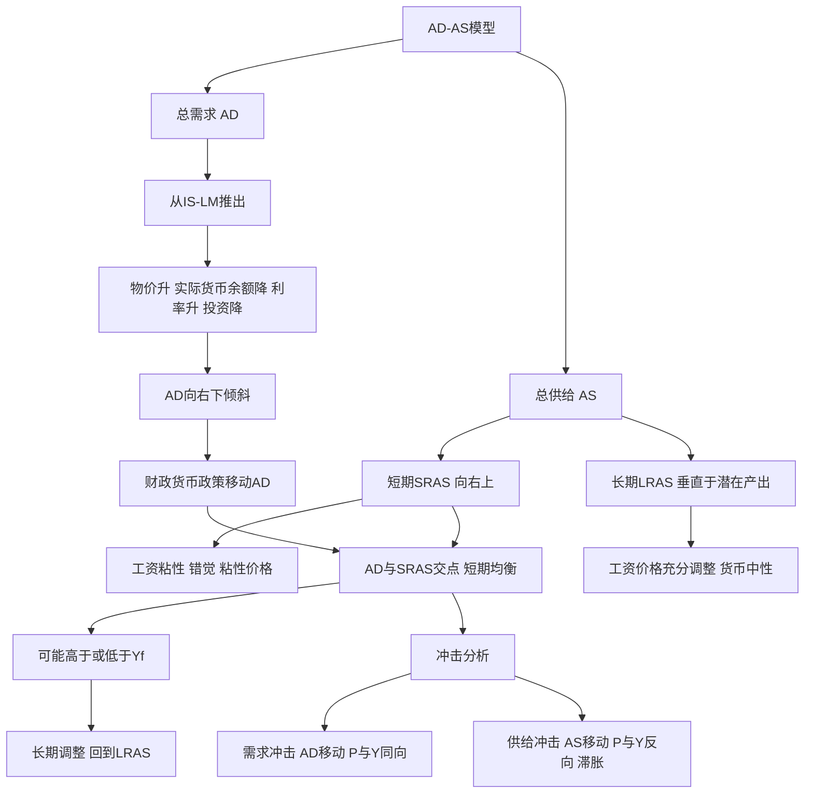

# 第十二章 国民收入的决定：AD-AS模型 · 章节总结

> 本章引入价格水平：AD 讲需求侧，AS 讲供给侧。交点决定短期 $P$ 和 $Y$；长期里经济回到潜在产出 $Y_f$。

## 一、本章地图

## 二、核心公式速查

| 公式 | 含义 |
|---|---|
| AD：$Y = AD(P)$ 向右下 | 物价与总需求反向 |
| SRAS：$Y = Y_f + \alpha(P - P^e)$ | 短期总供给 |
| LRAS：$Y = Y_f$ 垂直 | 长期总供给 |
| 长期均衡 | AD=SRAS=LRAS，$Y=Y_f$ |

## 三、一句话记住每个 KP

- **KP01 AD 曲线**：物价高 → 实际货币余额少 → 利率高 → 投资低 → $Y$ 低，右下倾斜。
- **KP02 短期 AS**：工资粘性下，物价超预期涨 → 企业多生产，右上倾斜。
- **KP03 长期 AS**：工资充分调整后，产出固定在 $Y_f$，垂直。
- **KP04 AD-AS 均衡**：需求冲击 $P,Y$ 同动；供给冲击 $P,Y$ 反动（滞胀）。

## 四、本章与后续章节的关系

- 本章解释了**通胀和产出怎么同时决定** → 下一章 [[../13_失业通胀与经济周期/00_章节总结|失业与通胀]]。
- 长期 AS 的位置 $Y_f$ 由 [[../16_经济增长/00_章节总结|经济增长]] 决定。
- AD-AS 是 [[../15_宏观经济政策/00_章节总结|宏观经济政策]] 的分析框架。

---

## 🔗 相关知识点

**本章 KP：** [[知识点/KP01_AD总需求曲线|KP01 AD曲线]] ｜ [[知识点/KP02_短期总供给曲线|KP02 短期AS]] ｜ [[知识点/KP03_长期总供给曲线|KP03 长期AS]] ｜ [[知识点/KP04_ADAS均衡与冲击|KP04 均衡与冲击]]

**跨章：** [[../11_IS-LM模型/00_章节总结|第十一章 IS-LM]] ｜ [[../13_失业通胀与经济周期/00_章节总结|第十三章 失业与通胀]]

**📖 原书原文：** [[../../../../原文件/经济学/西方经济学下册_宏观_全书|《西方经济学》下册 第十二章]]
