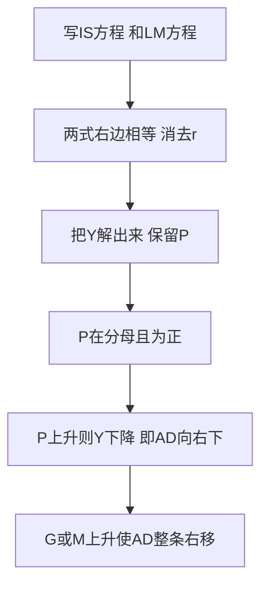

# KP01 AD总需求曲线

<a href="../../../../exam.html" target="_blank" style="display:inline-block;padding:6px 16px;background:#2563eb;color:#fff;border-radius:6px;text-decoration:none;font-size:14px;">📝 开始做题</a>

> 所属：[[00_章节总结|第十二章 AD-AS模型]]

## 1. 一句话先懂（小白版）

IS-LM 模型里价格 $P$ 是固定的。现在放开价格：物价变了会怎么样？

**AD（总需求）曲线**就是描述"物价 $P$ 和全社会总需求 $Y$ 关系"的曲线。它向右下方倾斜——物价越高，总需求越低。

为什么？三条链子：
1. **利率效应**：物价涨 → 交易需要更多钱 → 货币需求增加 → 利率上升 → 投资下降 → $Y$ 下降。
2. **财富效应**：物价涨 → 你手里现金的实际购买力下降 → 觉得自己穷了 → 消费下降 → $Y$ 下降。
3. **汇率效应**：国内物价涨 → 本国商品变贵 → 出口下降、进口上升 → 净出口下降 → $Y$ 下降。

## 2. 严格定义

**总需求（AD）曲线**：在其他条件不变时，物价水平 $P$ 与全社会意愿购买的产品和服务总量 $Y$ 之间的关系。

$$Y = AD(P)$$

向右下方倾斜。

## 3. AD 曲线怎么从 IS-LM 推出来？

IS-LM 里，实际货币供给是 $M/P$。当价格 $P$ 变化时：

- $P$ 上升 → $M/P$ 下降 → LM 左移 → 均衡利率上升 → 投资下降 → $Y$ 下降。
- $P$ 下降 → $M/P$ 上升 → LM 右移 → 均衡利率下降 → 投资上升 → $Y$ 上升。

所以 $P$ 和 $Y$ 反向变化 → AD 向右下倾斜。

## 4. AD 曲线怎么移动？

任何让 IS 或 LM 移动的因素，都会让 AD 移动：

| 变动 | AD 移动 |
|---|---|
| 政府购买增加（扩财政） | 右移 |
| 减税 | 右移 |
| 央行增加货币供给（扩货币） | 右移 |
| 消费者更乐观 | 右移 |
| 国外需求旺盛（出口增加） | 右移 |
| 紧缩财政/货币 | 左移 |

**财政政策和货币政策都叫"需求管理政策"**，因为它们都移动 AD。

## 4.5 理论推导（AD 怎么从 IS-LM 消出来）

> AD 曲线不是凭空画的，它就是 IS-LM 联立后消去利率 r、留下 Y 和 P 的关系。

**思路**：IS 方程里没有 P，LM 方程里有 $M/P$。给不同的 P，LM 左右移动，与 IS 交出不同的 Y。把每对 $(P,Y)$ 记下来，就是 AD。

**第一步：写 IS 和 LM**
$$\text{IS:}\quad r=\frac{\alpha+\bar A}{b}-\frac{1-\beta}{b}Y$$
$$\text{LM:}\quad r=\frac{k}{h}Y-\frac{M}{Ph}$$

**第二步：右边相等，消去 r**
$$\frac{\alpha+\bar A}{b}-\frac{1-\beta}{b}Y=\frac{k}{h}Y-\frac{M}{Ph}$$

**第三步：把 Y 解出来，P 留在式中**
$$\frac{\alpha+\bar A}{b}+\frac{M}{Ph}=\left(\frac{1-\beta}{b}+\frac{k}{h}\right)Y$$

$$\boxed{AD:\quad Y=\frac{\frac{\alpha+\bar A}{b}+\frac{M}{Ph}}{\frac{1-\beta}{b}+\frac{k}{h}}}$$

**结论**：式子中 $P$ 在分母、前面是正号 → $P$ 上升 → 第二项 $\dfrac{M}{Ph}$ 变小 → $Y$ 变小。所以 $Y$ 与 $P$ 反方向 → **AD 曲线向右下方倾斜**。

## 4.6 数学推导（谁让 AD 移动）

看上面 AD 方程分子：$\dfrac{\alpha+\bar A}{b}+\dfrac{M}{Ph}$。

- **财政政策**：$\bar A=e+G-\beta T$。$G$ 上升或 $T$ 下降 → $\dfrac{\alpha+\bar A}{b}$ 变大 → 同一 $P$ 下 $Y$ 变大 → **AD 右移**。
- **货币政策**：$M$ 上升 → $\dfrac{M}{Ph}$ 变大 → 同一 $P$ 下 $Y$ 变大 → **AD 右移**。
- **价格 P 本身变化**：不改 AD 位置，而是**沿 AD 移动**（P 变 → LM 移 → Y 变）。

**图形说明**：纵轴 $P$、横轴 $Y$，AD 从左上到右下。财政/货币扩张使整条 AD 右移；$P$ 变化只沿 AD 滑动。

## 5. 手算例子

已知 IS：$Y = 1500 - 250r$，货币需求 $L = 0.5Y - 50r$，名义货币供给 $M = 500$。

**第一步：推 LM（用 $P$ 表示）**

$$\frac{M}{P} = 0.5Y - 50r$$

$$\frac{500}{P} = 0.5Y - 50r$$

$$Y = \frac{1000}{P} + 100r$$

**第二步：联立 IS**

$$1500 - 250r = \frac{1000}{P} + 100r$$

$$350r = 1500 - \frac{1000}{P}$$

$$r = \frac{1500}{350} - \frac{1000}{350P}$$

代回 IS 求 $Y$：

$$Y = 1500 - 250 \times \left(\frac{1500}{350} - \frac{1000}{350P}\right)$$

$$Y = \frac{1500 \times 100}{350P} = \frac{15000}{35P} = \frac{428.6}{P}$$

这就是 AD 曲线。

- $P = 1$ 时，$Y = 428.6$
- $P = 2$ 时，$Y = 214.3$
- $P = 0.5$ 时，$Y = 857.2$

物价翻倍，实际产出需求减半。

## 6. 容易混淆

- **AD 曲线不是微观需求曲线的加总**。微观需求曲线讲的是一种商品价格和需求量的关系；AD 讲的是总体价格水平和总产出的关系。
- **沿 AD 移动 vs AD 移动**：物价变 → 沿 AD 移动；财政/货币政策变 → AD 整条移动。
- **AD 曲线是"需求侧"的**，它只说人们想买多少；实际能生产多少要看 AS。

## 7. 现实意义

央行降息、政府发消费券，都是在移动 AD 曲线右移，让经济在每个物价水平下都有更高产出。疫情后各国发钱刺激消费，就是 AD 右移。

---

## 🔗 相关知识点

**同章关联：** [[KP02_短期总供给曲线|短期AS]] ｜ [[KP03_长期总供给曲线|长期AS]] ｜ [[KP04_ADAS均衡与冲击|AD-AS均衡]]

**跨章关联：** [[../../11_IS-LM模型/知识点/KP03_LM曲线|LM曲线]] ｜ [[../../15_宏观经济政策/知识点/KP01_财政政策工具与自动稳定器|财政政策]]

**📖 原书原文：** [[../../../../原文件/经济学/西方经济学下册_宏观_全书#第十二章 国民收入的决定：AD-AS 模型|《西方经济学》下册 第十二章]]

---

## 🐮 小白教程入门

> 看不懂下面这个KP？先看通俗版教程建立直觉：

- [[../../../../经济统计学论文从0基础到精通/14_宏观经济学基础/09_AD-AS模型是什么|🐮 教程·AD-AS模型是什么]]

---

## 📝 考研真题（首经贸 801）

**配套主观题：** 见同目录 [[../考研真题集|本章考研真题集]]
**配套选择题：** 见同目录 [[../选择题集|本章选择题集]]

### 高频简答
- 简述AD曲线向右下方倾斜的原因（利率效应、财富效应、汇率效应）→ 见 [[../考研真题集#s1|真题集·简答 1]]
- 用IS-LM模型推导AD曲线，并说明财政货币政策如何移动AD → 见 [[../考研真题集#s2|真题集·简答 2]]
- 计算题：由IS与货币需求函数推导AD曲线 → 见 [[../考研真题集#s3|真题集·简答 3]]

### 高频论述
- 古典与凯恩斯AS分歧及其政策含义 → 见 [[../考研真题集#l1|真题集·论述 1]]

### 易错选择
- 本知识点选择题见 [[../选择题集#KP01 AD总需求曲线|选择题集·KP01]]
