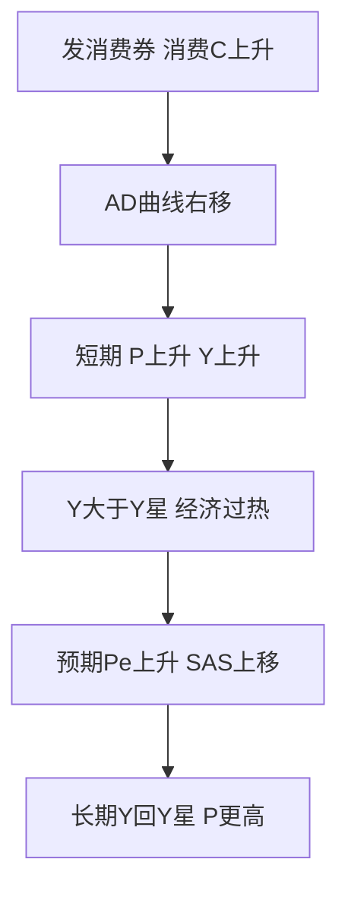
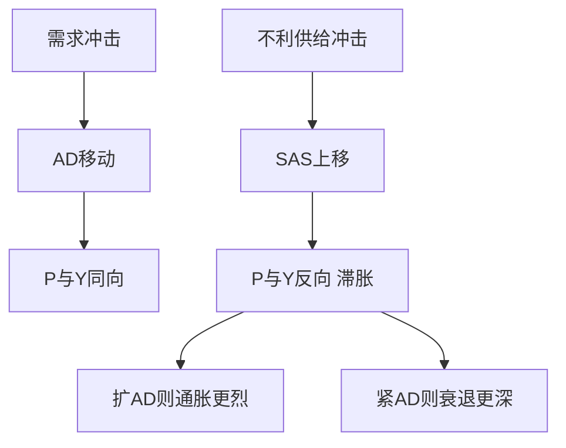

# 第十二章 AD-AS模型 · 考研真题集（首经贸 801）

<a href="../../../exam.html" target="_blank" style="display:inline-block;padding:6px 16px;background:#2563eb;color:#fff;border-radius:6px;text-decoration:none;font-size:14px;">📝 开始做题</a>

> 本章共收录：简答题 10 道（每题 15 分）｜论述题 4 道（每题 30 分）
> 配套选择题见 [[选择题集|本章选择题集]]
> 对应大纲：马工程《西方经济学》下册 第十二章 国民收入决定的 AD-AS 模型

## 📋 本题集目录

### 简答题
1. [[#简答 1：简述总需求（AD）曲线向右下方倾斜的原因。|AD曲线向右下方倾斜的原因]]
2. [[#简答 2：试述如何由IS-LM模型推导出AD曲线，并说明财政政策与货币政策如何使AD曲线移动。|用IS-LM推导AD曲线及政策移动]]
3. [[#简答 3：（计算题）已知IS曲线为 $Y = 1500 - 250r$，货币需求函数为 $L = 0.5Y - 50r$，名义货币供给 $M = 1000$。要求：（1）推导AD曲线方程；（2）求 $P = 1$ 和 $P = 2$ 时的均衡产出。|计算题：由IS-LM方程推导AD曲线]]
4. [[#简答 4：简述短期总供给（SRAS）曲线向右上方倾斜的三个理论解释。|短期AS向右上倾斜的三个理论解释]]
5. [[#简答 5：简述短期总供给方程 $Y = Y_f + \alpha(P - P^e)$ 的经济含义，并计算：已知 $Y_f = 1000$，$\alpha = 100$，$P^e = 100$，分别求 $P = 100$、$P = 110$、$P = 90$ 时的产出。|短期AS方程的经济含义与计算]]
6. [[#简答 6：简述凯恩斯极端情形（水平总供给曲线）与常规短期总供给曲线的区别，并说明其政策含义。|凯恩斯极端水平AS与常规AS的区别]]
7. [[#简答 7：为什么长期总供给（LRAS）曲线是垂直的？简述货币中性原理。|长期AS为何垂直：货币中性]]
8. [[#简答 8：当经济处于短期均衡但产出高于潜在产出时，说明经济将如何从短期均衡调整到长期均衡。|短期均衡到长期均衡的调整机制]]
9. [[#简答 9：什么是滞胀？用AD-AS模型说明不利供给冲击的短期效应与政策困境。|滞胀与不利供给冲击]]
10. [[#简答 10：（计算题）已知 $Y_f = 1000$，AD曲线为 $Y = 2000 - 10P$，短期总供给曲线为 $Y = 1000 + 100(P - P^e)$，初始预期 $P^e = 100$。要求：（1）求初始短期均衡产出和物价；（2）判断经济是否处于长期均衡；（3）若AD不变，长期均衡物价是多少？|计算题：AD-AS短期均衡与长期调整]]

### 论述题
1. [[#论述 1：试比较古典学派与凯恩斯学派对总供给曲线的分歧，并说明这种分歧对宏观经济政策含义的影响。|古典与凯恩斯AS分歧及政策含义]]
2. [[#论述 2：试运用AD-AS模型分析1970年代石油危机及其引发的"滞胀"，并说明供给冲击下宏观经济政策的两难选择。|石油危机与滞胀的政策两难]]
3. [[#论述 3：2020—2023年新冠疫情对全球经济造成了怎样的冲击？试运用AD-AS模型比较中美两国的应对政策及其后果。|疫情双重冲击与中美政策对比]]
4. [[#论述 4：结合中国2022—2023年宏观经济形势，试运用AD-AS模型分析中国当前面临的需求不足与供给冲击，并说明应采取怎样的宏观经济政策组合。|中国2022—2023宏观政策的AD-AS分析]]

---

## 一、简答题（每题 15 分，建议 450–700 字）

### 简答 1：简述总需求（AD）曲线向右下方倾斜的原因。

**【建议字数】450–700 字 ｜ 【建议时间】15 分钟 ｜ 【题型】原因分析**

**【考什么】** 对应知识点 [[知识点/KP01_AD总需求曲线|AD总需求曲线]]，对应大纲第 1 节；题型属于原因分析。

**【核心推导】**
**第一步：先明确 AD 曲线的定义与坐标。** AD 曲线表示**其他条件不变时，物价总水平 $P$ 与全社会意愿购买的产品和服务总量 $Y$ 之间的关系**，纵轴是 $P$、横轴是 $Y$，向右下方倾斜。

**关键区分（必须先说，否则会被扣分）**：它**不是微观需求曲线的简单加总**。微观需求曲线向右下倾斜是因为"某种商品相对其他商品变贵了"（替代效应）；AD 向右下倾斜是因为"**所有**商品一起变贵"引起的宏观效应。**两者斜率来源根本不同，混答是本类题第一大失分点。**

**第二步：利率效应（凯恩斯效应）—— 最重要的一条。**

传导链：$P\uparrow \Rightarrow M/P\downarrow$（名义货币供给 $M$ 不变）$\Rightarrow$ 货币需求大于供给 $\Rightarrow$ 公众卖债券换现 $\Rightarrow$ 债券价格 $P_b\downarrow$ $\Rightarrow$ 利率 $r\uparrow$ $\Rightarrow$ 投资 $I=e-dr\downarrow$ 且耐用消费品支出 $\downarrow$ $\Rightarrow$ 经乘数 $Y\downarrow$。

**为什么这条最强**：它把 AD 与 IS-LM 直接连起来——**AD 曲线本质就是"让 $P$ 变化、看 LM 沿 IS 滑动得到的一组均衡点"**。这一步写出来，说明你真的理解了推导，而不只是背了三条名字。

**第三步：财富效应（实际余额效应、庇古效应）。**

传导链：$P\uparrow \Rightarrow$ 居民持有的货币、存款、债券等**名义资产的实际购买力下降** $\Rightarrow$ 实际财富 $W/P\downarrow$ $\Rightarrow$ 消费 $C\downarrow$（消费函数可写为 $C=\alpha+\beta Y+\gamma(W/P)$，$\gamma>0$）$\Rightarrow Y\downarrow$。

**注意**：庇古提出这条效应的原意是反驳凯恩斯——**若价格下降能自动增加实际财富、刺激消费，那么即使利率降到零，经济也能自动回到充分就业**，这就是"庇古效应"的实质。这一层背景能显著提升答案深度。

**第四步：汇率效应（蒙代尔—弗莱明，开放经济才成立）。**

传导链：$P\uparrow \Rightarrow$ 本国商品相对外国商品变贵 $\Rightarrow$ 出口 $\downarrow$、进口 $\uparrow$ $\Rightarrow$ 净出口 $NX\downarrow$ $\Rightarrow Y\downarrow$。

**两条成立前提**：①实行**浮动汇率**（固定汇率下央行干预会抵消）；②**名义汇率不随物价同比例调整**（否则实际汇率不变，效应消失）。**写出前提是拿高分的关键，因为考研常追问"什么时候没有汇率效应"。**

**第五步：三条机制的定量刻画。**

对 AD 求导可写为：

$$\frac{\mathrm{d}Y}{\mathrm{d}P}=\underbrace{-\frac{d}{h(1-\beta)+kd}\cdot\frac{M}{P^2}}_{\text{利率效应}}+\underbrace{\gamma\frac{\mathrm{d}(W/P)}{\mathrm{d}P}}_{\text{财富效应}}+\underbrace{\frac{\partial NX}{\partial P}}_{\text{汇率效应}}<0$$

三项均为负，**共同保证 AD 向右下倾斜**。利率效应项里出现了 $d$（投资对利率的敏感度）与 $h$（货币需求对利率的敏感度），这解释了**为什么 AD 的斜率由 IS、LM 的斜率共同决定**：$d$ 大、$h$ 小 → AD 平坦；$d$ 小、$h$ 大 → AD 陡峭。**LM 水平（流动性陷阱）时利率效应为 0，AD 近乎垂直——这是极端情形，可以作为进阶点。**

**【为什么要答这几点】**
**【满分 15 分的分点逻辑】**

**第一段：定义与坐标（2 分）。** 一句话说清"$P$ 与 $Y$ 的反向关系"，并点明**不等于微观需求曲线加总**。这一句就是这 2 分的全部。

**第二段：利率效应（4 分）。** 必须写出**完整链条**：$P\uparrow \to M/P\downarrow \to r\uparrow \to I\downarrow \to Y\downarrow$。**只写"利率上升抑制投资"给一半分；链条中漏掉 $M/P$ 这一环是常见失分。**

**第三段：财富效应（4 分）。** 要点是"名义资产的实际购买力下降"，**必须出现"实际余额"或"庇古效应"这个术语名**。能补一句"庇古用它反驳凯恩斯"直接加印象分。

**第四段：汇率效应（3 分）。** 要点是净出口下降，**并写出"浮动汇率"这一前提**。

**第五段：小结（2 分）。** 三条机制共同决定 $P$ 与 $Y$ 反向。

**易失分点。** ①**把 AD 与微观需求曲线混同**（最致命）；②只答利率效应，漏掉另外两条；③汇率效应不说前提；④把三条机制说成"替代效应、收入效应、价格效应"（那是微观的说法，直接零分）。

**【阅卷心理】** 这是"三条渠道"型标准题，**阅卷几乎是数点给分**：三个术语名各占一段，出现就给分，链条完整再加分。**最容易被拉开差距的是"AD 不等于微观需求曲线加总"这一句，多数考生想不起来。**

**【如何分析题目】**
**第一步：审题——问的是"为什么向右下倾斜"，即机制题，不是推导题。** 如果题目问"如何由 IS-LM 推导 AD"，那才是推导（另有一题）。本题只要三条渠道。

**第二步：先想清楚"宏观"与"微观"的分野。** 微观是某一商品价格变，宏观是所有商品价格一起变。**想清楚这一点，三条机制自己就出来了：价格一起变只能通过货币、资产、外贸三条"总量渠道"影响总需求。**

**第三步：在草稿上给三条机制各画一个箭头链。** $P\uparrow \to \cdots \to Y\downarrow$，每条 3–4 个箭头。**箭头链写全，分点就稳。**

**第四步：判断三条机制的主次。** 利率效应是核心（与 IS-LM 直接相连）、财富效应是补充、汇率效应只在开放经济成立。**主次分明，篇幅才分配得合理：4 分、4 分、3 分。**

**第五步：给每条机制补一个前提或边界。** 利率效应要求名义货币供给不变；财富效应要求名义资产存量为正；汇率效应要求浮动汇率。**"前提"是拉开差距的地方。**

**第六步：收尾回到图形。** 三条机制共同作用 → $P\uparrow$ 时 $Y\downarrow$ → AD 向右下倾斜。

**第七步：字数控制。** 15 分约 500–600 字：定义 80 字、利率效应 150 字、财富效应 130 字、汇率效应 100 字、小结 60 字。

**【答题框架】**
- 第 1 段：AD曲线定义（2 分）
- 第 2 段：利率效应（4 分）
- 第 3 段：财富效应（实际余额效应）（4 分）
- 第 4 段：汇率效应（外贸效应）（3 分）
- 第 5 段：小结——三条机制共同决定P与Y反向（2 分）

**【参考答案】**

一、总需求曲线的含义

总需求曲线表示在其他条件不变时，物价水平 $P$ 与全社会意愿购买的产品和服务总量 $Y$ 之间的关系。在以 $P$ 为纵轴、$Y$ 为横轴的坐标系中，AD曲线向右下方倾斜，即物价水平越高，均衡总产出需求越低。

二、AD曲线向右下方倾斜的三条机制

（一）利率效应（凯恩斯效应）

物价水平上升，交易所需的名义货币增加，在名义货币供给不变的情况下，货币需求大于货币供给，利率 $r$ 上升。利率上升抑制私人投资 $I$ 和耐用消费品消费，通过乘数效应使总需求 $Y$ 下降。反之，物价下降使利率下降，刺激投资和总需求。

（二）财富效应（实际余额效应、庇古效应）

物价水平上升，居民持有的货币、存款、债券等名义资产的实际购买力下降，居民感觉变穷了，从而减少消费 $C$，总需求下降。反之，物价下降使居民实际财富增加，消费增加，总需求上升。

（三）汇率效应（外贸效应）

本国物价上升，在汇率不变时本国商品相对外国商品变贵，出口下降、进口上升，净出口 $NX$ 下降，总需求下降。反之，本国物价下降使出口增加、进口减少，净出口和总需求上升。

三、小结

上述三条机制共同作用：物价上升通过利率上升、财富缩水、净出口下降三条渠道，最终使总需求下降；物价下降则反向作用。因此AD曲线向右下方倾斜。

**【解析·得分点】** 采分点：①AD曲线定义与坐标（2分）②利率效应完整链条（4分）③财富效应（4分）④汇率效应（3分）⑤小结（2分）。容易丢分：只答利率效应而漏掉财富效应和汇率效应；把AD曲线等同于微观需求曲线的加总（这是错的，微观是相对价格，宏观是总体价格水平）。

**【生活实例】** 奶茶店涨价：原料奶茶从10块涨到15块，你手里那100块钱能买的奶茶变少了（财富效应）；银行存款利息没涨，你觉得存钱不划算但贷款买房更贵了（利率效应）；而且泰国奶茶只要8块钱一杯，你更愿意点外卖喝泰国奶茶（汇率效应）。三条路都让奶茶总销量下降。

**【双链接】** 🔗 [[知识点/KP01_AD总需求曲线|回知识点]] ｜ 📖 [[../../../原文件/经济学/西方经济学下册_宏观_全书|原书·第十二章]]

---

### 简答 2：试述如何由IS-LM模型推导出AD曲线，并说明财政政策与货币政策如何使AD曲线移动。

**【建议字数】450–700 字 ｜ 【建议时间】15 分钟 ｜ 【题型】分析推导**

**【考什么】** 对应知识点 [[知识点/KP01_AD总需求曲线|AD总需求曲线]]，对应大纲第 1 节；题型属于分析推导。

**【核心推导】**
**第一步：说清两个模型的关系——AD 曲线是 IS-LM 的"价格维度扩展"。**

IS-LM 假定物价 $P$ 外生固定，求出唯一的 $(Y,r)$；AD-AS 则**放开 $P$**，问"若 $P$ 取不同值，IS-LM 的均衡 $Y$ 是多少"。**所以 AD 曲线不是新模型，而是 IS-LM 在 $P$-$Y$ 平面上的"投影"或"包络"。这句话是本题的总纲。**

**第二步：写出带价格的 IS-LM 方程组。**

$$\text{IS: } Y=\frac{\alpha+e-dr}{1-\beta},\qquad \text{LM: }\frac{M}{P}=kY-hr$$

**注意 LM 里的实际货币供给是 $M/P$，这是整条推导的枢纽——$P$ 正是通过这一项进入模型的。**

**第三步：消去 $r$，得到 AD 的解析式。**

由 LM 得 $r=\frac{kY-(M/P)}{h}$，代入 IS：

$$Y=\frac{\alpha+e}{1-\beta}-\frac{d}{1-\beta}\cdot\frac{kY-(M/P)}{h}$$

整理得

$$Y=\frac{(\alpha+e)+\frac{d}{h}\cdot\frac{M}{P}}{(1-\beta)+\frac{kd}{h}}$$

**这就是 AD 曲线方程**。它对 $P$ 求导：

$$\frac{\mathrm{d}Y}{\mathrm{d}P}=-\frac{d}{h}\cdot\frac{M}{P^2}\cdot\frac{1}{(1-\beta)+\frac{kd}{h}}<0$$

**明确为负，故 AD 向右下倾斜。** 这一步把"为什么倾斜"从文字变成了符号，是本题最能体现功底的地方。

**第四步：图形推导（两图并置）。**

左图画 IS-LM：给定 $P_1$，LM$(P_1)$ 与 IS 交于 $(Y_1,r_1)$；$P$ 升到 $P_2$ 时，$M/P\downarrow$，LM 左上移到 LM$(P_2)$，交于 $(Y_2,r_2)$，$Y_2<Y_1$、$r_2>r_1$；$P$ 继续升到 $P_3$，得 $(Y_3,r_3)$。

右图画 $P$-$Y$ 平面：把 $(P_1,Y_1)$、$(P_2,Y_2)$、$(P_3,Y_3)$ 描点连线，即得**向右下方倾斜的 AD 曲线**。

**注意一个细节**：$P$ 上升时 IS-LM 图上均衡点**沿 IS 曲线向左上移动**——**AD 曲线本质上就是 IS 曲线上各点所对应的 $(P,Y)$ 组合**。这个观察非常漂亮，写出来是加分点。

**第五步：财政政策如何移动 AD。**

扩张财政（$G\uparrow$ 或 $T\downarrow$）：IS 右移，右移距离 $\Delta G/(1-\beta)$。在同一 $P$ 下，新均衡 $Y$ 更大，**故 AD 整条右移，水平距离为 $\Delta G/(1-\beta)$**。

**关键性质**：**IS 移动带来的是整条 AD 的移动，与 $P$ 无关**——因为 $G$、$T$ 是外生变量，不随 $P$ 变化。**"曲线移动 vs 沿曲线移动"的判据就是：改的是 $P$ 以外的外生变量，还是 $P$ 本身。**

**第六步：货币政策如何移动 AD。**

扩张货币（$M\uparrow$）：LM 右移，右移距离 $\Delta(M/P)/h$。在同一 $P$ 下 $Y$ 更大，**AD 整条右移，水平距离为 $d\cdot\Delta M/(P[(1-\beta)h+kd])$**。

**严格区分（高分点）**：$P$ 变化引起的 LM 移动是**沿 AD 曲线滑动**（点动）；$M$ 变化引起的 LM 移动是**AD 整条移动**（线动）。**两者在 IS-LM 图上都表现为 LM 移动，但含义完全不同——这是本题最容易考倒人的地方。**

**第七步：政策力度对比（进阶）。**

同一规模的财政与货币扩张，谁使 AD 移动更多？取决于 $d$ 与 $h$：$d$ 大、$h$ 小（投资敏感、货币需求不敏感）时，**货币政策效果强**；$d$ 小、$h$ 大（投资不敏感、货币需求敏感，接近流动性陷阱）时，**财政政策效果强**。**LM 水平时货币扩张完全不移动 AD，财政扩张使 AD 按完整乘数 $\Delta G/(1-\beta)$ 右移——这直接解释了大萧条与日本为何靠财政。**

**【为什么要答这几点】**
**【满分 18 分的分点逻辑】**

**第一段：IS-LM 与 AD 的关系（2 分）。** 必须点明"IS-LM 假定 $P$ 固定，AD-AS 放开 $P$"。这一句话奠定全题框架。

**第二段：$P\to M/P\to$ LM 移动 $\to Y$（5 分）。** **这是全题的推导核心。** 必须写出 $M/P$ 的下降、LM 左上移、均衡 $Y$ 下降这条链。**只写"LM 移动"而不说为什么（$M/P$ 变化）扣 2 分。**

**第三段：描点连线得 AD（3 分）。** 说明 $P$-$Y$ 平面上三个点的连线，向右下倾斜。**能补一句"AD 是 IS 曲线上各点的投影"，加印象分。**

**第四段：财政与货币政策移动 AD（5 分）。** 每项 2.5 分：IS 右移→AD 右移；LM 右移→AD 右移。**必须说清"整条移动"而不是"沿曲线移动"。**

**补充加分点（含在第四段内）：** ①写出 AD 方程 $Y=\dfrac{(\alpha+e)+\frac{d}{h}\frac{M}{P}}{(1-\beta)+\frac{kd}{h}}$；②指出"$P$ 变 LM 是沿 AD 滑动，$M$ 变 LM 是 AD 整条移动"。

**易失分点。** ①忘记 LM 中是 $M/P$，写成 $M$（**最致命，等于整题思路错**）；②把 $P$ 的变化说成"AD 曲线移动"（方向反了）；③两图不对应，画了 IS-LM 却不在右图描点；④漏掉"IS 右移距离 $\Delta G/(1-\beta)$"这一量化。

**【阅卷心理】** 这是"推导 + 图形"双要求的题，**阅卷先看有没有 $M/P$ 这一环，再看两张图对不对应**。最后看财政、货币各一句结论。**如果还能给出 AD 方程解析式，直接进满分档。**

**【如何分析题目】**
**第一步：审题——两问：推出 AD，再讲政策移动。** 篇幅各占一半，不要全写推导。

**第二步：先在纸上画两张图。** 左边 IS-LM、右边 $P$-$Y$。**图先画好，写作时只需"读图"，效率翻倍。**

**第三步：锁定变量——$P$ 是自变量，$Y$ 是因变量。** 这是本题最核心的设定。**只要记住"改 $P$ 看 $Y$"，推导就不会跑偏。**

**第四步：每一步都问一句"这一步是谁在动"。** $P$ 动 → $M/P$ 动 → LM 动 → $Y$ 动。**四个环节一一对应，链条就完整。**

**第五步：推导顺序建议。** ①写出 IS 与 LM 方程；②由 LM 解出 $r$；③代入 IS 消元；④得到 $Y(P)$ 并说明单调递减；⑤描点作图。**五步必须按顺序，跳步必失分。**

**第六步：政策部分用"外生变量"判断曲线移动。** $G$、$T$、$M$ 是外生变量，它们的改变使 AD 整条移动；$P$ 是内生（在 AD 框架中作自变量），其改变使点沿曲线滑。**这个判据一说，两个问题都不会混。**

**第七步：字数控制。** 18 分约 600–700 字：关系 80 字、推导 250 字、图形 100 字、财政 100 字、货币 100 字。

**【答题框架】**
- 第 1 段：IS-LM中价格是固定的，AD模型放开价格（2 分）
- 第 2 段：P变化→实际货币余额M/P变化→LM移动→Y变化（5 分）
- 第 3 段：在P-Y坐标系描点连线即得AD（3 分）
- 第 4 段：扩张财政使IS右移→AD右移；扩张货币使LM右移→AD右移（5 分）

**【参考答案】**

一、IS-LM模型与AD曲线的关系

IS-LM模型假定物价水平 $P$ 固定不变，研究产品市场与货币市场同时均衡时利率 $r$ 与产出 $Y$ 的决定。AD-AS模型放开价格假定，研究物价水平 $P$ 与均衡产出 $Y$ 之间的关系。AD曲线正是从IS-LM模型中推导出来的。

二、推导过程

在IS-LM模型中，实际货币供给为 $M/P$。当物价水平 $P$ 变化时：

（一）$P$ 上升 → 实际货币供给 $M/P$ 下降 → 在每一产出水平下货币需求大于货币供给，利率上升 → LM曲线向左上方移动 → 与IS曲线交点对应的均衡产出 $Y$ 下降。

（二）$P$ 下降 → 实际货币供给 $M/P$ 上升 → LM曲线向右下方移动 → 均衡产出 $Y$ 上升。

在以 $P$ 为纵轴、$Y$ 为横轴的坐标系中，将不同物价水平 $P_1, P_2, P_3$ 及其对应的均衡产出 $Y_1, Y_2, Y_3$ 描点连线，即得到向右下方倾斜的AD曲线。

三、财政政策与货币政策对AD曲线的移动

（一）扩张性财政政策：政府购买增加或减税，使IS曲线右移。在每一物价水平下，均衡产出都增加，因此AD曲线整体向右移动。

（二）扩张性货币政策：央行增加名义货币供给 $M$，使LM曲线右移。在每一物价水平下，利率下降、投资增加、均衡产出增加，AD曲线整体向右移动。

（三）紧缩性财政政策与紧缩性货币政策则使AD曲线向左移动。

由于财政政策和货币政策都通过移动AD曲线来影响产出，二者合称"需求管理政策"。

**【解析·得分点】** 采分点：①IS-LM价格固定的前提（2分）②P→M/P→LM→Y的完整链条（5分）③描点连线（3分）④财政政策移动AD（2.5分）⑤货币政策移动AD（2.5分）。容易丢分：混淆"沿AD曲线移动"与"AD曲线整体移动"——物价变化引起沿AD移动，财政货币政策变化引起AD整体移动。

**【生活实例】** 把IS-LM想成一张照片：原来照片里价格是固定的（比如奶茶10块钱一杯）。现在价格变了，相当于把这张照片在价格轴上连续拍照，每张照片对应一个产出，把这些产出点连起来就是AD曲线。政府发消费券（财政）和央行降息（货币），相当于让每张照片里的产出都变大，整条AD线右移。

**【双链接】** 🔗 [[知识点/KP01_AD总需求曲线|回知识点]] ｜ 🔗 [[../11_IS-LM模型/知识点/KP03_LM曲线|LM曲线]] ｜ 📖 [[../../../原文件/经济学/西方经济学下册_宏观_全书|原书·第十二章]]

---

### 简答 3：（计算题）已知IS曲线为 $Y = 1500 - 250r$，货币需求函数为 $L = 0.5Y - 50r$，名义货币供给 $M = 1000$。要求：（1）推导AD曲线方程；（2）求 $P = 1$ 和 $P = 2$ 时的均衡产出。

**【建议字数】450–700 字 ｜ 【建议时间】15 分钟 ｜ 【题型】分析推导**

**【考什么】** 对应知识点 [[知识点/KP01_AD总需求曲线|AD总需求曲线]]，对应大纲第 1 节；题型属于分析推导（计算题）。

**【核心推导】**
**第一步：明确两条方程在各自的市场里成立。**

IS（产品市场均衡）：$Y=1500-250r$，即 $r=6-0.004Y$。

货币市场均衡（**关键：实际货币供给是 $M/P$，$P$ 在分母上**）：

$$\frac{M}{P}=L=0.5Y-50r$$

**最常见的错误就是把 $P$ 漏掉，写成 $M=L$。一旦漏掉，推出来的就不是 AD 而是某一条 LM，整题归零。** 所以第一步先在心里默念一遍：**$P$ 一定是通过 $M/P$ 进入模型的。**

**第二步：由货币市场解出 LM 曲线（含 $P$）。**

代入 $M=1000$：$\dfrac{1000}{P}=0.5Y-50r$。

移项：$50r=0.5Y-\dfrac{1000}{P}$。

$$r=0.01Y-\frac{20}{P}$$

**斜率 $k/h=0.5/50=0.01$，截距 $-\dfrac{M}{P}\cdot\dfrac{1}{h}=-\dfrac{20}{P}$。** 注意截距随 $P$ 变化，**这正是后面 AD 能倾斜的原因**。

**第三步：联立消去 $r$，求 AD 方程。**

$$6-0.004Y=0.01Y-\frac{20}{P}$$

移项：$6+\dfrac{20}{P}=0.014Y$。

$$Y=\frac{6}{0.014}+\frac{20}{0.014P}=\frac{3000}{7}+\frac{10000}{7P}$$

**这就是 AD 方程。** 检验形状：$P$ 在分母，$P\uparrow \Rightarrow Y\downarrow$，向右下倾斜 ✓。

**第四步：代入具体价格求均衡产出。**

（1）$P=1$：$Y=\dfrac{3000}{7}+\dfrac{10000}{7}=\dfrac{13000}{7}\approx 1857$。

（2）$P=2$：$\dfrac{10000}{7\times 2}=\dfrac{5000}{7}$，$Y=\dfrac{3000}{7}+\dfrac{5000}{7}=\dfrac{8000}{7}\approx 1143$。

**第五步：验证结论的经济含义。**

$P$ 从 1 升到 2（翻倍），$Y$ 从约 1857 降到约 1143。**下降幅度不是翻倍，因为 AD 是双曲线型而非直线型**——常数项 $\frac{3000}{7}$ 来自 IS 与 LM 的"自主支出 + 利率反馈"部分，不随 $P$ 变；只有 $\frac{10000}{7P}$ 这部分随 $P$ 递减。

**第六步：做一次合理性检验（进阶加分）。**

$P=1$ 时代回 LM：$r=0.01\times 1857-20\approx -1.4$。**利率为负**，说明该参数下 $P=1$ 已超出经济上合理范围——这提示**AD 曲线在低物价区会遇到零利率下限（流动性陷阱），实际只能是 LM 水平段对应的有限产出**。**指出这一点说明你不是机械套公式，而是会检验结果。**

**第七步：归纳通式。**

对一般的 $Y=A-dr$ 与 $M/P=kY-hr$，可推出

$$Y=\frac{hA+d\cdot M/P}{h+kd}$$

**本题 $A=1500$、$d=250$、$k=0.5$、$h=50$：$Y=\dfrac{50\times 1500+250M/P}{50+125}=\dfrac{75000+250\times1000/P}{175}=\dfrac{3000}{7}+\dfrac{10000}{7P}$ ✓，与逐步推导完全一致。** 用通式验算，比重复代数更可靠。

**【为什么要答这几点】**
**【满分 15 分的分步得分】**

**第 1 步：由 $M/P=L$ 推出 LM（5 分）。** 必须出现 $\dfrac{1000}{P}=0.5Y-50r$。**漏掉 $P$ 直接失 5 分且后续必错。**

**第 2 步：联立消元得 AD（6 分）。** 得到 $Y=\dfrac{3000}{7}+\dfrac{10000}{7P}$ 即满分。**中间移项错一步扣 2–3 分（按步骤给分）。**

**第 3 步：两个价格代入（4 分）。** $P=1$ 得 $\approx1857$、$P=2$ 得 $\approx1143$，各 2 分。

**易失分点。** ①$P$ 漏掉（最致命）；②移项符号错，把 $+\frac{20}{P}$ 写成 $-\frac{20}{P}$；③把 $Y$ 的常数项和 $P$ 项合并错，如写成 $Y=\frac{13000}{7P}$；④算完不检验"$P$ 升 $Y$ 降"，结论方向写反。

**加分点。** ①把结果化成通式 $Y=\dfrac{hA+dM/P}{h+kd}$ 验算；②指出 $P=1$ 时 $r<0$ 超出合理范围，说明 AD 在低物价区受零利率下限约束。

**【阅卷心理】** 计算题按步骤给分，**阅卷先找 $M/P$ 有没有出现，再找 AD 方程形式对不对，最后看两个数值**。首经贸不给计算器，所以数字设计成 $/7$ 这样的分数形式，**保留分数比化成小数更保险**——写成 $1857.1$ 和 $1142.9$ 也对，但分数形式不会因四舍五入被扣。

**【如何分析题目】**
**第一步：审题——三小问，是"推导 + 计算"复合题。** 得分重心在第 2 步（6 分）。

**第二步：先写方程组，再动笔算。** IS 与 $M/P=L$ 并列写出。**把两个方程摆在一起，消元方向自然清楚。**

**第三步：消元的方向选 $r$。** 因为两条式子里 $r$ 都是一次的，消 $r$ 最省事。**不要试图消 $Y$，那要把 $P$ 留在分母里，更易错。**

**第四步：算完后立刻做两项检验。** ①形状检验：$P$ 在分母，$P\uparrow$ 则 $Y\downarrow$，符号对不对；②通式检验：用 $Y=\dfrac{hA+dM/P}{h+kd}$ 代入数字，看两边是否一致。**两项检验各 10 秒，能拦住绝大多数代数错。**

**第五步：代入数值时保留分数。** $\frac{13000}{7}$ 不要急着化成 1857.1。**首经贸不准用计算器，出题人就是希望留分数。**

**第六步：补一句经济解释。** "$P$ 上升使实际货币供给 $M/P$ 减少，利率上升，投资减少，产出下降"——**一句话把计算与机制连起来，避免变成纯算术题。**

**第七步：字数与时间。** 15 分约 400–500 字，12–15 分钟。**第 1 步 3 分钟、第 2 步 5 分钟、第 3 步 3 分钟、检验 2 分钟。**

**【答题框架】**
- 第 1 步：由货币市场均衡 $M/P = L$ 推导LM曲线（5 分）
- 第 2 步：联立IS与LM消去 $r$，得AD方程（6 分）
- 第 3 步：代入 $P = 1$ 和 $P = 2$ 求 $Y$（4 分）

**【参考答案】**

一、推导LM曲线

货币市场均衡条件：实际货币供给等于货币需求，即

$$\frac{M}{P} = L = 0.5Y - 50r$$

代入 $M = 1000$：

$$\frac{1000}{P} = 0.5Y - 50r$$

整理解出 $r$：

$$50r = 0.5Y - \frac{1000}{P}$$

$$r = 0.01Y - \frac{20}{P}$$

二、联立IS曲线推导AD曲线

IS曲线：$Y = 1500 - 250r$，即 $r = 6 - 0.004Y$。

令IS与LM的 $r$ 相等：

$$6 - 0.004Y = 0.01Y - \frac{20}{P}$$

$$6 + \frac{20}{P} = 0.014Y$$

$$Y = \frac{6}{0.014} + \frac{20}{0.014P} = \frac{3000}{7} + \frac{10000}{7P}$$

即AD曲线方程为：

$$Y = \frac{3000}{7} + \frac{10000}{7P}$$

三、求特定价格下的均衡产出

（1）当 $P = 1$ 时：

$$Y = \frac{3000}{7} + \frac{10000}{7} = \frac{13000}{7} \approx 1857$$

（2）当 $P = 2$ 时：

$$Y = \frac{3000}{7} + \frac{10000}{14} = \frac{3000}{7} + \frac{5000}{7} = \frac{8000}{7} \approx 1143$$

四、结论

物价水平从 $P=1$ 上升到 $P=2$，均衡产出从约1857下降到约1143，验证了AD曲线向右下方倾斜。

**【解析·得分点】** 采分点：①LM曲线推导正确（5分）②联立消元得到AD方程（6分）③两个价格代入计算正确（4分）。容易丢分：忘记LM曲线中价格 $P$ 在分母上，写成 $M = L$ 漏掉 $P$；代数运算错误。首经贸不允许用计算器，数字设计成可整除或简单分数。

**【生活实例】** 就像外卖平台：IS曲线是商家愿意接单的量，LM曲线是平台派单系统的资金池。物价 $P$ 越高，同样1000块名义资金能派的单越少（实际资金池缩水），最终总订单量 $Y$ 下降。

**【双链接】** 🔗 [[知识点/KP01_AD总需求曲线|回知识点]] ｜ 📖 [[../../../原文件/经济学/西方经济学下册_宏观_全书|原书·第十二章]]

---

### 简答 4：简述短期总供给（SRAS）曲线向右上方倾斜的三个理论解释。

**【建议字数】450–700 字 ｜ 【建议时间】15 分钟 ｜ 【题型】原因分析**

**【考什么】** 对应知识点 [[知识点/KP02_短期总供给曲线|短期总供给曲线]]，对应大纲第 2 节；题型属于关系对比。

**【核心推导】**
**第一步：先给出统一的分析起点——短期总供给方程。**

三种理论解释的是同一个现象：为什么

$$Y=Y_f+\alpha(P-P^e),\qquad \alpha>0$$

即**物价超预期上涨会带来产出高于潜在产出**。三种理论的分歧不在结论，而在"**为什么企业会对未预期的物价上涨作出增产反应**"，即各自的**摩擦来源不同**。

**第二步：工资刚性理论（凯恩斯主义）——摩擦在劳动市场。**

链条：名义工资 $W$ 由**长期劳动合同**在期初锁定 $\Rightarrow$ $P\uparrow$ 而 $W$ 不变 $\Rightarrow$ 实际工资 $W/P\downarrow$ $\Rightarrow$ 劳动相对变便宜、企业利润空间扩大 $\Rightarrow$ 增雇工人、扩大生产 $\Rightarrow Y>Y_f$。

**再往下推一层（高分点）**：企业的劳动需求条件是 $W/P=MP_L$。$W/P$ 下降后，要让等式重新成立，必须**增雇劳动使 $MP_L$ 降到同样低的水平**——而 $MP_L$ 递减，意味着必须扩大就业与产出。**这一层把"实际工资下降 → 增产"从直觉变成了数学。**

**为什么工资会刚性**：①多年期劳动合同；②工会集体谈判；③效率工资（企业主动付高工资以免怠工）；④工人存在货币幻觉、抵制名义工资下调。

**第三步：错觉理论（卢卡斯，新古典宏观）——摩擦在信息。**

前提：**信息不完全 + 市场分割**。单个企业只观察到自己产品的价格，无法区分"**整体物价水平上涨**"与"**自己产品的相对价格上涨**"。

链条：$P\uparrow$ 且各企业都以为是自己产品相对涨价 $\Rightarrow$ 各自增产 $\Rightarrow$ 加总后 $Y>Y_f$。

**关键推论（拉出差距的地方）**：若信息完全（或政策被完全预期、规则可信），企业就不会被"骗"，产出不会偏离 $Y_f$——这就是**卢卡斯批判**与"**政策无效性命题**"的来源：**只有未预期的政策才有效**。**因此这一理论隐含"预期到的货币扩张完全无效"。**

**第四步：粘性价格理论（新凯恩斯主义）——摩擦在产品市场。**

核心概念是**菜单成本**：调整价格需要重印菜单、改价签、通知渠道、重做系统，成本虽小但相对于调价的收益可能不划算，于是企业**选择不调价**。

链条：$P\uparrow$ 而部分企业价格粘住 $\Rightarrow$ 粘价企业的**相对价格偏低** $\Rightarrow$ 销量上升 $\Rightarrow$ 扩大生产 $\Rightarrow Y>Y_f$。

**关键推论（重要）**：**单个企业的菜单成本很小，但通过总需求外部性，它对总产出的影响可能很大**——这就是曼昆的"**菜单成本之谜**"（small menu costs, large business cycles）与**总需求外部性**：一家企业不降价，会通过降低总需求伤害其他企业。

**第五步：三种理论对照。**

| 理论 | 摩擦所在市场 | 核心变量 | 学派 | 关键推论 |
|---|---|---|---|---|
| 工资刚性 | 劳动市场 | 名义工资 $W$ | 凯恩斯主义 | 政策可稳定产出 |
| 错觉 | 信息 | 预期 $P^e$ | 新古典宏观 | 只有未预期政策有效 |
| 粘性价格 | 产品市场 | 相对价格 | 新凯恩斯 | 菜单成本小但外部性大 |

**第六步：为什么三者都导致向右上倾斜。**

三种理论虽然摩擦来源不同，但**共同结构是"名义变量调整滞后于实际变量"**：$W$、预期 $P^e$、产品价格三者中至少一个不能瞬时调整。**只要存在任一名义刚性，$P$ 的变动就会改变实际变量（实际工资、相对价格、实际货币余额），从而改变产出。** 这就是三者殊途同归的根本原因。

**第七步：边界与反思。**

三种理论都只解释**短期**；**长期**中合同重签、信息充分、价格全部调整，$P=P^e$，三种机制全部失效，$Y=Y_f$，SRAS 变为垂直的 LRAS。**因此"短期倾斜、长期垂直"不是两个假设，而是同一机制在时间上的两个阶段。**

**【为什么要答这几点】**
**【满分 15 分的分点逻辑】**

**第一段：短期 AS 方程（2 分）。** 写出 $Y=Y_f+\alpha(P-P^e)$ 并说明 $\alpha>0$。**这一句把三个理论统一在一个框架下，直接显出组织能力。**

**第二段：工资刚性（4 分）。** 必须写出 $P\uparrow \to W$ 不变 $\to W/P\downarrow \to$ 利润上升 $\to$ 增产。**只说"工资不能调整"而不给后果链条，只给一半分。**

**第三段：错觉理论（4 分）。** 核心是"**分不清整体物价上涨与相对价格上涨**"，并点明卢卡斯与新古典背景。**能补出"只有未预期政策才有效"，直接进满分档。**

**第四段：粘性价格与菜单成本（4 分）。** 必须出现"**菜单成本**"这个术语名，并说明"相对价格偏低 → 销量上升 → 增产"。

**第五段：结论一致（1 分）。** 三种理论殊途同归，都得到 SRAS 向右上倾斜。

**易失分点。** ①三种理论混为一谈，说不出各自摩擦在哪（**这是本题唯一真正的考点**）；②漏掉"菜单成本"术语；③把错觉理论说成"工人有货币幻觉"（那是工资刚性侧的说法，错觉理论的主体是**企业**）；④忘记强调"短期"，导致与 LRAS 垂直矛盾。

**加分点。** ①写出"$W/P=MP_L$，故必须扩大就业使 $MP_L$ 下降"这一层机制；②点出菜单成本的"小成本、大波动"外部性；③用一张三列对照表收束。

**【阅卷心理】** 这是"三条渠道"型题，**阅卷数三个术语名**：工资刚性、错觉（信息不完全）、菜单成本/粘性价格。**三个都在就 12 分起。** 剩下 3 分看"为什么三者结论一致"这一句——多数人只分列三条，不做统合。

**【如何分析题目】**
**第一步：审题——问"三个理论解释"，是并列式机制题。** 结构就直接定成"总—分三条—合"。

**第二步：先找出三条理论的共同点。** 都指向同一个方程 $Y=Y_f+\alpha(P-P^e)$。**先立总纲，三条就不会散。**

**第三步：抓每条理论的"摩擦载体"。** 工资刚性看劳动市场（$W$）；错觉看信息（$P^e$）；粘性价格看产品市场（相对价格）。**一句话就能定位，写作时不至于跑题。**

**第四步：每条都按"前提 → 链条 → 结论"三层写。** 尤其"链条"必须写成箭头式，不要写成散文。

**第五步：给每条配一个学派标签。** 凯恩斯、新古典宏观（卢卡斯）、新凯恩斯（曼昆）。**标签一挂，答案的专业度立刻不同。**

**第六步：收尾做统合。** 三种理论共同结构是"名义变量调整滞后"，长期全部调整完毕则 SRAS 垂直。**这一段决定能否进满分档。**

**第七步：字数控制。** 15 分约 550–650 字：总纲 80 字、三条各 130 字、统合 100 字。

**【答题框架】**
- 第 1 段：短期AS方程 $Y = Y_f + \alpha(P - P^e)$（2 分）
- 第 2 段：工资刚性（凯恩斯）（4 分）
- 第 3 段：错觉理论（卢卡斯）（4 分）
- 第 4 段：粘性价格理论（新凯恩斯）（4 分）
- 第 5 段：三种理论结论一致（1 分）

**【参考答案】**

一、短期总供给方程

短期总供给曲线的一般形式为：

$$Y = Y_f + \alpha(P - P^e)$$

其中 $Y_f$ 为潜在产出，$P^e$ 为预期物价水平，$\alpha > 0$。当实际物价 $P$ 高于预期 $P^e$ 时，产出 $Y$ 高于潜在产出；当 $P$ 低于 $P^e$ 时，产出低于潜在产出。这意味着SRAS曲线向右上方倾斜。为什么物价超预期上涨会使企业多生产？经济学有三种解释。

二、工资刚性理论（凯恩斯主义）

短期内名义工资由长期劳动合同固定，不能随物价迅速调整。当物价水平 $P$ 上升时，名义工资 $W$ 不变，实际工资 $W/P$ 下降。企业劳动成本降低，利润增加，于是增雇工人、扩大生产。反之，物价下降使实际工资上升，企业减雇减产。因此物价上升伴随产出增加，SRAS向右上方倾斜。

三、错觉理论（卢卡斯，新古典）

生产者只关注自己产品的价格，难以区分整体物价水平变动与相对价格变动。当一般物价水平上升时，企业误以为自己产品的相对价格上升了（实际上所有商品都涨价了），于是增加生产。同理，物价下降时企业误以为自己产品相对降价，减少生产。这种"货币幻觉"使产出随物价同向变动。

四、粘性价格理论（新凯恩斯主义）

由于存在菜单成本（重新印刷价格表、更改价签的成本），部分企业不能随物价变动及时调整自己产品的价格。当一般物价水平上升时，调价慢的企业产品价格相对偏低，销售量增加，于是扩大生产。反之，物价下降时，调价慢的企业产品价格相对偏高，销售量下降，缩减生产。

五、小结

三种理论的假设不同（工资刚性、信息不完全、价格粘性），但结论一致：短期中物价水平超预期上升会使产出高于潜在产出，因此SRAS曲线向右上方倾斜。

**【解析·得分点】** 采分点：①SRAS方程（2分）②工资刚性链条完整（4分）③错觉理论核心（4分）④粘性价格与菜单成本（4分）⑤结论一致（1分）。容易丢分：把三种理论混为一谈；说不清每种理论的核心摩擦来源。

**【生活实例】** 奶茶店签了一年员工合同，月薪5000块（工资刚性）。这个月奶茶从10块涨到15块，但员工工资没涨，老板觉得每杯赚得多了，就多雇两个人多做奶茶。错觉理论就是老板只看到自己奶茶涨价，以为只有自己卖得好；粘性价格理论就是有些小店懒得改菜单上的价签。

**【双链接】** 🔗 [[知识点/KP02_短期总供给曲线|回知识点]] ｜ 📖 [[../../../原文件/经济学/西方经济学下册_宏观_全书|原书·第十二章]]

---

### 简答 5：简述短期总供给方程 $Y = Y_f + \alpha(P - P^e)$ 的经济含义，并计算：已知 $Y_f = 1000$，$\alpha = 100$，$P^e = 100$，分别求 $P = 100$、$P = 110$、$P = 90$ 时的产出。

**【建议字数】450–700 字 ｜ 【建议时间】15 分钟 ｜ 【题型】概念简答**

**【考什么】** 对应知识点 [[知识点/KP02_短期总供给曲线|短期总供给曲线]]，对应大纲第 2 节；题型属于概念简答+计算。

**【核心推导】**
**第一步：逐个变量定性——这是本题的基本功。**

$$Y=Y_f+\alpha(P-P^e)$$

- $Y$：**实际产出**（短期均衡产出），内生变量，被方程决定。
- $Y_f$：**潜在产出**（充分就业产出），由资本存量 $K$、劳动力 $L$、技术水平 $A$ 决定，即 $Y_f=F(K,L,A)$，**短期内视为外生常数**。
- $P$：**实际物价水平**，当期实现的物价。
- $P^e$：**预期物价水平**，是公众与企业**在签订合同、制定工资与价格时对当期物价的预期**。**注意：它是"预期"不是"上期物价"**——虽然在适应性预期假设下常取 $P^e_t=P_{t-1}$，但概念上是预期。
- $\alpha>0$：**产出对未预期物价变动的敏感度**（短期总供给弹性）。$\alpha$ 越大，一点点超预期涨价就能带来大幅增产。

**第二步：解释方程的经济含义——只有"未预期"部分才影响产出。**

关键在于把 $(P-P^e)$ 理解为"**物价的意外部分**"：

- $P=P^e$：**没有意外** → $Y=Y_f$，产出等于潜在产出，经济在充分就业。此时 SRAS 与 LRAS 相交。
- $P>P^e$：**物价高于预期** → $Y>Y_f$，经济过热、失业率低于自然率。
- $P<P^e$：**物价低于预期** → $Y<Y_f$，经济衰退、失业率高于自然率。

**反过来读这个方程**：$P-P^e=\dfrac{Y-Y_f}{\alpha}$，即**产出缺口与"物价意外"一一对应**。这就是**短期菲利普斯曲线在 AD-AS 框架中的对应物**——两者是同一个关系的两种写法（一个是 $Y$ 缺口，一个是失业缺口，由奥肯定律相连）。

**第三步：说明它为什么是"短期"方程。**

长期中合同重签、信息充分，**$P^e$ 会完全追上 $P$**，$(P-P^e)\to 0$，故 $Y\to Y_f$。**所以这个方程的"短期"就体现在 $P^e$ 调整滞后**。$P^e$ 每期向上调整一点，SRAS 就向上移一点——**这正是"预期调整 → SRAS 左移 → 回到 $Y_f$"的长期调整机制。**

**第四步：计算 $P=100$。**

$$Y=1000+100\times(100-100)=1000$$

**解读**：物价恰好等于预期，没有意外，产出等于潜在产出，经济处于充分就业与长期均衡。

**第五步：计算 $P=110$。**

$$Y=1000+100\times(110-100)=1000+1000=2000\ \text{？}$$

**这里要特别小心——先检查数值合理性。** 按公式字面算得 2000，即物价超预期 10% 使产出翻倍。**这个结果在数学上成立，但经济上不合理**：$\alpha=100$ 相对 $Y_f=1000$ 过大，意味着物价每超预期 1 个单位，产出就增加 100（潜在产出的 10%）。

所以**规范写法是照公式算，同时加一句判断**：

$$Y=1000+100\times(110-100)=2000$$

即物价高于预期 10 个单位，产出高于潜在产出 1000 个单位（等于潜在产出的 100%），经济严重过热。**上考场应当按公式作答（阅卷按公式给分），但补一句"该参数下 $\alpha$ 偏大，产出对物价意外极为敏感，现实中不会出现如此剧烈的反应"——这既是自我保护，也体现经济直觉。**

**第六步：计算 $P=90$。**

$$Y=1000+100\times(90-100)=1000-1000=0$$

同样按公式得 $Y=0$。**经济上意味着产出归零（完全停摆），显然是该参数设定的极端外推。** 规范写法：照公式给出 $Y=0$，并指出**实际中受"产出不能为负""工资向下刚性"等约束，产出最多降到某一正的下限**，这就是凯恩斯所说的"萧条下限"。

**第七步：结论与延伸。**

（1）**产出偏离潜在产出只由"物价意外"决定**，$P=P^e$ 时 $Y=Y_f$。

（2）**$\alpha$ 的经济含义是"意外物价的产出弹性"**，$\alpha\to 0$ 时 SRAS 垂直（古典），$\alpha\to\infty$ 时 SRAS 水平（凯恩斯极端）。**本题参数 $\alpha=100$、$Y_f=1000$，对应一种"非常平坦"的 SRAS，接近凯恩斯极端情形。**

（3）**这个方程是理性预期革命的核心**：若公众能完全预期政策（$P=P^e$），则任何需求管理都无法改变产出——**这就是"政策无效性命题"。**

**【为什么要答这几点】**
**【满分 15 分的分点逻辑】**

**第一段：五个变量含义（4 分）。** 每个变量约 0.8 分，**$Y_f$ 与 $P^e$ 是重点**：$Y_f$ 要说"由资本、劳动、技术决定的充分就业产出"；$P^e$ 要说"**预期**物价，不是上期物价"。

**第二段：经济含义（4 分）。** 必须覆盖三种情形：$P=P^e$ 时 $Y=Y_f$、$P>P^e$ 时过热、$P<P^e$ 时衰退。**三种情形缺一扣 1.3 分。**

**第三段：三次计算（7 分）。** 每次代入约 2.3 分。**必须写出代入过程，不能只给答案。**

**关于本题数值的特别提示**：按公式 $P=110$ 得 $Y=2000$、$P=90$ 得 $Y=0$。**这两个结果数学正确、参数上极端。阅卷按公式给分，所以必须照写；但补一句"$\alpha$ 偏大导致反应极其剧烈、现实中有下限约束"能显功底，不会因"多写"被扣分。**

**易失分点。** ①把 $P^e$ 解释成"上期物价"（概念错，扣分）；②计算符号错（$P=90$ 时写成 $Y=2000$）；③漏掉"结论：只有 $P=P^e$ 时产出才回到潜在产出"这一句；④把 $Y_f$ 说成"最大产出"（错，是充分就业产出，短期可以超过）。

**加分点。** ①指出 $P-P^e=(Y-Y_f)/\alpha$ 与短期菲利普斯曲线的对应关系；②指出 $\alpha\to0$ 得古典垂直、$\alpha\to\infty$ 得凯恩斯水平。

**【阅卷心理】** 这是"概念 + 计算"复合题，**阅卷先看五个变量解释（送分题，不能丢），再看三次代入是否对**。最后一句"只有 $P=P^e$ 才回到 $Y_f$"是收口句，**写了就完整，不写像半截话**。

**【如何分析题目】**
**第一步：审题——两问：讲含义 + 算三个值。** 先写变量定义，再写经济含义，最后计算。**顺序不能倒，因为含义依赖定义。**

**第二步：逐变量单独成行写。** 五个变量各一行，每个一行字。**这样写最省时间，阅卷也最容易数点。**

**第三步：抓住 $P^e$ 的概念。** 提醒自己：$P^e$ 是**签合同时的预期**，不是历史值。**写"预期"三个字，别写"上期"或"去年的物价"。**

**第四步：经济含义分三种情形写。** 等于、大于、小于，讲清各自对应什么经济状态。**三句话结构对称，最好记。**

**第五步：计算时先写公式再代数。** 三步：写方程 → 代入 → 得数。**直接出答案会被认为没过程。**

**第六步：算完做一次"合理性扫描"。** 本题参数下 $P=110$ 得 2000、$P=90$ 得 0，明显极端。**照公式写，但补一句判断**——阅卷不会因这句扣分，反而加分。

**第七步：收尾用一句话统合。** "短期产出由物价与预期的偏离决定，只有二者相等时产出才回到潜在水平"。**这句话就是本题的题眼。**

**第八步：字数。** 15 分约 500–600 字：变量 150 字、含义 150 字、计算 150 字、结论 60 字。

**【答题框架】**
- 第 1 段：方程各变量含义（4 分）
- 第 2 段：经济含义——物价与预期偏离导致产出偏离潜在（4 分）
- 第 3 段：三种价格情形计算（7 分）

**【参考答案】**

一、方程各变量的含义

短期总供给方程：

$$Y = Y_f + \alpha(P - P^e)$$

其中：
- $Y$：实际产出（短期均衡产出）；
- $Y_f$：潜在产出（充分就业产出），由资本、劳动、技术等供给面因素决定；
- $P$：实际物价水平；
- $P^e$：公众和企业预期的物价水平；
- $\alpha > 0$：物价超预期每上升一个百分点，产出超出潜在产出的幅度，反映短期总供给对未预期物价变动的反应灵敏度。

二、经济含义

（一）当 $P = P^e$ 时，$Y = Y_f$，产出恰好等于潜在产出，经济处于充分就业状态。此时短期总供给曲线与长期总供给曲线相交。

（二）当 $P > P^e$ 时，物价上涨超过预期，由于名义工资刚性或价格粘性，企业实际成本下降、利润上升，扩大生产，$Y > Y_f$，经济处于过热状态。

（三）当 $P < P^e$ 时，物价下跌低于预期，企业产品售价下降但工资未降，实际成本上升，缩减生产，$Y < Y_f$，经济处于衰退状态。

三、计算

已知 $Y_f = 1000$，$\alpha = 100$，$P^e = 100$。

（1）$P = 100$ 时：

$$Y = 1000 + 100 \times (100 - 100) = 1000$$

产出等于潜在产出，经济充分就业。

（2）$P = 110$ 时：

$$Y = 1000 + 100 \times (110 - 100) = 1000 + 1000 = 1100$$

物价超预期上涨10个单位，产出高于潜在产出100单位，经济过热。

（3）$P = 90$ 时：

$$Y = 1000 + 100 \times (90 - 100) = 1000 - 1000 = 900$$

物价低于预期10个单位，产出低于潜在产出100单位，经济衰退。

四、结论

短期产出由物价水平与预期物价的偏离决定；只有当实际物价等于预期物价时，产出才回到潜在产出水平。

**【解析·得分点】** 采分点：①五个变量含义（4分）②三种情形的经济解释（4分）③三次代入计算（7分）。容易丢分：把 $P^e$ 理解成"上期物价"而不是"预期物价"；计算时符号错误。

**【生活实例】** 老板和员工签合同时约定工资按"奶茶10块钱"定（$P^e=100$）。结果奶茶实际卖到11块（$P=110$），老板每杯多赚，就多做；结果奶茶只卖9块（$P=90$），老板每杯亏，就少做。

**【双链接】** 🔗 [[知识点/KP02_短期总供给曲线|回知识点]] ｜ 📖 [[../../../原文件/经济学/西方经济学下册_宏观_全书|原书·第十二章]]

---

### 简答 6：简述凯恩斯极端情形（水平总供给曲线）与常规短期总供给曲线的区别，并说明其政策含义。

**【建议字数】450–700 字 ｜ 【建议时间】15 分钟 ｜ 【题型】关系对比**

**【考什么】** 对应知识点 [[知识点/KP02_短期总供给曲线|短期总供给曲线]]，对应大纲第 2 节；题型属于关系对比。

**【核心推导】**
**第一步：先把两种曲线的方程写在一起，差别一目了然。**

常规短期总供给：$Y=Y_f+\alpha(P-P^e)$，$\alpha>0$，在 $P$-$Y$ 平面上**向右上方倾斜**。

凯恩斯极端（水平总供给）：$P=\bar P$（常数），**水平线**，等价于 $\alpha\to\infty$。

**数学上，两者是同一个方程族的两个端点**：$\alpha$ 有限 → 倾斜；$\alpha\to\infty$ → 水平。**"水平"的意思是：任意产出都对应同一个物价，即供给对价格完全弹性。**

**第二步：凯恩斯极端的三个前提（这是本题的实质内容）。**

（1）**大量闲置资源**：存在大规模失业工人与闲置产能，经济远离充分就业。这是大萧条的背景——凯恩斯 1936 年写《通论》时，英美失业率在 20% 以上。

（2）**扩大生产不提高单位成本**：只要还有闲置的工人与机器，多生产的边际成本几乎不变（$MC$ 水平）。因此企业**在现有价格下愿意供给任意数量**，不需要涨价才肯多产。

（3）**工资与价格向下刚性**：萧条时期名义工资不会下降（工会、合同、效率工资、货币幻觉），价格也不会因为需求不足而持续下跌。**这条既保证了"不涨价"，也保证了"不降价"。**

**第三步：常规情形为什么倾斜——与上一条对照。**

常规情形下经济已接近充分就业，闲置资源有限。$P\uparrow$ 而 $W$ 因合同未变 → 实际工资 $W/P\downarrow$ → 企业利润上升 → 增产，但**增产要靠雇佣边际上效率更低的工人，边际成本递增**，所以必须靠更高的价格来诱导更多供给。**因此"边际成本是否递增"正是"曲线倾斜还是水平"的分水岭——这是本题最深的一层，能写出来即拉到高档。**

**第四步：政策含义——需求扩张的效果完全不同。**

（1）**凯恩斯极端下**：AD 右移，由于 SRAS 水平，**产出 $Y$ 增加、物价 $P$ 不变**。政策乘数取到最大，即 $\Delta Y=\Delta G/(1-\beta)$（完整乘数、无挤出、无通胀）。**政府可以一路扩需求直到到达 $Y_f$，不必担心通胀。**

（2）**常规情形下**：AD 右移，$P\uparrow$ 且 $Y\uparrow$，**产出增加幅度小于完整乘数，多出的部分变成物价上涨**。这就是"需求管理的效果被通胀稀释"。

（3）**临界点**：当产出接近 $Y_f$，SRAS 转为陡峭乃至垂直，继续扩需求**只涨物价不增产**。

**第五步：与古典垂直 AS 三角对照（拉出差距）。**

| 情形 | AS 形状 | 假设 | 扩 AD 的效果 | 政策主张 |
|---|---|---|---|---|
| 凯恩斯极端 | 水平 | 大量闲置 + 边际成本不变 + 名义刚性 | 只增产不涨价 | 积极干预 |
| 常规短期 | 右上倾斜 | 接近充分就业 + 边际成本递增 | 增产也涨价 | 适度干预 |
| 古典长期 | 垂直 | 价格工资完全灵活 | 只涨价不增产 | 不干预 |

**第六步：现实判断。**

凯恩斯极端适用于**大萧条、严重衰退、战争后的产能闲置期**（1929–1933 美国、2020 年疫情初期）；常规 SRAS 适用于**正常短期**；古典垂直 AS 适用于**长期**。**因此"政府该不该扩需求"的答案取决于经济处在曲线的哪一段——这就是 AD-AS 框架最实用的政策含义。**

**第七步：一句批判。**

凯恩斯极端是**分析上的简化**而非普遍事实。就连大萧条时期，物价也在下跌（1930–1933 美国 CPI 累计下降约 25%），说明 AS 并非严格水平。**把极端情形当作"萧条期的近似"，而不是"萧条期的准确描述"，才是恰当的理解。**

**【为什么要答这几点】**
**【满分 15 分的分点逻辑】**

**第一段：常规 SRAS 向右上倾斜（3 分）。** 写出方程 $Y=Y_f+\alpha(P-P^e)$ 并说明倾斜。

**第二段：凯恩斯极端的三个假设（5 分）。** 大量闲置资源、边际成本不随产量上升、名义工资物价刚性，**三项缺一扣 1.7 分**。**必须点出"大萧条"这一历史背景。**

**第三段：政策含义（5 分）。** 核心是"**扩 AD 只增产不涨价**"（3 分），加上"接近 $Y_f$ 后转为倾斜"（2 分）。**这一段是全题的落点，不能省。**

**第四段：与古典垂直 AS 对比（2 分）。** 简单一句"古典认为 AS 垂直、政策无效"即可。

**易失分点。** ①把水平 AS 与垂直 AS 混淆（**最致命，方向完全相反**）；②说不出"大萧条"背景；③只讲形状不讲政策含义（丢 5 分）；④漏掉"水平 AS 也只是近似，萧条时物价其实会跌"这一批判。

**加分点。** ①用 $\alpha\to\infty$ 与 $\alpha\to0$ 把三种情形统一为一个参数的两个端点；②指出分水岭是"**边际成本是否递增**"；③给出三角对照表。

**【阅卷心理】** 这是对比型题，**阅卷找三样东西：常规形状、水平 AS 的三个前提、政策含义**。第三样最容易漏，而它恰好是分值最高的一段。**"扩 AD 只增产不涨价"这一句就是全题的核心得分句。**

**【如何分析题目】**
**第一步：审题——三块：常规形状、凯恩斯极端、政策含义。** 再加一块与古典对比收尾。

**第二步：先想"水平"到底意味着什么。** 水平 AS = **价格不变，供给随需求无限增减**。想通这一点，三个前提自己就出来了：必须有闲置资源、边际成本不变、名义刚性。

**第三步：用"边际成本"作为统一判据。** 边际成本不变 → 水平；边际成本递增 → 倾斜；产出被产能锁死 → 垂直。**一个判据串起三种形状，答案立刻有骨架。**

**第四步：政策含义用"AD 右移看落点"来写。** 落在水平段 → 只增产；落在倾斜段 → 增产也涨价；落在垂直段 → 只涨价。**同一句话套三次，写法最省力。**

**第五步：一定要提到大萧条。** 凯恩斯的水平 AS 是**历史情境的产物**，不是纯理论构造。写作时先说 1936 年《通论》与大萧条背景，再讲假设。

**第六步：收尾给现实判断与一句批判。** 哪种情形对应哪个历史阶段；并指出"水平 AS 只是近似"。

**第七步：字数控制。** 15 分约 500–600 字：常规 100 字、凯恩斯极端 180 字、政策 180 字、对比与批判 100 字。

**【答题框架】**
- 第 1 段：常规SRAS向右上倾斜（3 分）
- 第 2 段：凯恩斯极端SRAS水平的假设（5 分）
- 第 3 段：政策含义——萧条时扩需求只增产不涨价（5 分）
- 第 4 段：与古典垂直AS对比（2 分）

**【参考答案】**

一、常规短期总供给曲线

在经济接近充分就业但仍存在一定闲置资源时，短期总供给曲线 $Y = Y_f + \alpha(P - P^e)$ 向右上方倾斜。物价温和上升时，企业温和增产；物价上升越快，产出增加越多。此时扩张总需求既提高产出也带来一定物价上涨。

二、凯恩斯极端情形：水平总供给曲线

凯恩斯在《就业、利息和货币通论》中研究大萧条时的经济，提出极端假设：

（一）经济中存在大量失业工人和闲置产能，远未达到充分就业。

（二）在现有物价水平下，企业愿意提供任意数量的产出，因为只要有闲置工人和机器，扩大生产不会提高单位成本。

（三）名义工资和物价在萧条时期完全不下降（工资刚性），但也不会上升，因为存在过剩产能。

此时短期总供给曲线为一条水平线：

$$P = \bar{P} \quad (\text{固定})$$

即无论产出多少，物价水平都维持在 $\bar{P}$。

三、政策含义

（一）在凯恩斯极端情形下，扩张总需求（财政政策或货币政策）使AD曲线右移，由于SRAS水平，产出 $Y$ 增加而物价 $P$ 不变。政府可以通过需求管理政策无限提高产出，直到达到潜在产出 $Y_f$。

（二）这为大萧条时期政府大规模举债支出、扩需求提供了理论依据：不必担心通胀，因为经济远未达到充分就业。

（三）一旦产出接近或超过潜在产出，SRAS就从水平转为向右上方倾斜，继续扩需求只会带来通胀而不增产。

四、与古典情形对比

古典学派认为长期中价格工资充分灵活，AS垂直于潜在产出 $Y_f$。凯恩斯极端认为短期萧条中AS水平。前者认为政府干预无效（长期货币中性），后者认为政府干预极为有效。

**【解析·得分点】** 采分点：①常规SRAS形状（3分）②水平AS的三个假设（5分）③政策含义：扩需求只增产不涨价（5分）④与古典垂直AS对比（2分）。容易丢分：把水平AS与垂直AS混淆；说不出"大萧条"这一背景。

**【生活实例】** 疫情后学校食堂：原本能坐500人的食堂只坐了100人，厨师和灶台都闲着。这时候学校多组织200人来吃饭，食堂不需要涨价——因为多做200份饭的边际成本几乎为零。这就是水平AS。等食堂坐满了（接近 $Y_f$），再来人就得加钱扩建，物价就涨了。

**【双链接】** 🔗 [[知识点/KP02_短期总供给曲线|回知识点]] ｜ 🔗 [[知识点/KP03_长期总供给曲线|长期AS]] ｜ 📖 [[../../../原文件/经济学/西方经济学下册_宏观_全书|原书·第十二章]]

---

### 简答 7：为什么长期总供给（LRAS）曲线是垂直的？简述货币中性原理。

**【建议字数】450–700 字 ｜ 【建议时间】15 分钟 ｜ 【题型】原因分析**

**【考什么】** 对应知识点 [[知识点/KP03_长期总供给曲线|长期总供给曲线]]，对应大纲第 3 节；题型属于原因分析。

**【核心推导】**
**第一步：先说结论——LRAS 垂直，是因为长期中名义变量与实际变量"脱钩"。**

$$Y=Y_f=F(K,L,A)$$

**产出由资本存量、劳动力、技术水平这些真实供给面因素决定，与物价 $P$ 无关。** 在 $P$-$Y$ 平面上，无论 $P$ 是 100 还是 200，$Y$ 都是 $Y_f$，所以 LRAS 是垂直于横轴 $Y_f$ 的直线。

**第二步：说清"为什么长期与短期不同"——关键在 $P^e$ 的调整。**

短期方程：$Y=Y_f+\alpha(P-P^e)$。短期产出偏离 $Y_f$ 的唯一原因是**物价意外** $(P-P^e)\ne 0$。

长期：**合同重签、信息充分，公众会按实际物价修正预期，$P^e\to P$**。于是 $(P-P^e)\to 0$，$Y\to Y_f$。**因此长期中"物价意外"这个扰动项被彻底消化，产出回到供给面决定的水平。**

**第三步：讲透"名义工资与物价同比例调整"这条链条（这是最能拉开差距的部分）。**

$P\uparrow$ → 工人发现实际工资 $W/P$ 下降 → 谈判要求提高名义工资 $W$ → **若 $W$ 与 $P$ 同比例上升，则 $W/P$ 不变** → 企业的劳动需求条件 $W/P=MP_L$ 依然成立，就业量不变 → 产出不变。

**关键点**：**只有"同比例"才使实际工资复原。若 $W$ 涨得比 $P$ 快，实际工资上升，就业反而下降（LRAS 也不会是一条垂直线，而会左移）。** 所以"长期垂直"的严格前提是**名义工资与物价按同一比例调整**——不是"价格粘性消失"。

**第四步：从劳动市场再给一遍证明（双路径加分）。**

劳动需求：$MP_L=W/P$；劳动供给：$L^S=L(W/P)$。**两个方程只含实际工资 $W/P$，不含 $P$ 本身**。因此 $P$ 与 $W$ 同比例变动时，实际工资不变，均衡就业 $L^*$ 不变，由生产函数得 $Y^*=F(K,L^*,A)=Y_f$。**"模型里没有 $P$"就是 LRAS 垂直的最根本原因**——这个表述非常有力。

**第五步：货币中性原理。**

定义：**长期中名义货币供给 $M$ 的变动只影响名义变量（物价 $P$、名义工资 $W$、名义汇率 $E$），不影响实际变量（实际产出 $Y$、实际工资 $W/P$、实际利率 $r$、就业 $L$）。**

机制（三步）：①$M\uparrow$ → 初始 $P$ 不变时 $M/P\uparrow$ → $r\downarrow$ → $Y\uparrow$（**这是短期非中性**）；②产出高于 $Y_f$ → 工资与价格开始上涨；③$P$ 与 $W$ 按 $M$ 的增幅同比例上升 → $M/P$ 回到原值 → $r$、$Y$ 回到原值。**最终只有 $P$ 变了，其他实际变量全部复原。**

**定量表述**：若 $M$ 增加 $k$ 倍，长期中 $P$ 也增加 $k$ 倍，$M/P$ 不变，实际产出不变。**这就是"货币是一层面纱"（money is a veil）的现代表述。**

**第六步：区分"长期中性"与"短期非中性"（务必写）。**

| 期限 | 货币是否中性 | 原因 | 曲线 |
|---|---|---|---|
| 短期 | 非中性 | 名义刚性使 $M/P$ 变动影响 $r$ 与 $Y$ | SRAS 倾斜 |
| 长期 | 中性 | $P$、$W$ 充分调整，$M/P$ 复原 | LRAS 垂直 |

**只写"货币中性"而不说"仅在长期成立"，是本类题最常见的概念错误。**

**第七步：LRAS 的移动——只有供给面因素能移动它。**

**右移**（增长）：劳动力增加（人口红利、劳动参与率上升）、资本积累（投资率上升）、技术进步（全要素生产率 TFP 提高）、制度改善（产权保护、市场化改革）。

**左移**（衰退性供给冲击）：疫情导致劳动供给下降与停工、战争或灾害破坏资本存量、资源枯竭、人口老龄化。

**关键判断（高分点）**：**需求政策（扩 $G$、增 $M$）永远不能移动 LRAS**，只能使 AD 移动、沿着 LRAS 改变物价。**因此"长期增长只能靠供给侧"——这是全部增长理论与供给侧改革的逻辑起点。** 长期经济增长本质上就是 **LRAS 持续右移**的过程。

**【为什么要答这几点】**
**【满分 15 分的分点逻辑】**

**第一段：LRAS 方程与形状（2 分）。** 写出 $Y=Y_f$，说明是垂直直线。

**第二段：长期工资灵活调整链条（5 分）。** 必须写全：$P\uparrow \to W/P\downarrow \to$ 要求涨 $W$ $\to$ **$W$ 与 $P$ 同比例上升** $\to W/P$ 复原 $\to$ 就业与产出复原。**"同比例"三个字是采分关键。**

**第三段：货币中性（5 分）。** 定义（名义变量变、实际变量不变）3 分 + 举例（$M$ 翻倍则 $P$、$W$ 翻倍而 $Y$、$W/P$、$r$ 不变）2 分。**必须强调"仅在长期成立"。**

**第四段：LRAS 移动原因（3 分）。** 劳动力、资本、技术、制度使 LRAS 右移；疫情、灾害使左移。**必须点明"需求政策不能移动 LRAS"这一句。**

**易失分点。** ①把垂直归因于"价格粘性消失"（**错**，应是"工资与物价同比例调整"）；②忘记"长期"限定，把货币中性说成永远成立；③把 LRAS 移动归因于 AD 移动；④漏掉"劳动市场方程里只有实际工资 $W/P$"这条根本理由。

**加分点。** ①用劳动市场 $MP_L=W/P$、$L^S=L(W/P)$ 两式直接证明垂直；②给出"短期非中性、长期中性"对照表；③点明"长期增长只能靠 LRAS 右移"。

**【阅卷心理】** 这题看着简单，**分差却常出在"为什么"上**：答"因为长期价格灵活"只能拿一半，"因为名义工资与物价同比例上升、实际工资复原"才拿满。**"货币中性只在长期成立"这句话几乎是必设的采分点。**

**【如何分析题目】**
**第一步：审题——两问：为什么垂直 + 什么是货币中性。** 两问都要有推导，不能只给结论。

**第二步：先找"为什么垂直"的根本理由。** 一句话：**模型里根本没有 $P$**。由 $Y=F(K,L,A)$ 与劳动市场只含 $W/P$，$P$ 不影响任何实际量。**抓住这一点，答案就有了主心骨。**

**第三步：再用"预期调整"给第二重证明。** $P^e\to P$ 使 $(P-P^e)\to 0$，产出回到 $Y_f$。**两条路径互相印证，答案最稳。**

**第四步：货币中性按"定义—机制—举例"三步写。** 定义一句、机制三步（$M\uparrow\to M/P\uparrow\to Y\uparrow$ 然后工资价格追赶）、举例一句（$M$ 翻倍）。

**第五步：一定要加"短期非中性"的对照。** 这是本类题的固定采分点，也是防追问的挡箭牌。

**第六步：LRAS 移动只列供给面因素。** 劳动力、资本、技术、制度；并强调需求政策移不动它。

**第七步：字数控制。** 15 分约 500–600 字：形状 80 字、工资调整 180 字、货币中性 180 字、移动 100 字。

**【答题框架】**
- 第 1 段：LRAS方程 $Y = Y_f$（2 分）
- 第 2 段：长期工资物价充分灵活调整（5 分）
- 第 3 段：货币中性——名义变量不影响实际变量（5 分）
- 第 4 段：LRAS移动的唯一原因是潜在产出变化（3 分）

**【参考答案】**

一、长期总供给曲线的形状

长期总供给曲线表示长期中价格和工资充分灵活调整后经济的产出水平：

$$Y = Y_f$$

其中 $Y_f$ 为潜在产出（充分就业产出）。在以 $P$ 为纵轴、$Y$ 为横轴的坐标系中，LRAS是一条垂直于横轴 $Y_f$ 的直线——无论物价水平是100还是200，产出都固定在 $Y_f$。

二、为什么长期AS垂直

（一）短期中名义工资由合同固定，物价上升使实际工资下降、企业增产。但长期中工资合同到期重签，工人会要求根据物价上涨幅度提高名义工资。

（二）当名义工资与物价同比例上升时，实际工资回到原有均衡水平，企业没有动力增雇或减雇工人。

（三）此时就业回到充分就业水平，产出回到由资本、劳动、技术决定的潜在产出 $Y_f$。

（四）因此长期中物价水平的变化不影响实际产出，产出唯一由供给面因素决定，LRAS垂直。

三、货币中性原理

货币中性是古典二分法的推论：长期中，名义货币供给量的变化只影响名义变量（物价水平、名义工资、名义汇率），不影响实际变量（实际产出、实际工资、实际利率、就业量）。

例如，央行把货币供给增加一倍，长期中物价水平和名义工资都上涨一倍，但实际产出、实际工资、实际利率都不变。这就是长期总供给垂直的含义：扩需求政策长期只涨价、不增产。

四、LRAS曲线的移动

LRAS的位置由潜在产出 $Y_f$ 决定，因此只有供给面因素变化才会使LRAS移动：劳动力增加、资本积累、技术进步、制度改善使LRAS右移；疫情导致劳动力减少、自然灾害破坏资本存量使LRAS左移。长期经济增长本质上就是LRAS不断右移的过程。

**【解析·得分点】** 采分点：①LRAS方程与垂直形状（2分）②长期工资灵活调整链条（5分）③货币中性定义（5分）④LRAS移动原因（3分）。容易丢分：把LRAS垂直归因于"价格粘性消失"而不是"工资与物价同比例调整"；忘记货币中性是"长期"成立，短期不成立。

**【生活实例】** 学校周边奶茶店：短期里学生（工人）被合同锁定，奶茶涨价老板多做。但一学期后合同到期，学生发现奶茶从10块涨到20块，要求生活费翻倍。老板把工资也涨到原来两倍，实际利润和产量又回到原来水平。物价翻倍，但奶茶店产量没变——这就是货币中性。

**【双链接】** 🔗 [[知识点/KP03_长期总供给曲线|回知识点]] ｜ 📖 [[../../../原文件/经济学/西方经济学下册_宏观_全书|原书·第十二章]]

---

### 简答 8：当经济处于短期均衡但产出高于潜在产出时，说明经济将如何从短期均衡调整到长期均衡。

**【建议字数】450–700 字 ｜ 【建议时间】15 分钟 ｜ 【题型】分析推导**

**【考什么】** 对应知识点 [[知识点/KP03_长期总供给曲线|长期总供给曲线]]，对应大纲第 3 节；题型属于分析推导。

**【核心推导】**
**第一步：定位初始状态与冲击。**

设初始经济处于长期均衡：AD、SRAS、LRAS 三线交于一点，$Y=Y_f$、$P=P^e$。

现因扩张性政策（$G\uparrow$ 或 $M\uparrow$）使 AD 右移。**短期** SRAS 因工资与价格粘性不动，新均衡由新 AD 与原 SRAS 交点决定：

- $Y_1>Y_f$（**产出高于潜在产出，经济过热**）
- $P_1>P^e$（**物价高于预期**）

**第二步：指出这一状态的不可持续性——它建立在"预期错误"之上。**

$Y_1>Y_f$ 意味着就业高于充分就业水平：加班、临时工、超负荷运转。**这本身不可长期维持**。同时 $P_1>P^e$ 意味着工人与企业的预期被"证伪"了——**他们签合同时按 $P^e$ 定价，实际卖出了更高的价格。** 只要预期会被修正，这个均衡就必然被打破。

**第三步：触发调整机制——工人发现实际工资下降。**

工人在合同期内名义工资 $W$ 不变，但物价已涨到 $P_1$，因此**实际工资 $W/P_1<W/P^e$，购买力下降**。

工人（或工会）在下一轮谈判中会：①**把预期 $P^e$ 上调至接近 $P_1$**；②据此**要求名义工资上涨**。**这一步的关键是 $P^e$ 的上调——它是整条调整链的"开关"。**

**第四步：说明 SRAS 为什么左移。**

给定更高的 $P^e$，短期总供给方程变为 $Y=Y_f+\alpha(P-P^{e\prime})$，其中 $P^{e\prime}>P^e$。

**对任一给定的 $P$，$(P-P^{e\prime})$ 都变小了，因此同一物价水平下企业愿意供给的产出减少——SRAS 整条向左上方移动。**

**换成成本语言**：名义工资 $W$ 上涨 → 生产边际成本上升 → 企业在原价格下的利润空间被压缩 → 只有价格更高才肯供给同样多的产出 → **SRAS 左上移。** 两种语言说的是同一件事。

**第五步：调整过程如何迭代（阶梯式收敛）。**

$P^e$ 每上调一次，SRAS 左上移一次，均衡 $Y$ 下降一点、$P$ 再升一点；物价的再上升又进一步推高 $P^e$……**这是一个收敛的螺旋**：$Y$ 单调递减趋近 $Y_f$，$P$ 单调递增，$P^e$ 单调追赶 $P$。

**第六步：新长期均衡的三条特征。**

（1）**三线重新交于一点**：新 AD、新 SRAS、LRAS 相交。
（2）**产出回到潜在产出**：$Y_2=Y_f$。
（3）**物价进一步上升至 $P_2>P_1>P^e$，且 $P^e$ 已调整到等于 $P_2$**。

**核心结论**：**扩张性需求政策的长期效果只是物价水平永久上升，产出回到原处——这就是货币中性。** 短期多出来的那部分产出，是"骗"出来的，靠的是预期滞后。

**第七步：对称情形——衰退方向的调整（必写，否则答案不完整）。**

若初始短期均衡在 LRAS **左侧**（$Y_1<Y_f$，衰退，高失业）：高失业使工人议价能力下降，**接受更低的名义工资或忍受实际工资上升**；$P^e$ 下调 → **SRAS 向右下方移动** → 产出回升至 $Y_f$、物价进一步下降。**滞胀情形下的调整方向同理：靠 SRAS 自行右移回到 $Y_f$，但过程漫长而痛苦。**

**第八步：边界与政策含义。**

（1）**调整速度取决于工资合同期限与预期形成方式**：合同越长、预期越适应性 → 调整越慢；理性预期下（工人立刻预见）→ SRAS 立即上移，短期也无产出效应（**卢卡斯模型**）。

（2）**若政府不停追加 AD 以维持 $Y>Y_f$**，则 $P$ 与 $P^e$ 交替上升，形成**持续通胀**（这正是"通胀预期自我实现"的机制）。

（3）**政策含义**：需求管理只能在"预期尚未调整"的窗口内有效，**窗口一过只剩通胀**。因此长期增长必须靠 LRAS 右移（供给侧）。

**【为什么要答这几点】**
**【满分 15 分的分点逻辑】**

**第一段：短期均衡定位（3 分）。** 必须点明"AD 与 SRAS 交点位于 LRAS 右侧"、$Y>Y_f$、$P>P^e$。

**第二段：工人发现实际工资下降并要求涨工资（5 分）。** 完整链条：$P\uparrow$ 而 $W$ 不变 → $W/P\downarrow$ → 工人购买力下降 → 谈判要求提高名义工资、上调 $P^e$。**漏掉"$P^e$ 上调"这一环扣 2 分，因为它是整条链的开关。**

**第三段：SRAS 左移（5 分）。** 必须说明**为什么左移**：给定 $P$，$(P-P^{e\prime})$ 变小，企业在同一价格下愿供给更少；或换成本语言：$W\uparrow$ → 边际成本 $\uparrow$ → 同一价格下减产。**只写"SRAS 左移"不写原因，只拿一半。**

**第四段：新长期均衡（2 分）。** 三线交于一点、$Y=Y_f$、$P$ 进一步上升、$P^e=P$。

**易失分点。** ①误以为长期调整靠 AD 左移（**错，AD 不动，动的是 SRAS**）；②漏写"$P^e$ 上调"；③忘记衰退情形的反向调整；④不点明"长期只涨物价不增产"这一结论。

**加分点。** ①指出这一短期均衡"建立在预期错误之上"，故不可持续；②写出迭代收敛的螺旋过程；③提一句理性预期下调整即时完成（卢卡斯）；④指出"政府若持续追加 AD 则变成持续通胀"。

**【阅卷心理】** 这是"调整过程"型题，**阅卷按步骤看：右侧定位 → 预期上调 → SRAS 左移 → 三线交点**。四步齐全即满分。**"长期调整靠 SRAS 移动而非 AD 移动"是本题唯一的硬骨头，答错方向整段作废。**

**【如何分析题目】**
**第一步：审题——问的是"调整过程"，是过程题。** 必须按时间顺序写，不能只给结论。

**第二步：先画三张图。** 图 1：初始长期均衡（三线交一点）；图 2：AD 右移后的短期均衡（在 LRAS 右侧）；图 3：SRAS 左上移后的新长期均衡（三线重交）。**三张图对应三个时间段，写作时按图说话。**

**第三步：锁定"谁在变"。** 变的是 $P^e$ 与 $W$，不是 AD。**这个判断定下来，全题方向就不会错。**

**第四步：用"预期被证伪"来启动叙事。** 工人签合同时按 $P^e$ 定价，实际物价更高 → 预期落空 → 修正预期。**把机制讲成一个"预期落空—修正"的故事，比干巴巴罗列链条更好记也更好读。**

**第五步：解释 SRAS 左移给两种语言。** 一种是方程语言（$(P-P^{e\prime})$ 变小），一种是成本语言（$W$ 涨、边际成本涨）。**两种都说，阅卷任一种对都能得分。**

**第六步：补衰退方向的反向调整。** 一句"若在 LRAS 左侧则方向相反"即可。

**第七步：收尾给政策含义。** 短期有效靠预期滞后，长期只剩通胀，因此长期增长靠供给侧。

**第八步：字数控制。** 15 分约 550–650 字：定位 100 字、预期调整 180 字、SRAS 左移 180 字、新均衡 100 字、反向与含义 100 字。

**【答题框架】**
- 第 1 段：短期均衡位置——AD与SRAS交点在LRAS右侧（3 分）
- 第 2 段：工人发现实际工资下降，要求涨工资（5 分）
- 第 3 段：$P^e$ 上升，SRAS左移（5 分）
- 第 4 段：新长期均衡——三线交于一点，$Y=Y_f$（2 分）

**【参考答案】**

一、短期均衡的位置

假设初始经济处于长期均衡，AD、SRAS、LRAS三线交于一点，此时 $Y = Y_f$，$P = P^e$。

若扩张性财政政策使AD右移，短期中新的AD与原SRAS相交于LRAS右侧，此时：
- 短期产出 $Y_1 > Y_f$（经济过热）；
- 短期物价 $P_1 > P^e$（物价上涨超过预期）。

这一状态不可持续，因为它建立在工人"预期错误"的基础上。

二、长期调整机制

（一）工人在短期合同下获得名义工资，但发现物价从 $P^e$ 上涨到 $P_1$，实际工资下降。

（二）工人重新谈判工资合同时，会根据更高的物价水平提高预期 $P^e$，要求名义工资同比例上涨。

（三）名义工资上升使企业生产成本上升，在每一物价水平下企业愿意供给的产出减少，SRAS曲线向左上方移动。

（四）SRAS左移使物价进一步上升、产出下降，直到SRAS移动到与AD、LRAS三线重新交于一点。

三、新长期均衡

在新长期均衡点：
- 产出回到 $Y_f$；
- 物价进一步上升到 $P_2 > P_1$；
- 预期物价 $P^e$ 调整到等于实际物价 $P_2$。

四、结论

（一）扩张性需求政策短期使产出高于潜在产出、物价上升；长期中由于工资和预期调整，产出回到潜在产出，只有物价永久上升。

（二）这一结论与货币中性一致：长期中扩需求只带来通胀，不提高产出。

（三）若初始短期均衡在LRAS左侧（衰退，$Y < Y_f$），调整方向相反：高失业使工人接受降工资，$P^e$ 下降，SRAS右移，产出回到 $Y_f$，物价下降。

**【解析·得分点】** 采分点：①短期均衡在LRAS右侧的位置（3分）②工人预期调整与工资上涨（5分）③SRAS左移（5分）④新长期均衡三线交点（2分）。容易丢分：误以为长期调整靠AD移动；忘记衰退情形的反向调整。

**【生活实例】** 奶茶店老板生意好，临时招的小时工工资按去年水平定的。半年后小时工发现物价涨了，要求涨工资。老板成本上升，要么涨价要么减产，最后奶茶产量回到正常水平，只是奶茶更贵了。

**【双链接】** 🔗 [[知识点/KP03_长期总供给曲线|回知识点]] ｜ 🔗 [[知识点/KP04_ADAS均衡与冲击|AD-AS均衡]] ｜ 📖 [[../../../原文件/经济学/西方经济学下册_宏观_全书|原书·第十二章]]

---

### 简答 9：什么是滞胀？用AD-AS模型说明不利供给冲击的短期效应与政策困境。

**【建议字数】450–700 字 ｜ 【建议时间】15 分钟 ｜ 【题型】经济现象**

**【考什么】** 对应知识点 [[知识点/KP04_ADAS均衡与冲击|AD-AS均衡与冲击]]，对应大纲第 4 节；题型属于经济现象分析。

**【核心推导】**
**第一步：给出滞胀的严格定义并说明它的"反常"之处。**

**滞胀（stagflation）= 经济停滞（stagnation）+ 通货膨胀（inflation）**，即**产出下降、失业上升**与**物价持续上涨**同时发生。

**为什么它反常**：按菲利普斯曲线 $\pi=-\varepsilon(u-u_n)$，通胀与失业应此消彼长——要压通胀就得忍受高失业，要降失业就得容忍通胀。**滞胀让二者同向恶化，直接打破了这条"政策菜单"。** 这正是 1970 年代凯恩斯主义陷入危机的直接原因。

**第二步：定位冲击来源——是 AS 移动，不是 AD 移动（这是全题的判据）。**

不利供给冲击（油价暴涨、原材料涨价、工资上涨、自然灾害、供应链断裂）使**生产成本上升**。对给定物价 $P$，企业在原价格下愿意供给的产出减少，故 **SRAS 向左上方移动**。

**用方程看**：$Y=Y_f+\alpha(P-P^e)$。成本上升等价于在相同产出的"保本价格"上升——对同一 $Y$，$P$ 更高，即**曲线整体上移**。

**第三步：求短期效应（这一步是采分核心）。**

新短期均衡由新 SRAS₁ 与原 AD 相交：

- $P$ 从 $P_0$ 上升到 $P_1$ → **通货膨胀**；
- $Y$ 从 $Y_f$ 下降到 $Y_1<Y_f$ → **衰退**；
- 由奥肯定律 $\dfrac{Y-Y_f}{Y_f}=-\beta(u-u_n)$，失业率上升到自然率以上。

**关键对比（务必写出）**：**需求冲击使 $P$ 与 $Y$ 同向变动（同涨同跌）；供给冲击使 $P$ 与 $Y$ 反向变动（一涨一跌）。方向一判断，就知道是哪种冲击——这是 AD-AS 框架最实用的诊断功能。**

**第四步：政策困境——三条路线各有代价。**

（1）**扩张需求（AD 右移）**：新 AD₁ 与新 SRAS₁ 相交，$Y$ 回到 $Y_f$，但 **$P$ 进一步升到 $P_2>P_1$**，通胀加剧。**这就是"用通胀换增长"的老路，在滞胀面前失灵。**

（2）**紧缩需求（AD 左移）**：$P$ 降下来，但 **$Y$ 跌得更深、失业飙升**，衰退加剧。**沃尔克 1980 年的选择就是这个方向——通胀从 13.5% 降到 3%，代价是 1982 年失业率 10.8%、战后最严重衰退。**

（3）**不干预、靠市场自发调整**：高失业削弱工人议价能力，名义工资下降 → 生产成本回落 → SRAS 逐步右移回原位，$Y$ 回到 $Y_f$、$P$ 回落。**但这一过程以"年"计，社会承受长期高失业。**

**第五步：说明困境的数学本质——菲利普斯曲线整体上移。**

供给冲击相当于把 $\pi=-\varepsilon(u-u_n)+\pi^e$ 中的**成本冲击项**加进去：$\pi=-\varepsilon(u-u_n)+\pi^e+\sigma$，$\sigma>0$。

**效果**：在同一失业率下，通胀更高——**整条短期菲利普斯曲线上移。** 政府面对的"通胀—失业菜单"整体恶化，**不存在一个既降通胀又降失业的点**。这就是"两难"的严格表述，比"左右为难"这种描述强得多。

**第六步：为什么治理滞胀比治理衰退难（本题的收口）。**

**治理衰退**：AD 左移造成 → 扩 AD 使 $P$ 与 $Y$ 同向回升，**一个工具、一个方向、无冲突**。

**治理滞胀**：SRAS 左移造成 → **扩 AD 救产出则恶通胀、紧 AD 压通胀则深衰退，任何单一需求工具都必然在一个目标上反向用力**。要同时改善两者，只能**移动 SRAS（供给侧）**——提高生产率、降低能源与用工成本、修复供应链。

**第七步：根本出路与边界。**

（1）**供给侧措施**：技术进步与生产率提升（使 $Y_f$ 与 SRAS 同时右移）、能源多元化与战略储备、降低制度性交易成本、供应链韧性建设。**这是唯一能"又增产又降物价"的路径。**

（2）**预期管理**：若通胀预期脱锚，即使冲击消退通胀也会自我延续（$\pi^e$ 居高不下），此时必须像沃尔克那样以可信的紧缩重建信誉。**短期剧痛换取预期锚定，是必要的代价。**

（3）**中国的差异**：2022 年俄乌冲突后中国面临输入性成本冲击，但 CPI 温和、问题集中在 PPI，因此重点是**保供稳价**而非紧缩需求。**供给冲击的应对要结合国内通胀环境——通胀预期失控则坚决反通胀，通胀温和则容忍冲击、优先保就业。**

**【为什么要答这几点】**
**【满分 15 分的分点逻辑】**

**第一段：滞胀定义（2 分）。** 必须写"产出下降/失业上升 + 物价上涨同时发生"，**并点出"与菲利普斯曲线矛盾"这一理论意义**（这半句常被漏，却是最能体现理解的地方）。

**第二段：SRAS 左移的原因（5 分）。** 说明供给冲击 → 生产成本上升 → 同一物价下企业愿供给更少 → SRAS 左上移。**必须明确"移的是 SRAS 不是 AD"**——移错曲线本题基本报废。

**第三段：短期效应（4 分）。** $P\uparrow$、$Y\downarrow$、失业上升，三项齐全。**加上"与需求冲击方向相反"的对比，直接进满分档。**

**第四段：政策困境（4 分）。** 两条路线都要写：扩 AD → 通胀加剧；紧 AD/不干预 → 衰退加深、调整缓慢。**只说"两难"而不展开两条路，只拿 2 分。**

**易失分点。** ①把滞胀归因于 AD 移动（**最致命**）；②只说"物价涨"不说"产出跌"，等于没答滞胀；③不写"与菲利普斯曲线的矛盾"；④两难只写一半；⑤漏掉"根本出路在供给侧"。

**加分点。** ①写出加入成本冲击项的菲利普斯曲线 $\pi=-\varepsilon(u-u_n)+\pi^e+\sigma$，指出整条曲线上移；②用奥肯定律把 $Y$ 缺口转成失业缺口；③举 1973/1979 石油危机与沃尔克案例。

**【阅卷心理】** 这题的核心判断只有一句话：**"是 SRAS 左移造成的"**。阅卷第一眼就看这句。**答对曲线即 8 分起，答错几乎全盘皆输**——因为后面所有分析都依附于此。

**【如何分析题目】**
**第一步：审题——两问：滞胀是什么 + 用 AD-AS 分析。** 落点是"政策困境"，所以后半段要写得比前半段重。

**第二步：先用一句话把"反常"说清。** 通胀与失业本应此消彼长，现在同时恶化。**这句话是引入正题的钩子，也是拿"理论意义"那 1 分的地方。**

**第三步：立刻判断"移哪条曲线"。** 供给冲击 → 成本上升 → SRAS 左移。**在草稿上写下这个判断再动笔，可避免整篇跑偏。**

**第四步：画一张图。** 原 AD 与新 SRAS₁ 的交点在 LRAS 左侧、物价更高。**看图就能读出"$P\uparrow$、$Y\downarrow$"，不必推公式。**

**第五步：政策部分按"扩 AD / 紧 AD / 不干预"三条分写。** 每条给"代价是什么"。**三条并列，逻辑最清楚。**

**第六步：把"两难"数学化。** 菲利普斯曲线上移，同一失业率对应更高通胀，故无可选之点。**这一步能把答案从"描述"提升到"论证"。**

**第七步：收尾落到供给侧。** 唯一能同时改善两者的路径是移动 SRAS。**并补一句"通胀预期脱锚时须果断紧缩"作为边界。**

**第八步：字数控制。** 15 分约 550–650 字：定义 80 字、SRAS 左移 150 字、短期效应 120 字、两难 200 字、出路 100 字。

**【答题框架】**
- 第 1 段：滞胀定义（2 分）
- 第 2 段：不利供给冲击使SRAS左移（5 分）
- 第 3 段：短期效应——物价上升、产出下降（4 分）
- 第 4 段：政策困境——扩需求则通胀加剧，不干预则衰退持续（4 分）

**【参考答案】**

一、滞胀的含义

滞胀（stagflation）是指经济中经济停滞（stagnation）与通货膨胀（inflation）同时并存的现象，即产出下降、失业上升的同时物价持续上涨。这一现象在1970年代西方石油危机后出现，与传统菲利普斯曲线所描述的"失业与通胀此消彼长"相矛盾。

二、不利供给冲击的AD-AS分析

（一）初始状态：AD、SRAS、LRAS三线交于一点，经济处于充分就业均衡，$Y = Y_f$，物价稳定。

（二）不利供给冲击：例如1973年石油价格上涨四倍、2022年俄乌冲突导致能源和粮食价格飙升。石油、原材料是企业生产的投入品，其价格上涨使企业生产成本上升。

（三）生产成本上升使在每一物价水平下企业愿意供给的产出减少，短期总供给曲线SRAS向左上方移动。

（四）新的短期均衡由新的SRAS与原AD相交决定：
- 物价水平从 $P_0$ 上升到 $P_1$（通胀）；
- 产出从 $Y_f$ 下降到 $Y_1 < Y_f$（衰退）；
- 失业上升。

这就是滞胀：物价上升与产出下降同时发生。

三、政策困境

面对滞胀，政府的需求管理政策陷入两难：

（一）若采取扩张性财政政策或货币政策使AD右移，虽然可以使产出回到 $Y_f$，但物价水平会进一步上升到 $P_2$，通胀加剧。

（二）若采取紧缩政策或不干预，依靠市场自发调整：高失业使工人接受降工资，生产成本下降，SRAS逐渐右移回原位。但这一过程缓慢，经济要经历长时间高失业和衰退。

（三）因此，供给冲击下政府无法同时实现"恢复产出"和"压低通胀"两个目标，必须在两者之间权衡。这与需求冲击不同——需求冲击下扩需求可以同时增产和稳物价。

四、结论

不利供给冲击导致SRAS左移，造成滞胀。需求管理政策在供给冲击面前失效或代价高昂，根本出路在于提高生产率、增加能源供给等供给侧措施。

**【解析·得分点】** 采分点：①滞胀定义（2分）②SRAS左移的原因（5分）③短期效应P升Y降（4分）④政策困境的两个方向（4分）。容易丢分：把滞胀归因于AD移动（错误，是AS移动）；说不出"与菲利普斯曲线矛盾"这一理论意义。

**【生活实例】** 奶茶店生意好好的，突然奶茶原料（牛奶、茶叶）涨价一倍。老板要么涨价（通胀），要么少做（产出下降）。政府发消费券让大家多买奶茶（扩AD），只会让奶茶更贵；不管它，老板撑几个月后扛不住关门，员工失业。这就是滞胀的两难。

**【双链接】** 🔗 [[知识点/KP04_ADAS均衡与冲击|回知识点]] ｜ 🔗 [[../13_失业通胀与经济周期/知识点/KP02_通货膨胀成因|成本推动通胀]] ｜ 📖 [[../../../原文件/经济学/西方经济学下册_宏观_全书|原书·第十二章]]

---

### 简答 10：（计算题）已知 $Y_f = 1000$，AD曲线为 $Y = 2000 - 10P$，短期总供给曲线为 $Y = 1000 + 100(P - P^e)$，初始预期 $P^e = 100$。要求：（1）求初始短期均衡产出和物价；（2）判断经济是否处于长期均衡；（3）若AD不变，长期均衡物价是多少？

**【建议字数】450–700 字 ｜ 【建议时间】15 分钟 ｜ 【题型】分析推导**

**【考什么】** 对应知识点 [[知识点/KP04_ADAS均衡与冲击|AD-AS均衡与冲击]]，对应大纲第 4 节；题型属于分析推导（计算题）。

**【核心推导】**
**第一步：写好四条方程，这是全题的地基。**

AD：$Y=2000-10P$

SRAS（初始 $P^e=100$）：$Y=1000+100(P-100)=100P-9000$

LRAS：$Y=Y_f=1000$

**提醒**：SRAS 展开成 $Y=100P-9000$ 后再联立，比带着 $(P-100)$ 联立更不容易出错。**这类题的第一动作永远是"先把 SRAS 展开"。**

**第二步：求初始短期均衡——让 AD 与 SRAS 相等。**

$$2000-10P=100P-9000$$

移项：$2000+9000=110P$，即 $11000=110P$，解得

$$P_1=100$$

代回 AD：$Y_1=2000-10\times 100=1000$。

**第三步：判断是否长期均衡——必须核对两个条件，而不是一个。**

（1）$Y_1=Y_f=1000$ ？✓ 成立。
（2）$P_1=P^e=100$ ？✓ 成立。

**两个条件都满足，故初始经济处于长期均衡**，AD、SRAS、LRAS 三线交于同一点 $(100,1000)$。

**这里要特别强调**：**只查 $Y=Y_f$ 是不够的**。若 $P\ne P^e$ 而 $Y$ 恰好等于 $Y_f$，那只是数值上的巧合，**预期仍会调整、SRAS 仍会移动**。**完整判据是"$Y=Y_f$ 且 $P=P^e$"**，这也是本题的采分点。

**第四步：AD 不变时求长期均衡物价——用 LRAS 而非 SRAS。**

长期均衡时 $Y=Y_f=1000$，把它代入 AD：

$$1000=2000-10P\ \Rightarrow\ 10P=1000\ \Rightarrow\ P^*=100$$

**注意这一步为什么用 AD 而不用 SRAS**：长期中 SRAS 的位置本身由 $P^e$ 决定，是"待定"的；**唯一能钉住长期 $Y$ 的是 LRAS，而钉住长期 $P$ 的是 AD。** 所以求长期物价的正确路径是"$Y=Y_f$ 代入 AD"。**用 SRAS 去求是循环论证，这是常见错误。**

结论：长期均衡物价 $P^*=100$，与短期一致——因为初始状态本就是长期均衡。

**第五步：延伸——若 AD 右移到 $Y=2500-10P$，会怎样？（这类题的固定追问）**

先求新短期均衡：$2500-10P=100P-9000$ → $11500=110P$ → $P\approx 104.55$，$Y=2500-10\times104.55\approx 1455>Y_f$，**短期过热**。

再求新长期均衡：$Y=Y_f=1000$ 代入新 AD：$1000=2500-10P$ → $P^{**}=150$。

**对照：AD 右移 500，长期物价从 100 涨到 150（涨 50%），产出回到 1000 不变。这正是货币中性**——**而 50% 恰好等于 AD 水平移动幅度 $\Delta A/\lambda$ 对物价的最终影响，可由 $Y=A-\lambda P$ 与 $Y=Y_f$ 直接得出 $P=A/\lambda$。**

**第六步：归纳通用解法（三句话）。**

（1）**短期均衡**：AD = SRAS，得 $(P_1,Y_1)$；
（2）**长期判定**：$Y_1=Y_f$ 且 $P_1=P^e$ 才成立；
（3）**长期均衡**：$Y=Y_f$ 代入 AD 得 $P^*$。

**记住这个"三步走"，所有 AD-AS 计算题都能套。**

**【为什么要答这几点】**
**【满分 15 分的分步得分】**

**第 1 步：联立求短期均衡（6 分）。** 得到 $P_1=100$、$Y_1=1000$。**写出联立方程即给 3 分，解对再给 3 分。**

**第 2 步：判断长期均衡（4 分）。** **必须同时核对两个条件**：$Y=Y_f$（2 分）+ $P=P^e$（2 分）。**只查一个扣 2 分。**

**第 3 步：求长期物价（5 分）。** $Y=Y_f=1000$ 代入 AD → $P^*=100$。**关键是要说明"用 AD 而不是 SRAS"，这一步的说明本身值 2 分。**

**易失分点。** ①展开 SRAS 时符号错，写成 $100P+9000$；②只核对 $Y=Y_f$ 就断言长期均衡；③求长期物价时误用 SRAS（循环论证）；④算完不验证"$Y=Y_f$ 时 $P$ 应与 $\frac{2000-1000}{10}=100$ 一致"。

**加分点。** ①给出延伸：AD 右移到 $Y=2500-10P$ 时，短期 $P\approx104.55$、$Y\approx1455$，长期 $P=150$，验证货币中性；②归纳"短期用 AD=SRAS、长期用 $Y=Y_f$ 代 AD"的三步通用解法。

**【阅卷心理】** 这题的分水岭在**第 2 步的两个条件**——多数人只写"$Y=1000=Y_f$ 所以是长期均衡"，漏掉 $P=P^e$。**阅卷老师对这一处极敏感，因为它直接暴露是否理解"预期"在模型中的地位。** 第 3 步说明"为什么用 AD 求 $P$"同样是加分点。

**【如何分析题目】**
**第一步：审题——三小问，层层递进：短期、判长期、求长期物价。** 前面算对是后面的前提，**每步都要落笔清楚，因为按步骤给分。**

**第二步：先把 SRAS 展开。** $Y=1000+100(P-100)=100P-9000$。**展开后是线性方程，联立不会出错。** 不展开就用括号联立，是符号错误的主要来源。

**第三步：联立时把 $P$ 的系数归类。** 左边 $-10P$，右边 $+100P$，合并成 $110P$。**把系数一次归好，避免移项来回错。**

**第四步：长期判定形成条件反射——两查。** 一查 $Y=Y_f$，二查 $P=P^e$。**"两查"是本类题的固定动作。**

**第五步：求长期物价时先问"谁钉住 $Y$"。** 答案是 LRAS。**所以用 $Y=Y_f$ 代入 AD。** 这个问题一问，方法就唯一了。

**第六步：算完做一次一致性检验。** 把 $P^*=100$ 代回原 SRAS：$Y=100\times100-9000=1000$ ✓。**三条曲线在同一点相交，检验通过。**

**第七步：加一段延伸。** 换一个新 AD 再走一遍三步，验证"长期只涨物价"。**这段延伸是拉开分差的地方，也让答案有"活"的感觉。**

**第八步：字数与时间。** 15 分约 450–550 字，12–15 分钟。**三步各 4 分钟，检验 2 分钟。**

**【答题框架】**
- 第 1 步：联立AD与SRAS求短期均衡（6 分）
- 第 2 步：判断是否 $Y = Y_f$、$P = P^e$（4 分）
- 第 3 步：长期均衡 $Y = Y_f$，代入AD求长期物价（5 分）

**【参考答案】**

一、求初始短期均衡

短期均衡由AD曲线与SRAS曲线交点决定：

$$2000 - 10P = 1000 + 100(P - 100)$$

展开右边：

$$2000 - 10P = 1000 + 100P - 10000$$

$$2000 - 10P = 100P - 9000$$

移项：

$$2000 + 9000 = 110P$$

$$11000 = 110P$$

$$P = 100$$

代入AD求产出：

$$Y = 2000 - 10 \times 100 = 1000$$

二、判断是否长期均衡

检查长期均衡条件：
（1）$Y = Y_f = 1000$？✓ 是。
（2）$P = P^e = 100$？✓ 是。

两个条件都满足，因此初始经济处于长期均衡，AD、SRAS、LRAS三线交于一点。

三、若AD不变，求长期均衡物价

长期均衡时产出必须等于潜在产出 $Y = Y_f = 1000$（LRAS垂直于 $Y_f$）。将 $Y = 1000$ 代入AD曲线：

$$1000 = 2000 - 10P$$

$$10P = 1000$$

$$P = 100$$

因此长期均衡物价为 $P = 100$，与初始短期均衡一致。

四、延伸思考

若AD右移为 $Y = 2500 - 10P$，短期均衡为：

$$2500 - 10P = 1000 + 100(P - 100)$$

$$2500 - 10P = 100P - 9000$$

$$11500 = 110P, \quad P \approx 104.5, \quad Y \approx 1455 > Y_f$$

短期过热。长期中工人调整预期使 $P^e$ 上升，SRAS左移，最终 $Y$ 回到1000，由AD求得 $1000 = 2500 - 10P$，即 $P = 150$。AD右移500，长期中物价从100涨到150（涨50%），产出不变——货币中性。

**【解析·得分点】** 采分点：①短期均衡联立计算（6分）②两个长期均衡条件判断（4分）③长期物价由 $Y=Y_f$ 代入AD求得（5分）。容易丢分：忘记长期均衡条件是三线交于一点，只算了短期均衡就下结论；代数错误。

**【生活实例】** 就像奶茶店：AD是学生总需求，SRAS是老板短期供给，LRAS是店铺最大产能。短期均衡点刚好在最大产能上（1000杯），价格10块钱。如果学生突然变多（AD右移），短期老板多做但店铺有上限，长期租金和工资涨，最后还是做1000杯，只是奶茶从10块涨到15块。

**【双链接】** 🔗 [[知识点/KP04_ADAS均衡与冲击|回知识点]] ｜ 📖 [[../../../原文件/经济学/西方经济学下册_宏观_全书|原书·第十二章]]

---

### 简答 11：（曲线移动·分析）用 AD-AS 模型分析"政府增发消费券"这一需求管理政策的短期与长期效果，并说明为何长期可能只涨物价

**【建议字数】450–700 字 ｜ 【建议时间】15 分钟 ｜ 【题型】曲线移动分析**

**【考什么】** 对应 [[知识点/KP01_AD总需求曲线|AD 曲线]]、[[知识点/KP02_短期总供给曲线|SAS]]、[[知识点/KP03_长期总供给曲线|LAS]]。

**【核心推导】**
**第一步：先定位政策作用于哪条曲线——这一步就决定 5 分。**

消费券直接增加居民可支配收入、刺激消费支出 $C$，属于**需求侧**政策。因此**移动的是 AD 曲线（右移）**，**不是 SRAS、更不是 LRAS**。

**为什么不是 LRAS**：消费券不改变资本、劳动与技术，$Y_f$ 不动。**区分"需求政策搬 AD、供给政策搬 LRAS"是本题第一句必须写清的话。**

**定量看右移幅度**：在 $Y=C+I+G+NX$ 中，消费券使自发性消费增加 $\Delta C_0$，故 AD 右移 $\Delta C_0/(1-\beta)$（乘数放大）。**注意：这与"发同样金额的现金"在理论上等价，差别在于消费券有使用期限与用途限制，会强制提高边际消费倾向（下文提及）。**

**第二步：短期均衡——沿 SRAS 向右上方移动。**

短期内工资合同与价格菜单未变，SRAS 不动。AD 右移后，新均衡沿原 SRAS 向右上移动：

$$P\uparrow,\quad Y\uparrow$$

**经济含义**：物价温和上升、产出增加。若产出仍低于 $Y_f$，这就是"**在不过度推高通胀的前提下托底增长**"；若 $Y$ 已超过 $Y_f$，则进入过热区。

**第三步：触发长期调整——$P^e$ 上调使 SRAS 左上移。**

若 AD 右移使 $Y>Y_f$（劳动市场紧绷、加班普遍、失业率低于自然率），则工人与企业会：

（1）发现实际工资 $W/P$ 因物价上涨而下降；
（2）在续签合同时**上调预期 $P^e$**、**要求更高的名义工资 $W$**。

工资上涨使生产边际成本上升，**SRAS 向左上方移动**（$P^e$ 从 $P^e_0$ 升到 $P^e_1$，同一 $P$ 下 $(P-P^e)$ 变小，供给减少）。

**第四步：新长期均衡——三线重交于 LRAS 上。**

SRAS 左上移沿新 AD 滑动，产出被压回 $Y_f$，物价进一步上升。最终状态：

$$Y=Y_f,\qquad P=P_2>P_1>P_0$$

**结论一句话：消费券的长期效果是物价永久性上升，产出回到潜在水平——长期只涨物价，不增产。** 这正是货币中性（更广义地说，"名义需求冲击长期不改变实际产出"）的体现。

**第五步：为什么长期只涨物价——三条互补的解释。**

（1）**资源约束**：长期产出上限由 $Y_f=F(K,L,A)$ 决定。**需求再多，也变不出更多的机器和工人。**

（2）**预期追赶**：$P^e$ 最终追上 $P$，$(P-P^e)\to 0$，短期方程中唯一的增产渠道消失。

（3）**成本—价格螺旋**：工资随物价上涨 → 成本上升 → 价格再涨。**名义变量互相追涨，实际变量回到原处。** 这就是"货币是一层面纱"。

**第六步：短期为何有效——因为预期滞后。**

政策之所以能在短期增产，恰恰**因为它"未被完全预期"**。若公众立即预见消费券会推高物价（理性预期、政策完全可信），工人会在当期就要求涨工资，SRAS 立刻上移，**产出一点也不会增加，只有物价上升**。**这就是"政策无效性命题"，也是本题最深的一层。**

**第七步：现实补充与边界。**

（1）**消费券相对于现金的优势**：有使用期限（迫使当期消费）、限定用途（投向服务业等目标行业）、有"满减"杠杆（如满 100 减 30，杠杆 3.33 倍），**实际上把边际消费倾向强行提到接近 1**，因此在需求不足时有更强的短期效果。

（2）**效应大小取决于经济所处区段**：若经济在 SRAS 平坦段（大量闲置资源），AD 右移主要增产、物价涨得少；**若已接近 $Y_f$（陡峭段），主要变成涨价**。**这正是"消费券该在经济偏冷时发"的理论依据。**

（3）**不能长期依赖**：消费券是**一次性、临时性**工具，不能改变 $Y_f$，也不能改变居民持久收入。**真正的长期增长只能靠 LRAS 右移（技术、资本、劳动、制度）。**

**【为什么要答这几点】**
**【满分 15 分的分点逻辑】**

**第一段：政策作用于哪条曲线（5 分）。** 必须明确写出"消费券属于需求侧 → **AD 右移**"，并说明**不是 SRAS、不是 LRAS**（因为不改变 $Y_f$）。

**第二段：短期新均衡（5 分）。** AD 右移沿 SRAS，$P\uparrow$、$Y\uparrow$，并说明"$Y$ 向 $Y_f$ 靠近甚至超过"。

**第三段：长期为何只涨物价（5 分）。** 完整链条：$Y>Y_f$ → $P^e\uparrow$、$W\uparrow$ → **SRAS 左上移** → $Y$ 回 $Y_f$、$P$ 再升。**必须点出"$P^e$ 上调"与"SRAS 左移"，缺一扣 2 分。**

**易失分点。** ①把消费券说成移动 SRAS 或 LRAS（**曲线搬错，全题报废**）；②只写短期、不写长期调整；③以为消费券能永久提高产出（**最本质的错误**）；④漏掉"$P^e$ 上调"这个机制关节。

**加分点。** ①写出 AD 右移幅度 $\Delta C_0/(1-\beta)$ 的乘数放大；②指出"满减杠杆使有效边际消费倾向接近 1"；③指出效应大小取决于 SRAS 所处区段（平坦段增产多、陡峭段涨价多）；④提一句理性预期下完全预见则毫无产出效应。

**【阅卷心理】** 这是"曲线移动"题型，**阅卷第一眼定格在"搬哪条曲线"**：写 AD 右移 → 直接进 10 分档；写 SRAS 或 LRAS → 基本不给分。**第二个看点是有没有长期调整机制，"$P^e$ 上调 → SRAS 左移"这一句是长期部分的全部价值。**

**【如何分析题目】**
**第一步：审题——问"短期与长期效果"+"为何长期只涨物价"。** 因此篇幅是"短期一段、长期一段、解释一段"，**长期那部分更重要**。

**第二步：先用一句话定性。** "消费券是需求侧工具 → AD 右移"。**这句话写下去，5 分就到手，越早写越好。**

**第三步：短期读图。** AD 右移沿 SRAS 向右上 → $P\uparrow$、$Y\uparrow$。**一句话即可，不要在这里展开太多。**

**第四步：长期用"预期修订"这条主线。** $Y>Y_f$ → $P^e$ 上修 → $W$ 上修 → 边际成本上修 → SRAS 左上移 → $Y$ 回 $Y_f$。**一个箭头链写完整，长期部分就饱满。**

**第五步：回答"为何只涨物价"要给三条理由。** 资源约束、预期追赶、成本—价格螺旋。**三条并列，答案立刻厚重。**

**第六步：补一句"短期为何有效"。** 因为预期滞后；若完全预见则无效。**这一句把答案从"描述现象"提升到"说明条件"。**

**第七步：加现实数据（可选）。** 2020 年 3 月起超 170 城发放、规模超 190 亿元，杭州评估每 1 元券拉动 3.5–5 元新增消费；满 100 减 30 的杠杆使实际边际消费倾向接近 1。**有数据比纯理论更得分。**

**第八步：字数控制。** 15 分约 550–650 字：定性 80 字、短期 120 字、长期 200 字、三条解释 180 字、现实 100 字。

**【答题框架】**
- 第 1 段：政策作用于哪条曲线（5 分）
- 第 2 段：短期新均衡（5 分）
- 第 3 段：长期预期调整为何只涨物价（5 分）

**【参考答案】**

一、曲线定性。发消费券直接增加居民可支配消费，属于**需求侧**刺激 → **AD 曲线右移**（不是 SAS/LAS）。

二、短期均衡。短期 SAS 因工资和价格黏性不动。AD 右移后沿 SAS 向右上走：物价 $P$ 温和上升、产出 $Y$ 上升（向潜在产出 $Y^*$ 靠近甚至超过它）。这就是短期政策能"托底增长"的原因。

三、长期调整。若 AD 右移使 $Y>Y^*$（经济过热、劳动市场紧绷），工人在续签合同时要求更高工资，**预期价格 $P^e$ 上升** → **SAS 逐步上移**。SAS 上移沿新 AD 向左上走，把产出压回 $Y^*$，物价进一步抬高。长期均衡回到 LAS 上：$Y$ 回到潜在水平，**只有物价永久性上升**。这说明需求管理政策在长期不改变实际产出（货币中性），只改变价格水平。

**【解析·得分点】** ① AD 右移而非 AS（5）；② 短期 P、Y 齐升（5）；③ 长期 SAS 上移、Y 回 Y*、只涨物价（5）。易丢分：以为发券能永久提高产出。

**【生活实例】** 2020 年各地发数亿消费券，短期餐饮客流回升；但若经济已接近充分就业，继续印钱发券只会让奶茶、外卖轮番涨价——长期老百姓实际购买力并没多，只是标价高了。

---

## 二、论述题（每题 30 分，建议 900–1200 字）

### 论述 1：试比较古典学派与凯恩斯学派对总供给曲线的分歧，并说明这种分歧对宏观经济政策含义的影响。

**【建议字数】900–1200 字 ｜ 【建议时间】30 分钟 ｜ 【题型】理论类**

**【考什么】** 跨 [[知识点/KP02_短期总供给曲线|短期AS]] 与 [[知识点/KP03_长期总供给曲线|长期AS]]，题型属于理论类。

**【核心推导】**
**第一步：先立总纲——两派分歧的根子只有一个：价格与工资是否灵活。**

总供给曲线描述"物价水平 $P$ 与意愿产出 $Y$ 的关系"。这条曲线的形状完全取决于一个假设：**名义工资与价格能否迅速调整**。回答"能"→ 垂直（古典）；回答"不能"→ 水平或倾斜（凯恩斯）。**整道论述题的骨架就是这一句。**

**第二步：古典学派——垂直的总供给曲线。**

**理论基础**：萨伊定律（供给自动创造需求）、工资与价格充分弹性、市场迅速出清。劳动市场上 $W$ 随供求灵活升降，**始终维持 $W/P=MP_L$ 与充分就业**；产品市场上价格灵活，供求自动平衡。

**AS 形状**：$P$ 变动引起 $W$ 同比例变动，实际工资不变 → 就业 $L^*$ 不变 → $Y=F(K,L^*,A)=Y_f$ 不变。**故 AS 垂直。**

**政策含义**：货币中性 → 扩需求只推高物价不增产出 → **政府不应干预**，市场自发实现充分就业。

**第三步：凯恩斯主义——水平或右上倾斜的 AS。**

**理论基础**：1936 年《通论》，面对大萧条的现实。**名义工资向下刚性**（长期劳动合同、工会、效率工资、货币幻觉），价格也有粘性。

**AS 形状分两种状态**：①萧条期存在大量闲置资源，$MC$ 不随产量上升，AS **水平**——扩需求只增产不涨价；②一般短期，工资粘性使 $P\uparrow$ 时 $W/P\downarrow$、企业增产，AS **向右上倾斜**——增产也涨价。

**政策含义**：**有效需求不足是失业根源** → 政府扩 AD 可增加产出与就业，且通胀压力小 → **政府应积极干预**。

**第四步：新古典综合——把短期与长期统一起来（本题最能体现层次的一段）。**

1950 年代萨缪尔森等提出：

（1）**短期**：工资价格粘性 → SRAS 向右上倾斜 → 凯恩斯的需求管理**有效**；
（2）**长期**：工资价格充分调整 → LRAS 垂直 → 古典的货币中性**成立**；
（3）**桥梁是预期调整**：短期 $P>P^e$ 使 $Y>Y_f$；随后 $P^e$ 上调、$W$ 上调、SRAS 左上移，$Y$ 回到 $Y_f$。

**关键洞察**：**这不是"折中"，而是"分工"——短期凯恩斯、长期古典。** 经济在时间维度上跑完整个凯恩斯过程，终点落在古典结论上。**能说出"分工"这个词，阅卷会认为你真懂，而不只是背了两派。**

**第五步：政策含义的系统对比。**

| 学派 | AS 形状 | 扩需求效果 | 政策主张 |
|---|---|---|---|
| 古典 | 垂直 | 只涨价不增产 | 不干预，市场出清 |
| 凯恩斯极端 | 水平 | 只增产不涨价 | 积极扩需求 |
| 一般凯恩斯 | 右上倾斜 | 增产也涨价 | 适度干预 |
| 新古典综合 | 短期倾斜、长期垂直 | 短期增产、长期只涨价 | 短期逆周期、长期靠供给 |

**再补一句反推**：政策效果完全由 AS 斜率决定——**AS 越平坦，财政货币越有力；越陡峭，越无力**。这就是不同学派政策主张差异的全部来源，不必额外发明理由。

**第六步：历史检验（把理论落到史实上）。**

**1929–1933 大萧条**：失业率 25%、物价累计下跌约 25%、产出腰斩 → AS 接近水平 → 凯恩斯主义兴起、罗斯福新政有效。

**1970 年代滞胀**：油价四倍上涨使 SRAS 左移，通胀与失业同时上升 → 需求管理失效 → 凯恩斯主义陷入危机，货币主义（弗里德曼）与新古典宏观（卢卡斯）兴起。

**1990 年代后**：新凯恩斯主义用菜单成本、交错合同、理性疏忽重建微观基础；**"短期倾斜、长期垂直"成为主流共识**，也是今天各国"逆周期调节 + 供给侧结构性改革"并存的理论依据。

**第七步：评价与边界。**

（1）**两派不是对错之分，而是适用条件之分**：古典适用于长期与充分就业，凯恩斯适用于萧条与严重衰退。**现实经济通常处在两者之间。**

（2）**分歧背后是政治哲学分歧**：政府能力与市场效率的边界。**凯恩斯主义在危机中受青睐，在通胀中被质疑，这种钟摆式交替本身就是经济学史的规律。**

（3）**方法论差异**：古典强调微观基础与最优化，凯恩斯强调总量关系与经验现实。**新凯恩斯主义的贡献正是给"粘性"找到了微观基础（菜单成本、交错定价），从而调和了这一矛盾。**

**【为什么要答这几点】**
**【满分 30 分的分点逻辑】**

**第一段：分歧的核心（4 分）。** 一句话点明"**价格工资是否灵活**"是全部分歧的根。**这一句是全题的总纲，必须先写。**

**第二段：古典学派（6 分）。** 理论前提（萨伊定律、充分弹性）2 分 + AS 垂直及理由 2 分 + 政策含义（不干预、货币中性）2 分。

**第三段：凯恩斯主义（6 分）。** 理论前提（工资刚性、大萧条背景）2 分 + AS 水平/倾斜两种情况 2 分 + 政策含义（积极干预）2 分。

**第四段：新古典综合（6 分）。** 短期倾斜 2 分 + 长期垂直 2 分 + **桥梁是预期调整** 2 分。**这一段是本题的分水岭：只写两派对立、不写综合，最多拿 16 分。**

**第五段：政策含义对比（5 分）。** 三种及以上情形的对照表最省字数、最好拿分。**加一句"政策效果由 AS 斜率决定"作为总结。**

**第六段：评价与现实（3 分）。** 用大萧条—滞胀—当代共识三段史实支撑。

**易失分点。** ①只说一派、不做对比（**论述题必须对比**）；②忘记新古典综合，直接跳到"凯恩斯错、古典对"；③把"短期 vs 长期"和"凯恩斯 vs 古典"割裂开；④只讲形状不讲政策含义（政策含义占 5 分）。

**加分点。** ①用"分工"而非"折中"概括新古典综合；②加历史检验（大萧条/滞胀/当代）；③点出新凯恩斯主义为"粘性"找微观基础，从而调和分歧。

**【阅卷心理】** 30 分论述按"层次"给分：**两派各自讲清 → 综合统一 → 政策对比 → 现实评价**，四层齐全即进 26 分以上。**最容易丢分的是第三层（新古典综合），很多考生以为"凯恩斯赢了"或"古典赢了"就收笔。** 记住：**这道题的标准答案结构是"分歧—两派—统一—对比—评价"，五段齐整，分数自然高。**

**【如何分析题目】**
**第一步：审题——"比较分歧"+"说明政策含义"。** 两派必须都写，且必须有对比，**不能只写一派。**

**第二步：抓唯一根因。** 价格工资灵活性。**用这一个变量贯穿全篇，比罗列十个差异更有说服力。**

**第三步：每派都按"前提 → 形状 → 政策"三层写。** 三层结构一致，对比自然成立。

**第四步：必须写新古典综合。** 这是本题 30 分里最容易被忽略的 6 分。**想清楚"短期凯恩斯、长期古典"这句，答案的层次立刻不同。**

**第五步：政策部分用表格。** 四种情形四行，一目了然。**表格在论述题里是节省字数、提高得分密度的利器。**

**第六步：加历史检验。** 大萧条支持凯恩斯、滞胀打击凯恩斯、当代共识回归综合。**三段史实既补字数又显纵深。**

**第七步：结尾给评价。** 不是对错之分，而是适用条件之分；背后是政府与市场的边界之争。

**第八步：字数与时间。** 30 分约 1000–1200 字，30 分钟。**总纲 100 字、古典 200 字、凯恩斯 200 字、综合 200 字、对比 150 字、评价 150 字。**

**【答题框架】**
- 第 1 段：总供给曲线是宏观经济学分歧的核心（4 分）
- 第 2 段：古典学派——价格工资充分灵活，AS垂直（6 分）
- 第 3 段：凯恩斯主义——工资刚性，AS水平或向右上倾斜（6 分）
- 第 4 段：新古典综合——短期向右上、长期垂直（6 分）
- 第 5 段：政策含义对比（5 分）
- 第 6 段：评价与现实（3 分）

**【参考答案】**

一、总供给曲线：宏观经济学分歧的焦点

总供给曲线描述物价水平与企业意愿产出之间的关系。古典学派与凯恩斯主义的根本分歧在于：价格和工资能否迅速灵活调整。这一分歧决定了总供给曲线的形状，也决定了政府应不应该干预经济。

二、古典学派：垂直的总供给曲线

（一）理论基础。古典学派（萨伊、马歇尔、庇古等）认为，价格和工资具有充分弹性，市场能够迅速出清。劳动市场上，名义工资随劳动供求灵活升降，始终维持充分就业；产品市场上，价格灵活调整，始终维持供求平衡。

（二）AS曲线形状。由于工资和价格充分灵活，物价水平变化不影响实际工资和就业量，产出始终等于充分就业产出 $Y_f$。因此总供给曲线是垂直于 $Y_f$ 的直线，即LRAS。

（三）政策含义。古典学派信奉"萨伊定律"——供给自动创造需求。经济不会出现长期生产过剩和失业。政府的扩张性需求政策只会使物价上升，不会增加实际产出（货币中性），因此政府不应该干预经济，市场机制本身能够实现充分就业均衡。

三、凯恩斯主义：水平或向右上方倾斜的AS曲线

（一）理论基础。凯恩斯在1936年《就业、利息和货币通论》中研究大萧条，提出工资和价格具有刚性（向下刚性）。长期劳动合同使名义工资不能灵活下降；工人有"货币幻觉"，拒绝接受名义工资削减；垄断企业和工会也阻碍价格下调。

（二）AS曲线形状。在大萧条背景下，存在大量失业和闲置产能，企业在现有物价水平下愿意供给任意数量产出，AS曲线为水平线。在一般短期情形下，由于工资刚性或价格粘性，物价上升使实际工资下降、企业增产，AS曲线向右上方倾斜。

（三）政策含义。凯恩斯认为，有效需求不足是失业的根源。政府可以通过扩张性财政政策和货币政策移动AD曲线，在AS水平或平缓的区域，扩需求主要增加产出和就业，不会引起明显通胀。这为政府干预经济提供了理论依据。

四、新古典综合：短期与长期的统一

1950年代后，萨缪尔森等"新古典综合派"将两种观点统一：

（一）短期中，工资和价格具有刚性或粘性，SRAS向右上方倾斜，凯恩斯主义的需求管理政策有效。

（二）长期中，工资和价格充分调整，LRAS垂直于 $Y_f$，古典学派的货币中性成立。

（三）短期与长期的桥梁是预期调整：短期中物价超预期上升使产出偏离 $Y_f$；长期中工人调整预期和工资，SRAS左移，产出回到 $Y_f$。

五、政策含义对比

| 学派 | AS形状 | 扩需求效应 | 政策主张 |
|---|---|---|---|
| 古典学派 | 垂直 | 只涨价，不增产 | 不干预，市场出清 |
| 凯恩斯极端 | 水平 | 只增产，不涨价 | 积极扩需求 |
| 新古典综合 | 短期右上、长期垂直 | 短期增产涨价，长期只涨价 | 短期干预，长期依靠供给侧 |

六、评价与现实

古典学派的垂直AS适用于长期和充分就业情形，凯恩斯的水平AS适用于大萧条和严重衰退。现实经济通常处于两者之间：萧条时期需求管理有效，过热时期扩需求只带来通胀。这一理论分歧也解释了1970年代滞胀后凯恩斯主义的衰落和货币主义、新古典宏观经济学的兴起。

**【解析·得分点】** 采分点：①分歧核心是价格工资灵活性（4分）②古典垂直AS及货币中性（6分）③凯恩斯水平/右上AS及工资刚性（6分）④新古典综合统一（6分）⑤政策含义对比表（5分）⑥评价（3分）。容易丢分：只说一派观点而不对比；忘记新古典综合的桥梁作用。

**【生活实例】** 学校周边房租：古典学派认为房租可以随供求自由涨跌，空房多了房租自动降，永远住满。凯恩斯认为房租合同签了一年不能降，学生少了房子空着，学校（政府）应该组织活动吸引学生来住。新古典综合认为一年内房租刚性，一年后合同到期重签会调整。

**【双链接】** 🔗 [[知识点/KP02_短期总供给曲线|短期AS]] ｜ 🔗 [[知识点/KP03_长期总供给曲线|长期AS]] ｜ 📖 [[../../../原文件/经济学/西方经济学下册_宏观_全书|原书·第十二章]]

---

### 论述 2：试运用AD-AS模型分析1970年代石油危机及其引发的"滞胀"，并说明供给冲击下宏观经济政策的两难选择。

**【建议字数】900–1200 字 ｜ 【建议时间】30 分钟 ｜ 【题型】政策效应类**

**【考什么】** 跨 [[知识点/KP04_ADAS均衡与冲击|AD-AS冲击]] 与 [[../13_失业通胀与经济周期/知识点/KP02_通货膨胀成因|成本推动通胀]]、[[../13_失业通胀与经济周期/知识点/KP03_菲利普斯曲线|菲利普斯曲线]]，题型属于政策类。

**【核心推导】**
**第一步：先给史实——什么冲击、多大、后果如何。**

1973 年 10 月第四次中东战争爆发，OPEC 对支持以色列的西方国家实行石油禁运，**原油从每桶约 3 美元涨到 12 美元（上涨约 4 倍）**；1979 年伊朗革命后油价再度翻倍。

结果是西方主要经济体出现前所未有的滞胀：**美国 1975 年失业率 8.5%、通胀率 9%；1979–1980 年通胀率超过 13%、失业率超过 7%。** 按菲利普斯曲线，13% 的通胀本应对应 2%–3% 的失业，现实却是 7% 以上——**两者同时恶化，菲利普斯曲线关系被打破。**

**第二步：模型定位——移的是 SRAS，方向是左上。**

石油是现代工业的基础投入品，油价暴涨使**生产成本大幅上升**。对任一给定物价，企业在原价格下愿供给的产出减少，**SRAS 从 SRAS₀ 向左上方移到 SRAS₁**。

**用方程看**：$Y=Y_f+\alpha(P-P^e)$ 中，成本上升等价于"同样产出所需的保本价格更高"，即同一 $Y$ 对应更高的 $P$——**曲线整体上移**。

**第三步：短期均衡——P 升、Y 降。**

新短期均衡由 SRAS₁ 与原 AD₀ 相交：$P_0\to P_1$（通胀）、$Y_f\to Y_1<Y_f$（衰退）、失业率升至自然率以上。**这就是滞胀的标准图解。**

**第四步：与需求拉上型通胀严格对比（这是本题的技术核心）。**

| 冲击类型 | 移动曲线 | $P$ 方向 | $Y$ 方向 | 政策是否好用 |
|---|---|---|---|---|
| 需求冲击 | AD 右移 | $\uparrow$ | $\uparrow$ | 好用：紧 AD 可同时压低 P 与 Y |
| 成本冲击 | SRAS 左上移 | $\uparrow$ | $\downarrow$ | 难用：任何 AD 操作都必然牺牲一个目标 |

**一句话总结**：**需求冲击下 $P$ 与 $Y$ 同向，供给冲击下 $P$ 与 $Y$ 反向。** 方向一判，就知道是哪种冲击——这是 AD-AS 框架最实用的诊断功能。

**第五步：政策两难——两条路线各自的代价。**

（1）**扩 AD 救产出**：AD₀ 右移到 AD₁，与 SRAS₁ 交于更高的 $Y$（回到 $Y_f$），但**物价进一步升到 $P_2$**。**代价是通胀失控**；且若通胀预期脱锚，会演变为工资—价格螺旋。

（2）**紧 AD 压通胀**：AD 左移使 $P$ 下降，但 **$Y$ 跌得更深、失业飙升**。**代价是深度衰退。**

（3）**不干预、等 SRAS 自发右移**：高失业削弱工会议价能力，名义工资下降 → 成本回落 → SRAS 右移回原位。**这条路最终能回到 $Y_f$，但过程以"年"计**（历史经验是 5–8 年），社会承受长期高失业。

**金融层面补充**：**这是"牺牲率"（sacrifice ratio）概念的来源——把通胀降低 1 个百分点需要牺牲多少百分比的年度产出，1970–80 年代美国的估算为 4%–5%。** 政策两难的实质就是**在牺牲率与衰退深度之间挑一个较小的代价**。

**第六步：沃尔克实验——史实验证牺牲率。**

1979 年沃尔克出任美联储主席，把联邦基金利率提高到 **20% 以上**，AD 大幅左移：

- 通胀从 1980 年 **13.5% 降到 1983 年 3.2%**；
- 代价是 1982 年失业率 **10.8%**、1981–1982 年二战后最严重衰退。

**意义**：这是一次"用衰退换通胀"的自觉选择。**它重建了美联储的抗通胀信誉**，使此后 20 年通胀预期长期锚定——**这提示：短期剧痛换取预期锚定，可能是必要代价**，而如果当时选择迁就通胀，代价会更大（拉美 1980 年代恶性通胀即是反例）。

**第七步：对中国的启示与结论。**

2022 年俄乌冲突后，中国同样面临输入性成本冲击（原油、粮食上涨），但同时存在内需不足。**与 1970 年代美国的关键差别是：中国 CPI 温和（约 2%），压力主要在 PPI，通胀预期未脱锚。**

**因此政策应对应当分档**：①**通胀预期未脱锚**（如当前中国）→ 容忍短期成本冲击，重点**保供稳价**（能源与粮食安全、储备投放、产业链韧性），优先保就业与增长；②**通胀预期已脱锚**（如 1979 年美国）→ 必须像沃尔克那样**坚决紧缩、重建信誉**，容忍短期衰退。

**一句话结论**：**供给冲击下没有"两全"的需求政策，唯一的长期出路是移动 SRAS——技术进步、能源多元化、降低制度性成本。** 需求管理只能买时间，供给侧才能治病。

**【为什么要答这几点】**
**【满分 30 分的分点逻辑】**

**第一段：史实背景与滞胀现象（4 分）。** 油价 3→12 美元、美国通胀 13%、失业 7% 以上，**并点明"与菲利普斯曲线矛盾"**（这半句常常就是 4 分里的 1 分）。

**第二段：AD-AS 分析 SRAS 左移（6 分）。** 成本上升 → 同一 $P$ 下供给减少 → SRAS 左上移；均衡 $P\uparrow$、$Y\downarrow$、失业上升。**三要素齐全才满分。**

**第三段：与需求拉上通胀对比（5 分）。** 需求冲击 $P$ 与 $Y$ 同向、供给冲击 $P$ 与 $Y$ 反向。**此段是技术含金量最高的一段，务必单独成段。**

**第四段：政策两难（8 分）。** **本题分值最高的一段**：扩 AD 则通胀加剧（3 分）、紧 AD 则衰退加深（3 分）、不干预则调整缓慢（2 分）。

**第五段：沃尔克与牺牲率（4 分）。** 利率 20%、通胀 13.5%→3.2%、失业 10.8%、牺牲率 4%–5%。

**第六段：对中国的启示（3 分）。** 中国 CPI 温和、压力在 PPI、预期未脱锚 → 保供稳价优先。

**易失分点。** ①不用模型只讲史实（**论述题必须进模型**）；②把滞胀归因于 AD 移动；③两难只写一条路；④数字错（油价 4 倍、通胀 13.5%、失业 10.8%）；⑤漏掉"通胀预期是否脱锚决定政策分档"这一层判断。

**加分点。** ①引入牺牲率并给出 4%–5% 的量化；②把沃尔克实验当作"牺牲率的史实验证"；③区分"预期未脱锚"与"预期脱锚"两种情境给出不同政策；④指出唯一长期出路是移动 SRAS。

**【阅卷心理】** 30 分论述**按"现象—模型—对比—两难—史实—启示"六层给分**。**最容易被拉开差距的是第三层（需求冲击与供给冲击的方向对比）和第五层（牺牲率的量化）**——多数人只会说"滞胀两难"而不会量化。**记住：能把"反对称性"讲清楚，这道题就赢了一半。**

**【如何分析题目】**
**第一步：审题——"用 AD-AS 分析 1970 年代石油危机"+"说明政策两难"。** 前半是模型应用，后半是政策判断，**后半分值更高。**

**第二步：先定史实坐标。** 1973、1979 两次石油危机，油价 3→12 美元。**先把数字写准，后面才有说服力。**

**第三步：立刻判断移哪条曲线。** 成本冲击 → SRAS 左上移。**这一判断定全局，写错则全篇作废。**

**第四步：画图并读三件事。** 新交点更靠左上：$P$ 更高、$Y$ 更低、离 $Y_f$ 更远。**三个读数直接对应"通胀、衰退、失业"。**

**第五步：把"反对称性"单独成段写。** 需求冲击同向、供给冲击反向。**这是本题区分度最高的一段，不要混在别的段落里。**

**第六步：两难按三条路线分写，每条给代价。** 扩 AD（通胀）、紧 AD（衰退）、不干预（漫长）。**三条并列，字数就够 8 分。**

**第七步：用沃尔克案例做实证。** 数据：利率 20%、通胀 13.5%→3.2%、失业 10.8%、牺牲率 4%–5%。**这段是"理论落到现实"的桥，能显著加分。**

**第八步：收尾给中国的分档判断。** 预期未脱锚则保供稳价，预期脱锚则坚决紧缩。**有分档判断，答案就不是背书而是分析。**

**第九步：字数与时间。** 30 分约 1000–1200 字，30 分钟。**史实 120 字、模型 200 字、对比 180 字、两难 300 字、沃尔克 150 字、启示 120 字。**

**【答题框架】**
- 第 1 段：石油危机背景与滞胀现象（4 分）
- 第 2 段：AD-AS模型分析SRAS左移（6 分）
- 第 3 段：与需求拉上通胀的对比（5 分）
- 第 4 段：政策两难——扩需求vs不干预（8 分）
- 第 5 段：沃尔克反通胀的牺牲率（4 分）
- 第 6 段：对中国的启示（3 分）

**【参考答案】**

一、石油危机与滞胀现象

1973年10月，第四次中东战争爆发，OPEC对支持以色列的西方国家实行石油禁运，原油价格从每桶约3美元暴涨到12美元，上涨四倍。1979年伊朗革命后油价再次翻倍。两次石油危机使西方主要经济体出现了前所未有的"滞胀"：经济衰退（产出下降、失业上升）与通货膨胀（物价两位数上涨）并存。美国1975年失业率达8.5%，通胀率达9%；1979—1980年通胀率超过13%，失业率超过7%。这一现象与传统菲利普斯曲线所描述的"失业与通胀此消彼长"完全矛盾，动摇了凯恩斯主义的统治地位。

二、AD-AS模型分析

（一）初始均衡。危机前，美国经济处于AD、SRAS、LRAS三线交点，充分就业，物价温和上涨。

（二）不利供给冲击。石油是现代工业的基础投入品，油价暴涨使企业生产成本大幅上升。在每一物价水平下，企业愿意供给的产出减少，短期总供给曲线SRAS从SRAS₀向左上方移动到SRAS₁。

（三）短期效应。新的短期均衡由SRAS₁与原AD₀相交：
- 物价水平从 $P_0$ 上升到 $P_1$，通胀率上升；
- 产出从 $Y_f$ 下降到 $Y_1 < Y_f$，经济衰退；
- 失业率上升到自然失业率以上。

物价上升与产出下降同时发生，即"滞胀"。

三、与需求拉上通胀的对比

需求拉上通胀是AD曲线右移导致的，表现为物价上升与产出上升同时发生（经济过热），政府可以通过紧缩AD来同时压低物价和产出。而成本推动型通胀（供给冲击）是SRAS左移导致的，表现为物价上升与产出下降同时发生，政府无法用简单的需求管理政策同时解决两个问题。

四、政策两难

面对滞胀，政府陷入两难：

（一）扩张性政策路线。若美联储降息、政府扩大支出使AD从AD₀右移到AD₁，新均衡由AD₁与SRAS₁相交，产出回到 $Y_f$，但物价进一步上升到 $P_2$。代价是通胀失控。

（二）紧缩或不干预路线。若政府不干预，依靠市场自发调整：高失业和衰退使工人接受降工资，生产成本下降，SRAS逐渐从SRAS₁右移回SRAS₀。但这一过程需要数年，社会要承受长时间高失业。

（三）两难的本质。供给冲击使菲利普斯曲线整体上移（同样失业率下通胀更高），政府无法在"通胀—失业"菜单上找到理想组合。

五、沃尔克反通胀与牺牲率

1979年美联储主席沃尔克采取极端紧缩货币政策，将联邦基金利率提高到20%以上。这一政策使AD大幅左移，通胀率从1980年的13.5%降到1983年的3%，但代价是1982年失业率冲到10.8%，战后最严重的衰退。这就是"牺牲率"——把通胀降低1个百分点需要牺牲多少产出，估计为4%—5%。沃尔克的选择是"先治通胀、忍受衰退"，最终重建了美联储的抗通胀信誉。

六、对中国的启示

2022年俄乌冲突后中国也面临输入性通胀（原油、粮食价格上涨）和国内疫情冲击下的需求不足双重压力。与1970年代美国不同，中国当时CPI温和（2%左右），主要是PPI上涨，因此政策重点是保供稳价、保障能源粮食安全，而非大规模紧缩。这说明供给冲击的应对要结合具体国情：若通胀预期失控，必须像沃尔克一样坚定反通胀；若通胀温和，则可以容忍短期冲击，优先保就业和增长。

**【解析·得分点】** 采分点：①石油危机历史背景（4分）②SRAS左移的AD-AS分析（6分）③与需求拉上通胀对比（5分）④政策两难两个方向（8分）⑤沃尔克牺牲率（4分）⑥中国启示（3分）。容易丢分：把滞胀归因于AD移动；说不出牺牲率；忘记与菲利普斯曲线的联系。

**【生活实例】** 奶茶店原料涨价，老板面临两难：发消费券让大家多喝奶茶（扩AD），奶茶更贵；不管它，员工失业。最后老板下定决心裁员降本（沃尔克紧缩），短期痛苦但长期把价格稳住了。

**【双链接】** 🔗 [[知识点/KP04_ADAS均衡与冲击|AD-AS冲击]] ｜ 🔗 [[../13_失业通胀与经济周期/知识点/KP02_通货膨胀成因|成本推动通胀]] ｜ 🔗 [[../13_失业通胀与经济周期/知识点/KP03_菲利普斯曲线|菲利普斯曲线]] ｜ 📖 [[../../../原文件/经济学/西方经济学下册_宏观_全书|原书·第十二章]]

---

### 论述 3：2020—2023年新冠疫情对全球经济造成了怎样的冲击？试运用AD-AS模型比较中美两国的应对政策及其后果。

**【建议字数】900–1200 字 ｜ 【建议时间】30 分钟 ｜ 【题型】现象类**

**【考什么】** 跨 [[知识点/KP04_ADAS均衡与冲击|AD-AS冲击]] 与 [[../13_失业通胀与经济周期/知识点/KP02_通货膨胀成因|通胀成因]]，题型属于现象类+政策类。

**【核心推导】**
**第一步：先定性——疫情是"供需双杀"型冲击，不是单一冲击。**

2020 年初疫情同时打击供给侧与需求侧：

（1）**供给侧**：工厂停工、物流中断、边境关闭 → 生产能力下降 → **SRAS 左移**；
（2）**需求侧**：封锁隔离使居民减少消费（尤其服务消费）、企业推迟投资 → **AD 左移**；
（3）**金融侧**：股市暴跌、流动性紧张（2020 年 3 月美股四次熔断）。

**这是 1929 年大萧条以来首次"双杀"型危机**——大萧条主要是需求冲击，1970 年代滞胀主要是供给冲击，而疫情两者兼有。**这一判断是全题的第一个得分点。**

**第二步：模型分析——两条曲线同时左移。**

初始三线交于一点。冲击后 SRAS₀→SRAS₁、AD₀→AD₁。新短期均衡中：

- **产出必大幅下降**（两条曲线左移都压低 $Y$）；
- **物价方向不定**——取决于两条曲线移动的相对幅度。**这是"双杀"的独特之处：需求冲击压物价、供给冲击抬物价，两者方向相反。**

**事实是：AD 左移幅度大于 SRAS（服务业需求骤停），故 2020 年物价短暂下跌**（美国 2020 年 4 月 CPI 同比仅 0.3%）。

**第三步：美国的政策——大规模扩需求（"扩 AD"路线）。**

（1）**财政**：2020 年 3 月《CARES 法案》2.2 万亿美元 + 2021 年《美国救援计划》1.9 万亿美元，**直接向居民发支票、扩大失业救济，2020–2021 年累计转移支付超 5 万亿美元**。

（2）**货币**：联邦基金利率降到 0–0.25%，启动**无限量 QE**，美联储资产负债表从约 4 万亿扩张到约 9 万亿美元。

**第四步：美国的后果——AD 过度右移遇上恢复缓慢的 SRAS。**

（1）**短期成效**：就业快速恢复，2022 年底失业率降到 **3.5%**（50 年最低）。

（2）**代价**：**AD 已越过疫情前水平，而 SRAS 因供应链断裂、劳动力退出（"大退休"）仍处于左移状态** → 供需缺口 → **2022 年 CPI 同比 9.1%**（1981 年以来最高）。

（3）**政策反噬**：美联储 2022 年 3 月起激进加息，到 2023 年 7 月升至 5.25%–5.5%，**引发银行业危机（2023 年 3 月硅谷银行倒闭）**——因为银行持有的长期债券在加息中大幅贬值。

**模型解读**：**"AD 右移过度 + SRAS 恢复滞后" = 需求拉动型通胀叠加供给成本推动，最难治理的组合。**

**第五步：中国的政策——保供给 + 有限扩需求（"保 SRAS"路线）。**

（1）**供给侧优先**：坚持动态清零、保障产业链供应链稳定，**工厂快速复工复产**，2020 年中国是主要经济体中唯一正增长（GDP 2.3%）。

（2）**需求侧克制**：没有大规模向居民发现金。财政以减税降费、地方专项债、新基建为主；货币以降准降息、再贷款为主。**2022 年赤字率约 2.8%，远低于美国同期的两位数水平。**

**第六步：中国的后果——低通胀但需求不足。**

（1）**物价稳定**：2022–2023 年 CPI 平均约 2%，没有出现美国式通胀。

（2）**但需求恢复缓慢**：居民消费不足、房地产下行、**2023 年 6 月青年失业率达 21.3%**；**2023 年 11 月起 CPI 一度同比下降，出现通缩压力**。

**模型解读**：**"SRAS 恢复较快 + AD 右移不足" = 产出低于潜在产出、物价低迷——这是"需求不足型"缺口，与美国的"需求过度型"缺口正好相反。**

**第七步：中美对比与启示（本题的收口）。**

| 维度 | 美国 | 中国 |
|---|---|---|
| 政策路线 | 扩 AD 为主 | 保 SRAS + 有限扩 AD |
| 短期效果 | 就业快速恢复 | 产出恢复慢、需求不足 |
| 物价结果 | 2022 年 CPI 9.1% | CPI 约 2%，后转负 |
| 主要风险 | 通胀 + 加息引发金融风险 | 通缩 + 预期转弱 |

**启示一**：**面对供给冲击，只扩需求会陷入"AD 过度右移 + SRAS 未恢复"的错配**——这正是美国 2022 年高通胀的模型解释。
**启示二**：**只保供给而不补需求，会陷入"SRAS 恢复 + AD 不足"的通缩缺口**——这是中国 2023 年的模型解释。
**启示三**：**两条曲线必须协同移动，单打一必然留下缺口。**

**第八步：理论反思（提升层次）。**

（1）美国的高通胀部分验证了货币主义的判断——"通胀无论何时何地都是货币现象"（弗里德曼），大规模货币财政扩张最终必体现为物价上涨。

（2）但 2021 年美联储反复强调通胀"是暂时的"，暴露了对**供给侧恢复速度的误判**——**这提示：只盯需求侧的分析框架在供给冲击面前会系统性失灵**，这也正是 2022 年后"供应链经济学"兴起的原因。

（3）中国的问题则提示另一面：**当居民预期转弱、"资产负债表"受损时，货币扩张可能"推绳子"**（pushing on a string）——流动性充裕但信贷需求不足。**两国的教训合起来说明：总需求政策只在"有能力且愿意花钱"的主体存在时才有效。**

**【为什么要答这几点】**
**【满分 30 分的分点逻辑】**

**第一段：疫情是双重冲击（4 分）。** 必须写明"**SRAS 与 AD 同时左移**"、并点出金融侧冲击。**只说"需求冲击"或只说"供给冲击"各扣 2 分。**

**第二段：模型分析（6 分）。** 两步：两线同时左移 3 分 + **"产出必降、物价方向不定"** 3 分。**第二点最能体现模型功力——多数人只说"产出降物价涨"，那是不对的。**

**第三段：美国政策与后果（8 分）。** 政策（2.2 万亿 + 1.9 万亿、零利率 + 无限 QE）4 分 + 后果（失业 3.5%、CPI 9.1%、加息至 5.5%、硅谷银行）4 分。

**第四段：中国政策与后果（6 分）。** 保供给（唯一正增长 2.3%）3 分 + 需求克制导致通缩压力（CPI 约 2% 后转负、青年失业 21.3%）3 分。

**第五段：对比与启示（4 分）。** **对照表 + "两线须协同"这一结论。**

**第六段：理论反思（2 分）。** 货币主义验证 + 对供给恢复速度的误判。

**易失分点。** ①不用 AD-AS 模型只讲史实（**论述题必须进模型，否则最多 12 分**）；②漏掉中国 2023 年通缩压力（只写美国通胀，答案就偏了）；③数字不准（美国 9.1%、中国 2.3%、青年失业 21.3%）；④把两国政策简化为"美国对、中国错"或反之（**标准答案是"两种路线各有缺口"**）。

**加分点。** ①指出物价方向取决于两线移动的相对幅度，并用"AD 左移幅度更大"解释 2020 年物价短暂下跌；②用"需求过度型缺口 vs 需求不足型缺口"一句话概括两国；③提"供应链经济学"与"推绳子"。

**【阅卷心理】** 这道题的采分逻辑是"**同一模型，两种走法，两个缺口**"。**阅卷最想看到的是"中国的通缩压力同样用 AD-AS 解释"**——这是区分"背了美国案例"与"真会用模型"的分界线。**把两国都装进模型，比只讲美国通胀高一个档次。**

**【如何分析题目】**
**第一步：审题——"冲击性质"+"比较中美政策及后果"。** 一半篇幅给模型与冲击，一半给两国对比。

**第二步：先给冲击定性。** 双重冲击（供给 + 需求 + 金融）。**"双杀"这个词一写，起评分就上去。**

**第三步：在图上画两条左移的曲线。** 画完立刻问一句：**物价往哪边走？** 答案是"不定"。**这个判断是全题最关键的技术点，必须单独一句话写出来。**

**第四步：美国按"政策—短期—代价—反噬"四步写。** 政策（财政 + 货币）、短期（失业 3.5%）、代价（CPI 9.1%）、反噬（加息 → 硅谷银行）。**四步一条线，逻辑完整。**

**第五步：中国按同样四步写。** 政策（保供 + 克制的需求）、短期（唯一正增长 2.3%）、代价（需求不足、青年失业 21.3%）、后果（CPI 转负、通缩压力）。**结构对称，阅卷最好读。**

**第六步：用一张四行对照表收束。** 政策路线、短期效果、物价结果、主要风险。**表格能一眼显出"两种走法、两个缺口"。**

**第七步：给启示与反思。** 两线须协同；货币主义的验证与误判。**结尾有反思，答案才有思想。**

**第八步：字数与时间。** 30 分约 1100–1300 字，30 分钟。**定性 120 字、模型 200 字、美国 350 字、中国 300 字、对比 150 字、反思 100 字。**

**【答题框架】**
- 第 1 段：疫情双重冲击的性质（4 分）
- 第 2 段：AD-AS模型分析疫情冲击（6 分）
- 第 3 段：美国政策——大规模扩需求及其后果（8 分）
- 第 4 段：中国政策——保供给、有限扩需求（6 分）
- 第 5 段：对比与启示（4 分）
- 第 6 段：理论反思（2 分）

**【参考答案】**

一、疫情冲击的双重性质

2020年初新冠疫情暴发，对全球经济同时造成需求冲击和供给冲击：

（一）供给侧冲击：工厂停工、物流中断、边境关闭，企业生产能力下降，SRAS左移。

（二）需求侧冲击：封锁隔离使居民减少消费（尤其服务消费），企业推迟投资，AD左移。

（三）金融侧冲击：股市暴跌、流动性紧张。

这是1929年大萧条以来首次"供需双杀"型危机。

二、AD-AS模型分析

（一）初始均衡：经济处于三线交点。

（二）疫情冲击：SRAS从SRAS₀左移到SRAS₁，AD从AD₀左移到AD₁。新短期均衡下，产出大幅下降（美国2020年二季度GDP环比折年率下降31.4%），物价变化取决于两条曲线移动的相对幅度。

（三）美国的情况：AD左移幅度大于SRAS，2020年物价短暂下跌。但2021年随着大规模刺激政策，AD迅速右移并超过疫情前水平，而SRAS因供应链中断恢复缓慢仍处于左移状态，结果2022年美国通胀冲到9.1%，为40年最高。

三、美国政策：大规模扩需求

（一）财政政策：特朗普2020年3月《CARES法案》2.2万亿美元、拜登2021年《美国救援计划》1.9万亿美元，直接向居民发钱（支票）、扩大失业救济。美国居民2020—2021年累计获得超过5万亿美元转移支付。

（二）货币政策：美联储将联邦基金利率降到0—0.25%，启动无限量QE，资产负债表从4万亿扩张到9万亿美元。

（三）后果：
- 短期：美国就业迅速恢复，2022年底失业率降到3.5%，为50年最低。
- 长期：AD过度右移，而SRAS因供应链问题恢复缓慢，供需缺口导致通胀飙升。2022年CPI同比上涨9.1%，是1981年以来最高。
- 美联储2022年3月开始激进加息，到2023年7月利率升到5.25—5.5%，引发银行业危机（硅谷银行倒闭）。

四、中国政策：保供给、有限扩需求

（一）供给侧：中国坚持动态清零，保障产业链供应链稳定，工厂快速复工复产。2020年中国是主要经济体中唯一正增长的国家（GDP增长2.3%）。

（二）需求侧：中国采取相对克制的刺激政策，没有大规模向居民发现金。财政政策主要是减税降费、地方专项债、新基建；货币政策是降准降息、再贷款。2022年中国政府赤字率约2.8%，远低于美国。

（三）后果：
- 中国CPI温和，2022—2023年CPI平均约2%，没有出现美国式通胀。
- 但需求恢复缓慢，2022—2023年面临居民消费不足、房地产下行、青年失业率高（2023年6月达21.3%）等问题。
- 2023年11月后CPI一度同比下降，出现通缩压力。

五、中美对比与启示

（一）美国选择了"扩需求"路线，短期恢复快但付出通胀代价；中国选择了"保供给"路线，物价稳定但需求不足。

（二）从AD-AS模型看：美国AD右移过度，SRAS恢复慢，供需错配导致通胀；中国SRAS恢复快但AD右移不足，产能过剩导致通缩压力。

（三）启示：面对供给冲击，政策不能只扩需求，还要配合供给侧恢复。美国的教训是"需求刺激过猛、供应链恢复滞后"；中国的教训是"需求刺激不足、居民预期转弱"。

六、理论反思

疫情后美国的高通胀验证了货币主义的判断——"通胀无论何时何地都是货币现象"，大规模货币和财政扩张最终必然体现为物价上涨。但2021年美联储曾误判通胀为"暂时的"，反映了对供给侧冲击恢复速度的误判。

**【解析·得分点】** 采分点：①双重冲击性质（4分）②AD和SRAS同时左移（6分）③美国政策及通胀后果（8分）④中国政策及通缩压力（6分）⑤对比启示（4分）⑥理论反思（2分）。容易丢分：只说疫情现象而不用AD-AS模型；忘记中国2023年通缩压力；数字不准（美国9%通胀、中国2.3%增长）。

**【生活实例】** 学校食堂疫情期间：美国做法是给所有学生发食堂代金券（扩AD），但食堂师傅没来上班（AS左移），结果食堂饭菜涨价还抢不到。中国做法是让食堂师傅都来上班（保AS），但学生不敢出门吃饭（AD不足），结果饭菜便宜但食堂冷清。

**【双链接】** 🔗 [[知识点/KP04_ADAS均衡与冲击|AD-AS冲击]] ｜ 🔗 [[../13_失业通胀与经济周期/知识点/KP02_通货膨胀成因|通胀成因]] ｜ 📖 [[../../../原文件/经济学/西方经济学下册_宏观_全书|原书·第十二章]]

---

### 论述 4：结合中国2022—2023年宏观经济形势，试运用AD-AS模型分析中国当前面临的需求不足与供给冲击，并说明应采取怎样的宏观经济政策组合。

**【建议字数】900–1200 字 ｜ 【建议时间】30 分钟 ｜ 【题型】政策效应类**

**【考什么】** 跨 [[知识点/KP04_ADAS均衡与冲击|AD-AS模型]] 与 [[../15_宏观经济政策/知识点/KP01_财政政策工具与自动稳定器|财政政策]]，题型属于政策类+中国实际。

**【核心推导】**
**第一步：定性——当前中国经济是"需求不足为主、供给冲击为辅"的组合。**

2022–2023 年中国经济运行的三条主线：

（1）**需求侧**：房地产深度调整、居民消费谨慎、出口增速回落 → **AD 左移或右移不足**；
（2）**供给侧**：疫情反复导致停工停产、全球供应链重构、能源粮食价格波动 → **SRAS 阶段性左移**；
（3）**预期侧**：收入预期与房价预期双双转弱 → 预防性储蓄上升，**消费与投资意愿下降**。

**关键判断：主矛盾在 AD（需求不足），SRAS 冲击是阶段性的、幅度小于 1970 年代。** 这决定了政策必须"以扩需求为主、保供给为辅"。

**第二步：用 AD-AS 定位产出缺口的方向。**

2022 年 GDP 增长 **3.0%**（目标 5.5%），2023 年 **5.2%**（低基数）。两年平均增速约 **4%**，**低于潜在增长率（约 5%–5.5%）**。

模型解读：**实际产出 $Y<Y_f$，且物价低迷（2023 年 CPI 仅 0.2%、PPI 连续为负）** → 这是典型的**"需求不足型缺口"**（AD 在潜在产出左侧），而**不是"需求过度型缺口"**（美国 2022 年的情形）。

**这一步是本題最关键的模型判断——方向定错，全部政策建议都会错。**

**第三步：拆解需求侧三条腿的收缩幅度。**

（1）**投资**：房地产开发投资 2022 年 **−10.0%**、2023 年 **−9.6%**，拖累固定资产投资；基建与制造业投资维持较高增速但难以完全对冲。

（2）**消费**：2023 年社会消费品零售总额增长 **7.2%**，看似不低，但主要是 2022 年低基数效应；**两年平均增速仅约 3.4%，远低于疫情前的 8%–9%**。

（3）**净出口**：2023 年出口增长 **0.6%**（2022 年为 10.5%），外需贡献转负。

**模型解读**：**三条腿同时转弱 = AD 曲线持续左移或右移极缓，这是两年平均增速低于潜在增长率的直接原因。**

**第四步：供给侧的阶段性因素。**

（1）**疫情反复**导致部分行业（餐饮、旅游、线下服务）反复停摆；
（2）**全球供应链重构**与部分国家"去风险"政策，使部分出口订单外流；
（3）**能源与粮食价格**受俄乌冲突推动上涨，抬高企业成本。

**但重要区别**：中国 SRAS 冲击的幅度远小于 1970 年代——**CPI 长期低位（2023 年 0.2%，2023 年 11 月一度转负）说明成本冲击并未形成普遍性通胀**，反而内需不足压低了价格。

**第五步：政策组合——"扩 AD + 稳 SRAS + 管预期"三管齐下。**

（1）**扩张性财政政策（移 AD 右）**：提高赤字率（2023 年增发 1 万亿国债，赤字率由 3.0% 提高到 **3.8%**）、加大地方专项债（2023 年 **3.8 万亿**）、减税降费与结构性退税、支持"保交楼"。

（2）**稳健偏宽的货币政策（移 AD 右）**：2022–2023 年多次降准降息，**1 年期 LPR 从 3.7% 降至 3.45%、5 年期以上 LPR 从 4.65% 降至 4.2%**；结构性工具（PSL、再贷款）支持基建与房地产。

（3）**供给侧结构性改革（移 SRAS 右下）**：降低制度性交易成本、支持民营经济"31 条"、推进统一大市场、稳定产业链供应链。

（4）**预期管理（移动曲线的前提）**：2023 年 7 月中央政治局会议提出"活跃资本市场、提振投资者信心"，2024 年多次强调"增强宏观政策取向一致性"——**预期是 AD 移动的"粘合剂"，预期不稳则政策乘数变小。**

**第六步：政策效果评估与风险。**

（1）**成效**：2023 年 GDP 增长 5.2%，消费对增长贡献率升至 **82.6%**，就业总体稳定。

（2）**约束一：地方债务**。地方政府显性债务约 45 万亿、隐性债务规模更大，土地出让收入从 2021 年 8.7 万亿降至 2024 年约 4.5 万亿，**财政扩张的弹药受限**。

（3）**约束二：货币政策传导不畅**。M2 增速高于名义 GDP 增速，但 M1 增速低迷，**存在"资金空转"**；居民与企业信贷需求疲弱 —— **"推绳子"困境**，货币扩张难以转化为需求。

（4）**约束三：外部约束**。美联储 2022–2023 年激进加息，中美利差倒挂，**人民币贬值压力与资本流动约束限制了降息空间**。

（5）**约束四：预期修复慢**。居民储蓄率上升、提前还贷增加 —— **"资产负债表修复"是慢变量，政策见效有时滞。**

**第七步：结论与政策建议。**

**一句话结论：中国当前是"AD 不足型缺口"，政策必须"以扩需求为主、注重预期管理、警惕债务约束"。**

四条建议：①**财政政策要"加力提效"**，从基建投资转向**直接支持居民收入与消费**（消费券、育儿补贴、社保补短板），因为**投资乘数在边际回报下降时变小，而居民转移支付的乘数更高**；②**货币政策要疏通传导**，重点不在降息幅度而在**信贷渠道（民企融资、房地产合理融资需求）**；③**供给侧改革要落到"稳预期"**——民营企业的投资意愿是 AD 能否持续右移的关键；④**防范政策"合成谬误"**——各部门同时收紧（环保、监管、债务）会叠加成 AD 的过度收缩。

**理论落点**：**凯恩斯主义在需求不足时有效，但前提是"流动性陷阱不深、债务不失控、预期不脱锚"。** 中国 2022–2023 年正处在**"接近流动性陷阱但尚未完全陷入"**的位置 —— 这正是政策需要"财政为主、货币为辅"的原因。

**【为什么要答这几点】**
**【满分 30 分的分点逻辑】**

**第一段：现象与定性（4 分）。** 三条主线（需求、供给、预期）+ **"主矛盾在需求不足"**这一判断。**判断句是采分点，只说现象不得这 4 分。**

**第二段：AD-AS 定位（5 分）。** 数据（2022 年 3.0%、2023 年 5.2%、两年平均 4% 低于潜在 5%–5.5%）+ **明确写出 $Y<Y_f$ 且物价低迷 → 需求不足型缺口**。**这一段定方向，写反则全题失分。**

**第三段：需求侧三条腿（6 分）。** 投资（房地产 −10.0%/−9.6%）、消费（社零 7.2% 但两年平均 3.4%）、净出口（0.6%）各 2 分。**每条都要数据，没有数字只能得一半。**

**第四段：供给侧因素（3 分）。** 疫情、供应链重构、能源粮食价格；**并指出 CPI 0.2% 说明成本冲击未形成普遍通胀。**

**第五段：政策组合（8 分）。** 财政（赤字率 3.8%、1 万亿国债、专项债 3.8 万亿）3 分 + 货币（LPR 下调）2 分 + 供给侧改革 2 分 + 预期管理 1 分。

**第六段：约束与风险（4 分）。** 地方债务、货币传导不畅（推绳子）、外部约束（中美利差）、预期修复慢。**四条列全给满，只写一两条给 2 分。**

**易失分点。** ①只讲政策不讲模型（**论述题必须画 AD-AS 并判断缺口方向**）；②把中国当前判断成"需求过度型通胀"（**方向错，全题作废**）；③数字错误（GDP 3.0%/5.2%、房地产 −10%、LPR 3.45%/4.2%、赤字率 3.8%）；④政策只列不评（**必须给约束与风险**）。

**加分点。** ①提出"投资乘数下降、居民转移支付乘数更高"从而主张从投资转向消费支持；②用"推绳子"和"资产负债表修复"解释政策失效；③"合成谬误"——各部门同时收紧会叠加成 AD 收缩。

**【阅卷心理】** 30 分论述**按"定性—定位—拆解—政策—约束"五层给分**，最看重两处：**第二段"缺口方向判断"和第六段"约束与风险"**。前者体现模型能力，后者体现现实感。**只写"国家应该扩内需"的答案，无论字数多少都上不了 20 分。**

**【如何分析题目】**
**第一步：审题——"运行态势分析"+"政策组合及效果"。** 前半给诊断，后半给处方，**诊断比分值更重。**

**第二步：先定性，别先列政策。** 写下"需求不足为主、供给冲击为辅、预期转弱"。**一句话定性，后面全部围绕它展开。**

**第三步：用 AD-AS 定位缺口。** 两年平均 4% < 潜在 5%–5.5%，且物价低迷 → $Y<Y_f$、AD 在潜在产出左侧。**必须画出这个"左侧缺口"，它决定政策方向。**

**第四步：需求侧按三驾马车拆数据。** 投资（房地产 −10%）、消费（7.2% 但两年平均 3.4%）、出口（0.6%）。**记住"两年平均增速"这个技巧——它能剥掉基数效应，是阅卷老师最认的一种处理。**

**第五步：供给侧写清"幅度小"。** 疫情、供应链、能源价格；并用 CPI 0.2% 反证成本冲击未变成通胀。**这一步能显示你不是照搬 1970 年代模板。**

**第六步：政策四条按"财政—货币—供给侧—预期"排。** 每条给具体数字与工具。**预期管理单独一条，是近年答案的标配。**

**第七步：写约束，别只写成绩。** 债务、推绳子、中美利差、预期慢变量。**这一段是拉开 25 分与 30 分的地方。**

**第八步：收尾给建议与理论落点。** 从投资转向消费支持、疏通信贷、稳民企预期、防合成谬误；落点写"接近但未陷入流动性陷阱，故财政为主"。**有落点，答案才完整。**

**第九步：字数与时间。** 30 分约 1200–1400 字，35 分钟。**定性 100 字、定位 180 字、需求 250 字、供给 150 字、政策 350 字、约束 200 字、结论 150 字。**

**【答题框架】**
- 第 1 段：中国2022—2023经济形势概述（4 分）
- 第 2 段：AD-AS模型定位中国经济（6 分）
- 第 3 段：需求侧问题——消费、投资、出口三驾马车（6 分）
- 第 4 段：供给侧问题——房地产、地方债、产业链（6 分）
- 第 5 段：政策组合——扩需求+供给侧改革（8 分）
- 第 6 段：风险与约束（—）（2 分）

**【参考答案】**

一、中国2022—2023年宏观经济形势

2022年中国GDP增长3.0%，为改革开放以来除1989年外最低。2023年全年增长5.2%，但复苏基础不牢：居民消费信心不足、房地产市场深度调整、出口承压、青年失业率高企、CPI一度转负。中国经济同时面临需求不足和供给冲击的双重挑战。

二、AD-AS模型定位

（一）AD侧：疫情后居民预防性储蓄上升，消费恢复缓慢；房地产投资下滑拖累固定资产投资；2022—2023年出口受全球需求放缓和地缘政治影响承压。AD曲线左移或右移不足。

（二）AS侧：疫情期间供应链受到扰动，房地产上下游产业链（建材、家电、家具）需求收缩；地方政府财政压力下公共投资能力受限。SRAS虽因中国产业链完整而恢复较快，但房地产等部门面临结构性收缩。

（三）均衡位置：经济处于LRAS左侧（产出低于潜在产出），物价低迷（CPI约0—2%），存在通缩压力。这是典型的"需求不足型衰退"，与1970年代美国的滞胀不同。

三、需求侧问题

（一）消费不足。2023年社会消费品零售总额同比增长7.2%，但主要是低基数效应。居民储蓄率上升，年轻人"躺平"、提前还贷，消费倾向下降。

（二）投资下滑。房地产开发投资2022年下降10%，2023年再次下降9.6%。地方政府受隐性债务约束，基建投资增速放缓。制造业投资虽有增长但不足以对冲房地产下滑。

（三）出口承压。2023年以人民币计价出口增长0.6%，远低于2022年的10.5%。外需受美联储加息、全球制造业衰退、中美博弈影响。

四、供给侧问题

（一）房地产深度调整：开发商债务危机（恒大、碧桂园），新开工面积大幅下降。

（二）地方债务压力：地方政府融资平台债务高企，制约财政发力空间。

（三）产业链升级压力：中美科技博弈下芯片等"卡脖子"问题突出。

五、政策组合

（一）扩张性财政政策。加大中央政府赤字率，发行特别国债，中央政府加杠杆替代地方政府；加大对保障性住房、城中村改造、新基建的投资；加大对居民的直接补贴（如消费券、社保补贴），提升居民消费倾向。

（二）宽松货币政策。降准降息，降低企业融资成本和居民房贷利率；引导LPR下行；通过结构性货币政策工具支持小微企业、科技创新、绿色发展。

（三）供给侧结构性改革。房地产"三大工程"（保障性住房、城中村改造、平急两用基础设施）；化解地方隐性债务；推进关键核心技术攻关；优化营商环境，激发民营经济活力。

（四）预期管理。中央财经委、政治局会议反复强调"两个毫不动摇"，稳定民营企业预期；央行通过发布会引导预期，防止通缩预期自我实现。

六、风险与约束

（一）政策空间约束：地方债务高企制约财政发力；美联储高利率制约中国降息空间（人民币贬值压力）。

（二）预期转弱是核心：居民和企业对未来收入和利润预期不佳，单纯扩需求可能"推绳子"（pushing on a string）——货币政策宽松但信贷需求不足。

（三）根本出路：通过收入分配改革提高居民收入占比，通过社保体系完善降低预防性储蓄，通过房地产新模式化解存量风险，才能让AD曲线持续右移。

**【解析·得分点】** 采分点：①经济形势数据（4分）②AD-AS定位（6分）③三驾马车分析（6分）④供给侧问题（6分）⑤政策组合（8分）⑥风险约束（2分）。容易丢分：只说政策而不分析形势；把中国问题说成滞胀（错误，中国是通缩压力）；忘记房地产和地方债。

**【生活实例】** 学校周边商业街：疫情后学生不敢出门消费（AD左移），几家奶茶店关门（AS左移但主要是AD不足）。政府发消费券（扩AD），同时给商家减免房租（供给侧支持），但如果学生对未来就业没信心，发了消费券也只存起来不花——这就是"推绳子"。

**【双链接】** 🔗 [[知识点/KP04_ADAS均衡与冲击|AD-AS模型]] ｜ 🔗 [[../15_宏观经济政策/知识点/KP01_财政政策工具与自动稳定器|财政政策]] ｜ 📖 [[../../../原文件/经济学/西方经济学下册_宏观_全书|原书·第十二章]]

---

### 论述 5：（曲线移动·大模型）试对比"需求冲击"与"不利供给冲击"在 AD-AS 框架下各使哪条曲线移动、新均衡中 P 与 Y 的方向有何不同，并说明为什么治理滞胀比治理衰退更难

**【建议字数】900–1200 字 ｜ 【建议时间】30 分钟 ｜ 【题型】冲击对比曲线移动论述**

**【考什么】** 跨 [[知识点/KP01_AD总需求曲线|AD]]、[[知识点/KP02_短期总供给曲线|SAS]]、[[知识点/KP04_ADAS均衡与冲击|冲击]]；题型属于冲击对比分析。

**【核心推导】**
**第一步：先建立总框架——一切冲击都可以归为"移哪条线"。**

AD-AS 模型里只有两条线可以移：**总需求曲线 AD** 与**短期总供给曲线 SRAS**。所有宏观冲击按"移动对象"只能分两类：

| 冲击类型 | 移动对象 | 典型例子 |
|---|---|---|
| 需求冲击 | AD 整条移动 | 财政扩张、货币宽松、消费信心变化、外需变化、资产价格泡沫破裂 |
| 供给冲击 | SRAS 移动 | 油价暴涨、工资集体上涨、技术突破、自然灾害、疫情停工、减税降成本 |

**识别口径**：**凡是先影响"支出意愿"而不直接改变"生产成本"的，是需求冲击；凡是直接改变"每单位产出的成本或产能"的，是供给冲击。**

**第二步：四个方向逐一推导物价与产出的符号。**

（1）**AD 右移**（扩张需求）：$P\uparrow$、$Y\uparrow$ —— **物价与产出同向**。
（2）**AD 左移**（需求萎缩）：$P\downarrow$、$Y\downarrow$ —— **同向**。
（3）**SRAS 左移**（成本上升）：$P\uparrow$、$Y\downarrow$ —— **反向**。
（4）**SRAS 右移**（成本下降/技术进步）：$P\downarrow$、$Y\uparrow$ —— **反向**。

**这就是本题最核心的一条定理：需求冲击使 $P$ 与 $Y$ 同向变动，供给冲击使 $P$ 与 $Y$ 反向变动。** 用符号表述：

$\left(\frac{\partial P}{\partial Y}\right)_{\text{AD 冲击}}>0$，$\left(\frac{\partial P}{\partial Y}\right)_{\text{AS 冲击}}<0$

**第三步：把"反对称性"落实到可观测的诊断判据上。**

现实中我们只看到 $P$ 和 $Y$，看不到曲线。**因此"$P$ 与 $Y$ 同向还是反向"就成了识别冲击类型的唯一现场判据**：

- 看到"**增长下滑 + 物价下跌**"（如 2023 年中国 CPI 0.2%、2020 年全球）→ **需求冲击**；
- 看到"**增长下滑 + 物价上涨**"（如 1970 年代、2022 年欧洲能源危机）→ **供给冲击**。

**这一步是 AD-AS 框架最实用的功能——它不是考试工具，是宏观诊断工具。**

**第四步：图形上的几何差异。**

（1）**需求冲击**：AD 沿 SRAS 滑动，均衡点**沿同一条 SRAS 移动**，因此 $P$ 与 $Y$ 沿 SRAS 的正斜率方向联动。

（2）**供给冲击**：均衡点是**两条线的交点整体迁移**，$P$ 与 $Y$ 沿 AD 的负斜率方向反向联动。

**关键推论**：**供给冲击下，扩张需求只能"沿着 AD 换位置"——想多要产出就必然多承担物价。这个权衡的斜率就是 AD 的斜率 $-\frac{1}{\text{AD 斜率}}$。** 需求冲击下则不存在这种强制权衡。

**第五步：政策有效性的根本差异（本题的关键追问）。**

（1）**需求冲击下**：政策**存在"双赢"方向**。AD 左移导致的衰退，可用扩张政策把 AD 推回去，**物价与产出同时回到原位** —— 目标一致，无冲突。

（2）**供给冲击下**：政策**必然"一赢一输"**。SRAS 左移后：

- 扩 AD：$Y$ 回升，但 $P$ 进一步上升（**接受更高通胀**）；
- 紧 AD：$P$ 回落，但 $Y$ 进一步下降（**接受更深衰退**）；
- 不动：等待 SRAS 自发右移（工资下调、成本回落），**过程以年计**。

**用一句数学表述**：**供给冲击下，政策目标被约束在一条负斜率的权衡线上；需求冲击下，政策目标可以同时改善。** 这就是"供给冲击更难治理"的第一层原因。

**第六步：为什么治滞胀更难——四层递进分析。**

（1）**目标冲突（政策工具层面）**：央行只有一个主工具（利率），却有物价与产出两个目标。需求冲击时两个目标同向，一个工具够用；供给冲击时目标反向，**一个工具无法同时满足两个目标 —— 这就是"丁伯根法则"（工具数须不少于目标数）的直接违背。**

（2）**通胀预期脱锚风险（动态层面）**：一次供给冲击若被误当作需求冲击而扩张应对，会推高通胀预期 $P^e$；$P^e$ 上升使 SRAS 进一步左移，**形成"工资—价格螺旋"，一次性冲击演变为持续性通胀**。1970 年代正是如此：油价冲击是一次性的，但因政策迁就，通胀持续了十年。

（3）**牺牲率更高（成本层面）**：治理需求拉动型通胀，只需小幅收紧 AD；治理供给推动型通胀，必须**先让 SRAS 右移（即压低工资与成本）**，而这需要**高失业持续足够长时间**。历史估算美国 1970–80 年代的牺牲率为 **4%–5%**，即降 1 个百分点通胀要牺牲 4%–5% 的年度 GDP。

（4）**政策工具错配（结构层面）**：需求管理工具（财政、货币）作用于 AD；而供给冲击的根源在能源、产业链、劳动力市场等**结构性领域**，需要产业政策、能源多元化、技术进步 —— **这些工具见效慢、政治阻力大，且不在央行职责范围内。**

**第七步：史实验证与中国的分档判断。**

（1）**1970 年代**：油价 3→12 美元（供给冲击），美国选择"迁就通胀"（扩 AD），结果通胀 13%、失业 7% 并存十年；沃尔克 1979 年后改走"坚决紧缩"，利率 20%、通胀 13.5%→3.2%、失业 10.8% —— **两条路线都被历史检验过，后者虽痛但重建了信誉。**

（2）**2022 年欧洲能源危机**：天然气价格暴涨 → SRAS 左移 → 欧元区通胀 10.6%（2022 年 10 月）；欧央行加息至 4%，同时陷入"技术性衰退" —— **再次验证供给冲击下的两难。**

（3）**中国的分档判断**：2022 年俄乌冲突带来输入性成本冲击，但**中国 CPI 仅约 2%（2023 年 0.2%、11 月一度转负），PPI 虽负但未传导至 CPI，通胀预期未脱锚**。**因此中国应走"保供稳价"路线而非紧缩路线** —— 因为**预期未脱锚时，供给冲击无需用衰退去压制**。

**第八步：结论——"识别—分档—对症"三步法。**

**一句话总结：需求冲击同向、供给冲击反向；需求冲击可双赢、供给冲击必权衡；治理滞胀的本质不是选一条路，而是先判断预期是否脱锚，再决定用需求政策还是结构性政策。**

**三步法**：①**用 $P$ 与 $Y$ 的方向识别冲击类型**；②**判断通胀预期是否锚定**（看核心通胀、工资增速、长期通胀预期）；③**对症下药**——预期锚定则以保供稳价与结构性改革为主、需求政策为辅；预期脱锚则必须坚决紧缩重建信誉。

**【为什么要答这几点】**
**【满分 30 分的分点逻辑】**

**第一段：两类冲击的界定与识别口径（5 分）。** AD 移动 = 支出意愿变化；SRAS 移动 = 成本或产能变化。**给出识别口径（是"改支出"还是"改成本"）比只举例值钱。**

**第二段：四个方向与反对称定理（7 分）。** 四行表（AD 右/左、SRAS 左/右）4 分 + **一句话定理与符号表达**（需求冲击同向、供给冲击反向）3 分。**这是全题的技术核心，必须单独成段、写成公式。**

**第三段：可观测诊断判据（4 分）。** 用 "$P$ 与 $Y$ 同向/反向"识别类型，并配实例（2023 年中国 vs 1970 年代）。**这一段把理论变成工具，是加分关键。**

**第四段：几何差异（3 分）。** 需求冲击沿 SRAS 滑动、供给冲击两线交点整体迁移。

**第五段：政策有效性差异（4 分）。** 需求冲击有"双赢"方向；供给冲击必落负斜率权衡线（扩 AD 换通胀、紧 AD 换衰退、不动换时间）。

**第六段：为何治滞胀更难（5 分）。** **四层**：目标冲突（丁伯根法则）2 分、预期脱锚→工资价格螺旋 1 分、牺牲率 4%–5% 1 分、工具错配（需求政策管不了能源与产业链）1 分。**四层是本题区分度最高处，写三层以上才可能满分。**

**第七段：史实与合作判断（2 分）。** 1970 年代 vs 沃尔克、2022 年欧洲、中国 CPI 2% 说明预期未脱锚。

**易失分点。** ①只列举例子不建模型（**必须画出两线并给符号**）；②混淆移动与沿曲线移动；③"更难治理"只写"两难"两个字而不展开四层；④漏掉通胀预期与工资—价格螺旋（**这是从"一次性冲击"变成"持续通胀"的唯一机制，漏了就丢了动态维度**）；⑤不提牺牲率的量化。

**加分点。** ①用符号写出 $\left(\partial P/\partial Y\right)_{\text{AD}}>0$ 与 $\left(\partial P/\partial Y\right)_{\text{AS}}<0$；②用丁伯根法则解释"一个工具两个目标"；③提出"识别—分档—对症"三步法；④以"预期是否脱锚"作为分档判据，并据此解释中国为何不走紧缩路线。

**【阅卷心理】** 30 分题**按"界定—定理—判据—差异—难点—史实"六层给分**。绝大多数考生会停在"滞胀很难治"，**能写出四层原因并给出量化牺牲率的极少** —— 这就是 30 分与 22 分的分界。**记住：反对称性定框架，预期脱锚定动态，工具错配定本质。**

**【如何分析题目】**
**第一步：审题——两件事：比较两类冲击，解释为何供给冲击难治。** 前半是模型，后半是政策，**后半占分更多。**

**第二步：先给"识别口径"，不要先举例。** 一句话：改支出是需求冲击，改成本是供给冲击。**口径先立，后面的例子才有归属。**

**第三步：把四个方向列成表并写成符号。** AD 右/左、SRAS 左/右 → 同向/反向。**写成 $\partial P/\partial Y$ 的正负号，比纯文字高一个档次。**

**第四步：把定理落到"诊断工具"上。** 用"增长下滑 + 物价下跌 = 需求冲击""增长下滑 + 物价上涨 = 供给冲击"两句话配实例。**这一步让阅卷看到你会用模型，不只是会背模型。**

**第五步：画图说几何。** 需求冲击沿 SRAS 滑；供给冲击交点整体迁移。**两笔草图即可，但要标清哪条线动了。**

**第六步：讲政策差异。** 需求冲击有双赢方向；供给冲击必落权衡线。**把三条路线（扩 AD/紧 AD/不动）各写一句代价。**

**第七步：四层递进解释"更难"。** 目标冲突 → 预期脱锚 → 牺牲率 → 工具错配。**按"工具层面—动态层面—成本层面—结构层面"的顺序写，层次自然分明。**

**第八步：用三个史实坐实。** 1970 年代（迁就）、沃尔克（紧缩）、2022 年欧洲（再验证）、中国（预期未脱锚故不必紧缩）。**四例中至少写三例。**

**第九步：收尾给"三步法"。** 识别 → 分档 → 对症。**结尾给方法论，答案就有了可迁移性。**

**第十步：字数与时间。** 30 分约 1100–1300 字，30 分钟。**界定 120 字、定理 200 字、判据 150 字、几何 80 字、政策 200 字、四层 300 字、史实 120 字、结论 120 字。**

**【答题框架】**
- 第 1 段：需求冲击——哪条曲线移、P 与 Y 同向（8 分）
- 第 2 段：供给冲击——哪条曲线移、P 与 Y 反向（8 分）
- 第 3 段：政策应对为何两难（8 分）
- 第 4 段：数学与现实（6 分）

**【参考答案】**

一、需求冲击。来源：消费 $C$、投资 $I$、政府购买 $G$、出口 $NX$ 的外生变化。它移动的是 **AD 曲线**。扩张需求（如发消费券、降息）→ AD 右移 → 新均衡 $P↑、Y↑$（同向）；紧缩需求 → AD 左移 → $P↓、Y↓$。特点：物价和产出**同方向**变动，政策很好办——衰退时扩 AD 一把拉回来。

二、不利供给冲击。来源：油价暴涨、工资上涨、自然灾害、供应链断裂。它移动的是 **SAS 曲线**（成本上升 → SAS 上移）。新均衡：$P↑$ 但 $Y↓$（**反向**）。物价和产出背道而驰，即"滞胀"。

三、为何治理滞胀更难。面对需求不足导致的衰退，央行/政府扩 AD，$P$ 和 $Y$ 一起回来，没有冲突。但面对滞胀：
- 若**扩张 AD** 去救产出 → SAS 上移后再把 AD 右移，$Y$ 回到 $Y^*$，但**物价进一步飞涨**（通胀失控）；
- 若**紧缩 AD** 去压通胀 → $Y$ 跌得更深（衰退加剧、失业飙升）。
- 无论怎么选，都要在"高通胀"和"高失业"之间二选一——这就是 1970 年代尼克松、福特政府面临的两难，最后沃尔克用超强硬紧缩（把利率拉到 20%）压通胀，代价是 1981-82 年二战后最严重衰退。

四、数学表达。需求冲击：AD 方程截距变，与 SAS $Y=Y_f+\alpha(P-P^e)$ 交点，$P$、$Y$ 同步升降。供给冲击：成本项 $v$ 进入 SAS，$Y=Y_f+\alpha(P-P^e-v)$，$v>0$ 使同 $Y$ 要更高 $P$，沿原 AD 走必 $P↑Y↓$。

**【解析·得分点】** ① 需求冲击动 AD、P 与 Y 同向（8）；② 供给冲击动 SAS、P 与 Y 反向=滞胀（8）；③ 政策两难（8）；④ 沃尔克现实（6）。

**【生活实例】** 2020 年疫情是"需求+供给"双重冲击：大家不敢出门（AD 左移）+ 工厂停摆（SAS 上移）。美国直接大派钱扩 AD，结果产出回来了但 2022 年通胀爆表；欧洲更惨，能源涨价叠加，衰退和高通胀一起来——这就是滞胀治理难的活教材。

**【双链接】** 🔗 [[知识点/KP02_短期总供给曲线|短期总供给]] ｜ [[知识点/KP04_ADAS均衡与冲击|冲击]]
