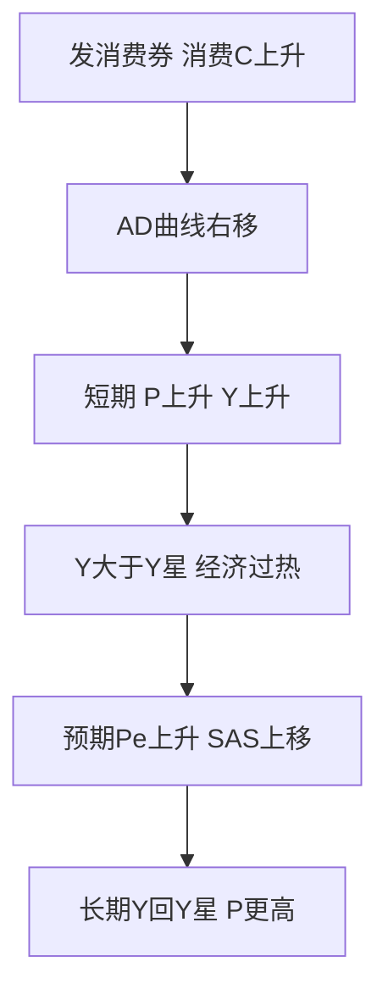
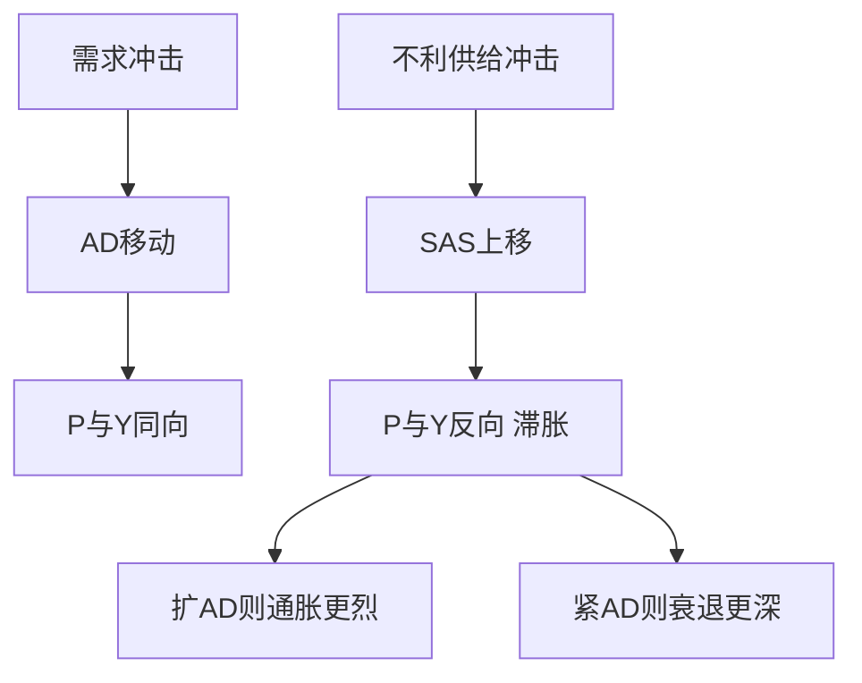

# 第十二章 AD-AS模型 · 考研真题集（首经贸 801）

<a href="../../../exam.html" target="_blank" style="display:inline-block;padding:6px 16px;background:#2563eb;color:#fff;border-radius:6px;text-decoration:none;font-size:14px;">📝 开始做题</a>

> 本章共收录：简答题 10 道（每题 15 分）｜论述题 4 道（每题 30 分）
> 配套选择题见 [[选择题集|本章选择题集]]
> 对应大纲：马工程《西方经济学》下册 第十二章 国民收入决定的 AD-AS 模型

## 📋 本题集目录

### 简答题
1. [AD曲线向右下方倾斜的原因](#s1)
2. [用IS-LM推导AD曲线及政策移动](#s2)
3. [计算题：由IS-LM方程推导AD曲线](#s3)
4. [短期AS向右上倾斜的三个理论解释](#s4)
5. [短期AS方程的经济含义与计算](#s5)
6. [凯恩斯极端水平AS与常规AS的区别](#s6)
7. [长期AS为何垂直：货币中性](#s7)
8. [短期均衡到长期均衡的调整机制](#s8)
9. [滞胀与不利供给冲击](#s9)
10. [计算题：AD-AS短期均衡与长期调整](#s10)

### 论述题
1. [古典与凯恩斯AS分歧及政策含义](#l1)
2. [石油危机与滞胀的政策两难](#l2)
3. [疫情双重冲击与中美政策对比](#l3)
4. [中国2022—2023宏观政策的AD-AS分析](#l4)

---

## 一、简答题（每题 15 分，建议 450–700 字）

### 简答 1：简述总需求（AD）曲线向右下方倾斜的原因。

**【建议字数】450–700 字 ｜ 【建议时间】15 分钟 ｜ 【题型】原因分析**

**【考什么】** 对应知识点 [[知识点/KP01_AD总需求曲线|AD总需求曲线]]，对应大纲第 1 节；题型属于原因分析。

**【答题框架】**
- 第 1 段：AD曲线定义（2 分）
- 第 2 段：利率效应（4 分）
- 第 3 段：财富效应（实际余额效应）（4 分）
- 第 4 段：汇率效应（外贸效应）（3 分）
- 第 5 段：小结——三条机制共同决定P与Y反向（2 分）

**【参考答案】**

一、总需求曲线的含义

总需求曲线表示在其他条件不变时，物价水平 $P$ 与全社会意愿购买的产品和服务总量 $Y$ 之间的关系。在以 $P$ 为纵轴、$Y$ 为横轴的坐标系中，AD曲线向右下方倾斜，即物价水平越高，均衡总产出需求越低。

二、AD曲线向右下方倾斜的三条机制

（一）利率效应（凯恩斯效应）

物价水平上升，交易所需的名义货币增加，在名义货币供给不变的情况下，货币需求大于货币供给，利率 $r$ 上升。利率上升抑制私人投资 $I$ 和耐用消费品消费，通过乘数效应使总需求 $Y$ 下降。反之，物价下降使利率下降，刺激投资和总需求。

（二）财富效应（实际余额效应、庇古效应）

物价水平上升，居民持有的货币、存款、债券等名义资产的实际购买力下降，居民感觉变穷了，从而减少消费 $C$，总需求下降。反之，物价下降使居民实际财富增加，消费增加，总需求上升。

（三）汇率效应（外贸效应）

本国物价上升，在汇率不变时本国商品相对外国商品变贵，出口下降、进口上升，净出口 $NX$ 下降，总需求下降。反之，本国物价下降使出口增加、进口减少，净出口和总需求上升。

三、小结

上述三条机制共同作用：物价上升通过利率上升、财富缩水、净出口下降三条渠道，最终使总需求下降；物价下降则反向作用。因此AD曲线向右下方倾斜。

**【解析·得分点】** 采分点：①AD曲线定义与坐标（2分）②利率效应完整链条（4分）③财富效应（4分）④汇率效应（3分）⑤小结（2分）。容易丢分：只答利率效应而漏掉财富效应和汇率效应；把AD曲线等同于微观需求曲线的加总（这是错的，微观是相对价格，宏观是总体价格水平）。

**【生活实例】** 奶茶店涨价：原料奶茶从10块涨到15块，你手里那100块钱能买的奶茶变少了（财富效应）；银行存款利息没涨，你觉得存钱不划算但贷款买房更贵了（利率效应）；而且泰国奶茶只要8块钱一杯，你更愿意点外卖喝泰国奶茶（汇率效应）。三条路都让奶茶总销量下降。

**【双链接】** 🔗 [[知识点/KP01_AD总需求曲线|回知识点]] ｜ 📖 [[../../../原文件/经济学/西方经济学下册_宏观_全书|原书·第十二章]]

---

### 简答 2：试述如何由IS-LM模型推导出AD曲线，并说明财政政策与货币政策如何使AD曲线移动。

**【建议字数】450–700 字 ｜ 【建议时间】15 分钟 ｜ 【题型】分析推导**

**【考什么】** 对应知识点 [[知识点/KP01_AD总需求曲线|AD总需求曲线]]，对应大纲第 1 节；题型属于分析推导。

**【答题框架】**
- 第 1 段：IS-LM中价格是固定的，AD模型放开价格（2 分）
- 第 2 段：P变化→实际货币余额M/P变化→LM移动→Y变化（5 分）
- 第 3 段：在P-Y坐标系描点连线即得AD（3 分）
- 第 4 段：扩张财政使IS右移→AD右移；扩张货币使LM右移→AD右移（5 分）

**【参考答案】**

一、IS-LM模型与AD曲线的关系

IS-LM模型假定物价水平 $P$ 固定不变，研究产品市场与货币市场同时均衡时利率 $r$ 与产出 $Y$ 的决定。AD-AS模型放开价格假定，研究物价水平 $P$ 与均衡产出 $Y$ 之间的关系。AD曲线正是从IS-LM模型中推导出来的。

二、推导过程

在IS-LM模型中，实际货币供给为 $M/P$。当物价水平 $P$ 变化时：

（一）$P$ 上升 → 实际货币供给 $M/P$ 下降 → 在每一产出水平下货币需求大于货币供给，利率上升 → LM曲线向左上方移动 → 与IS曲线交点对应的均衡产出 $Y$ 下降。

（二）$P$ 下降 → 实际货币供给 $M/P$ 上升 → LM曲线向右下方移动 → 均衡产出 $Y$ 上升。

在以 $P$ 为纵轴、$Y$ 为横轴的坐标系中，将不同物价水平 $P_1, P_2, P_3$ 及其对应的均衡产出 $Y_1, Y_2, Y_3$ 描点连线，即得到向右下方倾斜的AD曲线。

三、财政政策与货币政策对AD曲线的移动

（一）扩张性财政政策：政府购买增加或减税，使IS曲线右移。在每一物价水平下，均衡产出都增加，因此AD曲线整体向右移动。

（二）扩张性货币政策：央行增加名义货币供给 $M$，使LM曲线右移。在每一物价水平下，利率下降、投资增加、均衡产出增加，AD曲线整体向右移动。

（三）紧缩性财政政策与紧缩性货币政策则使AD曲线向左移动。

由于财政政策和货币政策都通过移动AD曲线来影响产出，二者合称"需求管理政策"。

**【解析·得分点】** 采分点：①IS-LM价格固定的前提（2分）②P→M/P→LM→Y的完整链条（5分）③描点连线（3分）④财政政策移动AD（2.5分）⑤货币政策移动AD（2.5分）。容易丢分：混淆"沿AD曲线移动"与"AD曲线整体移动"——物价变化引起沿AD移动，财政货币政策变化引起AD整体移动。

**【生活实例】** 把IS-LM想成一张照片：原来照片里价格是固定的（比如奶茶10块钱一杯）。现在价格变了，相当于把这张照片在价格轴上连续拍照，每张照片对应一个产出，把这些产出点连起来就是AD曲线。政府发消费券（财政）和央行降息（货币），相当于让每张照片里的产出都变大，整条AD线右移。

**【双链接】** 🔗 [[知识点/KP01_AD总需求曲线|回知识点]] ｜ 🔗 [[../11_IS-LM模型/知识点/KP03_LM曲线|LM曲线]] ｜ 📖 [[../../../原文件/经济学/西方经济学下册_宏观_全书|原书·第十二章]]

---

### 简答 3：（计算题）已知IS曲线为 $Y = 1500 - 250r$，货币需求函数为 $L = 0.5Y - 50r$，名义货币供给 $M = 1000$。要求：（1）推导AD曲线方程；（2）求 $P = 1$ 和 $P = 2$ 时的均衡产出。

**【建议字数】450–700 字 ｜ 【建议时间】15 分钟 ｜ 【题型】分析推导**

**【考什么】** 对应知识点 [[知识点/KP01_AD总需求曲线|AD总需求曲线]]，对应大纲第 1 节；题型属于分析推导（计算题）。

**【答题框架】**
- 第 1 步：由货币市场均衡 $M/P = L$ 推导LM曲线（5 分）
- 第 2 步：联立IS与LM消去 $r$，得AD方程（6 分）
- 第 3 步：代入 $P = 1$ 和 $P = 2$ 求 $Y$（4 分）

**【参考答案】**

一、推导LM曲线

货币市场均衡条件：实际货币供给等于货币需求，即

$$\frac{M}{P} = L = 0.5Y - 50r$$

代入 $M = 1000$：

$$\frac{1000}{P} = 0.5Y - 50r$$

整理解出 $r$：

$$50r = 0.5Y - \frac{1000}{P}$$

$$r = 0.01Y - \frac{20}{P}$$

二、联立IS曲线推导AD曲线

IS曲线：$Y = 1500 - 250r$，即 $r = 6 - 0.004Y$。

令IS与LM的 $r$ 相等：

$$6 - 0.004Y = 0.01Y - \frac{20}{P}$$

$$6 + \frac{20}{P} = 0.014Y$$

$$Y = \frac{6}{0.014} + \frac{20}{0.014P} = \frac{3000}{7} + \frac{10000}{7P}$$

即AD曲线方程为：

$$Y = \frac{3000}{7} + \frac{10000}{7P}$$

三、求特定价格下的均衡产出

（1）当 $P = 1$ 时：

$$Y = \frac{3000}{7} + \frac{10000}{7} = \frac{13000}{7} \approx 1857$$

（2）当 $P = 2$ 时：

$$Y = \frac{3000}{7} + \frac{10000}{14} = \frac{3000}{7} + \frac{5000}{7} = \frac{8000}{7} \approx 1143$$

四、结论

物价水平从 $P=1$ 上升到 $P=2$，均衡产出从约1857下降到约1143，验证了AD曲线向右下方倾斜。

**【解析·得分点】** 采分点：①LM曲线推导正确（5分）②联立消元得到AD方程（6分）③两个价格代入计算正确（4分）。容易丢分：忘记LM曲线中价格 $P$ 在分母上，写成 $M = L$ 漏掉 $P$；代数运算错误。首经贸不允许用计算器，数字设计成可整除或简单分数。

**【生活实例】** 就像外卖平台：IS曲线是商家愿意接单的量，LM曲线是平台派单系统的资金池。物价 $P$ 越高，同样1000块名义资金能派的单越少（实际资金池缩水），最终总订单量 $Y$ 下降。

**【双链接】** 🔗 [[知识点/KP01_AD总需求曲线|回知识点]] ｜ 📖 [[../../../原文件/经济学/西方经济学下册_宏观_全书|原书·第十二章]]

---

### 简答 4：简述短期总供给（SRAS）曲线向右上方倾斜的三个理论解释。

**【建议字数】450–700 字 ｜ 【建议时间】15 分钟 ｜ 【题型】原因分析**

**【考什么】** 对应知识点 [[知识点/KP02_短期总供给曲线|短期总供给曲线]]，对应大纲第 2 节；题型属于关系对比。

**【答题框架】**
- 第 1 段：短期AS方程 $Y = Y_f + \alpha(P - P^e)$（2 分）
- 第 2 段：工资刚性（凯恩斯）（4 分）
- 第 3 段：错觉理论（卢卡斯）（4 分）
- 第 4 段：粘性价格理论（新凯恩斯）（4 分）
- 第 5 段：三种理论结论一致（1 分）

**【参考答案】**

一、短期总供给方程

短期总供给曲线的一般形式为：

$$Y = Y_f + \alpha(P - P^e)$$

其中 $Y_f$ 为潜在产出，$P^e$ 为预期物价水平，$\alpha > 0$。当实际物价 $P$ 高于预期 $P^e$ 时，产出 $Y$ 高于潜在产出；当 $P$ 低于 $P^e$ 时，产出低于潜在产出。这意味着SRAS曲线向右上方倾斜。为什么物价超预期上涨会使企业多生产？经济学有三种解释。

二、工资刚性理论（凯恩斯主义）

短期内名义工资由长期劳动合同固定，不能随物价迅速调整。当物价水平 $P$ 上升时，名义工资 $W$ 不变，实际工资 $W/P$ 下降。企业劳动成本降低，利润增加，于是增雇工人、扩大生产。反之，物价下降使实际工资上升，企业减雇减产。因此物价上升伴随产出增加，SRAS向右上方倾斜。

三、错觉理论（卢卡斯，新古典）

生产者只关注自己产品的价格，难以区分整体物价水平变动与相对价格变动。当一般物价水平上升时，企业误以为自己产品的相对价格上升了（实际上所有商品都涨价了），于是增加生产。同理，物价下降时企业误以为自己产品相对降价，减少生产。这种"货币幻觉"使产出随物价同向变动。

四、粘性价格理论（新凯恩斯主义）

由于存在菜单成本（重新印刷价格表、更改价签的成本），部分企业不能随物价变动及时调整自己产品的价格。当一般物价水平上升时，调价慢的企业产品价格相对偏低，销售量增加，于是扩大生产。反之，物价下降时，调价慢的企业产品价格相对偏高，销售量下降，缩减生产。

五、小结

三种理论的假设不同（工资刚性、信息不完全、价格粘性），但结论一致：短期中物价水平超预期上升会使产出高于潜在产出，因此SRAS曲线向右上方倾斜。

**【解析·得分点】** 采分点：①SRAS方程（2分）②工资刚性链条完整（4分）③错觉理论核心（4分）④粘性价格与菜单成本（4分）⑤结论一致（1分）。容易丢分：把三种理论混为一谈；说不清每种理论的核心摩擦来源。

**【生活实例】** 奶茶店签了一年员工合同，月薪5000块（工资刚性）。这个月奶茶从10块涨到15块，但员工工资没涨，老板觉得每杯赚得多了，就多雇两个人多做奶茶。错觉理论就是老板只看到自己奶茶涨价，以为只有自己卖得好；粘性价格理论就是有些小店懒得改菜单上的价签。

**【双链接】** 🔗 [[知识点/KP02_短期总供给曲线|回知识点]] ｜ 📖 [[../../../原文件/经济学/西方经济学下册_宏观_全书|原书·第十二章]]

---

### 简答 5：简述短期总供给方程 $Y = Y_f + \alpha(P - P^e)$ 的经济含义，并计算：已知 $Y_f = 1000$，$\alpha = 100$，$P^e = 100$，分别求 $P = 100$、$P = 110$、$P = 90$ 时的产出。

**【建议字数】450–700 字 ｜ 【建议时间】15 分钟 ｜ 【题型】概念简答**

**【考什么】** 对应知识点 [[知识点/KP02_短期总供给曲线|短期总供给曲线]]，对应大纲第 2 节；题型属于概念简答+计算。

**【答题框架】**
- 第 1 段：方程各变量含义（4 分）
- 第 2 段：经济含义——物价与预期偏离导致产出偏离潜在（4 分）
- 第 3 段：三种价格情形计算（7 分）

**【参考答案】**

一、方程各变量的含义

短期总供给方程：

$$Y = Y_f + \alpha(P - P^e)$$

其中：
- $Y$：实际产出（短期均衡产出）；
- $Y_f$：潜在产出（充分就业产出），由资本、劳动、技术等供给面因素决定；
- $P$：实际物价水平；
- $P^e$：公众和企业预期的物价水平；
- $\alpha > 0$：物价超预期每上升一个百分点，产出超出潜在产出的幅度，反映短期总供给对未预期物价变动的反应灵敏度。

二、经济含义

（一）当 $P = P^e$ 时，$Y = Y_f$，产出恰好等于潜在产出，经济处于充分就业状态。此时短期总供给曲线与长期总供给曲线相交。

（二）当 $P > P^e$ 时，物价上涨超过预期，由于名义工资刚性或价格粘性，企业实际成本下降、利润上升，扩大生产，$Y > Y_f$，经济处于过热状态。

（三）当 $P < P^e$ 时，物价下跌低于预期，企业产品售价下降但工资未降，实际成本上升，缩减生产，$Y < Y_f$，经济处于衰退状态。

三、计算

已知 $Y_f = 1000$，$\alpha = 100$，$P^e = 100$。

（1）$P = 100$ 时：

$$Y = 1000 + 100 \times (100 - 100) = 1000$$

产出等于潜在产出，经济充分就业。

（2）$P = 110$ 时：

$$Y = 1000 + 100 \times (110 - 100) = 1000 + 1000 = 1100$$

物价超预期上涨10个单位，产出高于潜在产出100单位，经济过热。

（3）$P = 90$ 时：

$$Y = 1000 + 100 \times (90 - 100) = 1000 - 1000 = 900$$

物价低于预期10个单位，产出低于潜在产出100单位，经济衰退。

四、结论

短期产出由物价水平与预期物价的偏离决定；只有当实际物价等于预期物价时，产出才回到潜在产出水平。

**【解析·得分点】** 采分点：①五个变量含义（4分）②三种情形的经济解释（4分）③三次代入计算（7分）。容易丢分：把 $P^e$ 理解成"上期物价"而不是"预期物价"；计算时符号错误。

**【生活实例】** 老板和员工签合同时约定工资按"奶茶10块钱"定（$P^e=100$）。结果奶茶实际卖到11块（$P=110$），老板每杯多赚，就多做；结果奶茶只卖9块（$P=90$），老板每杯亏，就少做。

**【双链接】** 🔗 [[知识点/KP02_短期总供给曲线|回知识点]] ｜ 📖 [[../../../原文件/经济学/西方经济学下册_宏观_全书|原书·第十二章]]

---

### 简答 6：简述凯恩斯极端情形（水平总供给曲线）与常规短期总供给曲线的区别，并说明其政策含义。

**【建议字数】450–700 字 ｜ 【建议时间】15 分钟 ｜ 【题型】关系对比**

**【考什么】** 对应知识点 [[知识点/KP02_短期总供给曲线|短期总供给曲线]]，对应大纲第 2 节；题型属于关系对比。

**【答题框架】**
- 第 1 段：常规SRAS向右上倾斜（3 分）
- 第 2 段：凯恩斯极端SRAS水平的假设（5 分）
- 第 3 段：政策含义——萧条时扩需求只增产不涨价（5 分）
- 第 4 段：与古典垂直AS对比（2 分）

**【参考答案】**

一、常规短期总供给曲线

在经济接近充分就业但仍存在一定闲置资源时，短期总供给曲线 $Y = Y_f + \alpha(P - P^e)$ 向右上方倾斜。物价温和上升时，企业温和增产；物价上升越快，产出增加越多。此时扩张总需求既提高产出也带来一定物价上涨。

二、凯恩斯极端情形：水平总供给曲线

凯恩斯在《就业、利息和货币通论》中研究大萧条时的经济，提出极端假设：

（一）经济中存在大量失业工人和闲置产能，远未达到充分就业。

（二）在现有物价水平下，企业愿意提供任意数量的产出，因为只要有闲置工人和机器，扩大生产不会提高单位成本。

（三）名义工资和物价在萧条时期完全不下降（工资刚性），但也不会上升，因为存在过剩产能。

此时短期总供给曲线为一条水平线：

$$P = \bar{P} \quad (\text{固定})$$

即无论产出多少，物价水平都维持在 $\bar{P}$。

三、政策含义

（一）在凯恩斯极端情形下，扩张总需求（财政政策或货币政策）使AD曲线右移，由于SRAS水平，产出 $Y$ 增加而物价 $P$ 不变。政府可以通过需求管理政策无限提高产出，直到达到潜在产出 $Y_f$。

（二）这为大萧条时期政府大规模举债支出、扩需求提供了理论依据：不必担心通胀，因为经济远未达到充分就业。

（三）一旦产出接近或超过潜在产出，SRAS就从水平转为向右上方倾斜，继续扩需求只会带来通胀而不增产。

四、与古典情形对比

古典学派认为长期中价格工资充分灵活，AS垂直于潜在产出 $Y_f$。凯恩斯极端认为短期萧条中AS水平。前者认为政府干预无效（长期货币中性），后者认为政府干预极为有效。

**【解析·得分点】** 采分点：①常规SRAS形状（3分）②水平AS的三个假设（5分）③政策含义：扩需求只增产不涨价（5分）④与古典垂直AS对比（2分）。容易丢分：把水平AS与垂直AS混淆；说不出"大萧条"这一背景。

**【生活实例】** 疫情后学校食堂：原本能坐500人的食堂只坐了100人，厨师和灶台都闲着。这时候学校多组织200人来吃饭，食堂不需要涨价——因为多做200份饭的边际成本几乎为零。这就是水平AS。等食堂坐满了（接近 $Y_f$），再来人就得加钱扩建，物价就涨了。

**【双链接】** 🔗 [[知识点/KP02_短期总供给曲线|回知识点]] ｜ 🔗 [[知识点/KP03_长期总供给曲线|长期AS]] ｜ 📖 [[../../../原文件/经济学/西方经济学下册_宏观_全书|原书·第十二章]]

---

### 简答 7：为什么长期总供给（LRAS）曲线是垂直的？简述货币中性原理。

**【建议字数】450–700 字 ｜ 【建议时间】15 分钟 ｜ 【题型】原因分析**

**【考什么】** 对应知识点 [[知识点/KP03_长期总供给曲线|长期总供给曲线]]，对应大纲第 3 节；题型属于原因分析。

**【答题框架】**
- 第 1 段：LRAS方程 $Y = Y_f$（2 分）
- 第 2 段：长期工资物价充分灵活调整（5 分）
- 第 3 段：货币中性——名义变量不影响实际变量（5 分）
- 第 4 段：LRAS移动的唯一原因是潜在产出变化（3 分）

**【参考答案】**

一、长期总供给曲线的形状

长期总供给曲线表示长期中价格和工资充分灵活调整后经济的产出水平：

$$Y = Y_f$$

其中 $Y_f$ 为潜在产出（充分就业产出）。在以 $P$ 为纵轴、$Y$ 为横轴的坐标系中，LRAS是一条垂直于横轴 $Y_f$ 的直线——无论物价水平是100还是200，产出都固定在 $Y_f$。

二、为什么长期AS垂直

（一）短期中名义工资由合同固定，物价上升使实际工资下降、企业增产。但长期中工资合同到期重签，工人会要求根据物价上涨幅度提高名义工资。

（二）当名义工资与物价同比例上升时，实际工资回到原有均衡水平，企业没有动力增雇或减雇工人。

（三）此时就业回到充分就业水平，产出回到由资本、劳动、技术决定的潜在产出 $Y_f$。

（四）因此长期中物价水平的变化不影响实际产出，产出唯一由供给面因素决定，LRAS垂直。

三、货币中性原理

货币中性是古典二分法的推论：长期中，名义货币供给量的变化只影响名义变量（物价水平、名义工资、名义汇率），不影响实际变量（实际产出、实际工资、实际利率、就业量）。

例如，央行把货币供给增加一倍，长期中物价水平和名义工资都上涨一倍，但实际产出、实际工资、实际利率都不变。这就是长期总供给垂直的含义：扩需求政策长期只涨价、不增产。

四、LRAS曲线的移动

LRAS的位置由潜在产出 $Y_f$ 决定，因此只有供给面因素变化才会使LRAS移动：劳动力增加、资本积累、技术进步、制度改善使LRAS右移；疫情导致劳动力减少、自然灾害破坏资本存量使LRAS左移。长期经济增长本质上就是LRAS不断右移的过程。

**【解析·得分点】** 采分点：①LRAS方程与垂直形状（2分）②长期工资灵活调整链条（5分）③货币中性定义（5分）④LRAS移动原因（3分）。容易丢分：把LRAS垂直归因于"价格粘性消失"而不是"工资与物价同比例调整"；忘记货币中性是"长期"成立，短期不成立。

**【生活实例】** 学校周边奶茶店：短期里学生（工人）被合同锁定，奶茶涨价老板多做。但一学期后合同到期，学生发现奶茶从10块涨到20块，要求生活费翻倍。老板把工资也涨到原来两倍，实际利润和产量又回到原来水平。物价翻倍，但奶茶店产量没变——这就是货币中性。

**【双链接】** 🔗 [[知识点/KP03_长期总供给曲线|回知识点]] ｜ 📖 [[../../../原文件/经济学/西方经济学下册_宏观_全书|原书·第十二章]]

---

### 简答 8：当经济处于短期均衡但产出高于潜在产出时，说明经济将如何从短期均衡调整到长期均衡。

**【建议字数】450–700 字 ｜ 【建议时间】15 分钟 ｜ 【题型】分析推导**

**【考什么】** 对应知识点 [[知识点/KP03_长期总供给曲线|长期总供给曲线]]，对应大纲第 3 节；题型属于分析推导。

**【答题框架】**
- 第 1 段：短期均衡位置——AD与SRAS交点在LRAS右侧（3 分）
- 第 2 段：工人发现实际工资下降，要求涨工资（5 分）
- 第 3 段：$P^e$ 上升，SRAS左移（5 分）
- 第 4 段：新长期均衡——三线交于一点，$Y=Y_f$（2 分）

**【参考答案】**

一、短期均衡的位置

假设初始经济处于长期均衡，AD、SRAS、LRAS三线交于一点，此时 $Y = Y_f$，$P = P^e$。

若扩张性财政政策使AD右移，短期中新的AD与原SRAS相交于LRAS右侧，此时：
- 短期产出 $Y_1 > Y_f$（经济过热）；
- 短期物价 $P_1 > P^e$（物价上涨超过预期）。

这一状态不可持续，因为它建立在工人"预期错误"的基础上。

二、长期调整机制

（一）工人在短期合同下获得名义工资，但发现物价从 $P^e$ 上涨到 $P_1$，实际工资下降。

（二）工人重新谈判工资合同时，会根据更高的物价水平提高预期 $P^e$，要求名义工资同比例上涨。

（三）名义工资上升使企业生产成本上升，在每一物价水平下企业愿意供给的产出减少，SRAS曲线向左上方移动。

（四）SRAS左移使物价进一步上升、产出下降，直到SRAS移动到与AD、LRAS三线重新交于一点。

三、新长期均衡

在新长期均衡点：
- 产出回到 $Y_f$；
- 物价进一步上升到 $P_2 > P_1$；
- 预期物价 $P^e$ 调整到等于实际物价 $P_2$。

四、结论

（一）扩张性需求政策短期使产出高于潜在产出、物价上升；长期中由于工资和预期调整，产出回到潜在产出，只有物价永久上升。

（二）这一结论与货币中性一致：长期中扩需求只带来通胀，不提高产出。

（三）若初始短期均衡在LRAS左侧（衰退，$Y < Y_f$），调整方向相反：高失业使工人接受降工资，$P^e$ 下降，SRAS右移，产出回到 $Y_f$，物价下降。

**【解析·得分点】** 采分点：①短期均衡在LRAS右侧的位置（3分）②工人预期调整与工资上涨（5分）③SRAS左移（5分）④新长期均衡三线交点（2分）。容易丢分：误以为长期调整靠AD移动；忘记衰退情形的反向调整。

**【生活实例】** 奶茶店老板生意好，临时招的小时工工资按去年水平定的。半年后小时工发现物价涨了，要求涨工资。老板成本上升，要么涨价要么减产，最后奶茶产量回到正常水平，只是奶茶更贵了。

**【双链接】** 🔗 [[知识点/KP03_长期总供给曲线|回知识点]] ｜ 🔗 [[知识点/KP04_ADAS均衡与冲击|AD-AS均衡]] ｜ 📖 [[../../../原文件/经济学/西方经济学下册_宏观_全书|原书·第十二章]]

---

### 简答 9：什么是滞胀？用AD-AS模型说明不利供给冲击的短期效应与政策困境。

**【建议字数】450–700 字 ｜ 【建议时间】15 分钟 ｜ 【题型】经济现象**

**【考什么】** 对应知识点 [[知识点/KP04_ADAS均衡与冲击|AD-AS均衡与冲击]]，对应大纲第 4 节；题型属于经济现象分析。

**【答题框架】**
- 第 1 段：滞胀定义（2 分）
- 第 2 段：不利供给冲击使SRAS左移（5 分）
- 第 3 段：短期效应——物价上升、产出下降（4 分）
- 第 4 段：政策困境——扩需求则通胀加剧，不干预则衰退持续（4 分）

**【参考答案】**

一、滞胀的含义

滞胀（stagflation）是指经济中经济停滞（stagnation）与通货膨胀（inflation）同时并存的现象，即产出下降、失业上升的同时物价持续上涨。这一现象在1970年代西方石油危机后出现，与传统菲利普斯曲线所描述的"失业与通胀此消彼长"相矛盾。

二、不利供给冲击的AD-AS分析

（一）初始状态：AD、SRAS、LRAS三线交于一点，经济处于充分就业均衡，$Y = Y_f$，物价稳定。

（二）不利供给冲击：例如1973年石油价格上涨四倍、2022年俄乌冲突导致能源和粮食价格飙升。石油、原材料是企业生产的投入品，其价格上涨使企业生产成本上升。

（三）生产成本上升使在每一物价水平下企业愿意供给的产出减少，短期总供给曲线SRAS向左上方移动。

（四）新的短期均衡由新的SRAS与原AD相交决定：
- 物价水平从 $P_0$ 上升到 $P_1$（通胀）；
- 产出从 $Y_f$ 下降到 $Y_1 < Y_f$（衰退）；
- 失业上升。

这就是滞胀：物价上升与产出下降同时发生。

三、政策困境

面对滞胀，政府的需求管理政策陷入两难：

（一）若采取扩张性财政政策或货币政策使AD右移，虽然可以使产出回到 $Y_f$，但物价水平会进一步上升到 $P_2$，通胀加剧。

（二）若采取紧缩政策或不干预，依靠市场自发调整：高失业使工人接受降工资，生产成本下降，SRAS逐渐右移回原位。但这一过程缓慢，经济要经历长时间高失业和衰退。

（三）因此，供给冲击下政府无法同时实现"恢复产出"和"压低通胀"两个目标，必须在两者之间权衡。这与需求冲击不同——需求冲击下扩需求可以同时增产和稳物价。

四、结论

不利供给冲击导致SRAS左移，造成滞胀。需求管理政策在供给冲击面前失效或代价高昂，根本出路在于提高生产率、增加能源供给等供给侧措施。

**【解析·得分点】** 采分点：①滞胀定义（2分）②SRAS左移的原因（5分）③短期效应P升Y降（4分）④政策困境的两个方向（4分）。容易丢分：把滞胀归因于AD移动（错误，是AS移动）；说不出"与菲利普斯曲线矛盾"这一理论意义。

**【生活实例】** 奶茶店生意好好的，突然奶茶原料（牛奶、茶叶）涨价一倍。老板要么涨价（通胀），要么少做（产出下降）。政府发消费券让大家多买奶茶（扩AD），只会让奶茶更贵；不管它，老板撑几个月后扛不住关门，员工失业。这就是滞胀的两难。

**【双链接】** 🔗 [[知识点/KP04_ADAS均衡与冲击|回知识点]] ｜ 🔗 [[../13_失业通胀与经济周期/知识点/KP02_通货膨胀成因|成本推动通胀]] ｜ 📖 [[../../../原文件/经济学/西方经济学下册_宏观_全书|原书·第十二章]]

---

### 简答 10：（计算题）已知 $Y_f = 1000$，AD曲线为 $Y = 2000 - 10P$，短期总供给曲线为 $Y = 1000 + 100(P - P^e)$，初始预期 $P^e = 100$。要求：（1）求初始短期均衡产出和物价；（2）判断经济是否处于长期均衡；（3）若AD不变，长期均衡物价是多少？

**【建议字数】450–700 字 ｜ 【建议时间】15 分钟 ｜ 【题型】分析推导**

**【考什么】** 对应知识点 [[知识点/KP04_ADAS均衡与冲击|AD-AS均衡与冲击]]，对应大纲第 4 节；题型属于分析推导（计算题）。

**【答题框架】**
- 第 1 步：联立AD与SRAS求短期均衡（6 分）
- 第 2 步：判断是否 $Y = Y_f$、$P = P^e$（4 分）
- 第 3 步：长期均衡 $Y = Y_f$，代入AD求长期物价（5 分）

**【参考答案】**

一、求初始短期均衡

短期均衡由AD曲线与SRAS曲线交点决定：

$$2000 - 10P = 1000 + 100(P - 100)$$

展开右边：

$$2000 - 10P = 1000 + 100P - 10000$$

$$2000 - 10P = 100P - 9000$$

移项：

$$2000 + 9000 = 110P$$

$$11000 = 110P$$

$$P = 100$$

代入AD求产出：

$$Y = 2000 - 10 \times 100 = 1000$$

二、判断是否长期均衡

检查长期均衡条件：
（1）$Y = Y_f = 1000$？✓ 是。
（2）$P = P^e = 100$？✓ 是。

两个条件都满足，因此初始经济处于长期均衡，AD、SRAS、LRAS三线交于一点。

三、若AD不变，求长期均衡物价

长期均衡时产出必须等于潜在产出 $Y = Y_f = 1000$（LRAS垂直于 $Y_f$）。将 $Y = 1000$ 代入AD曲线：

$$1000 = 2000 - 10P$$

$$10P = 1000$$

$$P = 100$$

因此长期均衡物价为 $P = 100$，与初始短期均衡一致。

四、延伸思考

若AD右移为 $Y = 2500 - 10P$，短期均衡为：

$$2500 - 10P = 1000 + 100(P - 100)$$

$$2500 - 10P = 100P - 9000$$

$$11500 = 110P, \quad P \approx 104.5, \quad Y \approx 1455 > Y_f$$

短期过热。长期中工人调整预期使 $P^e$ 上升，SRAS左移，最终 $Y$ 回到1000，由AD求得 $1000 = 2500 - 10P$，即 $P = 150$。AD右移500，长期中物价从100涨到150（涨50%），产出不变——货币中性。

**【解析·得分点】** 采分点：①短期均衡联立计算（6分）②两个长期均衡条件判断（4分）③长期物价由 $Y=Y_f$ 代入AD求得（5分）。容易丢分：忘记长期均衡条件是三线交于一点，只算了短期均衡就下结论；代数错误。

**【生活实例】** 就像奶茶店：AD是学生总需求，SRAS是老板短期供给，LRAS是店铺最大产能。短期均衡点刚好在最大产能上（1000杯），价格10块钱。如果学生突然变多（AD右移），短期老板多做但店铺有上限，长期租金和工资涨，最后还是做1000杯，只是奶茶从10块涨到15块。

**【双链接】** 🔗 [[知识点/KP04_ADAS均衡与冲击|回知识点]] ｜ 📖 [[../../../原文件/经济学/西方经济学下册_宏观_全书|原书·第十二章]]

---

### 简答 11：（曲线移动·分析）用 AD-AS 模型分析"政府增发消费券"这一需求管理政策的短期与长期效果，并说明为何长期可能只涨物价

**【建议字数】450–700 字 ｜ 【建议时间】15 分钟 ｜ 【题型】曲线移动分析**

**【考什么】** 对应 [[知识点/KP01_AD总需求曲线|AD 曲线]]、[[知识点/KP02_短期总供给曲线|SAS]]、[[知识点/KP03_长期总供给曲线|LAS]]。

**【答题框架】**
- 第 1 段：政策作用于哪条曲线（5 分）
- 第 2 段：短期新均衡（5 分）
- 第 3 段：长期预期调整为何只涨物价（5 分）

**【参考答案】**

一、曲线定性。发消费券直接增加居民可支配消费，属于**需求侧**刺激 → **AD 曲线右移**（不是 SAS/LAS）。

二、短期均衡。短期 SAS 因工资和价格黏性不动。AD 右移后沿 SAS 向右上走：物价 $P$ 温和上升、产出 $Y$ 上升（向潜在产出 $Y^*$ 靠近甚至超过它）。这就是短期政策能"托底增长"的原因。

三、长期调整。若 AD 右移使 $Y>Y^*$（经济过热、劳动市场紧绷），工人在续签合同时要求更高工资，**预期价格 $P^e$ 上升** → **SAS 逐步上移**。SAS 上移沿新 AD 向左上走，把产出压回 $Y^*$，物价进一步抬高。长期均衡回到 LAS 上：$Y$ 回到潜在水平，**只有物价永久性上升**。这说明需求管理政策在长期不改变实际产出（货币中性），只改变价格水平。

**【解析·得分点】** ① AD 右移而非 AS（5）；② 短期 P、Y 齐升（5）；③ 长期 SAS 上移、Y 回 Y*、只涨物价（5）。易丢分：以为发券能永久提高产出。

**【生活实例】** 2020 年各地发数亿消费券，短期餐饮客流回升；但若经济已接近充分就业，继续印钱发券只会让奶茶、外卖轮番涨价——长期老百姓实际购买力并没多，只是标价高了。

---

## 二、论述题（每题 30 分，建议 900–1200 字）

### 论述 1：试比较古典学派与凯恩斯学派对总供给曲线的分歧，并说明这种分歧对宏观经济政策含义的影响。

**【建议字数】900–1200 字 ｜ 【建议时间】30 分钟 ｜ 【题型】理论类**

**【考什么】** 跨 [[知识点/KP02_短期总供给曲线|短期AS]] 与 [[知识点/KP03_长期总供给曲线|长期AS]]，题型属于理论类。

**【答题框架】**
- 第 1 段：总供给曲线是宏观经济学分歧的核心（4 分）
- 第 2 段：古典学派——价格工资充分灵活，AS垂直（6 分）
- 第 3 段：凯恩斯主义——工资刚性，AS水平或向右上倾斜（6 分）
- 第 4 段：新古典综合——短期向右上、长期垂直（6 分）
- 第 5 段：政策含义对比（5 分）
- 第 6 段：评价与现实（3 分）

**【参考答案】**

一、总供给曲线：宏观经济学分歧的焦点

总供给曲线描述物价水平与企业意愿产出之间的关系。古典学派与凯恩斯主义的根本分歧在于：价格和工资能否迅速灵活调整。这一分歧决定了总供给曲线的形状，也决定了政府应不应该干预经济。

二、古典学派：垂直的总供给曲线

（一）理论基础。古典学派（萨伊、马歇尔、庇古等）认为，价格和工资具有充分弹性，市场能够迅速出清。劳动市场上，名义工资随劳动供求灵活升降，始终维持充分就业；产品市场上，价格灵活调整，始终维持供求平衡。

（二）AS曲线形状。由于工资和价格充分灵活，物价水平变化不影响实际工资和就业量，产出始终等于充分就业产出 $Y_f$。因此总供给曲线是垂直于 $Y_f$ 的直线，即LRAS。

（三）政策含义。古典学派信奉"萨伊定律"——供给自动创造需求。经济不会出现长期生产过剩和失业。政府的扩张性需求政策只会使物价上升，不会增加实际产出（货币中性），因此政府不应该干预经济，市场机制本身能够实现充分就业均衡。

三、凯恩斯主义：水平或向右上方倾斜的AS曲线

（一）理论基础。凯恩斯在1936年《就业、利息和货币通论》中研究大萧条，提出工资和价格具有刚性（向下刚性）。长期劳动合同使名义工资不能灵活下降；工人有"货币幻觉"，拒绝接受名义工资削减；垄断企业和工会也阻碍价格下调。

（二）AS曲线形状。在大萧条背景下，存在大量失业和闲置产能，企业在现有物价水平下愿意供给任意数量产出，AS曲线为水平线。在一般短期情形下，由于工资刚性或价格粘性，物价上升使实际工资下降、企业增产，AS曲线向右上方倾斜。

（三）政策含义。凯恩斯认为，有效需求不足是失业的根源。政府可以通过扩张性财政政策和货币政策移动AD曲线，在AS水平或平缓的区域，扩需求主要增加产出和就业，不会引起明显通胀。这为政府干预经济提供了理论依据。

四、新古典综合：短期与长期的统一

1950年代后，萨缪尔森等"新古典综合派"将两种观点统一：

（一）短期中，工资和价格具有刚性或粘性，SRAS向右上方倾斜，凯恩斯主义的需求管理政策有效。

（二）长期中，工资和价格充分调整，LRAS垂直于 $Y_f$，古典学派的货币中性成立。

（三）短期与长期的桥梁是预期调整：短期中物价超预期上升使产出偏离 $Y_f$；长期中工人调整预期和工资，SRAS左移，产出回到 $Y_f$。

五、政策含义对比

| 学派 | AS形状 | 扩需求效应 | 政策主张 |
|---|---|---|---|
| 古典学派 | 垂直 | 只涨价，不增产 | 不干预，市场出清 |
| 凯恩斯极端 | 水平 | 只增产，不涨价 | 积极扩需求 |
| 新古典综合 | 短期右上、长期垂直 | 短期增产涨价，长期只涨价 | 短期干预，长期依靠供给侧 |

六、评价与现实

古典学派的垂直AS适用于长期和充分就业情形，凯恩斯的水平AS适用于大萧条和严重衰退。现实经济通常处于两者之间：萧条时期需求管理有效，过热时期扩需求只带来通胀。这一理论分歧也解释了1970年代滞胀后凯恩斯主义的衰落和货币主义、新古典宏观经济学的兴起。

**【解析·得分点】** 采分点：①分歧核心是价格工资灵活性（4分）②古典垂直AS及货币中性（6分）③凯恩斯水平/右上AS及工资刚性（6分）④新古典综合统一（6分）⑤政策含义对比表（5分）⑥评价（3分）。容易丢分：只说一派观点而不对比；忘记新古典综合的桥梁作用。

**【生活实例】** 学校周边房租：古典学派认为房租可以随供求自由涨跌，空房多了房租自动降，永远住满。凯恩斯认为房租合同签了一年不能降，学生少了房子空着，学校（政府）应该组织活动吸引学生来住。新古典综合认为一年内房租刚性，一年后合同到期重签会调整。

**【双链接】** 🔗 [[知识点/KP02_短期总供给曲线|短期AS]] ｜ 🔗 [[知识点/KP03_长期总供给曲线|长期AS]] ｜ 📖 [[../../../原文件/经济学/西方经济学下册_宏观_全书|原书·第十二章]]

---

### 论述 2：试运用AD-AS模型分析1970年代石油危机及其引发的"滞胀"，并说明供给冲击下宏观经济政策的两难选择。

**【建议字数】900–1200 字 ｜ 【建议时间】30 分钟 ｜ 【题型】政策效应类**

**【考什么】** 跨 [[知识点/KP04_ADAS均衡与冲击|AD-AS冲击]] 与 [[../13_失业通胀与经济周期/知识点/KP02_通货膨胀成因|成本推动通胀]]、[[../13_失业通胀与经济周期/知识点/KP03_菲利普斯曲线|菲利普斯曲线]]，题型属于政策类。

**【答题框架】**
- 第 1 段：石油危机背景与滞胀现象（4 分）
- 第 2 段：AD-AS模型分析SRAS左移（6 分）
- 第 3 段：与需求拉上通胀的对比（5 分）
- 第 4 段：政策两难——扩需求vs不干预（8 分）
- 第 5 段：沃尔克反通胀的牺牲率（4 分）
- 第 6 段：对中国的启示（3 分）

**【参考答案】**

一、石油危机与滞胀现象

1973年10月，第四次中东战争爆发，OPEC对支持以色列的西方国家实行石油禁运，原油价格从每桶约3美元暴涨到12美元，上涨四倍。1979年伊朗革命后油价再次翻倍。两次石油危机使西方主要经济体出现了前所未有的"滞胀"：经济衰退（产出下降、失业上升）与通货膨胀（物价两位数上涨）并存。美国1975年失业率达8.5%，通胀率达9%；1979—1980年通胀率超过13%，失业率超过7%。这一现象与传统菲利普斯曲线所描述的"失业与通胀此消彼长"完全矛盾，动摇了凯恩斯主义的统治地位。

二、AD-AS模型分析

（一）初始均衡。危机前，美国经济处于AD、SRAS、LRAS三线交点，充分就业，物价温和上涨。

（二）不利供给冲击。石油是现代工业的基础投入品，油价暴涨使企业生产成本大幅上升。在每一物价水平下，企业愿意供给的产出减少，短期总供给曲线SRAS从SRAS₀向左上方移动到SRAS₁。

（三）短期效应。新的短期均衡由SRAS₁与原AD₀相交：
- 物价水平从 $P_0$ 上升到 $P_1$，通胀率上升；
- 产出从 $Y_f$ 下降到 $Y_1 < Y_f$，经济衰退；
- 失业率上升到自然失业率以上。

物价上升与产出下降同时发生，即"滞胀"。

三、与需求拉上通胀的对比

需求拉上通胀是AD曲线右移导致的，表现为物价上升与产出上升同时发生（经济过热），政府可以通过紧缩AD来同时压低物价和产出。而成本推动型通胀（供给冲击）是SRAS左移导致的，表现为物价上升与产出下降同时发生，政府无法用简单的需求管理政策同时解决两个问题。

四、政策两难

面对滞胀，政府陷入两难：

（一）扩张性政策路线。若美联储降息、政府扩大支出使AD从AD₀右移到AD₁，新均衡由AD₁与SRAS₁相交，产出回到 $Y_f$，但物价进一步上升到 $P_2$。代价是通胀失控。

（二）紧缩或不干预路线。若政府不干预，依靠市场自发调整：高失业和衰退使工人接受降工资，生产成本下降，SRAS逐渐从SRAS₁右移回SRAS₀。但这一过程需要数年，社会要承受长时间高失业。

（三）两难的本质。供给冲击使菲利普斯曲线整体上移（同样失业率下通胀更高），政府无法在"通胀—失业"菜单上找到理想组合。

五、沃尔克反通胀与牺牲率

1979年美联储主席沃尔克采取极端紧缩货币政策，将联邦基金利率提高到20%以上。这一政策使AD大幅左移，通胀率从1980年的13.5%降到1983年的3%，但代价是1982年失业率冲到10.8%，战后最严重的衰退。这就是"牺牲率"——把通胀降低1个百分点需要牺牲多少产出，估计为4%—5%。沃尔克的选择是"先治通胀、忍受衰退"，最终重建了美联储的抗通胀信誉。

六、对中国的启示

2022年俄乌冲突后中国也面临输入性通胀（原油、粮食价格上涨）和国内疫情冲击下的需求不足双重压力。与1970年代美国不同，中国当时CPI温和（2%左右），主要是PPI上涨，因此政策重点是保供稳价、保障能源粮食安全，而非大规模紧缩。这说明供给冲击的应对要结合具体国情：若通胀预期失控，必须像沃尔克一样坚定反通胀；若通胀温和，则可以容忍短期冲击，优先保就业和增长。

**【解析·得分点】** 采分点：①石油危机历史背景（4分）②SRAS左移的AD-AS分析（6分）③与需求拉上通胀对比（5分）④政策两难两个方向（8分）⑤沃尔克牺牲率（4分）⑥中国启示（3分）。容易丢分：把滞胀归因于AD移动；说不出牺牲率；忘记与菲利普斯曲线的联系。

**【生活实例】** 奶茶店原料涨价，老板面临两难：发消费券让大家多喝奶茶（扩AD），奶茶更贵；不管它，员工失业。最后老板下定决心裁员降本（沃尔克紧缩），短期痛苦但长期把价格稳住了。

**【双链接】** 🔗 [[知识点/KP04_ADAS均衡与冲击|AD-AS冲击]] ｜ 🔗 [[../13_失业通胀与经济周期/知识点/KP02_通货膨胀成因|成本推动通胀]] ｜ 🔗 [[../13_失业通胀与经济周期/知识点/KP03_菲利普斯曲线|菲利普斯曲线]] ｜ 📖 [[../../../原文件/经济学/西方经济学下册_宏观_全书|原书·第十二章]]

---

### 论述 3：2020—2023年新冠疫情对全球经济造成了怎样的冲击？试运用AD-AS模型比较中美两国的应对政策及其后果。

**【建议字数】900–1200 字 ｜ 【建议时间】30 分钟 ｜ 【题型】现象类**

**【考什么】** 跨 [[知识点/KP04_ADAS均衡与冲击|AD-AS冲击]] 与 [[../13_失业通胀与经济周期/知识点/KP02_通货膨胀成因|通胀成因]]，题型属于现象类+政策类。

**【答题框架】**
- 第 1 段：疫情双重冲击的性质（4 分）
- 第 2 段：AD-AS模型分析疫情冲击（6 分）
- 第 3 段：美国政策——大规模扩需求及其后果（8 分）
- 第 4 段：中国政策——保供给、有限扩需求（6 分）
- 第 5 段：对比与启示（4 分）
- 第 6 段：理论反思（2 分）

**【参考答案】**

一、疫情冲击的双重性质

2020年初新冠疫情暴发，对全球经济同时造成需求冲击和供给冲击：

（一）供给侧冲击：工厂停工、物流中断、边境关闭，企业生产能力下降，SRAS左移。

（二）需求侧冲击：封锁隔离使居民减少消费（尤其服务消费），企业推迟投资，AD左移。

（三）金融侧冲击：股市暴跌、流动性紧张。

这是1929年大萧条以来首次"供需双杀"型危机。

二、AD-AS模型分析

（一）初始均衡：经济处于三线交点。

（二）疫情冲击：SRAS从SRAS₀左移到SRAS₁，AD从AD₀左移到AD₁。新短期均衡下，产出大幅下降（美国2020年二季度GDP环比折年率下降31.4%），物价变化取决于两条曲线移动的相对幅度。

（三）美国的情况：AD左移幅度大于SRAS，2020年物价短暂下跌。但2021年随着大规模刺激政策，AD迅速右移并超过疫情前水平，而SRAS因供应链中断恢复缓慢仍处于左移状态，结果2022年美国通胀冲到9.1%，为40年最高。

三、美国政策：大规模扩需求

（一）财政政策：特朗普2020年3月《CARES法案》2.2万亿美元、拜登2021年《美国救援计划》1.9万亿美元，直接向居民发钱（支票）、扩大失业救济。美国居民2020—2021年累计获得超过5万亿美元转移支付。

（二）货币政策：美联储将联邦基金利率降到0—0.25%，启动无限量QE，资产负债表从4万亿扩张到9万亿美元。

（三）后果：
- 短期：美国就业迅速恢复，2022年底失业率降到3.5%，为50年最低。
- 长期：AD过度右移，而SRAS因供应链问题恢复缓慢，供需缺口导致通胀飙升。2022年CPI同比上涨9.1%，是1981年以来最高。
- 美联储2022年3月开始激进加息，到2023年7月利率升到5.25—5.5%，引发银行业危机（硅谷银行倒闭）。

四、中国政策：保供给、有限扩需求

（一）供给侧：中国坚持动态清零，保障产业链供应链稳定，工厂快速复工复产。2020年中国是主要经济体中唯一正增长的国家（GDP增长2.3%）。

（二）需求侧：中国采取相对克制的刺激政策，没有大规模向居民发现金。财政政策主要是减税降费、地方专项债、新基建；货币政策是降准降息、再贷款。2022年中国政府赤字率约2.8%，远低于美国。

（三）后果：
- 中国CPI温和，2022—2023年CPI平均约2%，没有出现美国式通胀。
- 但需求恢复缓慢，2022—2023年面临居民消费不足、房地产下行、青年失业率高（2023年6月达21.3%）等问题。
- 2023年11月后CPI一度同比下降，出现通缩压力。

五、中美对比与启示

（一）美国选择了"扩需求"路线，短期恢复快但付出通胀代价；中国选择了"保供给"路线，物价稳定但需求不足。

（二）从AD-AS模型看：美国AD右移过度，SRAS恢复慢，供需错配导致通胀；中国SRAS恢复快但AD右移不足，产能过剩导致通缩压力。

（三）启示：面对供给冲击，政策不能只扩需求，还要配合供给侧恢复。美国的教训是"需求刺激过猛、供应链恢复滞后"；中国的教训是"需求刺激不足、居民预期转弱"。

六、理论反思

疫情后美国的高通胀验证了货币主义的判断——"通胀无论何时何地都是货币现象"，大规模货币和财政扩张最终必然体现为物价上涨。但2021年美联储曾误判通胀为"暂时的"，反映了对供给侧冲击恢复速度的误判。

**【解析·得分点】** 采分点：①双重冲击性质（4分）②AD和SRAS同时左移（6分）③美国政策及通胀后果（8分）④中国政策及通缩压力（6分）⑤对比启示（4分）⑥理论反思（2分）。容易丢分：只说疫情现象而不用AD-AS模型；忘记中国2023年通缩压力；数字不准（美国9%通胀、中国2.3%增长）。

**【生活实例】** 学校食堂疫情期间：美国做法是给所有学生发食堂代金券（扩AD），但食堂师傅没来上班（AS左移），结果食堂饭菜涨价还抢不到。中国做法是让食堂师傅都来上班（保AS），但学生不敢出门吃饭（AD不足），结果饭菜便宜但食堂冷清。

**【双链接】** 🔗 [[知识点/KP04_ADAS均衡与冲击|AD-AS冲击]] ｜ 🔗 [[../13_失业通胀与经济周期/知识点/KP02_通货膨胀成因|通胀成因]] ｜ 📖 [[../../../原文件/经济学/西方经济学下册_宏观_全书|原书·第十二章]]

---

### 论述 4：结合中国2022—2023年宏观经济形势，试运用AD-AS模型分析中国当前面临的需求不足与供给冲击，并说明应采取怎样的宏观经济政策组合。

**【建议字数】900–1200 字 ｜ 【建议时间】30 分钟 ｜ 【题型】政策效应类**

**【考什么】** 跨 [[知识点/KP04_ADAS均衡与冲击|AD-AS模型]] 与 [[../15_宏观经济政策/知识点/KP01_财政政策工具与自动稳定器|财政政策]]，题型属于政策类+中国实际。

**【答题框架】**
- 第 1 段：中国2022—2023经济形势概述（4 分）
- 第 2 段：AD-AS模型定位中国经济（6 分）
- 第 3 段：需求侧问题——消费、投资、出口三驾马车（6 分）
- 第 4 段：供给侧问题——房地产、地方债、产业链（6 分）
- 第 5 段：政策组合——扩需求+供给侧改革（8 分）
- 第 6 段：风险与约束（—）（2 分）

**【参考答案】**

一、中国2022—2023年宏观经济形势

2022年中国GDP增长3.0%，为改革开放以来除1989年外最低。2023年全年增长5.2%，但复苏基础不牢：居民消费信心不足、房地产市场深度调整、出口承压、青年失业率高企、CPI一度转负。中国经济同时面临需求不足和供给冲击的双重挑战。

二、AD-AS模型定位

（一）AD侧：疫情后居民预防性储蓄上升，消费恢复缓慢；房地产投资下滑拖累固定资产投资；2022—2023年出口受全球需求放缓和地缘政治影响承压。AD曲线左移或右移不足。

（二）AS侧：疫情期间供应链受到扰动，房地产上下游产业链（建材、家电、家具）需求收缩；地方政府财政压力下公共投资能力受限。SRAS虽因中国产业链完整而恢复较快，但房地产等部门面临结构性收缩。

（三）均衡位置：经济处于LRAS左侧（产出低于潜在产出），物价低迷（CPI约0—2%），存在通缩压力。这是典型的"需求不足型衰退"，与1970年代美国的滞胀不同。

三、需求侧问题

（一）消费不足。2023年社会消费品零售总额同比增长7.2%，但主要是低基数效应。居民储蓄率上升，年轻人"躺平"、提前还贷，消费倾向下降。

（二）投资下滑。房地产开发投资2022年下降10%，2023年再次下降9.6%。地方政府受隐性债务约束，基建投资增速放缓。制造业投资虽有增长但不足以对冲房地产下滑。

（三）出口承压。2023年以人民币计价出口增长0.6%，远低于2022年的10.5%。外需受美联储加息、全球制造业衰退、中美博弈影响。

四、供给侧问题

（一）房地产深度调整：开发商债务危机（恒大、碧桂园），新开工面积大幅下降。

（二）地方债务压力：地方政府融资平台债务高企，制约财政发力空间。

（三）产业链升级压力：中美科技博弈下芯片等"卡脖子"问题突出。

五、政策组合

（一）扩张性财政政策。加大中央政府赤字率，发行特别国债，中央政府加杠杆替代地方政府；加大对保障性住房、城中村改造、新基建的投资；加大对居民的直接补贴（如消费券、社保补贴），提升居民消费倾向。

（二）宽松货币政策。降准降息，降低企业融资成本和居民房贷利率；引导LPR下行；通过结构性货币政策工具支持小微企业、科技创新、绿色发展。

（三）供给侧结构性改革。房地产"三大工程"（保障性住房、城中村改造、平急两用基础设施）；化解地方隐性债务；推进关键核心技术攻关；优化营商环境，激发民营经济活力。

（四）预期管理。中央财经委、政治局会议反复强调"两个毫不动摇"，稳定民营企业预期；央行通过发布会引导预期，防止通缩预期自我实现。

六、风险与约束

（一）政策空间约束：地方债务高企制约财政发力；美联储高利率制约中国降息空间（人民币贬值压力）。

（二）预期转弱是核心：居民和企业对未来收入和利润预期不佳，单纯扩需求可能"推绳子"（pushing on a string）——货币政策宽松但信贷需求不足。

（三）根本出路：通过收入分配改革提高居民收入占比，通过社保体系完善降低预防性储蓄，通过房地产新模式化解存量风险，才能让AD曲线持续右移。

**【解析·得分点】** 采分点：①经济形势数据（4分）②AD-AS定位（6分）③三驾马车分析（6分）④供给侧问题（6分）⑤政策组合（8分）⑥风险约束（2分）。容易丢分：只说政策而不分析形势；把中国问题说成滞胀（错误，中国是通缩压力）；忘记房地产和地方债。

**【生活实例】** 学校周边商业街：疫情后学生不敢出门消费（AD左移），几家奶茶店关门（AS左移但主要是AD不足）。政府发消费券（扩AD），同时给商家减免房租（供给侧支持），但如果学生对未来就业没信心，发了消费券也只存起来不花——这就是"推绳子"。

**【双链接】** 🔗 [[知识点/KP04_ADAS均衡与冲击|AD-AS模型]] ｜ 🔗 [[../15_宏观经济政策/知识点/KP01_财政政策工具与自动稳定器|财政政策]] ｜ 📖 [[../../../原文件/经济学/西方经济学下册_宏观_全书|原书·第十二章]]

---

### 论述 5：（曲线移动·大模型）试对比"需求冲击"与"不利供给冲击"在 AD-AS 框架下各使哪条曲线移动、新均衡中 P 与 Y 的方向有何不同，并说明为什么治理滞胀比治理衰退更难

**【建议字数】900–1200 字 ｜ 【建议时间】30 分钟 ｜ 【题型】冲击对比曲线移动论述**

**【考什么】** 跨 [[知识点/KP01_AD总需求曲线|AD]]、[[知识点/KP02_短期总供给曲线|SAS]]、[[知识点/KP04_ADAS均衡与冲击|冲击]]；题型属于冲击对比分析。

**【答题框架】**
- 第 1 段：需求冲击——哪条曲线移、P 与 Y 同向（8 分）
- 第 2 段：供给冲击——哪条曲线移、P 与 Y 反向（8 分）
- 第 3 段：政策应对为何两难（8 分）
- 第 4 段：数学与现实（6 分）

**【参考答案】**

一、需求冲击。来源：消费 $C$、投资 $I$、政府购买 $G$、出口 $NX$ 的外生变化。它移动的是 **AD 曲线**。扩张需求（如发消费券、降息）→ AD 右移 → 新均衡 $P↑、Y↑$（同向）；紧缩需求 → AD 左移 → $P↓、Y↓$。特点：物价和产出**同方向**变动，政策很好办——衰退时扩 AD 一把拉回来。

二、不利供给冲击。来源：油价暴涨、工资上涨、自然灾害、供应链断裂。它移动的是 **SAS 曲线**（成本上升 → SAS 上移）。新均衡：$P↑$ 但 $Y↓$（**反向**）。物价和产出背道而驰，即"滞胀"。

三、为何治理滞胀更难。面对需求不足导致的衰退，央行/政府扩 AD，$P$ 和 $Y$ 一起回来，没有冲突。但面对滞胀：
- 若**扩张 AD** 去救产出 → SAS 上移后再把 AD 右移，$Y$ 回到 $Y^*$，但**物价进一步飞涨**（通胀失控）；
- 若**紧缩 AD** 去压通胀 → $Y$ 跌得更深（衰退加剧、失业飙升）。
- 无论怎么选，都要在"高通胀"和"高失业"之间二选一——这就是 1970 年代尼克松、福特政府面临的两难，最后沃尔克用超强硬紧缩（把利率拉到 20%）压通胀，代价是 1981-82 年二战后最严重衰退。

四、数学表达。需求冲击：AD 方程截距变，与 SAS $Y=Y_f+\alpha(P-P^e)$ 交点，$P$、$Y$ 同步升降。供给冲击：成本项 $v$ 进入 SAS，$Y=Y_f+\alpha(P-P^e-v)$，$v>0$ 使同 $Y$ 要更高 $P$，沿原 AD 走必 $P↑Y↓$。

**【解析·得分点】** ① 需求冲击动 AD、P 与 Y 同向（8）；② 供给冲击动 SAS、P 与 Y 反向=滞胀（8）；③ 政策两难（8）；④ 沃尔克现实（6）。

**【生活实例】** 2020 年疫情是"需求+供给"双重冲击：大家不敢出门（AD 左移）+ 工厂停摆（SAS 上移）。美国直接大派钱扩 AD，结果产出回来了但 2022 年通胀爆表；欧洲更惨，能源涨价叠加，衰退和高通胀一起来——这就是滞胀治理难的活教材。

**【双链接】** 🔗 [[知识点/KP02_短期总供给曲线|短期总供给]] ｜ [[知识点/KP04_ADAS均衡与冲击|冲击]]
