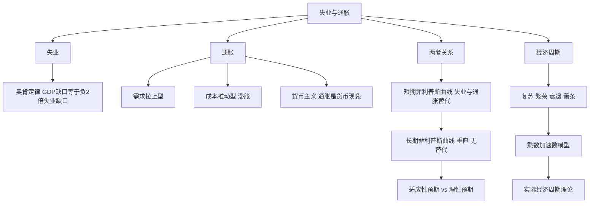

# 第十三章 失业、通货膨胀和经济周期 · 章节总结

> 本章把短期宏观经济的三大问题放在一起：失业（奥肯定律）、通胀（成因与代价）、两者的关系（菲利普斯曲线），再加上经济周期波动。

## 一、本章地图

## 二、核心公式速查

| 公式 | 含义 |
|---|---|
| $(Y-Y_f)/Y_f = -2(u-u_n)$ | 奥肯定律 |
| $\pi = \pi^e - \beta(u-u_n)$ | 短期菲利普斯曲线 |
| 长期 $u = u_n$ | 长期菲利普斯曲线垂直 |
| $\pi = \Delta M - \Delta Y$ | 货币数量论 |

## 三、一句话记住每个 KP

- **KP01 奥肯定律**：失业率每高 1 个百分点，GDP 少 2%。
- **KP02 通胀成因**：需求拉上（$P,Y$ 同动）vs 成本推动（$P,Y$ 反动 = 滞胀）。
- **KP03 菲利普斯曲线**：短期失业和通胀替代，长期垂直无替代。
- **KP04 预期**：适应性预期政策有效，理性预期政策无效（意料之外才有用）。
- **KP05 经济周期**：乘数 × 加速数相互作用产生波动。

## 四、本章与前后章节的关系

- 上接 [[../12_AD-AS模型/00_章节总结|AD-AS 模型]]：本章是 AD-AS 在失业-通胀维度的展开。
- 下接 [[../15_宏观经济政策/00_章节总结|宏观经济政策]]：政府怎么用政策应对失业和通胀。

---

## 🔗 相关知识点

**本章 KP：** [[知识点/KP01_奥肯定律|KP01 奥肯定律]] ｜ [[知识点/KP02_通货膨胀成因|KP02 通胀成因]] ｜ [[知识点/KP03_菲利普斯曲线|KP03 菲利普斯曲线]] ｜ [[知识点/KP04_适应性预期与理性预期|KP04 预期]] ｜ [[知识点/KP05_经济周期与乘数加速数|KP05 经济周期]]

**跨章：** [[../12_AD-AS模型/00_章节总结|第十二章 AD-AS]] ｜ [[../15_宏观经济政策/00_章节总结|第十五章 政策]]

**📖 原书原文：** [[../../../原文件/经济学/西方经济学下册_宏观_全书|《西方经济学》下册 第十三章]]
