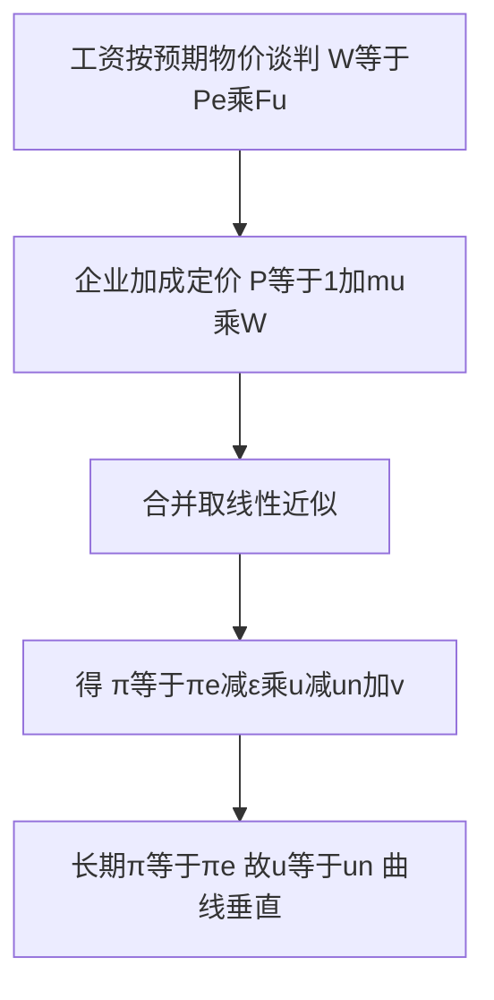

# KP03 菲利普斯曲线

<a href="../../../../exam.html" target="_blank" style="display:inline-block;padding:6px 16px;background:#2563eb;color:#fff;border-radius:6px;text-decoration:none;font-size:14px;">📝 开始做题</a>

> 所属：[[00_章节总结|第十三章 失业、通胀与经济周期]]

## 1. 一句话先懂（小白版）

1958 年，菲利普斯研究英国 1861-1957 年数据，发现一个经验规律：**失业率高的时候，工资涨得慢（甚至不涨）；失业率低的时候，工资涨得快**。

后来萨缪尔森把它改成：**失业率低 → 通胀率高；失业率高 → 通胀率低**。短期里这俩是"跷跷板"——要低失业就得忍受高通胀，要低通胀就得忍受高失业。

但 1970 年代滞胀出现后，弗里德曼和菲尔普斯说：**长期里这事儿不成立**——长期菲利普斯曲线是垂直的，通胀和失业没有替代关系。

## 2. 短期菲利普斯曲线

$$\pi = \pi^e - \beta(u - u_n)$$

其中：
- $\pi$：通胀率，$\pi^e$：预期通胀率。
- $u$：失业率，$u_n$：自然失业率。
- $\beta$：通胀对失业缺口的敏感度。

**直觉**：失业率低于自然率（经济过热），工资涨得快，通胀就高于预期通胀。

## 3. 长期菲利普斯曲线

长期里，预期 $\pi^e$ 会调整到实际 $\pi$，此时：

$$u = u_n$$

不管通胀是多少，失业率都等于自然率。长期菲利普斯曲线是**垂直**的。

**政策含义**：政府不能长期用高通胀换低失业——短期能骗工人（货币幻觉），长期工人会调整预期，失业回到自然率，只剩高通胀。

## 3.5 理论与数学推导（方程怎么来的）

> 从工资决定 → 价格加成 → 失业与通胀的关系。

**第一步：工资谈判。** 工人要求名义工资 $W$ 反映预期物价 $P^e$：$W=P^e\cdot F(u,z)$，$u$ 失业率越高，工人议价越弱，$F(u,z)$ 越小（$z$ 为其他因素如失业救济）。

**第二步：企业定价加成。** 企业按成本加成定价：$P=(1+\mu)W$，$\mu$ 为加成率。

**第三步：合并。** 代入 $W$：$P=(1+\mu)P^e F(u,z)$。定义通胀 $\pi=\Delta P/P$、预期通胀 $\pi^e=\Delta P^e/P^e$，并对 $F(u,z)$ 取线性近似 $F\approx 1-\varepsilon u+z$，整理得：

$$\boxed{\pi=\pi^e-\varepsilon(u-u_n)+v}$$

- $\pi$ 通胀率；$\pi^e$ 预期通胀；$u$ 失业率；$u_n$ 自然失业率；$\varepsilon>0$ 失业对通胀的压力系数；$v$ 供给冲击（油价、加成突变）。

**第四步：长期。** 预期充分调整 $\pi=\pi^e$，无冲击 $v=0$ 时 $u=u_n$ → 长期菲利普斯曲线垂直于 $u_n$。

**图形说明**：短期曲线向右下（π 与 u 替代）；πe 上升或 v>0 使整条线上移；长期是 $u=u_n$ 的垂直线。

## 4. 手算例子

**题目**：已知 $\pi^e = 2\%$，$\beta = 0.5$，$u_n = 5\%$。求：
1. $u = 3\%$ 时的 $\pi$
2. $u = 7\%$ 时的 $\pi$

**公式**：$\pi = \pi^e - \beta(u - u_n)$

1. $\pi = 2\% - 0.5 \times (3\% - 5\%) = 2\% + 1\% = \mathbf{3\%}$
2. $\pi = 2\% - 0.5 \times (7\% - 5\%) = 2\% - 1\% = \mathbf{1\%}$

**观察**：失业率比自然率低 2 个百分点，通胀比预期高 1 个百分点。

**长期调整**：如果政府一直把 $u$ 压在 3%，工人会把 $\pi^e$ 从 2% 调到 3%，新短期菲利普斯曲线变成 $\pi = 3\% - 0.5(u-5\%)$，同样 $u=3\%$ 时 $\pi = 4\%$——短期曲线不断上移，直到 $\pi^e$ 追上实际 $\pi$，$u$ 回到 5%。

## 5. 菲利普斯曲线的移动

- **预期通胀上升**：整条短期菲利普斯曲线右移（上移）。
- **供给冲击**（石油涨价）：短期菲利普斯曲线也上移（同样失业率下通胀更高）——这就是 1970 年代滞胀。
- **自然失业率变化**：长期菲利普斯曲线左右移动。

## 6. 容易混淆

- **短期菲利普斯曲线向右下倾斜**（失业和通胀替代）；**长期垂直**（无替代）。
- **牺牲率**：把通胀降 1 个百分点，要牺牲多少 GDP 增长。一般估计为 4-5%。
- **NAIRU**：非加速通胀的失业率，就是自然失业率 $u_n$。

## 7. 现实意义

1960 年代美国政府按菲利普斯曲线"选菜单"：要 3% 失业就接受 5% 通胀。结果 1970 年代预期通胀失控，曲线右移，滞胀。1980 年代沃尔克加息把通胀打下来，失业率冲到 10%——这就是"牺牲率"的代价。

---

## 🔗 相关知识点

**同章关联：** [[KP02_通货膨胀成因|通胀成因]] ｜ [[KP04_适应性预期与理性预期|预期]] ｜ [[KP01_奥肯定律|奥肯定律]]

**跨章关联：** [[../../12_AD-AS模型/知识点/KP02_短期总供给曲线|短期AS]] ｜ [[../../09_宏观经济基本指标/知识点/KP05_失业类型与自然失业率|自然失业率]]

**📖 原书原文：** [[../../../../原文件/经济学/西方经济学下册_宏观_全书|《西方经济学》下册 第十三章]]

---

## 🐮 小白教程入门

> 看不懂下面这个KP？先看通俗版教程建立直觉：

- [[../../../../经济统计学论文从0基础到精通/14_宏观经济学基础/10_菲利普斯曲线是什么|🐮 教程·菲利普斯曲线是什么]]

---

## 📝 考研真题（首经贸 801）

**配套主观题：** 见同目录 [[../考研真题集|本章考研真题集]]
**配套选择题：** 见同目录 [[../选择题集|本章选择题集]]

### 高频简答
- 短期菲利普斯曲线方程与计算 → 见 [[../考研真题集#s6|真题集·简答 6]]
- 短期与长期菲利普斯曲线的区别及政策含义 → 见 [[../考研真题集#s7|真题集·简答 7]]

### 高频论述
- 从原始菲利普斯曲线到附加预期菲利普斯曲线 → 见 [[../考研真题集#l1|真题集·论述 1]]
- 1970年代滞胀与沃尔克反通胀（跨12章AD-AS）→ 见 [[../考研真题集#l2|真题集·论述 2]]
- 中国2022—2023菲利普斯曲线形态 → 见 [[../考研真题集#l3|真题集·论述 3]]

### 易错选择
- 本知识点选择题见 [[../选择题集#KP03 菲利普斯曲线|选择题集·KP03]]
