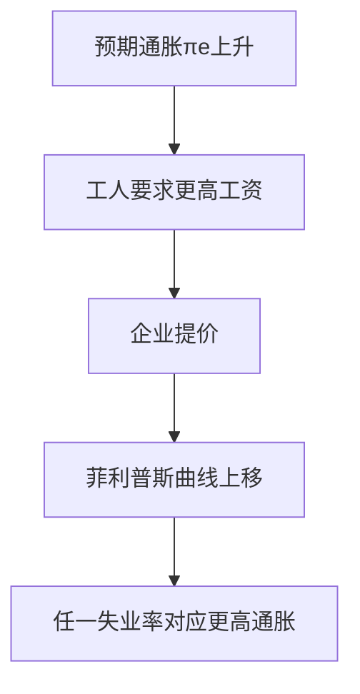
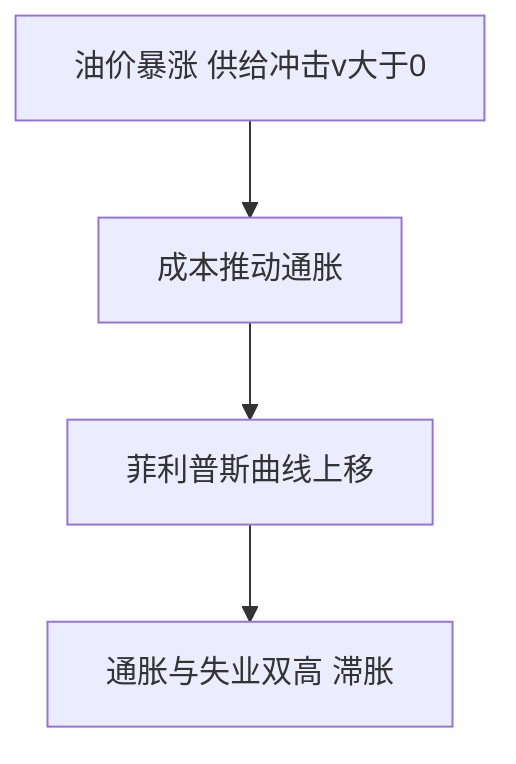

# 第十三章 失业、通货膨胀与经济周期 · 选择题集（首经贸 801 巩固用）

<a href="../../../exam.html" target="_blank" style="display:inline-block;padding:6px 16px;background:#2563eb;color:#fff;border-radius:6px;text-decoration:none;font-size:14px;">📝 开始做题</a>

> 每个知识点 9–10 道单选，共 46 道。
> 题目方向：概念辨析、公式计算、易混淆点、反向考法（"以下错误的是"）。
> 配套主观题见 [[考研真题集|本章考研真题集]]

## 📋 目录
- [[#KP01 奥肯定律|KP01]] — 9 题
- [[#KP02 通货膨胀成因|KP02]] — 9 题
- [[#KP03 菲利普斯曲线|KP03]] — 10 题
- [[#KP04 适应性预期与理性预期|KP04]] — 9 题
- [[#KP05 经济周期与乘数-加速数|KP05]] — 9 题

---

## KP01 奥肯定律（[[知识点/KP01_奥肯定律|回知识点]]）

**1. 奥肯定律描述的关系是：**
A. 通胀率与失业率的反向关系
B. 失业率缺口与GDP缺口的反向关系
C. 利率与投资的反向关系
D. 汇率与净出口的反向关系

> **✅ 答案：B**
> **解析：** 奥肯定律描述失业率偏离自然率与产出偏离潜在产出之间的定量关系。A项是菲利普斯曲线，C项是IS曲线，D项是净出口函数。

**2. 奥肯定律的表达式为：**
A. $(Y-Y_f)/Y_f = -\beta(u-u_n)$
B. $\pi = \pi^e - \beta(u-u_n)$
C. $Y = Y_f + \alpha(P-P^e)$
D. $MV = PY$

> **✅ 答案：A**
> **解析：** B项是菲利普斯曲线方程，C项是短期AS方程，D项是数量方程式。奥肯定律是A项：GDP缺口 = -β × 失业率缺口。

**3. 已知 $Y_f = 200$ 万亿元，$u_n = 4\%$，$u = 6\%$，$\beta = 2$，则实际GDP为：**
A. 184 万亿元
B. 192 万亿元
C. 196 万亿元
D. 208 万亿元

> **✅ 答案：B**
> **解析：** 失业率缺口 = 6% - 4% = 2个百分点。GDP缺口 = -2 × 2% = -4%。$Y = 200 \times (1-4\%) = 192$ 万亿元。

**4. 奥肯定律中 $\beta$ 的含义是：**
A. 通胀对失业的敏感度
B. 失业率每高于自然率1个百分点，GDP低于潜在产出的百分比
C. 货币流通速度
D. 边际消费倾向

> **✅ 答案：B**
> **解析：** β是奥肯系数，美国估计约为2。A项是菲利普斯曲线中的β，C项是数量方程式V，D项是MPC。

**5. 奥肯定律是：**
A. 理论推导的精确关系
B. 经验规律，不同国家β不同
C. 长期关系
D. 只适用于美国

> **✅ 答案：B**
> **解析：** 奥肯定律是经验规律，不是理论推导。美国β≈2，欧洲约1.5，中国估计1—2。它是短期关系（长期失业回到自然率，缺口为零）。

**6. 当经济过热，失业率低于自然率时：**
A. GDP高于潜在产出
B. GDP低于潜在产出
C. GDP等于潜在产出
D. 与潜在产出无关

> **✅ 答案：A**
> **解析：** 奥肯定律双向成立。$u < u_n$ → $u - u_n < 0$ → $(Y-Y_f)/Y_f > 0$ → $Y > Y_f$。这正是AD-AS模型中短期均衡在LRAS右侧的情形。

**7. 奥肯定律β>1（美国为2）的原因是：**
A. 失业不仅减少劳动投入，还有乘数效应和资本闲置
B. 工人效率下降
C. 技术退步
D. 政府支出减少

> **✅ 答案：A**
> **解析：** β>1因为失业冲击通过乘数效应放大（失业→收入下降→消费下降→其他企业裁员），同时资本设备闲置，共同使产出损失超过劳动投入损失。

**8. 2020年4月美国失业率达14.7%，按奥肯定律，GDP缺口约为：**
A. -4%
B. -10%
C. -20%
D. -30%

> **✅ 答案：C**
> **解析：** 假设自然失业率 $u_n=4\%$，失业率缺口 = 14.7% - 4% = 10.7个百分点。GDP缺口 = -2 × 10.7% ≈ -21%，最接近-20%。这解释了为何美联储紧急放水。

**9. 关于奥肯定律，下列说法错误的是：**
A. 它是短期关系
B. 它描述失业与产出的反向关系
C. 长期中失业率回到自然率，GDP缺口为零
D. 它适用于所有国家同一β值

> **✅ 答案：D**
> **解析：** 不同国家β不同，因为劳动市场制度、社会保障、产业结构不同。A、B、C都是正确的。

---

## KP02 通货膨胀成因（[[知识点/KP02_通货膨胀成因|回知识点]]）

**1. 需求拉上型通货膨胀的成因是：**
A. 总需求过度膨胀，"太多货币追逐太少商品"
B. 石油等原材料涨价
C. 工资上涨过快
D. 经济结构部门差异

> **✅ 答案：A**
> **解析：** 需求拉上通胀源于AD过度膨胀（货币供给过快、财政赤字、消费投资过热）。B、C是成本推动型，D是结构型。

**2. 成本推动型通胀在AD-AS模型中表现为：**
A. AD右移
B. SRAS左移
C. LRAS右移
D. AD左移

> **✅ 答案：B**
> **解析：** 成本上升（石油、工资）使企业在每一物价水平下供给减少，SRAS左移，结果是物价上升、产出下降（滞胀）。

**3. "通货膨胀无论何时何地都是一种货币现象"是谁的观点？**
A. 凯恩斯
B. 弗里德曼
C. 萨缪尔森
D. 菲利普斯

> **✅ 答案：B**
> **解析：** 弗里德曼（货币主义领袖）的名言。含义是长期中通胀根本原因是货币供给增长超过产出增长。

**4. 根据数量方程式 $MV=PY$，若货币供给增长10%，产出增长3%，流通速度不变，通胀率为：**
A. 3%
B. 7%
C. 10%
D. 13%

> **✅ 答案：B**
> **解析：** $\pi = \Delta M + \Delta V - \Delta Y = 10\% + 0 - 3\% = 7\%$。

**5. 下列哪一项属于通货膨胀的"菜单成本"？**
A. 人们频繁跑银行取钱
B. 企业频繁印刷新价格表
C. 债务人获利
D. 资本利得税扭曲

> **✅ 答案：B**
> **解析：** 菜单成本指企业调整价格的成本（重印价目表、更新系统）。A项是皮鞋成本，C项是财富再分配，D项是税收扭曲。

**6. 皮鞋成本是指：**
A. 鞋子涨价
B. 通胀使人们不愿持有现金，频繁跑银行浪费资源
C. 制鞋业成本上升
D. 通勤成本上升

> **✅ 答案：B**
> **解析：** 皮鞋成本形容人们为避免持有贬值现金而频繁跑银行，把鞋底都磨破了。恶性通胀时尤其严重。

**7. 通货膨胀的财富再分配效应是：**
A. 债务人获利，债权人受损
B. 债权人获利，债务人受损
C. 固定收入者获利
D. 政府受损

> **✅ 答案：A**
> **解析：** 通胀使未来偿还债务的实际价值下降，欠房贷的人受益，存存款的人受损。固定工资者实际收入下降受损；政府作为最大债务人也受益。

**8. 2021—2022年美国通胀从1.5%冲到9%的原因是：**
A. 单纯需求拉上
B. 单纯成本推动
C. 需求拉上与成本推动双重作用
D. 紧缩货币政策

> **✅ 答案：C**
> **解析：** 疫情后政府大规模发钱（需求拉上）+ 供应链中断、石油涨价（成本推动），双重因素导致40年最高通胀。

**9. 关于通货紧缩，下列说法正确的是：**
A. 物价持续下降对经济有利
B. 通缩使居民推迟消费，企业推迟投资，经济陷入衰退
C. 通缩与通胀无关
D. 日本"失去的二十年"是通缩的反面案例

> **✅ 答案：B**
> **解析：** 通缩使居民等更便宜再买、企业等需求恢复再投资，AD进一步左移，形成"债务-通缩"恶性循环。日本1990年代后就是典型案例。

---

## KP03 菲利普斯曲线（[[知识点/KP03_菲利普斯曲线|回知识点]]）

**1. 原始菲利普斯曲线描述的关系是：**
A. 工资增长率与失业率反向关系
B. 通胀率与利率反向关系
C. 汇率与出口反向关系
D. 税率与税收收入反向关系

> **✅ 答案：A**
> **解析：** 菲利普斯1958年研究英国数据，发现货币工资增长率与失业率反向关系。后被萨缪尔森改造为通胀率与失业率的关系。

**2. 附加预期的菲利普斯曲线方程是：**
A. $\pi = \pi^e - \beta(u-u_n)$
B. $\pi = \pi^e + \beta(u-u_n)$
C. $Y = Y_f + \alpha(P-P^e)$
D. $(Y-Y_f)/Y_f = -\beta(u-u_n)$

> **✅ 答案：A**
> **解析：** 通胀 = 预期通胀 - β × 失业缺口。失业率低于自然率时通胀高于预期。D项是奥肯定律。

**3. 已知 $\pi^e=2\%$，$\beta=0.5$，$u_n=5\%$，当 $u=3\%$ 时，通胀率为：**
A. 1%
B. 2%
C. 3%
D. 4%

> **✅ 答案：C**
> **解析：** $\pi = 2\% - 0.5 \times (3\%-5\%) = 2\% + 1\% = 3\%$。失业率低于自然率2个百分点，通胀高于预期1个百分点。

**4. 长期菲利普斯曲线的形状是：**
A. 向右下方倾斜
B. 垂直于自然失业率 $u_n$
C. 水平
D. 向右上方倾斜

> **✅ 答案：B**
> **解析：** 长期中预期调整到等于实际通胀，失业率等于自然率，无论通胀多高。长期菲利普斯曲线垂直，与长期AS垂直一致。

**5. 短期菲利普斯曲线向右下方倾斜意味着：**
A. 通胀与失业存在短期替代关系
B. 通胀与失业长期替代
C. 通胀与失业无关
D. 降低通胀必然降低失业

> **✅ 答案：A**
> **解析：** 短期中预期固定，政府可以在"通胀—失业"菜单上选择。长期中预期调整，替代关系消失。

**6. 1970年代滞胀使菲利普斯曲线：**
A. 向左下方移动
B. 向右上方移动
C. 变为垂直
D. 变为水平

> **✅ 答案：B**
> **解析：** 通胀预期上升和供给冲击使同样失业率下通胀更高，短期菲利普斯曲线上移。这打破了1960年代的稳定替代关系。

**7. 牺牲率是指：**
A. 降低通胀1个百分点需要牺牲的GDP百分比
B. 提高通胀1个百分点带来的GDP增长
C. 失业率每上升1%的产出损失
D. 货币政策的操作成本

> **✅ 答案：A**
> **解析：** 牺牲率（sacrifice ratio）衡量反通胀的产出代价，美国估计4%—5%。沃尔克反通胀就是典型案例。

**8. 自然失业率（NAIRU）是指：**
A. 通胀加速时的失业率
B. 非加速通胀的失业率，即长期均衡失业率
C. 零失业
D. 周期性失业率

> **✅ 答案：B**
> **解析：** NAIRU（Non-Accelerating Inflation Rate of Unemployment）就是自然失业率 $u_n$。在这一失业率下通胀稳定，既不加速也不减速。

**9. 政府持续把失业率压在自然率以下，长期结果是：**
A. 失业率永久降低
B. 通胀率持续上升，失业率回到自然率
C. 通胀率下降
D. 产出永久高于潜在

> **✅ 答案：B**
> **解析：** 短期可以降失业，但工人调整预期使短期菲利普斯曲线上移，最终失业率回到 $u_n$，只剩更高通胀。这是货币中性的另一表达。

**10. 关于菲利普斯曲线，下列说法错误的是：**
A. 短期向右下倾斜，长期垂直
B. 短期有替代关系，长期无替代关系
C. 供给冲击使曲线上移
D. 它在所有时期、所有国家都稳定成立

> **✅ 答案：D**
> **解析：** 菲利普斯曲线并不稳定。1970年代滞胀后曲线大幅移动；不同国家β和 $u_n$ 不同；理性预期学派甚至认为短期也无替代关系。

---

## KP04 适应性预期与理性预期（[[知识点/KP04_适应性预期与理性预期|回知识点]]）

**1. 适应性预期是指：**
A. 人们根据所有信息预测未来
B. 人们根据过去经验慢慢调整预期
C. 人们随机猜测
D. 人们不做预期

> **✅ 答案：B**
> **解析：** 适应性预期是后望型（backward-looking）：$\pi^e_t = \pi_{t-1}$ 或平滑调整。人们根据过去通胀预测未来，慢慢犯错慢慢改。

**2. 理性预期是指：**
A. 人们完全预知未来
B. 人们利用所有可获得信息（包括政策信息）预测，不犯系统性错误
C. 人们根据上期通胀预测
D. 人们凭直觉预测

> **✅ 答案：B**
> **解析：** 理性预期不是"完全预知"，而是说人们不会持续朝一个方向错。可能猜错，但会利用央行政策声明、历史数据、经济模型做最优预测。

**3. 在适应性预期下，扩张性政策：**
A. 立刻无效
B. 短期有效，长期预期调整后失效
C. 长期有效
D. 完全无效

> **✅ 答案：B**
> **解析：** 适应性预期下工人慢慢调整，政策宣布第一年工人没反应，失业下降；第二年工人调整预期，失业回到自然率。这是凯恩斯主义政策有效论的基础。

**4. 在理性预期下，公开宣布的扩张性政策：**
A. 短期有效
B. 立刻无效，因为工人同步要求涨工资
C. 长期有效
D. 只影响产出不影响物价

> **✅ 答案：B**
> **解析：** 理性预期学派政策无效性命题：被公开预期到的政策立刻被工人消化，工资同步调整，实际工资不变，产出就业不变。只有意料之外政策才有效。

**5. 卢卡斯批评是指：**
A. 凯恩斯模型参数是政策不变时的经验关系，政策变了参数也变
B. 凯恩斯模型完全错误
C. 数学模型无用
D. 应该用更复杂的模型

> **✅ 答案：A**
> **解析：** 卢卡斯批评：不能用历史数据估计的乘数预测政策效果，因为政策体制改变会改变人们行为，历史关系不再成立。这是对传统政策评估方法的根本批评。

**6. 理性预期学派的政策主张是：**
A. 积极相机抉择微调经济
B. 政府应保持政策一致性，建立央行信誉
C. 政府应该秘密操纵政策
D. 财政政策比货币政策有效

> **✅ 答案：B**
> **解析：** 既然系统性政策无效，政府应减少干预，保持政策透明一致，让公众形成稳定预期。这推动了央行独立性和通胀目标制。

**7. 下列哪种情况属于理性预期？**
A. 学生看到央行宣布加息，立刻预期通胀下降
B. 学生去年通胀5%，今年就猜5%
C. 学生凭感觉猜通胀
D. 学生不关心通胀

> **✅ 答案：A**
> **解析：** 理性预期利用所有信息，包括政策声明。B项是适应性预期，C、D不是理性预期。

**8. 央行独立性的理论依据来自：**
A. 凯恩斯主义
B. 理性预期学派——信誉稳定预期，降低反通胀成本
C. 货币主义单一规则
D. 供给学派

> **✅ 答案：B**
> **解析：** 理性预期学派认为，央行有抗通胀信誉，工人预期通胀低，通胀就真的低，反通胀不需要高失业代价。这是各国央行独立的理论基础。

**9. 关于理性预期，下列说法错误的是：**
A. 人们不会犯系统性错误
B. 被预期到的政策无效
C. 理性预期等于完全预知未来
D. 卢卡斯批评反对用历史乘数预测政策

> **✅ 答案：C**
> **解析：** 理性预期不是完全预知未来，而是利用所有信息做最优预测，可能猜错方向，但不会持续朝一个方向错。A、B、D都是正确的。

---

## KP05 经济周期与乘数-加速数（[[知识点/KP05_经济周期与乘数加速数|回知识点]]）

**1. 经济周期的四个阶段依次是：**
A. 复苏—繁荣—衰退—萧条
B. 繁荣—复苏—衰退—萧条
C. 萧条—复苏—衰退—繁荣
D. 衰退—萧条—复苏—繁荣

> **✅ 答案：A**
> **解析：** 标准周期顺序：复苏（Y上升）→繁荣（Y达顶峰）→衰退（Y下降）→萧条（Y触底），然后再复苏。

**2. 加速原理的表达式是：**
A. $I = vY$
B. $I = v\Delta Y$
C. $I = vY^2$
D. $I = v/Y$

> **✅ 答案：B**
> **解析：** 加速原理关键：投资由产出的**变动率**决定，不是产出水平。$I_t = v(Y_t - Y_{t-1})$。这是最容易考错的点。

**3. 加速数 $v$ 的含义是：**
A. 投资乘数
B. 资本-产出比，每增加1单位产出需要增加的资本
C. 边际消费倾向
D. 货币流通速度

> **✅ 答案：B**
> **解析：** v是资本-产出比，一般2—4。要多生产1元钱产出，需要多买v元钱机器设备。

**4. 乘数-加速数模型说明：**
A. 经济周期是外部冲击导致的
B. 经济周期是乘数与加速数相互作用内生产生的
C. 经济没有周期
D. 经济周期由政府政策导致

> **✅ 答案：B**
> **解析：** 萨缪尔森模型核心：投资增加通过乘数放大产出，产出增加又通过加速数引致更多投资，互相放大形成周期；增速放缓时反向作用导致衰退。周期是内生的。

**5. 当产出增速放缓时，加速原理使：**
A. 投资增加
B. 投资下降，即使产出水平仍在增长
C. 投资不变
D. 产出水平下降

> **✅ 答案：B**
> **解析：** 关键洞察：$I = v\Delta Y$。即使Y绝对值仍在增长，只要增速放缓（$\Delta Y$ 下降），引致投资就下降。这是繁荣转向衰退的机制。

**6. 熊彼特的经济周期理论是：**
A. 消费不足论
B. 创新周期论——重大创新带来繁荣，扩散完后衰退
C. 货币信用论
D. 实际经济周期理论

> **✅ 答案：B**
> **解析：** 熊彼特认为重大创新（铁路、电力、互联网）带来企业家利润和投资高潮，创新扩散完后利润消失，经济进入衰退。这是"创造性破坏"。

**7. 实际经济周期理论（RBC）认为经济波动的原因是：**
A. 市场失灵
B. 技术冲击（供给侧）
C. 政府政策失误
D. 消费不足

> **✅ 答案：B**
> **解析：** RBC（基德兰德、普雷斯科特）认为经济波动是技术进步等实际冲击导致的最优反应，不是市场失灵。政府不应干预。

**8. 政府反周期政策的理论依据是：**
A. 经济周期完全不可避免
B. 衰退时扩需求、过热时压需求可以平抑波动
C. 政府应该在繁荣时大力刺激
D. 政策不能影响周期

> **✅ 答案：B**
> **解析：** 凯恩斯主义反周期政策：衰退时扩AD保就业，过热时压AD防通胀。跨周期调节更进一步，兼顾短期与长期。

**9. 关于乘数-加速数模型，下列说法错误的是：**
A. 乘数使投资变动放大为产出变动
B. 加速数使产出变动引致投资变动
C. 两者相互作用产生内生周期
D. 它说明政府政策无法影响经济周期

> **✅ 答案：D**
> **解析：** 模型本身不否定政策作用。政府外生投资变化通过乘数-加速数放大（如四万亿），反周期政策可以平抑波动。D项错误。

---

---

## KP99 曲线移动专项

> 菲利普斯曲线纵轴通胀率 π、横轴失业率 u。预期通胀或供给冲击让整条曲线移动。

**1. （曲线移动·判断题）社会预期通胀率 πe 上升，菲利普斯曲线如何移动？（　）**
A. 整条菲利普斯曲线上移
B. 沿菲利普斯曲线向左上移动
C. 整条菲利普斯曲线下移
D. 曲线不动

> **✅ 答案：A**
> **解析：** 现代菲利普斯方程 $\pi=\pi^e-\varepsilon(u-u_n)$。$\pi^e$ 是截距项，$\pi^e$ 上升 → 在**任一失业率**下通胀都更高 → **整条曲线上移**。注意区分：政策刺激需求使失业率沿曲线左下走（短期替代）；预期改变才让曲线**整条移动**（长期无替代）。
>

>
> **数学推导**：$\pi=\pi^e-\varepsilon(u-u_n)$，$\pi^e$ 增大，截距变大，曲线平行上移。
>
> **生活实例**：一旦大家习惯了"每年物价涨 5%"，工人谈判直接要求工资涨 5% 打底，通胀就被预期"焊"在高位——这就是 1970 年代通胀惯性。

**2. （曲线移动·判断题）石油价格暴涨（不利供给冲击），菲利普斯曲线如何移动？（　）**
A. 上移（更高通胀与更高失业并存）
B. 下移
C. 不动
D. 变平缓

> **✅ 答案：A**
> **解析：** 供给冲击 $v>0$ 进入方程 $\pi=\pi^e-\varepsilon(u-u_n)+v$。油价涨 $v>0$ → 同失业率下通胀更高、且产出收缩失业也升 → **菲利普斯曲线上移**，出现"滞胀"（高通胀+高失业），替代关系恶化。
>

>
> **数学推导**：加冲击项 $v$，$\pi=\pi^e-\varepsilon(u-u_n)+v$，$v>0$ 使曲线上移。
>
> **生活实例**：1973 年石油危机后，美国同时出现 12% 通胀和 9% 失业——菲利普斯曲线本来教政府"通胀和失业二选一"，现在两个一起爆，政策失灵。

**3. （曲线移动·分析）长期中人们充分调整预期 πe=π，菲利普斯曲线变成什么形状？（　）**
A. 垂直于自然失业率 un 的直线（通胀与失业无替代）
B. 向右下方倾斜
C. 水平
D. 向右上方倾斜

> **✅ 答案：A**
> **解析：** 长期预期充分调整，$\pi=\pi^e$ 代入方程得 $u=u_n$。无论通胀多高，失业都回到自然失业率 → **长期菲利普斯曲线垂直于 $u_n$**。含义：长期用通胀换失业的政策无效，只会推高物价。
>

>
> **数学推导**：$\pi=\pi^e-\varepsilon(u-u_n)$，令 $\pi=\pi^e$，得 $u=u_n$，与 π 无关。
>
> **生活实例**：央行连续超发货币，短期就业好了一阵，但几年后工资物价全涨回去，失业率又回到自然水平——白忙一场，只剩通胀。
