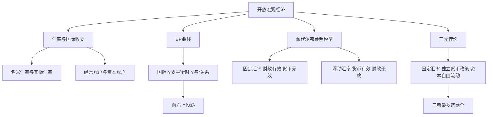

# 第十四章 开放条件下的宏观经济 · 章节总结

> 本章把封闭经济的 IS-LM 扩展到开放经济：加入 BP 曲线（国际收支平衡），研究汇率制度、资本流动和政策效果。核心结论是三元悖论。

## 一、本章地图

## 二、核心公式速查

| 公式 | 含义 |
|---|---|
| $\varepsilon = eP/P_f$ | 实际汇率 |
| $NX = X - M$ | 净出口 |
| $BP$ 平衡：$NX + CF = 0$ | 国际收支平衡 |
| $r = r_f$（资本完全流动） | BP 水平 |

## 三、一句话记住每个 KP

- **KP01 汇率与国际收支**：汇率是钱的价格，国际收支是国家和外国的账本。
- **KP02 BP 曲线**：国际收支平衡时 $Y$ 与 $r$ 正向关系，向右上倾斜。
- **KP03 蒙代尔-弗莱明**：固定汇率财政有效，浮动汇率货币有效。
- **KP04 三元悖论**：固定汇率、独立货币政策、资本自由流动，三选二。

## 四、本章与前后章节的关系

- 本章是 [[../11_IS-LM模型/00_章节总结|IS-LM]] 在开放经济下的扩展。
- 为 [[../15_宏观经济政策/00_章节总结|宏观经济政策]] 提供开放经济视角。

---

## 🔗 相关知识点

**本章 KP：** [[知识点/KP01_汇率与国际收支|KP01 汇率]] ｜ [[知识点/KP02_BP曲线|KP02 BP曲线]] ｜ [[知识点/KP03_蒙代尔弗莱明模型|KP03 蒙代尔-弗莱明]] ｜ [[知识点/KP04_三元悖论|KP04 三元悖论]]

**跨章：** [[../11_IS-LM模型/00_章节总结|第十一章 IS-LM]] ｜ [[../15_宏观经济政策/00_章节总结|第十五章 政策]]

**📖 原书原文：** [[../../../../原文件/经济学/西方经济学下册_宏观_全书|《西方经济学》下册 第十四章]]
