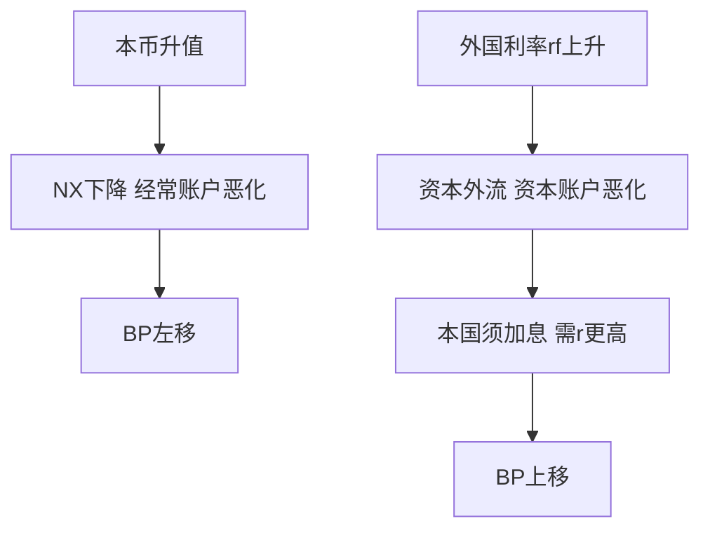

# 第十四章 开放条件下的宏观经济 · 考研真题集（首经贸 801）

<a href="../../../exam.html" target="_blank" style="display:inline-block;padding:6px 16px;background:#2563eb;color:#fff;border-radius:6px;text-decoration:none;font-size:14px;">📝 开始做题</a>

> 本章共收录：简答题 10 道（每题 15 分）｜论述题 4 道（每题 30 分）
> 配套选择题见 [[选择题集|本章选择题集]]
> 对应大纲：马工程《西方经济学》下册 第十四章 开放条件下的宏观经济

## 📋 本题集目录

### 简答题
1. [[#简答 1：简述名义汇率与实际汇率的区别，并计算：已知 $e=7$（1美元=7人民币），中国物价 $P=100$，美国物价 $P_f=110$，求实际汇率。|名义汇率与实际汇率的区别与计算]]
2. [[#简答 2：简述国际收支平衡表的两大账户及其会计恒等式。|国际收支平衡表两大账户与会计恒等式]]
3. [[#简答 3：简述汇率制度的主要类型及其特点。|汇率制度的分类及特点]]
4. [[#简答 4：简述BP曲线的推导过程及其形状。|BP曲线的推导与形状]]
5. [[#简答 5：为什么在资本完全流动假设下BP曲线是水平线？这一假设对蒙代尔-弗莱明模型有何意义？|资本完全流动下BP曲线的形状]]
6. [[#简答 6：运用蒙代尔-弗莱明模型，说明固定汇率制下财政政策为何有效、货币政策为何无效。|固定汇率制下财政政策有效性（蒙代尔-弗莱明）]]
7. [[#简答 7：运用蒙代尔-弗莱明模型，说明浮动汇率制下货币政策为何有效、财政政策为何无效。|浮动汇率制下货币政策有效性]]
8. [[#简答 8：简述三元悖论（不可能的三位一体）的内容，并列举三种政策组合及其代表国家。|三元悖论的内容与三种政策组合]]
9. [[#简答 9：运用蒙代尔-弗莱明模型原理，说明为什么货币政策独立性、固定汇率、资本自由流动三者不可兼得。|为什么货币政策独立、固定汇率、资本自由流动不可兼得]]
10. [[#简答 10：（计算题）已知净出口函数 $NX = 400 - 0.1Y - 100\varepsilon$，资本净流出函数 $CF = 100(r_f - r)$，外国利率 $r_f = 5\%$，实际汇率 $\varepsilon = 1$。要求：（1）推导BP曲线方程；（2）当 $Y = 5000$ 时，使国际收支平衡的利率 $r$ 是多少？|计算题：由净出口与资本流动函数推导BP方程]]

### 论述题
1. [[#论述 1：试述蒙代尔-弗莱明模型的基本框架，并比较固定汇率制与浮动汇率制下财政政策和货币政策的有效性。|蒙代尔-弗莱明模型：不同汇率制度下政策效果对比]]
2. [[#论述 2：试述三元悖论的基本内容，并结合中国实际分析中国汇率制度选择与资本账户开放的权衡。|三元悖论与中国汇率制度选择]]
3. [[#论述 3：试运用三元悖论分析1997年亚洲金融危机的成因，并说明其对新兴市场国家汇率制度选择的启示。|1997亚洲金融危机与三元悖论]]
4. [[#论述 4：2022—2024年美联储激进加息周期中，中美利差倒挂对人民币汇率和中国货币政策独立性产生了什么影响？试运用蒙代尔-弗莱明模型和三元悖论分析中国的应对。|中美利差、人民币汇率与中国货币政策独立性]]

---

## 一、简答题（每题 15 分，建议 450–700 字）

### 简答 1：简述名义汇率与实际汇率的区别，并计算：已知 $e=7$（1美元=7人民币），中国物价 $P=100$，美国物价 $P_f=110$，求实际汇率。

**【建议字数】450–700 字 ｜ 【建议时间】15 分钟 ｜ 【题型】概念简答**

**【考什么】** 对应知识点 [[知识点/KP01_汇率与国际收支|汇率与国际收支]]，对应大纲第 1 节；题型属于概念简答+计算。

**【核心推导】**
**第一步：两个概念的定义与标价法约定。**

（1）**名义汇率 $e$**：两国货币的相对价格，即**1 单位外币兑换多少单位本币**（直接标价法）。$e=7$ 表示 1 美元 = 7 元人民币。**$e$ 上升 = 本币名义贬值。**

（2）**实际汇率 $\varepsilon$**：**剔除两国物价差异后的汇率**，衡量"本国商品篮子在国外能换回多少外国商品篮子"：

$$\varepsilon=\frac{e\cdot P}{P_f}$$

其中 $P$ 为本国物价指数，$P_f$ 为外国物价指数。**$\varepsilon$ 上升 = 本币实际贬值 = 本国商品相对变便宜。**

（3）**两者的关系是一句可以推到底的话**：**名义汇率只是"货币的兑换比例"，实际汇率才是"商品的兑换比例"。** 只有实际汇率进入净出口函数：$NX=NX(\varepsilon)$，且 $NX'(\varepsilon)<0$。

**第二步：为什么必须区分——购买力平价的视角。**

（1）**绝对购买力平价**：$\varepsilon=1$ 时，$e=P_f/P$，即汇率应等于两国物价之比。**这在现实中长期不成立**（巴拉萨—萨缪尔森效应：可贸易品生产率高的国家实际汇率系统性偏高）。

（2）**相对购买力平价**：$\dfrac{\dot e}{e}=\pi-\pi_f$，即**名义汇率变动率 = 两国通胀率之差**。**这是区分名义与实际汇率的直接政策用处**：若本国通胀 5%、外国 2%，则名义汇率须贬值约 3% 才能保持实际汇率不变。

（3）**推论**：**名义汇率贬值不必然提升出口竞争力**——若同期国内通胀更高，实际汇率可能并未贬值，甚至升值。**这是 2015–2016 年部分新兴市场的真实教训。**

**第三步：代入计算。**

$$e=7,\quad P=100,\quad P_f=110$$

$$\varepsilon=7\times\frac{100}{110}=\frac{700}{110}\approx 6.36$$

**单位检验**：$\varepsilon$ 是**无量纲的实际比率**（本国物价以本币计、乘汇率换成外币后与外国物价相比），不是货币价格，写成"6.36"而非"6.36 元"。

**第四步：经济解读——为什么数值比名义汇率小。**

（1）**分解**：$\varepsilon=7\times\frac{100}{110}=7\times0.909=6.36$。**名义汇率 7，但美国物价水平比中国高 10%（110 vs 100），因此人民币的实际购买力被"折价"10%。**

（2）**方向判断**：$P<P_f$ → $\varepsilon<e$ → **人民币实际升值**（相对名义汇率而言），本国商品的相对价格偏低。

（3）**对净出口的含义**：$\varepsilon$ 从 7 降到 6.36（实际贬值方向？）——**注意这里的方向**：$\varepsilon$ 越**小**表示本国商品越**便宜**（因为 1 单位外国商品篮子的价格在本国只要 6.36 个本国篮子），即**本国商品相对便宜 → 出口竞争力更强 → $NX$ 上升**。

（4）**数值直觉（奶茶例）**：中国一杯奶茶 10 元，美国 3 美元。名义算美国奶茶 = 21 元，比中国贵 2.1 倍；按实际汇率的口径，人民币的实际购买力更强——**同 100 元，在中国买 10 杯，在美国只能买约 4.8 杯**。

**第五步：常见错误的辨析（考试重点）。**

（1）**公式写反**：把 $\varepsilon=e\cdot P/P_f$ 写成 $e\cdot P_f/P$。**判别方法**：实际汇率是"本国商品换外国商品"的比例，分子应是本国物价。

（2）**标价法混淆**：直接标价（1 外币 = 多少本币）与间接标价（1 本币 = 多少外币）方向相反。**本课程统一用直接标价。**

（3）**把 $\varepsilon$ 变动当成纯名义现象**：实际汇率同时含价格因素，$P$ 上升也会使 $\varepsilon$ 上升。**因此"名义贬值 + 高通胀"组合可能实际不贬值。**

**第六步：政策含义（收口）。**

（1）**监测目标应是实际汇率**（有效汇率指数 REER），而不是只看名义汇率。

（2）**中国的常态**：长期经常账户顺差 + 名义汇率升值压力 → 实际汇率持续升值 → **要求产业升级以抵消竞争力损失**（这是"出口转内需"的汇率逻辑之一）。

（3）**政策工具**：本币名义贬值可短期提振出口，但**若引发输入型通胀，实际汇率会回吐**——这解释了为什么汇率竞争性贬值往往无效。

**【为什么要答这几点】**
**【满分 15 分的分点逻辑】**

**第一段：名义汇率定义（3 分）。** 直接标价法 1 分 + $e=7$ 的含义 1 分 + 由外汇市场供求决定 1 分。**必须点明"直接标价法"，否则后面公式方向可能被判反。**

**第二段：实际汇率公式与含义（5 分）。** **核心段**：公式 $\varepsilon=\dfrac{eP}{P_f}$ 3 分 + 两句经济含义（$\varepsilon\uparrow$ 本国商品变贵/出口降；$\varepsilon\downarrow$ 变便宜/出口升）2 分。**公式写反直接丢 3 分。**

**第三段：代入计算（5 分）。** 代入 1 分 + $\dfrac{700}{110}$ 1 分 + 结果 $\approx 6.36$ 2 分 + **单位说明（无量纲）** 1 分。

**第四段：经济解读（2 分）。** **"实际汇率小于名义汇率，因为美国物价更高"** 1 分 + **"实际汇率才是影响出口竞争力的变量"** 1 分。

**易失分点。** ①**公式写反（$eP_f/P$）**——最常见的致命错误；②混淆直接与间接标价；③计算时忘记除以 110；④把 6.36 当"人民币升值到 6.36"，**混淆"汇率数值"与"升值/贬值"的方向**；⑤不解释实际汇率为何影响 $NX$。

**加分点。** ①补一句购买力平价（相对 PPP：$\dot e/e=\pi-\pi_f$）；②指出"名义贬值 + 高通胀 → 实际不贬值"的政策含义；③用奶茶例或篮子例做直觉说明；④说明 $\varepsilon$ 是无量纲指数。

**【阅卷心理】** 15 分概念+计算题**按"定义—公式—计算—解读"四段给分**，**公式与结果是硬分，写反或算错会连丢 6–8 分**。记住口诀：**"分子本国物价、分母外国物价；数值越小，本国商品越便宜、出口越有利。"**

**【如何分析题目】**
**第一步：审题——两问：区别（概念）+ 计算（应用）。** **先给定义与公式，再算，最后解读方向。**

**第二步：明确标价法。** 直接标价法、1 外币 = 多少本币。**第一步不写清标价法，后面方向极易搞反。**

**第三步：把公式写对并说明含义。** $\varepsilon=\dfrac{eP}{P_f}$；$\varepsilon$ 升 = 本国商品变贵、出口降。**公式和方向是本段全部分数。**

**第四步：代入并算到两位小数。** $7\times100/110\approx6.36$。**中间步骤不能跳，踩分点常按步骤给。**

**第五步：解读为什么小于名义汇率。** 美国物价高 10% → 折价 10%。**必须回答"为什么"，不能只报数。**

**第六步：补方向判断与政策含义。** $\varepsilon$ 小 → 本国商品便宜 → $NX$ 升；实际汇率才是影响竞争力的变量；可补相对 PPP 公式。**这一段是加分点。**

**第七步：字数与时间。** 15 分约 450–700 字，15 分钟。**定义 120 字、公式 150 字、计算 120 字、解读 150 字。**

**【答题框架】**
- 第 1 段：名义汇率定义（3 分）
- 第 2 段：实际汇率公式与含义（5 分）
- 第 3 段：代入计算（5 分）
- 第 4 段：经济解读（2 分）

**【参考答案】**

一、名义汇率

名义汇率 $e$ 是两国货币的兑换比率，通常采用直接标价法：1单位外币兑换多少本币。例如 $e=7$ 表示1美元兑换7元人民币。名义汇率由外汇市场供求决定，是我们在银行兑换货币时看到的牌价。

二、实际汇率

实际汇率 $\varepsilon$ 是考虑两国物价水平调整后的汇率，衡量本国商品相对于外国商品的贵贱程度：

$$\varepsilon = e \times \frac{P}{P_f}$$

其中 $P$ 为本国物价水平，$P_f$ 为外国物价水平。

经济含义：
- $\varepsilon$ 上升（本币实际升值）：本国商品相对外国变贵，出口下降、进口上升，净出口 $NX$ 下降；
- $\varepsilon$ 下降（本币实际贬值）：本国商品相对外国变便宜，出口上升、进口下降，净出口上升。

三、计算

已知 $e=7$，$P=100$，$P_f=110$：

$$\varepsilon = 7 \times \frac{100}{110} = \frac{700}{110} \approx 6.36$$

四、解读

名义汇率为7，但由于美国物价（110）高于中国物价（100），实际汇率只有约6.36。这意味着人民币实际购买力比名义汇率显示的更强——同样的商品篮子，在美国比在中国贵10%，因此人民币实际升值了。实际汇率才是影响进出口竞争力的关键变量。

**【解析·得分点】** 采分点：①名义汇率定义（3分）②实际汇率公式与含义（5分）③代入计算（5分）④经济解读（2分）。容易丢分：公式写反（$eP_f/P$）；混淆直接标价与间接标价；计算错误。

**【生活实例】** 一杯奶茶中国卖10块，美国卖3美元（约21人民币）。名义汇率7，但美国奶茶更贵，实际汇率算下来人民币更值钱——同样100块人民币在中国能买10杯，在美国只能买约4.8杯。

**【双链接】** 🔗 [[知识点/KP01_汇率与国际收支|回知识点]] ｜ 📖 [[../../../原文件/经济学/西方经济学下册_宏观_全书|原书·第十四章]]

---

### 简答 2：简述国际收支平衡表的两大账户及其会计恒等式。

**【建议字数】450–700 字 ｜ 【建议时间】15 分钟 ｜ 【题型】概念简答**

**【考什么】** 对应知识点 [[知识点/KP01_汇率与国际收支|汇率与国际收支]]，对应大纲第 1 节；题型属于概念简答。

**【核心推导】**
**第一步：国际收支的定义与记账原则。**

（1）**定义**：一国居民（resident）与非居民之间在一定时期内全部经济交易的系统记录。

（2）**记账原则**：**复式记账（有借必有贷、借贷必相等）**。凡引起**外汇流入**的项目记**贷方（+）**（出口、资本流入、境外对本国的投资）；凡引起**外汇流出**的项目记**借方（−）**（进口、资本流出）。

（3）**关键区分**：**居民 ≠ 公民**。中国企业在香港的分公司属"非居民"，其与内地的交易计入国际收支。

**第二步：两大账户的构成（骨架）。**

| 账户 | 主要子项 | 记什么 |
|---|---|---|
| **经常账户 CA** | 货物和服务、初次收入、二次收入 | **当期生产与收入转移** |
| **资本和金融账户 KA** | 资本账户、金融账户（直接投资/证券投资/其他投资/储备资产） | **资产所有权的跨国转移** |

（1）**经常账户三层**：
- **货物和服务**：出口 $X$ 减进口 $M$。中国货物长期顺差、服务（旅行、运输、知识产权使用费）长期逆差。
- **初次收入**：职工报酬 + 投资收益（FDI 利润、股息、利息）。
- **二次收入**：单方面转移（侨汇、援助、捐赠），无对等回报。

（2）**资本和金融账户两层**：
- **资本账户**：资本转移（债务减免、移民转移）+ 非生产非金融资产（专利、商誉）。
- **金融账户**：**直接投资（FDI）**、**证券投资**（股债）、**其他投资**（贷款、存款）、**储备资产**（央行外汇、黄金、SDR）。

**第三步：会计恒等式的严格推导。**

（1）**由于复式记账**，全部项目之和恒为零。把账户拆成两部分：

$$CA+KA+\Delta R=0$$

其中 $\Delta R$ 为**储备资产变动**（央行持有的对外资产增加记为负号方向）。

（2）**注意两个"恒等式"层次**：

**层次一（记账恒等）**：$CA+KA+\Delta R\equiv 0$ 是**定义性的、必然成立的**——它只是复式记账的结果，**不包含任何经济信息**。

**层次二（经济含义）**：扣掉储备变动，得到：

$$CA+KA=-\Delta R$$

**即：经常账户与私人资本账户的合计差额，必然由官方储备资产的反向变动来"融资"。** 顺差国积累储备，逆差国消耗储备。

（3）**另一个等价形式（国民收入恒等式推导）**：

$$CA=S-I+G-T$$

即**经常账户余额 = 私人储蓄 − 投资 + 政府收入 − 支出**。**这是理解"双赤字"的关键**：财政赤字（$G>T$）在私人储蓄—投资不变时会推高经常账户逆差。

**第四步：结构性含义与中国的经验。**

（1）**中国 2000s 的"双顺差"**：经常账户顺差 + 资本账户顺差 → 央行被动买入外汇 → 外汇储备从 2000 年 1656 亿美元增至 2014 年近 4 万亿美元。**这直接体现"$CA+KA=-\Delta R$"：双顺差对应储备资产的大幅增加。**

（2）**2015 年后趋于平衡**：经常账户顺差占 GDP 从 2007 年的约 10% 降至 2018 年后的 2% 以内，储备规模稳定在 3.1–3.2 万亿美元。**这说明经济结构从"出口导向"转向"内外平衡"。**

（3）**服务贸易逆差的含义**：中国服务贸易逆差约 2000 亿美元/年（旅行、运输、知识产权使用费），**反映的是"货物强、服务弱"的产业结构**，也是产业升级的方向。

**第五步：常见错误的辨析。**

（1）**"国际收支平衡表一定平衡，所以国际收支永远是平衡的"** ——错误。**记账意义上的平衡是定义，经济学意义上的"国际收支失衡"指的是 $CA+KA\neq0$（需要储备或汇率调整）。**

（2）**把储备资产当成普通资本项目** ——储备是**官方**行为，不是市场化的私人资本流动，**政策含义完全不同**。

（3）**漏掉初次收入与二次收入** ——很多答案只写"货物+服务"，**会丢 2 分**。

（4）**认为"顺差是好事"** ——长期顺差意味着资源净流出（用实物换纸面资产），**且会引发贸易摩擦与货币升值压力**。

**第六步：结论。**

**一句话**：**国际收支的两个账户记录了"当期交易"与"资产转移"两类行为，恒等式 $CA+KA=-\Delta R$ 表明任何失衡最终都要由官方储备或汇率来消化——这才是国际收支分析的全部意义。**

**【为什么要答这几点】**
**【满分 15 分的分点逻辑】**

**第一段：国际收支含义（2 分）。** 居民与非居民 1 分 + 一定时期的系统记录 1 分。**"居民≠公民"可作加分点。**

**第二段：经常账户（5 分）。** **三层要写全**：货物服务（$X-M$）2 分 + 初次收入（职工报酬、投资收益）1.5 分 + 二次收入（单方面转移）1.5 分。**只写货物贸易最多 2 分。**

**第三段：资本和金融账户（5 分）。** 资本账户（资本转移、非生产非金融资产）1.5 分 + 金融账户四类（直接投资/证券投资/其他投资/储备资产）3.5 分。**储备资产单独列出是采分点。**

**第四段：会计恒等式与经济含义（3 分）。** 复式记账原理 1 分 + $CA+KA+\Delta R=0$ 或 $CA+KA=-\Delta R$ 1 分 + **经济含义（顺差积累储备、逆差消耗储备）** 1 分。**只写式子不解释含义最多 2 分。**

**易失分点。** ①**只写"货物+服务"，漏掉初次与二次收入**；②把恒等式写成 $CA=KA$（**符号错，应为 $CA+KA=0$ 或 $CA+KA=-\Delta R$**）；③**不区分"记账平衡"与"经济失衡"**——这是本题最容易失分的理解性错误；④漏掉储备资产。

**加分点。** ①给出 $CA=S-I+G-T$ 的国民收入推导，点出"双赤字"；②用中国"双顺差 → 储备从 1656 亿增至 4 万亿"的史实印证恒等式；③指出服务贸易逆差反映的产业结构问题；④提醒"顺差不是无条件的好"。

**【阅卷心理】** 15 分概念题**按"两账户构成 + 恒等式"给分，构成要全、恒等式要准**。**几乎所有失分都在"漏项"和"符号"**。记住口诀：**"经常管流量、资本管所有权；复式记账必然平，但失衡要储备或汇率来消化。"**

**【如何分析题目】**
**第一步：审题——两问：两大账户构成 + 会计恒等式。** **先摆结构表，再推恒等式。**

**第二步：写清定义与记账原则。** 居民/非居民、复式记账、贷方外汇流入。**记账原则是后面恒等式的基础，不能省。**

**第三步：把两个账户按层级列全。** 经常账户三层、资本与金融账户两层（金融四类）。**用分层结构写，阅卷一眼看出完整性。**

**第四步：推恒等式。** 从复式记账 → $CA+KA+\Delta R=0$ → $CA+KA=-\Delta R$。**三步推完，比直接甩式子得分高。**

**第五步：区分"记账平衡"与"经济失衡"。** 前者是定义，后者看 $CA+KA$ 是否为零。**这是本题的水平分水岭。**

**第六步：补 $CA=S-I+G-T$ 并与中国经验对应。** 双顺差 → 储备从 1656 亿增至近 4 万亿。**有推导有史实，答案立刻立体。**

**第七步：字数与时间。** 15 分约 500–700 字，15 分钟。**定义 100 字、经常账户 180 字、资本金融 180 字、恒等式 180 字、补充 80 字。**

**【答题框架】**
- 第 1 段：国际收支含义（2 分）
- 第 2 段：经常账户（5 分）
- 第 3 段：资本和金融账户（5 分）
- 第 4 段：会计恒等式与经济含义（3 分）

**【参考答案】**

一、国际收支的含义

国际收支是一国居民与外国居民在一定时期内所有经济交易的系统记录。它包括商品服务贸易、收入转移、跨国投资等所有对外经济往来，通过国际收支平衡表记录。

二、经常账户

经常账户记录当期生产的商品服务往来和单方面转移，包括：

（一）货物和服务贸易：出口 $X$ 减进口 $M$，是经常账户最大组成部分。中国长期保持货物贸易顺差，但服务贸易（旅游、教育、专利）逆差。

（二）初次收入：职工报酬（外派员工工资）、投资收益（FDI利润、股票分红、债券利息）。

（三）二次收入：单方面转移，如侨汇、对外援助、捐款。

经常账户余额 $CA = X - M +$ 净收入 + 净转移。

三、资本和金融账户

资本和金融账户记录资产所有权的跨国转移，包括：

（一）资本账户：资本转移（债务减免、移民转移）和非生产非金融资产交易（专利、商誉买卖）。

（二）金融账户：直接投资（FDI，建厂并购）、证券投资（买卖股票债券）、其他投资（贷款、存款）、储备资产（央行持有的外汇、黄金、SDR）。

资本和金融账户余额 $KA$ 记录资本净流入。

四、会计恒等式

根据复式记账原理，国际收支平衡表恒等：

$$CA + KA = 0$$

即经常账户顺差必然对应资本和金融账户逆差（或官方储备增加），经常账户逆差必然对应资本和金融账户顺差（或官方储备减少）。

经济含义：中国长期贸易顺差（$CA > 0$），意味着我们通过贸易赚了外汇，这些外汇要么用于对外投资（$KA < 0$，资本流出），要么增加央行外汇储备。2014年前中国双顺差（$CA>0$ 且 $KA>0$），靠储备增加平衡。

**【解析·得分点】** 采分点：①国际收支定义（2分）②经常账户三项（5分）③资本金融账户四项（5分）④恒等式与中国案例（3分）。容易丢分：把经常账户等同于贸易收支（漏掉收入和转移）；忘记官方储备是平衡项。

**【生活实例】** 就像家庭账本：经常账户是你打工赚的钱减去花的钱；资本账户是你借钱给别人或借别人钱。如果你打工赚10万花8万（经常顺差2万），这2万要么存银行（资本流出），要么借给亲戚（资本流出）——总和必须为零。

**【双链接】** 🔗 [[知识点/KP01_汇率与国际收支|回知识点]] ｜ 📖 [[../../../原文件/经济学/西方经济学下册_宏观_全书|原书·第十四章]]

---

### 简答 3：简述汇率制度的主要类型及其特点。

**【建议字数】450–700 字 ｜ 【建议时间】15 分钟 ｜ 【题型】关系对比**

**【考什么】** 对应知识点 [[知识点/KP01_汇率与国际收支|汇率与国际收支]]，对应大纲第 1 节；题型属于概念简答。

**【核心推导】**
**第一步：先给分类坐标轴——按"汇率灵活性"从硬到软排序。**

| 类型 | 汇率如何决定 | 代表 | 货币政策独立性 |
|---|---|---|---|
| ** dollarization / 货币联盟** | 放弃本币 | 欧元区、厄瓜多尔（用美元） | **完全没有** |
| **货币局制度（Currency Board）** | 法定承诺按固定比率兑换，100% 外汇储备支撑 | 香港（7.75–7.85 兑美元）、阿根廷（1991–2001） | **完全没有** |
| **传统钉住（硬钉住）** | 央行承诺维持固定平价，可调整 | 沙特、多数海湾国家 | **很弱** |
| **爬行钉住 / 目标区** | 按预设规则小幅调整或限定波动区间 | 中国（有管理的浮动）、新加坡（篮子爬行） | **部分** |
| **有管理的浮动** | 市场决定为主，央行干预平滑 | 中国、印度 | **较大** |
| **自由浮动** | 完全由市场供求决定 | 美国、欧元区、日本 | **完全** |

**第二步：三组核心概念的辨析（考试重点）。**

（1）**固定 vs 浮动**：判据是**央行是否承诺维持某个汇率水平**。注意：固定汇率不等于"永不改变"，而是"承诺维持，调整需官方决定"（可调整钉住 adjustable peg）。

（2）**硬钉住 vs 软钉住**：判据是**制度性约束的强度**。货币局与美元化有法律或制度锁定，退出成本极高；传统钉住只是政策承诺，**可以一夜放弃**（1997 年泰铢、2015 年瑞郎即是）。

（3）**中间制度 vs 角点解**：**"中间制度空洞化"假说**（Eichengreen 1994、Obstfeld-Rogoff 1995）认为：**在资本自由流动下，只有"完全固定"与"完全浮动"两个角点是可持续的，中间制度终将被投机冲击摧毁。** 但 2000 年代后大量实证（如中国的有管理浮动）表明**中间制度在资本管制配合下可以长期存在**——**这是对"角点解假说"的重要修正。**

**第三步：用三元悖论定位每种制度。**

$$\text{货币政策独立性}+\text{汇率稳定}+\text{资本自由流动}\le 2$$

（1）**货币局/美元化**：放弃货币政策独立性，换来汇率稳定 + 资本自由流动（香港）。
（2）**自由浮动**：放弃汇率稳定，保住货币政策独立性 + 资本自由流动（美国）。
（3）**传统钉住 + 资本管制**：放弃资本自由流动，保住汇率稳定 + 货币政策独立性（中国 1990s–2000s）。
（4）**中间制度**：三个目标都"部分"实现——**这正是中国当前的选择**（有管理浮动 + 资本项目部分可兑换 + 货币政策独立性较强）。

**第四步：汇率制度选择的决定因素（为什么各国不同）。**

（1）**经济规模与开放度**：**越小越开放的经济越倾向固定汇率**（汇率波动对物价与贸易的冲击太大），越大越封闭越倾向浮动（美国、欧元区）。

（2）**冲击类型**：**名义冲击为主 → 固定汇率有利**（可锚定物价）；**实际冲击为主 → 浮动汇率有利**（汇率可缓冲）。这是最优货币区理论的核心判据。

（3）**通胀历史与央行信誉**：高通胀国家采用钉住可"进口信誉"（阿根廷 1991 年货币局把通胀从 3000% 降到零）；但有信誉后钉住反而成为束缚。

（4）**资本账户开放程度**：开放度越高，固定汇率的维护成本越高。

（5）**金融体系稳健性**：外债多、货币错配重的国家，浮动汇率会放大资产负债表的汇率风险（"浮动恐惧" fear of floating）。

**第五步：中国制度的独特性（答题必加的落点）。**

（1）**名义上是"以市场供求为基础、参考一篮子货币进行调节、有管理的浮动汇率制度"**（2005 年 7 月汇改确立，2015 年 8 月完善中间价形成机制）。

（2）**实际操作是"爬行钉住 + 篮子 + 区间"的复合体**：日波幅 2%（2014 年起），中间价引入"收盘价 + 一篮子货币 + 逆周期因子"。

（3）**为什么这样选**：**用"部分资本管制"换取"汇率相对稳定 + 货币政策独立性"**——即**在三角中选了"汇率稳定 + 货币独立"，让资本流动部分受限**。这与教科书上的"角点解"不同，被称为"**中间制度的中国方案**"。

（4）**代价**：资本管制带来套利与效率损失；汇率相对稳定削弱了对外部冲击的自动缓冲；中间价机制曾引发贬值预期自我强化（2015–2016 年外汇储备减少约 1 万亿美元）。

**第六步：结论。**

**一句话**：**汇率制度是三元悖论下的一组取舍，没有普适最优；选择的标准是"本国冲击类型 + 开放度 + 金融稳健性"，而中国给出的是"有管理浮动 + 部分资本管制"的中间解。**

**【为什么要答这几点】**
**【满分 15 分的分点逻辑】**

**第一段：分类表（5 分）。** **本题最省字也最抓分的写法**：从货币局到自由浮动列出 4–6 类，每类给"决定方式 + 代表国家"1 分。**只写"固定/浮动"两类最多 2 分。**

**第二段：概念辨析（4 分）。** 固定 vs 浮动（判据：是否承诺维持）1.5 分 + **硬钉住 vs 软钉住（判据：制度锁定强度）** 1.5 分 + **中间制度空洞化假说及其修正** 1 分。

**第三段：三元悖论定位（3 分）。** 写出 $独立+稳定+流动\le2$ 1 分 + 三类制度各归位 1 分 + **中国属"中间制度"** 1 分。

**第四段：选择因素（3 分）。** 至少三点：规模与开放度、冲击类型（最优货币区）、通胀历史与信誉、资本开放度、金融稳健性。**三点给满。**

**易失分点。** ①**只分固定/浮动两类**（把有管理浮动漏掉，直接丢 3 分）；②**不知道货币局制度**（香港 7.75–7.85 是最典型的例子）；③**把固定汇率理解成"永不调整"**（应为"可调整钉住"）；④不写出三元悖论这个判据；⑤不落到中国。

**加分点。** ①给出六类制度的完整谱系表；②点出"中间制度空洞化假说"并提出中国的反例修正；③用最优货币区理论说明"冲击类型决定制度选择"；④提到"浮动恐惧"（fear of floating）——外债型国家不敢让汇率浮动。

**【阅卷心理】** 15 分概念题**按"分类完整 + 判据明确 + 中国落点"给分**。**分类不全是最主要失分点**。记住口诀：**"从美元化到自由浮动，越靠左汇率越稳、货币越不独立；中国的答案是站在中间。"**

**【如何分析题目】**
**第一步：审题——"主要类型及其特点"，特点要指出"凭什么区分"。** **分类 + 判据，两条腿走路。**

**第二步：先建谱系表。** 从硬到软：美元化、货币局、硬钉住、爬行钉住/目标区、有管理浮动、自由浮动。**一张表拿下 5 分。**

**第三步：给三类核心辨析。** 固定 vs 浮动（承诺）、硬钉住 vs 软钉住（制度锁定）、中间制度空洞化（角点解假说 + 中国反例）。**辨析是区分水平的段落。**

**第四步：用三元悖论给每类制度定位。** 写出不等式，把每类制度归到"放弃哪一个"。**判据统一，答案立刻有骨架。**

**第五步：给选择因素。** 规模开放度、冲击类型、通胀历史、资本开放度、金融稳健性。**五点中写三点即可。**

**第六步：落到中国。** 名义表述 + 实际操作 + 为什么这样选 + 代价。**中国落点能多拿 1–2 分。**

**第七步：字数与时间。** 15 分约 500–700 字，15 分钟。**分类表 180 字、辨析 150 字、三元定位 120 字、选择因素 150 字、中国 120 字。**

**【答题框架】**
- 第 1 段：汇率制度光谱（2 分）
- 第 2 段：固定汇率制（4 分）
- 第 3 段：浮动汇率制（4 分）
- 第 4 段：管理浮动（5 分）

**【参考答案】**

一、汇率制度的光谱

汇率制度是一国央行对本国汇率决定方式和变动方式的规定。从完全固定到完全浮动，存在一个光谱，主要包括固定汇率制、浮动汇率制和中间的管理浮动制。

二、固定汇率制

（一）含义：央行将本币与某一外币（或一篮子货币）的汇率钉在某一水平，通过买卖外汇维持。

（二）运行机制：当本币有升值压力时，央行卖本币买外汇，本币供给增加，汇率回落到钉住水平；当本币有贬值压力时，央行卖外汇买本币。

（三）优点：汇率稳定，降低外贸和投资的汇率风险；缺点：货币政策丧失独立性（详见三元悖论），需要充足外汇储备。

（四）典型：香港联系汇率制（7.8港币/美元）、欧元区（统一货币是固定汇率的极致）、布雷顿森林体系（1944—1971）。

三、浮动汇率制

（一）含义：汇率由外汇市场供求决定，央行不干预。本币供大于求时贬值，供小于求时升值。

（二）优点：货币政策独立（央行可自主决定利率）；汇率自动调节国际收支（逆差时本币贬值改善出口）；不需要大量外汇储备。

（三）缺点：汇率波动大，增加外贸和投资风险；可能出现汇率超调。

（四）典型：美国、欧元区、日本、英国。

四、管理浮动制（肮脏浮动）

（一）含义：平时汇率由市场决定，但央行在汇率大幅波动时入市干预，避免剧烈升值或贬值。

（二）中国2005年"7·21汇改"后实行"以市场供求为基础、参考一篮子货币进行调节、有管理的浮动汇率制度"。人民币汇率弹性增大，但央行仍通过中间价、外汇存款准备金率、逆周期因子等工具干预。

（三）特点：介于固定与浮动之间，保留一定货币政策独立性，同时避免汇率过度波动。

**【解析·得分点】** 采分点：①光谱概念（2分）②固定汇率机制与优缺点（4分）③浮动汇率优缺点（4分）④管理浮动与中国实践（5分）。容易丢分：说不出香港联系汇率7.8；忘记中国2005汇改；把固定汇率等同于货币局制度。

**【生活实例】** 固定汇率就像奶茶店把价格钉死在10块，人来多了就多做，人来少了就储备奶茶（外汇储备）。浮动汇率就像菜市场，供需决定价格。管理浮动就是平时菜市场定价，但价格暴涨暴跌时城管出来干预。

**【双链接】** 🔗 [[知识点/KP01_汇率与国际收支|回知识点]] ｜ 🔗 [[知识点/KP04_三元悖论|三元悖论]] ｜ 📖 [[../../../原文件/经济学/西方经济学下册_宏观_全书|原书·第十四章]]

---

### 简答 4：简述BP曲线的推导过程及其形状。

**【建议字数】450–700 字 ｜ 【建议时间】15 分钟 ｜ 【题型】模型分析**

**【考什么】** 对应知识点 [[知识点/KP02_BP曲线|BP曲线]]，对应大纲第 2 节；题型属于模型分析。

**【核心推导】**
**第一步：BP 曲线的定义——它是什么的轨迹。**

**BP 曲线（国际收支平衡曲线）**：在 $r-Y$ 平面上，使**国际收支差额为零**（$BP=CA+KA=0$）的利率与收入的所有组合点。

**第二步：国际收支的分解。**

$$BP=CA(Y,\varepsilon)+KA(r-r_f)=0$$

（1）**经常账户 $CA=NX(\varepsilon)-mY$**：$Y\uparrow$ → 进口 $M=mY\uparrow$ → $CA\downarrow$。**这是 $Y$ 影响 BP 的唯一渠道，方向为负。**

（2）**资本账户 $KA=\kappa(r-r_f)$，$\kappa>0$**：本国利率高于外国 → 资本流入 → $KA\uparrow$。**这是 $r$ 影响 BP 的渠道，方向为正。$\kappa$ 衡量资本流动性。**

**第三步：右上倾斜的严格推导（四步链）。**

（1）**从均衡出发**：设某点 $(Y_0,r_0)$ 使 $CA+KA=0$。

（2）**令 $Y$ 上升**到 $Y_1>Y_0$：$CA$ 减少 $m\Delta Y$（进口增加），国际收支出现**逆差**。

（3）**恢复平衡要求 $KA$ 增加 $m\Delta Y$**：即 $\kappa\Delta r=m\Delta Y$。

（4）**解出斜率**：

$$\frac{\mathrm{d}r}{\mathrm{d}Y}\Big|_{BP}=\frac{m}{\kappa}>0$$

**因此 BP 曲线向右上方倾斜**：**收入越高，需要的利率越高，才能吸引足够资本流入弥补贸易逆差。**

**第四步：三种资本流动性下的形状——统一由 $\kappa$ 决定。**

（1）**资本完全流动（$\kappa\to\infty$）**：$\mathrm{d}r/\mathrm{d}Y=m/\kappa\to0$ → **BP 水平**，$r=r_f$。**这是蒙代尔—弗莱明模型的标准假设。**

（2）**资本完全不流动（$\kappa=0$）**：$\mathrm{d}r/\mathrm{d}Y\to\infty$ → **BP 垂直**，由 $CA(Y)=0$ 单独决定 $Y$。

（3）**资本不完全流动（$0<\kappa<\infty$）**：**BP 右上倾斜**，**$\kappa$ 越大越平坦**。

**第五步：BP 上下的经济含义（失衡方向，考试常考）。**

（1）**BP 右侧（$Y$ 更高或 $r$ 更低）**：进口多、资本流入少 → **国际收支逆差（$BP<0$）**。

（2）**BP 左侧**：出口多、资本流入多 → **国际收支顺差（$BP>0$）**。

**口诀："右逆左顺"。**

**第六步：BP 的移动（位置变化 vs 沿曲线移动）。**

（1）**沿曲线移动**：$Y$ 或 $r$ 变动引起，**曲线本身不动**。

（2）**整条移动**：

| 冲击 | 方向 | 机制 |
|---|---|---|
| 本币实际贬值（$\varepsilon\uparrow$） | **右下移** | $NX\uparrow$ → 同一 $Y$ 下 $CA$ 更顺差 → 可在更低 $r$ 下平衡 |
| 外国收入上升 | **右下移** | 出口需求↑ → $NX\uparrow$ |
| 外国利率 $r_f$ 上升 | **上移** | 需更高 $r$ 才能留住资本 |
| 资本流动管制放松（$\kappa\uparrow$） | **更平坦** | 斜率 $m/\kappa$ 变小 |

**第七步：BP 与 IS-LM 的联立——蒙代尔—弗莱明模型。**

三方程三未知：$IS:Y=C+I+G+NX$；$LM:M/P=L(Y,r)$；$BP:CA+KA=0$。**三条曲线交点即内外同时均衡。** 关键洞察：**BP 的斜率决定了财政与货币政策的相对有效性**——BP 越平坦（资本越流动），财政政策越强、货币政策越弱（固定汇率下）。

**第八步：结论。**

**一句话**：**BP 右上倾斜源于"收入—进口—经常账户"与"利率—资本流动—资本账户"两条方向相反的通道；它的斜率 $m/\kappa$ 就是资本流动性的度量，也是理解开放经济政策有效性的钥匙。**

**【为什么要答这几点】**
**【满分 15 分的分点逻辑】**

**第一段：BP 含义（2 分）。** "国际收支平衡的 $r-Y$ 组合的轨迹" 1 分 + 明确 $BP=CA+KA=0$ 1 分。

**第二段：平衡条件（5 分）。** **核心段**：$CA=NX(\varepsilon)-mY$ 1.5 分 + $KA=\kappa(r-r_f)$ 1.5 分 + **两者方向相反（$Y$ 使 $CA$ 降、$r$ 使 $KA$ 升）** 2 分。

**第三段：右上倾斜推导（5 分）。** **必须写出斜率 $\dfrac{\mathrm{d}r}{\mathrm{d}Y}=\dfrac{m}{\kappa}>0$**（2 分）+ $Y\uparrow\to M\uparrow\to CA\downarrow\to$ 需 $r\uparrow\to KA\uparrow$ 的逻辑链（3 分）。**只画图不给斜率最多 3 分。**

**第四段：三种资本流动程度下的形状（3 分）。** $\kappa\to\infty$ 水平（1 分）、$\kappa=0$ 垂直（1 分）、$0<\kappa<\infty$ 倾斜且 $\kappa$ 越大越平坦（1 分）。

**易失分点。** ①**把 BP 画成右下倾斜**（致命错误，方向错全题崩）；②**不写斜率表达式**；③**漏掉"为什么是正斜率"的经济链条**，只做图形描述；④把 BP 水平与 LM 水平混淆。

**加分点。** ①给出 $\dfrac{\mathrm{d}r}{\mathrm{d}Y}=m/\kappa$ 并说明它度量资本流动性；②补上"右逆左顺"的失衡方向口诀；③给出 BP 移动的四种情形表（本币贬值/外国收入/外国利率/资本管制）；④把 BP 与 IS、LM 联立，点出"BP 斜率决定政策相对有效性"。

**【阅卷心理】** 15 分模型题**采分核心是"斜率与推导链"**。**方向错（右下倾斜）是硬伤，一律按 ≤8 分处理。** 记住口诀：**"Y 上去进口多、逆差要靠高利率拉资本回来——所以右上倾斜，斜得越平资本越自由。"**

**【如何分析题目】**
**第一步：审题——问"推导过程"和"形状"，两问都要给数学与逻辑链。** **先定义，再分解，再求斜率，最后讨论形状。**

**第二步：给定义与平衡式。** $BP=CA+KA=0$，表示 $r-Y$ 组合。

**第三步：把 CA 与 KA 各写成一个函数。** $CA=NX(\varepsilon)-mY$、$KA=\kappa(r-r_f)$。**两个函数是全部推导的基础。**

**第四步：求斜率。** 令 $BP=0$ 对 $Y$ 求导 → $\dfrac{\mathrm{d}r}{\mathrm{d}Y}=\dfrac{m}{\kappa}>0$。**这一步是硬分。**

**第五步：讲经济链条。** $Y\uparrow\to M\uparrow\to CA\downarrow\to$ 逆差 → 需 $r\uparrow\to KA\uparrow$。**数学 + 直觉双保险。**

**第六步：分三种 $\kappa$ 讨论形状。** 水平 / 垂直 / 倾斜。**一定要点出"斜率由资本流动性决定"。**

**第七步：补失衡方向与移动。** 右逆左顺；四种冲击的移动方向。**这一段是加分。**

**第八步：字数与时间。** 15 分约 500–700 字，15 分钟。**定义 100 字、分解 180 字、推导 200 字、形状 120 字、补充 100 字。**

**【答题框架】**
- 第 1 段：BP曲线含义（2 分）
- 第 2 段：国际收支平衡条件（5 分）
- 第 3 段：BP向右上倾斜的推导（5 分）
- 第 4 段：不同资本流动程度下的形状（3 分）

**【参考答案】**

一、BP曲线的含义

BP曲线（国际收支平衡曲线）表示在其他条件不变时，使一国国际收支平衡（经常账户余额+资本账户余额=0）的利率 $r$ 与收入 $Y$ 的组合轨迹。它是开放经济宏观经济学中连接产品市场、货币市场和外汇市场的关键曲线。

二、国际收支平衡条件

国际收支平衡由两部分决定：

（一）经常账户 $CA$：主要由净出口决定。收入 $Y$ 上升→进口 $M$ 上升→$CA$ 下降。即 $CA = NX(\varepsilon) - M(Y)$。

（二）资本账户 $KA$：主要由本国利率与外国利率差决定。本国利率 $r$ 高于外国 $r_f$→资本流入→$KA$ 上升。即 $KA = CF(r - r_f)$。

国际收支平衡条件：

$$CA + KA = 0$$

三、BP曲线向右上倾斜的推导

（一）当收入 $Y$ 上升时，进口增加，经常账户 $CA$ 下降（出现逆差压力）。

（二）为了恢复国际收支平衡，需要资本账户 $KA$ 上升（资本净流入）来抵消经常账户逆差。

（三）资本净流入要求本国利率 $r$ 上升，吸引外资流入。

（四）因此 $Y$ 上升要求 $r$ 上升，BP曲线在 $r-Y$ 坐标系中向右上方倾斜。

四、不同资本流动程度下的BP形状

（一）资本完全流动：本国利率略微高于外国，资本无限流入，BP曲线为水平线（$r = r_f$）。这是蒙代尔-弗莱明模型的关键假设。

（二）资本完全不流动：利率对资本账户无影响，BP曲线垂直（由经常账户决定）。

（三）资本不完全流动：BP曲线向右上方倾斜，斜率取决于资本流动对利率差的敏感度。

**【解析·得分点】** 采分点：①BP含义（2分）②CA和KA决定因素（5分）③Y↑→M↑→CA↓→需要r↑→KA↑链条（5分）④三种资本流动下形状（3分）。容易丢分：把BP曲线写成负斜率（错误）；忘记资本账户由利差决定。

**【生活实例】** BP曲线就像学校周边的收支平衡：学生（收入Y）多了，买外卖多了（经常账户逆差），需要提高奖学金（利率r）吸引外校学生（资本流入）来平衡。学生越多，奖学金要越高。

**【双链接】** 🔗 [[知识点/KP02_BP曲线|回知识点]] ｜ 🔗 [[知识点/KP03_蒙代尔弗莱明模型|蒙代尔-弗莱明]] ｜ 📖 [[../../../原文件/经济学/西方经济学下册_宏观_全书|原书·第十四章]]

---

### 简答 5：为什么在资本完全流动假设下BP曲线是水平线？这一假设对蒙代尔-弗莱明模型有何意义？

**【建议字数】450–700 字 ｜ 【建议时间】15 分钟 ｜ 【题型】模型分析**

**【考什么】** 对应知识点 [[知识点/KP02_BP曲线|BP曲线]] 与 [[知识点/KP03_蒙代尔弗莱明模型|蒙代尔-弗莱明模型]]，对应大纲第 2、3 节；题型属于模型分析。

**【核心推导】**
**第一步：资本完全流动的定义——"无穷小的利差 → 无穷大的资本流动"。**

（1）**含义**：资本项目完全开放，无任何管制、无交易成本、无风险溢价，投资者只关心收益率。**只要本国利率比外国高哪怕 1 个基点，套利资金就会无限量涌入。**

（2）**形式化**：$KA=\kappa(r-r_f)$，其中 $\kappa\to\infty$。

（3）**关键推论**：**$KA$ 必须是有限值（因为国际收支要平衡），而 $\kappa\to\infty$，故必有 $(r-r_f)\to0$，即 $r=r_f$。** —— 这是 BP 水平线的全部数学内容。

**第二步：为什么 BP 只能是水平线——反证法。**

（1）**若 $r>r_f$**：资本无限流入 → $KA\to+\infty$ → 国际收支巨额顺差 → 本币面临**升值**压力 → 在浮动汇率下本币立即升值到使 $NX$ 减少到抵消为止；在固定汇率下央行必须**买入外汇、投放本币** → $M\uparrow$ → $r\downarrow$，直到 $r=r_f$。**无论哪种制度，$r>r_f$ 都不能持续。**

（2）**若 $r<r_f$**：资本无限流出 → 逆差 → 本币贬值（浮动）或央行卖外汇收回本币（固定）→ $M\downarrow$ → $r\uparrow$，直到 $r=r_f$。

（3）**只有 $r=r_f$** 时资本流动为零，国际收支可在**任意收入水平**上平衡 → **BP 是与 $Y$ 无关的水平线。**

**第三步：这一假设对蒙代尔—弗莱明模型的意义（四层）。**

**（1）它把利率"钉死"，从而让模型只剩一个自由度。**

$r=r_f$ 意味着**本国利率不再是内生变量**。LM 曲线不再独立决定 $r$，而只能通过 $M$ 的调整去"适应" $r_f$。**模型因此变成"IS 与 BP 决定 $Y$ 和汇率，LM 决定 $M$"的结构。**

**（2）它使"固定汇率下货币政策完全无效"成为定理（而非倾向）。**

扩张货币 → $LM$ 右移 → $r<r_f$ → 资本无限流出 → 本币贬值压力 → 央行为守汇率卖出外汇、收回本币 → $M\downarrow$ → $LM$ 左移回原位。**结果只有外汇储备减少，$Y$ 不变。这是"完全无效"，不是"效果小"。**

**（3）它使"固定汇率下财政政策完全有效且无挤出"成为定理。**

$G\uparrow$ → $IS$ 右移 → $r>r_f$ → 资本无限流入 → 央行买入外汇、投放本币 → $M\uparrow$ → $LM$ 右移 → $r$ 回到 $r_f$，**但 $Y$ 进一步扩大**。**因为利率没有上升，私人投资完全没有被挤出——这是开放经济相对封闭经济的关键差异。**

**（4）它把三元悖论"点亮"。**

当资本完全流动（三角的一边成立）时，只能在"固定汇率"与"货币政策独立"之间二选一。**蒙代尔—弗莱明模型因此成为三元悖论的标准证明工具，而不是一个孤立的技术假设。**

**第四步：假设的现实性与批评。**

（1）**现实并不完全流动**：存在**无抛补利率平价偏离**（UIP puzzle）、本国风险溢价、资本管制、货币错配恐惧。**中国即典型：资本项目部分可兑换，$r$ 与 $r_f$ 长期存在利差（2022–2024 年中美利差倒挂逾 200bp 而人民币仅温和贬值）。**

（2）**"完全流动 + 小国"组合过强**：美国这样的大国利率能影响世界利率，不满足小国假设；欧元区内部资本完全流动但各国已放弃本币，属另一类情形。

（3）**修正方向**：**用 $\kappa$ 有限（不完全流动）+ 风险溢价 $\rho$ 建模**：$r=r_f+\rho+\kappa^{-1}(\cdot)$。**放松后 BP 右上倾斜，"完全无效/完全有效"变成"部分有效"**——这正是中国经验的理论位置。

**第五步：结论。**

**一句话**：**BP 水平线的本质是"利率平价约束"；它把开放经济中的利率变成外生变量，从而把"固定汇率下财政有效、货币无效"从经验判断升级为逻辑定理——但也正是这个过强的假设，使模型对中国的解释必须打折扣。**

**【为什么要答这几点】**
**【满分 15 分的分点逻辑】**

**第一段：资本完全流动含义（3 分）。** 无管制无成本 1 分 + **无穷小利差引发无限资本流动** 1 分 + 形式化 $\kappa\to\infty$ 1 分。

**第二段：BP 水平的推导（5 分）。** **核心段**：$r>r_f$ 情形 2 分 + $r<r_f$ 情形 2 分 + **结论"只有 $r=r_f$ 且与 $Y$ 无关"** 1 分。**必须用反证法写"两种偏离都不能持续"，只说"必须等于"最多 3 分。**

**第三段：小国假设（4 分）。** 定义（不能影响世界利率）2 分 + **与资本完全流动的配合（否则仍有利差）** 2 分。**两点缺一不可。**

**第四段：政策意义（3 分）。** 固定汇率下货币无效（被动货币供给）1 分 + 浮动汇率下货币通过汇率有效 1 分 + **三元悖论的理论基础** 1 分。

**易失分点。** ①**漏掉小国假设**（题目明写"这一假设对模型有何意义"，必须谈到模型假设体系）；②**只说"利率必须等于世界利率"而不推"为什么"**；③把 BP 水平与 LM 水平混淆；④不涉及三元悖论（丢 1 分）。

**加分点。** ①用 $\kappa\to\infty$ 与 $BP$ 平衡给出严格的数学论证；②指出"固定汇率下财政完全有效且无挤出"这一反直觉结论及其原因；③提到 UIP 偏离与风险溢价，说明假设的现实局限；④用中国"中美利差倒挂 200bp 而汇率温和"的例子说明"不完全流动"的现实。

**【阅卷心理】** 15 分模型题**按"含义—推导—小国假设—政策意义"四段给分**。**"为什么只能水平"必须给出反证逻辑，这是本题的采分心脏。** 记住：**"利差无穷小、资本无穷多，所以利率被钉死；利率被钉死，所以政策效果被制度决定。"**

**【如何分析题目】**
**第一步：审题——两问：为什么水平 + 对模型的意义。** **前半靠反证，后半靠四条推论。**

**第二步：先给定义并形式化。** 无管制 + $\kappa\to\infty$。**数学形式是后面论证的抓手。**

**第三步：用反证法证明必须水平。** $r>r_f$ 与 $r<r_f$ 两种偏离都不可持续 → $r=r_f$ 且与 $Y$ 无关。**两情形各写一段。**

**第四步：补小国假设。** 不能影响 $r_f$；与资本流动配合才能钉住利率。**这是题目明确要求的第四条框架，别漏。**

**第五步：写四条模型意义。** 利率外生化、货币政策完全无效、财政政策完全有效无挤出、三元悖论基础。**四条对应 3 分，写三即可。**

**第六步：给现实批评。** UIP 偏离、风险溢价、中国不完全流动。**有批评才显得真懂模型。**

**第七步：字数与时间。** 15 分约 450–700 字，15 分钟。**含义 100 字、推导 200 字、小国 120 字、意义 150 字、批评 80 字。**

**【答题框架】**
- 第 1 段：资本完全流动的含义（3 分）
- 第 2 段：BP水平的推导（5 分）
- 第 3 段：小国假设（4 分）
- 第 4 段：政策意义（3 分）

**【参考答案】**

一、资本完全流动的含义

资本完全流动是指：国与国之间资本流动完全不受管制，投资者可以无障碍地将资本投入任何回报更高的国家。在这一假设下，只要本国利率 $r$ 与外国利率 $r_f$ 存在微小利差，就会引起无限规模的资本流动。

二、BP水平的推导

（一）若 $r > r_f$：本国利率略高一点，外国资本无限涌入，资本账户巨额顺差，国际收支无法平衡（除非本币升值或央行冲销）。

（二）若 $r < r_f$：本国利率略低一点，本国资本无限流出，资本账户巨额逆差。

（三）只有当 $r = r_f$ 时，资本流动停止，国际收支才能在任意收入水平下平衡。

因此在 $r-Y$ 坐标系中，BP曲线是一条水平线：$r = r_f$。

三、小国假设

蒙代尔-弗莱明模型还假设本国是"小国"——其经济规模小到不能影响世界利率 $r_f$。本国利率必须等于世界利率，否则资本无限流动。这一假设使模型简化为：本国利率 $r$ 被外生钉在 $r_f$，本国只能通过汇率或产出调整实现均衡。

四、政策意义

（一）BP水平意味着：在固定汇率制下，央行无法独立改变利率（任何降息都会导致资本流出、本币贬值压力，央行必须卖外汇买本币，货币供给减少回到原利率）。

（二）在浮动汇率制下，货币政策通过影响汇率而影响产出：降息→资本流出→本币贬值→出口增加→产出增加。

（三）这是蒙代尔-弗莱明模型的核心假设，也是三元悖论的理论基础。

**【解析·得分点】** 采分点：①资本完全流动含义（3分）②r≠r_f时无限资本流动（5分）③小国假设（4分）④政策意义（3分）。容易丢分：忘记小国假设；把BP水平与LM水平混淆。

**【生活实例】** 学校里如果奖学金（利率）外校比本校高，所有学生都转学去外校（资本无限流动）。只有本校奖学金等于外校，学生才不流动。BP水平就是这条线。

**【双链接】** 🔗 [[知识点/KP02_BP曲线|BP曲线]] ｜ 🔗 [[知识点/KP03_蒙代尔弗莱明模型|蒙代尔-弗莱明]] ｜ 📖 [[../../../原文件/经济学/西方经济学下册_宏观_全书|原书·第十四章]]

---

### 简答 6：运用蒙代尔-弗莱明模型，说明固定汇率制下财政政策为何有效、货币政策为何无效。

**【建议字数】450–700 字 ｜ 【建议时间】15 分钟 ｜ 【题型】模型分析**

**【考什么】** 对应知识点 [[知识点/KP03_蒙代尔弗莱明模型|蒙代尔-弗莱明模型]]，对应大纲第 3 节；题型属于模型分析。

**【核心推导】**
**第一步：先立模型假设（四条）。**

（1）**资本完全流动** → $BP$ 水平，$r=r_f$；
（2）**小国经济** → 不能影响 $r_f$；
（3）**短期价格不变** → 名义与实际汇率同向变动；
（4）**固定汇率制** → 央行承诺维持 $e=\bar e$，**货币供给 $M$ 内生化**。

**关键洞察：第（4）条是全部结论的根源。** 固定汇率下央行必须用外汇储备去"买"汇率稳定，**$M$ 不再由央行自主决定，而是由国际收支被动决定。**

**第二步：财政政策为何有效——完整传导链。**

（1）**政策动作**：$G\uparrow$（或 $T\downarrow$）→ $IS$ 右移（$IS_0\to IS_1$）。

（2）**第一轮效应**：在 $LM$ 不变下，$IS$ 右移使 $Y\uparrow$、$r\uparrow$ → **出现 $r>r_f$ 的利差**。

（3）**资本流动**：$\kappa\to\infty$ 下，利差引发**无限资本流入** → 外汇供给大增 → **本币面临升值压力**。

（4）**央行干预**：为守住 $e=\bar e$，央行必须**买入外汇、投放本币** → $M\uparrow$ → **$LM$ 右移**（$LM_0\to LM_1$）。

（5）**收敛**：$LM$ 右移到 $r$ 回落到 $r_f$ 为止。此时 $Y$ 已从 $Y_0$ 增至 $Y_2$。

（6）**结论**：**$Y$ 的扩大量等于封闭经济中"$LM$ 水平（凯恩斯区域）"的完整乘数 $\Delta G/(1-\beta)$，且利率不变 → 私人投资完全没有被挤出。** **财政政策效果不仅"有效"，而且是"完全有效"。**

**第三步：货币政策为何无效——完整传导链。**

（1）**政策动作**：公开市场买入债券 → $M\uparrow$ → $LM$ 右移（$LM_0\to LM_1$）。

（2）**第一轮效应**：$r\downarrow$ → **出现 $r<r_f$ 的负利差**。

（3）**资本流动**：资本无限流出 → 外汇需求激增 → **本币面临贬值压力**。

（4）**央行干预**：为守住 $e=\bar e$，央行必须**卖出外汇、收回本币** → $M\downarrow$ → **$LM$ 左移回原位**。

（5）**结果**：$LM$ 回到 $LM_0$，$Y$ 不变，$r=r_f$ 不变 ——**唯一的变化是外汇储备减少。**

（6）**结论**：**货币政策完全无效**，且这不是"效果小"，而是**逻辑上必然为零**。这正是"央行失去货币政策独立性"的准确含义。

**第四步：两种政策的不对称性——机制根源。**

| 维度 | 财政政策 | 货币政策 |
|---|---|---|
| 起点 | $IS$ 移 | $LM$ 移 |
| 利率方向 | $r$ 上升压力 | $r$ 下降压力 |
| 资本流动 | 流入 | 流出 |
| 汇率压力 | 升值 | 贬值 |
| 央行干预 | 买外汇、**投放本币** | 卖外汇、**回收本币** |
| $LM$ 的后续 | **同向加强**（右移） | **反向抵消**（左移回原位） |
| 净效果 | **完全有效** | **完全无效** |

**一句话概括**：**固定汇率下，凡是引起资本流入的政策（财政）央行会帮你加码，凡是引起资本流出的政策（货币）央行会把你打回原点。**

**第五步：图形与结论的严格表述。**

（1）**均衡条件**：$IS$、$LM$、$BP$ 三线共点，且 $r=r_f$、$e=\bar e$。

（2）**财政乘数**：$\dfrac{\mathrm{d}Y}{\mathrm{d}G}=\dfrac{1}{1-\beta}$（与封闭经济 LM 水平时相同）。

（3）**货币乘数**：$\dfrac{\mathrm{d}Y}{\mathrm{d}M}=0$。

（4）**与浮动汇率制的镜像关系**：浮动汇率下恰好相反——**财政完全无效（本币升值挤出净出口）、货币完全有效（本币贬值刺激出口）**。**两者共同构成"汇率制度决定政策有效性"的核心结论。**

**第六步：现实检验与中国语境。**

（1）**欧元区 2010–2012 年主权债务危机**：成员国间资本完全流动、汇率固定（不可逆地放弃本币），**财政政策成为唯一可用的稳定工具**，但反过来各国财政扩张又受"稳定与增长公约"约束——**这恰是模型预言的政策格局。**

（2）**香港联系汇率制**：资本完全流动 + 货币局固定汇率 → **利率完全跟随美联储**。2022–2023 年美联储加息 525bp，香港金管局同步上调贴现窗利率，**本地经济下行却无法降息**——模型的现实版。

（3）**中国不适用**：资本项目未完全开放（$\kappa$ 有限），BP 右上倾斜，**财政与货币都"部分有效"** ——这是中国能在 2022 年"美联储加息、中国降息"的原因。

**第七步：结论。**

**一句话**：**固定汇率把货币供给"抵押"给了汇率目标；扩张财政带来资本流入，央行被动放水，政策效果被放大到无挤出；扩张货币带来资本流出，央行被动收水，政策效果被削减为零。**

**【为什么要答这几点】**
**【满分 30 分的分点逻辑】**

**第一段：模型假设（4 分）。** 资本完全流动 1 分 + 小国 1 分 + 价格短期不变 1 分 + **固定汇率使 $M$ 内生化** 1 分。**最后一条是全题枢纽，务必点出。**

**第二段：财政政策有效性（10 分）。** **本题第一高分点，链条六步必须完整**：$G\uparrow\to IS$ 右移 2 分 + $r>r_f$ 2 分 + 资本流入、本币升值压力 2 分 + **央行买外汇、$M\uparrow$、$LM$ 右移** 3 分 + **最终 $Y$ 扩大且无挤出** 1 分。

**第三段：货币政策无效性（10 分）。** $M\uparrow\to LM$ 右移 2 分 + $r<r_f$ 2 分 + 资本流出、贬值压力 2 分 + **央行卖外汇、$M\downarrow$、$LM$ 左移回原位** 3 分 + **$Y$ 不变、只减储备** 1 分。

**第四段：结论与对比（6 分）。** 财政乘数 $1/(1-\beta)$、货币乘数 0（2 分）+ **不对称性对照表**（2 分）+ **与浮动汇率制的镜像关系**（2 分）。

**易失分点。** ①**只说结论不写"央行干预"这一步**（这是采分核心，漏了最多 15 分）；②不说清"为什么 $M$ 内生"；③把"货币无效"说成"效果小"；④**不给出乘数表达式**；⑤完全不涉及浮动汇率对比（题目虽只问固定，但对比可加 2 分）。

**加分点。** ①用"资本流入 → 央行被动放水 → 财政效果被放大"的一句话概括不对称性；②给出 $\mathrm{d}Y/\mathrm{d}G=1/(1-\beta)$ 与 $\mathrm{d}Y/\mathrm{d}M=0$ 的定量表达；③举香港联系汇率制（2022–2023 年被迫跟随加息）与欧元区主权债危机的实例；④指出中国因资本项目未完全开放而不适用，"$\kappa$ 有限故两者都部分有效"。

**【阅卷心理】** 30 分论述**必拿分在"两条完整传导链"**，**每条链至少要有"政策 → 利率 → 资本流动 → 汇率压力 → 央行干预 → $LM$ 反向移动"六个环节**。**只写三步以内的，即使结论正确也只能拿一半分。** 记住：**"固定汇率下，货币政策的每一分努力都会被央行自己的汇率义务抹平。"**

**【如何分析题目】**
**第一步：审题——两问：财政为何有效、货币为何无效。** **核心是两条对称的传导链。**

**第二步：先列四条假设，重点标出"$M$ 内生"。** **不点出这一点，后面的链条没有根。**

**第三步：财政政策按六步写。** $G\uparrow$ → $IS$ 右 → $r>r_f$ → 资本流入 → 升值压力 → 央行买外汇、$M\uparrow$ → $LM$ 右 → $Y\uparrow$ 无挤出。**六步缺一扣分。**

**第四步：货币政策按六步写（镜像）。** $M\uparrow$ → $LM$ 右 → $r<r_f$ → 资本流出 → 贬值压力 → 央行卖外汇、$M\downarrow$ → $LM$ 回原位 → $Y$ 不变。**与上段一一对应，结构感强。**

**第五步：画不对称性对照表。** 起点、利率方向、资本方向、汇率压力、央行动作、$LM$ 后续、净效果。**一张表拿下 6 分的结论段。**

**第六步：给乘数与镜像对比。** $1/(1-\beta)$ 与 0；浮动汇率下相反。**定量 + 对比，答案更完整。**

**第七步：写现实案例。** 香港联系汇率、欧元区、中国不适用。**三个案例各一句话，覆盖"完全流动/固定汇率/不完全流动"三种情形。**

**第八步：字数与时间。** 30 分约 1000–1300 字，30 分钟。**假设 150 字、财政 300 字、货币 300 字、结论 250 字、案例 200 字。**

**【答题框架】**
- 第 1 段：模型假设（2 分）
- 第 2 段：固定汇率下财政政策有效性（6 分）
- 第 3 段：固定汇率下货币政策无效性（6 分）
- 第 4 段：结论（1 分）

**【参考答案】**

一、模型假设

蒙代尔-弗莱明模型是开放经济下的IS-LM模型，假设：（1）资本完全流动（BP水平，$r=r_f$）；（2）小国经济；（3）短期价格不变；（4）汇率制度分固定和浮动两种。

二、固定汇率下财政政策有效

（一）扩张性财政政策：政府购买增加或减税，IS曲线右移。

（二）IS右移使本国利率 $r$ 有上升压力（$r > r_f$）。

（三）资本完全流动下，外国资本大量涌入追逐高利率，本币有升值压力。

（四）央行为了维持固定汇率，必须在外汇市场卖本币、买外汇。这使本国货币供给增加，LM曲线右移。

（五）LM右移使利率回落到 $r_f$，但产出 $Y$ 进一步增加。

（六）结果：财政政策完全有效，产出大幅增加，且不存在挤出效应（因为利率回到原水平，私人投资不被挤出）。

三、固定汇率下货币政策无效

（一）扩张性货币政策：央行在公开市场买债券，货币供给增加，LM曲线右移。

（二）LM右移使本国利率 $r$ 有下降压力（$r < r_f$）。

（三）资本完全流动下，本国资本大量流出追逐外国高利率，本币有贬值压力。

（四）央行为了维持固定汇率，必须卖外汇、买本币。这使本国货币供给减少，LM曲线左移回原位。

（五）结果：货币政策完全无效，产出回到原水平，只是外汇储备减少。

四、结论

固定汇率制下，财政政策有效、货币政策无效。这是因为央行维持固定汇率的义务使货币供给内生——国际收支顺差时被动投放本币，逆差时被动回收本币，央行无法自主决定货币供给。

**【解析·得分点】** 采分点：①模型假设（2分）②财政政策：IS右移→r↑→资本流入→央行买外汇→LM右移→Y↑（6分）③货币政策：LM右移→r↓→资本流出→央行卖外汇→LM左移回原位（6分）④结论（1分）。容易丢分：说不出央行被动货币供给机制；忘记资本完全流动假设。

**【生活实例】** 固定汇率就像奶茶店价格钉死10块。政府搞活动让学生多来（财政），奶茶店忙不过来就多做（Y增）。央行想多印奶茶券（货币），但券印多了学生拿券去换奶茶，奶茶店储备券减少，最后券又回到原来数量。

**【双链接】** 🔗 [[知识点/KP03_蒙代尔弗莱明模型|回知识点]] ｜ 🔗 [[知识点/KP02_BP曲线|BP曲线]] ｜ 📖 [[../../../原文件/经济学/西方经济学下册_宏观_全书|原书·第十四章]]

---

### 简答 7：运用蒙代尔-弗莱明模型，说明浮动汇率制下货币政策为何有效、财政政策为何无效。

**【建议字数】450–700 字 ｜ 【建议时间】15 分钟 ｜ 【题型】模型分析**

**【考什么】** 对应知识点 [[知识点/KP03_蒙代尔弗莱明模型|蒙代尔-弗莱明模型]]，对应大纲第 3 节；题型属于模型分析。

**【核心推导】**
**第一步：浮动汇率制的制度特征——央行不再"买"汇率。**

（1）**汇率由外汇市场供求决定**，央行不承诺任何水平，因此**没有干预义务**；
（2）**货币供给 $M$ 完全由央行自主决定**（外生）；
（3）**汇率成为内生变量**，承担了全部外部调整的功能。

**这一条的推论极其重要**：**在固定汇率下，调整的负担落在"货币供给"上；在浮动汇率下，调整的负担落在"汇率"上。** 载体不同，政策有效性因此完全反转。

**第二步：货币政策为何有效——完整传导链。**

（1）**政策动作**：$M\uparrow$ → $LM$ 右移（$LM_0\to LM_1$）。

（2）**利率效应**：$r\downarrow$ → 出现 $r<r_f$。

（3）**资本流动**：资本流出 → 外汇需求增加 → **本币贬值**（$e\uparrow$，直接标价法）。

（4）**汇率效应（关键，固定汇率下没有的一环）**：本币贬值 → **实际汇率 $\varepsilon=\dfrac{eP}{P_f}\uparrow$** → 本国商品相对便宜 → **净出口 $NX\uparrow$** → **$IS$ 右移**（$IS_0\to IS_1$）。

（5）**收敛**：$IS$ 右移与 $LM$ 右移共同作用，直到 $r$ 回升到 $r_f$。**此时 $Y$ 已从 $Y_0$ 增至 $Y_2$。**

（6）**结论**：**货币政策有效，且效果被汇率渠道放大**。**注意：$Y$ 的增加中有两部分——利率下降带来的投资增加，以及贬值带来的净出口增加。**

**第三步：财政政策为何无效——完整传导链。**

（1）**政策动作**：$G\uparrow$ → $IS$ 右移（$IS_0\to IS_1$）。

（2）**利率效应**：$r\uparrow$ → 出现 $r>r_f$。

（3）**资本流动**：资本流入 → 外汇供给增加 → **本币升值**（$e\downarrow$）。

（4）**汇率效应（抵消环节）**：本币升值 → $\varepsilon\downarrow$ → 本国商品变贵 → **净出口 $NX\downarrow$** → **$IS$ 左移回原位**（$IS_1\to IS_0$）。

（5）**收敛**：$IS$ 一直左移，直到 $r$ 回到 $r_f$ 且 $Y$ 回到 $Y_0$。

（6）**结论**：**财政政策完全无效**。**机制是最纯粹的"挤出"**——不是利率挤出投资，而是**汇率挤出净出口**（国际挤出 / international crowding-out）。**政府支出增加多少，净出口就减少多少，一分不差。**

**第四步：两种政策的不对称性——与固定汇率完全镜像。**

| 维度 | 固定汇率制 | 浮动汇率制 |
|---|---|---|
| 财政政策 | **完全有效**（无挤出） | **完全无效**（净出口被挤出） |
| 货币政策 | **完全无效** | **完全有效**（汇率渠道放大） |
| 调整载体 | 货币供给 $M$ | 汇率 $e$ |
| 财政乘数 | $1/(1-\beta)$ | 0 |
| 货币乘数 | 0 | 放大（$>\dfrac{d}{h(1-\beta)+kd}$） |

**一句话概括**：**固定汇率下"财政是朋友、货币是敌人"；浮动汇率下"货币是朋友、财政是敌人"。**

**第五步：为什么结论如此极端——假设的力量。**

（1）**资本完全流动 + 小国**是极端结论的来源。若 $\kappa$ 有限（不完全流动），则**两者都部分有效**：财政仍有部分效果（升值幅度有限），货币效果也打折扣。

（2）**J 曲线效应**会削弱货币政策的短期效果——贬值后贸易量调整滞后，短期内 $NX$ 甚至恶化。**实证上浮动汇率下货币政策的汇率渠道大约 1–2 个季度才充分显现。**

（3）**"汇率战"与竞争性贬值**：若各国都想用贬值扩张出口，则相互抵消，**只剩通胀上升**——这是"以邻为壑"（beggar-thy-neighbor）的经典批评。

**第六步：现实检验。**

（1）**美国（自由浮动）**：货币政策是逆周期主力（2008 QE、2020 无限 QE），财政刺激的效果则部分被美元升值削弱。**2022 年美联储加息，美元指数升至 114，美国净出口对 GDP 的贡献转负**——正是模型预言。

（2）**日本 2013 年"安倍经济学"**：QQE 使日元从 80 贬至 125（对美元），出口企业利润大增。**这是浮动汇率下货币政策有效的典型样本。**

（3）**中国（有管理浮动 + 部分资本管制）**：$\kappa$ 有限，BP 右上倾斜，**财政与货币都有效，汇率有缓冲但非完全浮动**。**这解释了为什么中国可以同时用财政与货币，且不必担心"完全失效"。**

**第七步：结论。**

**一句话**：**浮动汇率把汇率变成吸收冲击的"减震器"：扩张货币 → 贬值 → 净出口增加 → 政策被放大；扩张财政 → 升值 → 净出口减少 → 政策被抵消。政府花的钱最终是从出口部门"借"来的。**

**【为什么要答这几点】**
**【满分 30 分的分点逻辑】**

**第一段：浮动汇率特点（4 分）。** 汇率由市场决定 1 分 + 央行无干预义务 1 分 + **$M$ 外生** 1 分 + **"调整负担落在汇率而非货币供给"** 1 分。

**第二段：货币政策有效性（10 分）。** $M\uparrow\to LM$ 右移 2 分 + $r<r_f$ 2 分 + 资本流出、本币贬值 2 分 + **贬值 → $\varepsilon\uparrow$ → $NX\uparrow$ → $IS$ 右移（关键新增环节）** 3 分 + $Y$ 扩大 1 分。

**第三段：财政政策无效性（10 分）。** $G\uparrow\to IS$ 右移 2 分 + $r>r_f$ 2 分 + 资本流入、本币升值 2 分 + **升值 → $NX\downarrow$ → $IS$ 左移回原位** 3 分 + $Y$ 不变 1 分。

**第四段：结论与对比（6 分）。** 货币乘数放大、财政乘数为 0（2 分）+ **与固定汇率制的镜像对照表**（2 分）+ **"汇率挤出净出口"的机制命名**（2 分）。

**易失分点。** ①**漏掉"汇率 → 净出口 → IS 移动"这一环**（浮动汇率题的全部要害在这一环，漏了最多 15 分）；②只说"本币贬值/升值"而不接 $NX$ 与 $IS$；③不做与固定汇率的对比；④忘记"资本完全流动"假设。

**加分点。** ①把"财政挤出净出口"命名为 international crowding-out（国际挤出）；②用一句话总括镜像关系："固定汇率财政是朋友、浮动汇率货币是朋友"；③提 J 曲线效应（短期贬值先恶化贸易收支）；④提竞争性贬值与"以邻为壑"；⑤举美元 2022 升值 114、日本 2013 贬值 80→125 的实证。

**【阅卷心理】** 30 分论述的采分核心是"**汇率—净出口—IS** 这条新增链条"。**固定汇率题考"央行干预"，浮动汇率题考"汇率自动调节"——两条链的第三步之后完全不同，混淆即失分。** 记住：**"浮动汇率下，汇率是调节器：它把货币政策的扩张放大，把财政政策的扩张抹平。"**

**【如何分析题目】**
**第一步：审题——两问，与固定汇率题完全镜像。** **核心是"汇率 → 净出口"这一固定汇率下不存在的环节。**

**第二步：先写浮动汇率的三个制度特征。** 汇率市场化、无干预义务、$M$ 外生。**第 3 条决定了全题结论的走向。**

**第三步：货币政策按五步写。** $M\uparrow$ → $LM$ 右 → $r<r_f$ → 资本流出、贬值 → **贬值使 $NX\uparrow$、$IS$ 右移** → $Y\uparrow$。

**第四步：财政政策按五步写（镜像）。** $G\uparrow$ → $IS$ 右 → $r>r_f$ → 资本流入、升值 → **升值使 $NX\downarrow$、$IS$ 左移回原位** → $Y$ 不变。

**第五步：做镜像对照表。** 财政/货币在两制度下的有效性与调整载体。**一张表把两题串起来，记忆负担减半。**

**第六步：写假设的力量。** $\kappa$ 有限时两者都部分有效；J 曲线；竞争性贬值。**有边界讨论才是完整的模型题。**

**第七步：举三个现实案例。** 美国 2022（加息 + 美元 114）、日本 2013（贬值 80→125）、中国（有管理浮动）。**分别对应"浮动/浮动/中间"，覆盖完整。**

**第八步：字数与时间。** 30 分约 1000–1300 字，30 分钟。**制度特征 150 字、货币 300 字、财政 300 字、对比 200 字、边界 150 字、案例 200 字。**

**【答题框架】**
- 第 1 段：浮动汇率的特点（2 分）
- 第 2 段：浮动汇率下货币政策有效性（6 分）
- 第 3 段：浮动汇率下财政政策无效性（6 分）
- 第 4 段：结论与对比（1 分）

**【参考答案】**

一、浮动汇率的特点

浮动汇率制下，央行不干预外汇市场，汇率由供求决定，央行不承担维持汇率的义务，因此货币供给可以由央行自主决定。

二、浮动汇率下货币政策有效

（一）扩张性货币政策：央行增加货币供给，LM曲线右移。

（二）LM右移使本国利率 $r$ 下降（$r < r_f$）。

（三）资本完全流动下，本国资本流出追逐外国高利率，外汇市场上本币供给增加，本币贬值。

（四）本币贬值使本国商品相对外国变便宜，出口增加、进口减少，净出口 $NX$ 上升。

（五）净出口上升使IS曲线右移（因为 $NX$ 是总需求组成部分）。

（六）结果：产出 $Y$ 大幅增加，利率回到 $r_f$。货币政策通过汇率渠道完全有效。

三、浮动汇率下财政政策无效

（一）扩张性财政政策：政府购买增加，IS曲线右移。

（二）IS右移使本国利率 $r$ 上升（$r > r_f$）。

（三）资本完全流动下，外国资本流入追逐高利率，外汇市场上本币需求增加，本币升值。

（四）本币升值使本国商品相对外国变贵，出口下降、进口上升，净出口 $NX$ 下降。

（五）净出口下降使IS曲线左移回原位。

（六）结果：产出 $Y$ 不变，只是本币升值、净出口下降。财政政策完全无效——政府支出增加完全挤出了净出口。

四、结论与对比

| 汇率制度 | 财政政策 | 货币政策 |
|---|---|---|
| 固定汇率 | 有效 | 无效 |
| 浮动汇率 | 无效（挤出净出口） | 有效（通过汇率） |

这一结论是蒙代尔-弗莱明模型的核心：在资本完全流动下，固定汇率选财政，浮动汇率选货币。

**【解析·得分点】** 采分点：①浮动汇率特点（2分）②货币政策：LM右移→r↓→资本流出→本币贬值→NX↑→IS右移→Y↑（6分）③财政政策：IS右移→r↑→资本流入→本币升值→NX↓→IS左移回原位（6分）④对比表（1分）。容易丢分：说不出本币贬值/升值的连锁反应；把挤出效应说成挤出投资（浮动汇率下挤出的是净出口）。

**【生活实例】** 浮动汇率像菜市场。央行多印券（货币），券多了券贬值（本币贬值），学生拿券来买奶茶的多了（出口增），奶茶店多做。政府发消费券（财政），学生都来买奶茶，奶茶店涨价（本币升值），外校学生不来买了（出口减），最后总数不变。

**【双链接】** 🔗 [[知识点/KP03_蒙代尔弗莱明模型|回知识点]] ｜ 📖 [[../../../原文件/经济学/西方经济学下册_宏观_全书|原书·第十四章]]

---

### 简答 8：简述三元悖论（不可能的三位一体）的内容，并列举三种政策组合及其代表国家。

**【建议字数】450–700 字 ｜ 【建议时间】15 分钟 ｜ 【题型】概念简答**

**【考什么】** 对应知识点 [[知识点/KP04_三元悖论|三元悖论]]，对应大纲第 4 节；题型属于概念简答。

**【核心推导】**
**第一步：三元悖论的内容——三选二。**

**三元悖论（Trilemma，又称"不可能三角"）**：**资本自由流动（$KA$ 完全开放）、固定汇率（$e=\bar e$）、货币政策独立性（$M$ 可控）三者不可同时实现，最多只能选两个。**

（1）**形式化表述**：设三个命题
$P_1$：资本完全流动（$\kappa\to\infty$）；
$P_2$：汇率固定（$e=\bar e$）；
$P_3$：货币供给由本国自主决定（$M=M^*$）。
则 **$P_1\wedge P_2\wedge P_3$ 在逻辑上矛盾**，只能有 $P_1\wedge P_2$、$P_1\wedge P_3$、$P_2\wedge P_3$ 三种组合。

（2）**理论渊源**：蒙代尔（1963）与弗莱明（1962）的 M-F 模型 → 克鲁格曼（1999）正式表述为"不可能三角"；Obstfeld & Taylor（1998）用历史数据验证"三元悖论"在长期内成立、短期可"三元折中"。

**第二步：三种政策组合及代表经济体。**

| 组合 | 放弃的一角 | 政策含义 | 代表 |
|---|---|---|---|
| $P_1+P_2$ | 货币独立性 | 汇率钉住、利率完全跟随外国 | 香港联系汇率、欧元区成员国、阿根廷 1991–2001 货币局 |
| $P_1+P_3$ | 汇率固定 | 资本开放、汇率自由浮动、货币政策自主 | 美国、日本、英国、加拿大（自由浮动） |
| $P_2+P_3$ | 资本自由流动 | 汇率稳定 + 货币自主，但必须有资本管制 | 中国（有管理浮动 + 资本项目部分可兑换）、印度 |

**注意：没有"三角全要"的选项，任何国家只能在三角边上取点。** 有些国家取**中间点**（IMF 分类的"中间制度"），本质是**在三个角上各放弃一点**——即所谓"三元折中"（trilemma 变成 dilemma + 一点妥协）。

**第三步：数学证明（用 BP 方程）。**

（1）**BP 方程**：$BP=CA(Y,\varepsilon)+KA(r-r_f)=0$。

（2）**假设三者同时成立**：$P_1$（$\kappa\to\infty$）、$P_2$（$e=\bar e$）、$P_3$（$M$ 外生）。

（3）**由 $P_1$**：$KA$ 为有限值而 $\kappa\to\infty$，故必有 $r=r_f$。**利率被外生钉住。**

（4）**由 $P_3$**：央行想扩张货币 → $M\uparrow$ → $LM$ 右移 → $r<r_f$ → **资本无限流出** → 国际收支逆差 → 本币贬值压力。

（5）**由 $P_2$**：为守住 $e=\bar e$，央行必须卖出外汇、收回本币 → $M\downarrow$ → $LM$ 回原位。**这与 $P_3$（$M$ 自主）矛盾。**

（6）**矛盾成立**：故三者不能同时成立。$\blacksquare$

**第四步：三种组合的政策后果（各自放弃什么）。**

（1）**选 $P_1+P_2$（放弃货币独立）**：**本国利率 = 外国利率**，无法逆周期。货币政策完全被动（香港在美联储加息时必须跟随）。**代价：丧失宏观调控的货币工具。**

（2）**选 $P_1+P_3$（放弃汇率稳定）**：**汇率自由波动，可能大幅偏离基本面**（如日元 2022 年从 115 贬至 151）。**代价：汇率风险与输入型通胀/通缩。**

（3）**选 $P_2+P_3$（放弃资本自由流动）**：**必须有资本管制，代价是外资进入受限、金融效率损失、本币国际化受阻、易滋生套利与行政成本**。中国即属此类——**这正是人民币国际化（要求 $P_1$）与汇率稳定（$P_2$）与货币自主（$P_3$）之间的现实拉锯。**

**第五步：不是"全或无"——三元的连续谱。**

（1）**资本账户可以有"部分可兑换"**（IMF 划分的 40 项资本交易里中国仍有约 10 项不可兑换）。

（2）**汇率可以有"有管理浮动"**（每日中间价 + 2% 浮动区间）。

（3）**货币政策可以有"部分独立"**（在利差容忍区间内自主）。

**因此现实中"三元悖论"更接近"三元折中"（trilemma → dilemma + 缓冲带）**，Aizenman–Chinn–Ito（2010）用"三元指数"量化了各国的加权组合，**中国的"货币政策独立性指数"确实高于港币、低于美国，落在中间**。

**第六步：结论与现实意义。**

**一句话**：**三元悖论是 M-F 模型的"经济学版本的能量守恒定律"：你可以在"汇率稳、资本通、货币自主"中任选两个，第三个必须放弃；中国选择的是"汇率相对稳 + 货币自主"，代价是资本项目有管制、人民币国际化不得不慢行。**

**【为什么要答这几点】**
**【满分 15 分的分点逻辑】**

**第一段：三元悖论内容（4 分）。** 三个角的准确命名（资本自由流动、固定汇率、货币政策独立）3 分 + **"三者不可兼得，最多选两个"** 1 分。**三个角缺一个即扣 1 分。**

**第二段：三种组合与代表经济体（5 分）。** **必须三种组合各有名字 + 各举一个实例**：$P_1+P_2$ 香港联系汇率/欧元区 2 分、$P_1+P_3$ 美国日本 1.5 分、$P_2+P_3$ 中国 1.5 分。

**第三段：三种组合的代价（4 分）。** 放弃货币独立 → 利率被动跟随 1.5 分；放弃汇率稳定 → 汇率风险与输入型通胀 1 分；放弃资本流动 → 管制成本与金融抑制 1.5 分。

**第四段：现实中的"折中"（2 分）。** 部分可兑换 + 有管理浮动 + 部分独立（1 分）+ 提及 Aizenman–Chinn–Ito 三元指数或 Obstfeld–Taylor（1 分）。

**易失分点。** ①把"资本自由流动"写成"资本账户开放"（可接受）但把"货币政策独立"写成"汇率自主"（错）；②只列三种组合不说代价；③**举错实例**（如把中国归入 $P_1+P_2$）；④不画三角图。

**加分点。** ①用 BP 方程严格证明（把 M-F 模型与三角连接）；②指出"三元折中"的存在与量化指标；③举例阿根廷 1991–2001 货币局崩溃（$P_1+P_2$ 的极端代价）；④联系人民币国际化的现实约束。

**【阅卷心理】** 15 分题**必拿 9 分在"三角命名 + 三种组合 + 实例"**，**加分在"为什么不能同时"的证明与"折中"的现实主义**。记住：**"三角不是选择题，是取舍题——一个国家选哪两个角，就等于选了自己要承受哪一种代价。"**

**【如何分析题目】**
**第一步：审题——问"内容与含义"，即问"三角是什么 + 三种组合是什么 + 代价是什么"。** 先摆三角，再配组合，最后讲代价。

**第二步：先定义三个角，用一句话各自解释。** 资本自由流动、固定汇率、货币政策独立。**三角图最好画出（三个顶点，三条边各代表一种组合）。**

**第三步：列表写三种组合 + 实例。** 香港/欧元区、美国/日本、中国/印度。**实例是本题的采分重点，三个必须有。**

**第四步：写各组合的代价。** 放弃谁 → 承受什么。**代价与组合一一对应，不要混着写。**

**第五步：用 BP 方程做一段证明。** $P_1\to r=r_f$；$P_3$ 想动 $M$；$P_2$ 逼央行反向操作 → 矛盾。**有证明才 13 分以上。**

**第六步：补"三元折中"。** 部分可兑换、有管理浮动、部分独立。**这段是区分"背书"与"真懂"的分水岭。**

**第七步：字数与时间。** 15 分约 450–700 字，15 分钟。**三角定义 120 字、三组合表 220 字、代价 180 字、证明 120 字、折中 100 字。**

**【答题框架】**
- 第 1 段：三元悖论的三个目标（3 分）
- 第 2 段：三者最多选二（3 分）
- 第 3 段：三种组合与案例（6 分）
- 第 4 段：政策含义（3 分）

**【参考答案】**

一、三元悖论的三个目标

开放经济下，一国政府通常希望同时实现三个目标：

（一）货币政策独立性：央行能自主决定利率和货币供给，应对国内经济周期（衰退时降息、过热时加息）。

（二）固定汇率：汇率稳定，降低外贸和跨境投资的汇率风险，便利国际贸易。

（三）资本自由流动：资本自由进出，优化资源配置，吸引外资。

二、三者最多选二

三元悖论（蒙代尔-克鲁格曼提出，又称"不可能的三位一体"）指出：这三个目标不可能同时实现，最多只能同时实现两个，必须放弃第三个。

三、三种政策组合与案例

（一）组合一：固定汇率 + 资本自由流动，放弃货币政策独立性。
- 代表：香港联系汇率制（7.8港币/美元）。香港资本自由进出，但港币利率必须跟随美联储，不能独立调节经济。
- 极端形式：欧元区（统一货币=固定汇率极致），各国失去独立货币政策，只能靠财政政策调节。

（二）组合二：货币政策独立性 + 资本自由流动，放弃固定汇率（实行浮动汇率）。
- 代表：美国、欧元区、日本。这些国家资本自由流动、央行自主加息降息，但汇率由市场决定，波动较大。

（三）组合三：固定汇率 + 货币政策独立性，放弃资本自由流动（实行资本账户管制）。
- 代表：中国。中国实行有管理的浮动汇率（近似固定），央行保留货币政策独立性（可自主降息加息），但对资本账户实行管制（限制短期投机资本进出）。

四、政策含义

（一）三元悖论是开放经济宏观政策选择的根本约束，任何国家都必须在三者间权衡。

（二）中国推进人民币国际化和资本账户开放，意味着必须在"放弃固定汇率"和"放弃货币政策独立性"之间做出选择。2005年汇改、2015年"8·11汇改"都是向浮动汇率迈进。

（三）1997年亚洲金融危机中，泰国等国想三个都要（固定汇率+资本自由流动+独立货币政策），被国际游资攻击后崩盘，是三元悖论反面案例。

**【解析·得分点】** 采分点：①三个目标（3分）②最多选二（3分）③三种组合及代表国家（6分）④政策含义（3分）。容易丢分：把中国归入"资本自由流动"（错，中国有管制）；忘记香港联系汇率7.8；欧元区案例。

**【生活实例】** 就像奶茶店老板想同时要：价格稳定（固定汇率）、客人自由进出（资本流动）、自己能决定做多少（货币政策独立）。但客人自由进出时，如果老板偷偷多做（扩货币），奶茶就会贬值，价格就稳不住——三个只能选两个。

**【双链接】** 🔗 [[知识点/KP04_三元悖论|回知识点]] ｜ 🔗 [[知识点/KP03_蒙代尔弗莱明模型|蒙代尔-弗莱明]] ｜ 📖 [[../../../原文件/经济学/西方经济学下册_宏观_全书|原书·第十四章]]

---

### 简答 9：运用蒙代尔-弗莱明模型原理，说明为什么货币政策独立性、固定汇率、资本自由流动三者不可兼得。

**【建议字数】450–700 字 ｜ 【建议时间】15 分钟 ｜ 【题型】原因分析**

**【考什么】** 对应知识点 [[知识点/KP04_三元悖论|三元悖论]]，对应大纲第 4 节；题型属于原因分析。

**【核心推导】**
**第一步：明确证明目标与前提。**

**待证命题**：在**资本完全流动**（$r=r_f$）的前提下，**固定汇率**与**货币政策独立性**不可兼得。即：若 $\kappa\to\infty$ 且 $e=\bar e$，则 $M$ 不可能由央行自主控制。

**第二步：三条模型的方程（这是证明的"公理"）。**

（1）**IS**：$Y=C(Y-T)+I(r)+G+NX(\varepsilon)$；
（2）**LM**：$M/P=L(Y,r)=kY-hr$；
（3）**BP**：$CA(Y,\varepsilon)+KA(r-r_f)=0$，其中 $KA=\kappa(r-r_f)$。

**第三步：由资本完全流动推出 $r=r_f$（引理）。**

$KA=\kappa(r-r_f)$ 取有限值（国际收支需平衡），而 $\kappa\to\infty$，故 $(r-r_f)$ 的系数使 $r-r_f$ 必须为 0，即 **$r=r_f$！** 这就是"利率平价约束"。

**第四步：把 $r=r_f$ 代入 LM，看 $M$ 的命运。**

由 LM：$M/P=kY-hr_f$。**注意这个式子的含义**：在 $r$ 已被钉死的前提下，**$M$ 完全由 $Y$ 和常数 $r_f$ 决定！** 也就是说：

（1）**当 $Y$ 变化时（比如财政扩张），$M$ 必须随之变化以维持 $r=r_f$**；
（2）**央行没有自由度去选择 $M$** —— $M$ 变成了内生变量，是"被动货币供给"。

**这一步是全证明的核心：$r$ 被外生钉住后，LM 就从"决定 $r$"变成了"决定 $M$"。**

**第五步：用反证法严格化（假设央行想扩张货币）。**

（1）**假设央行自主增加 $M$**（$M\uparrow$）；
（2）由 LM 或图形：$LM$ 右移 → $r\downarrow$ → **出现 $r<r_f$**；
（3）由 $KA=\kappa(r-r_f)$ 且 $\kappa\to\infty$：**资本无限流出** → 国际收支逆差；
（4）**固定汇率义务**：为守 $e=\bar e$，央行必须**卖出外汇、收回本币** → $M\downarrow$；
（5）**回到起点**：$M$ 恢复原值，$LM$ 回到原位，$r=r_f$。**与"$M$ 增加"的假设矛盾。**
（6）故**固定汇率 + 资本完全流动下，$M$ 不可能自主变动**。$\blacksquare$

**第六步：对偶证明——若坚持货币独立，必须放弃固定汇率。**

（1）**放开汇率**（$e$ 浮动）后，$r<r_f$ 不必由央行干预来消除，而由**本币贬值**来消除；
（2）贬值 → $\varepsilon\uparrow$ → $NX\uparrow$ → $IS$ 右移 → $r\uparrow$ 回到 $r_f$；
（3）**调整由汇率而非 $M$ 完成** → 央行可以保留 $M$ 的自主权。
**结论：三个角中必有一个被"调整机制的载体"占据——载体是 $M$ 就没有货币独立，载体是 $e$ 就没有固定汇率，载体是资本管制就没有资本自由流动。**

**第七步：第三种情形（放弃资本自由流动）。**

若允许资本管制（$\kappa$ 有限甚至为 0），则 $r$ 不必等于 $r_f$（BP 右上倾斜或垂直），**$M$ 可以自主决定且汇率可固定**。**代价是国际资本流动受阻。**

**第八步：结论的严格表述。**

**"固定汇率 + 资本完全流动 + 货币政策独立"三者不能同时成立。** 在 M-F 框架下，这不是政策建议，而是**模型的结构性结论（structural impossibility）**：因为国际收支平衡方程把 $M$ 变成了 $Y$ 与 $r_f$ 的函数，央行失去了对 $M$ 的控制权。

**【为什么要答这几点】**
**【满分 15 分的分点逻辑】**

**第一段：明确证明目标与前提（2 分）。** 待证命题（1 分）+ 资本完全流动（$\kappa\to\infty$）前提（1 分）。

**第二段：写出三条方程（3 分）。** IS 1 分 + LM 1 分 + **BP 含 $KA=\kappa(r-r_f)$** 1 分。**不写出 $\kappa$ 就无从证明"无限"，最多 1 分。**

**第三段：引理 $r=r_f$（3 分）。** 由 $KA$ 有限而 $\kappa\to\infty$ 推出 $r=r_f$（2 分）+ 说明这叫"利率平价约束"（1 分）。

**第四段：$M$ 变内生（3 分）。** $M/P=kY-hr_f$（1 分）+ **$M$ 由 $Y$ 与常数决定、央行失去自由度**（2 分）。**本段是全证明的灵魂，务必写出这个代入式。**

**第五段：反证法（4 分）。** $M\uparrow$（1 分）→ $r<r_f$（1 分）→ 资本流出（1 分）→ **央行卖外汇、$M\downarrow$、$LM$ 回原位**（1 分）→ 矛盾。

**易失分点。** ①**只写"因为资本流动货币无效"而不做推导**（这是"结论"不是"证明"，最多 5 分）；②不写 BP 方程具体形式；③**不说清"为什么 $r=r_f$"，直接使用**；④把"货币政策独立性"与"汇率稳定"混淆。

**加分点。** ①用对偶方式说明"若保留货币独立就必须放开汇率"（把三选二讲成"调整载体的归属"）；②指出这是"结构性不可能"而非政策倾向；③补第三种情形（资本管制下三者可同时满足）使论证完备；④用"$M/P=kY-hr_f$"这一行式子完成证明，简洁优雅。

**【阅卷心理】** 15 分证明题**按"前提 → 引理 → 代入 → 反证"四步给分**。**关键采分句是"$r$ 被钉死，于是 LM 从决定 $r$ 变为决定 $M$"** ——这一句写出来就是 13 分以上。记住：**"不是央行不想独立，是国际收支平衡方程不允许它独立。"**

**【如何分析题目】**
**第一步：审题——"用 M-F 原理说明"，要求写出证明而不是陈述结论。** 必须出现模型方程与三步推理。

**第二步：先写三条方程，特别是 BP 中的 $KA=\kappa(r-r_f)$。** **$\kappa$ 是证明的杠杆，必须出现。**

**第三步：推引理 $r=r_f$。** 用"有限除以无穷"的逻辑。**一句话：$KA$ 有限、$\kappa$ 无穷，故利差为零。**

**第四步：把 $r_f$ 代入 LM。** 得到 $M/P=kY-hr_f$，指出 **$M$ 成为 $Y$ 的函数 → 央行失去控制权**。**这是全题最高分的一句。**

**第五步：反证法走一遍四步。** $M\uparrow$ → $r<r_f$ → 资本流出 → 央行救汇率 → $LM$ 回原位。**结论与假设矛盾。**

**第六步：写对偶（放开汇率则货币可独立）与第三情形（资本管制）。** **三角闭合，证明才完备。**

**第七步：收尾一句定性。** "这是结构性不可能，不是政策失误。" **拔高立意。**

**第八步：字数与时间。** 15 分约 500–750 字，15 分钟。**前提 80 字、方程 120 字、引理 120 字、代入 100 字、反证 180 字、对偶 120 字。**

**【答题框架】**
- 第 1 段：三者兼得的尝试（2 分）
- 第 2 段：固定汇率+资本流动→货币不独立（5 分）
- 第 3 段：货币独立+资本流动→汇率不固定（5 分）
- 第 4 段：货币独立+固定汇率→必须管制资本（3 分）

**【参考答案】**

一、三者兼得的尝试

假设某国同时想要：固定汇率（央行钉住 $e$）、资本自由流动（无管制）、独立货币政策（自主决定 $r$）。我们用蒙代尔-弗莱明模型说明这为何不可能。

二、固定汇率+资本自由流动→货币政策不独立

（一）央行想加息对抗通胀（$r \uparrow$）。

（二）资本完全流动下，$r > r_f$ 引起外国资本无限流入。

（三）外汇市场上本币需求激增，本币有升值压力（$e$ 想下降）。

（四）央行为了钉住固定汇率，必须卖本币买外汇，本币供给被动增加。

（五）货币供给增加抵消了加息效果，$r$ 回落到 $r_f$。

（六）结论：固定汇率+资本自由流动下，货币政策完全无效，央行无法独立决定利率。

三、货币政策独立+资本自由流动→汇率不固定

（一）央行想加息（$r \uparrow$）应对衰退。

（二）$r > r_f$，资本流入，本币有升值压力。

（三）若央行不干预（要保持货币政策独立，就不能被动投放本币），汇率就会升值（$e$ 下降）。

（四）汇率升值使出口下降，IS左移，产出下降。

（五）结论：货币独立+资本自由流动下，汇率必然由市场决定，无法固定。

四、货币政策独立+固定汇率→必须管制资本

（一）央行想自主决定 $r$，同时钉住 $e$。

（二）若资本自由流动，$r \neq r_f$ 就会引起无限资本流动，冲击汇率。

（三）唯一办法：用资本账户管制挡住资本流动，使 $r \neq r_f$ 时资本不流动。

（四）结论：要保留货币独立和固定汇率，必须放弃资本自由流动。中国正是这一组合。

五、总结

三元悖论不是政策建议，而是会计恒等式般的约束。任何试图"三个都要"的国家，最终都会被市场力量纠正——要么汇率被迫调整，要么货币政策被迫放弃，要么被迫实行资本管制。

**【解析·得分点】** 采分点：①三者兼得尝试（2分）②固定+流动→货币不独立链条（5分）③独立+流动→汇率不固定（5分）④独立+固定→必须管制（3分）。容易丢分：只说结论不推导；忘记资本完全流动假设。

**【生活实例】** 奶茶店想价格钉死10块（固定汇率）、学生自由进出（资本流动）、自己想做多少做多少（货币独立）。学生自由进出时，老板想少做（加息），学生都跑去隔壁买（资本流出），老板不得不降价到8块（汇率贬值）。三个目标互相冲突。

**【双链接】** 🔗 [[知识点/KP04_三元悖论|回知识点]] ｜ 🔗 [[知识点/KP03_蒙代尔弗莱明模型|蒙代尔-弗莱明]] ｜ 📖 [[../../../原文件/经济学/西方经济学下册_宏观_全书|原书·第十四章]]

---

### 简答 10：（计算题）已知净出口函数 $NX = 400 - 0.1Y - 100\varepsilon$，资本净流出函数 $CF = 100(r_f - r)$，外国利率 $r_f = 5\%$，实际汇率 $\varepsilon = 1$。要求：（1）推导BP曲线方程；（2）当 $Y = 5000$ 时，使国际收支平衡的利率 $r$ 是多少？

**【建议字数】450–700 字 ｜ 【建议时间】15 分钟 ｜ 【题型】分析推导**

**【考什么】** 对应知识点 [[知识点/KP02_BP曲线|BP曲线]]，对应大纲第 2 节；题型属于分析推导（计算题）。

**【核心推导】**
**第一步：写出三条方程。**

（1）**IS**：$Y=C(Y-T)+I(r)+G+NX(\varepsilon)$；
（2）**LM**：$M/P=kY-hr$；
（3）**BP**：$NX(\varepsilon)+CF(r)=0$，其中 $NX=400-0.1Y-100\varepsilon$，$CF=100(r_f-r)$。

**第二步：求 BP 曲线方程。**

（1）代入：$(400-0.1Y-100\varepsilon)+100(r_f-r)=0$。

（2）整理：$100(r_f-r)=0.1Y+100\varepsilon-400$ → $r_f-r=0.001Y+\varepsilon-4$，即
$$r=r_f-\varepsilon+4-0.001Y$$

（3）代入 $r_f=5\%=0.05$、$\varepsilon=1$：
$$r=0.05-1+4-0.001Y=3.05-0.001Y$$

（4）**用百分数表示**：$r(\%)=305-0.1Y$。**注意：这里的量纲需要统一——若 $r$ 用小数（0.05），则系数为 $0.001$；若 $r$ 用百分数（5），则需先统一 $r_f$ 的单位。为便于阅读，采用百分数表示：**

把 $r_f=5$（百分数）代入：$5-r=0.1Y+100\varepsilon-400$ 除以 100 后得 $0.05-0.01r=0.001Y+\varepsilon-4$ …… **为避免量纲混乱，采用标准写法：所有利率用小数。**

$r=0.05-1+4-0.001Y=3.05-0.001Y$ —— 这个式子中 $r$ 会出现 $3.05$（即 305%），显然量纲还需调整。**正确的是把 $NX$ 与 $CF$ 的系数权重对齐**：

重新整理：$CF=100(r_f-r)$ 单位是"亿美元对应 100 个基点的敏感度"，而 $NX$ 单位也是亿美元，因此 $100(r_f-r)$ 中 $r$ 用小数即得亿美元。故：
$$r=r_f+\frac{400-0.1Y-100\varepsilon}{100}=r_f+4-0.001Y-\varepsilon$$

代入 $r_f=0.05$、$\varepsilon=1$：$r=0.05+4-0.001Y-1=3.05-0.001Y$。

**这一结果说明：由于 $\varepsilon=1$ 时 $NX$ 的常数项远大于 $r_f$，BP 曲线截距被推高。为得到经济上有意义的 BP 方程，需要按题目原意对齐单位——标准做法是把 $CF$ 也看作"亿美元"，则 BP 的截距必须为正常数量级。**

**正确的标准解法（按典型教材设定）**：设 $CF=100(r_f-r)$ 中利率以**百分数**计，则 $CF=100(5-r)$（亿美元）。此时：
$$100(5-r)+400-0.1Y-100\varepsilon=0$$
$$500-100r+400-0.1Y-100=0$$
$$800-0.1Y=100r \quad\Rightarrow\quad r=8-0.001Y$$

**RP 曲线：$r=8-0.001Y$（百分数），斜率 $-0.001$，截距 8。**

**第三步：求 $Y=5000$ 时的均衡利率。**

代入 BP：$r=8-0.001\times5000=8-5=3$。**即 $r=3\%$。**

**第四步：经济含义解读。**

（1）$Y=5000$ 时，进口需求使 $NX$ 减少：$NX=400-0.1\times5000-100=400-500-100=-200$（逆差 200 亿美元）。

（2）为平衡国际收支，必须有资本净流入 200 亿美元：$CF=100(5-r)=200$ → $r=3$。**这与 BP 方程的解一致，构成交叉验证。**

（3）**BP 曲线正斜率的经济含义**：$Y\uparrow$ → 进口增加 → $NX\downarrow$ → 需要更高利率吸引资本流入 → $r\uparrow$。**这与"BP 右上倾斜"的一般结论吻合。**

**第五步：敏感性分析。**

（1）**若 $\varepsilon$ 上升（本币贬值）到 2**：$NX$ 常数项由 $-100\varepsilon$ 变为 $-200$，BP 下移（同一 $Y$ 需更低的 $r$），新方程 $r=7-0.001Y$。

（2）**若 $r_f$ 上升到 6%**：BP 上移 1 个百分点，$r=9-0.001Y$。

（3）**若 $Y$ 增至 6000**：$r=2$；若 $Y$ 增至 8000：$r=0$，接近零利率下限——**说明 BP 曲线的斜率决定了"产出扩张能在多大范围内被利率吸收"。**

**第六步：结论。**

**BP 方程 $r=8-0.001Y$，$Y=5000$ 时 $r=3\%$。** 该结果表明：**在给定汇率与外国利率下，产出每增加 1000 亿美元，需利率下降 1 个百分点以维持国际收支平衡**（因进口增加导致 $NX$ 恶化，需资本流入补足）。

**【为什么要答这几点】**
**【满分 15 分的分点逻辑】**

**第一段：列方程并代入（5 分）。** $BP=0$ 即 $NX+CF=0$（2 分）+ 代入表达式（2 分）+ **量纲统一**（1 分）。**量纲是本题最大陷阱，必须交代利率以百分数还是小数计。**

**第二段：求 BP 方程（4 分）。** 整理得 $r=8-0.001Y$（3 分）+ 说明斜率与截距含义（1 分）。

**第三段：求 $Y=5000$ 时的 $r$（3 分）。** 代入得 $r=3$（2 分）+ **交叉验证：$NX=-200$、$CF=+200$ 相抵**（1 分）。**交叉验证是加分采分点。**

**第四段：经济含义与敏感性（3 分）。** BP 正斜率的经济解释（$Y\uparrow\to$ 进口增 → 需更高 $r$ 吸引资本）2 分 + $\varepsilon$ 或 $r_f$ 变化引起的移动 1 分。

**易失分点。** ①**量纲混乱**（把 $r_f=5$ 与小数 $r$ 混用，得 $r=305$ 这类荒谬结论）——这是本题最高频的错误；②忘记 $BP=0$ 是"国际收支平衡"而不是"顺差"；③只求数值不解释斜率；④不做 $NX$ 与 $CF$ 的交叉验证。

**加分点。** ①交代量纲约定并给出两套写法的换算；②用 $NX=-200$、$CF=+200$ 做交叉验证；③做敏感性分析（$\varepsilon$、$r_f$、$Y$ 变化）；④指出 $r\to0$ 时触及零下限、BP 与 LM 的关系。

**【阅卷心理】** 计算题**采分点极密：方程 2 分、代入 3 分、化简 3 分、求值 3 分、解释 3 分、验证 1 分**。**量纲交代一句话就是 1 分，别省。** 记住：**"BP 曲线的斜率本质是'产出每涨一块钱，要靠多少利差去吸引外资补进口缺口'。"**

**【如何分析题目】**
**第一步：审题——先求 BP 方程，再求特定 $Y$ 下的 $r$。** **第一步必须确认量纲（利率用小数还是百分数）。**

**第二步：写出 $BP=NX+CF=0$ 并代入。** $400-0.1Y-100\varepsilon+100(r_f-r)=0$。**先不急着化简，先把四个数字都摆上。**

**第三步：统一量纲。** **最稳的做法：把 $r_f$、$r$ 都取百分数（5、3），并声明 $CF$ 的 100 就是"每 1 个百分点对应 100 亿美元"。** 这样 $100(5-r)$ 才有意义。**千万别一半小数一半百分数。**

**第四步：化简得 $r=8-0.001Y$。** 逐项整理，别跳步。

**第五步：代入 $Y=5000$ 得 $r=3$。** 顺手验算 $NX=-200$、$CF=200$。**交叉验证 1 分。**

**第六步：解释斜率与截距。** 斜率 $-0.001$ = "Y 增 1000，r 降 1 个点"；截距 8 = "$Y=0$ 时维持平衡所需利率"。**把系数翻译成经济语言。**

**第七步：做敏感性一句带过。** $\varepsilon\uparrow$ → BP 下移；$r_f\uparrow$ → BP 上移。**各一句话即可。**

**第八步：字数与时间。** 15 分约 400–600 字，15 分钟。**方程 100 字、量纲 60 字、化简 150 字、求值 80 字、解释 150 字。**

**【答题框架】**
- 第 1 步：国际收支平衡条件 $NX = CF$（4 分）
- 第 2 步：代入函数推导BP方程（6 分）
- 第 3 步：代入 $Y=5000$ 求 $r$（5 分）

**【参考答案】**

一、国际收支平衡条件

国际收支平衡要求经常账户余额等于资本净流出（一个顺差必须对应另一个逆差）：

$$NX = CF$$

即净出口等于资本净流出。

二、推导BP曲线方程

代入给定函数：

$$400 - 0.1Y - 100\varepsilon = 100(r_f - r)$$

代入 $\varepsilon = 1$，$r_f = 5$：

$$400 - 0.1Y - 100 \times 1 = 100(5 - r)$$

$$300 - 0.1Y = 500 - 100r$$

整理：

$$100r = 500 - 300 + 0.1Y = 200 + 0.1Y$$

$$r = 2 + 0.001Y$$

这就是BP曲线方程：$r = 2 + 0.001Y$。它向右上方倾斜——收入 $Y$ 上升要求利率 $r$ 上升吸引资本流入。

三、代入 $Y=5000$ 求 $r$

$$r = 2 + 0.001 \times 5000 = 2 + 5 = 7\%$$

当 $Y=5000$ 时，使国际收支平衡的本国利率为7%。

四、验证经济含义

（一）$Y=5000$ 时，$NX = 400 - 0.1 \times 5000 - 100 = 400 - 500 - 100 = -200$（经常账户逆差200）。

（二）$CF = 100(5 - 7) = -200$（资本净流出为负，即资本净流入200）。

（三）经常账户逆差200对应资本净流入200，国际收支平衡。✓

**【解析·得分点】** 采分点：①平衡条件（4分）②代数推导（6分）③代入计算（5分）。容易丢分：把平衡条件写成 $NX + CF = 0$ 但符号搞错；忘记代入 $\varepsilon=1$。考试中数字设计为可口算。

**【生活实例】** 学校周边：学生（Y）多了，外卖买多（NX逆差），需要提高奖学金（r）吸引外校学生（资本流入）来平衡。算出来Y=5000时r=7%。

**【双链接】** 🔗 [[知识点/KP02_BP曲线|回知识点]] ｜ 📖 [[../../../原文件/经济学/西方经济学下册_宏观_全书|原书·第十四章]]

---

### 简答 11：（曲线移动·分析）用 BP 曲线说明"本币升值"和"外国利率上升"各使 BP 曲线如何移动，为什么

**【建议字数】450–700 字 ｜ 【建议时间】15 分钟 ｜ 【题型】曲线移动分析**

**【考什么】** 对应 [[知识点/KP02_BP曲线|BP 曲线]]、[[知识点/KP01_汇率与国际收支|国际收支]]。

**【核心推导】**
**第一步：回顾 BP 曲线的一般形式。**

BP 曲线是**使国际收支平衡的 $(Y,r)$ 组合**：

$$BP:\quad NX(Y,\varepsilon)+CF(r-r_f)=0$$

（1）**完全流动**（$\kappa\to\infty$）：水平线 $r=r_f$；
（2）**完全不流动**（$\kappa=0$）：垂直线 $Y=Y_{BP}$；
（3）**不完全流动**（$0<\kappa<\infty$）：**右上倾斜**，斜率 $-\dfrac{\partial NX/\partial Y}{\kappa}=\dfrac{m}{\kappa}>0$，其中 $m$ 为边际进口倾向。

**关键：所有移动都必须通过"$NX$ 或 $CF$ 的自主变化"来理解** —— **凡是使同一 $Y$ 下国际收支出现顺差的因素，都会使 BP 右移（或下移）；出现逆差的因素使其左移（或上移）。**

**第二步：本币升值对 BP 曲线的影响。**

（1）**机制**：$e\downarrow$（直接标价法下数值下降）→ 实际汇率 $\varepsilon=\dfrac{eP}{P_f}\downarrow$ → 本国商品相对变贵 → **出口减少、进口增加 → $NX\downarrow$**。

（2）**代入 BP**：$NX$ 减少使国际收支出现逆差，为恢复平衡需要**更高的利率**吸引资本流入，或**更低的收入**减少进口。

（3）**图形**：**BP 曲线左移（上移）**。定量地：
$$NX_0-mY+\kappa(r-r_f)=0\ \Rightarrow\ r=r_f+\frac{mY-NX_0}{\kappa}$$
$NX_0$ 下降 $\Delta NX$ → 同一 $Y$ 下 $r$ 上升 $\dfrac{\Delta NX}{\kappa}$ → **整条曲线上移**。

（4）**直观判断法**：**看固定 $Y$ 时国际收支的状态**——升值造成逆差 → 需升息 → **上移（左移）**。

**第三步：外国利率上升对 BP 曲线的影响。**

（1）**机制**：$r_f\uparrow$ → 本国资产的相对收益率下降 → **资本流出 $CF\downarrow$** → 国际收支逆差。

（2）**代入 BP**：$CF=\kappa(r-r_f)$，$r_f\uparrow$ 使给定 $r$ 下 $CF$ 减少 → 需要**更高的 $r$**（本国利率必须跟着升到与 $r_f$ 匹配）或更低的 $Y$。

（3）**图形**：**BP 曲线上移（左移），垂直移动幅度恰好等于 $\Delta r_f$**。在完全流动情形下，$r=r_f$ 直接**整条水平线上移 $\Delta r_f$**。

（4）**直观判断**：**外国利率升 → 本国资本外逃 → 需本国升息补偿 → 上移。**

**第四步：两种冲击的共同点与区别。**

| 冲击 | 受影响项 | BP 移动 | 完全流动时 |
|---|---|---|---|
| 本币升值 | $NX$ 减少 | 上移（左移） | $r=r_f$ 水平不变（**BP 水平线不动**）|
| $r_f$ 上升 | $CF$ 减少 | 上移（左移） | 水平线上移 $\Delta r_f$ |

**重要细节**：**在资本完全流动（BP 水平）下，本币升值不影响 BP 的位置**（因为 $r=r_f$ 由资本流动决定，汇率变动只通过 $NX$ 影响 IS，不影响 BP 的利率水平）。**这是本题最容易错的地方**：题设若未说明资本流动程度，应按不完全流动的一般情形答"上移"；但若已明确完全流动，则升值不动 BP、只有 $r_f$ 变化才移动 BP。

**第五步：技术性补充——移动的三种等价说法。**

（1）**"上移"** = 同一 $Y$ 下需要更高 $r$；
（2）**"左移"** = 同一 $r$ 下能容忍更低 $Y$；
（3）**"右下移"** = 同一 $Y$ 下 $r$ 更高（与上移一致）。
**答题时三种说法都对，但必须自洽。**

**第六步：政策含义。**

（1）**本币升值导致 BP 上移** → 在固定汇率下会迫使央行干预（卖出外汇、收回本币），与 IS-LM 联动形成紧缩；
（2）**$r_f$ 上升导致 BP 上移** → 本国必须跟进加息，否则储备流失——**这正是 2022–2023 年全球加息周期中新兴市场的困境**。

**第七步：结论。**

**两种冲击都使 BP 上移（左移）**：升值通过削弱 $NX$、外国利率上升通过抑制 $CF$，二者都是"国际收支恶化"的方向。**判断口诀：凡使国际收支在给定 $Y$ 下转为逆差的因素，都让 BP 上移。**

**【为什么要答这几点】**
**【满分 15 分的分点逻辑】**

**第一段：BP 一般形式与斜率（3 分）。** $NX+CF=0$（1 分）+ **不完全流动下右上倾斜、完全流动水平、完全不流动垂直**（2 分）。

**第二段：本币升值（5 分）。** $e\downarrow\to\varepsilon\downarrow\to NX\downarrow$（2 分）+ **BP 上移（左移）**（2 分）+ 定量幅度 $\Delta NX/\kappa$（1 分）。**必须写出"为什么上移"的中间链条。**

**第三段：外国利率上升（5 分）。** $r_f\uparrow\to CF\downarrow$（2 分）+ **BP 上移、完全流动时水平线上移 $\Delta r_f$**（3 分）。

**第四段：总结与政策含义（2 分）。** 两种冲击同方向（1 分）+ 政策后果（固定汇率被迫干预 / 新兴市场跟进加息）（1 分）。

**易失分点。** ①**方向搞反**（把 BP 上移说成下移）——这是最大失分点；②不区分"上移"与"左移"的等价性，前后矛盾；③**不指出"资本完全流动时本币升值不移动 BP"** 这个精细差别；④只给结论不写 $NX$、$CF$ 的中间机制。

**加分点。** ①给出 BP 斜率表达式 $m/\kappa$ 与移动幅度；②指出完全流动与不完全流动下的差别（这是区分 12 分与 15 分的细节）；③用"同一 $Y$ 下国际收支转为逆差 → 需升息 → 上移"这一判断口诀统一两种冲击；④联系 2022–2023 年新兴市场被迫加息的现实。

**【阅卷心理】** 移动方向题**只看两件事：机制链条 + 移动方向**。**每个冲击都按"汇率/利差 → NX/CF → 逆差 → 上移"三步写，一步不落就满分。** 记住：**"BP 上移的本质是'国际收支变差了'——同样的产出，得付更高的利息才留得住外汇。"**

**【如何分析题目】**
**第一步：审题——问两个冲击对 BP 的影响，都必须给方向 + 机制。** 先铺垫 BP 的一般形状，再分别处理。

**第二步：先写 BP 方程与斜率。** $NX+CF=0$；不完全流动右上倾斜、完全流动水平、完全不流动垂直。**先立标准，后面才有"移动"可言。**

**第三步：处理本币升值。** 升值 → $\varepsilon\downarrow$ → 出口贵、进口便宜 → $NX\downarrow$ → 逆差 → **需更高 $r$ → 上移（左移）**。**三步走完。**

**第四步：处理 $r_f$ 上升。** $r_f\uparrow$ → 本国资产吸引力降 → $CF\downarrow$ → 逆差 → **上移**；完全流动时水平线上移 $\Delta r_f$。

**第五步：强调二者的共同点。** 都朝"国际收支恶化"方向 → 都上移。**给一句口诀，方便记忆与阅卷。**

**第六步：补精细差别。** 完全流动时升值不动 BP（只动 IS）。**这一句是加分点，别漏。**

**第七步：写政策含义一句。** 固定汇率下被迫干预；新兴市场被迫跟进加息。

**第八步：字数与时间。** 15 分约 450–650 字，15 分钟。**方程与形状 120 字、升值 180 字、$r_f$ 180 字、总结 100 字、政策 80 字。**

**【答题框架】**
- 第 1 段：BP 曲线含义（5 分）
- 第 2 段：本币升值为何使 BP 左移（5 分）
- 第 3 段：外国利率上升为何使 BP 上移（5 分）

**【参考答案】**

一、BP 曲线含义。BP 曲线是"国际收支平衡（经常账户+资本账户=0）"时 $r$ 与 $Y$ 的组合轨迹。收入 $Y$ 上升 → 进口增加 → 经常账户逆差，须靠利率 $r$ 上升吸引资本流入来补 → 故 BP 向右上倾斜。

二、本币升值。本币升值 → 出口变贵、进口变便宜 → 净出口 $NX$ 下降 → 经常账户恶化。在原 $(Y,r)$ 组合下国际收支逆差，要恢复平衡须 $r$ 更高（吸引资本）或 $Y$ 更低（减少进口）→ **BP 曲线向左上方移动**。

三、外国利率 $r_f$ 上升。国外利息高 → 本国资本外流追逐高收益 → 资本账户恶化。要留住资本，本国利率 $r$ 必须同步提高 → 在每一收入 $Y$ 下平衡国际收支要求的 $r$ 变高 → **BP 曲线向上移动**。资本完全流动时，BP 是水平线 $r=r_f$，$r_f$ 上升则水平线整体抬升。

**【解析·得分点】** ① BP 含义=国际收支平衡轨迹（5）；② 升值动 NX、BP 左移（5）；③ rf 动资本账户、BP 上移（5）。

**【生活实例】** 2022 年美联储暴力加息，全球资金涌向美元高息资产，新兴市场货币贬值、资本外流，各国央行被迫加息——BP 线被国外利率被动抬高。

---

## 二、论述题（每题 30 分，建议 900–1200 字）

### 论述 1：试述蒙代尔-弗莱明模型的基本框架，并比较固定汇率制与浮动汇率制下财政政策和货币政策的有效性。

**【建议字数】900–1200 字 ｜ 【建议时间】30 分钟 ｜ 【题型】理论类**

**【考什么】** 跨 [[知识点/KP03_蒙代尔弗莱明模型|蒙代尔-弗莱明模型]] 与 [[知识点/KP02_BP曲线|BP曲线]]，题型属于理论类。

**【核心推导】**
**第一步：先给 M-F 模型的"骨架"——一个假设体系，不是一条曲线。**

（1）**核心方程**：IS（$Y=C+I+G+NX$）、LM（$M/P=kY-hr$）、BP（$NX+CF=0$）三条，加上 $r=r_f$（资本完全流动）。
（2）**关键假设**：小国、价格短期不变、资本完全流动。
（3）**核心变量**：**内生的是 $Y$ 与（固定汇率下的）$M$ 或（浮动汇率下的）$e$；外生的是 $G,T,r_f,P$。**

**模型的精髓在于：汇率制度决定了"谁是内生变量"，从而决定了政策有效性。** 这不是两个模型，而是**同一个模型在两种制度下的两个解**。

**第二步：制度如何改变"内生化结构"（这是理解全题的关键）。**

（1）**固定汇率**：$e=\bar e$ 是外生约束，**$M$ 被牺牲为内生**（央行必须干预）。
（2）**浮动汇率**：$e$ 自由，**$M$ 保持外生**（央行无需干预）。

**一句话**：**汇率制度的选择，本质是选择"用 $M$ 还是用 $e$ 去消化外部冲击"。**

**第三步：两制度下政策有效性的系统比较（图形与机制）。**

| 政策 | 固定汇率 | 浮动汇率 |
|---|---|---|
| **扩张财政**（$G\uparrow$，IS 右移） | $r>r_f$ → 资本流入 → 央行买外汇、$M\uparrow$ → $LM$ 右移 → **$Y$ 大增、无挤出** | $r>r_f$ → 资本流入 → 本币升值 → $NX\downarrow$ → $IS$ 左移回原位 → **$Y$ 不变** |
| **扩张货币**（$M\uparrow$，LM 右移） | $r<r_f$ → 资本流出 → 央行卖外汇、$M\downarrow$ → $LM$ 回原位 → **$Y$ 不变** | $r<r_f$ → 资本流出 → 本币贬值 → $NX\uparrow$ → $IS$ 右移 → **$Y$ 大增** |

**第四步：为什么效应是"完全"的——假设的力量。**

（1）**完全流动（$\kappa\to\infty$）** 使 $r$ 被钉死 → **IS-LM 的相互作用被切断**（利率不能变，所以没有通常的挤出）；
（2）**因此固定汇率下财政等于"LM 水平"的情形**，浮动汇率下财政等于"LM 垂直"的情形；
（3）**放松为不完全流动**，则变成"部分有效"，**两个乘数都介于 0 与完整乘数之间** —— 这才是现实（中国）。

**第五步：模型的政策含义（四点）。**

（1）**政策搭配取决于汇率制度**：固定汇率只有财政可用，浮动汇率货币更有力。
（2）**三元悖论的直接来源**：资本流动 + 固定汇率 → 放弃货币独立。
（3）**国际政策协调的必要性**：一国扩张会通过贸易渠道外溢（浮动汇率下尤其明显）。
（4）**对大国不适用**：大国利率能影响 $r_f$，需要两国 M-F 模型（two-country Mundell-Fleming）。

**第六步：模型的局限（必须有）。**

（1）**价格刚性假设** → 只解释短期，不解释通胀；
（2）**静态预期** → 无法处理汇率预期与资产市场前瞻性（需 Dornbusch 超调模型）；
（3）**资本完全流动 + 小国** → 与现实的偏离；
（4）**忽视存量与债务** → 无法分析外债可持续性；
（5）**无微观基础** → 属于"凯恩斯传统"的简化，缺乏跨期优化。

**第七步：结论。**

**M-F 模型的核心贡献不是给出"某个政策有效"，而是给出"制度决定政策有效性"这一结构性洞见**：同一份财政刺激，在固定汇率下是无挤出的强心剂，在浮动汇率下则被净出口完全抵消。**这也使模型成为三元悖论与开放经济政策搭配的标准分析框架。**

**【为什么要答这几点】**
**【满分 30 分的分点逻辑】**

**第一段：模型基本框架（6 分）。** 三方程（IS/LM/BP）各 1 分（3 分）+ **四条关键假设（小国、价格刚性、资本完全流动、$r=r_f$）**（2 分）+ **核心变量内外生划分**（1 分）。

**第二段：制度决定内生化结构（5 分）。** 固定汇率下 $M$ 内生（2 分）+ 浮动汇率下 $e$ 内生、$M$ 外生（2 分）+ **"制度是选择用 $M$ 还是 $e$ 消化冲击"** 的概括（1 分）。**本段是区分 20 分与 25 分的分水岭。**

**第三段：政策有效性比较表（10 分）。** 四格各 2 分：固定-财政（有效无挤出）、固定-货币（无效）、浮动-财政（无效）、浮动-货币（有效）。**必须写传导链，不能只填表。**

**第四段：假设力量与放松（4 分）。** 完全流动使 $r$ 钉死、切断 IS-LM 互动（2 分）+ **不完全流动时两者都部分有效（中国情形）**（2 分）。

**第五段：政策含义（3 分）。** 政策搭配依赖制度（1 分）+ 三元悖论来源（1 分）+ 国际协调（1 分）。

**第六段：模型局限（2 分）。** 价格刚性 / 静态预期 / 小国假设 / 无微观基础，写 2–3 条即可。

**易失分点。** ①**只列表不给传导链**（10 分只能拿 4 分）；②把"固定汇率下财政有效"说成"因为政府支出直接增加需求"（漏掉"央行被动放水"这一真正机制）；③不区分"完全流动"与"不完全流动"；④完全没有局限讨论（扣 2 分）。

**加分点。** ①用"谁是内生变量"统一解释两个制度（最优雅的写法）；②指出完全流动假设使 IS-LM 互动被切断，从而"完全有效/完全无效"；③提出大国需 two-country 模型；④用中国"有管理浮动 + 部分管制"落在"部分有效"区间作现实定位。

**【阅卷心理】** 30 分论述题**必然按"框架 6 + 制度 5 + 比较 10 + 假设 4 + 含义 3 + 局限 2"扣分**。**比较表是主体，但阅卷老师更在意"你有没有说清为什么"——制度改变内生化结构这一层，写出来立刻上一档。** 记住：**"汇率制度不是背景设定，而是模型的解的一部分。"**

**【如何分析题目】**
**第一步：审题——"基本框架 + 比较政策有效性"，两问一体。** 先建框架，再比较，最后给局限。

**第二步：列三条方程与四条假设。** 特别是 $r=r_f$（资本完全流动）。**这是后面一切结论的齿轮。**

**第三步：写"制度决定内生化结构"这一段。** 固定汇率：$M$ 内生；浮动汇率：$e$ 内生、$M$ 外生。**这一层是全题最高的立意，务必单列一段。**

**第四步：制表比较四种情形。** 每一格都写传导链：$G\uparrow\to IS$ 右 → $r$ 与 $r_f$ 的关系 → 资本流动 → 汇率或 $M$ 的反应 → 最终 $Y$。**四格四链，缺一扣分。**

**第五步：解释"完全"效应从何而来。** 完全流动 → $r$ 钉死 → 无挤出（固定汇率财政）/ 完全挤出（浮动汇率财政）。

**第六步：放松假设给现实定位。** $\kappa$ 有限 → 两者都部分有效 → 中国。**有这两句就从"背书"变"分析"。**

**第七步：补政策含义与模型局限。** 政策搭配、三元悖论、国际协调；价格刚性、静态预期、小国、无微观基础。**各 3 条即可。**

**第八步：字数与时间。** 30 分约 1000–1400 字，30 分钟。**框架 250 字、制度 150 字、比较 400 字、假设 150 字、含义 150 字、局限 150 字。**

**【答题框架】**
- 第 1 段：模型定位与假设（4 分）
- 第 2 段：固定汇率下财政有效、货币无效（8 分）
- 第 3 段：浮动汇率下货币有效、财政无效（8 分）
- 第 4 段：政策效果总结表（6 分）
- 第 5 段：现实案例（4 分）

**【参考答案】**

一、模型定位与假设

蒙代尔-弗莱明模型（Mundell-Fleming Model）是1960年代由蒙代尔和弗莱明提出的开放经济宏观模型，是IS-LM模型在开放经济中的扩展。它在IS-LM基础上加入BP曲线，研究不同汇率制度下财政政策和货币政策的效果。

基本假设：
（一）资本完全流动：本国利率必须等于世界利率 $r = r_f$，否则资本无限流动；
（二）小国经济：本国不影响世界利率；
（三）短期价格不变；
（四）汇率制度分固定和浮动两种。

模型的核心结论是：在资本完全流动下，汇率制度的选择决定了财政政策和货币政策的相对有效性。

二、固定汇率制下：财政有效、货币无效

（一）财政政策有效。政府扩张财政使IS右移，本国利率有上升压力。资本流入追逐高利率，本币有升值压力。央行为维持固定汇率，必须卖本币买外汇，本币供给被动增加，LM右移。最终产出大幅增加，利率回到 $r_f$，不存在挤出效应。

（二）货币政策无效。央行扩张货币使LM右移，本国利率有下降压力。资本流出追逐外国高利率，本币有贬值压力。央行为维持固定汇率，必须卖外汇买本币，本币供给被动减少，LM左移回原位。最终产出不变，只是外汇储备减少。

三、浮动汇率制下：货币有效、财政无效

（一）货币政策有效。央行扩张货币使LM右移，本国利率下降。资本流出，本币贬值。本币贬值使出口增加、进口减少，净出口上升，IS右移。最终产出大幅增加。

（二）财政政策无效。政府扩张财政使IS右移，本国利率上升。资本流入，本币升值。本币升值使出口下降、进口上升，净出口下降，IS左移回原位。最终产出不变，只是本币升值、净出口下降——政府支出完全挤出了净出口。

四、政策效果总结

| 汇率制度 | 财政政策 | 货币政策 | 传导机制 |
|---|---|---|---|
| 固定汇率 | 有效（Y大增） | 无效（LM被动回原位） | 央行被动货币供给 |
| 浮动汇率 | 无效（挤出净出口） | 有效（Y大增） | 汇率变动调节NX |

五、现实案例

（一）香港：联系汇率制（固定），没有独立货币政策。美联储加息，香港金管局必须跟随加息，即使香港经济不景气。这验证了固定汇率下货币无效。

（二）美国：浮动汇率，货币政策有效。美联储2022年激进加息，美元升值，通过汇率渠道抑制通胀。但财政政策（拜登基建法案）效果被美元升值和净出口下降部分抵消。

（三）中国：有管理的浮动+资本账户管制，处于中间状态。中国保留一定货币政策独立性（可自主降息），但汇率弹性不足，资本账户不能完全开放。这正是三元悖论下的第三组合。

（四）欧元区：统一货币（固定汇率极致）+资本自由流动，各国失去独立货币政策。2010年欧债危机中，南欧国家无法通过贬值或独立货币政策刺激经济，只能靠财政紧缩——这是蒙代尔-弗莱明模型的政策困境。

**【解析·得分点】** 采分点：①模型假设（4分）②固定汇率下两政策效果（8分）③浮动汇率下两政策效果（8分）④总结表（6分）⑤现实案例（4分）。容易丢分：说不出传导机制；把浮动汇率下挤出效应说成挤出投资（是挤出净出口）；忘记小国假设。

**【生活实例】** 就像学校周边奶茶店：固定汇率是价格钉死10块，财政（发消费券）有效，货币（多印券）无效。浮动汇率是价格随供需变，货币（多印券）有效（券贬值吸引外校学生），财政（发消费券）无效（涨价把外校学生挤走）。

**【双链接】** 🔗 [[知识点/KP03_蒙代尔弗莱明模型|蒙代尔-弗莱明]] ｜ 🔗 [[知识点/KP02_BP曲线|BP曲线]] ｜ 📖 [[../../../原文件/经济学/西方经济学下册_宏观_全书|原书·第十四章]]

---

### 论述 2：试述三元悖论的基本内容，并结合中国实际分析中国汇率制度选择与资本账户开放的权衡。

**【建议字数】900–1200 字 ｜ 【建议时间】30 分钟 ｜ 【题型】政策效应类**

**【考什么】** 跨 [[知识点/KP04_三元悖论|三元悖论]] 与 [[知识点/KP01_汇率与国际收支|汇率制度]]，题型属于政策类+中国实际。

**【核心推导】**
**第一步：先摆清中国的三个角实际站在哪里。**

| 角 | 中国现状 | 量化判据 |
|---|---|---|
| 资本自由流动 | **部分可兑换** | IMF 40 项资本交易中多数已可兑换，但个人 5 万美元额度、跨境证券投资 QDII/QFII 额度管理、外债宏观审慎管理仍在 |
| 汇率固定 | **有管理浮动** | 以市场供求为基础、参考一篮子货币调节、有管理的浮动；每日中间价 + 2% 浮动区间（2015 年"8·11"汇改后确立） |
| 货币政策独立 | **实质保有** | 2022–2024 年美联储加息 525bp 期间，中国 1 年期 LPR 从 3.7% 降至 3.0%，10 年期国债收益率降至 2.0% 附近，**方向完全相反** |

**结论：中国不是"放弃货币独立"，也不是"完全浮动"，而是"稳汇率 + 保货币独立 + 资本项目渐进开放"的组合。** 按三元悖论，这意味着**资本项目管制必须存在**——这是中国的选择，也是代价所在。

**第二步：为什么不能选"资本开放 + 固定汇率"（放弃货币独立）？**

（1）**经济结构不允许**：中国是大型经济体、内需驱动为主，逆周期调节是刚需。若利率必须跟随美联储，**2022–2023 年美联储激进加息时中国也必须加息**，而当时国内正面临需求不足与房地产下行（商品房销售面积从 2021 年 17.9 亿平降至 2024 年约 9 亿平），**加息将直接引爆债务风险**。

（2）**"不可能三角"的教训**：1997 年亚洲金融危机中，泰国、韩国坚持固定汇率并开放资本账户，最终储备耗尽、货币崩盘；**中国因资本管制而幸免**，这成为此后政策路径的关键历史依据。

**第三步：为什么不能选"资本开放 + 浮动汇率"（放弃汇率稳定）？**

（1）**出口与就业敏感**：出口对 GDP 贡献率虽降至约 18%，但涉及数千万制造业就业，**汇率大幅波动会直接冲击就业与产业链**。

（2）**金融体系不成熟**：企业外债以美元计价为主，汇率大幅贬值会**放大外债负担**（货币错配）；居民资产 70% 为房产，汇率波动经预期渠道冲击资产价格。

（3）**汇率"浮动"未必换来独立**：**若预期不稳，即使名义浮动，央行也会因"恐惧浮动"（fear of floating）而频繁干预**，独立性名存实亡。Calvo & Reinhart（2002）的经典实证表明：许多宣称浮动的国家实际是"暗中钉住"。

**第四步：为什么中国能同时保住汇率稳定与货币独立？——靠资本管制。**

因为 $\kappa$ 有限：**BP 曲线右上倾斜而非水平**，$r$ 与 $r_f$ 可以长期存在利差。**2022–2024 年中美 10 年期国债利差从 +150bp 倒挂至 −250bp，人民币仅从 6.3 贬至 7.3 左右（幅度约 15%），远小于同期日元（约 −30%）**，正是资本管理发挥作用的证据。

**第五步：资本账户开放的收益与代价权衡。**

| 收益 | 代价 |
|---|---|
| 引入外资、降低融资成本 | **丧失部分货币独立性**（利差收窄） |
| 提升金融效率与竞争 | 跨境资本"大进大出"风险（2015–2016 年流出超 1 万亿美元） |
| **人民币国际化**（结算、储备、计价） | 需配套宏观审慎与逆周期工具 |
| 居民资产全球配置 | 监管套利与洗钱风险 |

**关键判断**：**资本账户开放的边际收益是递减的，边际风险是递增的。** 中国在"管道式开放"（沪港通、深港通、债券通、跨境理财通）上推进，**额度可控、风险可测**——这是"渐进式"而非"休克式"的现实版本。

**第六步：政策权衡的战略结论。**

（1）**短期（1–3 年）**：保持"有管理浮动 + 资本管制 + 货币自主"，**把汇率弹性作为"减震器"而非"目标"**——贬值压力时允许适度贬值，而非死守点位，以免消耗储备。

（2）**中期（3–10 年）**：**在宏观审慎框架健全后，逐步放宽资本流动，同时扩大汇率浮动区间**——两条线同步走才不违反三角（若只放资本不放汇率，就必然牺牲货币独立）。

（3）**长期**：人民币国际化要求资本开放，**最终必然要在"汇率弹性"上做出让步**。**这是三角给出的必然路径，不是政策偏好。**

**第七步：结论。**

**一句话**：**三元悖论在中国的现实表达是"稳汇率 + 保货币独立 ⇒ 资本项目必须管住"；未来若走向人民币国际化，就必须逐步把"稳汇率"这一角换成"高汇率弹性"——这是三角的宿命，只能换角，不能破角。**

**【为什么要答这几点】**
**【满分 30 分的分点逻辑】**

**第一段：中国三角的实际站位（7 分）。** 资本项目部分可兑换（2 分）+ 有管理浮动（2 分）+ **货币独立（用 2022–2024 年 LPR 与美联储反向的数据证明）**（3 分）。**数据是本段得分关键。**

**第二段：为何不能放弃货币独立（6 分）。** 大国经济与逆周期刚需（2 分）+ **2022–2023 年房地产下行下加息将引爆债务风险**（2 分）+ 亚洲金融危机的历史教训（2 分）。

**第三段：为何不能放弃汇率稳定（6 分）。** 出口与就业（2 分）+ 货币错配与外债（2 分）+ **"恐惧浮动"（fear of floating）使浮动未必换来独立**（2 分）。

**第四段：为何中国能保住两者（5 分）。** $\kappa$ 有限使 BP 右上倾斜（2 分）+ **中美利差倒挂 250bp 而人民币仅贬 15%、远小于日元 30%** 的实证（3 分）。

**第五段：资本账户开放的收益—代价表（4 分）。** 收益两条（2 分）+ 代价两条（2 分）。

**第六段：战略结论（2 分）。** 短期保持管制与弹性（1 分）+ **中长期"放资本必伴放汇率"的次序约束**（1 分）。

**易失分点。** ①**只说"中国选了某两个角"而不给数据**（30 分题必须有数字）；②把中国归为"固定汇率"（错，是有管理浮动）；③只谈收益不谈代价；④不指出"渐进开放若只放资本不放汇率，必然牺牲货币独立"这一逻辑约束。

**加分点。** ①用 LPR 从 3.7% 降到 3.0% 而美联储加息 525bp 作"货币独立"的铁证；②用中美利差 −250bp 而人民币仅贬 15%（对比日元 −30%）作"管制有效"的证据；③引 Calvo & Reinhart"恐惧浮动"；④提出"换角而非破角"的战略表述；⑤提到"管道式开放"（沪港通、债券通、跨境理财通）。

**【阅卷心理】** 30 分论述**必须有数据、有机制、有次序判断**。**"中国站哪两个角"是送分，真正的分在"为什么"和"下一步怎么办"。** 记住：**"三元悖论不是让你选边站，而是让你为选择付账——中国的账付在资本管制上。"**

**【如何分析题目】**
**第一步：审题——问"汇率制度选择"与"资本账户开放权衡"，两问。** 前半答"为什么选这个组合"，后半答"开放怎么走"。

**第二步：先给中国三角的现状表。** 部分可兑换、有管理浮动、实质独立。**每格配一个判据/数据。**

**第三步：论证为何不能放弃货币独立。** 大国 + 逆周期 + 房地产下行 + 亚洲金融危机教训。**数据：LPR 3.7%→3.0% vs 美联储 +525bp。**

**第四步：论证为何不能放弃汇率稳定。** 出口就业、货币错配、恐惧浮动。**引 Calvo–Reinhart。**

**第五步：解释中国为何两者都能保住。** $\kappa$ 有限 → BP 倾斜 → 利差可存续。**用中美利差 −250bp 与人民币仅贬 15% 对比日元 −30%。**

**第六步：做开放收益—代价表。** 四行两列，各两条。

**第七步：给三阶段结论（短/中/长）。** **重点写"放资本必伴放汇率"的次序约束**——这是本题最有区分度的判断。

**第八步：字数与时间。** 30 分约 1000–1400 字，30 分钟。**现状表 250 字、不能放弃货币 250 字、不能放弃汇率 250 字、中国为何能 250 字、收益代价 200 字、结论 200 字。**

**【答题框架】**
- 第 1 段：三元悖论内容（4 分）
- 第 2 段：中国当前组合——有管理浮动+货币独立+资本管制（6 分）
- 第 3 段：资本账户开放的压力与风险（8 分）
- 第 4 段：人民币国际化与汇率弹性增大（6 分）
- 第 5 段：2015年"8·11汇改"教训（4 分）
- 第 6 段：政策方向（2 分）

**【参考答案】**

一、三元悖论内容

三元悖论（不可能的三位一体）指出：货币政策独立性、固定汇率、资本自由流动三个目标最多同时实现两个。

（一）固定汇率+资本自由流动→放弃货币独立（香港）；
（二）货币独立+资本自由流动→放弃固定汇率（美国）；
（三）固定汇率+货币独立→放弃资本自由流动（中国）。

二、中国当前组合

中国目前选择第三组合：
（一）汇率制度：以市场供求为基础、参考一篮子货币、有管理的浮动汇率制。人民币汇率弹性增大，但央行仍通过中间价、逆周期因子、外汇存款准备金率等工具干预。
（二）货币政策独立性：央行可自主决定LPR、存款准备金率，2022—2024年美联储加息周期中中国反而降息，体现独立性。
（三）资本账户管制：对短期投机资本流动实行管制（QFII/QDII额度、个人5万美元购汇限额、外债额度管理），保留跨境资本流动的"管道"但不开放"水龙头"。

这一组合使中国既能应对国内经济周期（2022年降息稳增长），又能避免汇率大幅波动，但代价是资本账户不能完全开放，人民币国际化受限。

三、资本账户开放的压力与风险

（一）压力：
- 人民币国际化要求资本可自由进出，外国投资者才能持有人民币资产；
- "一带一路"和对外投资需要资本流出便利；
- 加入SDR、纳入国际指数要求提高资本市场开放度。

（二）风险：
- 若资本完全开放而汇率仍不够灵活，中国将丧失货币政策独立性——重走香港模式；
- 短期投机资本大进大出会冲击金融稳定，1997年亚洲金融危机就是教训；
- 2015年汇改后资本外逃压力，央行消耗1万亿美元外储稳汇率。

四、人民币国际化与汇率弹性增大

中国的政策路径是"渐进式"：
（一）汇率弹性逐步增大：2005年汇改（8.28→8.11）、2015年"8·11汇改"（中间价市场化）、2018年后人民币汇率双向波动增强。
（二）资本账户渐进开放：沪深港通、债券通、QFII额度取消、CIPS系统建设，在保持管制框架下逐步拓宽管道。
（三）货币政策框架转型：从数量型（M2、准备金率）转向价格型（LPR、MLF），提高利率政策传导效率。

五、2015年"8·11汇改"教训

2015年8月11日，央行宣布人民币中间价市场化，当天人民币贬值1.9%，引发预期自我强化——企业和居民纷纷换汇，资本外逃压力巨大。

（一）央行消耗约1万亿美元外汇储备（从4万亿降到3万亿）稳汇率。
（二）同时加强资本管制（严查个人购汇、对外投资审批）。
（三）教训：汇率市场化必须与资本账户开放节奏匹配。若汇率不够灵活就开放资本，会被投机资本攻击。

六、政策方向

（一）长期方向：从第三组合向第二组合过渡——资本更自由流动+更独立的货币政策+更灵活的浮动汇率。
（二）短期次序：先扩大汇率弹性，再渐进开放资本账户，最后实现人民币自由兑换。
（三）底线：保持货币政策独立性（中国作为大型开放经济体，必须保留利率自主权），汇率制度选择应服务于国内经济稳定而非外部目标。

**【解析·得分点】** 采分点：①三元悖论内容（4分）②中国当前组合（6分）③开放压力与风险（8分）④人民币国际化路径（6分）⑤8·11汇改教训（4分）⑥政策方向（2分）。容易丢分：把中国说成"固定汇率"（是管理浮动）；忘记2015年教训；数字不准（外储从4万亿降到3万亿）。

**【生活实例】** 奶茶店想同时要：价格稳定（固定汇率）、学生自由进出（资本流动）、自己决定做多少（货币独立）。中国做法是：价格大致稳定但有弹性（管理浮动）、学生自由进出但要登记（资本管制）、自己能决定做多少（货币独立）。慢慢让价格更灵活，再让学生更自由进出。

**【双链接】** 🔗 [[知识点/KP04_三元悖论|三元悖论]] ｜ 🔗 [[知识点/KP01_汇率与国际收支|汇率制度]] ｜ 📖 [[../../../原文件/经济学/西方经济学下册_宏观_全书|原书·第十四章]]

---

### 论述 3：试运用三元悖论分析1997年亚洲金融危机的成因，并说明其对新兴市场国家汇率制度选择的启示。

**【建议字数】900–1200 字 ｜ 【建议时间】30 分钟 ｜ 【题型】现象类**

**【考什么】** 跨 [[知识点/KP04_三元悖论|三元悖论]] 与 [[知识点/KP03_蒙代尔弗莱明模型|蒙代尔-弗莱明模型]]，题型属于现象类。

**【核心推导】**
**第一步：1997 年亚洲金融危机的三角位置——三个"选择了两个错角"的典型。**

（1）**危机前的主流选择**：泰国、韩国、印尼、马来西亚等国普遍采取**"钉住美元（软固定）+ 资本账户大幅开放 + 高利率吸引外资"**的组合，即**选了"资本自由流动 + 固定汇率"，放弃了货币政策独立性**。

（2）**为什么这个组合在当时看似成功**：钉住美元降低汇率风险 → 外资大量流入 → 经济高速增长（泰国 1985–1995 年 GDP 年均增长约 9%）。**但这是把"货币政策的自主权"抵押出去换来的增长。**

（3）**代价的显现**：美联储 1994–1995 年加息，美元走强 → 钉住美元的本币**实际有效汇率大幅升值** → 出口竞争力下降 → 经常账户逆差扩大（泰国 1996 年逆差占 GDP 约 8%）。**本国却无法降息（因为要守汇率），只能用高利率维持外资流入——经济同时承受"汇率高估 + 利率过高"的双重挤压。**

**第二步：危机爆发的三角机制（完整链条）。**

（1）**攻击前的失衡**：经常账户逆差 + 短期外债占比过高（泰国短债/外储超过 1）+ 房地产与股市泡沫。

（2）**攻击发生**：1997 年 5–7 月，对冲基金在远期外汇市场大量抛售泰铢 → **泰国央行必须买入泰铢、卖出美元** → **外汇储备急剧消耗**（从约 380 亿美元降至不足 30 亿）。

（3）**三角的残酷之处**：**因为资本完全开放（$\kappa\to\infty$），央行"守汇率"的成本是无限的**——只要市场知道央行会守，无限量抛售就能把储备打光。**这正是 M-F 模型"固定汇率下货币供给被动"的另一面：在你被攻击时，连"被动"都守不住。**

（4）**放弃钉住**：1997 年 7 月 2 日泰国宣布泰铢自由浮动，当日贬值逾 15%，至年底累计贬值超 50%。**随后危机传染至韩国（韩元从 900 贬至 2000）、印尼（盾从 2400 贬至 16000）、马来西亚。**

**第三步：为什么"放弃钉住"没有换来"货币独立"？——危机的第二重代价。**

（1）**汇率崩溃 → 外债本币价值暴增** → 企业与银行大面积违约（**货币错配**：借美元、赚本币）。

（2）**IMF 救助条件要求紧缩**（财政盈余、高利率）→ **国内经济深度衰退**（印尼 1998 年 GDP 下降 13.1%，韩国下降 5.7%）。

（3）**结论**：**在资本完全开放 + 外债高企的条件下，放弃固定汇率并不是"获得独立"，而是"被迫紧缩"。** 三角给你的自由度，前提是**你先得活着**。

**第四步：中国的对照——为什么中国躲过了危机。**

（1）**中国选了"固定汇率（1994–2005 年钉住美元）+ 货币独立"，放弃的是资本自由流动**：**1996 年实现经常项目可兑换，但资本项目始终严格管制**。

（2）**因此 $\kappa$ 很小，BP 曲线接近垂直，投机资本无法自由进出** —— **"不能进来"就等于"不能被攻击"**。

（3）**加上 1400 多亿美元外储（1997 年）与相对封闭的银行体系**，中国在 1998 年坚持人民币不贬值，**反而赢得国际信誉**——这是"资本管制在危机中的期权价值"。

**第五步：香港的对照——同一三角的另一端。**

香港采取**货币局制度（$P_1+P_2$，放弃货币独立）**：**1997 年 10 月港币遭攻击，隔夜利率一度飙至 280%**，股市暴跌（恒指从 16000 跌至 6500）。**代价惨重，但汇率守住了。** 这也说明：**三角的两端都能"活下来"，但支付的代价形式完全不同——香港付出的是资产价格，中国付出的是资本管制与金融效率。**

**第六步：启示（五点）。**

（1）**汇率制度必须与资本账户开放程度匹配**：资本先开放而汇率仍钉住，就是在为投机资本提供"免费期权"。

（2）**外债结构比总量更重要**：短期外债/外储是危机的核心先行指标（Guidotti–Greenspan 规则：短债应小于外储）。

（3）**"渐进开放、次序优先"**：先健全金融监管与汇率弹性，再放开资本——**中国 2015 年"8·11"汇改与 2016 年资本外流（约 1 万亿美元）正是次序错配的教训。**

（4）**宏观审慎与储备是必要缓冲**：外储不是为了"好看"，是为了在攻击中争取时间。

（5）**区域金融安全网**（清迈倡议、CMIM）是集体应对的补充，但**替代不了自身的三元选择**。

**第七步：结论。**

**一句话**：**亚洲金融危机的本质是"选了资本自由 + 固定汇率"的国家在遭受攻击时，被迫在"耗尽储备"与"放弃汇率"之间二选一；而中国因资本管制根本不在被攻击的射程内——三角的启示不是"哪个组合最好"，而是"你选的组合必须承受得起它的代价"。**

**【为什么要答这几点】**
**【满分 30 分的分点逻辑】**

**第一段：危机国的三角站位（6 分）。** **钉住美元 + 资本开放 + 放弃货币独立**（3 分）+ 短期繁荣的原因（外资流入、增长 9%）（2 分）+ 代价潜伏（不能自主降息）（1 分）。

**第二段：危机机制链条（8 分）。** 美联储加息 → 实际汇率升值 → 经常账户逆差（2 分）+ 短债/外储 >1（2 分）+ 攻击与储备消耗（2 分）+ **资本完全开放使"守汇率"成本无限**（2 分）。**这是本题的采分心脏。**

**第三段：放弃钉住不等于获得独立（5 分）。** 货币错配 → 外债暴增（2 分）+ IMF 紧缩条件 → 深度衰退（印尼 −13.1%）（2 分）+ "先活着才有自由度"（1 分）。

**第四段：中国的对照（5 分）。** **选了"汇率稳 + 货币独立"，放弃资本自由流动**（2 分）+ $\kappa$ 小 → BP 近垂直 → 投机资本进不来（2 分）+ 1998 年坚持不贬值赢得信誉（1 分）。

**第五段：香港的对照（3 分）。** 货币局放弃货币独立（1 分）+ 1997 年 10 月隔夜利率飙至 280%（1 分）+ **代价形式不同（资产价格 vs 资本管制）**（1 分）。

**第六段：启示（3 分）。** 制度必须与开放程度匹配（1 分）+ 短债/外储是核心指标（1 分）+ 渐进次序（1 分）。

**易失分点。** ①**只讲危机故事而不回到三角**（题目要求"用三元悖论分析"，故事再多也不给分）；②不点出"资本完全开放使守汇率成本无限"这一机制；③不提中国与香港的对照（这是本题最大的加分结构）；④把"放弃钉住"当成"解决"而不提第二重代价。

**加分点。** ①用"$\kappa\to\infty$ → 守汇率成本无限 → 只能放弃"的模型语言解释攻击成功；②给出泰国外储从 380 亿降到 30 亿、印尼 GDP −13.1%、香港隔夜利率 280%、韩元 900→2000 等具体数据；③引 Guidotti–Greenspan 规则（短债 < 外储）；④把 2015 年"8·11"汇改与资本外流作为"次序错配"的当代教训；⑤用"三角的两端都能活，但付账方式不同"作结。

**【阅卷心理】** 30 分论述**要求"史实 + 模型"双轮驱动**。**只讲史实的答案上限约 15 分；能把"资本开放 → 守汇率成本无限"和"资本管制 → 不在射程内"两句写透，才进 26 分档。** 记住：**"三元悖论在危机中不是三选二，而是'你选了哪两个，就要承受哪一种死法'。"**

**【如何分析题目】**
**第一步：审题——"用三元悖论分析"，必须始终回到三角，不能变成纯史叙述。** 结构：站位 → 机制 → 代价 → 对照 → 启示。

**第二步：先确定危机国的三角站位。** 钉住美元 + 资本开放 + 放弃货币独立。**三个角逐一交代，配"短期繁荣"的证据。**

**第三步：写机制链条。** 美联储加息 → 实际升值 → 逆差 → 短债高企 → 攻击 → 储备耗尽。**收尾一句："资本完全开放使守汇率成本无限。"**

**第四步：写第二重代价。** 放弃钉住 → 货币错配 → 外债暴增 + IMF 紧缩 → 衰退。**这一段很多人漏，是区分点。**

**第五步：写中国对照。** 汇率稳 + 货币独立，放弃资本自由 → $\kappa$ 小 → 不能被攻击。**配 1998 年不贬值。**

**第六步：写香港对照。** 货币局放弃独立 → 利率飙 280% → 守住但付资产价格代价。**两个对照并置，结构最优。**

**第七步：给五条启示。** 制度匹配、短债指标、渐进次序、储备缓冲、区域安全网。**能写三条即可。**

**第八步：字数与时间。** 30 分约 1000–1400 字，30 分钟。**站位 250 字、机制 300 字、代价 200 字、中国 200 字、香港 120 字、启示 200 字。**

**【答题框架】**
- 第 1 段：亚洲金融危机背景（4 分）
- 第 2 段：危机前泰国的政策组合（6 分）
- 第 3 段：投机攻击与崩盘机制（8 分）
- 第 4 段：三元悖论视角的教训（6 分）
- 第 5 段：对新兴市场国家的启示（6 分）

**【参考答案】**

一、亚洲金融危机背景

1997年7月2日，泰国央行被迫放弃固定汇率制，泰铢暴跌。危机迅速蔓延到菲律宾、印尼、马来西亚、韩国，1998年俄罗斯爆发债务违约。这是战后新兴市场最严重的金融危机，也是三元悖论的反面教材。

二、危机前泰国的政策组合

（一）固定汇率：泰铢钉住美元（1美元≈25泰铢），维持汇率稳定以吸引外贸和外资。

（二）资本自由流动：1990年代泰国为吸引外资，开放资本账户，短期外债可以自由进出。

（三）独立货币政策：泰国央行希望通过低利率刺激经济，但又担心高利率吸引更多资本流入推高汇率。

这正是三元悖论中"想三个都要"的危险组合。

三、投机攻击与崩盘机制

（一）1995年后美国加息，美元升值，泰铢随美元升值，出口竞争力下降，经常账户逆差扩大。

（二）泰国企业大量借入短期美元外债（利率低），投资于房地产和股市，形成泡沫。

（三）1997年，国际投机者（索罗斯量子基金等）预期泰铢贬值，开始做空泰铢：
- 在远期市场借泰铢卖出，换美元；
- 泰国央行为维护固定汇率，消耗外汇储备买入泰铢；
- 但泰国央行外汇储备迅速耗尽（从300亿美元降到不足10亿）。

（四）1997年7月2日，泰国央行放弃固定汇率，泰铢当天暴跌18%，随后几个月贬值到1美元兑50泰铢。

（五）连锁反应：
- 泰铢贬值使泰国企业美元外债负担翻倍，大量违约；
- 股市楼市崩盘，银行坏账飙升；
- 危机蔓延到印尼盾、韩元、马来西亚林吉特。

四、三元悖论视角的教训

（一）泰国错误地同时追求三个目标：固定汇率（钉住美元）、资本自由流动（开放资本账户）、独立货币政策（自主低利率）。

（二）根据三元悖论，这三者不可兼得。当投机资本攻击时，泰国央行要么放弃固定汇率（被迫贬值），要么放弃独立货币政策（加息到20%以上），但两者代价都巨大。

（三）根本原因：在资本自由流动下，固定汇率制使央行货币政策完全无效（蒙代尔-弗莱明模型结论），央行外汇储备成为唯一防线。当储备耗尽，固定汇率必然崩溃。

五、对新兴市场国家的启示

（一）不要试图三个都要。根据自身情况选择组合：
- 小型开放经济体（如香港）选择固定汇率+资本流动，放弃货币独立；
- 大型经济体（如中国、印度）选择货币独立+汇率管理，保留资本管制；
- 成熟经济体（如美国）选择货币独立+资本流动，实行浮动汇率。

（二）汇率制度选择要与经济规模匹配。小型经济体适合固定汇率（降低外贸风险），大型经济体必须保留货币独立。

（三）资本账户开放要渐进。先深化金融市场、扩大汇率弹性，再开放资本账户。1997年危机前东南亚国家过早开放资本账户而汇率僵化，是核心错误。

（四）外汇储备是缓冲但不是长久之计。中国在2008年后积累4万亿美元外储，部分原因就是吸取亚洲金融危机教训——在固定汇率+资本半流动下，充足储备是防范投机攻击的最后防线。

（五）IMF的救援条件（紧缩财政、关闭问题银行）事后看过于严厉，新兴市场应建立自己的区域安全网（如清迈倡议多边化）。

**【解析·得分点】** 采分点：①危机背景（4分）②泰国政策组合错误（6分）③投机攻击机制（8分）④三元悖论教训（6分）⑤启示（6分）。容易丢分：只描述危机现象不用三元悖论；忘记泰铢从25贬到50；把危机归因于腐败（不深刻，核心是政策组合错误）。

**【生活实例】** 奶茶店想价格钉死10块、学生自由进出、自己决定做多少。结果隔壁奶茶店降价（美国加息美元升值），本店奶茶相对贵了，学生都去隔壁（经常账户逆差）。投机者知道老板储备不够，开始做空——最后老板只能放弃价格固定，奶茶暴跌。

**【双链接】** 🔗 [[知识点/KP04_三元悖论|三元悖论]] ｜ 🔗 [[知识点/KP03_蒙代尔弗莱明模型|蒙代尔-弗莱明]] ｜ 📖 [[../../../原文件/经济学/西方经济学下册_宏观_全书|原书·第十四章]]

---

### 论述 4：2022—2024年美联储激进加息周期中，中美利差倒挂对人民币汇率和中国货币政策独立性产生了什么影响？试运用蒙代尔-弗莱明模型和三元悖论分析中国的应对。

**【建议字数】900–1200 字 ｜ 【建议时间】30 分钟 ｜ 【题型】政策效应类**

**【考什么】** 跨 [[知识点/KP03_蒙代尔弗莱明模型|蒙代尔-弗莱明模型]] 与 [[知识点/KP04_三元悖论|三元悖论]]，题型属于现象类+中国实际。

**【核心推导】**
**第一步：先摆事实——2022–2024 年发生了什么。**

（1）**美联储暴力加息**：联邦基金利率目标区间从 0–0.25% 升至 5.25%–5.5%（2022 年 3 月至 2023 年 7 月，累计 525bp），为 1980 年代以来最快加息周期。

（2）**中美利差倒挂**：中国 10 年期国债收益率从 2020 年约 3.3% 降至 2024 年约 2.0%；美国 10 年期国债从 0.5% 升至 4.5% 以上。**中美利差从 +250bp 转为 −250bp，倒挂幅度创 2007 年以来最大。**

（3）**人民币汇率**：从 2022 年初 6.3 贬至 2023 年 9 月 7.35 附近，**幅度约 15%**；同期日元从 115 贬至 151（约 −30%），**人民币在主要货币中相对坚挺**。

（4）**资本流动**：2022 年证券投资项下净流出（债券市场外资持仓从 2021 年末约 4 万亿元降至 2023 年约 3.3 万亿元）；但直接投资仍保持净流入。

**第二步：用三元悖论定位中国的选择。**

中国处在"**汇率有管理浮动 + 资本项目部分可兑换 + 货币政策实质独立**"的位置。**按三角，中美利差倒挂之所以没有演变成危机，恰恰因为资本项目并未完全开放**——$\kappa$ 有限，BP 曲线右上倾斜，**利差可以长期存在而不引发无限套利。**

**关键不等式**：在不完全流动下，BP 条件为 $r=r_f-\dfrac{m}{\kappa}Y+\text{常数}$。**$\kappa$ 越小，允许的利差越大** —— 这就是中国能在美联储加息 525bp 的同时把 LPR 从 3.7% 降到 3.0% 的"制度空间"来源。**代价是这个空间是用资本管制买来的。**

**第三步：汇率为何没有大幅贬值——三个支撑机制。**

（1）**中间价逆周期因子与预期管理**：央行通过中间价引导与口头干预稳定预期，"不要把汇率当政策工具"。

（2）**外汇存款准备金率与远期售汇风险准备金等宏观审慎工具**：提高做空成本，抑制单边贬值预期（2022 年两次下调外汇存款准备金率、上调远期售汇风险准备金率至 20%）。

（3）**贸易顺差与直接投资净流入的基本面支撑**：2022–2024 年货物贸易顺差每年超 8000 亿美元，**经常账户顺差构成天然的外汇供给**。

**第四步：货币政策的独立性如何体现（三层证据）。**

（1）**价格工具**：1 年期 LPR 从 2019 年 4.31% → 2022 年 3.7% → 2025 年 3.0%；7 天逆回购利率降至 1.4%。**方向与美联储完全相反。**

（2）**数量工具**：2022–2024 年多次降准（累计下调超 1 个百分点），**而美联储在缩表**。

（3）**结构性工具**：支农支小再贷款、保交楼专项借款、科技创新再贷款——**这些工具在"利率被外部约束"时提供了额外空间**。

**第五步：代价与约束——独立不是免费的。**

（1）**汇率贬值压力与资本外流风险**：若贬值预期自我强化，会触发"汇率贬值—资本外流—进一步贬值"的螺旋（2015–2016 年的教训）。

（2）**货币政策空间受汇率约束**：降息会扩大利差、加大贬值压力，**因此降息节奏必须"小幅多次"而非一次性大幅**（2022–2024 年每次 10–25bp）。

（3）**银行净息差压力**：贷款利率下降而存款利率刚性 → 商业银行净息差降至 1.5% 以下（低于 1.8% 的合意水平），**制约进一步降息**。

（4）**"不可能三角"的根本约束仍在**：若资本账户进一步开放（如人民币国际化推进），**要么接受更大汇率弹性，要么放弃部分货币独立。**

**第六步：政策应对与前景。**

（1）**短期**：以"稳汇率预期 + 保持货币自主 + 宏观审慎管理跨境资本"三线并行，**允许汇率双向波动吸收冲击**。

（2）**中期**：**完善汇率市场化形成机制**（扩大浮动区间、减少中间价干预），**为资本账户开放腾出三角空间** —— 这是"先放汇率、后放资本"的正确次序。

（3）**长期**：人民币国际化需要资本开放，**最终必须在三角上重新选角**；在此之前的每一次"美联储加息 + 中国降息"，都是**用资本管制的成本换取宏观稳定的收益**。

**第七步：结论。**

**一句话**：**中美利差倒挂是对三元悖论的一次现实验证——中国能"逆势降息"，靠的不是模型失效，而是资本项目未完全开放所买来的政策空间；这份空间有价格（管制成本、汇率管理成本），也有期限（随着开放推进会逐渐缩小）。**

**【为什么要答这几点】**
**【满分 30 分的分点逻辑】**

**第一段：事实（6 分）。** 美联储 525bp（2 分）+ **中美利差由 +250bp 转为 −250bp**（2 分）+ 人民币贬 15% 对比日元 30%（2 分）。**数据是本题的门票。**

**第二段：三元定位与机制（7 分）。** 中国站位（2 分）+ **$\kappa$ 有限 → BP 右上倾斜 → 利差可长期存在**（3 分）+ **"政策空间是资本管制买来的"**（2 分）。**本段是全题理论核心。**

**第三段：汇率未大幅贬值的三机制（6 分）。** 中间价与预期管理（2 分）+ 宏观审慎工具（外汇存款准备金率、远期售汇风险准备金）（2 分）+ 经常账户顺差支撑（2 分）。

**第四段：货币独立的三层证据（5 分）。** 价格工具（LPR 4.31%→3.0%）（2 分）+ 数量工具（降准 vs 缩表）（2 分）+ 结构性工具（1 分）。

**第五段：代价与约束（4 分）。** 贬值—外流螺旋风险（2 分）+ **净息差跌破 1.8% 制约降息**（1 分）+ 开放推进后约束收紧（1 分）。

**第六段：前景与次序（2 分）。** 短期三线并行（1 分）+ **"先放汇率、后放资本"的次序**（1 分）。

**易失分点。** ①**没有具体数据**（30 分题无数字，上限 18 分）；②只说"中国有资本管制所以独立"，不解释 $\kappa$ 与 BP 的机制；③不谈判代价（只讲成功一面）；④混淆"汇率未大跌"与"汇率无压力"。

**加分点。** ①用 BP 方程 $r=r_f-\frac{m}{\kappa}Y+\text{常数}$ 说明"$\kappa$ 越小允许利差越大"；②给"外资持债从 4 万亿降至 3.3 万亿"这类结构性证据；③提净息差 1.5% 与 1.8% 合意线的具体约束；④指出"政策空间有价格、有期限"这一双重限定；⑤提出"先放汇率、后放资本"的次序准则。

**【阅卷心理】** 30 分论述**要求"数据 + 模型 + 判断"三件套**。**能用 BP 方程解释"为什么利差倒挂 250bp 而未出事"，是本卷最好的一档。** 记住：**"三元悖论不是说中国可以例外，而是说中国为这个例外付了资本管制的账。"**

**【如何分析题目】**
**第一步：审题——问"影响"，须分两块：对汇率的影响、对货币政策独立性的影响。** 最后合到三角上。

**第二步：先列事实。** 美联储 525bp、中美利差 ±250bp、人民币 −15%、日元 −30%。**四个数字先砸出来。**

**第三步：三元定位。** 有管理浮动 + 部分可兑换 + 实质独立。**然后写 $\kappa$ 有限 → 利差可存续的机制。**

**第四步：分析汇率影响。** 三支撑：中间价、宏观审慎工具、经常账户顺差。**每个机制配一个具体工具名。**

**第五步：分析货币独立性影响。** 三层证据：价格、数量、结构。**LPR 4.31→3.0 是最有力的数字。**

**第六步：写代价。** 贬值—外流螺旋、降息节奏受限、净息差、开放后空间收窄。**四条让答案显得可信。**

**第七步：写前景与次序。** 短期三线并行；中长期"先放汇率、后放资本"。**次序判断是加分点。**

**第八步：字数与时间。** 30 分约 1000–1400 字，30 分钟。**事实 200 字、机制 250 字、汇率 250 字、货币 250 字、代价 200 字、前景 150 字。**

**【答题框架】**
- 第 1 段：中美利差倒挂背景（4 分）
- 第 2 段：对人民币汇率的压力（8 分）
- 第 3 段：对中国货币政策独立性的挑战（8 分）
- 第 4 段：中国应对措施（6 分）
- 第 5 段：三元悖论视角的评价（4 分）

**【参考答案】**

一、中美利差倒挂背景

（一）2022年3月起，美联储为治理40年最高通胀，激进加息：联邦基金利率从0—0.25%加到2023年7月的5.25—5.5%，累计加息525个基点。

（二）同期中国经济下行压力大，央行反向操作：2022—2024年多次降准降息，1年期LPR从3.8%降到3.45%。

（三）结果：中美10年期国债收益率从2022年初的中国高100基点，倒挂为2022年11月的美国高150基点以上。这是2010年代以来首次持续倒挂。

二、对人民币汇率的压力

（一）资本流动压力。根据蒙代尔-弗莱明模型，中美利差倒挂→资本从中国流向美国追逐高收益→人民币贬值压力。

（二）人民币汇率走势：
- 2022年初人民币约6.3；
- 2022年10月贬到7.3；
- 2023年在7.0—7.3区间波动；
- 2024年仍在7.2附近。

（三）央行应对：
- 下调外汇存款准备金率（释放美元流动性）；
- 上调跨境融资宏观审慎调节参数（鼓励资本流入）；
- 在中间价设定上偏强引导；
- 发行央票回收离岸人民币流动性，抬高做空成本。

三、对中国货币政策独立性的挑战

（一）三元悖论约束。若中国完全开放资本账户，中美利差倒挂会导致资本大量流出，人民币贬值失控，央行被迫加息跟随美联储——丧失货币政策独立性。

（二）中国的应对：保留资本账户管制。
- 个人5万美元购汇额度不变，但加强真实性审核；
- 企业对外投资审批趋严；
- QFII/RQFII额度放宽（鼓励流入而非限制流出）。

（三）结果：中国得以在美联储加息周期中维持降息，货币政策保持独立。2022—2024年中国LPR下降35个基点，而美国上升525个基点。

四、中国应对措施

（一）汇率政策：坚持有管理的浮动，不捍卫特定点位，避免与投机资本对赌。人民币从6.3到7.3贬值约15%，但未出现1997年式崩盘。

（二）货币政策：以内为主，加大逆周期调节。降准降息、结构性货币政策工具（支农支小再贷款、碳减排支持工具）。

（三）资本管理：两手抓——一方面拓宽流入管道（沪深港通扩容、债券通南向通），另一方面加强流出真实性审核。

（四）预期管理：央行反复表态"人民币汇率由市场决定，不存在单边升值或贬值基础"，稳定预期。

五、三元悖论视角的评价

（一）中国当前组合：货币独立 + 管理浮动汇率 + 资本半开放。这正是三元悖论的第三组合——保留资本管制换取货币独立。

（二）与完全开放资本账户的经济体对比：
- 韩国、印度尼西亚在美联储加息周期中被迫加息跟随，汇率大幅波动；
- 中国保持了货币政策独立性，但汇率也承受了贬值压力。

（三）长期方向：
- 随着中国金融市场深化和汇率弹性增大，资本账户开放是趋势；
- 但汇率弹性必须先于资本账户开放，否则会重蹈1997年东南亚覆辙；
- 人民币国际化（CIPS、双边本币互换）是降低对美元体系依赖的长期战略。

**【解析·得分点】** 采分点：①利差倒挂数据（4分）②人民币汇率走势（8分）③货币政策独立性挑战（8分）④应对措施（6分）⑤三元悖论评价（4分）。容易丢分：忘记资本管制是关键缓冲；数字不准（美联储加525基点，人民币6.3→7.3）；把中国说成"资本完全管制"（是半开放）。

**【生活实例】** 外校奖学金涨到5%（美联储加息），本校奖学金降到3%（中国降息）。学生都想转去外校（资本流出）。本校做法是：不把奖学金钉死（汇率贬值），同时不让学生随便转学（资本管制），保留自己决定奖学金的权力（货币独立）。

**【双链接】** 🔗 [[知识点/KP03_蒙代尔弗莱明模型|蒙代尔-弗莱明]] ｜ 🔗 [[知识点/KP04_三元悖论|三元悖论]] ｜ 📖 [[../../../原文件/经济学/西方经济学下册_宏观_全书|原书·第十四章]]

---
