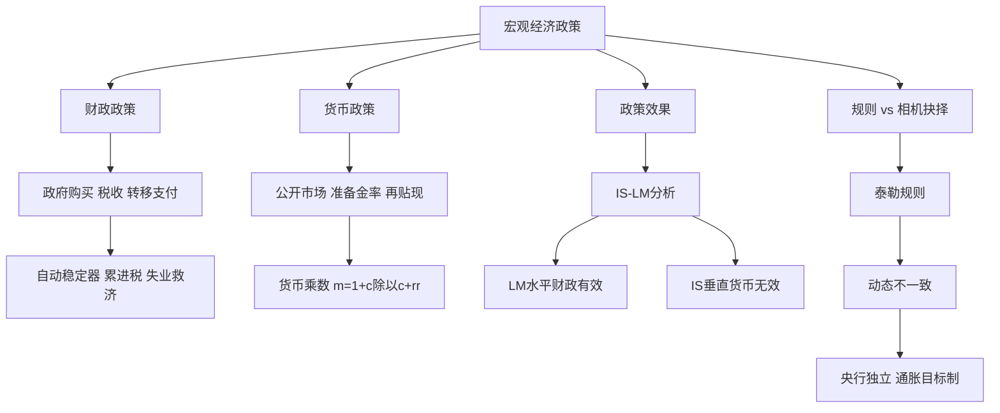

# 第十五章 宏观经济政策 · 章节总结

> 本章是前面所有模型的"应用篇"：政府怎么用财政和货币政策调节经济？什么时候哪种政策有效？央行应该按规则还是相机抉择？

## 一、本章地图

## 二、核心公式速查

| 公式 | 含义 |
|---|---|
| $k_G = 1/(1-\beta)$ | 政府购买乘数 |
| $k_T = -\beta/(1-\beta)$ | 税收乘数 |
| $m = (1+c)/(c+r_r)$ | 货币乘数 |
| 泰勒规则：$i = \pi + r^* + 0.5(\pi-\pi^*) + 0.5$ 缺口 | 利率规则 |

## 三、一句话记住每个 KP

- **KP01 财政政策**：政府花钱和收税，自动稳定器不用等国会。
- **KP02 货币政策**：央行三大工具，通过货币乘数放大。
- **KP03 IS-LM 政策效果**：LM 平财政有效，IS 陡货币无效。
- **KP04 泰勒规则与动态不一致**：央行独立、按规则来，避免"骗工人"的陷阱。

## 四、本章与前后章节的关系

- 本章是 [[../10_收入支出模型/00_章节总结|乘数]]、[[../11_IS-LM模型/00_章节总结|IS-LM]]、[[../12_AD-AS模型/00_章节总结|AD-AS]] 的综合应用。
- 开放经济下的政策效果见 [[../14_开放条件下的宏观经济/00_章节总结|蒙代尔-弗莱明]]。

---

## 🔗 相关知识点

**本章 KP：** [[知识点/KP01_财政政策工具与自动稳定器|KP01 财政政策]] ｜ [[知识点/KP02_货币政策工具与货币乘数|KP02 货币政策]] ｜ [[知识点/KP03_政策效果ISLM分析|KP03 政策效果]] ｜ [[知识点/KP04_泰勒规则与动态不一致|KP04 泰勒规则]]

**跨章：** [[../11_IS-LM模型/00_章节总结|第十一章 IS-LM]] ｜ [[../14_开放条件下的宏观经济/00_章节总结|第十四章 开放经济]]

**📖 原书原文：** [[../../../../原文件/经济学/西方经济学下册_宏观_全书|《西方经济学》下册 第十五章]]
