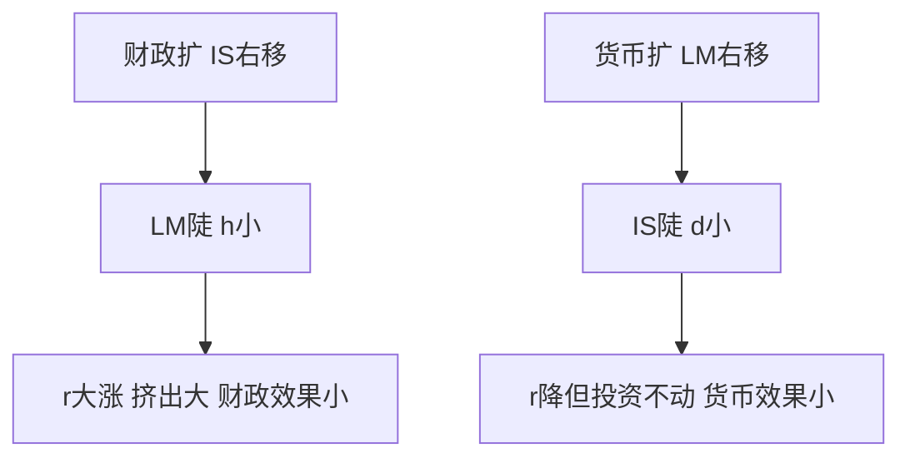

# 第十五章 宏观经济政策 · 考研真题集（首经贸 801）

<a href="../../../exam.html" target="_blank" style="display:inline-block;padding:6px 16px;background:#2563eb;color:#fff;border-radius:6px;text-decoration:none;font-size:14px;">📝 开始做题</a>

> 本章共收录：简答题 12 道（每题 15 分）｜论述题 4 道（每题 30 分）
> 配套选择题见 [[选择题集|本章选择题集]]
> 对应大纲：马工程《西方经济学》下册第十五章"宏观经济政策"全部四节：财政政策、货币政策、政策效果、规则与相机抉择

## 📋 本题集目录

### 简答题
1. [[#简答 1：简述财政政策的三大工具及其在经济衰退与过热时的运用方向|简述财政政策的三大工具及其作用方向]]
2. [[#简答 2：什么是自动稳定器？列举三种主要的自动稳定器并说明其作用机制|什么是自动稳定器？列举并说明其作用机制]]
3. [[#简答 3：简述宏观经济政策的时滞构成，并说明其对政策效果的影响|简述宏观经济政策的时滞及其对政策效果的影响]]
4. [[#简答 4：什么是货币乘数？写出完整公式，说明各变量含义及影响因素|什么是货币乘数？写出公式并说明其影响因素]]
5. [[#简答 5：简述中央银行三大传统货币政策工具及其作用机制|简述中央银行三大传统货币政策工具及其作用机制]]
6. [[#简答 6：用 IS-LM 模型分析财政政策的挤出效应及其影响因素|用 IS-LM 模型分析财政政策的挤出效应]]
7. [[#简答 7：用 IS-LM 模型说明货币政策效果的决定因素|用 IS-LM 模型说明货币政策效果的决定因素]]
8. [[#简答 8：简述财政政策与货币政策的四种配合组合及各自适用情形|简述财政政策与货币政策的四种配合组合及适用情形]]
9. [[#简答 9：简述泰勒规则的主要内容及其政策含义|简述泰勒规则的主要内容及其政策含义]]
10. [[#简答 10：什么是动态不一致？说明其后果及解决途径|什么是动态不一致？如何通过制度安排加以解决]]
11. [[#简答 11：（计算题）已知某国公众现金漏损率 $cr=0.2$，法定准备金率 $rr=0.1$，中央银行投放基础货币 $B=1000$ 亿元。求：(1) 货币乘数 $m$；(2) 货币供给 $M$；(3) 若央行降准使 $rr$ 降至 $0.05$，新的货币供给为多少？|计算题：货币乘数与货币供给]]
12. [[#简答 12：（计算题）设某经济边际消费倾向 $\beta=0.8$，政府购买增加 $\Delta G=100$ 亿元，同时增税 $\Delta T=100$ 亿元（平衡预算变动）。求国民收入变动 $\Delta Y$，并说明平衡预算乘数。|计算题：平衡预算乘数]]

### 论述题
1. [[#论述 1：结合中国实际，论述积极财政政策与稳健货币政策的协调配合|结合中国实际，论述积极财政政策与稳健货币政策的协调配合]]
2. [[#论述 2：论述流动性陷阱下货币政策的局限性，并说明财政政策应如何发挥作用|论述流动性陷阱下货币政策的局限及财政政策的作用]]
3. [[#论述 3：论述央行独立性、通胀目标制与动态不一致理论的内在联系，并结合中国央行实践谈预期管理|论述央行独立性、通胀目标制与动态不一致问题]]
4. [[#论述 4：论述地方政府债务扩张的宏观经济效应、风险成因及治理路径（结合积极财政政策）|论述地方政府债务扩张的宏观经济效应及其治理]]

---

## 一、简答题（每题 15 分，建议 450–700 字）

### 简答 1：简述财政政策的三大工具及其在经济衰退与过热时的运用方向

**【建议字数】450–700 字 ｜ 【建议时间】15 分钟 ｜ 【题型】概念简答**

**【考什么】** 对应知识点 [[知识点/KP01_财政政策工具与自动稳定器|KP01 财政政策工具与自动稳定器]]，对应大纲第一节；题型属于概念简答。

**【答题框架】**
- 第 1 段：财政政策的定义与相机抉择含义（2 分）
- 第 2 段：政府购买工具（4 分）
- 第 3 段：税收工具（4 分）
- 第 4 段：转移支付工具（3 分）
- 第 5 段：扩张与紧缩方向小结（2 分）

**【参考答案】**

一、财政政策是政府变动税收和支出以便影响总需求进而影响就业和国民收入的政策。按是否主动出击，可分为相机抉择的财政政策与自动稳定器，本题主要回答相机抉择的三大工具。

二、政府购买 $G$ 是政府对商品和劳务的直接购买，如公共工程建设、国防支出、公务员工资等。它是总需求的直接组成部分。经济衰退时，政府扩大购买（如搞"新基建"），直接拉动总需求；经济过热时，政府压缩购买，给经济降温。政府购买乘数 $k_G=1/(1-\beta)$，作用最直接。

三、税收 $T$ 通过影响可支配收入进而影响消费。经济衰退时，政府实施减税（降低税率、提高起征点），居民可支配收入增加，消费上升；经济过热时，政府增税，抑制消费。税收乘数 $k_T=-\beta/(1-\beta)$，绝对值小于政府购买乘数，且方向相反。

四、转移支付 $T_{tr}$ 是政府对居民的无偿支出，如失业救济、养老金、低保。经济衰退时，失业增加，政府自动（或主动）扩大转移支付，托底低收入群体消费；经济过热时，减少转移支付。转移支付乘数与税收乘数大小相等、方向相反。

五、方向小结：经济衰退用扩张性财政政策（增支、减税、扩转移），经济过热用紧缩性财政政策（减支、增税、缩转移）。三种工具配合使用，效果更佳。

**【解析·得分点】** 本题采分点：①三大工具名称及定义 ②每种工具在衰退/过热时的方向 ③乘数关系（$k_G>|k_T|$）。容易丢分：把转移支付与政府购买混为一谈；漏掉"相机抉择"这一前提。

**【生活实例】** 奶茶店生意差的时候，政府一边多修马路（政府购买），一边给市民发消费券（转移支付），一边减奶茶店的营业税（税收）——三管齐下拉消费。

**【双链接】** 🔗 [[知识点/KP01_财政政策工具与自动稳定器|回知识点 KP01]] ｜ 📖 [[../../../原文件/经济学/西方经济学下册_宏观_全书|原书·第十五章]]

---

### 简答 2：什么是自动稳定器？列举三种主要的自动稳定器并说明其作用机制

**【建议字数】450–700 字 ｜ 【建议时间】15 分钟 ｜ 【题型】概念简答**

**【考什么】** 对应知识点 [[知识点/KP01_财政政策工具与自动稳定器|KP01 财政政策工具与自动稳定器]]，对应大纲第一节；题型属于概念简答。

**【答题框架】**
- 第 1 段：自动稳定器定义（3 分）
- 第 2 段：累进所得税机制（4 分）
- 第 3 段：失业救济与转移支付机制（4 分）
- 第 4 段：农产品价格维持制度（2 分）
- 第 5 段：优点与局限（2 分）

**【参考答案】**

一、自动稳定器亦称内在稳定器，是指经济系统本身存在的一种会减少各种干扰对国民收入冲击的机制，能够在经济繁荣时期自动抑制通胀，在经济衰退时期自动减轻萧条，无需政府采取任何行动。其特点是时滞短、无需立法程序。

二、累进所得税是最重要的自动稳定器。经济繁荣时，居民收入普遍上升，适用更高的边际税率，税收自动增加，抑制可支配收入和消费的过快增长；经济衰退时，居民收入下降，自动跌入更低税率档次，税负减轻，可支配收入下降幅度小于收入下降幅度，从而缓冲消费下滑。

三、失业救济和各种转移支付。经济衰退时，失业人数增加，领取救济金的人数自动增多，转移支付自动扩大，支撑低收入家庭的消费；经济繁荣时，失业减少，救济金自动发放减少，抑制总需求膨胀。这相当于一张"社会安全网"。

四、农产品价格维持制度。经济萧条时，农产品价格下跌，政府按支持价格收购农产品，农民收入不致大幅下降；经济繁荣时，农产品价格上涨，政府抛售储备，平抑价格。这一机制稳定了农民收入和农村消费。

五、自动稳定器的优点是时滞短、不扭曲微观决策；缺点是只能减缓波动、不能消除波动，力度有限。严重衰退时仍需相机抉择的财政政策发力。

**【解析·得分点】** 采分点：①自动稳定器定义 ②三种机制各自动向（衰退/过热时如何反向调节）③优点缺点。易丢分：只列名字不写机制；漏掉农产品价格制度。

**【生活实例】** 就像奶茶店的"自动温控"：生意太火时炉子自动降火力（收入高了税档跳上去），生意太冷时自动添柴（失业救济自动发），不用店长每次手动调。

**【双链接】** 🔗 [[知识点/KP01_财政政策工具与自动稳定器|回知识点 KP01]] ｜ 📖 [[../../../原文件/经济学/西方经济学下册_宏观_全书|原书·第十五章]]

---

### 简答 3：简述宏观经济政策的时滞构成，并说明其对政策效果的影响

**【建议字数】450–700 字 ｜ 【建议时间】15 分钟 ｜ 【题型】原因分析**

**【考什么】** 对应知识点 [[知识点/KP01_财政政策工具与自动稳定器|KP01]] 与 [[知识点/KP03_政策效果ISLM分析|KP03]]，对应大纲第一、三节；题型属于原因分析。

**【答题框架】**
- 第 1 段：时滞的概念与分类（2 分）
- 第 2 段：内部时滞（认识、决策、执行）（6 分）
- 第 3 段：外部时滞（效果时滞）（4 分）
- 第 4 段：财政与货币政策时滞比较（2 分）
- 第 5 段：政策含义（1 分）

**【参考答案】**

一、政策时滞是指从经济出现波动到政策最终发挥效果之间的时间差。按发生环节可分为内部时滞与外部时滞两大类。

二、内部时滞是指从经济发生变动到政府采取政策行动的时间，包括三个阶段：
（一）认识时滞：从经济出现波动到决策者认识到需要采取行动的时间。由于宏观数据（GDP、失业率）公布有滞后，且需要多个数据相互印证，认识时滞通常为数月。
（二）决策时滞：从认识到需要政策到立法机构或决策当局做出决定的时间。财政政策需要国会或人大讨论表决，决策时滞长；货币政策由央行委员会决定，决策时滞短。
（三）执行时滞：从政策决定到具体项目落地、资金拨付的时间。财政政策搞基建，从立项到开工要时间；货币政策调整利率则即时生效。

三、外部时滞（效果时滞）是指从政策实施到对经济产生实际影响的时间。货币政策通过利率→投资→产出链条传导，效果时滞长且分散（通常 6–18 个月）；财政政策（如政府购买）直接计入总需求，效果时滞短。

四、时滞比较：财政政策内部时滞长（决策慢）、外部时滞短（见效快）；货币政策内部时滞短（央行独立决策快）、外部时滞长（传导链条长）。这正是两种政策需要配合的原因之一。

五、政策含义：时滞过长会使政策变成"逆周期加码"——衰退时政策还没见效，经济已自动复苏，结果政策变成过热时的刺激。这就是主张按规则行事（而非相机抉择）的重要理由。

**【解析·得分点】** 采分点：①内部时滞三阶段 ②外部时滞 ③财政vs货币时滞差异 ④时滞导致政策顺周期风险。易丢分：把决策时滞归给货币政策。

**【生活实例】** 就像发烧去医院：挂号验血（认识时滞）、医生开方（决策时滞）、取药打针（执行时滞）、药起作用（效果时滞）。等药见效时病可能自己好了。

**【双链接】** 🔗 [[知识点/KP01_财政政策工具与自动稳定器|KP01]] ｜ [[知识点/KP03_政策效果ISLM分析|KP03]] ｜ 📖 原书

---

### 简答 4：什么是货币乘数？写出完整公式，说明各变量含义及影响因素

**【建议字数】450–700 字 ｜ 【建议时间】15 分钟 ｜ 【题型】分析推导**

**【考什么】** 对应知识点 [[知识点/KP02_货币政策工具与货币乘数|KP02 货币政策工具与货币乘数]]，对应大纲第二节；题型属于分析推导。

**【答题框架】**
- 第 1 段：货币供给、基础货币与货币乘数关系（3 分）
- 第 2 段：公式推导（5 分）
- 第 3 段：各变量含义（4 分）
- 第 4 段：影响乘数的因素（2 分）
- 第 5 段：政策含义（1 分）

**【参考答案】**

一、货币供给 $M$ 与基础货币（高能货币）$B$ 之间存在倍数关系：$M=m\cdot B$，其中 $m$ 即为货币乘数。基础货币 $B=C+R$（流通中现金加银行准备金），由央行直接控制；货币供给 $M=C+D$（现金加活期存款），由央行、商业银行和公众共同决定。

二、设公众的现金漏损率 $cr=C/D$（现金占存款的比例），法定准备金率 $rr=R_r/D$，并暂不考虑超额准备金。则：

$$m=\frac{M}{B}=\frac{C+D}{C+R}=\frac{cr\cdot D+D}{cr\cdot D+rr\cdot D}=\frac{1+cr}{cr+rr}$$

三、各变量含义：
（一）$cr$：现金漏损率，公众手持现金与活期存款之比。支付习惯越依赖现金，$cr$ 越大，乘数越小。
（二）$rr$：法定准备金率，商业银行依法必须存放在央行的准备金占存款之比。央行降准，$rr$ 下降，乘数放大。
（三）若考虑超额准备金率 $re$，则公式扩展为 $m=(1+cr)/(cr+rr+re)$。银行惜贷、囤积超额准备金时，$re$ 上升，乘数缩小。

四、影响因素：央行可直接调整 $rr$；$cr$ 由公众支付习惯决定（信用卡普及使 $cr$ 下降）；$re$ 由商业银行风险偏好决定（经济不确定时银行多留准备金）。因此央行不能完全控制货币供给，只能控制基础货币。

五、政策含义：降准之所以威力大，是因为它既增加基础货币，又放大货币乘数，双重作用。

**【解析·得分点】** 采分点：①$M=mB$ 关系 ②公式 $m=(1+cr)/(cr+rr)$ ③各变量含义 ④超额准备金扩展。易丢分：分子分母写反；漏掉 $cr$ 在分子里。

**【生活实例】** 央行是"水龙头"（基础货币），银行体系是"水管放大器"（乘数）。水管越粗（准备金率低、现金留存少），放出来的水越多。

**【双链接】** 🔗 [[知识点/KP02_货币政策工具与货币乘数|回知识点 KP02]] ｜ 📖 [[../../../原文件/经济学/西方经济学下册_宏观_全书|原书·第十五章]]

---

### 简答 5：简述中央银行三大传统货币政策工具及其作用机制

**【建议字数】450–700 字 ｜ 【建议时间】15 分钟 ｜ 【题型】概念简答**

**【考什么】** 对应知识点 [[知识点/KP02_货币政策工具与货币乘数|KP02]]，对应大纲第二节；题型属于概念简答。

**【答题框架】**
- 第 1 段：货币政策定义（1 分）
- 第 2 段：公开市场业务（5 分）
- 第 3 段：法定准备金率（4 分）
- 第 4 段：再贴现率（4 分）
- 第 5 段：三者比较（1 分）

**【参考答案】**

一、货币政策是中央银行通过控制货币供应量以及通过货币供应量来调节利率进而影响投资和整个经济以达到一定经济目标的行为。

二、公开市场业务是指中央银行在金融市场上公开买卖政府债券以控制货币供给和利率的政策行为。央行买入债券，向商业银行体系注入基础货币，银行准备金增加，通过货币乘数扩张货币供给，利率下降；央行卖出债券则反向操作。这是最常用、最灵活的工具，可随时微调。中国人民银行通过逆回购、MLF（中期借贷便利）操作公开市场。

三、法定准备金率是指中央银行规定的商业银行必须按存款的一定比例上缴的准备金比率。降低法定准备金率，商业银行可贷资金增加，货币乘数放大，货币供给扩张；提高则相反。这一工具作用猛烈，被称为"巨斧"，不宜频繁使用。中国近年多次"降准"即属此类。

四、再贴现率是中央银行对商业银行及其他金融机构的放款利率。商业银行持未到期票据向央行贴现融资，再贴现率降低意味着融资成本下降，鼓励银行向央行借款，进而扩大放贷能力；提高再贴现率则紧缩。再贴现率目前更多作为"信号作用"，而非数量工具。

五、三者比较：公开市场业务最灵活常用；法定准备金率作用猛烈；再贴现率具有告示效应。中国近年货币政策框架正从数量型工具（降准）向价格型工具（政策利率）转型。

**【解析·得分点】** 采分点：①三大工具名称 ②每种工具扩张/紧缩方向 ③作用机制（通过基础货币或乘数）。易丢分：把再贴现率与存款利率混淆；漏掉公开市场业务的"灵活性"优点。

**【生活实例】** 央行三个工具：公开市场操作像"零舀水"（一勺一勺调），准备金率像"调水箱底阀"（一动一大片），再贴现率像"告示牌"（告诉市场我想干嘛）。

**【双链接】** 🔗 [[知识点/KP02_货币政策工具与货币乘数|回知识点 KP02]] ｜ 📖 [[../../../原文件/经济学/西方经济学下册_宏观_全书|原书·第十五章]]

---

### 简答 6：用 IS-LM 模型分析财政政策的挤出效应及其影响因素

**【建议字数】450–700 字 ｜ 【建议时间】15 分钟 ｜ 【题型】模型分析**

**【考什么】** 对应知识点 [[知识点/KP03_政策效果ISLM分析|KP03 政策效果 IS-LM 分析]]，对应大纲第三节；题型属于模型分析。

**【答题框架】**
- 第 1 段：挤出效应定义（3 分）
- 第 2 段：IS-LM 图形分析（5 分）
- 第 3 段：影响挤出效应大小的因素（5 分）
- 第 4 段：政策含义（2 分）

**【参考答案】**

一、挤出效应是指政府支出增加所引起的私人消费或投资降低的效果。在 IS-LM 模型中，扩张性财政政策使 IS 曲线右移，若 LM 不变，产出增加的同时利率上升，从而挤出部分私人投资。

二、图形分析：横轴为 $Y$，纵轴为 $r$。初始均衡点为 $E_0$（$IS_0$ 与 $LM$ 交点）。政府购买增加，$IS_0$ 右移至 $IS_1$。若利率不变，产出本应增加到 $Y_2$（水平距离）；但 LM 向上倾斜，新均衡点 $E_1$ 对应产出 $Y_1<Y_2$。$(Y_2-Y_1)$ 即为被挤出的部分。利率从 $r_0$ 升至 $r_1$，高利率抑制了私人投资。

三、影响挤出效应大小的因素：
（一）LM 斜率：LM 越陡（货币需求对利率越不敏感），IS 右移引起的利率上升越大，挤出越多。LM 垂直（古典区域）时，挤出为 100%，财政政策完全无效。
（二）IS 斜率：IS 越平（投资对利率越敏感），同样利率上升挤出的投资越多。
（三）支出乘数：乘数越大，IS 右移距离越大，利率上升越多，挤出越多。
（四）货币需求对产出的敏感程度：$k$ 越大，LM 越陡，挤出越多。

四、极端情形：LM 水平（凯恩斯陷阱）时，利率不上升，挤出为零，财政政策完全有效；LM 垂直（古典区域）时，挤出完全，财政政策无效。这正是凯恩斯主义与古典主义分歧的图形表达。

**【解析·得分点】** 采分点：①挤出效应定义 ②IS 右移、利率上升、私人投资减少的链条 ③LM/IS 斜率影响 ④两种极端情形。易丢分：只画图形不解释机制；漏掉乘数因素。

**【生活实例】** 政府在食堂包了一层楼吃饭（政府购买），租金大涨，原本在二楼开店的奶茶店付不起租关门了——政府多花的钱把私人挤走了一部分。

**【双链接】** 🔗 [[知识点/KP03_政策效果ISLM分析|回知识点 KP03]] ｜ [[../11_IS-LM模型/知识点/KP05_流动性陷阱与挤出效应|挤出效应]] ｜ 📖 原书

---

### 简答 7：用 IS-LM 模型说明货币政策效果的决定因素

**【建议字数】450–700 字 ｜ 【建议时间】15 分钟 ｜ 【题型】模型分析**

**【考什么】** 对应知识点 [[知识点/KP03_政策效果ISLM分析|KP03]]，对应大纲第三节；题型属于模型分析。

**【答题框架】**
- 第 1 段：货币政策传导（2 分）
- 第 2 段：IS 斜率的影响（6 分）
- 第 3 段：LM 斜率的影响（4 分）
- 第 4 段：极端情形（2 分）
- 第 5 段：政策含义（1 分）

**【参考答案】**

一、扩张性货币政策使货币供给增加，LM 曲线右移，利率下降，私人投资上升，进而带动产出增加。货币政策效果大小取决于 IS 与 LM 的斜率。

二、IS 斜率的影响：
（一）IS 越平坦，意味着投资对利率变动越敏感（利率弹性大）。货币扩张使利率小幅下降，就能引致投资大幅增加，从而产出大幅上升——货币政策效果强。
（二）IS 越陡峭，意味着投资对利率不敏感（如中国国企、政府主导项目对利率不敏感）。货币扩张使利率下降，但投资增加有限——货币政策效果弱。
（三）极端情形：IS 垂直（投资利率弹性为零），LM 右移只降利率，产出不变——货币政策完全无效。这就是"流动性陷阱"的另一面：当企业预期惨淡，再便宜的钱也不借。

三、LM 斜率的影响：
（一）LM 越陡峭，意味着货币需求对利率越不敏感。同样的货币扩张需要利率更大幅度下降才能出清货币市场，从而投资增加更多——货币政策效果强。
（二）LM 越平坦（流动性陷阱），货币供给已极度充裕，利率降至底线，再增加货币供给无法进一步降利率——货币政策无效。

四、极端情形小结：货币政策在 IS 平、LM 陡时最有效；在 IS 陡（投资不敏感）、LM 平（流动性陷阱）时无效。

五、政策含义：2008 年后美欧日长期低利率甚至零利率仍增长乏力，正是 LM 接近水平、企业不愿投资所致——这就是所谓"推绳子"（pushing on a string）。

**【解析·得分点】** 采分点：①传导链条 ②IS 平/陡分别对效果的影响 ③LM 平/陡影响 ④流动性陷阱。易丢分：把 IS 平与"货币无效"挂钩（正好相反）。

**【生活实例】** 降息像给奶茶店打折拉客：如果店老板一听打折就疯狂进货（IS 平），降息很管用；如果老板说"街上没人，打折我也不进货"（IS 陡），降息白搭。

**【双链接】** 🔗 [[知识点/KP03_政策效果ISLM分析|回知识点 KP03]] ｜ 📖 [[../../../原文件/经济学/西方经济学下册_宏观_全书|原书·第十五章]]

---

### 简答 8：简述财政政策与货币政策的四种配合组合及各自适用情形

**【建议字数】450–700 字 ｜ 【建议时间】15 分钟 ｜ 【题型】关系对比**

**【考什么】** 对应知识点 [[知识点/KP03_政策效果ISLM分析|KP03]]，对应大纲第三节；题型属于关系对比。

**【答题框架】**
- 第 1 段：政策配合必要性（2 分）
- 第 2 段：双扩张组合（4 分）
- 第 3 段：紧财政+松货币、松财政+紧货币（5 分）
- 第 4 段：双紧缩（2 分）
- 第 5 段：中国实践（2 分）

**【参考答案】**

一、财政政策与货币政策不仅各自有局限性，且政策目标（产出、利率）影响方向不同，需要配合使用。

二、双扩张（扩财政+扩货币）：IS 右移、LM 右移，产出大幅增加，利率变动不确定。适用严重衰退（如 2008 年金融危机、2020 年疫情冲击）。缺点是容易引发通胀和资产泡沫。

三、松财政+紧货币：IS 右移、LM 左移，产出小幅变动，利率明显上升。适用既要刺激增长又要防止通胀的情形。美国 1980 年代里根时期属此类。缺点是高利率挤出私人投资。

四、紧财政+松货币：IS 左移、LM 右移，产出小幅变动，利率明显下降。适用需要降低利率、促进私人投资、同时压缩政府赤字的情形。美国 1990 年代克林顿时期削减赤字+格林斯潘宽松货币属此类，成功实现低利率高增长。

五、双紧缩（紧财政+紧货币）：IS 左移、LM 左移，产出大幅下降，利率变动不确定。适用严重通胀需要强力降温（如 1980 年初沃尔克抗通胀）。代价是经济衰退。

六、中国实践：近年来实施"积极的财政政策+稳健的货币政策"，属松财政+中性偏松货币组合，既扩大内需又不搞大水漫灌；2024 年以来强调"更好发挥财政货币政策联动"，降准降息与专项债发力协同。

**【解析·得分点】** 采分点：①四种组合 ②每种对 $Y$ 和 $r$ 的影响方向 ③适用情形。易丢分：把"双扩张"的利率方向说死；漏掉中国实际。

**【生活实例】** 开车：财政是油门，货币是方向盘（利率）。要超车时油门踩到底+方向稳住（双扩）；要省油又要提速时松油门打方向（紧财政松货币）。

**【双链接】** 🔗 [[知识点/KP03_政策效果ISLM分析|回知识点 KP03]] ｜ 📖 原书

---

### 简答 9：简述泰勒规则的主要内容及其政策含义

**【建议字数】450–700 字 ｜ 【建议时间】15 分钟 ｜ 【题型】概念简答**

**【考什么】** 对应知识点 [[知识点/KP04_泰勒规则与动态不一致|KP04 泰勒规则与动态不一致]]，对应大纲第四节；题型属于概念简答。

**【答题框架】**
- 第 1 段：泰勒规则提出背景（2 分）
- 第 2 段：公式与各变量含义（6 分）
- 第 3 段：系数含义与直觉（4 分）
- 第 4 段：政策含义与局限（3 分）

**【参考答案】**

一、泰勒规则是美国经济学家约翰·泰勒于 1993 年提出的一个经验性利率规则，旨在为中央银行设定政策利率提供量化指引，替代纯粹的相机抉择。

二、公式为：

$$i_t=\pi_t+r^*+0.5(\pi_t-\pi^*)+0.5\cdot\frac{Y_t-Y_f}{Y_f}$$

其中：$i_t$ 为名义政策利率；$\pi_t$ 为当前通胀率；$r^*$ 为均衡实际利率（泰勒取 2%）；$\pi^*$ 为目标通胀率（取 2%）；$(Y_t-Y_f)/Y_f$ 为产出缺口（实际 GDP 相对潜在 GDP 的百分比偏离）。

三、系数含义：
（一）通胀缺口系数 0.5：通胀每高于目标 1 个百分点，名义利率上调 1.5 个百分点（其中 1 个点随通胀本身上升，0.5 个点为额外实际利率上调），从而实际利率上升，抑制经济。这一"1.5 原则"确保名义利率上调幅度超过通胀上升幅度。
（二）产出缺口系数 0.5：经济过热（产出缺口为正）1 个百分点，利率上调 0.5 个百分点。
（三）若通胀达标且产出达标，则 $i=\pi^*+r^*=4\%$。

四、政策含义：第一，央行不应随意调整利率，而应遵循对通胀和产出缺口的系统反应；第二，规则可稳定公众预期，避免动态不一致；第三，泰勒规则不是法律，央行在面临金融稳定、外部冲击时可偏离。中国央行近年来也在探索以政策利率为核心的市场化调控框架，与泰勒规则精神一致。

**【解析·得分点】** 采分点：①公式 ②各变量含义 ③1.5 原则 ④政策含义。易丢分：把名义利率公式里的 $\pi_t$ 漏掉；把系数 0.5 写成 1。

**【生活实例】** 像空调温控器：温度（通胀）高了就自动多制冷，室温（产出）偏高也加点冷量——不用人每次手动调。

**【双链接】** 🔗 [[知识点/KP04_泰勒规则与动态不一致|回知识点 KP04]] ｜ 📖 [[../../../原文件/经济学/西方经济学下册_宏观_全书|原书·第十五章]]

---

### 简答 10：什么是动态不一致？说明其后果及解决途径

**【建议字数】450–700 字 ｜ 【建议时间】15 分钟 ｜ 【题型】原因分析**

**【考什么】** 对应知识点 [[知识点/KP04_泰勒规则与动态不一致|KP04]]，对应大纲第四节；题型属于原因分析。

**【答题框架】**
- 第 1 段：动态不一致定义（3 分）
- 第 2 段：模型机制（6 分）
- 第 3 段：后果（3 分）
- 第 4 段：解决途径（3 分）

**【参考答案】**

一、动态不一致（时间不一致性）是指政府在事前宣布的最优政策，在公众预期形成之后，对政府而言不再是最优的，因而政府有动机食言的现象。基德兰德和普雷斯科特 1977 年提出，后由巴罗和戈登发展。

二、模型机制（菲利普斯曲线框架）：
（一）政府事前宣布"将实施低通胀政策"，公众据此形成低通胀预期 $\pi^e$，签订工资合同。
（二）一旦工资合同固定，政府面对的短期菲利普斯曲线变为：制造意外通胀 $\pi>\pi^e$ 可降低失业到自然率以下 $u<u_n$。
（三）于是政府有动机"欺骗"公众：实际实施扩张性政策，制造意外通胀。
（四）但公众是理性的，会预判到政府的食言动机，一开始就把 $\pi^e$ 调高。
（五）结果：工资合同一开始就按高通胀签订，政府若再扩张只是加速通胀，实际失业仍在 $u_n$。

三、后果：理性预期均衡下，通胀率高于最优水平，而失业率并未下降——这就是 1970 年代美国"滞胀"的理论解释。相机抉择产生了通胀偏差（inflation bias）。

四、解决途径：
（一）增强央行独立性：把货币政策委托给"保守的央行家"（如罗戈夫模型），其更厌恶通胀，不受选举周期干扰。
（二）通胀目标制：公开宣布量化通胀目标（如 2%），建立信誉，让公众相信央行抗通胀决心。
（三）按规则行事：如泰勒规则，约束央行随意扩张。
（四）签订契约：对央行行长设置奖惩，使其目标函数与社会福利一致。

**【解析·得分点】** 采分点：①动态不一致定义 ②事前最优 vs 事后最优冲突 ③理性预期下只剩通胀偏差 ④三种解决途径。易丢分：把动态不一致说成"政策朝令夕改"的日常含义；漏掉理性预期关键作用。

**【生活实例】** 老师开学说"这学期必考试"（事前宣布），学生开始复习。临近期末老师想"不如划重点让大家开心"（事后食言）。但学生早猜到老师心软，一开始就不信，照样只复习考试重点——结果考试照难，学生也没多学到东西。

**【双链接】** 🔗 [[知识点/KP04_泰勒规则与动态不一致|回知识点 KP04]] ｜ [[../13_失业通胀与经济周期/知识点/KP03_菲利普斯曲线|菲利普斯曲线]] ｜ 📖 原书

---

### 简答 11：（计算题）已知某国公众现金漏损率 $cr=0.2$，法定准备金率 $rr=0.1$，中央银行投放基础货币 $B=1000$ 亿元。求：(1) 货币乘数 $m$；(2) 货币供给 $M$；(3) 若央行降准使 $rr$ 降至 $0.05$，新的货币供给为多少？

**【建议字数】450–700 字 ｜ 【建议时间】15 分钟 ｜ 【题型】分析推导**

**【考什么】** 对应知识点 [[知识点/KP02_货币政策工具与货币乘数|KP02]]，对应大纲第二节；题型属于分析推导（计算）。

**【答题框架】**
- 写出乘数公式 → 代入算 $m$ → 算 $M$ → 算降准后 $M$

**【参考答案】**

一、货币乘数公式：

$$m=\frac{1+cr}{cr+rr}$$

二、代入 $cr=0.2$，$rr=0.1$：

$$m=\frac{1+0.2}{0.2+0.1}=\frac{1.2}{0.3}=4$$

三、货币供给：

$$M=m\cdot B=4\times 1000=4000\text{（亿元）}$$

四、降准后 $rr'=0.05$：

$$m'=\frac{1.2}{0.2+0.05}=\frac{1.2}{0.25}=4.8$$

$$M'=4.8\times 1000=4800\text{（亿元）}$$

五、结论：降准 0.05，货币乘数从 4 升至 4.8，货币供给增加 800 亿元，扩张 20%。这就是为什么"降准 0.5 个百分点释放长期资金数千亿元"的报道在数学上成立。

**【解析·得分点】** 采分点：①公式写对 ②$m=4$ ③$M=4000$ 亿 ④降准后 $m'=4.8$、$M'=4800$ 亿。易丢分：分子漏加 1；把 $cr$ 误当 0.02。

**【生活实例】** 央行像水池放 1000 吨水，银行像水管放大器，乘数 4 倍后池子里有 4000 吨；降准等于把水管加粗，放大到 4.8 倍，变成 4800 吨。

**【双链接】** 🔗 [[知识点/KP02_货币政策工具与货币乘数|回知识点 KP02]] ｜ 📖 原书

---

### 简答 12：（计算题）设某经济边际消费倾向 $\beta=0.8$，政府购买增加 $\Delta G=100$ 亿元，同时增税 $\Delta T=100$ 亿元（平衡预算变动）。求国民收入变动 $\Delta Y$，并说明平衡预算乘数。

**【建议字数】450–700 字 ｜ 【建议时间】15 分钟 ｜ 【题型】分析推导**

**【考什么】** 对应知识点 [[知识点/KP01_财政政策工具与自动稳定器|KP01]]，对应大纲第一节；题型属于分析推导（计算）。

**【答题框架】** 分别算政府购买乘数和税收乘数 → 合成 $\Delta Y$ → 引出平衡预算乘数

**【参考答案】**

一、政府购买乘数：

$$k_G=\frac{1}{1-\beta}=\frac{1}{1-0.8}=5$$

二、税收乘数：

$$k_T=\frac{-\beta}{1-\beta}=\frac{-0.8}{0.2}=-4$$

三、国民收入变动：

$$\Delta Y=k_G\cdot\Delta G+k_T\cdot\Delta T=5\times 100+(-4)\times 100=500-400=100\text{（亿元）}$$

四、平衡预算乘数：当 $\Delta G=\Delta T$ 时，

$$k_B=\frac{\Delta Y}{\Delta G}=\frac{100}{100}=1$$

即平衡预算乘数恒等于 1。其经济含义：政府等额增支与增税，国民收入仍等额增加——因为政府购买对总需求是 $1:1$ 的注入，而税收只是从私人支出中抽出一部分（$\beta$ 比例），二者作用不对等，净额等于初始支出量。

五、结论：平衡预算扩张虽然不产生赤字，但仍能拉动经济增长 100 亿元，代价是私人消费被部分挤出。

**【解析·得分点】** 采分点：①$k_G=5$ ②$k_T=-4$ ③$\Delta Y=100$ 亿 ④平衡预算乘数=1。易丢分：税收乘数符号错；不说明平衡预算乘数含义。

**【生活实例】** 政府向你收 100 元税，又花 100 元修马路。你本来要拿这 100 元里的 80 元买奶茶（花掉 80%），现在政府替你花掉全部 100 元——多出来的 20 元就是净拉动。

**【双链接】** 🔗 [[知识点/KP01_财政政策工具与自动稳定器|回知识点 KP01]] ｜ [[../10_收入支出模型/知识点/KP06_平衡预算乘数|平衡预算乘数]] ｜ 📖 原书

---

### 简答 13：（曲线移动·分析）为什么 LM 越陡财政政策挤出越大、IS 越陡货币政策效果越小？用 IS-LM 斜率说明

**【建议字数】450–700 字 ｜ 【建议时间】15 分钟 ｜ 【题型】曲线移动分析**

**【考什么】** 对应 [[知识点/KP03_政策效果ISLM分析|政策效果]]；综合 [[../11_IS-LM模型/知识点/KP01_IS曲线|IS]]、[[../11_IS-LM模型/知识点/KP03_LM曲线|LM]]。

**【答题框架】**
- 第 1 段：财政政策效果取决于 LM 斜率（5 分）
- 第 2 段：货币政策效果取决于 IS 斜率（5 分）
- 第 3 段：两个极端情形（5 分）

**【参考答案】**

一、财政政策 vs LM 斜率。财政扩张使 IS 右移。LM 斜率为 $k/h$（$h$ 是货币需求对利率敏感系数）。$h$ 越小 → LM 越陡 → IS 右移时，为吸收新增交易货币需求，$r$ 必须大涨 → 利率大涨挤出私人投资越多 → 财政政策效果越小。极端 $h\to0$，LM 垂直（古典区域），IS 右移只抬 r、Y 不变，100% 挤出。

二、货币政策 vs IS 斜率。货币扩张使 LM 右移、r 下降。IS 斜率为 $-(1-\beta)/d$（$d$ 是投资对利率敏感系数）。$d$ 越小 → IS 越陡 → r 下降后投资不敏感、不增加 → Y 拉动小 → 货币政策效果越小。极端 $d\to0$，IS 垂直，r 降多少投资都不动，货币政策完全无效。

三、两个极端。（1）流动性陷阱 $h\to\infty$，LM 水平：IS 右移 r 不升、无挤出，财政政策最有效。（2）投资对利率完全无弹性 $d\to0$，IS 垂直：货币政策传导断裂，"推绳子"。

**【解析·得分点】** ① LM 陡→h 小→挤出大（5）；② IS 陡→d 小→货币效果小（5）；③ 流动性陷阱/古典极端（5）。

**【生活实例】** 经济过热时银行寸头紧（LM 陡），政府发债直接顶高利率，民间被挤死；预期转弱时企业不敢借钱（IS 陡），央行再降息也没人投资——这就是政策要"看时候下菜"。

---

## 二、论述题（每题 30 分，建议 900–1200 字）

### 论述 1：结合中国实际，论述积极财政政策与稳健货币政策的协调配合

**【建议字数】900–1200 字 ｜ 【建议时间】30 分钟 ｜ 【题型】政策效应类**

**【考什么】** 跨 [[知识点/KP01_财政政策工具与自动稳定器|KP01]]、[[知识点/KP02_货币政策工具与货币乘数|KP02]]、[[知识点/KP03_政策效果ISLM分析|KP03]] 三个知识点，并跨第十五章与第十章乘数论；题型属于政策效应类。

**【答题框架】**
- 第 1 段：破题——宏观调控总基调（4 分）
- 第 2–3 段：财政政策：积极财政的工具与中国实践（8 分）
- 第 4 段：货币政策：稳健中性、降准降息（6 分）
- 第 5 段：IS-LM 模型下的配合机理（6 分）
- 第 6 段：地方债、防范风险与政策协调难点（6 分）

**【参考答案】**

一、近年来中国宏观调控始终坚持"积极的财政政策+稳健的货币政策"的总基调。这一组合既不同于西方危机时期的双扩张，也不同于抗通胀时期的双紧缩，而是立足中国经济"三期叠加"（增长速度换挡期、结构调整阵痛期、前期刺激政策消化期）特征的主动选择。

二、积极财政政策的工具与实践。一是扩大财政赤字，发行专项国债和地方专项债。2024 年财政赤字率按 4% 左右安排，新增地方专项债 3.9 万亿元，用于"两重"（重大战略实施、重点领域安全能力建设）和"两新"（大规模设备更新、消费品以旧换新）。二是减税降费，"十三五"以来累计超 12 万亿元，重点支持制造业和小微企业。三是优化支出结构，向科技创新、民生保障、绿色转型倾斜。从乘数角度看，政府购买直接计入总需求，且中国边际消费倾向较高（尤其对中低收入群体），支出乘数较大。

三、稳健货币政策的工具与实践。一是保持流动性合理充裕，2024 年多次降准，释放长期资金逾万亿元；政策利率（7 天逆回购利率、MLF 利率）多次下调，带动 LPR 下行。二是结构性工具精准滴灌，如支农支小再贷款、科技创新再贷款、保障性再贷款，引导资金流向重点领域。三是保持人民币汇率在合理均衡水平上基本稳定。从货币乘数角度看，降准同时扩大基础货币和乘数；但当前企业预期偏弱、银行风险偏好下降，货币乘数中的超额准备金率 $re$ 上升，货币政策传导效率打折。

四、IS-LM 模型下的配合机理。中国经济当前面临的问题：一方面企业预期不足，IS 曲线较陡（投资对利率不敏感），单独使用货币政策效果有限——降息也未必拉动投资；另一方面地方政府债务约束强化，财政扩张空间收窄。因此理想配合是：积极财政政策托底总需求（IS 右移），同时货币政策适度宽松对冲利率上升压力（LM 右移），避免挤出效应。这正是 2024 年以来"降准降息+专项债加速"组合的理论逻辑——产出增加而利率不飙升，既稳增长又不引发资产泡沫。

五、协调中的难点与风险。第一，地方政府债务压力：过去扩张性财政积累了大量隐性债务，继续扩财政的空间收窄，需要"开前门、堵后门"。第二，财政货币边界：央行不能直接为财政透支（《中国人民银行法》第 29 条），但可通过二级市场认购、PSL 等方式间接支持，需防止财政赤字货币化。第三，预期管理：居民和企业信心不足时，传统乘数效应递减，需要政策"可预期、有力度"，打破动态不一致中的预期陷阱。第四，外部约束：美联储利率周期影响跨境资本流动，制约国内降息空间。

六、总结。积极财政与稳健货币的配合，本质上是用财政解决"钱往哪花"的结构问题，用货币解决"钱够不够"的总量问题。面向新质生产力发展，未来财政要更注重结构性减税和研发补贴，货币要更注重打通传导机制、降低实际利率，二者协同服务于高质量发展。

**【解析·得分点】** 采分点：①两大政策工具具体操作 ②IS-LM 配合机理（IS 陡+LM 平下为何双管齐下）③地方债、传导阻滞等现实难点 ④新质生产力方向。易漏点：不写具体数字（赤字率、专项债规模）；只写理论不结合中国。

**【生活实例】** 像给一辆上坡又没油的车：财政是踩油门（直接花钱），货币是调方向盘和喷油（降息）。光踩油门不喷油，发动机转不起来；光喷油不踩油门，车不走。

**【双链接】** 🔗 [[知识点/KP01_财政政策工具与自动稳定器|KP01]] ｜ [[知识点/KP02_货币政策工具与货币乘数|KP02]] ｜ [[知识点/KP03_政策效果ISLM分析|KP03]] ｜ 📖 原书

---

### 论述 2：论述流动性陷阱下货币政策的局限性，并说明财政政策应如何发挥作用

**【建议字数】900–1200 字 ｜ 【建议时间】30 分钟 ｜ 【题型】理论类**

**【考什么】** 跨 [[知识点/KP02_货币政策工具与货币乘数|KP02]]、[[知识点/KP03_政策效果ISLM分析|KP03]]，并跨第十三章菲利普斯曲线；题型属于理论类。

**【答题框架】**
- 第 1 段：流动性陷阱定义与 IS-LM 图形（5 分）
- 第 2 段：货币政策为何失效（8 分）
- 第 3 段：财政政策为何有效（6 分）
- 第 4 段：政策组合与 QE 等非常规手段（6 分）
- 第 5 段：日本教训与中国启示（5 分）

**【参考答案】**

一、流动性陷阱是指当利率极低时，人们预期未来利率只会上升（债券价格只会下跌），因而愿意持有任何数量的货币，货币需求的利率弹性无穷大，LM 曲线成为水平线。此时中央银行增加货币供给无法再降低利率，货币政策失效。这是凯恩斯在《通论》中提出的极端情形，1990 年代后的日本、2008 年后的美欧均不同程度陷入。

二、货币政策局限性的机理：
（一）利率触及零下界（ZLB）。名义利率不能为负（否则人们持有现金），央行降息空间耗尽。日本 1999 年率先实施零利率，2016 年更进一步实施负利率，但经济仍低迷。
（二）传导机制断裂。货币扩张→利率下降→投资上升这一链条在后半段断裂：企业预期未来通缩和需求不足，即使实际利率为负也不愿投资；银行因资产负债表恶化而惜贷，超额准备金率 $re$ 飙升，货币乘数萎缩。2008 年后美联储资产负债表膨胀 4 倍，但广义货币增长远不及此，正是乘数失效。
（三）推绳子效应。弗里德曼形象地说，货币政策像"绳子"——你可以拉住（紧缩），但不能推开（扩张）。衰退时企业不借钱，央行放水放不到实体经济。
（四）预期陷阱。通缩预期自我实现：企业推迟投资、消费者推迟消费，形成"资产负债表衰退"（辜朝明）。

三、财政政策在流动性陷阱下为何有效：
（一）LM 水平时，IS 右移不引起利率上升，挤出效应为零，财政政策乘数达到最大。
（二）政府直接购买形成总需求，绕过私人部门"不愿花"的障碍。日本 1990 年代大规模公共投资虽留下巨额债务，但避免了大萧条式崩溃。
（三）财政支出可修复企业资产负债表：在资产负债表衰退中，私人部门目标从"利润最大化"转为"债务最小化"，只有政府支出能填补总需求缺口。
（四）自动稳定器发挥作用：失业救济、累进税自动托底。

四、非常规政策补充。一是量化宽松（QE）：央行直接购买长期债券和 MBS，压低长端利率，绕过短端利率下限。二是前瞻指引：央行承诺长期维持低利率，管理通胀预期。三是财政货币化（MMT 讨论）：紧急情况下央行直接为财政赤字融资，但代价是通胀风险和央行独立性丧失。

五、日本教训与中国启示。日本失去的三十年告诉我们：第一，泡沫破裂后必须快速处理不良债权，否则资产负债表修复拖延；第二，货币政策单独不足以应对，必须财政发力+结构改革；第三，通缩预期一旦形成，打破代价巨大。中国当前虽未陷入流动性陷阱，但企业预期偏弱、实际利率偏高、货币政策传导不畅，应：保持财政积极力度（专项债、赤字），货币配合降准降息打通传导，同时以结构性改革（国企、户籍、土地）提升 IS 曲线的利率弹性。

**【解析·得分点】** 采分点：①流动性陷阱定义+LM 水平图形 ②三重失效机理 ③财政为何有效（无挤出）④QE/前瞻指引 ⑤日本教训。易漏点：不区分名义利率零下界与实际利率；漏掉资产负债表衰退。

**【生活实例】** 像拉车：货币政策是在车后面推，车陷在泥里推不动（流动性陷阱）；财政政策是在前面直接拉，把车拉出泥坑。

**【双链接】** 🔗 [[知识点/KP02_货币政策工具与货币乘数|KP02]] ｜ [[知识点/KP03_政策效果ISLM分析|KP03]] ｜ [[../11_IS-LM模型/知识点/KP05_流动性陷阱与挤出效应|流动性陷阱]] ｜ 📖 原书

---

### 论述 3：论述央行独立性、通胀目标制与动态不一致理论的内在联系，并结合中国央行实践谈预期管理

**【建议字数】900–1200 字 ｜ 【建议时间】30 分钟 ｜ 【题型】理论类**

**【考什么】** 跨 [[知识点/KP04_泰勒规则与动态不一致|KP04]] 与第十三章菲利普斯曲线、理性预期；题型属于理论类。

**【答题框架】**
- 第 1 段：动态不一致理论回顾（5 分）
- 第 2 段：央行独立性的理论逻辑（7 分）
- 第 3 段：通胀目标制的机制（6 分）
- 第 4 段：规则与相机抉择权衡（6 分）
- 第 5 段：中国央行实践与预期管理（6 分）

**【参考答案】**

一、动态不一致理论指出，在理性预期下，相机抉择的货币政策会产生通胀偏差：政府事前宣布抗通胀，事后却有动机制造意外通胀以降低失业；公众预期到这一点，一开始就要求高工资，结果均衡是高通胀、失业不降。这一理论（基德兰德-普雷斯科特，1977；巴罗-戈登，1983）从根本上改变了货币政策制度设计。

二、央行独立性的理论逻辑。既然政府有动机制造意外通胀，解决办法就是把货币政策委托给"不受选举压力"的机构。罗戈夫（1985）提出"保守央行家"模型：任命一个比社会更厌恶通胀的央行行长，使其最优通胀率更低。实证研究（Alesina-Summers）发现，央行独立性越强的国家，平均通胀率越低，而失业率并不更高——这正是"免费午餐"。独立性包括：目标独立（自己定通胀目标）、工具独立（自主决定利率）、人事独立（长任期、不受政府任免）。美联储、欧央行、德意志央行是典范；欧央行条约甚至将"物价稳定"列为唯一首要目标。

三、通胀目标制的机制。新西兰 1989 年首创，后被英国、加拿大、澳大利亚、日本等国采用。其要素：（一）公开宣布量化通胀目标（通常 CPI 同比 2%）；（二）央行对目标负责，定期发布通胀报告；（三）货币政策以"中期通胀预测"为锚；（四）高度透明和问责。通胀目标制通过建立信誉，使公众 $\pi^e$ 锚定在 $\pi^*$，从而即使面对供给冲击，菲利普斯曲线位置也稳定——这是"锚定预期"的力量。美联储 2012 年正式宣布 2% 长期通胀目标，2020 年改为"平均通胀目标制"，允许通胀适度超标以弥补前期低迷。

四、规则与相机抉择的权衡。纯粹规则（如泰勒规则）可解决动态不一致，但无法应对未预见的冲击（如新冠疫情、2008 年金融危机）。纯粹相机抉择灵活但产生通胀偏差。现代实践是"有约束的相机抉择"（constrained discretion）：在透明的政策框架内保留应对冲击的灵活性。伯南克称之为"灵活通胀目标制"。

五、中国央行实践。中国人民银行 1995 年《中国人民银行法》确立"保持货币币值稳定，并以此促进经济增长"的目标。与美联储、欧央行相比，中国央行在法律上仍隶属国务院，独立性相对有限；政策目标多元（币值稳定、经济增长、就业、国际收支平衡、金融稳定）。但近年来在预期管理上明显进步：一是通过《货币政策执行报告》季度发布，加强沟通；二是政策利率体系建设（7 天逆回购为主要政策利率，MLF 为中期利率锚，LPR 为贷款定价基准），向价格型调控转型；三是 2024 年提出"宽松调控+预期引导"，强调"政府工作报告""中央经济工作会议"的政策信号作用。中国没有宣布单一通胀目标，但 CPI 涨幅控制在 3% 左右实际起到了隐性目标作用。未来，提升央行独立性、明确通胀目标、增强前瞻性指引，是破解动态不一致、稳定预期的制度方向。

**【解析·得分点】** 采分点：①动态不一致→通胀偏差链条 ②保守央行家+实证 ③通胀目标制四要素 ④规则与相机抉择权衡 ⑤中国央行法律定位+实践。易漏点：不区分工具独立与目标独立；把中国央行写成完全独立（事实上不独立）。

**【生活实例】** 像家长管孩子吃糖：家长天天说"吃完这颗就不吃了"（事前宣布），但孩子哭闹时家长心软又给一颗（事后食言）。几次之后孩子根本不信，一进超市就满地打滚要糖。解决办法：把管糖的权力交给"严厉的奶奶"（央行独立），并公开宣布"每天就一颗"（通胀目标）。

**【双链接】** 🔗 [[知识点/KP04_泰勒规则与动态不一致|回知识点 KP04]] ｜ [[../13_失业通胀与经济周期/知识点/KP04_适应性预期与理性预期|理性预期]] ｜ 📖 原书

---

### 论述 4：论述地方政府债务扩张的宏观经济效应、风险成因及治理路径（结合积极财政政策）

**【建议字数】900–1200 字 ｜ 【建议时间】30 分钟 ｜ 【题型】现象类**

**【考什么】** 跨 [[知识点/KP01_财政政策工具与自动稳定器|KP01]]、[[知识点/KP03_政策效果ISLM分析|KP03]] 与财政分权、金融风险专题；题型属于现象类。

**【答题框架】**
- 第 1 段：地方债规模与现状（4 分）
- 第 2 段：扩张的增长效应（IS-LM 视角）（7 分）
- 第 3 段：风险积累与成因（8 分）
- 第 4 段：治理路径（8 分）
- 第 5 段：与财政货币政策协调（3 分）

**【参考答案】**

一、地方政府债务是中国积极财政政策的重要载体。截至 2023 年末，全国地方政府债务余额约 47 万亿元，加上中央政府债务，宏观杠杆率约 280%（含企业部门）。地方债分为显性债（地方政府债券，纳入预算）和隐性债（融资平台公司城投债、拖欠款等，估算数十万亿元）。

二、地方债扩张的增长效应（IS-LM 视角）。地方政府通过举债搞基建，本质是扩张性财政政策：IS 曲线右移，在经济下行期托底总需求。2008 年"四万亿"刺激中，中央出 1.18 万亿，地方配套约 3 万亿，快速遏制了全球金融危机对中国的冲击；2020 年疫情后专项债发力，基建投资成为稳增长主力。从乘数角度，基建投资既直接形成 $G$，又通过产业关联带动上下游（钢铁、水泥、工程机械），就业和收入增加进而拉动消费。在 LM 相对平缓（流动性合理充裕）时期，这种扩张挤出效应较小。

三、但地方债扩张积累了三类风险：
（一）债务可持续性风险。部分地方财政自给率低（如西部地区不足 30%），还本付息依赖土地出让收入；房地产下行后土地财政萎缩，2022 年以来多地质押、展期。
（二）金融风险传导。城投债持有人多为银行、理财、保险，地方债务一旦违约，将冲击银行资产负债表，演变为系统性金融风险。这就是"财政风险金融化"。
（三）资源配置扭曲。大量资金用于低效基建和形象工程，挤出了民间投资；预算软约束使融资平台对利率不敏感（IS 曲线陡峭），货币政策传导失效。
成因：财政分权下事权与财权不匹配（地方承担 85% 支出但仅获得 55% 收入）；政绩考核驱动 GDP 竞赛；预算软约束；土地金融模式；隐性担保预期。

四、治理路径：
（一）开前门：扩大地方政府专项债规模，允许省级政府规范发债，将隐性债显性化、阳光化。
（二）堵后门：剥离融资平台政府融资职能，推进城投转型；打破刚性兑付，允许违约事件有序发生，硬化预算约束。
（三）稳存量：2023 年以来实施"一揽子化债方案"，包括债务置换（置换隐性债为显性专项债，期限拉长、利率降低）、特殊再融资债券、银行贷款重组。
（四）改革财税体制：合理划分中央地方事权与支出责任，培育地方主体税种（房地产税、消费税），摆脱土地财政依赖。
（五）转变发展方式：从"举债搞建设"转向"举债补短板"，资金投向要有回报（新基建、保障房），提高投资效率。

五、与财政货币政策协调。化债不能搞"大水漫灌"：央行可通过适度宽松货币（降准、PSL）降低政府融资成本，但不能直接赤字货币化（《人民银行法》第 29 条禁止）。财政政策要在"稳增长"与"防风险"间平衡——既不能因债务压力而收缩过度，导致经济失速；也不能继续盲目举债，推高风险。这正是"积极财政政策要适度加力、提质增效"的内涵。

**【解析·得分点】** 采分点：①地方债规模+显性/隐性 ②IS-LM 增长效应 ③三类风险+成因 ④五条治理路径 ⑤财政货币边界。易漏点：不区分显性债与隐性债；漏掉财政分权这一根源。

**【生活实例】** 像一个学生：为了找工作（稳增长）借了校园贷搞面试培训和正装（基建）。一开始确实找到了好工作（GDP 上去），但后来贷款越滚越多，培训也没那么大用处了（边际效益递减），每月还款压得喘不过气。现在要做的是：把高利贷转成长期低息贷款（债务置换）、停止乱借（堵后门）、同时好好学本事提高未来收入（结构性改革）。

**【双链接】** 🔗 [[知识点/KP01_财政政策工具与自动稳定器|KP01]] ｜ [[知识点/KP03_政策效果ISLM分析|KP03]] ｜ 📖 原书

---
