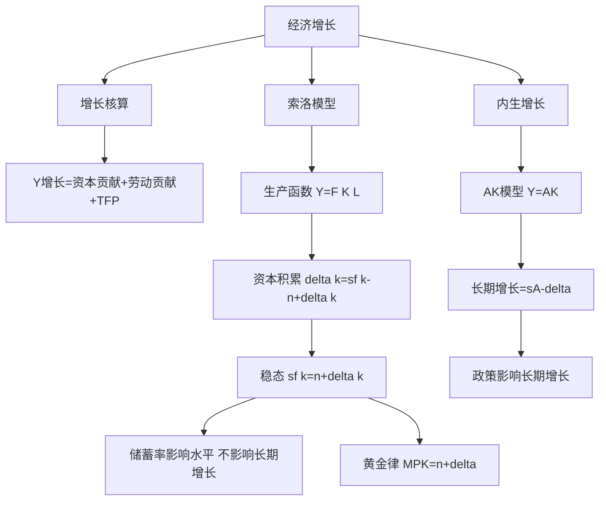

# 第十六章 经济增长 · 章节总结

> 本章回答长期问题：为什么有的国家富、有的穷？索洛模型说长期人均增长靠技术进步；内生增长理论进一步说技术进步靠教育、研发、知识溢出。

## 一、本章地图

## 二、核心公式速查

| 公式 | 含义 |
|---|---|
| $\Delta Y/Y = \alpha \Delta K/K + (1-\alpha)\Delta L/L + \Delta A/A$ | 增长核算 |
| $\Delta k = sf(k) - (n+\delta)k$ | 资本积累 |
| $sf(k^*) = (n+\delta)k^*$ | 稳态条件 |
| $MPK = n+\delta$ | 黄金律 |
| $g = sA - \delta$ | AK 模型长期增长 |

## 三、一句话记住每个 KP

- **KP01 增长核算**：GDP 增长 = 资本贡献 + 劳动贡献 + TFP（技术进步）。
- **KP02 索洛模型**：稳态时投资 = 持平投资，长期人均增长只靠技术进步。
- **KP03 储蓄率与人口**：储蓄率高人均富，人口快人均穷；只有水平效应。
- **KP04 黄金律**：找让人均消费最大的储蓄率，条件是 MPK = n+δ。
- **KP05 内生增长**：AK 模型里储蓄率决定长期增长，政策能影响增长。

## 四、本章与前后章节的关系

- 本章是 [[../12_AD-AS模型/00_章节总结|长期 AS]] 的微观基础：LRAS 为什么右移？因为经济增长。
- 本章是宏观经济学的"长期"部分，前面 9-15 章都是"短期"。

---

## 相关知识点

**本章 KP：** [[知识点/KP01_增长核算方程|KP01 增长核算]] ｜ [[知识点/KP02_索洛模型稳态|KP02 索洛模型]] ｜ [[知识点/KP03_储蓄率与人口增长|KP03 储蓄率]] ｜ [[知识点/KP04_黄金律水平|KP04 黄金律]] ｜ [[知识点/KP05_内生增长理论|KP05 内生增长]]

**跨章：** [[../12_AD-AS模型/00_章节总结|第十二章 AD-AS]] ｜ [[../09_宏观经济基本指标/00_章节总结|第九章 GDP]]

**📖 原书原文：** [[../../../../原文件/经济学/西方经济学下册_宏观_全书|《西方经济学》下册 第十六章]]
