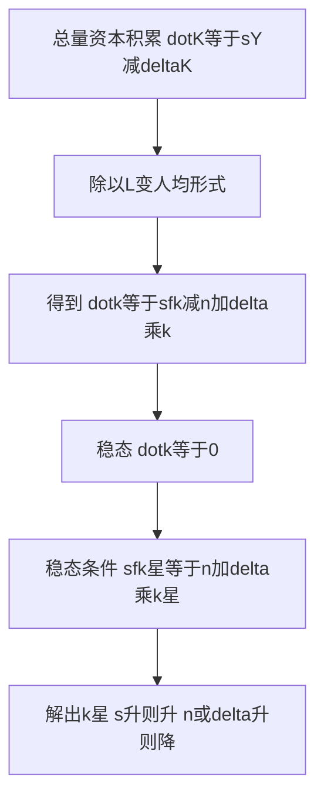

# KP02 索洛模型基本框架与稳态

<a href="../../../../exam.html" target="_blank" style="display:inline-block;padding:6px 16px;background:#2563eb;color:#fff;border-radius:6px;text-decoration:none;font-size:14px;">📝 开始做题</a>

> 所属：[[00_章节总结|第十六章 经济增长]]

## 1. 一句话先懂（小白版）

索洛模型问：一个经济长期里会增长到什么水平？为什么有的国家富、有的穷？

核心直觉：**资本越多，产出越多，但资本会折旧**。当"投资新增的资本"正好等于"折旧消耗的资本"时，经济就稳定了——这叫**稳态**。

长期里，人均产出增长只靠**技术进步**，不靠堆资本（因为资本边际报酬递减）。

## 2. 模型假设

1. 生产函数 $Y = F(K, L)$，规模报酬不变，边际报酬递减。
2. 储蓄率 $s$ 固定，投资 $I = sY$。
3. 人口（劳动）按 $n$ 增长。
4. 资本折旧率 $\delta$。
5. 技术进步率 $g$（扩展版）。

## 3. 人均形式

把所有变量除以 $L$（劳动），用人均量：

- $y = Y/L$（人均产出）
- $k = K/L$（人均资本）

生产函数：$y = f(k)$，边际报酬递减（$f'(k) > 0$，$f''(k) < 0$）。

**资本积累方程**：

$$\Delta k = s \cdot f(k) - (n + \delta)k$$

- $s \cdot f(k)$：人均投资（储蓄全部转化为投资）
- $(n+\delta)k$：**持平投资**——给新增工人配资本（$nk$）+ 替换折旧（$\delta k$）

## 4. 稳态

稳态时 $\Delta k = 0$：

$$s \cdot f(k^*) = (n+\delta)k^*$$

此时人均资本 $k^*$ 不变，人均产出 $y^* = f(k^*)$ 也不变——**长期人均产出不增长**（如果没有技术进步）。

总产出 $Y = y \cdot L$ 按人口增长率 $n$ 增长。

## 4.5 理论推导（资本积累方程怎么来的）

> 索洛模型只回答一个问题：人均资本 $k$ 随时间怎么变化，最后停在哪。

**假设起点**：
1. 生产函数 $Y=AF(K,L)$，且规模报酬不变 → 可写成人均形式 $y=f(k)$（$y=Y/L$，$k=K/L$）。
2. 产出中固定比例 $s$ 用于投资，其余 $(1-s)$ 消费。
3. 资本以速率 $\delta$ 折旧；劳动以速率 $n$ 增长。

**第一步：总量资本积累**。$t$ 时刻新增投资 $I=sY$，折旧 $\delta K$，故资本存量变化：

$$\dot K=I-\delta K=sY-\delta K$$

**第二步：变成人均形式**。$k=K/L$，两边对时间求导（商的导数）：

$$\dot k=\frac{\dot K\cdot L-K\cdot \dot L}{L^2}=\frac{\dot K}{L}-\frac{K}{L}\cdot\frac{\dot L}{L}$$

代入 $\dot K/L=sY/L-\delta K/L=sy-\delta k$，且 $\dot L/L=n$：

$$\dot k=sy-\delta k-nk$$

$$\boxed{\dot k=sf(k)-(n+\delta)k}$$

**这就是索洛核心方程**：人均资本变化 = 实际投资 $sf(k)$ − 持平投资 $(n+\delta)k$。

## 4.6 数学推导（稳态条件）

**稳态**定义：人均资本不再变化，$\dot k=0$：

$$sf(k^*)=(n+\delta)k^*$$

此方程的解 $k^*$ 即稳态人均资本。以柯布-道格拉斯 $y=k^\alpha$ 为例：

$$s(k^*)^\alpha=(n+\delta)k^*$$

两边除以 $(k^*)^\alpha$：

$$s=(n+\delta)(k^*)^{1-\alpha}$$

解出：

$$\boxed{k^*=\left(\frac{s}{n+\delta}\right)^{\frac{1}{1-\alpha}}}$$

对应人均产出 $y^*=(k^*)^\alpha=\left(\dfrac{s}{n+\delta}\right)^{\frac{\alpha}{1-\alpha}}$。

**从这个解析式看曲线移动**：
- $s$ 上升 → 分子变大 → $k^*$ 上升（$sf(k)$ 上移）。
- $n$ 或 $\delta$ 上升 → 分母变大 → $k^*$ 下降（$(n+\delta)k$ 变陡）。

**图形说明**：横轴 $k$，纵轴投资。$sf(k)$ 向上凸（边际报酬递减），$(n+\delta)k$ 是过原点射线。两线交点即 $k^*$。交点左侧 $sf(k)>(n+\delta)k$，$\dot k>0$，$k$ 自动向右收敛；右侧相反。

## 5. 手算例子

**题目**：已知 $f(k) = k^{1/2}$（柯布-道格拉斯人均形式），$s = 0.3$，$n = 0.02$，$\delta = 0.08$。求稳态 $k^*$ 和 $y^*$。

**第一步：写稳态条件**

$$s \cdot k^{1/2} = (n+\delta)k$$

**第二步：代入数字**

$$0.3 \cdot k^{1/2} = (0.02 + 0.08)k = 0.1k$$

**第三步：解 k**

两边除以 $k^{1/2}$：

$$0.3 = 0.1 \cdot k^{1/2}$$

$$k^{1/2} = 3$$

$$k^* = \mathbf{9}$$

**第四步：算 y***

$$y^* = (k^*)^{1/2} = \sqrt{9} = \mathbf{3}$$

**解读**：稳态下人均资本 9，人均产出 3。

## 6. 稳态的直觉

- $k < k^*$：投资 > 持平投资，$k$ 上升，向 $k^*$ 收敛。
- $k > k^*$：投资 < 持平投资，$k$ 下降，向 $k^*$ 收敛。
- **条件收敛**：穷国（$k$ 低）增长比富国快，最终赶上——但前提是储蓄率、人口增长率等参数相同。

## 7. 容易混淆

- **稳态不是"增长停止"**：总产出按人口 $n$ 增长，人均产出不增长（无技术进步时）。
- **长期人均增长只靠技术进步**：这是索洛模型最重要的结论。
- **储蓄率提高只有水平效应，没有增长效应**：从一个稳态到另一个稳态有过渡期增长，但长期人均增长率回到 0。

## 8. 现实意义

为什么中国过去 40 年增长这么快？因为起点低（$k$ 远低于稳态），向稳态收敛——这是"追赶效应"。但未来中国要放慢了，因为越来越接近稳态，必须靠技术进步。

---

## 🔗 相关知识点

**同章关联：** [[KP01_增长核算方程|增长核算]] ｜ [[KP03_储蓄率与人口增长|储蓄率]] ｜ [[KP04_黄金律水平|黄金律]]

**跨章关联：** [[../../12_AD-AS模型/知识点/KP03_长期总供给曲线|长期AS]]

**📖 原书原文：** [[../../../../原文件/经济学/西方经济学下册_宏观_全书|《西方经济学》下册 第十六章]]

---

## 🐮 小白教程入门

> 看不懂下面这个KP？先看通俗版教程建立直觉：

- [[../../../../经济统计学论文从0基础到精通/14_宏观经济学基础/12_索洛模型与经济增长|🐮 教程·索洛模型与经济增长]]

---

## 📝 考研真题（首经贸 801）

**配套主观题：** 见同目录 [[../考研真题集|本章考研真题集]]
**配套选择题：** 见同目录 [[../选择题集|本章选择题集]]

### 高频简答
- 写出索洛模型的稳态条件，并解释其经济含义（15 分）→ 见 [[../考研真题集#s3|真题集·简答 3]]
- 用索洛模型相图说明经济如何从任意初始 $k$ 向稳态 $k^*$ 收敛（15 分）→ 见 [[../考研真题集#s4|真题集·简答 4]]
- （计算）$y=k^{1/2}$，$s=0.3$，$n=0.05$，$\delta=0.05$，求稳态 $k^*$、$y^*$、$c^*$（15 分）→ 见 [[../考研真题集#s10|真题集·简答 10]]

### 高频论述
- 论述人口红利消失对中国经济增长的长期影响及应对（30 分）→ 见 [[../考研真题集#l2|真题集·论述 2]]

### 易错选择
- 本知识点选择题见 [[../选择题集#KP02 索洛模型基本框架与稳态|选择题集·KP02]]
