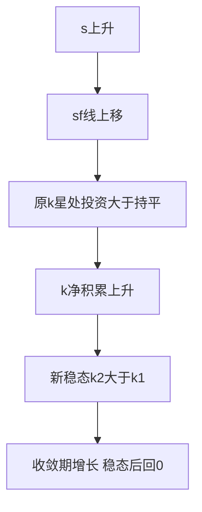
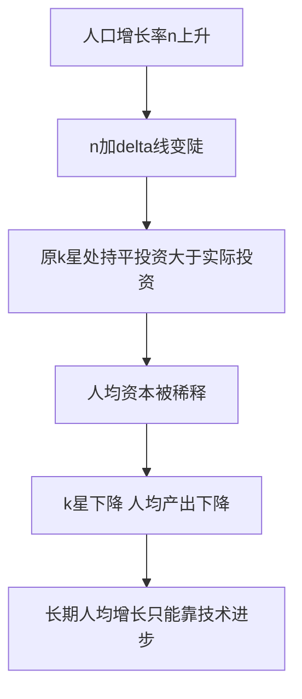

# 第十六章 经济增长 · 考研真题集（首经贸 801）

<a href="../../../exam.html" target="_blank" style="display:inline-block;padding:6px 16px;background:#2563eb;color:#fff;border-radius:6px;text-decoration:none;font-size:14px;">📝 开始做题</a>

> 本章共收录：简答题 11 道（每题 15 分）｜论述题 4 道（每题 30 分）
> 配套选择题见 [[选择题集|本章选择题集]]
> 对应大纲：马工程《西方经济学》下册第十六章"经济增长"全部五节：增长核算、索洛模型、储蓄率与人口、黄金律、内生增长

## 📋 本题集目录

### 简答题
1. [[#简答 1：写出增长核算方程，并说明各变量的经济含义|写出增长核算方程并说明各变量含义]]
2. [[#简答 2：什么是全要素生产率？为什么它被称为"索洛残差"？如何提高？|什么是全要素生产率（索洛残差）？]]
3. [[#简答 3：写出索洛模型的稳态条件，并解释其经济含义|写出索洛模型稳态条件并解释其经济含义]]
4. [[#简答 4：用索洛模型相图说明经济如何从任意初始 $k$ 向稳态 $k^*$ 收敛|用图形描述索洛模型的稳态及其收敛机制]]
5. [[#简答 5：简述储蓄率变动对稳态的影响，并区分水平效应与增长效应|简述储蓄率变动对稳态的水平效应与增长效应]]
6. [[#简答 6：简述人口增长对稳态人均产出的影响|简述人口增长对稳态人均产出的影响]]
7. [[#简答 7：什么是资本的黄金律水平？写出其条件并解释直觉|什么是资本的黄金律水平？写出其条件]]
8. [[#简答 8：简述内生增长理论与索洛模型的主要区别|简述内生增长理论与索洛模型的主要区别]]
9. [[#简答 9：简述条件收敛与绝对收敛的区别，并说明其经验含义|简述条件收敛与绝对收敛的区别]]
10. [[#简答 10：（计算题）已知索洛模型 $y=k^{1/2}$，$s=0.3$，$n=0.05$，$\delta=0.05$。求稳态 $k^*$、$y^*$、$c^*$。|计算题：索洛模型稳态（$s=0.3,n=0.05,\delta=0.05,y=k^{1/2}$）]]
11. [[#简答 11：（计算题）某国资本增长率 $\Delta K/K=6\%$，劳动增长率 $\Delta L/L=2\%$，GDP 增长率 $\Delta Y/Y=5\%$，资本产出弹性 $\alpha=1/3$。求全要素生产率增长率 $\Delta A/A$。|计算题：增长核算与索洛残差]]

### 论述题
1. [[#论述 1：结合中国实际，论述从要素驱动转向创新驱动、提高全要素生产率的必要性与路径|结合中国实际，论述从要素驱动转向创新驱动、提高全要素生产率]]
2. [[#论述 2：论述人口红利消失对中国经济增长的长期影响，并提出应对之策|论述人口红利消失对中国经济增长的影响及应对]]
3. [[#论述 3：论述高储蓄率对中国经济增长的利弊，并运用黄金律分析向消费驱动转型的必要性|论述高储蓄率、黄金律与中国向消费驱动转型]]
4. [[#论述 4：论述内生增长理论对中国发展新质生产力、实现高质量发展的启示|论述内生增长理论对中国发展新质生产力的启示]]

---

## 一、简答题（每题 15 分，建议 450–700 字）

### 简答 1：写出增长核算方程，并说明各变量的经济含义

**【建议字数】450–700 字 ｜ 【建议时间】15 分钟 ｜ 【题型】分析推导**

**【考什么】** 对应知识点 [[知识点/KP01_增长核算方程|KP01 增长核算方程]]，对应大纲第一节；题型属于分析推导。

**【核心推导】**
**第一步：写出增长核算方程的起点与推导。**

（1）**总量生产函数**：$Y=A\cdot F(K,L)$，**规模报酬不变** + **完全竞争**（要素按边际产品获得报酬）。

（2）**取对数再对时间求导**：$\ln Y=\ln A+\ln F(K,L)$，全微分：
$$\frac{\mathrm{d}Y}{Y}=\frac{\mathrm{d}A}{A}+\frac{F_K K}{F}\cdot\frac{\mathrm{d}K}{K}+\frac{F_L L}{F}\cdot\frac{\mathrm{d}L}{L}$$

（3）**定义产出弹性**：$\alpha=\dfrac{F_K K}{F}$（资本份额），$\beta=\dfrac{F_L L}{F}$（劳动份额），规模报酬不变保证 $\alpha+\beta=1$。

（4）**得到增长核算方程**：
$$\frac{\Delta Y}{Y}=\alpha\frac{\Delta K}{K}+(1-\alpha)\frac{\Delta L}{L}+\frac{\Delta A}{A}$$

（5）**柯布—道格拉斯特例**：$Y=K^{\alpha}(AL)^{1-\alpha}$，则 $\alpha$ 为常数（发达国家经验值约 $1/3$），**完全竞争下 $\alpha$ 恰等于资本收入份额**（这是该方程可操作的关键）。

**第二步：各变量的经济含义（逐项对照）。**

（1）$\Delta Y/Y$：**实际 GDP 增长率**（分子用不变价，剔通胀）。

（2）$\Delta K/K$：**资本存量增长率**（用永续盘存法 $K_t=(1-\delta)K_{t-1}+I_t$ 估计），**权重 $\alpha$ 是资本的产出弹性**。

（3）$\Delta L/L$：**劳动投入增长率**（用就业人数 × 人均工时做"有效劳动"更准确），**权重 $1-\alpha$**。

（4）$\Delta A/A$：**全要素生产率增长率（TFP）**，即**"索洛残差"** —— **不是直接观测到的，而是"算出来的余项"**。

（5）**权重之和为 1 的含义**：**规模报酬不变**，即**投入同时翻倍则产出翻倍**，全部增长必须被"要素贡献 + 效率贡献"分完。

**第三步：为什么它是"核算"而不是"理论"。**

（1）**它只是恒等式** —— 由定义恒成立，**不解释任何因果关系**（TFP 高是"结果的名字"，不是"原因"）。

（2）**但它是政策诊断的起点**：**把增长拆成"粗放型（要素投入）"与"集约型（TFP）"，就能判断增长是否可持续。**

（3）**"索洛残差"的方法论含义**：Solow（1957）对美国 1909–1949 年数据核算发现，**人均产出增长中约 87.5% 归因于技术进步，只有 12.5% 归因于资本深化** —— **这一结论颠覆了"资本积累决定增长"的直觉。**

**第四步：计算示例（用 s11 的数据说明怎么用）。**

$\Delta Y/Y=5\%$、$\Delta K/K=6\%$、$\Delta L/L=2\%$、$\alpha=1/3$：
- 资本贡献 $=\frac{1}{3}\times6\%=2\%$；
- 劳动贡献 $=\frac{2}{3}\times2\%=1.33\%$；
- **TFP 贡献 $=5\%-2\%-1.33\%=1.67\%$**。

**结构解读**：资本 40%、劳动 27%、效率 33%。

**第五步：中国实践与政策含义。**

（1）**中国的资本份额 $\alpha$ 高于发达国家**（约 0.5 左右），**因为投资占比高、要素价格扭曲（低利率、低地价）** —— 这使中国的增长核算结果长期显示 **"资本贡献 50% 以上、TFP 贡献 30% 左右"**。

（2）**TFP 贡献的变化**：**2000–2010 年约 35%–40%（入世红利、改革红利）；2011 年后降至 25%–30%** —— 这正是"从要素驱动转向创新驱动"的数据依据。

（3）**政策含义三层**：①**若增长靠 $\Delta K/K$，则受资本边际报酬递减限制，不可持续**；②**若靠 $\Delta L/L$，则受人口红利消失约束**；③**只有 $\Delta A/A$ 可以持续** —— 因此"提高全要素生产率"成为供给侧改革与高质量发展的核心命题。

**第六步：局限与争议。**

（1）**TFP 是"黑箱"**：**它吸收了一切未被度量的东西** —— 技术、制度、配置效率、测量误差、甚至需求波动（"我们无知的度量"）。**因此 TFP 下降未必意味着技术退步。**

（2）**要素份额 $\alpha$ 的估计不稳定**（由要素价格是否等于边际产品决定，中国要素市场存在扭曲，$\alpha$ 的估计偏差会全部转移到 TFP 上）。

（3）**资本存量的度量依赖折旧率假设**（$\delta$ 取 5% 还是 10% 会显著改变结果）。

（4）**规模报酬不变的假定**在规模经济显著的行业不成立。

**第七步：结论。**

**一句话**：**增长核算方程 $\frac{\Delta Y}{Y}=\alpha\frac{\Delta K}{K}+(1-\alpha)\frac{\Delta L}{L}+\frac{\Delta A}{A}$ 是一个"分账恒等式"，把增长拆成资本、劳动、效率三笔；它的价值不在解释而在诊断——索洛用它发现 87.5% 的增长来自残差，中国用它发现资本贡献过半，两者都指向同一个政策结论：要素投入终会递减，只有效率改进能长期支撑增长。**

**【为什么要答这几点】**
**【满分 15 分的分点逻辑】**

**第一段：生产函数与假设（3 分）。** $Y=AF(K,L)$（1 分）+ **规模报酬不变 + 完全竞争**（2 分）。**两条件缺一，$\alpha+(1-\alpha)=1$ 就不成立。**

**第二段：推导方程（5 分）。** 取对数求导（2 分）+ **方程完整写出**（2 分）+ **$\alpha=\frac{F_K K}{F}$ 的定义**（1 分）。**不写推导只写结果最多 3 分。**

**第三段：各变量含义（5 分）。** 四项各 1 分 + **$\alpha\approx1/3$ 的经验值**（1 分）。**"索洛残差 = 算出来的余项"必须点明。**

**第四段：政策含义（2 分）。** **粗放型 vs 集约型**（1 分）+ 中国从要素驱动转向创新驱动（1 分）。

**易失分点。** ①**权重写反**（把 $\Delta K/K$ 的权重写成 $1-\alpha$）；②**把 TFP 说成"劳动生产率"**（劳动生产率是 $Y/L$，TFP 是"同样投入更多产出"）；③漏掉规模报酬不变假设；④不写"索洛残差"这个词。

**加分点。** ①用 $\ln Y=\alpha\ln K+(1-\alpha)\ln A+(1-\alpha)\ln L$ 求导得方程；②指出**完全竞争下 $\alpha$ 恰等于资本收入份额**（这是方程可操作的理论基础）；③Solow 1957 年 **87.5% 来自技术进步、仅 12.5% 来自资本深化** 的经典结论；④中国 $\alpha\approx0.5$ 高于发达国家（要素价格扭曲）；⑤TFP 是"我们无知的度量"这一批评。

**【阅卷心理】** 15 分简答题**按"假设 3 + 推导 5 + 含义 5 + 政策 2"给分**。**方程写错（权重、漏项）是硬伤，直接掉 5 分。** 记住：**"增长核算不是理论，是分账——它只说'这笔钱谁出的'，不说'为什么出钱'。"**

**【如何分析题目】**
**第一步：审题——两问：写出方程 + 说明各变量含义。** 前半推导，后半解释。

**第二步：先立假设。** 总量生产函数 $Y=AF(K,L)$、规模报酬不变、完全竞争。**这两条假设是方程成立的前提。**

**第三步：推导。** 取对数 → 对时间求导 → 定义弹性 $\alpha=F_K K/F$ → 得方程。

**第四步：逐项解释四个变量。** $\Delta Y/Y$、$\Delta K/K$（权重 $\alpha\approx1/3$）、$\Delta L/L$（权重 $2/3$）、$\Delta A/A$（索洛残差）。

**第五步：点出资重之和为 1 的含义。** 规模报酬不变，增长被"分完"。

**第六步：举例算一遍。** 用 $5\%=\frac13\times6\%+\frac23\times2\%+1.67\%$ 演示。**有数字才有说服力。**

**第七步：给政策含义。** 粗放型 vs 集约型；中国要转向创新驱动。

**第八步：字数与时间。** 15 分约 450–700 字，15 分钟。**推导 200 字、含义 250 字、政策 150 字。**

**【答题框架】**
- 第 1 段：生产函数与规模报酬不变假设（3 分）
- 第 2 段：推导增长核算方程（5 分）
- 第 3 段：各变量含义（5 分）
- 第 4 段：政策含义（2 分）

**【参考答案】**

一、增长核算的起点是总量生产函数 $Y=A\cdot F(K,L)$。其中 $Y$ 为总产出（实际 GDP），$K$ 为资本存量，$L$ 为劳动投入，$A$ 为全要素生产率（TFP），反映技术水平和效率。假设规模报酬不变，且为柯布-道格拉斯形式 $Y=K^\alpha(AL)^{1-\alpha}$。

二、对生产函数取对数并对时间求导，可得增长核算方程：

$$\frac{\Delta Y}{Y}=\alpha\frac{\Delta K}{K}+(1-\alpha)\frac{\Delta L}{L}+\frac{\Delta A}{A}$$

推导思路：$\ln Y=\alpha\ln K+(1-\alpha)\ln A+(1-\alpha)\ln L$，对时间求导得增长率分解。

三、各变量含义：
（一）$\Delta Y/Y$：GDP 实际增长率。
（二）$\Delta K/K$：资本存量增长率，权重 $\alpha$ 为资本的产出弹性（发达国家经验约 $1/3$）。
（三）$\Delta L/L$：劳动投入增长率，权重 $1-\alpha$（约 $2/3$）。
（四）$\Delta A/A$：全要素生产率增长率，又称"索洛残差"——不能由资本和劳动增长解释的那部分产出增长。

四、该方程的政策含义：一国 GDP 增长可分解为"资本贡献+劳动贡献+TFP 贡献"。若增长主要来自资本和劳动投入，则是"粗放型"增长；若主要来自 TFP，则是"集约型"增长。中国提出"从要素驱动转向创新驱动"，就是要提高 $\Delta A/A$ 的比重。

**【解析·得分点】** 采分点：①生产函数 $Y=AF(K,L)$ ②方程完整 ③$\alpha\approx1/3$ ④索洛残差=技术进步。易丢分：把 TFP 写成"劳动生产率"；权重写反。

**【生活实例】** 像分析一个奶茶店为什么生意变好：是多买了一台制茶机（资本）、多雇了两个人（劳动），还是同样的人和机器但出杯速度变快了（技术进步）？增长核算就是把这三件事分开算账。

**【双链接】** 🔗 [[知识点/KP01_增长核算方程|回知识点 KP01]] ｜ 📖 [[../../../原文件/经济学/西方经济学下册_宏观_全书|原书·第十六章]]

---

### 简答 2：什么是全要素生产率？为什么它被称为"索洛残差"？如何提高？

**【建议字数】450–700 字 ｜ 【建议时间】15 分钟 ｜ 【题型】概念简答**

**【考什么】** 对应知识点 [[知识点/KP01_增长核算方程|KP01]]，对应大纲第一节；题型属于概念简答。

**【核心推导】**
**第一步：TFP 的定义与度量。**

（1）**定义**：全要素生产率（Total Factor Productivity）是**在全部要素投入（资本、劳动）给定的条件下，由生产效率提升带来的额外产出** —— 回答"同样一单位的 $K$ 与 $L$，为什么能产出更多"。

（2）**度量**（由增长核算方程反解）：
$$\frac{\Delta A}{A}=\frac{\Delta Y}{Y}-\alpha\frac{\Delta K}{K}-(1-\alpha)\frac{\Delta L}{L}$$

（3）**水平形式**（用于跨国比较）：
$$A=\frac{Y}{K^{\alpha}L^{1-\alpha}}$$

**关键点**：**TFP 从严不是"直接观测"到的，永远是"算出来的余项"。**

**第二步：为什么叫"索洛残差"（三层命名史）。**

（1）**Solow（1957）的实证**：对美国 1909–1949 年数据作增长核算，发现**人均产出增长中约 87.5% 无法由资本深化解释** —— 他把这一"剩余"归为技术进步。

（2）**"残差"（residual）的字面意义**：**它是回归中的误差项** —— 已解释的部分（$K$ 与 $L$ 的贡献）被扣掉后，剩下的都倒进这个篮子。

（3）**Abramovitz（1956）的著名比喻**：**"我们无知的度量"（a measure of our ignorance）** —— 凡是无法归因于要素投入的增长，统统算成 TFP。**这句自嘲道破了 TFP 的方法论地位：它是"承认自己不懂"的容器。**

**第三步：TFP 里到底装了什么（五类，远比"技术"宽）。**

（1）**狭义技术进步**：新工艺、新设备、新产品（R&D 的直接产物）。

（2）**资源配置效率（结构红利）**：**劳动力从农业（低边际产出）转移到工业**，即使各部门技术不变，总量 TFP 也会上升 —— 这是中国 1980–2010 年 TFP 增长的主要来源之一。

（3）**人力资本**：教育与健康提升劳动者的"有效劳动"，**在 Mankiw–Romer–Weil（1992）的扩展核算中，人力资本解释了跨国收入差异的大部分**。

（4）**制度与基础设施**：产权保护、契约执行、交通通信网络（**降低交易成本，等同于效率提升**）。

（5）**测量误差与需求波动**：**产能利用率下降（需求不足）会被计入 TFP 下滑** —— 这是 TFP 指标的严重缺陷（2015 年后中国的 TFP 增速放缓部分源于此）。

**第四步：如何提高 TFP（五条路径，对应上述五类）。**

（1）**加强研发与基础研究**：中国 R&D 强度从 2012 年 1.91% 升至 2023 年约 2.64%，**接近 OECD 平均，但基础研究占比仅 6% 左右（发达国家 15%–20%）** —— **"卡脖子"的根源之一。**

（2）**推进要素市场化改革（配置效率）**：**户籍改革（释放劳动力流动）、土地改革（盘活存量）、利率市场化（资本配置到高效率部门）** —— 这是"改革红利"的经济学含义。

（3）**提升人力资本**：**高等教育毛入学率从 2012 年 30% 升至 2023 年约 60%**；**技能培训与职业教育**（对应制造业升级）。

（4）**深化开放与竞争**：**加入 WTO 后的关税下降使进口中间品的 TFP 效应明显**；**竞争政策（反垄断、公平竞争审查）** 淘汰低效企业（**"创造性破坏"**）。

（5）**制度与基础设施**：**产权保护、营商环境（世界银行 B-READY 评估）、数字基础设施**（5G、算力网络）。

**第五步：中国 TFP 的实证。**

（1）**总量水平**：按 Penn World Table 口径，**中国 TFP 水平约为美国的 40%–45%**（不同研究 35%–50%），**相对水平在 2008 年后有所上升但近年放缓**。

（2）**贡献率变化**：**TFP 对增长的贡献从 2000–2010 年约 35%–40% 降至 2011 年后约 25%–30%** —— **这是"要素驱动转向创新驱动"最直接的证据。**

（3）**分阶段**：**1978–1995 年（改革红利）高；1995–2008 年（重工业化）中；2008 年后（投资刺激）低。**

**第六步：局限。**

（1）**"残差"包含误差** —— **TFP 下降可能是需求不足（产能利用率低），而不是技术退步。**

（2）**要素份额 $\alpha$ 的估计敏感** —— **$\alpha$ 偏高会低估 TFP**（因为把更多增长归给资本）。

（3）**资本存量的估计依赖折旧率与初始存量假设**。

（4）**无法区分"技术前沿推进"与"追赶前沿"**（前者靠自主创新，后者靠模仿与贸易）。

**第七步：结论。**

**一句话**：**TFP 是"同样投入更多产出"的能力，它被称为"索洛残差"是因为它永远由增长核算反解得出——扣掉资本和劳动的贡献后，剩下的全倒进这个篮子，故 Abramovitz 称之为"我们无知的度量"；它装着技术、配置效率、人力资本、制度与测量误差五样东西，因此提高它必须在研发、要素市场化改革、教育、开放竞争与制度五处同时用力。**

**【为什么要答这几点】**
**【满分 15 分的分点逻辑】**

**第一段：定义（3 分）。** **"同样是这些资本和劳动，产出更多的能力"**（2 分）+ 度量式 $\Delta A/A=\Delta Y/Y-\alpha\Delta K/K-(1-\alpha)\Delta L/L$（1 分）。

**第二段：索洛残差的由来（4 分）。** Solow 1957 年对美国数据核算（1 分）+ **87.5% 无法由资本解释**（2 分）+ **"残差 = 扣掉要素贡献后的余项"**（1 分）。**不给 87.5% 这个数就少 2 分。**

**第三段：TFP 包含什么（4 分）。** 狭义技术（1 分）+ **配置效率**（1 分）+ 人力资本（1 分）+ 制度与基础设施 / 测量误差（1 分）。**这一段的深度决定分数上限。**

**第四段：如何提高（4 分）。** 研发（1 分）+ **要素市场化改革（户籍、土地、利率）**（1 分）+ 人力资本与教育（1 分）+ 开放竞争与制度（1 分）。

**易失分点。** ①**把 TFP 说成"劳动生产率"**（$Y/L$ 与 $Y/(K^\alpha L^{1-\alpha})$ 是两回事）；②只说"技术进步"不说配置效率（丢 1 分且显得浅）；③不解释"残差"二字的由来；④提高的路径只写"加大研发"。

**加分点。** ①Abramovitz 的"我们无知的度量"这一经典表述；②**中国 TFP 贡献从 35%–40% 降至 25%–30%** 的实证；③**TFP 水平约为美国 40%–45%** 的跨国比较；④R&D 强度 2.64% 但基础研究仅 6%（发达国家 15%–20%）；⑤**TFP 会被产能利用率污染**这一方法论批评（这是很高的层次）；⑥$\alpha$ 估计偏差会全部转移到 TFP 上。

**【阅卷心理】** 15 分简答题**按"定义 3 + 残差 4 + 内容 4 + 路径 4"给分**。**"残差"为什么叫残差是全题眼，答不出就丢 4 分。** 记住：**"TFP 不是测出来的，是减出来的——减完剩下的那笔，就叫我们的无知。"**

**【如何分析题目】**
**第一步：审题——三问：什么是 TFP、为何叫索洛残差、如何提高。** 三问三段的骨架已经很清楚。

**第二步：先给定义。** "同样的资本与劳动，产出更多"，并附度量式（反解）。

**第三步：讲清"残差"的由来。** Solow 1957 美国数据、87.5% 无法由资本解释、Abramovitz"我们无知的度量"。**这段要有名字和数字。**

**第四步：拆开 TFP 的五类内容。** 技术、配置效率、人力资本、制度、测量误差。**配置效率最容易被漏掉，一定要写。**

**第五步：给出五条提高路径。** 研发（含基础研究占比低）、要素市场化改革、教育、开放竞争、制度。

**第六步：加中国实证。** TFP 贡献从 35%–40% 降到 25%–30%；TFP 水平约美国 40%–45%；R&D 强度 2.64%、基础研究 6%。

**第七步：收一句批评。** TFP 会被产能利用率与要素份额估计污染。**一句就够，显得清醒。**

**第八步：字数与时间。** 15 分约 450–700 字，15 分钟。**定义 100 字、残差 150 字、内容 200 字、路径 200 字。**

**【答题框架】**
- 第 1 段：TFP 定义（3 分）
- 第 2 段：索洛残差由来（4 分）
- 第 3 段：TFP 包含的内容（4 分）
- 第 4 段：提高 TFP 的途径（4 分）

**【参考答案】**

一、全要素生产率（Total Factor Productivity, TFP）是指在全部要素投入（资本、劳动）给定条件下，生产效率的提升带来的额外产出增长。它反映的是"同样投入能生产更多"的能力。

二、索洛残差的由来。索洛 1957 年对美国 1909–1949 年数据进行增长核算，发现产出增长中约 $80\%$ 无法用资本和劳动投入增长解释。他把这一"剩余"残差 $\Delta A/A=\Delta Y/Y-\alpha\Delta K/K-(1-\alpha)\Delta L/L$ 称为技术进步。后人戏称它为"我们无知的度量"（measure of our ignorance）——凡是不能归因于要素投入的，统统塞进 TFP。

三、TFP 实际包含的内容远比"技术"宽泛：
（一）狭义技术进步：新工艺、新设备、新产品。
（二）资源配置效率：劳动力从农业转移到工业（结构红利）。
（三）规模经济：产出扩大后单位成本下降。
（四）制度改善：产权保护、市场竞争、营商环境。
（五）人力资本：劳动者技能提升（严格说应归入劳动质量调整）。

四、提高 TFP 的途径：
（一）研发投入和技术创新，攻关"卡脖子"技术。
（二）人力资本积累，教育和培训。
（三）深化市场化改革，让要素流向高效率部门。
（四）对外开放，吸收国际技术溢出。
（五）保护知识产权，激励创新。
这正是中国"创新驱动发展战略"和"新质生产力"的理论依据。

**【解析·得分点】** 采分点：①TFP 定义 ②残差公式 ③TFP 广义内容 ④提高途径。易丢分：把 TFP 等同于狭义技术；漏掉"资源配置"。

**【生活实例】** 像奶茶店：投入同样多的牛奶、茶叶和人工，如果换了个更聪明的店长（管理改善）、把制杯流程从串行改并行（流程创新）、把门口排队动线重画（资源配置），出杯量都能涨——这些都算 TFP，不只是买新机器。

**【双链接】** 🔗 [[知识点/KP01_增长核算方程|回知识点 KP01]] ｜ 📖 原书

---

### 简答 3：写出索洛模型的稳态条件，并解释其经济含义

**【建议字数】450–700 字 ｜ 【建议时间】15 分钟 ｜ 【题型】分析推导**

**【考什么】** 对应知识点 [[知识点/KP02_索洛模型稳态|KP02 索洛模型稳态]]，对应大纲第二节；题型属于分析推导。

**【核心推导】**
**第一步：模型的四条假设与变量人均化。**

（1）**假设**：①总量生产函数 $Y=F(K,L)$ **规模报酬不变**；②**边际报酬递减** $f'(k)>0,f''(k)<0$；③**储蓄率固定** $s$，且 $S=I$（封闭经济、无政府）；④劳动按 $n$ 增长、资本按 $\delta$ 折旧。

（2）**人均化**：$y=\dfrac{Y}{L}$、$k=\dfrac{K}{L}$，由规模报酬不变得 $y=f(k)$。

（3）**资本积累方程的推导（关键，必须给全过程）**：
$$\dot{K}=I-\delta K=sF(K,L)-\delta K$$
由 $k=K/L$ 取对数求导：$\dfrac{\dot k}{k}=\dfrac{\dot K}{K}-\dfrac{\dot L}{L}=\dfrac{\dot K}{K}-n$，故
$$\dot k=\frac{\dot K}{K}k-nk=\frac{sF(K,L)-\delta K}{L}-nk=s f(k)-(\delta+n)k$$

（4）**核心方程**：
$$\boxed{\Delta k=s\cdot f(k)-(n+\delta)k}$$

**第二步：稳态条件与经济含义。**

（1）**稳态**：$\Delta k=0$，即
$$s\cdot f(k^*)=(n+\delta)k^*$$

（2）**两项的解读**：
- **$s f(k)$ = 人均实际投资**（储蓄全部转化投资）；
- **$(n+\delta)k$ = 持平投资（break-even investment）** —— **$nk$ 给新增工人配备资本、$\delta k$ 替换折旧掉的资本** —— **只为"维持"人均资本不变所必需的投资，不含任何深化。**

（3）**收敛机制（自动稳定）**：
- $k<k^*$：$sf(k)>(n+\delta)k$ → $\Delta k>0$ → $k$ 上升；
- $k>k^*$：$sf(k)<(n+\delta)k$ → $\Delta k<0$ → $k$ 下降；
- **故 $k^*$ 是全局稳定的均衡**（相图中储蓄曲线从上穿持平投资线，两条线的斜率条件保证唯一交点）。

（4）**相图刻画**：横轴 $k$，纵轴为投资；$sf(k)$ 是**向下弯曲的曲线**（因 $f''<0$），$(n+\delta)k$ 是**过原点、斜率为 $n+\delta$ 的直线**；**交点即 $k^*$**。

**第三步：稳态下的增长率（最容易混的一步）。**

（1）**稳态时 $k^*$ 不变 → $y^*=f(k^*)$ 不变 → 人均产出增长率为 0。**

（2）**但总产出 $Y=y\cdot L$ 按 $n$ 增长**（人口增长带来总产出增长）。

（3）**资本存量 $K=k\cdot L$ 也按 $n$ 增长。**

（4）**引入技术进步 $g$ 后**：以"有效劳动"$AL$ 为人均化基础，稳态时 $\dfrac{\dot k}{k}=0$ 对"有效人均资本"，**人均产出按 $g$ 增长、总产出按 $n+g$ 增长** —— **这是索洛模型最核心的结论。**

（5）**一句话总结增长率格局**：

| 变量 | 无技术进步 | 有技术进步 $g$ |
|---|---|---|
| $k^*$（人均资本） | 不变 | 按 $g$ 增长 |
| $y^*$（人均产出） | **0** | **$g$** |
| $Y$（总产出） | $n$ | $n+g$ |

**第四步：稳态的经济含义（四点）。**

（1）**稳态不是"停止增长"，而是"结构比不变"** —— $K/Y$、$C/Y$ 等比例固定（**"平衡增长路径" balanced growth path**）。

（2）**长期人均增长的唯一来源是技术进步** —— **储蓄率只能改变人均产出的"水平"，不能改变"增长率"（水平效应 ≠ 增长效应）。**

（3）**收敛假说的基础**：**$k$ 越低，$\Delta k$ 越大 → 穷国增长快（追赶效应）** —— 但这只在参数相同时成立（**条件收敛**）。

（4）**政策含义**：**提高 $s$ 或降低 $n$ 只能"一次性"提高人均水平；只有提高 $g$（技术与效率）才有持续增长。**

**第五步：中国应用。**

（1）**1980–2010 年**：$s$ 高达 40%+（世界最高之一）、$n$ 为正且劳动参与率高 → **$k^*$ 与 $y^*$ 快速提升**，同时**离稳态远，收敛速度快** —— 这是"高增长奇迹"的索洛解释。

（2）**2010 年后**：**$s$ 已近上限（继续提高受消费挤压）、$n$ 转负（人口负增长）、$\delta$ 上升（基建存量老化）** → **靠 $k$ 积累的空间收窄，必须靠 $g$** —— 这正是"高质量发展"的模型语言。

（3）**2022 年后人口负增长**：$n<0$ 使 $(n+\delta)k$ 线**变缓** → **稳态 $k^*$ 上升**（人均资本被动提高），但**总产出增长受抑制**（$Y$ 按 $n+g$ 增长）—— **这解释了中国"人均指标改善、总量增速下降"并存的现实。**

**第六步：局限。**

（1）**技术外生** —— 模型不解释 $g$ 从何而来（内生增长理论的出发点）。

（2）**储蓄率外生** —— 不解释家庭为何储蓄（生命周期、预防性储蓄等）。

（3）**忽略人力资本**（Mankiw–Romer–Weil 扩展后收入差异解释力大增）。

（4）**假设完全竞争与充分就业**，忽略需求侧与失业。

**第七步：结论。**

**一句话**：**索洛模型的稳态条件是 $sf(k^*)=(n+\delta)k^*$ —— 储蓄曲线与持平投资线的交点；它的经济含义是"人均资本不再变动、人均产出停止增长（无技术进步时）"，从而证明了一个反直觉的结论：储蓄率只能决定你多富（水平效应），决定不了你变富的速度（增长效应），长期人均增长只能来自技术进步。**

**【为什么要答这几点】**
**【满分 15 分的分点逻辑】**

**第一段：假设与人均化（3 分）。** 四条假设（2 分）+ $y=f(k)$ 的推出（1 分）。

**第二段：资本积累方程推导（4 分）。** $\dot K=sF(K,L)-\delta K$（1 分）+ **$\dot k/k=\dot K/K-n$ 这一步**（2 分）+ 得 $\Delta k=sf(k)-(n+\delta)k$（1 分）。**这一步是本题技术核心，跳过只给一半分。**

**第三段：稳态条件（3 分）。** $sf(k^*)=(n+\delta)k^*$（2 分）+ **持平投资 $(n+\delta)k$ 的含义（$nk$ 配新工人 + $\delta k$ 补折旧）**（1 分）。

**第四段：收敛与相图（3 分）。** 左右两侧 $\Delta k$ 的符号（2 分）+ 相图两线形状（1 分）。

**第五段：稳态增长率（2 分）。** **人均增长率为 0、总产出按 $n$ 增长**；有技术进步时人均按 $g$、总产出按 $n+g$。

**易失分点。** ①**把稳态说成"经济停止增长"**（应说"人均停止增长、总产出按 $n$ 增长"）；②**忘记 $nk$ 这一项**（只写 $\delta k$）；③不画相图；④不区分"实际投资"与"持平投资"。

**加分点。** ①完整给出 $\dot k/k=\dot K/K-n$ 的推导；②**"平衡增长路径"**这一术语；③三种增长率对照表；④**2022 年后中国人口负增长使 $(n+\delta)k$ 变缓、$k^*$ 上升但总产出增速下降**的分析；⑤条件收敛与追赶效应；⑥明确"水平效应 ≠ 增长效应"。

**【阅卷心理】** 15 分简答题**按"假设 3 + 推导 4 + 稳态 3 + 收敛 3 + 增长率 2"给分**。**最容易被扣分的是"稳态 = 停止增长"这一表述错误，以及漏掉 $nk$。** 记住：**"持平投资这条线是'保住人均水平'的最低消费：$nk$ 是给新工人配机器，$\delta k$ 是补旧机器——储蓄刚好够这两笔，人均就不再变。"**

**【如何分析题目】**
**第一步：审题——要求"写出稳态条件并解释经济含义"。** 结构：假设 → 推导 → 稳态 → 收敛 → 增长率。

**第二步：先立四条假设并人均化。** $Y=F(K,L)$、边际报酬递减、$s$ 固定、$n$ 与 $\delta$ 外生。

**第三步：推导资本积累方程。** 从 $\dot K=sF-\delta K$ 出发，用 $\dot k/k=\dot K/K-n$，得 $\Delta k=sf(k)-(n+\delta)k$。**别跳步。**

**第四步：写稳态等式。** $sf(k^*)=(n+\delta)k^*$，并逐项解释 $nk$ 与 $\delta k$。

**第五步：讲收敛机制 + 相图。** 左增右减、自动稳定；曲线向下弯、直线过原点。

**第六步：讲稳态增长率（关键辨析）。** 人均 0、总产出 $n$；有 $g$ 时人均 $g$、总产出 $n+g$。

**第七步：给政策含义 + 中国应用。** 水平效应 ≠ 增长效应；中国 $s$ 近上限、$n$ 转负 → 必须靠 $g$；人口负增长的双重效应。

**第八步：字数与时间。** 15 分约 450–700 字，15 分钟。**推导 200 字、稳态与收敛 250 字、增长率与政策 200 字。**

**【答题框架】**
- 第 1 段：模型假设与人均化（3 分）
- 第 2 段：资本积累方程（4 分）
- 第 3 段：稳态条件推导（4 分）
- 第 4 段：稳态经济含义（4 分）

**【参考答案】**

一、索洛模型假设：总量生产函数 $Y=F(K,L)$ 规模报酬不变、边际报酬递减；储蓄率 $s$ 固定，$I=sY$；人口（劳动）按 $n$ 增长；资本折旧率 $\delta$。

二、人均化：令 $y=Y/L$，$k=K/L$，则人均生产函数 $y=f(k)$，满足 $f'(k)>0$，$f''(k)<0$（边际报酬递减）。

三、资本积累方程。人均资本变动：

$$\Delta k=s\cdot f(k)-(n+\delta)k$$

其中 $s\cdot f(k)$ 是人均投资（储蓄全部转化为投资）；$(n+\delta)k$ 是**持平投资**（break-even investment）——$nk$ 给新增工人配备资本，$\delta k$ 替换折旧掉的资本。

四、稳态定义。当 $\Delta k=0$ 时，人均资本不再变动，经济达到稳态 $k^*$：

$$s\cdot f(k^*)=(n+\delta)k^*$$

图形上：横轴 $k$，纵轴 $y$，$s\cdot f(k)$ 是向下弯曲的储蓄曲线（因 $f''<0$），$(n+\delta)k$ 是一条从原点出发的射线。两线交点即稳态 $k^*$。

五、经济含义：
（一）当 $k<k^*$：$s f(k)>(n+\delta)k$，投资大于持平投资，$k$ 上升，经济向 $k^*$ 收敛。
（二）当 $k>k^*$：投资小于持平投资，$k$ 下降，向 $k^*$ 收敛。
（三）稳态下人均资本 $k^*$ 不变，人均产出 $y^*=f(k^*)$ 也不变——**长期人均产出增长率为 0**（无技术进步时）。
（四）总产出 $Y=y\cdot L$ 按人口增长率 $n$ 增长。
（五）长期人均增长只能靠外生技术进步 $g$——这是索洛模型最重要的结论。

**【解析·得分点】** 采分点：①$\Delta k=sf(k)-(n+\delta)k$ ②稳态等式 $sf(k^*)=(n+\delta)k^*$ ③收敛机制 ④长期人均增长=技术进步。易丢分：把总产出增长和人均增长混淆；不画图形。

**【生活实例】** 像养鱼塘：每天喂的饲料 $s f(k)$（投资）要同时分给两件事——新增鱼苗要分饲料 $nk$、老化死掉的鱼要补 $\delta k$。当喂的饲料正好够补新鱼和死鱼，鱼塘里鱼的数量就稳定了——这就是稳态。

**【双链接】** 🔗 [[知识点/KP02_索洛模型稳态|回知识点 KP02]] ｜ 📖 [[../../../原文件/经济学/西方经济学下册_宏观_全书|原书·第十六章]]

---

### 简答 4：用索洛模型相图说明经济如何从任意初始 $k$ 向稳态 $k^*$ 收敛

**【建议字数】450–700 字 ｜ 【建议时间】15 分钟 ｜ 【题型】模型分析**

**【考什么】** 对应知识点 [[知识点/KP02_索洛模型稳态|KP02]]，对应大纲第二节；题型属于模型分析。

**【核心推导】**
**第一步：相图的三条线与一个交点。**

（1）**坐标**：横轴为人均资本 $k$，纵轴为人均产出/投资（同一量纲，可直接比较）。

（2）**三条线**：
- **人均生产函数 $y=f(k)$**：过原点、单调上升、**斜率递减**（$f'>0,f''<0$）：**上凸弯曲**；
- **人均储蓄（投资）曲线 $s\cdot f(k)$**：**形状同 $f(k)$，但整体按 $s$ 缩放**（$0<s<1$，故在其下方）；
- **持平投资线 $(n+\delta)k$**：**过原点、斜率恒为 $n+\delta$ 的直线**。

（3）**交点即稳态 $k^*$**：$s f(k^*)=(n+\delta)k^*$。**两线只交一次（唯一性）** —— 因为 $sf(k)$ 从原点出发且上凸（斜率从 $+\infty$ 递减），直线斜率恒为 $n+\delta$，当 $k\to0$ 时曲线斜率趋近无穷大（Inada 条件 $f'(0)=\infty$），故必在 $k>0$ 处有唯一交点。

**第二步：两侧的动态（收敛机制）。**

（1）**当 $k<k^*$（左半段）**：$sf(k)$ 在 $(n+\delta)k$ **上方** → $sf(k)>(n+\delta)k$ → **$\Delta k>0$** → $k$ **向右移动**，趋向 $k^*$。

**经济解释**：实际投资超过"维持人均资本不变"所需，**多出来的部分用于资本深化（每人配更多机器）**。

（2）**当 $k>k^*$（右半段）**：$sf(k)$ 在 $(n+\delta)k$ **下方** → $\Delta k<0$ → $k$ **向左移动**，趋向 $k^*$。

**经济解释**：储蓄不够"修补与配置"，**人均资本被稀释（折旧与人口增长吃掉存量）**。

（3）**故 $k^*$ 是稳定不动点**：**任何初始 $k_0\neq k^*$ 都会单调收敛到 $k^*$。** 箭头方向：**左边向右、右边向左**。

**第三步：收敛速度与"追赶效应"。**

（1）**$\Delta k$ 的大小 = 两线的垂直距离** —— **离 $k^*$ 越远，距离越大，$\Delta k$ 越大，收敛越快。**

（2）**线性近似**：在 $k^*$ 附近泰勒展开 $\Delta k\approx-\lambda(k-k^*)$，其中**收敛速度**
$$\lambda=(1-\alpha)(n+\delta+g)$$
**（柯布—道格拉斯情形）** —— **$\alpha$ 约 $1/3$、$n+\delta+g$ 约 0.1 时，$\lambda\approx6.7\%$，即每年消除约 7% 的缺口、"半程收敛期"约 10 年。**

（3）**"追赶效应"**：**穷国（$k$ 远低于自己的 $k^*$）增长快，富国（已近稳态）增长慢** —— 这是收敛假说的图形来源。

（4）**但收敛是"条件"的**：**只有当两国 $s$、$n$、$\delta$、$g$ 相同时，才收敛到同一个 $k^*$**（详见 s9）。

**第四步：福利视角的补充（图中藏着消费）。**

（1）**在任意 $k$ 处，两条线的垂直距离就是人均消费 $c=f(k)-sf(k)$**（**$y$ 与 $i$ 的差距**）。

（2）**黄金律点 $k_{gold}$** 是使这一垂直距离最大的 $k$（详见 s7）：**$f'(k_{gold})=n+\delta$**。

（3）**关键判断**：
- **若 $k^*<k_{gold}$**：经济"动态有效"，**提高储蓄率既能提高 $k^*$ 也能提高稳态消费**；
- **若 $k^*>k_{gold}$**：经济"动态无效"，**储蓄过度，降低储蓄率反而提高长期消费** —— **这是索洛模型最反直觉、也最有政策意义的判断。**

**第五步：模型外的意义（为什么这个图值得反复考）。**

（1）**它把"增长"分解成"水平"与"速度"两件事** —— 图形上"交点在哪里"决定水平，"离交点多远"决定速度。

（2）**它给出政策的两类作用**：**移动曲线（改 $s$、$n$、$\delta$）→ 改水平；改变 $g$ → 改速度**（但 $g$ 在模型外生）。

（3）**它是内生增长理论的靶子** —— **正因为图中"稳态增长率必然为 0"，才逼出"如果资本边际报酬不递减会怎样"的 AK 模型**（详见 s8）。

**第六步：中国应用。**

（1）**1978–2010 年**：$k$ 远低于 $k^*$（资本稀缺、$s$ 高、$n$ 正）→ **$\Delta k$ 大、收敛快、GDP 增速近 10%** —— **图中"左半段远处"的典型。**

（2）**2010 年后**：**$k$ 已接近 $k^*$（资本存量约 GDP 的 3–4 倍）→ 两线靠近 → $\Delta k$ 变小 → 增速自然回落** —— 这是"增速换挡"的模型语言，**不是政策失误。**

（3）**当前的政策含义**：**在图中"向右上方移动曲线"（提高 $s$ 或降低 $n+\delta$）的空间已很小，只能抬高 $g$ —— 即提高 TFP。**

**第七步：结论。**

**一句话**：**索洛相图只有三条线（$y=f(k)$、$sf(k)$、$(n+\delta)k$）与一个交点（$k^*$），却讲清了增长的全部分寸：交点的位置由储蓄率、人口增长率与折旧率共同决定（决定你多富），离交点的距离决定收敛速度（决定你追赶多快），而两线之间的垂直距离就是消费（决定你过得好不好）；经济永不"停在"图上，它一直在向交点走——而一旦走到，人均增长就停了，除非技术进步不断把整张图向上推。**

**【为什么要答这几点】**
**【满分 15 分的分点逻辑】**

**第一段：三条线的画法（4 分）。** $y=f(k)$ 上凸（1 分）+ $sf(k)$ 同形缩放（1 分）+ $(n+\delta)k$ 过原点直线（1 分）+ **交点即 $k^*$、且唯一**（1 分）。**不画图最多得 8 分。**

**第二段：两侧动态（5 分）。** 左侧 $sf(k)>(n+\delta)k$、$\Delta k>0$、$k$ 上升（2 分）+ 右侧反向（2 分）+ **结论：$k^*$ 稳定、任意 $k_0$ 都收敛**（1 分）。**"单调收敛"这四个字要写出。**

**第三段：收敛速度与追赶效应（3 分）。** 距离越远 $\Delta k$ 越大（1.5 分）+ **穷国增长快、富国慢（追赶效应）**（1.5 分）。

**第四段：消费与黄金律（2 分）。** **两线垂直距离 = 人均消费 $c=f(k)-sf(k)$**（1 分）+ $k^*>k_{gold}$ 时"动态无效"（1 分）。

**第五段：政策含义（1 分）。** 移动曲线改水平、$g$ 改速度。

**易失分点。** ①**把 $f(k)$ 画成直线**（丢"边际报酬递减"这一核心）；②**不标箭头方向**；③说不出"唯一交点"的保证（Inada 条件）；④只画图不讲收敛速度；⑤不知道两线垂直距离是消费。

**加分点。** ①收敛速度 $\lambda=(1-\alpha)(n+\delta+g)\approx6.7\%$、"半程收敛期约 10 年"；②Inada 条件 $f'(0)=\infty$ 保证唯一交点；③$k^*>k_{gold}$ 的动态无效判断；④**"交点的位置决定多富、离交点的距离决定追赶多快、两线间的距离决定过得好不好"** 这三句话的结构化总结；⑤中国 2010 年后 $k$ 接近 $k^*$ 使增速自然回落的解释。

**【阅卷心理】** 15 分简答题**按"画图 4 + 动态 5 + 收敛 3 + 消费 2 + 政策 1"给分**。**这是图形题，不画图直接扣 4 分，箭头画反再扣 5 分。** 记住：**"左增右减——储蓄线在上面就往上走，在下面就往下掉；箭头永远指向交点。"**

**【如何分析题目】**
**第一步：审题——图形题，要求"用相图说明如何从任意初始 $k$ 向 $k^*$ 收敛"。** 必须先画图，再用文字讲动态。

**第二步：画三条线。** $y=f(k)$（上凸）、$sf(k)$（同形在下）、$(n+\delta)k$（过原点直线）；标出交点 $k^*$。

**第三步：标两侧箭头。** 左侧向右、右侧向左。**箭头是这题的分数所在。**

**第四步：讲左侧机制。** $sf(k)>(n+\delta)k$ → 实际投资超过持平投资 → 多出的部分深化资本 → $k$ 上升。

**第五步：讲右侧机制。** 反向 —— 储蓄不够补折旧与配置新工人 → 人均资本被稀释 → $k$ 下降。

**第六步：下结论。** $k^*$ 是稳定不动点，任意 $k_0$ 单调收敛；离得越远收敛越快（追赶效应）。

**第七步：补两句深度。** ①收敛速度 $\lambda=(1-\alpha)(n+\delta+g)\approx7\%$/年；②两线垂直距离 = 消费，引出黄金律与动态无效。

**第八步：字数与时间。** 15 分约 450–700 字，15 分钟。**画图 3 分钟、文字 12 分钟。**

**【答题框架】**
- 第 1 段：坐标系与两条曲线（3 分）
- 第 2 段：交点即稳态（3 分）
- 第 3 段：$k<k^*$ 与 $k>k^*$ 两侧动态（6 分）
- 第 4 段：收敛速度与条件收敛（3 分）

**【参考答案】**

一、索洛模型相图：横轴为人均资本 $k$，纵轴为人均产出/投资 $y$。图中画三条线：
（一）人均生产函数 $y=f(k)$：过原点、单调上升、斜率递减（因 $f''<0$）。
（二）人均储蓄曲线 $s\cdot f(k)$：形状与 $f(k)$ 相似但高度乘以 $s$。
（三）持平投资线 $(n+\delta)k$：从原点出发、斜率为 $(n+\delta)$ 的直线。

二、稳态 $k^*$ 是 $s\cdot f(k)$ 与 $(n+\delta)k$ 的交点。此时投资=持平投资，$\Delta k=0$。

三、两侧动态：
（一）左侧（$k<k^*$）：储蓄曲线在持平投资线上方，$s f(k)>(n+\delta)k$，每新增投资除了补充折旧和装备新工人之外还有剩余，人均资本 $k$ 上升——经济向右移动，向 $k^*$ 收敛。
（二）右侧（$k>k^*$）：储蓄曲线在持平投资线下方，$s f(k)<(n+\delta)k$，现有投资不足以维持当前人均资本（折旧太快、新工人太多），$k$ 下降——经济向左移动，向 $k^*$ 收敛。
（三）因此 $k^*$ 是稳定均衡：任何偏离都会被自动拉回。

四、收敛速度：
（一）$k$ 离 $k^*$ 越远，$\Delta k$ 越大，收敛越快——这就是"追赶效应"。穷国（$k$ 远低于 $k^*$）增长比富国快。
（二）但收敛是**条件收敛**：只有当两国储蓄率 $s$、人口增长率 $n$、折旧率 $\delta$ 相同，才收敛到同一 $k^*$。否则各自收敛到自己的稳态。
（三）过渡期有增长，一旦到达稳态，人均增长率回到 0（无技术进步）。

**【解析·得分点】** 采分点：①三条线画法 ②交点 ③左右两侧 $\Delta k$ 正负 ④条件收敛。易丢分：把 $f(k)$ 当成直线；漏掉"边际报酬递减"导致曲线弯曲。

**【生活实例】** 像排水槽里的小球：不管球放在左边还是右边，槽底（$k^*$）是稳定位置——左边推上去一点会滚下来，右边推上去也会滚下来。

**【双链接】** 🔗 [[知识点/KP02_索洛模型稳态|回知识点 KP02]] ｜ 📖 原书

---

### 简答 5：简述储蓄率变动对稳态的影响，并区分水平效应与增长效应

**【建议字数】450–700 字 ｜ 【建议时间】15 分钟 ｜ 【题型】因素影响**

**【考什么】** 对应知识点 [[知识点/KP03_储蓄率与人口增长|KP03 储蓄率与人口增长]]，对应大纲第三节；题型属于因素影响。

**【核心推导】**
**第一步：储蓄率上升在相图上的移动。**

（1）**哪条线动**：$s\uparrow$ → **$s f(k)$ 曲线向上移动（同一 $k$ 下投资更多）**；**$(n+\delta)k$ 线不动**。

（2）**新交点**：在原稳态 $k^*_1$ 处，新储蓄曲线位于持平投资线之上 → $\Delta k>0$ → $k$ 上升 → **新的 $k^*_2>k^*_1$**。

（3）**人均产出**：$y^*_2=f(k^*_2)>y^*_1$ —— **稳态人均产出永久性提高。**

**第二步：过渡期动态（这是本题的核心）。**

（1）**储蓄率跳升的瞬间**，$k$ 不能跳（$k$ 是存量、只能逐步积累）。

（2）**此后 $sf(k)>(n+\delta)k$，$\Delta k>0$，$k$ 逐年上升。**

（3）**人均产出增长率 = $\dfrac{\Delta y}{y}=\dfrac{f'(k)\Delta k}{f(k)}>0$**，**但随 $k$ 上升而递减**（因为 $f'(k)$ 递减、两线距离缩小）。

（4）**到达 $k^*_2$ 后，$\Delta k=0$，人均增长率回到 0**（无技术进步时）。

（5）**图形语言**：**经济沿新储蓄曲线"滑向"新交点，路径是渐近的（越近越慢）。**

**第三步：水平效应与增长效应的严格区分（本题最常考的辨析点）。**

（1）**水平效应（level effect）**：**$s\uparrow$ 使稳态人均产出的"水平"永久提高** —— $y^*_1\to y^*_2$，**这是一次性、永久的改变。**

（2）**增长效应（growth effect）**：**$s\uparrow$ 不改变长期人均增长率** —— 到达新稳态后，人均增长率仍是 0（有技术进步时为 $g$）。

（3）**过渡期是"临时增长效应"**：**在 $k^*_1\to k^*_2$ 的过渡期内，人均增长率高于长期水平**（因为 $\Delta k>0$），**但这是暂时的** —— **一旦到位就消失。**

（4）**判定口诀**：**储蓄率改变"你在哪"，不改变"你走多快"。**

（5）**为什么必然如此**：**资本边际报酬递减** —— 多存的钱不断堆资本，但每单位新资本的产出增量越来越小，**最终被 $nk$ 与 $\delta k$ 吃光**；**只有外生的技术进步 $g$ 能持续把曲线往上推。**

**第四步：数值演示（让"水平效应"有刻度）。**

设 $y=k^{1/2}$、$n+\delta=0.10$：
- $s_1=0.3$ → $0.3k^{1/2}=0.1k$ → $k^*_1=9$、$y^*_1=3$；
- $s_2=0.4$ → $0.4k^{1/2}=0.1k$ → $k^*_2=16$、$y^*_2=4$。

**结果**：**储蓄率提高 33%（0.3→0.4），稳态人均产出提高 33%（3→4），而长期增长率仍为 0。** 若技术进步 $g=2\%$，两情形长期人均增长率**都是 2%**。

**第五步：消费的复杂性（引入黄金律判断）。**

（1）**若 $k^*<k_{gold}$**：$s\uparrow$ 使 $k^*$ 靠近黄金律 → **稳态消费也上升**（**双赢**）。

（2）**若 $k^*>k_{gold}$**：$s\uparrow$ 使 $k^*$ 远离黄金律 → **稳态消费反而下降**（**"动态无效"加剧**）—— **储蓄过度时，多存钱让当代与后代都更穷。**

（3）**中国的判断**：**储蓄率 40%+、消费率仅约 38%（美国 68%）** → **接近或高于黄金律** → **政策应从"鼓励储蓄/投资"转向"扩大消费"**（详见 l3）。

**第六步：实证与政策含义。**

（1）**跨国证据**：**高储蓄率的国家（东亚）人均收入水平高**，但**长期增长率并不系统地更高** —— 与"水平效应"一致（**Mankiw–Romer–Weil 1992 的扩展索洛模型解释了约 60%–80% 的跨国收入差异**）。

（2）**中国经验**：**1980–2010 年储蓄率从 35% 升至 50% 左右，同期人均 GDP 增长约 10 倍** —— **水平效应显著**；**2010 年后储蓄率见顶、增速回落** —— **过渡期结束、进入稳态的迹象。**

（3）**政策含义三层**：①**不能靠无限提高储蓄率实现持续增长**；②**增长的持续性必须来自技术进步（$g$）与效率（TFP）**；③**储蓄率的选择还要与黄金律比较，避免"为增长而牺牲消费"走到动态无效。**

**第七步：结论。**

**一句话**：**储蓄率上升把 $sf(k)$ 曲线整体上推，与不动的 $(n+\delta)k$ 交出更高的 $k^*$ —— 这是水平效应；过渡期内 $\Delta k>0$ 带来一段"高于长期水平"的增长，到点即止 —— 说明没有增长效应；根源是资本边际报酬递减，储蓄堆出来的资本终会被折旧与人口增长吃平，所以"多储蓄让你更富"成立，"多储蓄让你一直更快地富"不成立。**

**【为什么要答这几点】**
**【满分 15 分的分点逻辑】**

**第一段：图形移动（3 分）。** **$sf(k)$ 曲线上移、$(n+\delta)k$ 不动**（2 分）+ 新交点 $k^*_2>k^*_1$、$y^*_2>y^*_1$（1 分）。

**第二段：过渡期动态（3 分）。** $k$ 不能跳（存量）（1 分）+ $\Delta k>0$ 逐年上升（1 分）+ **增长率递减、到 $k^*_2$ 后归零**（1 分）。

**第三段：水平效应 vs 增长效应（5 分，核心）。** **定义水平效应：$y^*$ 永久提高**（2 分）+ **定义增长效应：长期人均增长率不变**（2 分）+ **过渡期的高增长是临时的**（1 分）。**这一段写不出就等于没答本题。**

**第四段：根源与政策（4 分）。** **资本边际报酬递减**是根源（2 分）+ 增长只能靠技术进步 $g$（1 分）+ **储蓄过高超过黄金律反而降低消费（动态无效）**（1 分）。

**易失分点。** ①**把水平效应说成增长效应**（这是索洛模型最常见、最致命的错误，直接丢 5 分）；②说"储蓄率提高使人均增长率永久上升"（错误）；③不画图或不标移动方向；④忘记过渡期；⑤不谈黄金律与动态无效。

**加分点。** ①数值演示 $s:0.3\to0.4$ 得 $y^*:3\to4$、**长期增长率仍为 0**；②**"储蓄率改变你在哪，不改变你走多快"** 这句口诀；③$k^*>k_{gold}$ 时储蓄上升反而降低稳态消费；④**Mankiw–Romer–Weil 1992 解释了 60%–80% 跨国收入差异**（水平效应有实证）；⑤中国储蓄率 1980 年 35% → 2010 年 50%、人均 GDP 增 10 倍，2010 年后见顶与增速回落；⑥中国消费率 38% vs 美国 68% 的黄金律判断。

**【阅卷心理】** 15 分简答题**按"移动 3 + 过渡 3 + 两效应 5 + 根源政策 4"给分**。**把"水平效应"和"增长效应"混为一谈，直接从 15 分掉到 8 分以下——这是本章最经典的送命题。** 记住：**"储蓄率决定你的富有程度（水平），技术进步决定你的富有速度（增长）；多存钱能让你富一次，不能让你一直富得更快。"**

**【如何分析题目】**
**第一步：审题——要求"说明储蓄率上升使哪条线移动、$k^*$ 如何变化，并区分水平效应与增长效应"。** 三问三答。

**第二步：先答"哪条线动"。** $sf(k)$ 上移，$(n+\delta)k$ 不动。**一句话就要答到。**

**第三步：答新稳态方向。** $k^*_2>k^*_1$、$y^*_2>y^*_1$；说明 $k$ 是存量、不能跳、只能沿路径滑过去。

**第四步：重点写两种效应的定义与区别。** 水平效应 = 永久提高水平；增长效应 = 改变长期增长率（答案是不改变）；过渡期高增长是临时的。

**第五步：讲清根源。** 资本边际报酬递减 → 储蓄堆的资本被 $nk$ 与 $\delta k$ 吃光 → 只有 $g$ 能持续。

**第六步：给数字。** $y=k^{1/2}$、$n+\delta=0.1$，$s$ 从 0.3 到 0.4，$y^*$ 从 3 到 4，长期增长率都是 0。

**第七步：补黄金律。** 若 $k^*>k_{gold}$，储蓄上升反而降低稳态消费（动态无效）；中国 38% 消费率 + 40% 储蓄率的判断。

**第八步：字数与时间。** 15 分约 450–700 字，15 分钟。**移动 150 字、两效应 300 字、根源与黄金律 200 字。**

**【答题框架】**
- 第 1 段：储蓄率上升的图形移动（4 分）
- 第 2 段：新稳态 $k^*$、$y^*$ 更高（4 分）
- 第 3 段：水平效应 vs 增长效应（5 分）
- 第 4 段：政策含义（2 分）

**【参考答案】**

一、储蓄率 $s$ 上升，人均储蓄曲线 $s\cdot f(k)$ 向上旋转/上移（同一 $k$ 下投资更多）。在原稳态 $k^*_1$ 处，新储蓄曲线高于持平投资线，$\Delta k>0$，人均资本开始上升，直到在更高的 $k^*_2$ 处重新与 $(n+\delta)k$ 相交。

二、新稳态特征：
（一）$k^*_2>k^*_1$：稳态人均资本更高。
（二）$y^*_2=f(k^*_2)>y^*_1$：稳态人均产出更高。
（三）但稳态人均增长率回到 0（无技术进步时）——只是从一个水平跳到另一个水平。

三、水平效应与增长效应的区别：
（一）**水平效应**：储蓄率提高使稳态人均产出**水平**永久性提高。过渡期内（从 $k^*_1$ 到 $k^*_2$）经济经历一段高于稳态增长率的高速增长。
（二）**增长效应**：储蓄率提高**不**影响长期人均增长率。一旦到达新稳态，人均增长率回到 0（或等于外生技术进步率 $g$）。
（三）直觉：资本边际报酬递减。多存的钱不断堆资本，但每一单位新资本带来的产出增量越来越小，最终被折旧和人口增长吃光——长期增长只能靠技术进步。

四、政策含义：
（一）高储蓄率国家人均更富，但持续提高储蓄率不能持续提高增长率。
（二）中国 1980–2010 年高储蓄率（40%+）是高增长的重要原因，但现在接近稳态，必须转向技术进步。
（三）若储蓄率过高（超过黄金律），则当前消费过低，反而应降低储蓄率。

**【解析·得分点】** 采分点：①图形移动 ②新稳态更高 ③水平效应≠增长效应 ④过渡期增长。易丢分：把水平效应说成增长效应——这是索洛模型最常考的辨析点。

**【生活实例】** 像奶茶店存钱买设备：多存钱（$s$ 上升）可以多买几台制茶机，产量跳到一个新水平；但机器多了，店员忙不过来、店面就那么大，每加一台机器带来的新增产量越来越小——最后产量稳定在新水平，不会无限涨下去。

**【双链接】** 🔗 [[知识点/KP03_储蓄率与人口增长|回知识点 KP03]] ｜ 📖 [[../../../原文件/经济学/西方经济学下册_宏观_全书|原书·第十六章]]

---

### 简答 6：简述人口增长对稳态人均产出的影响

**【建议字数】450–700 字 ｜ 【建议时间】15 分钟 ｜ 【题型】因素影响**

**【考什么】** 对应知识点 [[知识点/KP03_储蓄率与人口增长|KP03]]，对应大纲第三节；题型属于因素影响。

**【核心推导】**
**第一步：人口增长进入模型的位置。**

（1）**模型设定**：劳动 $L$ 按 $n$ 增长（$\dot L/L=n$），$n>0$ 为人口增长率。

（2）**资本积累方程中多出的项**：由 $\dot k/k=\dot K/K-n$，得
$$\Delta k=s f(k)-(n+\delta)k$$

（3）**关键**：**$n$ 出现在"持平投资"项里，与折旧率 $\delta$ 地位对称** —— **每新增一个工人，必须为他配备 $k$ 单位的资本，否则人均资本就被"稀释"。**

**第二步：$n$ 上升的图形效应（逐项说明）。**

（1）**哪条线动**：**$(n+\delta)k$ 的斜率由 $n+\delta$ 变为 $n'+\delta$（$n'>n$）→ 直线变陡（向左上旋转）**；**$sf(k)$ 不动**。

（2）**新稳态**：在原 $k^*_1$ 处，变陡后的持平投资线跑到储蓄曲线上方 → $\Delta k<0$ → $k$ 下降 → **$k^*_2<k^*_1$**。

（3）**人均产出**：$y^*_2=f(k^*_2)<y^*_1$ —— **稳态人均产出下降。**

（4）**代数验证**（$y=k^{\alpha}$ 情形）：$s k^{\alpha}=(n+\delta)k$ → $k^*=\left(\dfrac{s}{n+\delta}\right)^{\frac{1}{1-\alpha}}$、$y^*=\left(\dfrac{s}{n+\delta}\right)^{\frac{\alpha}{1-\alpha}}$ —— **$n\uparrow$ 使 $k^*$ 与 $y^*$ 都下降，且 $y^*$ 的弹性为 $-\dfrac{\alpha}{1-\alpha}>0$ 的负数。**

**第三步：新古典结论——"人口增长降低人均收入水平"。**

（1）**机制（资本稀释 capital dilution）**：**储蓄总量不变，但要在更多人之间分摊 → 每人分到的资本变少 → 人均产出下降。**

（2）**这是 1950–1960 年代"人口爆炸忧虑"的理论基础** —— **人口增长快的发展中国家为什么难以脱贫？因为每一份新增储蓄都要先"装备"新增人口。**

（3）**反直觉之处**：**人口增长不是"多一倍人手就多一倍产出"** —— **因为资本必须先被摊薄。**

**第四步：但"增长率"反而更高（关键辨析）。**

（1）**稳态时人均产出增长率仍为 0**（无技术进步）—— **$n$ 不改变长期人均增长率。**

（2）**但总产出增长率 $=n+g$** —— **$n$ 越大，总产出（GDP 总量）增长越快。**

（3）**所以**：**人口增长提高总量增速、降低人均水平** —— **这正是"总量指标"与"人均指标"背离的经典来源。**

（4）**对中国 2022 年后人口负增长的含义**：
- $n<0$ → 持平投资线**变缓** → **$k^*$ 上升（人均资本被动提高）**；
- 但**总产出按 $n+g$ 增长，$n<0$ 使总量增速承压**；
- **所以会出现"人均改善、总量放缓"并存** —— **这完全符合索洛模型的预测。**

**第五步：更精细的讨论（三个补充）。**

（1）**人口结构 vs 人口总量**：**模型只看 $L$ 的总量，不看"劳动年龄人口占比"** —— **中国的问题是"劳动年龄人口 2012 年见顶"，比"总人口 2022 年见顶"更早、更关键。**

（2）**人力资本的质量维度**：**Becker–Murphy–Tamura 与 Galor–Weil 指出，$n$ 下降会提高每人教育投入（数量—质量权衡 quality–quantity tradeoff）** → **$n$ 下降可能通过人力资本渠道提高 $g$** —— **这是索洛模型无法捕捉的第二效应。**

（3）**"人口红利"的正解**：**红利不在 $n$ 本身，而在"抚养比下降"**（劳动人口占比上升）→ **储蓄率高 + 劳动力充足 → $k$ 与 $y$ 双升** —— **这是 1980–2010 年中国高增长的要素基础。**

**第六步：政策含义。**

（1）**对发展中国家**：**控制人口增速可提高人均水平**（马尔萨斯以来最直接的推论），但**不应以牺牲人力资本质量为代价**（数量—质量权衡）。

（2）**对低生育率国家**：**提高生育率不是唯一选项** —— **①提高劳动参与率（女性、老年）②延迟退休 ③提高人力资本 ④用技术进步（$g$）抵消 $n$ 下降**，**四条路径中最后一条最有效。**

（3）**对中国**：**应把重心从"人口数量"转向"人口质量"与"生产率"** —— **因为 $n$ 已不可逆，$g$ 才是可控变量。**

**第七步：结论。**

**一句话**：**人口增长率 $n$ 上升使持平投资线 $(n+\delta)k$ 变陡，两条线的交点左移，稳态人均资本与人均产出都下降——机制是"资本稀释"；但它同时使总产出增速提高到 $n+g$。因此 $n$ 的效应是"总量变快、人均变低"，而长期人均增长率仍只由技术进步决定；人口负增长的中国正处在"人均改善与总量放缓并存"的索洛式局面中。**

**【为什么要答这几点】**
**【满分 15 分的分点逻辑】**

**第一段：$n$ 在模型中的位置（3 分）。** 资本积累方程 $\Delta k=sf(k)-(n+\delta)k$（2 分）+ **$nk$ 的含义：为新增工人配备资本（资本稀释）**（1 分）。**这一句是全题命门。**

**第二段：图形效应（4 分）。** **$(n+\delta)k$ 变陡、$sf(k)$ 不动**（2 分）+ 新交点左移、$k^*$ 与 $y^*$ 都下降（2 分）。

**第三段：机制说明（3 分）。** **储蓄总量不变但要在更多人之间分摊**（2 分）+ 人口增长快的发展中国家难脱贫（1 分）。

**第四段：总产出与人均的区分（3 分）。** **人均增长率仍为 0、总产出按 $n+g$ 增长**（2 分）+ 人口负增长时"人均改善、总量放缓"（1 分）。

**第五段：政策含义（2 分）。** 数量—质量权衡（1 分）+ 用 $g$ 抵消 $n$ 下降（1 分）。

**易失分点。** ①**只说"人口多产出多"而不讲资本稀释**（方向都说反了）；②**不区分总产出增速与人均产出**；③忘了 $n$ 在"持平投资"里而非"储蓄"里；④漏掉人口负增长情形（近两年高频）。

**加分点。** ①代数解 $k^*=\left(\frac{s}{n+\delta}\right)^{1/(1-\alpha)}$ 与 $y^*$ 的弹性 $-\frac{\alpha}{1-\alpha}$；②**"资本稀释"**这一术语；③**人口结构 vs 人口总量**（中国劳动年龄人口 2012 年见顶早于总人口 2022 年见顶）；④**Galor–Weil 的数量—质量权衡**（$n$ 下降通过人力资本提高 $g$）；⑤**人口红利的本质是抚养比下降而非 $n$ 本身**；⑥中国"人均改善、总量放缓"的索洛式解释。

**【阅卷心理】** 15 分简答题**按"位置 3 + 图形 4 + 机制 3 + 区分 3 + 政策 2"给分**。**不写"资本稀释"这一机制会丢 3 分；不区分人均与总量会再丢 3 分。** 记住：**"$n$ 加在折旧上——多来的工人不是多出的产能，而是多出的'要配的机器'，所以人口越快，人均越穷，但总量越快。"**

**【如何分析题目】**
**第一步：审题——"简述人口增长对稳态人均产出的影响"。** 重点是"人均"，但要主动补"总量"作对照。

**第二步：先把 $n$ 放回方程。** $\Delta k=sf(k)-(n+\delta)k$，$nk$ 是给新工人配资本。**位置对了，后面就不会错。**

**第三步：画/说图形移动。** $(n+\delta)k$ 变陡，$sf(k)$ 不动，交点左移 → $k^*\downarrow$、$y^*\downarrow$。

**第四步：讲机制。** 资本稀释：储蓄总量不变，更多人分摊 → 每人资本变少。

**第五步：补代数解。** $k^*=(s/(n+\delta))^{1/(1-\alpha)}$，$n$ 上升则 $k^*$ 下降。

**第六步：辨析总量与人均。** 人均增长率仍 0；总产出按 $n+g$ 增长。**这是加分与防错的双保险。**

**第七步：落到中国。** 2022 年后 $n<0$ → 持平投资线变缓 → $k^*$ 升、总量增速承压 → "人均改善、总量放缓"。**再补一句劳动年龄人口 2012 年见顶。**

**第八步：字数与时间。** 15 分约 450–700 字，15 分钟。**方程与图形 200 字、机制 150 字、人均与总量 200 字、中国与政策 150 字。**

**【答题框架】**
- 第 1 段：人口增长率 $n$ 进入持平投资（3 分）
- 第 2 段：图形移动（4 分）
- 第 3 段：对 $k^*$、$y^*$、$c^*$ 的影响（5 分）
- 第 4 段：现实意义（3 分）

**【参考答案】**

一、在索洛模型中，人口（劳动）按 $n$ 速率增长。持平投资线为 $(n+\delta)k$：$nk$ 是给新增工人配备资本所需的人均投资。

二、人口增长率 $n$ 上升，持平投资线 $(n+\delta)k$ 变得更陡。在原稳态 $k^*_1$ 处，新持平投资线高于储蓄曲线，$\Delta k<0$——因为新增工人太多，现有储蓄不足以给每个人配同样多的资本，人均资本被"摊薄"。经济沿曲线向左下滑，直到在更低的 $k^*_2$ 处重新达到稳态。

三、影响结果：
（一）$k^*_2<k^*_1$：稳态人均资本下降。
（二）$y^*_2=f(k^*_2)<y^*_1$：稳态人均产出下降。
（三）$c^*_2=(1-s)y^*_2<c^*_1$：稳态人均消费下降。
（四）但总产出增长率上升（等于新的 $n'$）——国家"总蛋糕"变大了，但人均变小了。

四、现实意义：
（一）非洲高人口增长国家长期贫困——人均资本被新增人口摊薄。
（二）欧洲、日本人口负增长：稳态人均资本高（更富），但总产出增长慢（甚至停滞）。
（三）中国过去几十年人口红利（劳动年龄人口快速增长+抚养比低）支撑高储蓄高增长；如今人口负增长、老龄化，将使 $n$ 下降甚至为负——短期看人均资本被"稀释"的压力减轻，长期看总需求和创新活力受影响。
（四）政策含义：发展中国家要控人口、提储蓄、提教育，才能摆脱"人口陷阱"。

**【解析·得分点】** 采分点：①持平投资线变陡 ②$k^*$、$y^*$ 下降 ③总产出 vs 人均产出方向相反 ④中国人口转型。易丢分：把人口增长说成人均产出上升（正好相反）。

**【生活实例】** 像一个宿舍 4 个人用一台洗衣机（资本 $K$）。突然宿舍搬进 8 个人，人均可用洗衣机从 1/4 台降到 1/8 台——人均"资本"下降，每人洗衣效率下降。

**【双链接】** 🔗 [[知识点/KP03_储蓄率与人口增长|回知识点 KP03]] ｜ 📖 原书

---

### 简答 7：什么是资本的黄金律水平？写出其条件并解释直觉

**【建议字数】450–700 字 ｜ 【建议时间】15 分钟 ｜ 【题型】概念简答**

**【考什么】** 对应知识点 [[知识点/KP04_黄金律水平|KP04 黄金律水平]]，对应大纲第四节；题型属于概念简答。

**【核心推导】**
**第一步：定义与目标函数。**

（1）**黄金律水平（golden rule level）**：**使稳态人均消费 $c^*$ 达到最大的稳态人均资本 $k^*_{gold}$**。

（2）**为什么目标是消费而不是资本**：**资本只是生产的手段，消费才是福利的终点** —— **索洛称之为"黄金律"（ biblical golden rule："己所欲，施于人"的跨代版本：不要要求后代比你自己更节俭）。**

（3）**稳态人均消费的表达式**：稳态时 $i^*=(n+\delta)k^*$（投资恰好补偿折旧与人口增长），故
$$c^*=y^*-i^*=f(k^*)-(n+\delta)k^*$$

（4）**关键观察**：**$c^*$ 就是相图中 $f(k)$ 与 $(n+\delta)k$ 之间的垂直距离** —— **求它的最大值，就是求两条曲线之间的最大垂直距离。**

**第二步：一阶条件推导（核心步骤）。**

（1）**对 $k^*$ 求导并令其为 0**：
$$\frac{\mathrm{d}c^*}{\mathrm{d}k^*}=f'(k^*)-(n+\delta)=0$$

（2）**黄金律条件**：
$$\boxed{MPK=f'(k_{gold})=n+\delta}$$

（3）**二阶条件**：$\dfrac{\mathrm{d}^2c^*}{\mathrm{d}k^{*2}}=f''(k^*)<0$ —— **由边际报酬递减保证，故确实是最大值。**

（4）**柯布—道格拉斯情形**：$f(k)=k^{\alpha}$ → $\alpha k^{\alpha-1}=n+\delta$ → $k_{gold}=\left(\dfrac{\alpha}{n+\delta}\right)^{\frac{1}{1-\alpha}}$ —— **注意：与储蓄率 $s$ 完全无关！**

**第三步：直觉解释（三层）。**

（1）**收益侧**：**多积累一单位资本，边际产出是 $MPK$** —— 这是它能带来的额外产品。

（2）**成本侧**：**维持这一单位资本，必须拿出 $n+\delta$ 用于装备新增工人（$n$）与替换折旧（$\delta$）** —— 这是维持成本。

（3）**比较判断**：
- **$MPK>n+\delta$**：收益大于维持成本 → **继续积累能提高消费 → 应提高储蓄率**；
- **$MPK<n+\delta$**：**积累过度，再多存只会让更多产出用于维持资本，消费反而下降 → 应降低储蓄率**；
- **$MPK=n+\delta$**：边际上一进一出恰好抵平 → **消费最大**。

（4）**一句话直觉**：**"资本的边际产出恰好够补偿折旧与人口增长"时，既不多存也不少存，消费最大。**

**第四步：动态有效与动态无效（黄金律的诊断价值）。**

（1）**若 $k^*<k_{gold}$（$MPK>n+\delta$）**：**经济"动态有效"（dynamically efficient）** —— **提高储蓄率可以帕累托改进**（当期少消费、未来多消费，代际都有改善）。

（2）**若 $k^*>k_{gold}$（$MPK<n+\delta$）**：**经济"动态无效"（dynamically inefficient）** —— **存在帕累托改进：降低储蓄率，每一代人的消费都提高。** 这是**唯一一种"免费午餐"**：**资本过度积累等于把资源埋在土里。**

（3）**调整路径**：**从 $k^*>k_{gold}$ 降到 $k_{gold}$ 的过程是"消费跳跃式上升"**（一次性把多余资本转成消费，之后每期都更高）。

（4）**历史争论**：**Diamond（1965）指出，分散经济（OLG 模型）可能收敛到动态无效的稳态** —— **这是"市场失灵"在资本积累领域的表现（需要政府调整储蓄激励）。**

**第五步：各国判断与中国应用。**

（1）**判断方法**：比较 $f'(k^*)$ 与 $n+\delta$。**资本回报率（MPK）高于 $(n+\delta)$ → 储蓄不足；低于 → 储蓄过度。**

（2）**美国**：**储蓄率低（约 18%），多项研究认为 $k^*<k_{gold}$** —— **应提高储蓄率**（这正是美国低储蓄率担忧的理论依据）。

（3）**中国**：**储蓄率 40%+（世界最高之一）、资本产出比约 3–4（增量资本产出率 ICOR 从 3.5 升至 6–7）→ 资本边际产出下降** —— **部分研究认为中国已接近甚至超过黄金律。** 消费率仅约 38%（美国 68%、全球平均 58%）—— **过度投资、消费不足正是动态无效的表现。**

（4）**政策结论**：**从"投资驱动"转向"消费驱动"** —— **提高居民收入占比、完善社保（降低预防性储蓄）、发展服务业** —— **这三条正是"扩大内需"的黄金律语言。**

（5）**反方观点**：**中国的资本回报率仍高于发达国家（白重恩等估计实际资本回报率 5%–10%）**，且**存在大量公共资本（基础设施）未计入私人产出核算** —— **因此"中国已动态无效"的判断仍有争议。**

**第六步：局限与批评。**

（1）**以"稳态人均消费最大化"为目标，隐含"代际中性"** —— **未考虑贴现与代际公平**（贴现率大于 0 时，最优储蓄率低于黄金律 —— **Ramsey 问题的结论**）。

（2）**忽略技术进步**：**有 $g$ 时，条件变为 $f'(k_{gold})=n+\delta+g$**（或按有效劳动口径处理）。

（3）**忽略不确定性、人力资本与公共资本**。

（4）**"帕累托改进"的比较静态性质**：**从 $k^*$ 走向 $k_{gold}$ 需要"损失一代人"，未必政治可行。**

**第七步：结论。**

**一句话**：**黄金律是使稳态人均消费最大的资本存量，条件为 $MPK=f'(k_{gold})=n+\delta$ —— 直觉是"多一单位资本的边际产出，恰好等于维持它的成本（折旧 $\delta$ 加给新工人配资本的 $n$）"；它给出一个跨代的最优储蓄标准：$k^*<k_{gold}$ 说明存得太少、可以帕累托改进，$k^*>k_{gold}$ 则是"动态无效"——资本过度积累，减少储蓄能使每一代人都过得更好。中国的高储蓄、低消费率提示已接近或越过这一界线。**

**【为什么要答这几点】**
**【满分 15 分的分点逻辑】**

**第一段：定义（3 分）。** **使稳态人均消费最大化的人均资本**（2 分）+ **目标为何是消费而非资本**（1 分）。

**第二段：稳态消费公式（4 分）。** $c^*=f(k^*)-(n+\delta)k^*$（2 分）+ **它就是 $f(k)$ 与 $(n+\delta)k$ 之间的垂直距离**（2 分）。**这一句是几何直觉的关键。**

**第三段：条件推导（5 分）。** 求导得 $f'(k)-(n+\delta)=0$（3 分）+ **$MPK=n+\delta$**（1 分）+ 二阶条件 $f''<0$（1 分）。**不推导只写结果给 2 分。**

**第四段：直觉与政策（3 分）。** **收益 vs 成本的三分情况**（2 分）+ **动态有效 / 动态无效的判断**（1 分）。

**易失分点。** ①**把条件写成 $f'(k)=n$** 或漏掉 $\delta$；②**说"黄金律下储蓄率最大"**（错，是最优消费）；③不区分动态有效与动态无效；④不知道 $k_{gold}$ 与 $s$ 无关；⑤二阶条件不提。

**加分点。** ①**$k_{gold}=\left(\frac{\alpha}{n+\delta}\right)^{1/(1-\alpha)}$ 与 $s$ 无关**这一反直觉结论；②**"动态无效 = 唯一存在帕累托改进的稳态"**；③Diamond（1965）OLG 模型可能收敛到动态无效；④**Ramsey 问题：有贴现时最优储蓄率低于黄金律**；⑤中国 ICOR 从 3.5 升至 6–7、消费率 38% vs 美国 68% 的黄金律判断；⑥反方：白重恩等估计中国实际资本回报率仍 5%–10%，且公共资本未计入。

**【阅卷心理】** 15 分简答题**按"定义 3 + 公式 4 + 推导 5 + 直觉政策 3"给分**。**条件是硬采分点，漏掉 $\delta$ 直接丢 3 分。** 记住：**"黄金律说：最后一单位资本赚的钱，刚好够修它、够给新人配它——再存就是白存，少存就浪费。"**

**【如何分析题目】**
**第一步：审题——"什么是黄金律？写出条件并解释直觉"。** 三段式：定义 → 推导 → 直觉。

**第二步：先给定义。** 使稳态人均消费最大的 $k$；说明目标为何是消费。

**第三步：写稳态消费公式。** $c^*=f(k)-(n+\delta)k$；指出它就是两条线的垂直距离。**这句话让几何与代数打通。**

**第四步：求导得条件。** $f'(k)=n+\delta$，即 $MPK=n+\delta$；补二阶条件。

**第五步：给柯布—道格拉斯解。** $k_{gold}=(\alpha/(n+\delta))^{1/(1-\alpha)}$，强调与 $s$ 无关。

**第六步：讲直觉。** 收益 = $MPK$；成本 = $n+\delta$；三分情况判断该多存还是少存。

**第七步：引动态有效/无效。** $k^*>k_{gold}$ 是动态无效 = 存在帕累托改进（唯一免费午餐）。

**第八步：落到中国并保留争议。** 高储蓄、ICOR 6–7、消费率 38% → 接近或越过；但白重恩等估计资本回报率仍 5%–10%，公共资本未计入 → 判断有争议。**两边都写，显得稳健。**

**第九步：字数与时间。** 15 分约 450–700 字，15 分钟。**定义 100 字、推导 200 字、直觉 200 字、应用 150 字。**

**【答题框架】**
- 第 1 段：黄金律定义（3 分）
- 第 2 段：稳态消费公式（4 分）
- 第 3 段：$MPK=n+\delta$ 条件推导（5 分）
- 第 4 段：直觉与政策含义（3 分）

**【参考答案】**

一、资本的黄金律水平是使稳态人均消费 $c^*$ 达到最大的稳态人均资本 $k^*_{gold}$。宏观经济的最终目标是居民消费，而非资本积累本身——储蓄太高，钱都建工厂了，当前吃用反而少。

二、稳态人均消费：

$$c^*=y^*-i^*=f(k^*)-(n+\delta)k^*$$

因为稳态时投资 $i^*=(n+\delta)k^*$（持平投资）。要让 $c^*$ 最大，对 $k^*$ 求导并令导数为零：

$$\frac{\mathrm{d}c^*}{\mathrm{d}k^*}=f'(k^*)-(n+\delta)=0$$

即：

$$MPK=n+\delta$$

三、直觉：
（一）多一单位资本，边际产出是 $MPK$（这是"收益"）。
（二）但要维持这一单位资本，必须拿出 $n+\delta$ 用于装备新增工人和替换折旧（这是"成本"）。
（三）当 $MPK>n+\delta$：多储蓄一单位带来的产出大于维持成本，消费还能上升——应该多储蓄。
（四）当 $MPK<n+\delta$：资本过度积累，再储蓄反而减少消费——应该少储蓄。
（五）当 $MPK=n+\delta$：多一单位资本既不增消费也不减消费——正好在消费最大点。

四、政策含义：
（一）若当前 $k^*<k_{gold}$，经济处于"动态有效"，应提高储蓄率。
（二）若 $k^*>k_{gold}$，经济处于"动态无效"（资本过度积累），应降低储蓄率。
（三）美国储蓄率低，可能低于黄金律；中国储蓄率 40%+，消费率仅 38%（美国 70%），接近或略高于黄金律——政策上要从"投资驱动"转向"消费驱动"，扩大居民消费。

**【解析·得分点】** 采分点：①黄金律定义 ②$c^*=f(k^*)-(n+\delta)k^*$ ③$MPK=n+\delta$ ④直觉+中国实际。易丢分：把条件写成 $MPK=\delta$（漏了 $n$）；不区分"动态有效/无效"。

**【生活实例】** 像奶茶店老板把利润再投入买设备：每多买一台制茶机，能多做奶茶（$MPK$），但机器要维护（$\delta$）、要给新雇员工配（$n$）。如果买太多，老板自己都不舍得喝奶茶了——那就是过度积累。黄金律就是找到"老板自己喝得最爽"的那台机器数。

**【双链接】** 🔗 [[知识点/KP04_黄金律水平|回知识点 KP04]] ｜ 📖 [[../../../原文件/经济学/西方经济学下册_宏观_全书|原书·第十六章]]

---

### 简答 8：简述内生增长理论与索洛模型的主要区别

**【建议字数】450–700 字 ｜ 【建议时间】15 分钟 ｜ 【题型】关系对比**

**【考什么】** 对应知识点 [[知识点/KP05_内生增长理论|KP05 内生增长理论]]，对应大纲第五节；题型属于关系对比。

**【核心推导】**
**第一步：先把索洛模型的"死结"说清楚。**

（1）**索洛的结论**：**长期人均增长率 = 外生技术进步率 $g$**，**模型本身不解释 $g$。**

（2）**由此带来的政策无力**：**储蓄率、教育、研发补贴在长期都只有"水平效应"，没有"增长效应"** —— **这等于说"政府的任何政策都无法影响长期增长速度"。**

（3）**与现实冲突**：**美国 1990s 后 IT 革命推动生产率加速、东亚教育投入与长期增长正相关、韩国研发强度从 2% 升到 4.5% 并保持高增长** —— **技术显然不是"天上掉下来的"。**

**第二步：核心突破——放弃"资本边际报酬递减"。**

（1）**最简单的内生增长模型（AK 模型）**：
$$Y=AK$$
其中 $A$ 为常数（每单位资本的产出），**$K$ 为"广义资本"**（含物质资本 + 知识 + 人力资本）。

（2）**$MPK=A$ 恒定，不递减** —— **为什么？** 因为**知识具有非竞争性（non-rivalry）与外溢性（spillover）**：**一份知识可以被无数人同时使用而不损耗，反而通过溢出使他人受益** —— **故"总体"资本边际报酬不递减。**

（3）**长期增长率推导**：
$$\dot K=sY-\delta K=sAK-\delta K\ \Rightarrow\ \frac{\dot K}{K}=sA-\delta$$
由 $Y=AK$ 线性，$\dfrac{\dot Y}{Y}=\dfrac{\dot K}{K}$，故
$$g_Y=sA-\delta$$

（4）**关键**：**$g_Y$ 由 $s$ 与 $A$ 决定，而 $s$ 与 $A$ 是政策变量** —— **储蓄率提高直接提高长期增长率（增长效应，而非水平效应）。**

**第三步：五维对照（本题的主体）。**

| 维度 | 索洛模型 | 内生增长理论 |
|---|---|---|
| **技术** | 外生（给定 $g$） | **内生（由研发/教育投入决定）** |
| **资本边际报酬** | **递减** | **不变或递增（广义资本）** |
| **长期人均增长率** | **$g$（外生）** | **$sA-\delta$（内生）** |
| **储蓄率的作用** | **水平效应**（不改增长率） | **增长效应**（改增长率） |
| **政策含义** | 政策无法影响长期增长 | **补贴研发/教育/基础设施可永久提高增长率** |
| **收敛性** | **条件收敛**（穷国追赶） | **不必然收敛**（可能持续分化） |

**第四步：扩展模型（三个经典，简述）。**

（1）**Romer（1990）研发模型**：**知识是非竞争品，研发有正外部性** → **市场投入的研发低于社会最优 → 政府应补贴研发**；同时**知识可以无限复制 → 规模报酬递增。**

（2）**Lucas（1988）人力资本模型**：**人力资本积累不递减（学习越多学得越快）** → **人力资本增长率为正并可无限持续** → **教育投入直接提高长期增长率。**

（3）**Aghion–Howitt（1992）熊彼特式模型**：**增长来自"创造性破坏"** —— **新技术使旧技术被淘汰** → **增长是"质量阶梯"的攀升** → **竞争政策与知识产权保护成为增长政策。**

**第五步：政策含义对比（最能体现分数的部分）。**

（1）**索洛框架下**：**减税提高 $s$ 只是"一次性"提高人均收入水平**（过渡期约 10–20 年），**长期增速回到 $g$。**

（2）**内生增长框架下**：**研发补贴、教育投入、知识产权保护、基础设施投资可以永久提高增长率** —— **这为"创新驱动发展战略"提供了严谨的理论基础。**

（3）**中国对应**：**R&D 强度从 1.91%（2012）升至 2.64%（2023）、高等教育毛入学率 30%→60%、"新质生产力"** —— **都是内生增长框架下的政策工具。**

**第六步：批评与界限。**

（1）**AK 模型的"不递减"是假设而非发现** —— **为什么整体的资本边际报酬不递减？经验证据混杂。**

（2）**规模效应（scale effect）问题**：**早期内生增长模型预测"人口越多增长越快"，与数据不符**（Jones 1995 的批评）—— 后续模型用"研发难度递增"修正。

（3）**收敛性证据**：**跨国数据显示有条件收敛（Mankiw–Romer–Weil），但最穷国家未追赶** —— **说明"不必然收敛"更接近现实。**

（4）**两者的关系不是"取代"而是"补充"** —— **现代增长理论（如半内生增长模型）把"研发投入内生 + 知识扩散有条件"结合起来。**

**第七步：结论。**

**一句话**：**索洛模型把技术进步当作"天上掉下来的 $g$"，所以政策只能改变水平、改不了速度；内生增长理论放弃"资本边际报酬递减"（理由：知识非竞争、可外溢），使 $g=sA-\delta$ 成为政策变量——储蓄率、研发补贴、教育投入从此有了"永久提高增长率"的能力，这是"创新驱动"与"新质生产力"的理论出处；代价是"不必然收敛"，穷国可能被越拉越远。**

**【为什么要答这几点】**
**【满分 15 分的分点逻辑】**

**第一段：索洛的局限（4 分）。** 技术外生 $g$（1.5 分）+ **政策只有水平效应没有增长效应**（2 分）+ 与现实冲突（0.5 分）。**"政策无力"这一句是引出下文的关键。**

**第二段：AK 模型的核心假设（4 分）。** $Y=AK$（2 分）+ **$MPK=A$ 不递减，理由为知识的非竞争性与外溢性**（2 分）。**"为什么可以不递减"是本题最高分的问号。**

**第三段：长期增长率（4 分）。** $\dot K/K=sA-\delta$ 的推导（2 分）+ **$g=sA-\delta$ 内生、储蓄率有增长效应**（2 分）。

**第四段：政策对比（3 分）。** 索洛：一次性水平效应（1 分）+ 内生：研发补贴/教育可永久提高增长率（1 分）+ 收敛性差异（1 分）。

**易失分点。** ①**只说"内生增长把技术内生化"而不说"放弃边际报酬递减"**（这是核心机制，丢 4 分）；②**不推导 $g=sA-\delta$**；③不说"水平效应 vs 增长效应"的对照；④漏掉"知识非竞争性"这一原因。

**加分点。** ①**"知识非竞争、可无限复制、有溢出"** 三层理由；②Romer 1990 / Lucas 1988 / Aghion–Howitt 1992 三篇经典；③**Jones 1995 的规模效应批评**；④半内生增长模型的综合；⑤中国 R&D 强度 1.91%→2.64%、毛入学率 30%→60% 的政策对应；⑥指出"不必然收敛"是对索洛收敛假说的重大修正。

**【阅卷心理】** 15 分简答题**按"局限 4 + 假设 4 + 增长率 4 + 政策 3"给分**。**"为什么资本边际报酬可以不递减"是分水岭，答不出最多 9 分。** 记住：**"索洛说技术是天上掉的，所以你只能等；内生增长说技术是人投出来的，所以你投研发就能让经济一直跑得快——前提是知识不像机器那样越用越少。"**

**【如何分析题目】**
**第一步：审题——"简述内生增长理论与索洛模型的主要区别"。** 需要机制级区别，不是名词对照。

**第二步：先说索洛的局限。** $g$ 外生 → 政策只有水平效应，没有增长效应。**这是引出下文的前提。**

**第三步：说清核心突破。** 放弃边际报酬递减；$Y=AK$；理由是知识非竞争 + 外溢。

**第四步：推导 $g=sA-\delta$。** 由 $\dot K=sAK-\delta K$ 除以 $K$ 得。**推导一步就能见功底。**

**第五步：做五维对照。** 技术、边际报酬、增长率、储蓄率作用、政策含义（+收敛性）。**表格式更清晰。**

**第六步：点出三个扩展模型。** Romer 研发、Lucas 人力资本、Aghion–Howitt 创造性破坏。

**第七步：给批评。** 不递减是假设、Jones 1995 规模效应、收敛证据混杂、两者是补充而非取代。**一段批评显著提升档次。**

**第八步：字数与时间。** 15 分约 450–700 字，15 分钟。**局限 100 字、假设 200 字、增长率 150 字、对照 200 字。**

**【答题框架】**
- 第 1 段：索洛模型的局限（4 分）
- 第 2 段：AK 模型核心假设（4 分）
- 第 3 段：长期增长率公式（4 分）
- 第 4 段：政策含义对比（3 分）

**【参考答案】**

一、索洛模型的局限。在索洛模型中，长期人均增长率等于外生技术进步率 $g$，但模型本身没有解释 $g$ 从何而来。这意味着：政策（教育、研发补贴、储蓄率）在长期只有水平效应，没有增长效应——这与现实不符：美国 1980 年代后 IT 革命推动长期增长加速，东亚国家教育投入与长期增长正相关。

二、内生增长理论的核心突破是放弃"资本边际报酬递减"假设。最简单的 AK 模型：

$$Y=AK$$

其中 $A$ 为常数（每单位资本产出 $A$），资本边际报酬恒等于 $A$，不递减。为什么不递减？因为广义资本 $K$ 不仅包括物质资本，还包括**知识、人力资本**——知识用了不会耗尽，反而通过溢出让他人受益，因此整体资本边际报酬不递减。

三、长期增长率。资本积累方程 $\Delta K=sY-\delta K=sAK-\delta K$，两边除以 $K$：

$$\frac{\Delta K}{K}=sA-\delta$$

由于 $Y=AK$ 线性，$\Delta Y/Y=\Delta K/K=sA-\delta$。

四、政策含义对比：
（一）索洛模型：储蓄率提高只有水平效应，长期人均增长率回到 $g$；政策不能影响长期增长。
（二）AK 模型：储蓄率 $s$ 提高直接提高长期增长率 $g=sA-\delta$；补贴教育、研发、基础设施能提高 $A$ 或 $s$，从而提高长期增长。
（三）扩展模型（Romer 研发模型、Lucas 人力资本模型）：研发有正外部性，政府应补贴；教育提升人力资本，不产生递减。

五、结论：内生增长理论把"技术进步"从外生黑箱变成内生选择，为创新驱动发展战略提供了理论基础。

**【解析·得分点】** 采分点：①索洛 $g$ 外生 ②AK 生产函数不递减 ③$g=sA-\delta$ ④政策含义。易丢分：把 AK 模型写成 $Y=K^\alpha$（那是索洛）；不解释"为什么不递减"。

**【生活实例】** 索洛模型像种西瓜：地越种越瘦（资本递减），最后产量稳定；内生增长像写教材：知识越写越多、还能被别人引用，不会因为用多而变薄——所以写教材的人（研发）越多，长期产出增长越快。

**【双链接】** 🔗 [[知识点/KP05_内生增长理论|回知识点 KP05]] ｜ 📖 [[../../../原文件/经济学/西方经济学下册_宏观_全书|原书·第十六章]]

---

### 简答 9：简述条件收敛与绝对收敛的区别，并说明其经验含义

**【建议字数】450–700 字 ｜ 【建议时间】15 分钟 ｜ 【题型】关系对比**

**【考什么】** 对应知识点 [[知识点/KP03_储蓄率与人口增长|KP03]]，对应大纲第三节；题型属于关系对比。

**【核心推导】**
**第一步：收敛假说的来源。**

（1）**索洛模型的一个推论**：$\Delta k=s f(k)-(n+\delta)k$，**$k$ 越低，$\Delta k$ 越大（$f'(k)$ 越高、两条线距离越大）** → **穷国的增长速度应快于富国。**

（2）**几何语言**：**相图左半段离 $k^*$ 越远，$\Delta k$ 越大** → **收敛速度与缺口成正比，故缺口按指数衰减。**

（3）**形式化（$\beta$ 收敛）**：$\dfrac{1}{T}\ln\left(\dfrac{y_{iT}}{y_{i0}}\right)=a-\dfrac{1-e^{-\lambda T}}{T}\ln y_{i0}+\varepsilon_i$ —— **回归中 $\ln y_{i0}$ 的系数为负即为"收敛"。**

**第二步：绝对收敛（unconditional / absolute convergence）。**

（1）**定义**：**所有国家无论储蓄率、人口增长率、制度、技术如何，都收敛到同一个稳态 $k^*$** —— **穷国增长快，最终追上富国。**

（2）**成立条件**（关键）：**各国参数完全相同**（$s$、$n$、$\delta$、$g$、$A$ 一致）—— **这其实是一个极强的假设，现实中几乎不可能。**

（3）**经验检验：失败。** **1960 年以来，最穷的国家（撒哈拉以南非洲）并没有比欧美增长更快** —— **Barro–Sala-i-Martin 的跨国回归显示 $\ln y_0$ 的系数接近 0。**

（4）**为什么失败**：**各国 $k^*$ 不同** —— **穷国可能离"自己的" $k^*$ 很远，也可能就停在低稳态上。**

**第三步：条件收敛（conditional convergence）。**

（1）**定义**：**只有在控制 $s$、$n$、$\delta$、$g$、$A$ 等"稳态决定因素"之后，穷国才会增长更快** —— **穷国增长快不是"因为穷"，而是"因为离自己的稳态远"。**

（2）**形式化**：$\dfrac{1}{T}\ln\left(\dfrac{y_{iT}}{y_{i0}}\right)=a-\beta\ln y_{i0}+\gamma X_i+\varepsilon_i$，**$X_i$ 为 $s$、$n$、教育等控制变量**；**$\beta>0$ 即为条件收敛。**

（3）**经验检验：支持。** **Mankiw–Romer–Weil（1992）在索洛模型中加入人力资本后，跨国数据收敛速度约 $\lambda\approx1.4\%$/年**（原版索洛预测约 7%，加入人力资本后与数据吻合得多）。

（4）**更强的证据**：**同一国家内部的地区间数据（美国各州、日本各县、欧洲各地区、中国各省）显示明显的条件收敛** —— **因为制度与技术相同，参数更接近，故收敛更清晰。**

**第四步：俱乐部收敛（club convergence）。**

（1）**定义**：**结构特征相似的国家群内部收敛，群与群之间不收敛甚至发散** —— **如"富国俱乐部"（OECD）内部收敛、"穷国俱乐部"内部分化。**

（2）**解释**：**多重均衡（multiple equilibria）** —— **若存在门槛效应（人力资本低于某阈值则无法吸收技术），穷国可能被锁定在低稳态。**

（3）**Quah（1996）的"双峰分布"**：**世界收入分布从单峰变为双峰**（"富者愈富、穷者恒穷"），**这正是"收敛俱乐部"的统计表现。**

**第五步：中国经验（重要的本土化分析）。**

（1）**全国层面**：**改革开放以来，不存在绝对收敛** —— **东部沿海（高 $s$、出口导向、外资）稳态更高，中西部稳态较低**；**地区差距在 1990s–2000s 一度扩大。**

（2）**条件收敛存在**：**控制投资率、教育、开放度、城镇化率后，落后省份增长更快** —— **2000 年后西部大开发、中部崛起期间，中西部增速一度超过东部。**

（3）**收敛速度**：**多项研究估计中国省际条件收敛速度约 $\lambda\approx2\%$–$5\%$/年**（高于跨国数据，因制度统一）。

（4）**政策含义（本题的落点）**：**转移支付、西部大开发、对口支援的理论依据不是"让穷省自动变富"（绝对收敛不存在），而是"提高落后地区的稳态水平"（提高 $s$、教育、基础设施 = 抬高其 $k^*$）** —— **这是条件收敛框架给中国区域政策的严谨解释。**

**第六步：政策含义与批评。**

（1）**绝对收敛失败意味着**：**"开放市场就能让穷国自动追上来"是错的** —— **需要主动提高稳态（储蓄、教育、制度）。**

（2）**条件收敛意味着**：**政策有效但必须"对症"** —— **不同的稳态缺口需要不同的政策工具。**

（3）**批评**：①**收敛回归的计量问题**（内生性、测量误差、Galton 谬误）；②**$\beta$ 收敛与 $\sigma$ 收敛不同**（前者是增长率的追赶，后者是收入分布的离散度下降，两者可以背离）；③**制度的作用被"控制变量"吸收而无法识别。**

**第七步：结论。**

**一句话**：**绝对收敛说"穷国自动追上富国"（要求所有参数相同，跨国数据不支持）；条件收敛说"控制住储蓄率、人口增长率、教育与制度后，穷国增长更快"（Mankiw–Romer–Weil 1992 支持，速度约 1.4%/年，中国省际约 2%–5%）；再弱一级是俱乐部收敛（结构相似的国家群内部收敛，群间分化，表现为收入分布的双峰）——三者的政策含义层层递进：靠市场自动追赶不可行，靠"提高自己的稳态"才可行。**

**【为什么要答这几点】**
**【满分 15 分的分点逻辑】**

**第一段：收敛假说的来源（3 分）。** **$k$ 越低 $\Delta k$ 越大**（2 分）+ 索洛模型的推论地位（1 分）。

**第二段：绝对收敛（4 分）。** 定义"所有国家收敛到同一 $k^*$"（1.5 分）+ **前提是参数完全相同**（1.5 分）+ **经验失败：非洲未追赶**（1 分）。

**第三段：条件收敛（5 分，核心）。** 定义"控制稳态决定因素后穷国增长更快"（2 分）+ **穷国快不是因为穷，而是离自己的稳态远**（2 分）+ **Mankiw–Romer–Weil 1992 支持、速度约 1.4%/年**（1 分）。

**第四段：俱乐部收敛与中国经验（3 分）。** 俱乐部收敛 + 多重均衡/门槛效应（1.5 分）+ **中国省际条件收敛 2%–5%、东西部差距**（1.5 分）。

**易失分点。** ①**把两者定义写反**（最高频错误）；②**不说"参数相同"这一前提**；③只给定义不给经验证据（题目明确要求"说明其经验含义"）；④不谈中国。

**加分点。** ①回归式 $\frac1T\ln(y_{iT}/y_{i0})=a-\beta\ln y_{i0}+\gamma X_i$ 与 $\beta>0$；②**Mankiw–Romer–Weil 1992 加入人力资本后收敛速度 1.4% 与数据吻合**；③**Quah 1996 的双峰分布**与"富者愈富"；④**多重均衡与门槛效应**（人力资本阈值）；⑤**$\beta$ 收敛与 $\sigma$ 收敛的区别**；⑥**中国区域政策 = "提高落后地区稳态"而非"等它自动追上"** 这一条最有说服力的落点。

**【阅卷心理】** 15 分简答题**按"来源 3 + 绝对 4 + 条件 5 + 俱乐部/中国 3"给分**。**两个定义写反直接损失 5 分以上；不给 Mankiw–Romer–Weil 就少 1 分但缺实证感。** 记住：**"绝对收敛问'穷国会不会自己追上来'——不会；条件收敛问'参数一样时穷国会不会追得更快'——会，而且快得多；所以政策不是等，而是把落后地区的稳态抬高。"**

**【如何分析题目】**
**第一步：审题——"区别 + 经验含义"，两问。** 不能只定义，必须给证据。

**第二步：先讲来源。** 索洛推论：$k$ 越低 $\Delta k$ 越大。

**第三步：写绝对收敛。** 定义 + **"所有参数相同"这一强前提** + 经验失败（非洲未追赶）。

**第四步：写条件收敛。** 定义 + "穷不是原因、离稳态远才是原因" + MRW 1992 的 1.4%/年。

**第五步：给回归式（可选加分）。** $\frac1T\ln(y_{iT}/y_{i0})=a-\beta\ln y_{i0}+\gamma X_i$。

**第六步：补俱乐部收敛。** 多重均衡、门槛效应、Quah 双峰。

**第七步：落到中国。** 无绝对收敛（东部稳态高）、有条件收敛（省际 2%–5%）；政策 = 抬高落后地区稳态。**这是最有说服力的一段。**

**第八步：加一句批评。** Galton 谬误、$\beta$ 收敛与 $\sigma$ 收敛可以背离。

**第九步：字数与时间。** 15 分约 450–700 字，15 分钟。**来源 80 字、绝对 150 字、条件 200 字、俱乐部与中国 200 字。**

**【答题框架】**
- 第 1 段：收敛假说提出（3 分）
- 第 2 段：绝对收敛（4 分）
- 第 3 段：条件收敛（5 分）
- 第 4 段：俱乐部收敛与中国经验（3 分）

**【参考答案】**

一、收敛假说是索洛模型的一个推论：穷国应该比富国增长快，最终赶上富国。但收敛有强弱版本。

二、绝对收敛（unconditional convergence）：所有国家无论参数（储蓄率、人口增长率、制度）如何，都收敛到同一稳态 $k^*$。含义：越穷的国家增长越快。
经验检验：跨国数据不支持——1960 年以来，最穷的非洲国家并没有比欧美增长快，绝对收敛失败。

三、条件收敛（conditional convergence）：只有当两国储蓄率 $s$、人口增长率 $n$、折旧率 $\delta$、技术水平相同，才收敛到同一稳态。穷国增长快，只是因为它离自己的稳态远——不是因为穷本身。
经验检验：Mankiw-Romer-Weil（1992）加入人力资本后，跨国数据支持条件收敛。OECD 国家、美国各州、欧洲各地区之间都出现条件收敛。

四、进一步概念：
（一）俱乐部收敛（club convergence）：结构特征相似的国家群（如东亚经济体）内部收敛，群间不收敛。
（二）中国经验：改革开放以来，东部沿海省份因高储蓄、出口导向、外资流入，稳态更高；中西部稳态较低。从全国看不存在绝对收敛，但存在"条件收敛"——控制投资率、教育、开放度后，落后省份增长更快。这正是"转移支付、西部大开发"政策的理论依据：不是让穷省自动变富，而是提高其稳态水平。

**【解析·得分点】** 采分点：①绝对收敛定义+失败 ②条件收敛定义+支持 ③俱乐部收敛 ④中国经验。易丢分：把条件收敛说成"穷国永远追不上"（错——只是收敛到自己的稳态）。

**【生活实例】** 像爬山：所有人都爬到同一高度是绝对收敛（不现实）；体力相同的人爬到各自顶峰，体力差的人一开始爬得快（离自己顶峰远），但顶峰低——这是条件收敛。

**【双链接】** 🔗 [[知识点/KP03_储蓄率与人口增长|回知识点 KP03]] ｜ 📖 原书

---

### 简答 10：（计算题）已知索洛模型 $y=k^{1/2}$，$s=0.3$，$n=0.05$，$\delta=0.05$。求稳态 $k^*$、$y^*$、$c^*$。

**【建议字数】450–700 字 ｜ 【建议时间】15 分钟 ｜ 【题型】分析推导**

**【考什么】** 对应知识点 [[知识点/KP02_索洛模型稳态|KP02]] 与 [[知识点/KP03_储蓄率与人口增长|KP03]]，对应大纲第二、三节；题型属于分析推导（计算）。

**【核心推导】**
**第一步：写出稳态条件并代入。**

（1）**稳态条件**：
$$s\cdot f(k^*)=(n+\delta)k^*$$

（2）**代入** $f(k)=k^{1/2}$、$s=0.3$、$n=0.05$、$\delta=0.05$（故 $n+\delta=0.10$）：
$$0.3\,(k^*)^{1/2}=0.10\,k^*$$

**第二步：解 $k^*$。**

（1）**两边同除以 $(k^*)^{1/2}$**（$k^*\neq0$）：
$$0.3=0.10\,(k^*)^{1/2}$$

（2）**得**：
$$(k^*)^{1/2}=3\ \Rightarrow\ k^*=9$$

（3）**注意**：**本题有平凡解 $k^*=0$**（两边同除时被排除），**非平凡稳态才是经济收敛的目标。**

**第三步：求 $y^*$ 与 $c^*$。**

（1）$y^*=f(k^*)=(k^*)^{1/2}=\sqrt{9}=3$。

（2）**稳态投资** $i^*=(n+\delta)k^*=0.10\times9=0.9$。

（3）**稳态消费**：
$$c^*=y^*-i^*=3-0.9=2.1$$

（4）**也可用** $c^*=(1-s)y^*=0.7\times3=2.1$ —— **两种算法一致。**

**第四步：验证（必做，这是计算题的自检）。**

（1）$s\cdot y^*=0.3\times3=0.9$。

（2）$(n+\delta)k^*=0.10\times9=0.9$。

**两者相等 → 稳态成立 ✓**

**第五步：延伸一——储蓄率提高到 0.4 会怎样（水平效应）。**

（1）$0.4(k^*)^{1/2}=0.1k^*$ → $(k^*)^{1/2}=4$ → $k^*=16$。

（2）$y^*=4$、$i^*=0.1\times16=1.6$、$c^*=4-1.6=2.4$。

（3）**结论**：**$s$ 从 0.3 升到 0.4，$y^*$ 从 3 升到 4（+33%），$c^*$ 也从 2.1 升到 2.4（+14%）** —— **说明当前 $k^*=9$ 在黄金律左侧（储蓄不足）。**

（4）**验证黄金律**：$f'(k)=\dfrac{1}{2\sqrt{k}}$，令 $\dfrac{1}{2\sqrt{k}}=0.10$ → $\sqrt{k}=5$ → $k_{gold}=25$、$y_{gold}=5$、$c_{gold}=5-2.5=2.5$。**$k^*=9<25$，确在黄金律左侧**，**且 $c_{gold}=2.5>c^*=2.1$，说明提高储蓄率能提高消费。**

**第六步：延伸二——通式与敏感度。**

（1）**通式**（$y=k^{\alpha}$）：$k^*=\left(\dfrac{s}{n+\delta}\right)^{\frac{1}{1-\alpha}}$、$y^*=\left(\dfrac{s}{n+\delta}\right)^{\frac{\alpha}{1-\alpha}}$。

（2）**本题** $\alpha=1/2$：$k^*=\left(\dfrac{0.3}{0.1}\right)^{2}=9$ ✓；$y^*=\left(\dfrac{0.3}{0.1}\right)^{1}=3$ ✓ —— **与逐步求解一致，验证通式正确。**

（3）**弹性**：$s$ 提高 1% → $k^*$ 提高 $\frac{1}{1-\alpha}=2\%$、$y^*$ 提高 $\frac{\alpha}{1-\alpha}=1\%$。

（4）**$n$ 或 $\delta$ 上升的效应**：**若 $n+\delta$ 从 0.10 升到 0.15**（如人口增速加快或折旧上升），则 $k^*=(0.3/0.15)^2=4$、$y^*=2$ —— **人均资本与产出双双下降。**

**第七步：结论与答题规范。**

（1）**答案**：**$k^*=9$、$y^*=3$、$c^*=2.1$。**

（2）**答题顺序**（严格按框架）：**写稳态条件 → 代入数字 → 解 $k^*$ → 算 $y^*$ → 算 $c^*$。**

（3）**常见错误**：**①把 $(n+\delta)$ 写成 $n\delta$；②开方算错（$k^*=3$ 而非 9）；③忘记减投资直接写 $c^*=y^*$；④不验证。**

**（4）一句话**：**$k^*=9$ 相当于"每个工人配 9 台机器，产出 3 单位，其中 0.9 单位用于补折旧与新工人装备，剩下 2.1 单位消费"。**

**【为什么要答这几点】**
**【满分 10 分的分点逻辑】**

**第一段：稳态条件（2 分）。** $sf(k^*)=(n+\delta)k^*$，**$n+\delta=0.10$ 要写出来**（1 分）+ 代入得 $0.3(k^*)^{1/2}=0.1k^*$（1 分）。

**第二段：解 $k^*$（3 分）。** 除以 $(k^*)^{1/2}$ 得 $0.3=0.1(k^*)^{1/2}$（1.5 分）+ **$k^*=9$**（1.5 分）。

**第三段：$y^*$ 与 $c^*$（3 分）。** $y^*=3$（1.5 分）+ $i^*=0.9$、**$c^*=2.1$**（1.5 分）。

**第四段：验证（2 分）。** $sy^*=0.9=(n+\delta)k^*$ 成立。

**易失分点。** ①把 $n+\delta$ 算成 $0.0025$（把 $n$ 与 $\delta$ 相乘）；②$(k^*)^{1/2}=3$ 之后写成 $k^*=3$（漏平方）；③**$c^*=y^*-(n+\delta)k^*$ 忘记减投资**；④不做验证。

**加分点。** ①指出 $k^*=0$ 是平凡解；②用 $c^*=(1-s)y^*=2.1$ 双重验算；③**延伸算黄金律 $k_{gold}=25$、$c_{gold}=2.5$，判断当前处于"储蓄不足、动态有效"区间**；④给通式 $k^*=(s/(n+\delta))^{1/(1-\alpha)}$ 与弹性 $\frac{1}{1-\alpha}$；⑤算 $n+\delta=0.15$ 时 $k^*=4$、$y^*=2$ 的敏感性。

**【阅卷心理】** 10 分计算题**按"条件 2 + $k^*$ 3 + $y^*$&$c^*$ 3 + 验证 2"给分**。**三个数字（9、3、2.1）对即 8 分起步。** 记住：**"稳态就是把 $y=k^{1/2}$ 代进去，两边同除 $\sqrt{k}$，一步到底——$k^*=9$ 不是巧合，而是 $0.3/0.1=3$ 的平方。"**

**【如何分析题目】**
**第一步：审题——计算题，框架已给：稳态条件 → 代入 → 解 $k^*$ → 算 $y^*$ → 算 $c^*$。** 严格照这个顺序写。

**第二步：写稳态条件并代入数字。** $0.3(k^*)^{1/2}=0.10k^*$，**先把 $n+\delta=0.10$ 算出来**。

**第三步：解 $k^*$。** 两边同除 $\sqrt{k}$ → $0.3=0.1\sqrt{k}$ → $\sqrt{k}=3$ → $k^*=9$。**别漏平方。**

**第四步：算 $y^*$ 与 $i^*$。** $y^*=3$、$i^*=0.9$。

**第五步：算 $c^*$。** $c^*=3-0.9=2.1$，并用 $(1-s)y^*=0.7\times3=2.1$ 复核。

**第六步：验证稳态。** $sy^*=0.9=(n+\delta)k^*$ ✓。

**第七步：加一句延伸（若时间允许）。** $k_{gold}=25$、$c_{gold}=2.5$ → 当前储蓄不足。**这一句让计算题有经济学含义。**

**第八步：字数与时间。** 10 分约 250–400 字，10 分钟。**计算占 70%，验证与延伸占 30%。**

**【答题框架】** 写稳态条件 → 代入数字 → 解 $k^*$ → 算 $y^*$ → 算 $c^*$

**【参考答案】**

一、稳态条件：

$$s\cdot f(k^*)=(n+\delta)k^*$$

代入 $f(k)=k^{1/2}$，$s=0.3$，$n+\delta=0.10$：

$$0.3\cdot (k^*)^{1/2}=0.10\cdot k^*$$

二、解 $k^*$。两边除以 $(k^*)^{1/2}$（$k^*\neq 0$）：

$$0.3=0.10\cdot (k^*)^{1/2}$$

$$(k^*)^{1/2}=3$$

$$k^*=9$$

三、算 $y^*$：

$$y^*=(k^*)^{1/2}=\sqrt{9}=3$$

四、算 $c^*$：稳态消费=稳态产出-稳态投资

$$c^*=y^*-(n+\delta)k^*=3-0.10\times 9=3-0.9=2.1$$

五、结论：稳态人均资本 9，人均产出 3，人均消费 2.1。验证：$s y^*=0.3\times 3=0.9=(n+\delta)k^*=0.1\times 9$，等式成立。

**【解析·得分点】** 采分点：①稳态方程 ②$k^*=9$ ③$y^*=3$ ④$c^*=2.1$。易丢分：把 $c^*$ 写成 $(1-s)y^*=0.7\times 3=2.1$（数值对但要写清楚 $c=y-i$ 的逻辑）；开方算错。

**【生活实例】** 一个小工厂稳态：每个工人配 9 台设备，每天产出 3 单位产品，其中 0.9 单位用于补充折旧和新工人装备（投资），剩下 2.1 单位被消费掉。

**【双链接】** 🔗 [[知识点/KP02_索洛模型稳态|KP02]] ｜ [[知识点/KP03_储蓄率与人口增长|KP03]] ｜ 📖 原书

---

### 简答 11：（计算题）某国资本增长率 $\Delta K/K=6\%$，劳动增长率 $\Delta L/L=2\%$，GDP 增长率 $\Delta Y/Y=5\%$，资本产出弹性 $\alpha=1/3$。求全要素生产率增长率 $\Delta A/A$。

**【建议字数】450–700 字 ｜ 【建议时间】15 分钟 ｜ 【题型】分析推导**

**【考什么】** 对应知识点 [[知识点/KP01_增长核算方程|KP01]]，对应大纲第一节；题型属于分析推导（计算）。

**【核心推导】**
**第一步：写出增长核算方程。**

（1）**生产函数形式**（柯布—道格拉斯）：
$$Y=A K^{\alpha} L^{1-\alpha}$$

（2）**取对数再对时间求导**（增长率形式）：
$$\frac{\Delta Y}{Y}=\frac{\Delta A}{A}+\alpha\frac{\Delta K}{K}+(1-\alpha)\frac{\Delta L}{L}$$

（3）**各符号含义**：$\dfrac{\Delta Y}{Y}$ 产出增长率，$\dfrac{\Delta A}{A}$ 全要素生产率（TFP）增长率即"索洛残差"，$\alpha$ 资本产出弹性（资本份额），$1-\alpha$ 劳动产出弹性。

**第二步：代入数据。**

（1）已知：$\dfrac{\Delta Y}{Y}=5\%$、$\dfrac{\Delta K}{K}=6\%$、$\dfrac{\Delta L}{L}=2\%$、$\alpha=\dfrac{1}{3}$。

（2）**资本贡献**：
$$\alpha\frac{\Delta K}{K}=\frac{1}{3}\times6\%=2\%$$

（3）**劳动贡献**：
$$(1-\alpha)\frac{\Delta L}{L}=\frac{2}{3}\times2\%\approx1.33\%$$

**第三步：求 TFP 增长率（索洛残差）。**

$$\frac{\Delta A}{A}=\frac{\Delta Y}{Y}-\alpha\frac{\Delta K}{K}-(1-\alpha)\frac{\Delta L}{L}=5\%-2\%-1.33\%=1.67\%$$

**第四步：结果解读（这部分才拿分）。**

（1）**贡献率分解**：资本 $\dfrac{2}{5}=40\%$、劳动 $\dfrac{1.33}{5}\approx26.7\%$、**TFP $\dfrac{1.67}{5}\approx33.3\%$。**

（2）**判断**：**TFP 贡献约三分之一，说明该经济已从"要素驱动"转向"效率/创新驱动"** —— **粗放型增长中 TFP 贡献通常在 20% 以下。**

（3）**含义**：**若资本增速从 6% 降到 3%（投资放缓），在 TFP 不变时产出增速将降至 $5\%-(1/3)\times3\%=4\%$** —— **TFP 是维持增长的关键。**

**第五步：延伸一——为什么 $\alpha$ 通常取 1/3。**

（1）**来自要素收入份额**：**完全竞争下资本报酬份额 = 资本产出弹性**，**主要发达国家劳动份额约 2/3、资本份额约 1/3**，中国资本份额偏高（约 0.4–0.5）因投资驱动。

（2）**若用中国参数 $\alpha=0.45$**：资本贡献 $0.45\times6\%=2.7\%$、劳动贡献 $0.55\times2\%=1.1\%$、**TFP $=5-2.7-1.1=1.2\%$** —— **TFP 贡献降至 24%，说明投资依赖度更高。**

**第六步：延伸二——索洛残差的性质与批评。**

（1）**"残差"不是"技术"的全部**：**它吸收了一切未测量的因素**（技术、制度、管理、配置效率、测量误差）—— **Abramovitz 称之为"我们无知的度量"。**

（2）**顺周期问题**：**经济繁荣时产能利用率高，TFP 残差偏高；衰退时偏低** —— **真实的"技术"不会这样波动。**

（3）**内生性**：**TFP 与资本积累互为因果**（技术进步引致投资，投资内含新技术）—— **简单的增长核算无法识别因果方向。**

**第七步：结论。**

（1）**答案**：**资本贡献 2%、劳动贡献 1.33%、TFP 增长 1.67%（贡献率 40%、26.7%、33.3%）。**

（2）**一句话含义**：**增长核算把产出增长"拆账"：这台发动机有 40% 靠加资本、27% 靠加人、33% 靠效率提升；当资本和劳动的油门都踩不动时（人口负增长、投资回报下降），唯一还能加速的就是那 33% 的 TFP。**

**【为什么要答这几点】**
**【满分 10 分的分点逻辑】**

**第一段：写出方程（2 分）。** $\frac{\Delta Y}{Y}=\frac{\Delta A}{A}+\alpha\frac{\Delta K}{K}+(1-\alpha)\frac{\Delta L}{L}$（1.5 分）+ 各符号含义（0.5 分）。

**第二段：算两项贡献（3 分）。** 资本 $\frac13\times6\%=2\%$（1.5 分）+ 劳动 $\frac23\times2\%\approx1.33\%$（1.5 分）。

**第三段：求 TFP（3 分）。** 公式变形（1 分）+ **$\frac{\Delta A}{A}=1.67\%$**（2 分）。

**第四段：解读（2 分）。** 三部分贡献率（1 分）+ **判断该经济已转向创新驱动**（1 分）。

**易失分点。** ①**写成 $\frac{\Delta Y}{Y}=\frac{\Delta A}{A}+\frac{\Delta K}{K}+\frac{\Delta L}{L}$（漏掉 $\alpha$）**（这是最高频错误，直接丢 4 分）；②$(1-\alpha)$ 用成 $\alpha$；③只算数字不解读（题目要"说明其含义"）。

**加分点。** ①**说明 $\alpha=1/3$ 来自要素收入份额**；②**用中国 $\alpha=0.45$ 重算得 TFP 1.2%、贡献 24%**，说明投资依赖；③**索洛残差的三条性质：吸收未测量因素、顺周期、内生性**（Abramovitz"我们无知的度量"）；④**假设资本增速降至 3% 时产出降至 4%** 的敏感性分析；⑤从对数微分推导方程而非直接背公式。

**【阅卷心理】** 10 分计算题**按"方程 2 + 资本/劳动 3 + TFP 3 + 解读 2"给分**。**忘记 $\alpha$ 是最常见且最致命的错误。** 记住：**"增长核算就是给 GDP 增速做会计：资本那份乘 $\alpha$，劳动那份乘 $1-\alpha$，剩下的都算给技术进步——所以它叫残差。"**

**【如何分析题目】**
**第一步：审题——计算题但要"说明含义"，故必须解读。** 框架：写方程 → 算资本 → 算劳动 → 求残差 → 解读。

**第二步：先写方程。** $Y=AK^{\alpha}L^{1-\alpha}$ 取对数微分得增长率式。**写出 $\alpha$ 与 $1-\alpha$ 是关键。**

**第三步：算资本贡献。** $\frac13\times6\%=2\%$。

**第四步：算劳动贡献。** $\frac23\times2\%\approx1.33\%$。

**第五步：求索洛残差。** $5\%-2\%-1.33\%=1.67\%$。

**第六步：算贡献率。** 40% / 26.7% / 33.3%。

**第七步：解读一句。** TFP 占三分之一 → 已转向创新驱动。**这句话是"说明含义"的得分点。**

**第八步：补加分内容（时间允许）。** $\alpha=1/3$ 来自收入份额；中国 $\alpha=0.45$ 时 TFP 仅 1.2%；残差的顺周期与内生性。

**第九步：字数与时间。** 10 分约 250–400 字，10 分钟。**计算 60%，解读 40%。**

**【答题框架】** 写增长核算方程 → 代入数字 → 索洛残差 → 解释

**【参考答案】**

一、增长核算方程：

$$\frac{\Delta Y}{Y}=\alpha\frac{\Delta K}{K}+(1-\alpha)\frac{\Delta L}{L}+\frac{\Delta A}{A}$$

二、代入 $\Delta Y/Y=5\%$，$\Delta K/K=6\%$，$\Delta L/L=2\%$，$\alpha=1/3$：

资本贡献：

$$\alpha\frac{\Delta K}{K}=\frac{1}{3}\times 6\%=2\%$$

劳动贡献：

$$(1-\alpha)\frac{\Delta L}{L}=\frac{2}{3}\times 2\%=1.33\%$$

三、索洛残差（TFP 增长）：

$$\frac{\Delta A}{A}=5\%-2\%-1.33\%=1.67\%$$

四、解读：GDP 增长 5% 中，资本贡献 2 个百分点（占 40%），劳动贡献 1.33 个百分点（占 27%），全要素生产率贡献 1.67 个百分点（占 33%）。技术进步贡献约 1/3，属于"要素投入+效率提升"双驱动型增长。

**【解析·得分点】** 采分点：①方程 ②资本贡献 2% ③劳动贡献 1.33% ④TFP=1.67%。易丢分：把 $(1-\alpha)$ 写成 1/3；不解读结构。

**【生活实例】** 奶茶店今年营收涨 5%：其中 2% 是因为多买了机器、1.33% 是因为多雇了人，剩下 1.67% 是因为店长改了流程、出杯更快——这就是 TFP。

**【双链接】** 🔗 [[知识点/KP01_增长核算方程|回知识点 KP01]] ｜ 📖 原书

---

### 简答 12：（曲线移动·分析）用索洛相图说明"储蓄率 s 上升"使哪条线移动、稳态 k* 如何变化，并区分水平效应与增长效应

**【建议字数】450–700 字 ｜ 【建议时间】15 分钟 ｜ 【题型】曲线移动分析**

**【考什么】** 对应 [[知识点/KP02_索洛模型稳态|索洛稳态]]、[[知识点/KP03_储蓄率与人口增长|储蓄率与人口增长]]。

**【核心推导】**
**第一步：把"储蓄率上升"翻译成图形语言。**

（1）**索洛模型的三个方程**：
$$y=f(k)\quad\text{（生产函数，凹）}$$
$$i=s f(k)\quad\text{（实际投资/储蓄线，从原点出发、凹）}$$
$$(n+\delta)k\quad\text{（持平投资线，从原点出发的直线）}$$

（2）**稳态点**：**两条线的交点 $s f(k^*)=(n+\delta)k^*$。**

（3）**关键：$s$ 只出现在左边** —— **故储蓄率上升使"实际投资线"移动，"持平投资线"不动。**

**第二步：确定移动方向与幅度。**

（1）**方向**：$s$ 从 $s_1$ 升到 $s_2$（$s_2>s_1$）→ **对任意给定的 $k$，$s_2 f(k)>s_1 f(k)$** → **$s f(k)$ 曲线整体向上移动（更陡的凹曲线）。**

（2）**幅度**：**在同一 $k$ 处，垂直上移量为 $(s_2-s_1)f(k)$** —— **$k$ 越大上移越多（因为 $f(k)$ 越大）**，**故新曲线是"绕原点向上张开"而非平行上移。**

（3）**两条线都不动**：**$(n+\delta)k$ 不动**（$n$ 与 $\delta$ 未变）、**$f(k)$ 不动**（技术未变）。

**第三步：说明新旧稳态的关系（本题的核心答案）。**

（1）**新交点必在原点连线的右上方**：**在旧稳态 $k_1^*$ 处，$s_2f(k_1^*)>s_1f(k_1^*)=(n+\delta)k_1^*$** → **实际投资大于持平投资** → **$k$ 开始积累** → **向右移动直到新交点 $k_2^*>k_1^*$。**

（2）**结论**：**$(n+\delta)k$ 线不动，$s f(k)$ 线上移，交点右上移，$k_1^*\to k_2^*$（$k^*$ 上升），$y^*=f(k^*)$ 同步上升。**

（3）**定量**（用 s10 的数值）：$y=k^{1/2}$、$n+\delta=0.1$，**$s:0.3\to0.4$ 时 $k^*:9\to16$、$y^*:3\to4$、$c^*:2.1\to2.4$。**

**第四步：过渡路径（题目若要求"说明过程"，这段必写）。**

（1）**$t_0$ 时刻**：$s$ 突升 → **投资率跳升 → $k$ 开始增长（但增速递减）。**

（2）**过渡期**：**$\Delta k=s_2f(k)-(n+\delta)k>0$ 但随 $k$ 上升而递减** → **$k$ 沿新曲线逼近 $k_2^*$，人均产出增长率短暂高于稳态值。**

（3）**$t_1$ 时刻**：**到达 $k_2^*$，增长率回落到 $n+g$（或 0，若不计技术进步）。**

（4）**这就是"水平效应"**：**储蓄率上升只带来一次性的过渡期高增长，长期增长率不变。**

**第五步：消费的变化（区分情形）。**

（1）**$c^*=(1-s)f(k^*)$** —— **$s$ 上升使 $(1-s)$ 下降，但 $f(k^*)$ 上升**，**净效应不定。**

（2）**若原稳态在黄金律左侧**（$k^*<k_{gold}$），**$s$ 上升使 $c^*$ 上升**（本题即是：$2.1\to2.4$）。

（3）**若原稳态已在黄金律右侧**（动态无效），**$s$ 上升使 $c^*$ 下降** —— **此时应降储蓄率。**

**第六步：结论。**

**一句话**：**储蓄率上升只让 $s f(k)$ 这条"实际投资线"往上抬（幅度为 $(s_2-s_1)f(k)$，越往右抬得越多），持平投资线 $(n+\delta)k$ 原地不动，交点在原点连线上向右上移动——人均资本与人均产出水平上升（$k^*$ 从 9 到 16、$y^*$ 从 3 到 4），过渡期内增长加快，但长期增长率仍回到技术进步率 $g$：这就是储蓄率的"水平效应而非增长效应"。**

**【为什么要答这几点】**
**【满分 10 分的分点逻辑】**

**第一段：画出/描述三条线（2 分）。** $f(k)$ 凹（0.5 分）+ $s f(k)$（0.75 分）+ $(n+\delta)k$ 直线（0.75 分）。

**第二段：判断哪条线移动（3 分，核心）。** **只有 $s f(k)$ 上移，$(n+\delta)k$ 不动**（2 分）+ **理由：$s$ 只出现在投资函数里**（1 分）。**这一步答错整题归零。**

**第三段：新稳态位置（3 分）。** 在旧 $k^*$ 处 $s_2f(k)>s_1f(k)$ → 实际投资大于持平投资（1 分）+ **交点右移，$k^*$ 与 $y^*$ 上升**（1 分）+ 定量 $9\to16$、$3\to4$（1 分）。

**第四段：过渡路径与性质（2 分）。** 过渡期增长率高于稳态（1 分）+ **长期增长率不变，只有水平效应**（1 分）。

**易失分点。** ①**说"两条线都动"或"$(n+\delta)k$ 上移"**（=把 $s$ 变化与 $n$ 变化混淆，直接丢 3 分）；②不说移动方向只说"交点变了"；③**不说"水平效应 vs 增长效应"**；④漏掉消费可能下降的黄金律右侧情形。

**加分点。** ①**上移幅度 $(s_2-s_1)f(k)$ 随 $k$ 增大，是"绕原点张开"而非平行移动**；②定量到 $k^*:9\to16$；③**消费方向不定，取决于相对黄金律的位置**，本题 $c^*$ 从 2.1 升到 2.4 说明储蓄不足；④过渡期的 $\Delta k$ 递减过程；⑤对比"$n$ 上升"（动的是持平投资线，方向相反）——**这一对比最能体现理解深度。**

**【阅卷心理】** 10 分题**按"三条线 2 + 谁动 3 + 新稳态 3 + 性质 2"给分**。**"动哪条线"是唯一的分水岭：动 $s f(k)$ 上去；动 $(n+\delta)k$ 上去是 $n$ 或 $\delta$ 变了。** 记住：**"储蓄率是油门（投资线），人口是漏水的洞（持平线）——踩油门，线往上；洞变大，线往上。"**

**【如何分析题目】**
**第一步：审题——"用相图说明"，必须点名三条线并指出谁动、谁不动。** 这是图形分析题。

**第二步：先说清三条线。** $f(k)$（凹）、$s f(k)$（实际投资）、$(n+\delta)k$（持平投资）。

**第三步：判断谁动。** $s$ 只出现在投资函数 → **只有 $s f(k)$ 上移，持平投资线不动。** **这是本题的命门。**

**第四步：说移动方式。** 上移量 $(s_2-s_1)f(k)$，随 $k$ 增大 → 绕原点张开。

**第五步：定新交点。** 在旧 $k^*$ 处投资 > 持平投资 → $k$ 积累 → 交点右上移。

**第六步：给定量。** $k^*:9\to16$、$y^*:3\to4$。

**第七步：说过渡性质。** 过渡期增速高，长期回到 $g$ = 只有水平效应。

**第八步：补消费与对比。** $c^*$ 方向取决于黄金律位置；**对比 $n$ 上升（动持平线）**。

**第九步：字数与时间。** 10 分约 250–400 字，10 分钟。**"谁动谁不动"占 3 分，务必写清。**

**【答题框架】**
- 第 1 段：哪条线移（5 分）
- 第 2 段：新稳态 k* 方向（5 分）
- 第 3 段：水平效应 vs 增长效应（5 分）

**【参考答案】**

一、曲线移动。索洛相图横轴人均资本 $k$，纵轴投资。两条线：实际投资 $sf(k)$（向上凸，受边际报酬递减制约越来越平缓）；持平投资 $(n+\delta)k$（过原点的射线，斜率 $n+\delta$）。储蓄率 $s$ 上升 → $sf(k)$ **整条上移**；$(n+\delta)k$ 由 $n$、$\delta$ 决定，**不动**。

二、新稳态。稳态条件 $sf(k)=(n+\delta)k$。$s$ 上升后，在原稳态 $k_1^*$ 处出现 $sf(k)>(n+\delta)k$（实际投资多于持平需要），资本开始净积累，$k$ 持续上升，直到新交点 $k_2^*>k_1^*$。即 $sf(k)$ 与原射线交点右移 → **稳态人均资本 $k^*$ 上升、人均产出 $y^*=f(k^*)$ 上升**。

三、水平效应 vs 增长效应。$s$ 上升只在**收敛过程中**带来人均正增长；一旦到达新稳态 $k_2^*$，$\dot k=0$，人均产出增长率在无技术进步时**回到 0**。所以储蓄率提高只有**水平效应**（把人均产出水平抬到新台阶），没有**长期增长效应**（不能让经济永久高速增长）。长期人均增长只能来自外生技术进步。

**【解析·得分点】** ① sf(k) 上移、(n+δ)k 不动（5）；② 新交点右移、k* 上升（5）；③ 只有水平效应无长期增长效应（5）。易丢分：以为多储蓄能永久高增长。

**【生活实例】** 二战后日本、韩国靠高储蓄率快速建厂追赶（k* 上升），但到了一定阶段增速自然回落——多盖工厂不能永远提速，必须靠技术创新（全要素生产率）才能继续往上走。

---

## 二、论述题（每题 30 分，建议 900–1200 字）

### 论述 1：结合中国实际，论述从要素驱动转向创新驱动、提高全要素生产率的必要性与路径

**【建议字数】900–1200 字 ｜ 【建议时间】30 分钟 ｜ 【题型】政策效应类**

**【考什么】** 跨 [[知识点/KP01_增长核算方程|KP01]]、[[知识点/KP05_内生增长理论|KP05]]，并跨第十二章 LRAS 右移；题型属于政策效应类。

**【核心推导】**
**第一步：先把框架拆成"是什么—为什么—怎么做"三段。**

（1）**是什么**：**要素驱动 = 增长主要靠资本与劳动投入的数量扩张**；**创新驱动 = 增长主要靠全要素生产率（TFP）提升。**

（2）**为什么必须转**：**要素的价格在变、要素的数量在减、要素的边际报酬在降。**

（3）**怎么做**：**提高 TFP 的四条路径**（改革/研发/人力资本/开放）。

**第二步：为什么必须转（三条硬约束，数据支撑）。**

（1）**劳动：人口红利转人口负债。** **劳动年龄人口 2011 年达峰（约 9.4 亿），2022 年起总人口负增长（-85 万），2023 年 -208 万**；**15–59 岁人口占比从 2010 年 70.1% 降至 2023 年 62%左右。**

（2）**资本：边际报酬递减与投资回报下滑。** **ICOR（增量资本产出率）从 2000s 的 3.5 升至 2015 年后的 6–7** —— **同样 1 单位 GDP 需要两倍的资本**；**固定资产投资增速从 2009 年 30% 降至 2024 年 3%左右。**

（3）**资源环境：碳排放约束。** **单位 GDP 能耗仍是世界平均的 1.5 倍左右**，"双碳"目标要求 2030 年前碳达峰、2060 年前碳中和 —— **高耗能扩张路径被封死。**

（4）**增长核算的证据**：**中国 TFP 对增长的贡献从 2000–2010 年的 35%–40% 降至 2010 年后的 25%–30%** —— **恰恰是增速从 10% 降到 5% 的主因。**

**第三步：TFP 是什么，为什么它是唯一可加的燃料。**

（1）**定义**：$Y=A K^{\alpha}L^{1-\alpha}$ 中的 $A$ —— **同量资本与劳动产出更多，只能来自效率。**

（2）**关键性质**：**$K$ 与 $L$ 的边际报酬递减，$A$ 不递减（知识可复制、可外溢）** —— **索洛模型里长期人均增长的唯一来源就是 $g$。**

（3）**故命题成立**：**要素数量被人口与回报锁死，长期增长只能靠 TFP。**

**第四步：提高 TFP 的四条路径（"怎么做"的主体，每条给机制 + 中国政策实例）。**

（1）**改革释放配置效率（structural reform）**：
- **机制**：**TFP 的一部分来自"资源从低效部门流向高效部门"**（Hsieh–Klenow 的研究表明，中国制造业 TFP 缺口中很大一部分来自错配）。
- **实例**：**国企改革、要素市场化配置改革（土地/劳动力/资本/技术/数据五大要素）、全国统一大市场（2022 年《关于加快建设全国统一大市场的意见》）、户籍改革促进劳动力流动。**

（2）**研发与技术创新（R&D）**：
- **机制**：**Romer 1990 的内生增长——知识生产函数 $ \dot A=\delta L_A A$，研发人力是增长的直接投入。**
- **实例**：**R&D 强度从 2012 年 1.91% 升至 2023 年 2.64%（超 EU 平均）**；**基础研究占 R&D 比重仅约 6%，远低于发达国家 15%–20%** —— **这是"卡脖子"的根源**。

（3）**人力资本积累（education）**：
- **机制**：**Lucas 1988——人力资本积累不递减，且能提高吸收前沿技术的能力**（"社会能力"，Abramovitz）。
- **实例**：**高等教育毛入学率从 2012 年 30% 升至 2023 年 60.2%**；**但技能错配严重：2023 年 16–24 岁青年失业率峰值 21.3%，同时高技能岗位招工难。**

（4）**对外开放与技术扩散（diffusion）**：
- **机制**：**前沿国家靠创新，追赶国家靠扩散**（Acemoglu–Aghion–Zilibotti 的"距离前沿"假说）—— **越靠近前沿，越要自主创新。**
- **实例**：**外资技术溢出、中间品进口、加入 CPTPP/DEPA 的规则对接。**

**第五步：中国当下的具体抓手（"新质生产力"的政策语言）。**

（1）**定义对接**：**新质生产力 = 以科技创新为主导、摆脱传统增长路径、符合高质量发展要求的先进生产力** —— **在增长核算里就是"提高 TFP"。**

（2）**三大抓手**：**①战略性新兴产业与未来产业（人工智能、量子、生物制造、氢能）；②传统产业数字化、智能化改造（"人工智能+"行动）；③制度供给（数据要素市场、知识产权保护、耐心资本）。**

（3）**一个提醒**：**发展新质生产力不是"放弃传统产业另起炉灶"** —— **传统产业占制造业增加值约 80%，其效率提升本身就是最大的 TFP 来源。**

**第六步：风险与陷阱（高分段落）。**

（1）**"创新泡沫"风险**：**地方政府一哄而上搞芯片、新能源，出现产能过剩与资源浪费**（如光伏、锂电 2023–2024 价格战）。

（2）**"重论文轻转化"风险**：**专利数量全球第一，但转化率不足 10%**（发达国家约 40%）—— **成果转化机制是关键短板。**

（3）**"技术进步与就业"的张力**：**AI 替代中低技能岗位，可能加剧结构性失业** —— **需要社保与再培训配套。**

（4）**"TFP 无法直接观测"的统计难题**：**索洛残差吸收了一切未测量因素**，**用它做政策考核容易被短期波动误导。**

**第七步：结论。**

**一句话**：**要素驱动是"加油门"，但中国现在油（劳动）在减少、油门（资本回报）越来越沉、路（环境约束）越来越窄；创新驱动是"换发动机"——靠改革消除错配、靠研发（R&D 强度 1.91%→2.64%、基础研究仅 6%）攻关、靠教育（毛入学率 30%→60%）积累、靠开放扩散技术，把增长核算里那 25%–30% 的 TFP 贡献重新抬上去；这就是"新质生产力"的经济学内涵，但也要防"一哄而上"的泡沫与专利不转化的空转。**

**【为什么要答这几点】**
**【满分 30 分的分点逻辑】**

**第一段：概念界定（4 分）。** 要素驱动与创新驱动的定义（2 分）+ **在增长核算中对应 $K$、$L$ 贡献 vs TFP 贡献**（2 分）。**用核算方程定义两种模式是本段务要。**

**第二段：为何必须转（8 分）。** 劳动：人口负增长（2 分）+ 资本：递减与 ICOR 升至 6–7（2 分）+ 资源环境约束（2 分）+ **TFP 贡献从 35%–40% 降至 25%–30%，恰是增速下台阶的主因**（2 分）。**四组数据是本段血肉。**

**第三段：为什么 TFP 是唯一可加的燃料（4 分）。** $Y=AK^{\alpha}L^{1-\alpha}$（1 分）+ **$K$、$L$ 边际报酬递减而 $A$ 不递减**（2 分）+ 索洛的长期增长只由 $g$ 决定（1 分）。

**第四段：四条路径（8 分）。** 每条 2 分：改革消除错配（统一大市场、要素市场化、Hsieh–Klenow 错配）+ 研发（2.64% 强度、基础研究 6%）+ 人力资本（毛入学率 60%、技能错配）+ 开放扩散（距离前沿假说）。

**第五段：中国抓手与风险（6 分）。** 新质生产力的定义与三大抓手（3 分）+ **两条风险：一哄而上产能过剩、专利转化率不足 10%**（3 分）。

**易失分点。** ①通篇口号无数据（本题是论述题，**30 分必须用数据说话**）；②**只说"要提高 TFP"却不说 TFP 是什么、为什么它不递减**（丢 4 分）；③**只讲研发不讲改革**（改革的配置效率往往比研发更快见效）；④**不写风险**（论述题的高分区分度在此）。

**加分点。** ①**ICOR 3.5→6–7 与 TFP 贡献 35%–40%→25%–30%** 的双数据印证；②Hsieh–Klenow 的错配测算；③**"距离前沿假说"——追赶靠扩散、前沿靠创新**，解释为何现在必须自主创新；④**"发展新质生产力不是放弃传统产业"**（传统产业占制造业增加值约 80%）这一辩证表述；⑤**专利转化率不足 10% vs 发达国家 40%**；⑥**AI 替代与结构性失业的张力**。

**【阅卷心理】** 30 分论述**按"概念 4 + 必须转 8 + TFP 原理 4 + 四路径 8 + 抓手与风险 6"给分**。**"为什么 TFP 不递减"与"算数据"是两个分水岭；只会喊口号的答案通常不超过 15 分。** 记住：**"要素驱动是踩油门，油门会踩到底；创新驱动是换发动机——换的方式有四种：改革把资源搬到高效的地方、研发把知识造出来、教育把人变成能吸收知识的人、开放在离前沿远时借别人的技术。"**

**【如何分析题目】**
**第一步：审题——"必要性 + 路径"，两问，30 分要写满六段。** 别写成政策宣讲。

**第二步：先给定义并绑到增长核算。** 要素驱动=$K$、$L$ 贡献；创新驱动=TFP 贡献。

**第三步：论证"必须转"。** 三条硬约束 + 一条证据：人口负增长、ICOR 升至 6–7、双碳约束、TFP 贡献 35%→25%。

**第四步：说清 TFP 为何是唯一可加的燃料。** $A$ 不递减、知识可复制外溢、索洛长期增长只由 $g$ 定。

**第五步：给四条路径。** 改革 / 研发 / 教育 / 开放，每条配数据。

**第六步：接中国政策语言。** 新质生产力的定义 + 三大抓手（新兴产业 / 传统产业改造 / 制度供给）。

**第七步：必须写风险。** 一哄而上的产能过剩、专利转化率低、AI 与就业的张力。**这是 30 分题的区分点。**

**第八步：结尾一句"辩证"。** 发展新质生产力不等于放弃传统产业。

**第九步：字数与时间。** 30 分约 1200–1800 字，30–35 分钟。**六段各 200–300 字。**

**【答题框架】**
- 第 1 段：破题——增长核算视角下的中国增长（4 分）
- 第 2 段：传统要素驱动模式的困境（8 分）
- 第 3 段：TFP 的战略地位（6 分）
- 第 4 段：内生增长理论的政策含义（6 分）
- 第 5 段：中国路径：新质生产力、双循环（6 分）

**【参考答案】**

一、用增长核算方程 $\Delta Y/Y=\alpha\Delta K/K+(1-\alpha)\Delta L/L+\Delta A/A$ 分解中国过去四十多年的高速增长，可以看到一个清晰的结构变化：1980–2010 年，资本贡献约 4–5 个百分点，劳动贡献约 1 个百分点，TFP 贡献约 2–3 个百分点——这是典型的"高储蓄+高投资+人口红利"驱动模式。2010 年后，资本边际回报下降、劳动年龄人口见顶，传统要素贡献衰减，经济增速从 10% 台阶式降至 5% 左右。

二、传统要素驱动模式的困境：
（一）资本边际报酬递减。索洛模型预言，离稳态越近，投资回报率越低。中国增量资本产出比（ICOR）从 2000 年的 4 左右升至近年的 8 以上——同样增加一单位 GDP 需要两倍的投资。
（二）人口红利消失。2012 年劳动年龄人口首次下降，2022 年总人口见顶，$n$ 从正转负——按索洛模型，持平投资线斜率变小，但总需求和创新活力受冲击。
（三）杠杆率高企。企业、地方政府、居民三部门杠杆率合计超过 280%，继续加投资的空间收窄。
（四）资源环境约束。高耗能、高排放模式不可持续，双碳目标倒逼转型。

三、TFP 的战略地位。索洛残差 $\Delta A/A$ 是长期人均增长的唯一源泉。世界银行研究显示，1978–2010 年中国 TFP 年均增长约 4%（其中约 2 个百分点来自资源再配置——农业劳动力转工业）；2011 年后 TFP 增速降至 2% 左右，资源再配置空间收窄。要维持 4–5% 的中速增长，TFP 增速必须从 2% 提升到 2.5–3%。

四、内生增长理论的政策含义。索洛模型中技术进步是外生的，但内生增长理论（Romer 研发模型、Lucas 人力资本模型）告诉我们：研发有正外部性（私人收益小于社会收益），政府应补贴；知识不递减，开放可以吸收溢出；教育提升人力资本质量。这为政策干预提供了理论依据。

五、中国路径：
（一）科技创新。R&D 经费投入强度从 2000 年的 0.9% 提升到 2023 年的 2.6%，接近 OEDC 平均水平；攻关芯片、工业软件、高端装备等"卡脖子"领域；科创板、北交所为硬科技企业融资。
（二）人力资本。从"人口红利"转向"人才红利"：高等教育毛入学率 60%+，职业教育提质，延迟退休释放老年人力资本。
（三）资源再配置。深化户籍改革让劳动力继续流向高效率服务业；国企改革提高资本配置效率；数字经济平台提升匹配效率。
（四）制度创新。保护知识产权、营商环境市场化法治化国际化、数据要素市场化配置。
（五）双循环。以内循环为主，通过外循环吸收国际技术溢出；高水平对外开放，加入 IPEF 等绿色和数字贸易规则。
（六）新质生产力。以科技创新为主导，摆脱传统路径依赖，发展高科技、高效能、高质量的先进生产力——这正是内生增长理论在 21 世纪中国的最新表达。

**【解析·得分点】** 采分点：①用增长核算分解中国增长 ②ICOR、人口拐点等具体事实 ③TFP=长期增长唯一源泉 ④内生增长政策含义 ⑤新质生产力具体路径。易漏点：不写数据；把 TFP 等同于"科技创新"而漏掉资源配置。

**【生活实例】** 像奶茶店开了 40 年，从 1 家开到 100 家（资本扩张），店员从 2 个涨到 200 个（劳动扩张）。但现在街面就那么大，再开店也没用——必须靠新菜单（技术进步）、新管理（效率提升）才能继续涨。

**【双链接】** 🔗 [[知识点/KP01_增长核算方程|KP01]] ｜ [[知识点/KP05_内生增长理论|KP05]] ｜ 📖 原书

---

### 论述 2：论述人口红利消失对中国经济增长的长期影响，并提出应对之策

**【建议字数】900–1200 字 ｜ 【建议时间】30 分钟 ｜ 【题型】现象类**

**【考什么】** 跨 [[知识点/KP03_储蓄率与人口增长|KP03]]、[[知识点/KP02_索洛模型稳态|KP02]]，并跨劳动经济学专题；题型属于现象类。

**【核心推导】**
**第一步：把"人口红利消失"翻译成模型参数的变化。**

（1）**索洛模型中人口的作用**：**稳态条件 $s f(k^*)=(n+\delta)k^*$，$n$ 在等式右边。**

（2）**$n$ 下降意味着**：**持平投资线 $(n+\delta)k$ 变平（斜率变小）。**

（3）**结果是**：**同一储蓄率下交点右移，$k^*$ 上升、$y^*=f(k^*)$ 上升** —— **即"人少了，人均资本反而多"。**

（4）**所以不能简单说"人口减少就衰退"** —— **要区分"人均"与"总量"。**

**第二步：区分两个层面的影响（本题的第一层结构）。**

（1）**人均层面（$y=Y/L$）**：**$n$ 下降 → $k^*$ 上升 → $y^*$ 上升** —— **人均产出路径反而更好。**

（2）**总量层面（$Y$）**：**总产出增长率 $g_Y=g+n$（$g$ 为技术进步率）** —— **$n$ 从 1% 降到 -0.2%，总量增长率同步下降**。

（3）**故核心矛盾**：**"人均在改善、总量在减速、养老负担在加重"** —— **这三句话是本题的纲领。**

**第三步：三条具体冲击（数据支撑）。**

（1）**劳动力供给收缩**：**劳动年龄人口 2011 年约 9.4 亿见顶，2023 年约 8.6 亿，年均减少约 600–800 万**；**就业人口 2014 年见顶后下降。**

（2）**储蓄率下行**：**生命周期假说——老年人口占比上升使总储蓄率下降**；**中国国民储蓄率从 2010 年 51% 降至 2023 年约 43%** —— **这直接压低 $s$，使 $s f(k)$ 线下移。**

（3）**抚养比与财政压力**：**65 岁以上人口占比 2023 年约 15.4%（2.17 亿）**，**预计 2035 年超过 25%**；**基本养老保险基金支出增速持续高于收入增速，社科院预测城镇职工养老金累计结余可能在 2035 年前后耗尽（此预测有争议，属"长期压力"的提示）。**

**第四步：三条对策（对应三条冲击，一一呼应）。**

（1）**对冲劳动力收缩：提高劳动参与率与人力资本，而非只提高生育率。**
- **延迟退休**（2024 年《关于实施渐进式延迟法定退休年龄的决定》，2025 年起实施，15 年过渡）。
- **提高女性与老年劳动参与率、户籍改革释放农村劳动力**。
- **关键是"人力资本替代数量"**：**Lucas 1988——人力资本积累不递减，可以用质量抵数量。**

（2）**对冲储蓄率下行：提高资本效率与 TFP，而非强推储蓄。**
- **$s$ 下降无法逆转（老龄化是结构性的），故应提高 $A$**：**研发强度、改革错配、开放扩散**。
- **同时把储蓄导向高效部门**：**发展资本市场、提高直接融资比重、养老金入市（长期资本）。**

（3）**对冲抚养负担：完善社保与养老产业。**
- **多层次养老体系（基本+企业年金+个人养老金，2022 年个人养老金制度落地）**；
- **银发经济与"人工智能+养老"**；
- **注意代际公平**：**避免把负担全部推给年轻一代。**

**第五步：一个反直觉但重要的判断。**

（1）**人口减少不必然是"坏事"**：**若 TFP 提升足够快，人均收入仍可上升** —— **日本 1990s 后人口见顶，但人均 GDP 仍位居前列。**

（2）**真正危险的是"未富先老"**：**中国人均 GDP 约 1.3 万美元进入中度老龄化**，**而日本 1990s 老龄化时人均已达 3 万美元** —— **应对窗口更窄。**

（3）**故紧迫性来自"时间差"**：**需要在老龄化高峰到来前把 TFP 与制度准备好。**

**第六步：批评与边界。**

（1）**索洛框架看不到"年龄结构"**：**它只把人口简化为 $n$，不区分劳动年龄与非劳动年龄** —— **更精细的分析需要 OLG 模型（戴蒙德世代交叠模型）。**

（2）**人口预测高度依赖生育率假设**：**中国总和生育率从 1990 年代 2.0 以上降至 2023 年约 1.0**，**预测区间很宽。**

（3）**"延迟退休"的就业挤出效应存在争议**：**短期可能挤压青年就业，长期看总需求可能同步扩大。**

**第七步：结论。**

**一句话**：**人口红利消失对索洛模型来说是"持平投资线变平"——人均资本与人均产出反而上升，但总量增长率 $g+n$ 下降、储蓄率 $s$ 随老龄化下行、抚养比上升；故对策不是"多生孩子"这一条，而是三管齐下：用延迟退休、户籍改革与人力资本对冲劳动力收缩，用 TFP 与资本配置效率对冲储蓄率下行，用多层次社保与银发经济对冲抚养负担——关键窗口在于"未富先老"，必须赶在老龄化高峰前把效率短板补上。**

**【为什么要答这几点】**
**【满分 30 分的分点逻辑】**

**第一段：参数化翻译（4 分）。** $n$ 在稳态条件的右边（1 分）+ **$n$ 下降使 $(n+\delta)k$ 变平、$k^*$ 与 $y^*$ 上升**（2 分）+ **不能简单说"人口减少就衰退"**（1 分）。**这一步是全题的理论骨架。**

**第二段：区分人均与总量（5 分）。** 人均 $y^*$ 上升（2 分）+ **总量 $g_Y=g+n$ 下降**（2 分）+ **"人均改善、总量减速、负担加重"三句纲领**（1 分）。

**第三段：三条冲击（8 分）。** 劳动力 2011 年见顶、年均减 600–800 万（3 分）+ **储蓄率 51%→43%**（3 分）+ **65 岁以上 15.4%、2035 年超 25%**（2 分）。

**第四段：三条对策（8 分）。** 延迟退休+户籍+人力资本（3 分）+ **提高 TFP 而非强推储蓄**（3 分）+ 多层次社保与银发经济（2 分）。**对策必须与冲击一一对应，不能各说各话。**

**第五段：判断与批评（5 分）。** **未富先老（1.3 万美元 vs 日本 3 万美元）**（2 分）+ 索洛看不到年龄结构、需 OLG（2 分）+ 预测不确定性（1 分）。

**易失分点。** ①**只会喊"鼓励生育、延迟退休"，不回到索洛模型**（丢理论分）；②**把"人均"和"总量"混为一谈**（丢 5 分）；③不提储蓄率下行（这是最容易被漏掉的传导环节）；④**不区分"人口减少"与"未富先老"**。

**加分点。** ①**$n$ 下降使人均反而改善**这一反直觉结论（很多人答反）；②储蓄率从 51% 降到 43% 的量化传导（$s$ 下行让 $s f(k)$ 下移，抵销 $n$ 下行的好处）；③**OLG 模型的补正**；④"未富先老"的中日对比；⑤延迟退休的就业挤出争议。

**【阅卷心理】** 30 分论述**按"参数化 4 + 人均/总量 5 + 冲击 8 + 对策 8 + 批评 5"给分**。**把 $n$ 定位到稳态条件右侧是入场券；能说清"人均反而改善"就跨过 20 分；能写出储蓄率下行的抵销机制才到 26 分以上。** 记住：**"人少了，分蛋糕的人少，人均反而大；但做蛋糕的人少，总量就慢，还要多留一份给老人——所以对策不是一条（多生），而是两条腿跑：人少就靠效率，钱少就靠配置。"**

**【如何分析题目】**
**第一步：审题——"长期影响 + 对策"，要回模型，不要只谈人口政策。**

**第二步：参数化。** $n$ 在稳态条件右侧；$n$ 下降 → 持平投资线变平 → $k^*$ 上升。

**第三步：先立纲领三句。** 人均改善、总量减速、负担加重。

**第四步：讲三条冲击。** 劳动力收缩、储蓄率下行、抚养比上升，每条配数据。

**第五步：讲三条对策。** 与冲击一一对应：延迟退休与人力资本、TFP 与资本配置、社保与银发经济。

**第六步：补一个反直觉判断。** 人口减少本身不必然坏，日本就是例证。

**第七步：点出真正的紧迫性。** 未富先老（1.3 万 vs 3 万美元），窗口更窄。

**第八步：加批评。** 索洛不含年龄结构（需 OLG）、生育率预测不确定、延迟退休争议。

**第九步：字数与时间。** 30 分约 1200–1800 字，30–35 分钟。**理论段（参数化 + 人均/总量）至少占 1/3。**

**【答题框架】**
- 第 1 段：中国人口转型现状（4 分）
- 第 2 段：索洛模型下的 $n$ 下降效应（8 分）
- 第 3 段：储蓄率、消费、创新的连锁影响（8 分）
- 第 4 段：国际比较：日本、欧洲教训（5 分）
- 第 5 段：应对之策（5 分）

**【参考答案】**

一、中国人口正在经历历史性转折：2012 年 15–59 岁劳动年龄人口首次下降；2022 年总人口见顶（14.12 亿）并开始负增长；总和生育率仅 1.09，世界最低行列；65 岁以上老人占比突破 15%，进入深度老龄化。这意味着索洛模型中的人口增长率 $n$ 从过去的 1–2% 转为 0 甚至负数。

二、索洛模型下 $n$ 下降的效应：
（一）持平投资线 $(n+\delta)k$ 变得平缓，新稳态 $k^*$ 更高，人均产出 $y^*$ 上升。仅从模型看，人均"资本装备率"提高，这是好事。
（二）但总产出 $Y=y\cdot L$ 的增长率等于 $n+g$，$n$ 下降使总产出增长率下降——即使人均还在增长，总蛋糕变大速度放慢。
（三）过渡期：从 $n_1$ 到 $n_2<n_1$，经济需要一段调整期，资本积累从高人均资本路径重新过渡。

三、模型之外的连锁影响：
（一）储蓄率下降。年轻人是储蓄主体，老年人是负储蓄主体（用掉养老金）。老龄化导致国民储蓄率从 2010 年的 50% 降至 2023 年的 45%，按索洛模型，$s$ 下降将拉低稳态 $k^*$ 和 $y^*$。
（二）消费结构变化。老年人医疗、护理消费占比上升，住房、汽车、教育消费下降——总需求结构迁移。
（三）创新活力。年轻人是创业和研发主力，老龄化经济体创业率下降，内生增长模型中的 $A$ 提升放缓。
（四）财政压力。养老金、医保支出刚性增长，社保费率高企挤压投资和创新支出。
（五）地区不平衡。年轻人向大城市集聚，农村和东北深度老龄化，区域差距拉大。

四、国际教训：
（一）日本 1990 年代人口拐点叠加资产泡沫破裂，陷入"失去的三十年"：$n$ 下降+通缩预期+资产负债表衰退。
（二）欧洲（意大利、西班牙、德国）靠移民缓解，但也引发社会张力。
（三）韩国、新加坡生育率比中国还低，靠引进外籍劳工和自动化对冲。
（四）关键教训：人口拐点本身不是最可怕的，可怕的是叠加资产泡沫、债务高企、通缩预期——多重因素共振才是"日本化"。

五、应对之策：
（一）提高生育率：育儿补贴、普惠托育、女性就业友好、教育减负——短期效果有限但必须做。
（二）延迟退休：从 2025 年起逐步延迟到 63/58 岁，释放老年人力资本。
（三）提高劳动参与率：女性就业、残疾人就业、海外人才引进。
（四）自动化与 AI：用资本替代劳动——$n$ 下降推动 $k$ 上升，机器人和人工智能正好补上劳动力缺口。
（五）从人口红利转向人才红利：高等教育提质、研发投入、知识溢出，让 $\Delta A/A$ 上升弥补 $\Delta L/L$ 下降。
（六）社会保障制度改革：养老体系多支柱（基本养老+企业年金+个人养老金），全国统筹。
（七）对外开放移民：适度引入外籍高素质劳工。

六、结论。人口红利消失既是挑战也是倒逼——它逼迫中国从"要素驱动"转向"效率驱动"，从"数量型人口红利"转向"质量型人才红利"。能否成功，取决于 TFP 增速能否顶上劳动增速下降的缺口。

**【解析·得分点】** 采分点：①中国人口数据 ②索洛模型 $n$ 下降效应 ③储蓄率下降连锁 ④日本教训 ⑤七条对策。易漏点：只讲养老压力不讲创新活力；漏掉自动化对冲。

**【生活实例】** 像一个奶茶店从 10 个店员减到 5 个：每个人分到的咖啡机变多了（人均资本上升），但总出杯量增长变慢。要继续涨，只能靠更聪明的点单系统（AI）和更熟练的店员（人才红利）。

**【双链接】** 🔗 [[知识点/KP03_储蓄率与人口增长|KP03]] ｜ [[知识点/KP02_索洛模型稳态|KP02]] ｜ [[知识点/KP05_内生增长理论|KP05]] ｜ 📖 原书

---

### 论述 3：论述高储蓄率对中国经济增长的利弊，并运用黄金律分析向消费驱动转型的必要性

**【建议字数】900–1200 字 ｜ 【建议时间】30 分钟 ｜ 【题型】政策效应类**

**【考什么】** 跨 [[知识点/KP03_储蓄率与人口增长|KP03]]、[[知识点/KP04_黄金律水平|KP04]]，并跨消费理论专题；题型属于政策效应类。

**【核心推导】**
**第一步：把"高储蓄率的利弊"翻译成索洛模型里的 $s$。**

（1）**索洛模型：$s f(k^*)=(n+\delta)k^*$。**

（2）**$s$ 上升的两面**：**$k^*$ 与 $y^*$ 上升（利）**；**当期消费 $c=(1-s)y$ 下降（弊）**。

（3）**判断标准：黄金律** —— **$c^*=f(k)-(n+\delta)k$ 最大的 $k_{gold}$，满足 $f'(k_{gold})=n+\delta$。**

**第二步：利的方面（三条，逐条给机制）。**

（1）**资本深化 → 人均产出更高**：**中国储蓄率（国民储蓄率约 43%，居民储蓄率约 30%）远高于世界平均，支撑了 40 年 9% 以上的高投资、高增长** —— **这是"高储蓄—高投资—高增长"的东亚模式核心。**

（2）**为工业化与基础设施提供低成本资金**：**高储蓄 → 低利率 → 支撑重工业、基建、房地产的巨额融资**；**中国制造业增加值占全球约 30%，与长期高投资直接相关。**

（3）**抵御外部冲击的缓冲**：**高储蓄对应高外汇储备与国际投资头寸**，**1997 年亚洲金融危机与 2008 年全球金融危机中，中国的抗冲击能力部分来自高储蓄与资本管制。**

（4）**在黄金律左侧时，提高 $s$ 连消费也提高**：**若 $k^*<k_{gold}$，$s$ 上升使 $c^*$ 上升** —— **中国 ICOR 虽升，但多项测算认为仍处于动态有效区间。**

**第三步：弊的方面（四条，逐条给机制 + 数据）。**

（1）**当期消费被压低 → 福利损失**：**中国最终消费占 GDP 约 38%（全球平均约 58%、美国约 68%）**，**居民消费率长期偏低** —— **这是"高增长低福利感"的关键。**

（2）**资本边际报酬递减 → 投资效率下滑**：**ICOR 从 2000s 的 3.5 升至 2015 年后的 6–7**；**增量资本产出比恶化意味着同样的增长需要更多资本。**

（3）**产能过剩与结构性扭曲**：**高储蓄必须由高投资吸收，而高投资在需求不足时变成过剩产能** —— **2015 年供给侧改革"去产能"针对的钢铁、煤炭即源于此。**

（4）**储蓄—投资转化的金融风险**：**居民存款 → 银行 → 地方融资平台/房地产的链条，把储蓄变成了地方债务与房地产泡沫**；**2023 年末地方债务余额约 47 万亿，居民财富 70% 集中在房产。**

（5）**消费不足抑制长期增长**：**消费是终端需求，消费不足使企业难以形成规模经济与创新激励** —— **这是"内需不足→价格战→利润薄→研发少"的恶性循环。**

**第四步：黄金律视角的综合判断（本题的理论核心）。**

（1）**若 $k^*<k_{gold}$（动态有效）**：**储蓄率不足，应提高 $s$** —— **提高储蓄长期看既增加产出也增加消费。**

（2）**若 $k^*>k_{gold}$（动态无效）**：**储蓄过度，应降低 $s$** —— **此时"多储蓄"是纯粹的当期牺牲，且总福利下降。**

（3）**中国的实际位置有争议**：**按 ICOR 与资本回报率测算，有研究认为 2010 年后已进入动态无效区（资本回报率从 2000s 的 15%–20% 降至 5% 左右）**；**但也有研究认为考虑折旧与风险溢价后仍在有效区。**

（4）**关键在于"配置效率"**：**同样的 $s$，若资本流向高效部门，$k^*$ 更接近 $k_{gold}$；若流向低效部门（僵尸企业、空置新城），则形成"无效资本深化"。**

**第五步：为什么中国必须转向消费驱动（政策落点）。**

（1）**理论上**：**若已接近或越过 $k_{gold}$，继续靠投资拉动会降低福利** → **应把资源转向消费。**

（2）**现实上**：**出口面临外部压力、房地产投资下台阶、基建边际回报下降（从 1990s 的 20% 降至 3%–5%）** → **投资这条路走不通了。**

（3）**政策五条**：**①提高居民收入占比（初次分配向劳动倾斜）；②完善社保与公共服务（降低预防性储蓄）；③户籍与城镇化（释放农民工消费潜力）；④收入再分配（基尼系数长期高于 0.46）；⑤消费场景与服务业开放（教育、医疗、养老）。**

（4）**一个辨析**：**"降储蓄"不等于"鼓励不储蓄"** —— **是降低"预防性储蓄"（社保不足所致），不是降低"生命周期储蓄"。**

**第六步：风险与界限。**

（1）**过快降储蓄的风险**：**消费刺激若靠信贷，会形成居民杠杆（居民债务/GDP 从 2008 年 18% 升至 2023 年 63%）**，**加重资产负债表脆弱性。**

（2）**黄金律的局限**：**它假设可以自由调整 $s$、不考虑人口结构与代际公平** —— **老年人口上升本身会降低储蓄率，故"降储蓄"未必可控。**

（3）**"消费驱动"不等于"投资无用"**：**投资结构比投资总量更重要**（新基建、绿色投资、人力资本投资）。

**第七步：结论。**

**一句话**：**高储蓄率在索洛模型里是把双刃剑——它把 $k^*$ 推高、支撑了高投资高增长与抗冲击能力（东亚模式），但也压低了当期消费（最终消费率仅 38%）、推高了 ICOR（3.5→6–7）、造成产能过剩与债务风险；判据是黄金律：$k^*<k_{gold}$ 该存，$k^*>k_{gold}$ 该花；中国大概率已接近甚至越过黄金律，故转型方向不是"少存钱"而是"把储蓄配置到高效部门、把社保补齐以释放预防性储蓄"——这才是消费驱动的真实含义。**

**【为什么要答这几点】**
**【满分 30 分的分点逻辑】**

**第一段：把命题转成参数（3 分）。** $s$ 在稳态条件左侧（1 分）+ **$s\uparrow$ 使 $k^*$、$y^*$ 升而 $c=(1-s)y$ 降**（1 分）+ **判据是黄金律 $f'(k_{gold})=n+\delta$**（1 分）。

**第二段：利的四条（7 分）。** 资本深化与东亚模式（2 分）+ 低成本融资支撑工业化（2 分）+ 抗外部冲击缓冲（2 分）+ **黄金律左侧时消费也提高**（1 分）。

**第三段：弊的五条（10 分）。** **消费率仅 38% vs 全球 58%**（3 分）+ **ICOR 3.5→6–7（资本边际报酬递减）**（3 分）+ 产能过剩（1.5 分）+ 储蓄—投资链条的债务与地产风险（1.5 分）+ 消费不足抑制创新（1 分）。

**第四段：黄金律判断（5 分）。** 动态有效 vs 无效的判据（2 分）+ **中国资本回报率从 15%–20% 降至 5%**、可能已进入无效区（2 分）+ 配置效率决定实际位置（1 分）。

**第五段：转型与风险（5 分）。** 五条政策（3 分）+ **居民杠杆 18%→63% 的过快降储蓄风险**（1 分）+ "降储蓄"≠"鼓励不存钱"（1 分）。

**易失分点。** ①**只讲利弊不讲黄金律**（30 分题缺理论判据，最多 18 分）；②**利弊都停留在常识**（"存钱好，能防老"），不给数据；③**漏掉消费率 38% 与 ICOR 这两个中国核心指标**；④不写"过快降储蓄"的风险（只讲一面）。

**加分点。** ①**ICOR 从 3.5 升到 6–7** 作为资本边际报酬递减的量化证据；②**资本回报率从 15%–20% 降至 5%** 的动态无效判断；③**"预防性储蓄 vs 生命周期储蓄"的辨析**——社保补齐释放的是前者，这才是政策靶点；④**居民债务/GDP 18%→63%** 的反向风险；⑤**"投资结构比投资总量更重要"**（新基建、绿色、人力资本）；⑥**基建边际回报从 20% 降至 3%–5%** 的实证。

**【阅卷心理】** 30 分论述**按"参数化 3 + 利 7 + 弊 10 + 黄金律 5 + 转型风险 5"给分**。**"黄金律"是本题唯一的分水岭：写了得 25 分以上，没写通常卡在 18 分。** 记住：**"存钱不是美德也不是罪过，是有个最优量的：存到让长期消费最大那一点为止——少存了该存，多存了该花；中国现在是存的太多、花的不够，但让人敢花的前提是社保兜底。"**

**【如何分析题目】**
**第一步：审题——"利弊 + 黄金律视角 + 消费驱动转型"，三块，必须写到黄金律。**

**第二步：参数化。** $s$ 在左边，$s\uparrow$ 使 $k^*$ 升、当期消费降；判据 $f'(k_{gold})=n+\delta$。

**第三步：列利。** 资本深化、低成本资金、抗冲击、左侧时消费也升。**四条都要有机制，不能空说。**

**第四步：列弊。** 消费率 38%、ICOR 3.5→6–7、产能过剩、债务地产链条、消费不足抑制创新。

**第五步：黄金律判断。** 有效 vs 无效两栏；中国资本回报率 15%–20%→5%，可能已越过。

**第六步：落到转型。** 五条政策，重点写"社保补齐释放预防性储蓄"。

**第七步：写风险。** 居民杠杆 18%→63%。

**第八步：加辨析。** "降储蓄"不是"鼓励不存钱"；投资结构 > 投资总量。

**第九步：字数与时间。** 30 分约 1200–1800 字，30–35 分钟。**利弊各 400 字，黄金律 300 字，转型 400 字。**

**【答题框架】**
- 第 1 段：中国高储蓄率现状（4 分）
- 第 2 段：高储蓄的增长红利（7 分）
- 第 3 段：高储蓄的代价——黄金律视角（8 分）
- 第 4 段：动态有效 vs 动态无效判断（6 分）
- 第 5 段：向消费驱动转型路径（5 分）

**【参考答案】**

一、中国国民储蓄率长期维持在 40–50% 区间，2010 年峰值约 51%，2023 年仍约 45%，远高于美国（约 18%）、OECD 平均（约 22%）。储蓄主体包括居民（约 20%）、企业（约 20%）、政府（约 5–10%）。高储蓄支撑了高投资，是过去四十年增长奇迹的重要资金来源。

二、高储蓄的增长红利（索洛模型视角）：
（一）按 $s\cdot f(k)=(n+\delta)k$，$s$ 高意味着稳态 $k^*$ 高、人均产出 $y^*$ 高。中国基础设施（高铁、高速公路、5G 基站）雄冠全球，正是高储蓄转化为高投资的结果。
（二）过渡期高速增长。中国起点低（$k$ 远低于稳态），高储蓄加速向稳态收敛，带来 1980–2010 年年均 9%+ 的高增长——这是"追赶效应+高储蓄"的合力。
（三）金融抑制下，居民储蓄通过银行体系廉价流向国有企业和基础设施，压低了资本成本。
（四）高储蓄也意味着低消费——在出口旺盛时期，过剩产能由外需吸收，形成"双外循环"。

三、高储蓄的代价（黄金律视角）：
（一）稳态消费 $c^*=f(k^*)-(n+\delta)k^*$。储蓄率过高时，虽然 $y^*$ 高，但持平投资 $(n+\delta)k^*$ 也高，留给消费的部分反而少。
（二）中国居民消费率仅 38%（美国 70%、印度 60%），居民获得感与 GDP 增速不匹配。
（三）投资回报率下降。增量资本产出比从 4 升至 8，大量投资进入低效基建、房地产库存。
（四）产能过剩。高投资形成的产能找不到足够国内消费，只能靠出口和房地产吸纳——房地产深度调整后矛盾暴露。

四、动态有效还是动态无效？判断方法：比较 $MPK$ 与 $n+\delta$。
（一）中国学者估算，中国资本的边际产出 $MPK$ 仍在 8–10%，远高于 $n+\delta\approx 10–12\%$（含折旧）。按此粗略估算，中国可能处于"动态有效"区间——即 $MPK$ 与 $n+\delta$ 接近甚至略高，并未过度积累。
（二）但结构上，房地产和部分传统产业已出现 $MPK<n+\delta$ 的"动态无效"局部；高端制造、新质生产力领域仍 $MPK$ 高。
（三）因此政策不是简单"降储蓄率"，而是"优化储蓄配置"——把储蓄从低效地产、僵尸企业，引导到高科技、绿色、人力资本。

五、向消费驱动转型路径：
（一）收入分配。提高劳动报酬占 GDP 比重（当前约 52%，发达国家 60%+）；二次分配加大转移支付。
（二）社保兜底。养老保险、医疗保险、教育、住房保障体系完善，降低预防性储蓄动机——中国居民高储蓄的重要原因是"安全感不足"。
（三）城镇化。农民工市民化，释放 2 亿多新市民消费潜力。
（四）服务消费。文旅、养老、医疗、教育消费升级。
（五）双循环。以内循环为主体，让消费成为增长主动力——这正是"扩大内需战略"的理论根据。

六、结论。高储蓄率曾是中国增长的优势，但在人均 GDP 越过 1.2 万美元、接近稳态、房地产深度调整的新发展阶段，必须从"为积累而积累"转向"为消费而生产"。黄金律告诉我们：经济增长的最终目的是居民消费，不是 GDP 数字本身。

**【解析·得分点】** 采分点：①储蓄率数据对比 ②索洛模型下 $s$ 高→$k^*$ 高 ③$c^*$ 公式+消费率数据 ④$MPK$ vs $n+\delta$ 判断 ⑤五条转型路径。易漏点：把"降储蓄"绝对化（中国仍是动态有效）；不区分居民储蓄与国民储蓄。

**【生活实例】** 像一个奶茶店老板拼命把利润存起来买新机器，机器越买越多，但自己顿顿吃泡面——员工也吃泡面。机器是多了，但店里幸福感没上去。黄金律就是找到"老板和店员吃得最爽"的那个买机器数量。

**【双链接】** 🔗 [[知识点/KP03_储蓄率与人口增长|KP03]] ｜ [[知识点/KP04_黄金律水平|KP04]] ｜ 📖 原书

---

### 论述 4：论述内生增长理论对中国发展新质生产力、实现高质量发展的启示

**【建议字数】900–1200 字 ｜ 【建议时间】30 分钟 ｜ 【题型】理论类**

**【考什么】** 跨 [[知识点/KP05_内生增长理论|KP05]]、[[知识点/KP01_增长核算方程|KP01]]，并跨第十二章 LRAS；题型属于理论类。

**【核心推导】**
**第一步：先说清内生增长理论给了哪三件"武器"。**

（1）**AK 模型**：**$Y=AK$、$MPK=A$ 不递减** → **$g=sA-\delta$** —— **储蓄与研发投入直接决定长期增长率。**

（2）**Romer（1990）研发模型**：**知识是非竞争品、有外溢** → **$\dot A=\delta L_A A$** —— **研发人力越多，知识存量增长越快，且是规模报酬不变（甚至递增）**。

（3）**Lucas（1988）人力资本**：**人力资本积累不递减** → **$h$ 的增长可以无限持续。**

（4）**Aghion–Howitt（1992）创造性破坏**：**增长来自"新技术淘汰旧技术"** → **竞争与进入退出是增长机制。**

**第二步：把"新质生产力"翻译成理论语言。**

（1）**官方定义**：**以科技创新为主导、摆脱传统经济增长方式、符合高质量发展要求的先进生产力质态**，**特点是创新，关键在质优，本质是先进生产力。**

（2）**映射**：**"科技创新主导"= 提高 $A$（Romer）**；**"摆脱传统路径"= 从 $K$、$L$ 驱动转向 $sA-\delta$ 驱动（AK）**；**"质优"= 人力资本与配置效率（Lucas + 错配消除）**；**"先进生产力"= 向技术前沿靠近（Aghion–Howitt 的阶梯攀升）。**

（3）**一句判断**：**新质生产力在增长理论里不是新东西，而是"内生增长理论的政策版"** —— **它的每个要素都能对应到一个模型机制。**

**第三步：四条启示（本题主体，每条"理论—启示—中国实践"三层）。**

（1）**启示一：研发投入是增长的直接投入，不是"成本"。**
- **理论**：**Romer——研发人力直接进入知识生产函数，是增长率的分母。**
- **启示**：**研发支出应按"投资"而非"费用"看待，需长期稳定且容忍失败。**
- **实践**：**中国 R&D 强度 1.91%（2012）→2.64%（2023）**，**但基础研究仅约 6%（发达国家 15%–20%）** —— **基础研究是"卡脖子"的根源，因为它决定 $A$ 的长期增速。**

（2）**启示二：知识有外溢，故市场投入会不足，政府必须补贴。**
- **理论**：**知识非竞争 + 可复制 + 外溢 → 私人收益 < 社会收益 → 市场失灵**（正是第八章的外部性）。
- **启示**：**研发补贴、税收加计扣除（中国研发费用加计扣除比例已提高至 100%）、政府采购首台套、知识产权保护** —— **都是纠正研发外部性的工具。**
- **辨析**：**补贴要"补前端（基础研究）而非只补后端（产能）"** —— **否则就是光伏、锂电式的产能过剩。**

（3）**启示三：人力资本积累不递减，故教育是"永久性"增长政策。**
- **理论**：**Lucas——$h$ 的积累不递减，且提高吸收前沿技术的能力（"社会能力"）。**
- **启示**：**教育投入的回报是长期的、复利的**，**且要与产业需求匹配（否则是"学历通胀 + 技能错配"）。**
- **实践**：**高等教育毛入学率 30%（2012）→60.2%（2023）**，**但 2023 年青年失业率峰值 21.3%，同时高技能岗位招工难** —— **说明"数量"已够，"结构"未对。**

（4）**启示四：创造性破坏要求"允许失败与退出"。**
- **理论**：**Aghion–Howitt——增长是旧技术被新技术替代，若旧企业不能退出，新企业就进不来。**
- **启示**：**统一的破产制度、容忍失败的资本市场（耐心资本、科创板第五套标准）、反垄断保持可竞争性** —— **这些制度不是"增长之外的东西"，而是增长机制本身。**
- **辨析**：**"创造性破坏"意味着必然有受损者，故必须配套社会保障（否则改革阻力会阻止增长）。**

**第四步：一个重要的界限——内生增长不是"政策万能论"。**

（1）**Jones（1995）的批评**：**研发人力持续增长但 TFP 增速没有同步上升（"规模效应"不成立）** —— **现代模型用"研发难度递增"（林子大了，容易摘的果子先摘完）修正**。

（2）**故政策含义要打折**：**研发投入的边际效应递减**，**"堆钱"不如"改机制"。**

（3）**中国的现实约束**：**人口负增长使 $L_A$ 难以持续扩张** → **只能靠"每个研发人员的效率"提升（即 $A$ 的研发弹性）**。

**第五步：结论。**

**一句话**：**内生增长理论告诉我们，长期增长率不是一个"外生常数"，而是研发人力（Romer）、人力资本（Lucas）、储蓄与配置效率（AK）、以及进入退出机制（Aghion–Howitt）的函数；"新质生产力"正是这套理论的政策化表述——提高研发强度（2.64%）尤其基础研究（6%→目标更高）、补贴前端而非产能、让教育匹配产业、允许失败与退出；但要记住 Jones 的警告：研发有边际递减，光堆钱不改机制，增长不会自己变快。**

**【为什么要答这几点】**
**【满分 30 分的分点逻辑】**

**第一段：三件武器（6 分）。** AK 的 $g=sA-\delta$（1.5 分）+ Romer 知识非竞争与外溢（1.5 分）+ Lucas 人力资本（1.5 分）+ Aghion–Howitt 创造性破坏（1.5 分）。

**第二段：概念映射（4 分）。** 新质生产力定义（2 分）+ **四个关键词分别对应 $A$、$sA-\delta$、人力资本、技术前沿**（2 分）。**"用理论解释政策语言"是本题的核心任务。**

**第三段：四条启示（14 分）。** 每条 3.5 分，且必须"理论—启示—中国实践"三层：
- 研发是投资不是成本（R&D 2.64%、基础研究 6%）；
- **知识外溢 → 市场失灵 → 政府补贴前端**（加计扣除 100%，临界别补产能）；
- 人力资本不递减 → 教育是永久政策（毛入学率 60%，但青年失业 21.3% 显示结构错配）；
- 创造性破坏 → 允许失败与退出（破产制度、科创板、耐心资本、社保配套）。

**第四段：界限（6 分）。** **Jones 1995 的规模效应批评**（2 分）+ 研发边际递减、"改机制不如堆钱"（2 分）+ 人口负增长使 $L_A$ 难扩张（2 分）。

**易失分点。** ①**通篇政策宣传语，不出现任何模型**（30 分题若零理论，通常 15 分以下）；②**只讲研发一条**（漏掉人力资本、配置效率、进入退出）；③**不写 Jones 的批评**（缺"界限"段，丢 6 分）；④**"新质生产力"与"传统产业"对立化**（政策上明确不是这个意思）。

**加分点。** ①**"新质生产力是内生增长理论的政策版"** 这一判断句；②**"补前端不补后端"** 对研发补贴外部性的精确应用；③**基础研究 6% vs 发达国家 15%–20%** 的量化靶点；④**毛入学率 60% 与青年失业 21.3% 并存 = 数量够结构错**；⑤**创造性破坏必须配套社保**（否则增长机制被既得利益阻断）；⑥**研发难度递增（"低垂果实先摘完"）** 的通俗表达。

**【阅卷心理】** 30 分论述**按"理论 6 + 映射 4 + 四启示 14 + 界限 6"给分**。**能不能把"新质生产力"翻译成 $A$、$h$、$s$，是这道题的真正考点；只会背政策文本的最多 12 分。** 记住：**"内生增长说：技术不是天上掉的，是人投研发、办教育、让企业生死更替投出来的——所以'新质生产力'不是口号，是把这三个开关拧大；但果实越摘越难，光加钱不加机制也不行。"**

**【如何分析题目】**
**第一步：审题——"内生增长理论对……的启示"，必须用理论解释政策，不能复述政策。**

**第二步：先摆理论。** AK（$g=sA-\delta$）、Romer（知识外溢）、Lucas（人力资本）、Aghion–Howitt（创造性破坏），四个各一句机制。

**第三步：做映射。** 把"科技创新主导/摆脱传统路径/质优/先进生产力"分别对到 $A$、$sA-\delta$、$h$、前沿攀升。

**第四步：四条启示。** 每条写清"理论 → 启示 → 中国数据"，缺一层就薄。

**第五步：写出辨析。** 补贴补前端不补产能；教育数量够结构错；破坏必须配社保。

**第六步：写界限。** Jones 1995 规模效应不成立、研发边际递减、人口负增长约束 $L_A$。

**第七步：字数与时间。** 30 分约 1200–1800 字，30–35 分钟。**理论 400 字、启示 800 字、界限 300 字。**

**第八步：自检。** 全篇是否至少出现 4 个模型名与 3 组数据？没有就补。

**【答题框架】**
- 第 1 段：内生增长理论回顾（4 分）
- 第 2 段：新质生产力的经济学内涵（7 分）
- 第 3 段：研发外部性与政府作用（7 分）
- 第 4 段：人力资本、知识溢出、开放（6 分）
- 第 5 段：制度保障与中国实践（6 分）

**【参考答案】**

一、内生增长理论（Romer 1990、Lucas 1988、Aghion-Howitt）突破索洛模型"技术进步外生"的局限，把研发、人力资本、知识溢出内生化。核心命题：广义资本（含知识）边际报酬不递减；研发有正外部性，私人收益小于社会收益；长期增长率由 $s$、$A$、教育投入等政策变量决定。这一理论为政府主动推动创新提供了严谨的经济学基础。

二、新质生产力的经济学内涵。2023 年提出的"新质生产力"，是指以科技创新为主导，摆脱传统增长路径，具有高科技、高效能、高质量特征的先进生产力。用增长核算语言翻译：新质生产力就是要把增长动力从 $\alpha\Delta K/K+(1-\alpha)\Delta L/L$（要素驱动）切换到 $\Delta A/A$（效率驱动）。用内生增长语言翻译：就是通过研发和知识溢出，让广义资本的边际报酬不递减，从而在资本边际递减压力下仍维持长期增长。

三、研发外部性与政府作用。Romer 模型指出，研发企业投入 $R\&D$ 产生新知识，但知识一旦披露即具有非排他性，其他企业可通过模仿、逆向工程获益——这导致私人研发投入低于社会最优。因此：
（一）政府应补贴 $R\&D$：中国企业研发加计扣除比例提高到 100%，国家重点实验室体系，大科学装置建设。
（二）保护知识产权：专利保护期、商业秘密、反不正当竞争——让创新者能获得足够回报。
（三）政府采购：首台套保险、政府采购国产创新产品，为新技术提供早期市场。

四、人力资本、知识溢出、开放：
（一）Lucas 模型强调人力资本外部性。中国高等教育毛入学率从 2000 年的 12% 升至 2023 年的 60%，每年 1000 万大学毕业生——这是最大的"知识溢出"池。
（二）产业集聚。深圳大湾区、上海张江、北京中关村——人才在地理上的集聚加速知识溢出，这是内生增长理论的空间表达。
（三）对外开放。FDI 带来技术溢出（干中学）；出口学习效应；国际科研合作。中国加入 WTO 后出口部门 TFP 增速显著高于非出口部门。
（四）数字经济。数据作为新生产要素，具有零边际成本、强网络效应——是 21 世纪的"知识资本"。平台经济、人工智能、工业互联网，本质上都是在放大知识溢出。

五、制度保障与中国实践：
（一）科技体制改革。破除"唯论文"，让科研人员面向经济主战场；赋予科研人员更大经费自主权。
（二）资本市场。科创板"5+2"硬科技属性定位，北交所服务专精特新；注册制改革让创新企业能融资。
（三）新型举国体制。在芯片、核电、大飞机、新能源汽车等领域，政府组织攻关+市场机制结合。
（四）绿色转型。双碳目标既是约束也是新赛道——新能源汽车、光伏、风电中国已取得全球领先地位，是"创新驱动+制度设计"的成功案例。
（五）双循环。内循环扩大国内市场规模，让创新企业有足够利润回收研发成本；外循环吸收国际技术溢出。

六、结论。内生增长理论告诉我们：长期增长不是"自然赐予"的外生技术进步率，而是制度、教育、研发、开放的内生结果。中国发展新质生产力，本质上是把经济增长的"发动机"从要素投入切换到知识生产——这是跨越中等收入陷阱、迈向高收入经济体的必由之路。

**【解析·得分点】** 采分点：①内生增长核心命题 ②新质生产力=TFP 提升 ③研发外部性与补贴 ④人力资本+集聚+开放 ⑤科创板、新型举国体制等具体实践。易漏点：不区分内生增长与索洛模型；只罗列政策不讲理论逻辑。

**【生活实例】** 像写一本奶茶教材：作者花一年写出来（私人成本），但全国奶茶店都能照着改进（社会收益）——作者赚的钱不够补偿这一年时间，所以出版社要给稿费（知识产权）、政府要补贴写作（研发补贴），才能让更多人愿意写书。

**【双链接】** 🔗 [[知识点/KP05_内生增长理论|KP05]] ｜ [[知识点/KP01_增长核算方程|KP01]] ｜ 📖 原书

---

### 论述 5：（曲线移动·大模型）试用索洛模型说明人口增长率 n 变化使哪条线移动、稳态人均资本 k* 如何变化，并结合中国"人口红利消失"讨论为何要提高全要素生产率

**【建议字数】900–1200 字 ｜ 【建议时间】30 分钟 ｜ 【题型】索洛曲线移动论述**

**【考什么】** 对应 [[知识点/KP02_索洛模型稳态|稳态]]、[[知识点/KP03_储蓄率与人口增长|人口增长]]；题型属于参数变化的比较静态分析。

**【核心推导】**
**第一步：先把"$n$ 变化"翻译成图形语言。**

（1）**索洛模型的三条线**：$f(k)$（生产函数，凹）、$s f(k)$（实际投资/储蓄线）、$(n+\delta)k$（持平投资线，直线、斜率 $n+\delta$）。

（2）**稳态条件**：$s f(k^*)=(n+\delta)k^*$。

（3）**关键判断**：**$n$ 只出现在右侧的持平投资线里** —— **故人口增长率变化使"持平投资线"旋转，实际投资线不动。**

**第二步：确定移动方向（新增两个易混情形，必须分清）。**

（1）**$n$ 下降（人口红利消退）**：**$(n+\delta)k$ 的斜率变小 → 这条线绕原点顺时针向下转（变平）** → **同一储蓄率下交点右移，$k^*$ 上升、$y^*$ 上升。**

（2）**注意与"$\delta$ 上升（折旧加快）"的区别**：**方向相同（线变陡）但原因不同** —— **$\delta$ 是资本磨损，$n$ 是新增人口需要装备**，**两者在模型里都体现为"持平投资"，但政策含义完全不同**（$\delta$ 对应设备更新，$n$ 对应人口政策）。

（3）**与"s 上升"的区别**：**$s$ 上升动的是实际投资线（向上），$n$ 上升动的是持平投资线（向上）** —— **两者都使 $k^*$ 下降但机制相反。**

**第三步：用中国人口红利的历史走一遍（这是本题的核心）。**

（1）**1980–2010 年：高 $n$ 但 $s$ 更高。**
- **$n$ 较高（1980s 自然增长率约 1.2%–1.5%）→ 持平投资线较陡**；
- **但 $s$ 从 30% 升到 50%（储蓄率飙升）→ 实际投资线上移更多**；
- **净效应：交点右移，$k^*$ 与 $y^*$ 快速上升** —— **这就是"人口红利"的模型表达：劳动力占比高（$L$ 大）+ 抚养比低（$s$ 高）+ 劳动力从农业转入工业（$A$ 提升）。**

（2）**2011 年至今：$n$ 转负、$s$ 下行。**
- **劳动年龄人口 2011 年见顶（约 9.4 亿），2022 年总人口负增长（-85 万）、2023 年 -208 万** → **$n$ 从正转负。**
- **$(n+\delta)k$ 线大幅变平（$n<0$ 时甚至向下倾斜）** → **这一项单独看有利于 $k^*$。**
- **但 $s$ 同时从 51%（2010）降至约 43%（2023）** → **实际投资线也在下移。**
- **两者大致抵消，人均资本增速明显放缓** —— **而总量增长率 $g_Y=g+n$ 明确下降。**

**第四步：说清"人均上升不等于没问题"（本题的高分判断）。**

（1）**人均层面**：**$n$ 下降使 $k^*$ 上升，人均产出路径改善** —— **这是"人少了反而更富"的机制。**

（2）**总量层面**：**$Y$ 的增长率为 $g+n$，$n$ 由 +1% 变为 -0.2%，总量增速下台阶约 1.2 个百分点。**

（3）**财政与社保层面**：**抚养比上升使消费与社保支出增加，储蓄率 $s$ 被动下行** —— **模型外的重要反馈。**

（4）**故结论**：**"人均改善、总量减速、负担加重"三者同时成立**，**不能只看 $k^*$ 上升就说"人口减少是好事"。**

**第五步：政策含义（把图形结论翻译成政策）。**

（1）**$n$ 不可逆（生育率约 1.0）** → **不能指望靠提高 $n$ 挪回那条线。**

（2）**只能动另两条**：**提高 $s$（但老龄化使 $s$ 下行，故难）** 与 **提高 $A$（TFP）** —— **故唯一可持续的路是提高 TFP。**

（3）**补充路径**：**提高劳动参与率（延迟退休 2025 年起渐进实施、户籍改革）相当于"提高有效 $L$"** —— **可视为对 $n$ 下降的部分对冲。**

**第六步：界限与批评。**

（1）**索洛把人口简化为 $n$，不区分年龄结构** —— **更精细的分析需 OLG（戴蒙德世代交叠模型），其中老龄化会同时降低 $s$ 与提高消费需求。**

（2）**"人口红利"在索洛里只体现为 $n$ 与 $L$**，**而真实的红利还包括"抚养比低 → 储蓄率高"这一 $s$ 渠道** —— **模型的 $n$ 与 $s$ 是两个独立参数，实际上二者耦合，这是索洛的一个简化缺陷。**

（3）**技术进步 $g$ 外生** —— **人口减少是否降低创新（更多人口 = 更多创意？）在内生增长框架下有争议（Jones 的规模效应问题）。**

**第七步：结论。**

**一句话**：**$n$ 只出现在持平投资线 $(n+\delta)k$ 上，所以人口增长率下降使这条线变平、交点右移，$k^*$ 与人均产出上升；中国 1980–2010 年是"$n$ 高但 $s$ 更高"（投资线上移更多）带来人均快速提升，2011 年后 $n$ 转负、$s$ 也从 51% 降到 43%，两者大致抵消，人均增速放缓而总量增速 $g+n$ 明确下台阶；由于 $n$ 不可逆，唯一可持续的出路是把 $A$ 提上去（并靠延迟退休与户籍改革提高有效劳动供给）——这就是"人口红利消失后必须转向创新驱动"的模型依据。**

**【为什么要答这几点】**
**【满分 30 分的分点逻辑】**

**第一段：图形语言（4 分）。** 三条线与稳态条件（2 分）+ **$n$ 只在持平投资线里，故动的是那条直线**（2 分）。**这是全题的钥匙。**

**第二段：方向与易混辨析（6 分）。** $n\downarrow$ 使线变平、$k^*\uparrow$（2 分）+ **与 $\delta$ 上升的区别（线变陡但原因不同）**（2 分）+ **与 $s$ 上升的区别（动的是另一条线）**（2 分）。

**第三段：中国历史两段（8 分）。** 1980–2010：$n$ 高但 $s$ 从 30%→50%，实际投资线上移占优（4 分）+ 2011 后：$n$ 转负（9.4 亿见顶、2022 年 -85 万、2023 年 -208 万）+ $s$ 51%→43%（4 分）。

**第四段：人均 vs 总量（6 分）。** $k^*$ 上升、人均改善（2 分）+ **$g_Y=g+n$ 下台阶约 1.2 个百分点**（2 分）+ 抚养比上升使 $s$ 被动下行（2 分）。

**第五段：政策与界限（6 分）。** $n$ 不可逆、只能提 $A$（2 分）+ 延迟退休与户籍改革提高有效劳动（2 分）+ **索洛不含年龄结构的 OLG 补正、$n$ 与 $s$ 实际耦合**（2 分）。

**易失分点。** ①**说"人口减少使持平投资线上移"（方向答反）**—— $n$ 下降是变平不是变陡，这是本题最大陷阱；②**把 $n$ 变化与 $s$ 变化、$\delta$ 变化混为一谈**；③只会说"人口红利消失所以要创新"，不落到图形；④**忽略储蓄率同步下行这一抵销机制**（这是把 20 分答案抬到 26 分的关键）。

**加分点。** ①**"$n$ 与 $s$ 在模型中独立，实际却耦合"** 的批评（老龄化同时压 $n$ 与 $s$）；②**人均改善与总量减速并存的完整表述**；③**延迟退休 = 提高"有效 $L$"** 的等价转换；④**OLG 模型的补正**；⑤**Jones 的规模效应之争（人口少是否减少创意）**；⑥**总量增速下台阶约 1.2 个百分点**的定量。

**【阅卷心理】** 30 分论述**按"图形 4 + 方向辨析 6 + 中国史实 8 + 人均/总量 6 + 政策界限 6"给分**。**"$n$ 动哪条线、往哪个方向动"是入场券，答反直接掉到 10 分以下。** 记住：**"人口增长率是这条直线的斜率：人多，要装备的人多，线陡，人均资本被稀释；人少，线平，人均反而富——但总共做蛋糕的人少了，总量就慢下来。"**

**【如何分析题目】**
**第一步：审题——"用索洛模型说明 $n$ 变化使哪条线移动 + 结合中国人口红利"，图形题 + 论述题。**

**第二步：先点明谁动谁不动。** $n$ 只在 $(n+\delta)k$ 里 → 动的是持平投资线。

**第三步：说方向。** $n$ 下降 → 斜率变小 → 线变平（不是变陡！）→ 交点右移 → $k^*$ 上升。

**第四步：做三个易混辨析。** 与 $\delta$ 变（同向不同因）、与 $s$ 变（动另一条线）、与 $n$ 上升（反向）。

**第五步：讲中国两段史。** 1980–2010（$n$ 高 $s$ 更高）、2011 后（$n$ 转负 + $s$ 下行）。

**第六步：区分人均与总量。** 人均改善、总量 $g+n$ 减速、抚养比加重。

**第七步：给政策。** $n$ 不可逆 → 提 $A$；延迟退休 = 提高有效 $L$。

**第八步：加界限。** 索洛无年龄结构（需 OLG）；$n$ 与 $s$ 实际耦合。

**第九步：字数与时间。** 30 分约 1200–1800 字，30–35 分钟。**图形部分（谁动、方向）必须占前 300 字，先解决对错。**

**【答题框架】**
- 第 1 段：n 变化使哪条线移（8 分）
- 第 2 段：新稳态 k* 与人均产出方向（8 分）
- 第 3 段：对总产出 vs 人均产出的不同影响（8 分）
- 第 4 段：中国人口红利与 TFP（6 分）

**【参考答案】**

一、哪条线移。索洛相图横轴人均资本 $k$，实际投资线 $sf(k)$ 由储蓄率 $s$ 决定；持平投资线 $(n+\delta)k$ 是斜率为 $n+\delta$ 的射线。**人口增长率 $n$ 上升，直接增大射线斜率 → $(n+\delta)k$ 变陡（上移）**；$sf(k)$ 不变。

二、新稳态方向。稳态 $sf(k^*)=(n+\delta)k^*$。$n$ 上升后，在原 $k_1^*$ 处 $(n+\delta)k>sf(k)$，持平需要的资本投资（要给新增工人配机器、补折旧）超过实际投资 → 人均资本被稀释，$k$ 下降，直到与新射线交于左方 → **$k_2^*<k_1^*$，人均产出 $y^*=f(k^*)$ 下降**。反之 $n$ 下降（老龄化、劳动人口增长放缓）使射线变缓 → $k^*$ 上升，人均资本变多。

三、人均与总量的差别。索洛模型中：稳态**人均**产出增长率（无技术进步时）为 0；但**总产出** $Y=y\cdot L$ 的增长率等于人口增长率 $n$。所以 $n$ 上升，总 GDP 增长更快，但人均更穷；$n$ 下降（中国现状），人均资本和人均产出有望提高，但总产出增速被劳动数量拖慢——"人口红利消失"拖低的是总量增速。

四、中国对策。中国劳动年龄人口 2015 年后转负（$n$ 下降甚至为负），靠"人多+高储蓄"堆 $k$ 的老路走到头。按索洛模型，长期人均增长不能靠 $s$ 也不能靠 $n$，唯一来源是**外生技术进步（全要素生产率 TFP）**——即使 $(n+\delta)k$ 变缓，只要生产函数 $f(k)$ 因技术进步上移，$sf(k)$ 上移，就能推动 $k^*$ 和人均产出持续上升。这就是"从要素驱动转向创新驱动"的理论根据。

**【解析·得分点】** ① (n+δ)k 变陡、sf(k) 不动（8）；② 新交点左移、k* 下降（8）；③ 人均 vs 总量增长差别（8）；④ 长期靠 TFP（6）。

**【生活实例】** 中国过去靠廉价农民工建厂（n 高、劳动力无限供给），人均工资低但总量涨得快；现在年轻人变少、机器人和 AI 补位——不再靠"人多"，而是靠"每人配更智能的机器和技术"，这就是索洛说的用技术进步上移 $f(k)$。

**【双链接】** 🔗 [[知识点/KP03_储蓄率与人口增长|储蓄率与人口增长]] ｜ [[知识点/KP01_增长核算方程|TFP]]
