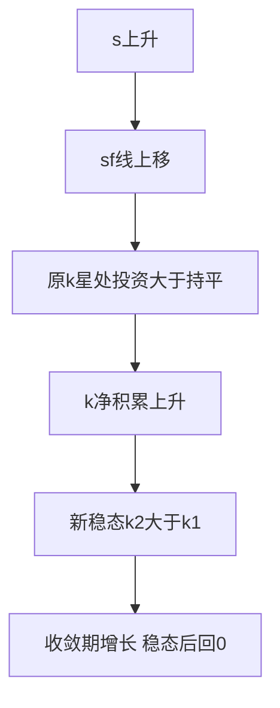
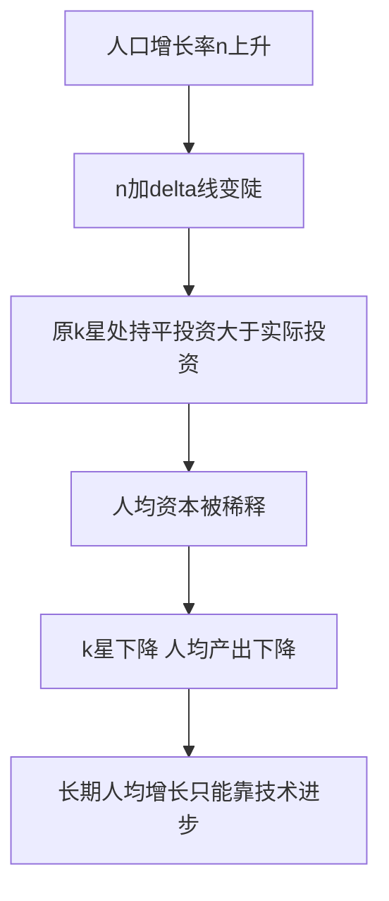

# 第十六章 经济增长 · 考研真题集（首经贸 801）

<a href="../../../exam.html" target="_blank" style="display:inline-block;padding:6px 16px;background:#2563eb;color:#fff;border-radius:6px;text-decoration:none;font-size:14px;">📝 开始做题</a>

> 本章共收录：简答题 11 道（每题 15 分）｜论述题 4 道（每题 30 分）
> 配套选择题见 [[选择题集|本章选择题集]]
> 对应大纲：马工程《西方经济学》下册第十六章"经济增长"全部五节：增长核算、索洛模型、储蓄率与人口、黄金律、内生增长

## 📋 本题集目录

### 简答题
1. [写出增长核算方程并说明各变量含义](#s1)
2. [什么是全要素生产率（索洛残差）？](#s2)
3. [写出索洛模型稳态条件并解释其经济含义](#s3)
4. [用图形描述索洛模型的稳态及其收敛机制](#s4)
5. [简述储蓄率变动对稳态的水平效应与增长效应](#s5)
6. [简述人口增长对稳态人均产出的影响](#s6)
7. [什么是资本的黄金律水平？写出其条件](#s7)
8. [简述内生增长理论与索洛模型的主要区别](#s8)
9. [简述条件收敛与绝对收敛的区别](#s9)
10. [计算题：索洛模型稳态（$s=0.3,n=0.05,\delta=0.05,y=k^{1/2}$）](#s10)
11. [计算题：增长核算与索洛残差](#s11)

### 论述题
1. [结合中国实际，论述从要素驱动转向创新驱动、提高全要素生产率](#l1)
2. [论述人口红利消失对中国经济增长的影响及应对](#l2)
3. [论述高储蓄率、黄金律与中国向消费驱动转型](#l3)
4. [论述内生增长理论对中国发展新质生产力的启示](#l4)

---

## 一、简答题（每题 15 分，建议 450–700 字）

### 简答 1：写出增长核算方程，并说明各变量的经济含义

**【建议字数】450–700 字 ｜ 【建议时间】15 分钟 ｜ 【题型】分析推导**

**【考什么】** 对应知识点 [[知识点/KP01_增长核算方程|KP01 增长核算方程]]，对应大纲第一节；题型属于分析推导。

**【答题框架】**
- 第 1 段：生产函数与规模报酬不变假设（3 分）
- 第 2 段：推导增长核算方程（5 分）
- 第 3 段：各变量含义（5 分）
- 第 4 段：政策含义（2 分）

**【参考答案】**

一、增长核算的起点是总量生产函数 $Y=A\cdot F(K,L)$。其中 $Y$ 为总产出（实际 GDP），$K$ 为资本存量，$L$ 为劳动投入，$A$ 为全要素生产率（TFP），反映技术水平和效率。假设规模报酬不变，且为柯布-道格拉斯形式 $Y=K^\alpha(AL)^{1-\alpha}$。

二、对生产函数取对数并对时间求导，可得增长核算方程：

$$\frac{\Delta Y}{Y}=\alpha\frac{\Delta K}{K}+(1-\alpha)\frac{\Delta L}{L}+\frac{\Delta A}{A}$$

推导思路：$\ln Y=\alpha\ln K+(1-\alpha)\ln A+(1-\alpha)\ln L$，对时间求导得增长率分解。

三、各变量含义：
（一）$\Delta Y/Y$：GDP 实际增长率。
（二）$\Delta K/K$：资本存量增长率，权重 $\alpha$ 为资本的产出弹性（发达国家经验约 $1/3$）。
（三）$\Delta L/L$：劳动投入增长率，权重 $1-\alpha$（约 $2/3$）。
（四）$\Delta A/A$：全要素生产率增长率，又称"索洛残差"——不能由资本和劳动增长解释的那部分产出增长。

四、该方程的政策含义：一国 GDP 增长可分解为"资本贡献+劳动贡献+TFP 贡献"。若增长主要来自资本和劳动投入，则是"粗放型"增长；若主要来自 TFP，则是"集约型"增长。中国提出"从要素驱动转向创新驱动"，就是要提高 $\Delta A/A$ 的比重。

**【解析·得分点】** 采分点：①生产函数 $Y=AF(K,L)$ ②方程完整 ③$\alpha\approx1/3$ ④索洛残差=技术进步。易丢分：把 TFP 写成"劳动生产率"；权重写反。

**【生活实例】** 像分析一个奶茶店为什么生意变好：是多买了一台制茶机（资本）、多雇了两个人（劳动），还是同样的人和机器但出杯速度变快了（技术进步）？增长核算就是把这三件事分开算账。

**【双链接】** 🔗 [[知识点/KP01_增长核算方程|回知识点 KP01]] ｜ 📖 [[../../../原文件/经济学/西方经济学下册_宏观_全书|原书·第十六章]]

---

### 简答 2：什么是全要素生产率？为什么它被称为"索洛残差"？如何提高？

**【建议字数】450–700 字 ｜ 【建议时间】15 分钟 ｜ 【题型】概念简答**

**【考什么】** 对应知识点 [[知识点/KP01_增长核算方程|KP01]]，对应大纲第一节；题型属于概念简答。

**【答题框架】**
- 第 1 段：TFP 定义（3 分）
- 第 2 段：索洛残差由来（4 分）
- 第 3 段：TFP 包含的内容（4 分）
- 第 4 段：提高 TFP 的途径（4 分）

**【参考答案】**

一、全要素生产率（Total Factor Productivity, TFP）是指在全部要素投入（资本、劳动）给定条件下，生产效率的提升带来的额外产出增长。它反映的是"同样投入能生产更多"的能力。

二、索洛残差的由来。索洛 1957 年对美国 1909–1949 年数据进行增长核算，发现产出增长中约 $80\%$ 无法用资本和劳动投入增长解释。他把这一"剩余"残差 $\Delta A/A=\Delta Y/Y-\alpha\Delta K/K-(1-\alpha)\Delta L/L$ 称为技术进步。后人戏称它为"我们无知的度量"（measure of our ignorance）——凡是不能归因于要素投入的，统统塞进 TFP。

三、TFP 实际包含的内容远比"技术"宽泛：
（一）狭义技术进步：新工艺、新设备、新产品。
（二）资源配置效率：劳动力从农业转移到工业（结构红利）。
（三）规模经济：产出扩大后单位成本下降。
（四）制度改善：产权保护、市场竞争、营商环境。
（五）人力资本：劳动者技能提升（严格说应归入劳动质量调整）。

四、提高 TFP 的途径：
（一）研发投入和技术创新，攻关"卡脖子"技术。
（二）人力资本积累，教育和培训。
（三）深化市场化改革，让要素流向高效率部门。
（四）对外开放，吸收国际技术溢出。
（五）保护知识产权，激励创新。
这正是中国"创新驱动发展战略"和"新质生产力"的理论依据。

**【解析·得分点】** 采分点：①TFP 定义 ②残差公式 ③TFP 广义内容 ④提高途径。易丢分：把 TFP 等同于狭义技术；漏掉"资源配置"。

**【生活实例】** 像奶茶店：投入同样多的牛奶、茶叶和人工，如果换了个更聪明的店长（管理改善）、把制杯流程从串行改并行（流程创新）、把门口排队动线重画（资源配置），出杯量都能涨——这些都算 TFP，不只是买新机器。

**【双链接】** 🔗 [[知识点/KP01_增长核算方程|回知识点 KP01]] ｜ 📖 原书

---

### 简答 3：写出索洛模型的稳态条件，并解释其经济含义

**【建议字数】450–700 字 ｜ 【建议时间】15 分钟 ｜ 【题型】分析推导**

**【考什么】** 对应知识点 [[知识点/KP02_索洛模型稳态|KP02 索洛模型稳态]]，对应大纲第二节；题型属于分析推导。

**【答题框架】**
- 第 1 段：模型假设与人均化（3 分）
- 第 2 段：资本积累方程（4 分）
- 第 3 段：稳态条件推导（4 分）
- 第 4 段：稳态经济含义（4 分）

**【参考答案】**

一、索洛模型假设：总量生产函数 $Y=F(K,L)$ 规模报酬不变、边际报酬递减；储蓄率 $s$ 固定，$I=sY$；人口（劳动）按 $n$ 增长；资本折旧率 $\delta$。

二、人均化：令 $y=Y/L$，$k=K/L$，则人均生产函数 $y=f(k)$，满足 $f'(k)>0$，$f''(k)<0$（边际报酬递减）。

三、资本积累方程。人均资本变动：

$$\Delta k=s\cdot f(k)-(n+\delta)k$$

其中 $s\cdot f(k)$ 是人均投资（储蓄全部转化为投资）；$(n+\delta)k$ 是**持平投资**（break-even investment）——$nk$ 给新增工人配备资本，$\delta k$ 替换折旧掉的资本。

四、稳态定义。当 $\Delta k=0$ 时，人均资本不再变动，经济达到稳态 $k^*$：

$$s\cdot f(k^*)=(n+\delta)k^*$$

图形上：横轴 $k$，纵轴 $y$，$s\cdot f(k)$ 是向下弯曲的储蓄曲线（因 $f''<0$），$(n+\delta)k$ 是一条从原点出发的射线。两线交点即稳态 $k^*$。

五、经济含义：
（一）当 $k<k^*$：$s f(k)>(n+\delta)k$，投资大于持平投资，$k$ 上升，经济向 $k^*$ 收敛。
（二）当 $k>k^*$：投资小于持平投资，$k$ 下降，向 $k^*$ 收敛。
（三）稳态下人均资本 $k^*$ 不变，人均产出 $y^*=f(k^*)$ 也不变——**长期人均产出增长率为 0**（无技术进步时）。
（四）总产出 $Y=y\cdot L$ 按人口增长率 $n$ 增长。
（五）长期人均增长只能靠外生技术进步 $g$——这是索洛模型最重要的结论。

**【解析·得分点】** 采分点：①$\Delta k=sf(k)-(n+\delta)k$ ②稳态等式 $sf(k^*)=(n+\delta)k^*$ ③收敛机制 ④长期人均增长=技术进步。易丢分：把总产出增长和人均增长混淆；不画图形。

**【生活实例】** 像养鱼塘：每天喂的饲料 $s f(k)$（投资）要同时分给两件事——新增鱼苗要分饲料 $nk$、老化死掉的鱼要补 $\delta k$。当喂的饲料正好够补新鱼和死鱼，鱼塘里鱼的数量就稳定了——这就是稳态。

**【双链接】** 🔗 [[知识点/KP02_索洛模型稳态|回知识点 KP02]] ｜ 📖 [[../../../原文件/经济学/西方经济学下册_宏观_全书|原书·第十六章]]

---

### 简答 4：用索洛模型相图说明经济如何从任意初始 $k$ 向稳态 $k^*$ 收敛

**【建议字数】450–700 字 ｜ 【建议时间】15 分钟 ｜ 【题型】模型分析**

**【考什么】** 对应知识点 [[知识点/KP02_索洛模型稳态|KP02]]，对应大纲第二节；题型属于模型分析。

**【答题框架】**
- 第 1 段：坐标系与两条曲线（3 分）
- 第 2 段：交点即稳态（3 分）
- 第 3 段：$k<k^*$ 与 $k>k^*$ 两侧动态（6 分）
- 第 4 段：收敛速度与条件收敛（3 分）

**【参考答案】**

一、索洛模型相图：横轴为人均资本 $k$，纵轴为人均产出/投资 $y$。图中画三条线：
（一）人均生产函数 $y=f(k)$：过原点、单调上升、斜率递减（因 $f''<0$）。
（二）人均储蓄曲线 $s\cdot f(k)$：形状与 $f(k)$ 相似但高度乘以 $s$。
（三）持平投资线 $(n+\delta)k$：从原点出发、斜率为 $(n+\delta)$ 的直线。

二、稳态 $k^*$ 是 $s\cdot f(k)$ 与 $(n+\delta)k$ 的交点。此时投资=持平投资，$\Delta k=0$。

三、两侧动态：
（一）左侧（$k<k^*$）：储蓄曲线在持平投资线上方，$s f(k)>(n+\delta)k$，每新增投资除了补充折旧和装备新工人之外还有剩余，人均资本 $k$ 上升——经济向右移动，向 $k^*$ 收敛。
（二）右侧（$k>k^*$）：储蓄曲线在持平投资线下方，$s f(k)<(n+\delta)k$，现有投资不足以维持当前人均资本（折旧太快、新工人太多），$k$ 下降——经济向左移动，向 $k^*$ 收敛。
（三）因此 $k^*$ 是稳定均衡：任何偏离都会被自动拉回。

四、收敛速度：
（一）$k$ 离 $k^*$ 越远，$\Delta k$ 越大，收敛越快——这就是"追赶效应"。穷国（$k$ 远低于 $k^*$）增长比富国快。
（二）但收敛是**条件收敛**：只有当两国储蓄率 $s$、人口增长率 $n$、折旧率 $\delta$ 相同，才收敛到同一 $k^*$。否则各自收敛到自己的稳态。
（三）过渡期有增长，一旦到达稳态，人均增长率回到 0（无技术进步）。

**【解析·得分点】** 采分点：①三条线画法 ②交点 ③左右两侧 $\Delta k$ 正负 ④条件收敛。易丢分：把 $f(k)$ 当成直线；漏掉"边际报酬递减"导致曲线弯曲。

**【生活实例】** 像排水槽里的小球：不管球放在左边还是右边，槽底（$k^*$）是稳定位置——左边推上去一点会滚下来，右边推上去也会滚下来。

**【双链接】** 🔗 [[知识点/KP02_索洛模型稳态|回知识点 KP02]] ｜ 📖 原书

---

### 简答 5：简述储蓄率变动对稳态的影响，并区分水平效应与增长效应

**【建议字数】450–700 字 ｜ 【建议时间】15 分钟 ｜ 【题型】因素影响**

**【考什么】** 对应知识点 [[知识点/KP03_储蓄率与人口增长|KP03 储蓄率与人口增长]]，对应大纲第三节；题型属于因素影响。

**【答题框架】**
- 第 1 段：储蓄率上升的图形移动（4 分）
- 第 2 段：新稳态 $k^*$、$y^*$ 更高（4 分）
- 第 3 段：水平效应 vs 增长效应（5 分）
- 第 4 段：政策含义（2 分）

**【参考答案】**

一、储蓄率 $s$ 上升，人均储蓄曲线 $s\cdot f(k)$ 向上旋转/上移（同一 $k$ 下投资更多）。在原稳态 $k^*_1$ 处，新储蓄曲线高于持平投资线，$\Delta k>0$，人均资本开始上升，直到在更高的 $k^*_2$ 处重新与 $(n+\delta)k$ 相交。

二、新稳态特征：
（一）$k^*_2>k^*_1$：稳态人均资本更高。
（二）$y^*_2=f(k^*_2)>y^*_1$：稳态人均产出更高。
（三）但稳态人均增长率回到 0（无技术进步时）——只是从一个水平跳到另一个水平。

三、水平效应与增长效应的区别：
（一）**水平效应**：储蓄率提高使稳态人均产出**水平**永久性提高。过渡期内（从 $k^*_1$ 到 $k^*_2$）经济经历一段高于稳态增长率的高速增长。
（二）**增长效应**：储蓄率提高**不**影响长期人均增长率。一旦到达新稳态，人均增长率回到 0（或等于外生技术进步率 $g$）。
（三）直觉：资本边际报酬递减。多存的钱不断堆资本，但每一单位新资本带来的产出增量越来越小，最终被折旧和人口增长吃光——长期增长只能靠技术进步。

四、政策含义：
（一）高储蓄率国家人均更富，但持续提高储蓄率不能持续提高增长率。
（二）中国 1980–2010 年高储蓄率（40%+）是高增长的重要原因，但现在接近稳态，必须转向技术进步。
（三）若储蓄率过高（超过黄金律），则当前消费过低，反而应降低储蓄率。

**【解析·得分点】** 采分点：①图形移动 ②新稳态更高 ③水平效应≠增长效应 ④过渡期增长。易丢分：把水平效应说成增长效应——这是索洛模型最常考的辨析点。

**【生活实例】** 像奶茶店存钱买设备：多存钱（$s$ 上升）可以多买几台制茶机，产量跳到一个新水平；但机器多了，店员忙不过来、店面就那么大，每加一台机器带来的新增产量越来越小——最后产量稳定在新水平，不会无限涨下去。

**【双链接】** 🔗 [[知识点/KP03_储蓄率与人口增长|回知识点 KP03]] ｜ 📖 [[../../../原文件/经济学/西方经济学下册_宏观_全书|原书·第十六章]]

---

### 简答 6：简述人口增长对稳态人均产出的影响

**【建议字数】450–700 字 ｜ 【建议时间】15 分钟 ｜ 【题型】因素影响**

**【考什么】** 对应知识点 [[知识点/KP03_储蓄率与人口增长|KP03]]，对应大纲第三节；题型属于因素影响。

**【答题框架】**
- 第 1 段：人口增长率 $n$ 进入持平投资（3 分）
- 第 2 段：图形移动（4 分）
- 第 3 段：对 $k^*$、$y^*$、$c^*$ 的影响（5 分）
- 第 4 段：现实意义（3 分）

**【参考答案】**

一、在索洛模型中，人口（劳动）按 $n$ 速率增长。持平投资线为 $(n+\delta)k$：$nk$ 是给新增工人配备资本所需的人均投资。

二、人口增长率 $n$ 上升，持平投资线 $(n+\delta)k$ 变得更陡。在原稳态 $k^*_1$ 处，新持平投资线高于储蓄曲线，$\Delta k<0$——因为新增工人太多，现有储蓄不足以给每个人配同样多的资本，人均资本被"摊薄"。经济沿曲线向左下滑，直到在更低的 $k^*_2$ 处重新达到稳态。

三、影响结果：
（一）$k^*_2<k^*_1$：稳态人均资本下降。
（二）$y^*_2=f(k^*_2)<y^*_1$：稳态人均产出下降。
（三）$c^*_2=(1-s)y^*_2<c^*_1$：稳态人均消费下降。
（四）但总产出增长率上升（等于新的 $n'$）——国家"总蛋糕"变大了，但人均变小了。

四、现实意义：
（一）非洲高人口增长国家长期贫困——人均资本被新增人口摊薄。
（二）欧洲、日本人口负增长：稳态人均资本高（更富），但总产出增长慢（甚至停滞）。
（三）中国过去几十年人口红利（劳动年龄人口快速增长+抚养比低）支撑高储蓄高增长；如今人口负增长、老龄化，将使 $n$ 下降甚至为负——短期看人均资本被"稀释"的压力减轻，长期看总需求和创新活力受影响。
（四）政策含义：发展中国家要控人口、提储蓄、提教育，才能摆脱"人口陷阱"。

**【解析·得分点】** 采分点：①持平投资线变陡 ②$k^*$、$y^*$ 下降 ③总产出 vs 人均产出方向相反 ④中国人口转型。易丢分：把人口增长说成人均产出上升（正好相反）。

**【生活实例】** 像一个宿舍 4 个人用一台洗衣机（资本 $K$）。突然宿舍搬进 8 个人，人均可用洗衣机从 1/4 台降到 1/8 台——人均"资本"下降，每人洗衣效率下降。

**【双链接】** 🔗 [[知识点/KP03_储蓄率与人口增长|回知识点 KP03]] ｜ 📖 原书

---

### 简答 7：什么是资本的黄金律水平？写出其条件并解释直觉

**【建议字数】450–700 字 ｜ 【建议时间】15 分钟 ｜ 【题型】概念简答**

**【考什么】** 对应知识点 [[知识点/KP04_黄金律水平|KP04 黄金律水平]]，对应大纲第四节；题型属于概念简答。

**【答题框架】**
- 第 1 段：黄金律定义（3 分）
- 第 2 段：稳态消费公式（4 分）
- 第 3 段：$MPK=n+\delta$ 条件推导（5 分）
- 第 4 段：直觉与政策含义（3 分）

**【参考答案】**

一、资本的黄金律水平是使稳态人均消费 $c^*$ 达到最大的稳态人均资本 $k^*_{gold}$。宏观经济的最终目标是居民消费，而非资本积累本身——储蓄太高，钱都建工厂了，当前吃用反而少。

二、稳态人均消费：

$$c^*=y^*-i^*=f(k^*)-(n+\delta)k^*$$

因为稳态时投资 $i^*=(n+\delta)k^*$（持平投资）。要让 $c^*$ 最大，对 $k^*$ 求导并令导数为零：

$$\frac{\mathrm{d}c^*}{\mathrm{d}k^*}=f'(k^*)-(n+\delta)=0$$

即：

$$MPK=n+\delta$$

三、直觉：
（一）多一单位资本，边际产出是 $MPK$（这是"收益"）。
（二）但要维持这一单位资本，必须拿出 $n+\delta$ 用于装备新增工人和替换折旧（这是"成本"）。
（三）当 $MPK>n+\delta$：多储蓄一单位带来的产出大于维持成本，消费还能上升——应该多储蓄。
（四）当 $MPK<n+\delta$：资本过度积累，再储蓄反而减少消费——应该少储蓄。
（五）当 $MPK=n+\delta$：多一单位资本既不增消费也不减消费——正好在消费最大点。

四、政策含义：
（一）若当前 $k^*<k_{gold}$，经济处于"动态有效"，应提高储蓄率。
（二）若 $k^*>k_{gold}$，经济处于"动态无效"（资本过度积累），应降低储蓄率。
（三）美国储蓄率低，可能低于黄金律；中国储蓄率 40%+，消费率仅 38%（美国 70%），接近或略高于黄金律——政策上要从"投资驱动"转向"消费驱动"，扩大居民消费。

**【解析·得分点】** 采分点：①黄金律定义 ②$c^*=f(k^*)-(n+\delta)k^*$ ③$MPK=n+\delta$ ④直觉+中国实际。易丢分：把条件写成 $MPK=\delta$（漏了 $n$）；不区分"动态有效/无效"。

**【生活实例】** 像奶茶店老板把利润再投入买设备：每多买一台制茶机，能多做奶茶（$MPK$），但机器要维护（$\delta$）、要给新雇员工配（$n$）。如果买太多，老板自己都不舍得喝奶茶了——那就是过度积累。黄金律就是找到"老板自己喝得最爽"的那台机器数。

**【双链接】** 🔗 [[知识点/KP04_黄金律水平|回知识点 KP04]] ｜ 📖 [[../../../原文件/经济学/西方经济学下册_宏观_全书|原书·第十六章]]

---

### 简答 8：简述内生增长理论与索洛模型的主要区别

**【建议字数】450–700 字 ｜ 【建议时间】15 分钟 ｜ 【题型】关系对比**

**【考什么】** 对应知识点 [[知识点/KP05_内生增长理论|KP05 内生增长理论]]，对应大纲第五节；题型属于关系对比。

**【答题框架】**
- 第 1 段：索洛模型的局限（4 分）
- 第 2 段：AK 模型核心假设（4 分）
- 第 3 段：长期增长率公式（4 分）
- 第 4 段：政策含义对比（3 分）

**【参考答案】**

一、索洛模型的局限。在索洛模型中，长期人均增长率等于外生技术进步率 $g$，但模型本身没有解释 $g$ 从何而来。这意味着：政策（教育、研发补贴、储蓄率）在长期只有水平效应，没有增长效应——这与现实不符：美国 1980 年代后 IT 革命推动长期增长加速，东亚国家教育投入与长期增长正相关。

二、内生增长理论的核心突破是放弃"资本边际报酬递减"假设。最简单的 AK 模型：

$$Y=AK$$

其中 $A$ 为常数（每单位资本产出 $A$），资本边际报酬恒等于 $A$，不递减。为什么不递减？因为广义资本 $K$ 不仅包括物质资本，还包括**知识、人力资本**——知识用了不会耗尽，反而通过溢出让他人受益，因此整体资本边际报酬不递减。

三、长期增长率。资本积累方程 $\Delta K=sY-\delta K=sAK-\delta K$，两边除以 $K$：

$$\frac{\Delta K}{K}=sA-\delta$$

由于 $Y=AK$ 线性，$\Delta Y/Y=\Delta K/K=sA-\delta$。

四、政策含义对比：
（一）索洛模型：储蓄率提高只有水平效应，长期人均增长率回到 $g$；政策不能影响长期增长。
（二）AK 模型：储蓄率 $s$ 提高直接提高长期增长率 $g=sA-\delta$；补贴教育、研发、基础设施能提高 $A$ 或 $s$，从而提高长期增长。
（三）扩展模型（Romer 研发模型、Lucas 人力资本模型）：研发有正外部性，政府应补贴；教育提升人力资本，不产生递减。

五、结论：内生增长理论把"技术进步"从外生黑箱变成内生选择，为创新驱动发展战略提供了理论基础。

**【解析·得分点】** 采分点：①索洛 $g$ 外生 ②AK 生产函数不递减 ③$g=sA-\delta$ ④政策含义。易丢分：把 AK 模型写成 $Y=K^\alpha$（那是索洛）；不解释"为什么不递减"。

**【生活实例】** 索洛模型像种西瓜：地越种越瘦（资本递减），最后产量稳定；内生增长像写教材：知识越写越多、还能被别人引用，不会因为用多而变薄——所以写教材的人（研发）越多，长期产出增长越快。

**【双链接】** 🔗 [[知识点/KP05_内生增长理论|回知识点 KP05]] ｜ 📖 [[../../../原文件/经济学/西方经济学下册_宏观_全书|原书·第十六章]]

---

### 简答 9：简述条件收敛与绝对收敛的区别，并说明其经验含义

**【建议字数】450–700 字 ｜ 【建议时间】15 分钟 ｜ 【题型】关系对比**

**【考什么】** 对应知识点 [[知识点/KP03_储蓄率与人口增长|KP03]]，对应大纲第三节；题型属于关系对比。

**【答题框架】**
- 第 1 段：收敛假说提出（3 分）
- 第 2 段：绝对收敛（4 分）
- 第 3 段：条件收敛（5 分）
- 第 4 段：俱乐部收敛与中国经验（3 分）

**【参考答案】**

一、收敛假说是索洛模型的一个推论：穷国应该比富国增长快，最终赶上富国。但收敛有强弱版本。

二、绝对收敛（unconditional convergence）：所有国家无论参数（储蓄率、人口增长率、制度）如何，都收敛到同一稳态 $k^*$。含义：越穷的国家增长越快。
经验检验：跨国数据不支持——1960 年以来，最穷的非洲国家并没有比欧美增长快，绝对收敛失败。

三、条件收敛（conditional convergence）：只有当两国储蓄率 $s$、人口增长率 $n$、折旧率 $\delta$、技术水平相同，才收敛到同一稳态。穷国增长快，只是因为它离自己的稳态远——不是因为穷本身。
经验检验：Mankiw-Romer-Weil（1992）加入人力资本后，跨国数据支持条件收敛。OECD 国家、美国各州、欧洲各地区之间都出现条件收敛。

四、进一步概念：
（一）俱乐部收敛（club convergence）：结构特征相似的国家群（如东亚经济体）内部收敛，群间不收敛。
（二）中国经验：改革开放以来，东部沿海省份因高储蓄、出口导向、外资流入，稳态更高；中西部稳态较低。从全国看不存在绝对收敛，但存在"条件收敛"——控制投资率、教育、开放度后，落后省份增长更快。这正是"转移支付、西部大开发"政策的理论依据：不是让穷省自动变富，而是提高其稳态水平。

**【解析·得分点】** 采分点：①绝对收敛定义+失败 ②条件收敛定义+支持 ③俱乐部收敛 ④中国经验。易丢分：把条件收敛说成"穷国永远追不上"（错——只是收敛到自己的稳态）。

**【生活实例】** 像爬山：所有人都爬到同一高度是绝对收敛（不现实）；体力相同的人爬到各自顶峰，体力差的人一开始爬得快（离自己顶峰远），但顶峰低——这是条件收敛。

**【双链接】** 🔗 [[知识点/KP03_储蓄率与人口增长|回知识点 KP03]] ｜ 📖 原书

---

### 简答 10：（计算题）已知索洛模型 $y=k^{1/2}$，$s=0.3$，$n=0.05$，$\delta=0.05$。求稳态 $k^*$、$y^*$、$c^*$。

**【建议字数】450–700 字 ｜ 【建议时间】15 分钟 ｜ 【题型】分析推导**

**【考什么】** 对应知识点 [[知识点/KP02_索洛模型稳态|KP02]] 与 [[知识点/KP03_储蓄率与人口增长|KP03]]，对应大纲第二、三节；题型属于分析推导（计算）。

**【答题框架】** 写稳态条件 → 代入数字 → 解 $k^*$ → 算 $y^*$ → 算 $c^*$

**【参考答案】**

一、稳态条件：

$$s\cdot f(k^*)=(n+\delta)k^*$$

代入 $f(k)=k^{1/2}$，$s=0.3$，$n+\delta=0.10$：

$$0.3\cdot (k^*)^{1/2}=0.10\cdot k^*$$

二、解 $k^*$。两边除以 $(k^*)^{1/2}$（$k^*\neq 0$）：

$$0.3=0.10\cdot (k^*)^{1/2}$$

$$(k^*)^{1/2}=3$$

$$k^*=9$$

三、算 $y^*$：

$$y^*=(k^*)^{1/2}=\sqrt{9}=3$$

四、算 $c^*$：稳态消费=稳态产出-稳态投资

$$c^*=y^*-(n+\delta)k^*=3-0.10\times 9=3-0.9=2.1$$

五、结论：稳态人均资本 9，人均产出 3，人均消费 2.1。验证：$s y^*=0.3\times 3=0.9=(n+\delta)k^*=0.1\times 9$，等式成立。

**【解析·得分点】** 采分点：①稳态方程 ②$k^*=9$ ③$y^*=3$ ④$c^*=2.1$。易丢分：把 $c^*$ 写成 $(1-s)y^*=0.7\times 3=2.1$（数值对但要写清楚 $c=y-i$ 的逻辑）；开方算错。

**【生活实例】** 一个小工厂稳态：每个工人配 9 台设备，每天产出 3 单位产品，其中 0.9 单位用于补充折旧和新工人装备（投资），剩下 2.1 单位被消费掉。

**【双链接】** 🔗 [[知识点/KP02_索洛模型稳态|KP02]] ｜ [[知识点/KP03_储蓄率与人口增长|KP03]] ｜ 📖 原书

---

### 简答 11：（计算题）某国资本增长率 $\Delta K/K=6\%$，劳动增长率 $\Delta L/L=2\%$，GDP 增长率 $\Delta Y/Y=5\%$，资本产出弹性 $\alpha=1/3$。求全要素生产率增长率 $\Delta A/A$。

**【建议字数】450–700 字 ｜ 【建议时间】15 分钟 ｜ 【题型】分析推导**

**【考什么】** 对应知识点 [[知识点/KP01_增长核算方程|KP01]]，对应大纲第一节；题型属于分析推导（计算）。

**【答题框架】** 写增长核算方程 → 代入数字 → 索洛残差 → 解释

**【参考答案】**

一、增长核算方程：

$$\frac{\Delta Y}{Y}=\alpha\frac{\Delta K}{K}+(1-\alpha)\frac{\Delta L}{L}+\frac{\Delta A}{A}$$

二、代入 $\Delta Y/Y=5\%$，$\Delta K/K=6\%$，$\Delta L/L=2\%$，$\alpha=1/3$：

资本贡献：

$$\alpha\frac{\Delta K}{K}=\frac{1}{3}\times 6\%=2\%$$

劳动贡献：

$$(1-\alpha)\frac{\Delta L}{L}=\frac{2}{3}\times 2\%=1.33\%$$

三、索洛残差（TFP 增长）：

$$\frac{\Delta A}{A}=5\%-2\%-1.33\%=1.67\%$$

四、解读：GDP 增长 5% 中，资本贡献 2 个百分点（占 40%），劳动贡献 1.33 个百分点（占 27%），全要素生产率贡献 1.67 个百分点（占 33%）。技术进步贡献约 1/3，属于"要素投入+效率提升"双驱动型增长。

**【解析·得分点】** 采分点：①方程 ②资本贡献 2% ③劳动贡献 1.33% ④TFP=1.67%。易丢分：把 $(1-\alpha)$ 写成 1/3；不解读结构。

**【生活实例】** 奶茶店今年营收涨 5%：其中 2% 是因为多买了机器、1.33% 是因为多雇了人，剩下 1.67% 是因为店长改了流程、出杯更快——这就是 TFP。

**【双链接】** 🔗 [[知识点/KP01_增长核算方程|回知识点 KP01]] ｜ 📖 原书

---

### 简答 12：（曲线移动·分析）用索洛相图说明"储蓄率 s 上升"使哪条线移动、稳态 k* 如何变化，并区分水平效应与增长效应

**【建议字数】450–700 字 ｜ 【建议时间】15 分钟 ｜ 【题型】曲线移动分析**

**【考什么】** 对应 [[知识点/KP02_索洛模型稳态|索洛稳态]]、[[知识点/KP03_储蓄率与人口增长|储蓄率与人口增长]]。

**【答题框架】**
- 第 1 段：哪条线移（5 分）
- 第 2 段：新稳态 k* 方向（5 分）
- 第 3 段：水平效应 vs 增长效应（5 分）

**【参考答案】**

一、曲线移动。索洛相图横轴人均资本 $k$，纵轴投资。两条线：实际投资 $sf(k)$（向上凸，受边际报酬递减制约越来越平缓）；持平投资 $(n+\delta)k$（过原点的射线，斜率 $n+\delta$）。储蓄率 $s$ 上升 → $sf(k)$ **整条上移**；$(n+\delta)k$ 由 $n$、$\delta$ 决定，**不动**。

二、新稳态。稳态条件 $sf(k)=(n+\delta)k$。$s$ 上升后，在原稳态 $k_1^*$ 处出现 $sf(k)>(n+\delta)k$（实际投资多于持平需要），资本开始净积累，$k$ 持续上升，直到新交点 $k_2^*>k_1^*$。即 $sf(k)$ 与原射线交点右移 → **稳态人均资本 $k^*$ 上升、人均产出 $y^*=f(k^*)$ 上升**。

三、水平效应 vs 增长效应。$s$ 上升只在**收敛过程中**带来人均正增长；一旦到达新稳态 $k_2^*$，$\dot k=0$，人均产出增长率在无技术进步时**回到 0**。所以储蓄率提高只有**水平效应**（把人均产出水平抬到新台阶），没有**长期增长效应**（不能让经济永久高速增长）。长期人均增长只能来自外生技术进步。

**【解析·得分点】** ① sf(k) 上移、(n+δ)k 不动（5）；② 新交点右移、k* 上升（5）；③ 只有水平效应无长期增长效应（5）。易丢分：以为多储蓄能永久高增长。

**【生活实例】** 二战后日本、韩国靠高储蓄率快速建厂追赶（k* 上升），但到了一定阶段增速自然回落——多盖工厂不能永远提速，必须靠技术创新（全要素生产率）才能继续往上走。

---

## 二、论述题（每题 30 分，建议 900–1200 字）

### 论述 1：结合中国实际，论述从要素驱动转向创新驱动、提高全要素生产率的必要性与路径

**【建议字数】900–1200 字 ｜ 【建议时间】30 分钟 ｜ 【题型】政策效应类**

**【考什么】** 跨 [[知识点/KP01_增长核算方程|KP01]]、[[知识点/KP05_内生增长理论|KP05]]，并跨第十二章 LRAS 右移；题型属于政策效应类。

**【答题框架】**
- 第 1 段：破题——增长核算视角下的中国增长（4 分）
- 第 2 段：传统要素驱动模式的困境（8 分）
- 第 3 段：TFP 的战略地位（6 分）
- 第 4 段：内生增长理论的政策含义（6 分）
- 第 5 段：中国路径：新质生产力、双循环（6 分）

**【参考答案】**

一、用增长核算方程 $\Delta Y/Y=\alpha\Delta K/K+(1-\alpha)\Delta L/L+\Delta A/A$ 分解中国过去四十多年的高速增长，可以看到一个清晰的结构变化：1980–2010 年，资本贡献约 4–5 个百分点，劳动贡献约 1 个百分点，TFP 贡献约 2–3 个百分点——这是典型的"高储蓄+高投资+人口红利"驱动模式。2010 年后，资本边际回报下降、劳动年龄人口见顶，传统要素贡献衰减，经济增速从 10% 台阶式降至 5% 左右。

二、传统要素驱动模式的困境：
（一）资本边际报酬递减。索洛模型预言，离稳态越近，投资回报率越低。中国增量资本产出比（ICOR）从 2000 年的 4 左右升至近年的 8 以上——同样增加一单位 GDP 需要两倍的投资。
（二）人口红利消失。2012 年劳动年龄人口首次下降，2022 年总人口见顶，$n$ 从正转负——按索洛模型，持平投资线斜率变小，但总需求和创新活力受冲击。
（三）杠杆率高企。企业、地方政府、居民三部门杠杆率合计超过 280%，继续加投资的空间收窄。
（四）资源环境约束。高耗能、高排放模式不可持续，双碳目标倒逼转型。

三、TFP 的战略地位。索洛残差 $\Delta A/A$ 是长期人均增长的唯一源泉。世界银行研究显示，1978–2010 年中国 TFP 年均增长约 4%（其中约 2 个百分点来自资源再配置——农业劳动力转工业）；2011 年后 TFP 增速降至 2% 左右，资源再配置空间收窄。要维持 4–5% 的中速增长，TFP 增速必须从 2% 提升到 2.5–3%。

四、内生增长理论的政策含义。索洛模型中技术进步是外生的，但内生增长理论（Romer 研发模型、Lucas 人力资本模型）告诉我们：研发有正外部性（私人收益小于社会收益），政府应补贴；知识不递减，开放可以吸收溢出；教育提升人力资本质量。这为政策干预提供了理论依据。

五、中国路径：
（一）科技创新。R&D 经费投入强度从 2000 年的 0.9% 提升到 2023 年的 2.6%，接近 OEDC 平均水平；攻关芯片、工业软件、高端装备等"卡脖子"领域；科创板、北交所为硬科技企业融资。
（二）人力资本。从"人口红利"转向"人才红利"：高等教育毛入学率 60%+，职业教育提质，延迟退休释放老年人力资本。
（三）资源再配置。深化户籍改革让劳动力继续流向高效率服务业；国企改革提高资本配置效率；数字经济平台提升匹配效率。
（四）制度创新。保护知识产权、营商环境市场化法治化国际化、数据要素市场化配置。
（五）双循环。以内循环为主，通过外循环吸收国际技术溢出；高水平对外开放，加入 IPEF 等绿色和数字贸易规则。
（六）新质生产力。以科技创新为主导，摆脱传统路径依赖，发展高科技、高效能、高质量的先进生产力——这正是内生增长理论在 21 世纪中国的最新表达。

**【解析·得分点】** 采分点：①用增长核算分解中国增长 ②ICOR、人口拐点等具体事实 ③TFP=长期增长唯一源泉 ④内生增长政策含义 ⑤新质生产力具体路径。易漏点：不写数据；把 TFP 等同于"科技创新"而漏掉资源配置。

**【生活实例】** 像奶茶店开了 40 年，从 1 家开到 100 家（资本扩张），店员从 2 个涨到 200 个（劳动扩张）。但现在街面就那么大，再开店也没用——必须靠新菜单（技术进步）、新管理（效率提升）才能继续涨。

**【双链接】** 🔗 [[知识点/KP01_增长核算方程|KP01]] ｜ [[知识点/KP05_内生增长理论|KP05]] ｜ 📖 原书

---

### 论述 2：论述人口红利消失对中国经济增长的长期影响，并提出应对之策

**【建议字数】900–1200 字 ｜ 【建议时间】30 分钟 ｜ 【题型】现象类**

**【考什么】** 跨 [[知识点/KP03_储蓄率与人口增长|KP03]]、[[知识点/KP02_索洛模型稳态|KP02]]，并跨劳动经济学专题；题型属于现象类。

**【答题框架】**
- 第 1 段：中国人口转型现状（4 分）
- 第 2 段：索洛模型下的 $n$ 下降效应（8 分）
- 第 3 段：储蓄率、消费、创新的连锁影响（8 分）
- 第 4 段：国际比较：日本、欧洲教训（5 分）
- 第 5 段：应对之策（5 分）

**【参考答案】**

一、中国人口正在经历历史性转折：2012 年 15–59 岁劳动年龄人口首次下降；2022 年总人口见顶（14.12 亿）并开始负增长；总和生育率仅 1.09，世界最低行列；65 岁以上老人占比突破 15%，进入深度老龄化。这意味着索洛模型中的人口增长率 $n$ 从过去的 1–2% 转为 0 甚至负数。

二、索洛模型下 $n$ 下降的效应：
（一）持平投资线 $(n+\delta)k$ 变得平缓，新稳态 $k^*$ 更高，人均产出 $y^*$ 上升。仅从模型看，人均"资本装备率"提高，这是好事。
（二）但总产出 $Y=y\cdot L$ 的增长率等于 $n+g$，$n$ 下降使总产出增长率下降——即使人均还在增长，总蛋糕变大速度放慢。
（三）过渡期：从 $n_1$ 到 $n_2<n_1$，经济需要一段调整期，资本积累从高人均资本路径重新过渡。

三、模型之外的连锁影响：
（一）储蓄率下降。年轻人是储蓄主体，老年人是负储蓄主体（用掉养老金）。老龄化导致国民储蓄率从 2010 年的 50% 降至 2023 年的 45%，按索洛模型，$s$ 下降将拉低稳态 $k^*$ 和 $y^*$。
（二）消费结构变化。老年人医疗、护理消费占比上升，住房、汽车、教育消费下降——总需求结构迁移。
（三）创新活力。年轻人是创业和研发主力，老龄化经济体创业率下降，内生增长模型中的 $A$ 提升放缓。
（四）财政压力。养老金、医保支出刚性增长，社保费率高企挤压投资和创新支出。
（五）地区不平衡。年轻人向大城市集聚，农村和东北深度老龄化，区域差距拉大。

四、国际教训：
（一）日本 1990 年代人口拐点叠加资产泡沫破裂，陷入"失去的三十年"：$n$ 下降+通缩预期+资产负债表衰退。
（二）欧洲（意大利、西班牙、德国）靠移民缓解，但也引发社会张力。
（三）韩国、新加坡生育率比中国还低，靠引进外籍劳工和自动化对冲。
（四）关键教训：人口拐点本身不是最可怕的，可怕的是叠加资产泡沫、债务高企、通缩预期——多重因素共振才是"日本化"。

五、应对之策：
（一）提高生育率：育儿补贴、普惠托育、女性就业友好、教育减负——短期效果有限但必须做。
（二）延迟退休：从 2025 年起逐步延迟到 63/58 岁，释放老年人力资本。
（三）提高劳动参与率：女性就业、残疾人就业、海外人才引进。
（四）自动化与 AI：用资本替代劳动——$n$ 下降推动 $k$ 上升，机器人和人工智能正好补上劳动力缺口。
（五）从人口红利转向人才红利：高等教育提质、研发投入、知识溢出，让 $\Delta A/A$ 上升弥补 $\Delta L/L$ 下降。
（六）社会保障制度改革：养老体系多支柱（基本养老+企业年金+个人养老金），全国统筹。
（七）对外开放移民：适度引入外籍高素质劳工。

六、结论。人口红利消失既是挑战也是倒逼——它逼迫中国从"要素驱动"转向"效率驱动"，从"数量型人口红利"转向"质量型人才红利"。能否成功，取决于 TFP 增速能否顶上劳动增速下降的缺口。

**【解析·得分点】** 采分点：①中国人口数据 ②索洛模型 $n$ 下降效应 ③储蓄率下降连锁 ④日本教训 ⑤七条对策。易漏点：只讲养老压力不讲创新活力；漏掉自动化对冲。

**【生活实例】** 像一个奶茶店从 10 个店员减到 5 个：每个人分到的咖啡机变多了（人均资本上升），但总出杯量增长变慢。要继续涨，只能靠更聪明的点单系统（AI）和更熟练的店员（人才红利）。

**【双链接】** 🔗 [[知识点/KP03_储蓄率与人口增长|KP03]] ｜ [[知识点/KP02_索洛模型稳态|KP02]] ｜ [[知识点/KP05_内生增长理论|KP05]] ｜ 📖 原书

---

### 论述 3：论述高储蓄率对中国经济增长的利弊，并运用黄金律分析向消费驱动转型的必要性

**【建议字数】900–1200 字 ｜ 【建议时间】30 分钟 ｜ 【题型】政策效应类**

**【考什么】** 跨 [[知识点/KP03_储蓄率与人口增长|KP03]]、[[知识点/KP04_黄金律水平|KP04]]，并跨消费理论专题；题型属于政策效应类。

**【答题框架】**
- 第 1 段：中国高储蓄率现状（4 分）
- 第 2 段：高储蓄的增长红利（7 分）
- 第 3 段：高储蓄的代价——黄金律视角（8 分）
- 第 4 段：动态有效 vs 动态无效判断（6 分）
- 第 5 段：向消费驱动转型路径（5 分）

**【参考答案】**

一、中国国民储蓄率长期维持在 40–50% 区间，2010 年峰值约 51%，2023 年仍约 45%，远高于美国（约 18%）、OECD 平均（约 22%）。储蓄主体包括居民（约 20%）、企业（约 20%）、政府（约 5–10%）。高储蓄支撑了高投资，是过去四十年增长奇迹的重要资金来源。

二、高储蓄的增长红利（索洛模型视角）：
（一）按 $s\cdot f(k)=(n+\delta)k$，$s$ 高意味着稳态 $k^*$ 高、人均产出 $y^*$ 高。中国基础设施（高铁、高速公路、5G 基站）雄冠全球，正是高储蓄转化为高投资的结果。
（二）过渡期高速增长。中国起点低（$k$ 远低于稳态），高储蓄加速向稳态收敛，带来 1980–2010 年年均 9%+ 的高增长——这是"追赶效应+高储蓄"的合力。
（三）金融抑制下，居民储蓄通过银行体系廉价流向国有企业和基础设施，压低了资本成本。
（四）高储蓄也意味着低消费——在出口旺盛时期，过剩产能由外需吸收，形成"双外循环"。

三、高储蓄的代价（黄金律视角）：
（一）稳态消费 $c^*=f(k^*)-(n+\delta)k^*$。储蓄率过高时，虽然 $y^*$ 高，但持平投资 $(n+\delta)k^*$ 也高，留给消费的部分反而少。
（二）中国居民消费率仅 38%（美国 70%、印度 60%），居民获得感与 GDP 增速不匹配。
（三）投资回报率下降。增量资本产出比从 4 升至 8，大量投资进入低效基建、房地产库存。
（四）产能过剩。高投资形成的产能找不到足够国内消费，只能靠出口和房地产吸纳——房地产深度调整后矛盾暴露。

四、动态有效还是动态无效？判断方法：比较 $MPK$ 与 $n+\delta$。
（一）中国学者估算，中国资本的边际产出 $MPK$ 仍在 8–10%，远高于 $n+\delta\approx 10–12\%$（含折旧）。按此粗略估算，中国可能处于"动态有效"区间——即 $MPK$ 与 $n+\delta$ 接近甚至略高，并未过度积累。
（二）但结构上，房地产和部分传统产业已出现 $MPK<n+\delta$ 的"动态无效"局部；高端制造、新质生产力领域仍 $MPK$ 高。
（三）因此政策不是简单"降储蓄率"，而是"优化储蓄配置"——把储蓄从低效地产、僵尸企业，引导到高科技、绿色、人力资本。

五、向消费驱动转型路径：
（一）收入分配。提高劳动报酬占 GDP 比重（当前约 52%，发达国家 60%+）；二次分配加大转移支付。
（二）社保兜底。养老保险、医疗保险、教育、住房保障体系完善，降低预防性储蓄动机——中国居民高储蓄的重要原因是"安全感不足"。
（三）城镇化。农民工市民化，释放 2 亿多新市民消费潜力。
（四）服务消费。文旅、养老、医疗、教育消费升级。
（五）双循环。以内循环为主体，让消费成为增长主动力——这正是"扩大内需战略"的理论根据。

六、结论。高储蓄率曾是中国增长的优势，但在人均 GDP 越过 1.2 万美元、接近稳态、房地产深度调整的新发展阶段，必须从"为积累而积累"转向"为消费而生产"。黄金律告诉我们：经济增长的最终目的是居民消费，不是 GDP 数字本身。

**【解析·得分点】** 采分点：①储蓄率数据对比 ②索洛模型下 $s$ 高→$k^*$ 高 ③$c^*$ 公式+消费率数据 ④$MPK$ vs $n+\delta$ 判断 ⑤五条转型路径。易漏点：把"降储蓄"绝对化（中国仍是动态有效）；不区分居民储蓄与国民储蓄。

**【生活实例】** 像一个奶茶店老板拼命把利润存起来买新机器，机器越买越多，但自己顿顿吃泡面——员工也吃泡面。机器是多了，但店里幸福感没上去。黄金律就是找到"老板和店员吃得最爽"的那个买机器数量。

**【双链接】** 🔗 [[知识点/KP03_储蓄率与人口增长|KP03]] ｜ [[知识点/KP04_黄金律水平|KP04]] ｜ 📖 原书

---

### 论述 4：论述内生增长理论对中国发展新质生产力、实现高质量发展的启示

**【建议字数】900–1200 字 ｜ 【建议时间】30 分钟 ｜ 【题型】理论类**

**【考什么】** 跨 [[知识点/KP05_内生增长理论|KP05]]、[[知识点/KP01_增长核算方程|KP01]]，并跨第十二章 LRAS；题型属于理论类。

**【答题框架】**
- 第 1 段：内生增长理论回顾（4 分）
- 第 2 段：新质生产力的经济学内涵（7 分）
- 第 3 段：研发外部性与政府作用（7 分）
- 第 4 段：人力资本、知识溢出、开放（6 分）
- 第 5 段：制度保障与中国实践（6 分）

**【参考答案】**

一、内生增长理论（Romer 1990、Lucas 1988、Aghion-Howitt）突破索洛模型"技术进步外生"的局限，把研发、人力资本、知识溢出内生化。核心命题：广义资本（含知识）边际报酬不递减；研发有正外部性，私人收益小于社会收益；长期增长率由 $s$、$A$、教育投入等政策变量决定。这一理论为政府主动推动创新提供了严谨的经济学基础。

二、新质生产力的经济学内涵。2023 年提出的"新质生产力"，是指以科技创新为主导，摆脱传统增长路径，具有高科技、高效能、高质量特征的先进生产力。用增长核算语言翻译：新质生产力就是要把增长动力从 $\alpha\Delta K/K+(1-\alpha)\Delta L/L$（要素驱动）切换到 $\Delta A/A$（效率驱动）。用内生增长语言翻译：就是通过研发和知识溢出，让广义资本的边际报酬不递减，从而在资本边际递减压力下仍维持长期增长。

三、研发外部性与政府作用。Romer 模型指出，研发企业投入 $R\&D$ 产生新知识，但知识一旦披露即具有非排他性，其他企业可通过模仿、逆向工程获益——这导致私人研发投入低于社会最优。因此：
（一）政府应补贴 $R\&D$：中国企业研发加计扣除比例提高到 100%，国家重点实验室体系，大科学装置建设。
（二）保护知识产权：专利保护期、商业秘密、反不正当竞争——让创新者能获得足够回报。
（三）政府采购：首台套保险、政府采购国产创新产品，为新技术提供早期市场。

四、人力资本、知识溢出、开放：
（一）Lucas 模型强调人力资本外部性。中国高等教育毛入学率从 2000 年的 12% 升至 2023 年的 60%，每年 1000 万大学毕业生——这是最大的"知识溢出"池。
（二）产业集聚。深圳大湾区、上海张江、北京中关村——人才在地理上的集聚加速知识溢出，这是内生增长理论的空间表达。
（三）对外开放。FDI 带来技术溢出（干中学）；出口学习效应；国际科研合作。中国加入 WTO 后出口部门 TFP 增速显著高于非出口部门。
（四）数字经济。数据作为新生产要素，具有零边际成本、强网络效应——是 21 世纪的"知识资本"。平台经济、人工智能、工业互联网，本质上都是在放大知识溢出。

五、制度保障与中国实践：
（一）科技体制改革。破除"唯论文"，让科研人员面向经济主战场；赋予科研人员更大经费自主权。
（二）资本市场。科创板"5+2"硬科技属性定位，北交所服务专精特新；注册制改革让创新企业能融资。
（三）新型举国体制。在芯片、核电、大飞机、新能源汽车等领域，政府组织攻关+市场机制结合。
（四）绿色转型。双碳目标既是约束也是新赛道——新能源汽车、光伏、风电中国已取得全球领先地位，是"创新驱动+制度设计"的成功案例。
（五）双循环。内循环扩大国内市场规模，让创新企业有足够利润回收研发成本；外循环吸收国际技术溢出。

六、结论。内生增长理论告诉我们：长期增长不是"自然赐予"的外生技术进步率，而是制度、教育、研发、开放的内生结果。中国发展新质生产力，本质上是把经济增长的"发动机"从要素投入切换到知识生产——这是跨越中等收入陷阱、迈向高收入经济体的必由之路。

**【解析·得分点】** 采分点：①内生增长核心命题 ②新质生产力=TFP 提升 ③研发外部性与补贴 ④人力资本+集聚+开放 ⑤科创板、新型举国体制等具体实践。易漏点：不区分内生增长与索洛模型；只罗列政策不讲理论逻辑。

**【生活实例】** 像写一本奶茶教材：作者花一年写出来（私人成本），但全国奶茶店都能照着改进（社会收益）——作者赚的钱不够补偿这一年时间，所以出版社要给稿费（知识产权）、政府要补贴写作（研发补贴），才能让更多人愿意写书。

**【双链接】** 🔗 [[知识点/KP05_内生增长理论|KP05]] ｜ [[知识点/KP01_增长核算方程|KP01]] ｜ 📖 原书

---

### 论述 5：（曲线移动·大模型）试用索洛模型说明人口增长率 n 变化使哪条线移动、稳态人均资本 k* 如何变化，并结合中国"人口红利消失"讨论为何要提高全要素生产率

**【建议字数】900–1200 字 ｜ 【建议时间】30 分钟 ｜ 【题型】索洛曲线移动论述**

**【考什么】** 对应 [[知识点/KP02_索洛模型稳态|稳态]]、[[知识点/KP03_储蓄率与人口增长|人口增长]]；题型属于参数变化的比较静态分析。

**【答题框架】**
- 第 1 段：n 变化使哪条线移（8 分）
- 第 2 段：新稳态 k* 与人均产出方向（8 分）
- 第 3 段：对总产出 vs 人均产出的不同影响（8 分）
- 第 4 段：中国人口红利与 TFP（6 分）

**【参考答案】**

一、哪条线移。索洛相图横轴人均资本 $k$，实际投资线 $sf(k)$ 由储蓄率 $s$ 决定；持平投资线 $(n+\delta)k$ 是斜率为 $n+\delta$ 的射线。**人口增长率 $n$ 上升，直接增大射线斜率 → $(n+\delta)k$ 变陡（上移）**；$sf(k)$ 不变。

二、新稳态方向。稳态 $sf(k^*)=(n+\delta)k^*$。$n$ 上升后，在原 $k_1^*$ 处 $(n+\delta)k>sf(k)$，持平需要的资本投资（要给新增工人配机器、补折旧）超过实际投资 → 人均资本被稀释，$k$ 下降，直到与新射线交于左方 → **$k_2^*<k_1^*$，人均产出 $y^*=f(k^*)$ 下降**。反之 $n$ 下降（老龄化、劳动人口增长放缓）使射线变缓 → $k^*$ 上升，人均资本变多。

三、人均与总量的差别。索洛模型中：稳态**人均**产出增长率（无技术进步时）为 0；但**总产出** $Y=y\cdot L$ 的增长率等于人口增长率 $n$。所以 $n$ 上升，总 GDP 增长更快，但人均更穷；$n$ 下降（中国现状），人均资本和人均产出有望提高，但总产出增速被劳动数量拖慢——"人口红利消失"拖低的是总量增速。

四、中国对策。中国劳动年龄人口 2015 年后转负（$n$ 下降甚至为负），靠"人多+高储蓄"堆 $k$ 的老路走到头。按索洛模型，长期人均增长不能靠 $s$ 也不能靠 $n$，唯一来源是**外生技术进步（全要素生产率 TFP）**——即使 $(n+\delta)k$ 变缓，只要生产函数 $f(k)$ 因技术进步上移，$sf(k)$ 上移，就能推动 $k^*$ 和人均产出持续上升。这就是"从要素驱动转向创新驱动"的理论根据。

**【解析·得分点】** ① (n+δ)k 变陡、sf(k) 不动（8）；② 新交点左移、k* 下降（8）；③ 人均 vs 总量增长差别（8）；④ 长期靠 TFP（6）。

**【生活实例】** 中国过去靠廉价农民工建厂（n 高、劳动力无限供给），人均工资低但总量涨得快；现在年轻人变少、机器人和 AI 补位——不再靠"人多"，而是靠"每人配更智能的机器和技术"，这就是索洛说的用技术进步上移 $f(k)$。

**【双链接】** 🔗 [[知识点/KP03_储蓄率与人口增长|储蓄率与人口增长]] ｜ [[知识点/KP01_增长核算方程|TFP]]
