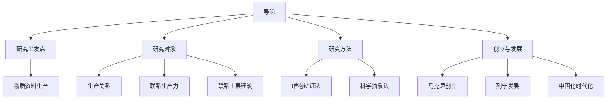

# 导论 · 章节总结

> 对应原书：导论（共 5 节）
> 📖 原书原文：[[../../../原文件/经济学/马克思主义政治经济学概论_全书|《概论》导论]]

## 这一章在回答什么问题

在正式学理论之前，先搞清楚三件事：

1. **政治经济学研究什么？** —— 不是研究"国家怎么管经济"，而是研究**生产关系**（人和人在生产中结成的关系）。
2. **怎么研究？** —— 科学抽象法：从具体表象抽象出经济范畴，再从抽象回到具体。
3. **这门学问怎么来的？** —— 马克思在英国博物馆啃古典政治经济学（斯密、李嘉图），用唯物史观改造它，创立了马克思主义政治经济学。

## 本章框架图

## 核心概念速查

| 概念 | 一句话 | 详细 KP |
|---|---|---|
| 政治经济学 | 研究生产关系及其发展规律的科学 | [[知识点/KP01_政治经济学的研究对象]] |
| 生产关系 | 人们在物质生产过程中结成的社会关系 | [[知识点/KP01_政治经济学的研究对象]] |
| 生产力 | 人类改造自然的能力（劳动者 + 劳动资料 + 劳动对象） | [[知识点/KP01_政治经济学的研究对象]] |
| 经济基础/上层建筑 | 生产关系总和 = 经济基础；政治法律意识形态 = 上层建筑 | [[知识点/KP01_政治经济学的研究对象]] |
| 科学抽象法 | 从具体到抽象、再从抽象到具体 | [[知识点/KP02_政治经济学的研究方法]] |
| 两大发现 | 唯物史观 + 剩余价值论 | [[知识点/KP03_政治经济学的创立与发展]] |

## 思考题（原书）

1. 政治经济学的研究对象是什么？为什么必须联系生产力和上层建筑来研究生产关系？
2. 如何理解科学抽象法？它和自然科学的实验方法有什么不同？
3. 马克思主义政治经济学与资产阶级政治经济学的根本区别在哪里？

## 🔗 相关知识点

**本章：** [[知识点/KP01_政治经济学的研究对象]] ｜ [[知识点/KP02_政治经济学的研究方法]] ｜ [[知识点/KP03_政治经济学的创立与发展]]

**跨章：** [[../01_商品与货币/00_章节总结|01 商品与货币（劳动价值论正式开始）]]

**跨课对照：** 西方经济学把"资源配置"当研究对象，政治经济学把"生产关系"当研究对象——这是两门课的**根本分野**。
