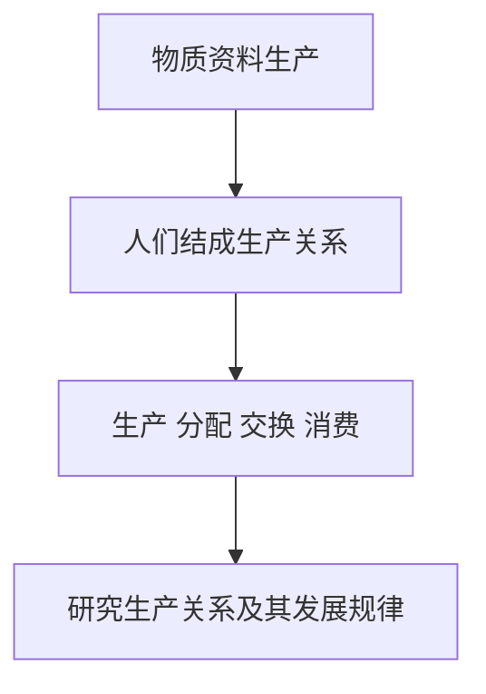

# KP01 · 政治经济学的研究对象

<div style="text-align:right;margin:10px 0;"><a href="../../../../exam.html" target="_blank" style="display:inline-block;padding:6px 16px;background:#2563eb;color:#fff;border-radius:6px;text-decoration:none;font-size:14px;">📝 开始做题</a></div>


> 所属：[[../00_章节总结|导论]] ｜ 节：原书第二节

## 1. 一句话先懂（小白版）

政治经济学不是研究"国家怎么管钱"，而是研究**人和人在生产东西的时候结成了什么关系**。

举个例子：王老板开奶茶店，你被雇来做奶茶。这里面至少有三层关系——

- 你和王老板：**雇佣关系**（你干活，他发工资、拿走利润）；
- 王老板和茶叶供应商：**买卖关系**；
- 王老板和房东：**租赁关系**。

这些关系怎么产生、为什么这样、会怎么变——就是政治经济学要回答的。

## 2. 严格定义

**政治经济学的研究对象：生产关系及其发展规律。**

拆解成三对概念：

| 概念 | 定义 | 通俗解释 |
|---|---|---|
| **物质资料生产** | 人类利用劳动资料改造劳动对象、创造物质财富的过程 | 人干活做出东西 |
| **生产力** | 人类改造自然的能力 = 劳动者 + 劳动资料（工具）+ 劳动对象 | 干活的本事 |
| **生产关系** | 人们在物质资料生产过程中结成的社会关系，包括：生产资料归谁所有、人们在生产中的地位和相互关系、产品怎么分配 | 人和人在生产中"谁听谁的、东西归谁" |
| **经济基础** | 占统治地位的生产关系的总和 | 一个社会的"经济骨架" |
| **上层建筑** | 建立在经济基础上的政治、法律、意识形态、国家机器 | 法律、国家、道德这些"上层" |

## 3. 为什么（原理/机制）

### 为什么研究生产关系必须从"物质资料生产"出发？

因为**人得先吃饭、穿衣、住房子，才能搞政治、写论文、谈恋爱**。马克思说："人们为了能够创造历史，必须能够生活。但是为了生活，首先就需要衣、食、住以及其他东西。"

所以物质资料生产是**一切历史的第一个前提**，研究社会关系得从这里下手。

### 为什么不能孤立研究生产关系？

生产关系不是悬在空中的，它和另外两个东西互相咬合：

```
生产力 ──决定──> 生产关系 ──构成──> 经济基础 ──决定──> 上层建筑
   ▲                                                          │
   └────────────── 反作用（促进或阻碍）──────────────────────────┘
```

- **生产力决定生产关系**：手工作坊对应封建行会，机器大工业对应资本主义。
- **生产关系反作用于生产力**：合适就促进，不合适就阻碍（比如大锅饭养懒汉）。
- **经济基础决定上层建筑**：有了资本主义私有制，才有资本主义法律（保护私有财产）。
- **上层建筑反作用于经济基础**：国家用立法、警察、军队维护它认可的生产关系。

**这就是唯物史观的"两层矛盾运动"**：生产力↔生产关系、经济基础↔上层建筑。

## 4. 来源（理论怎么来的）

- **古典政治经济学**（威廉·配第、亚当·斯密、李嘉图）：第一次把研究对象从"国家财富怎么增长"转到"生产中人与人的关系"，但他们把资本主义当成永恒的自然秩序。
- **马克思的改造**：马克思在《德意志意识形态》《〈政治经济学批判〉导言》里明确——政治经济学的研究对象不是物（财富），而是**被物的外壳掩盖着的人与人的关系**。商品、货币、资本这些看似"物"的东西，背后都是社会关系。

## 5. 怎么用（现实例子）

**场景**：奶茶店打工的你，一个月做 1100 杯奶茶，每杯卖 15 元，月营业额 16500 元。你工资 5000。

- **生产力层面**：你一个月能做 1100 杯，这是你的劳动能力；封口机、制冰机是劳动资料；茶叶牛奶是劳动对象。
- **生产关系层面**：店面、机器、原料都是王老板的（**生产资料私有制**）；你只有劳动力，不得不把它卖给王老板（**雇佣关系**）；营业额扣掉成本和工资后剩下的归王老板（**分配关系**）。
- **上层建筑层面**：《劳动合同法》保护你，《公司法》保护王老板，商标法保护"王老板奶茶"这个品牌。

**为什么这比西方经济学深一层？** 西方经济学只问"奶茶怎么定价、雇几个人最优"，不问"为什么王老板拿利润而你拿工资"——这就是研究对象的差别。

## 5.5 理论推导（一步步推）

**假设起点**：人类要生存必须先进行物质资料生产。

**推导过程**：
- 第一步：物质资料生产是社会存在和发展的基础。
- 第二步：生产从来不是单个人孤立进行的，人们必须结成相互关系——生产关系。
- 第三步：生产关系包括生产、分配、交换、消费四环节。
- 第四步：政治经济学的研究对象就是生产关系及其发展规律，联系生产力和上层建筑来研究。
- 结论：研究对象 = 生产关系（及其与生产力、上层建筑的关系）。



## 5.6 数学推导（公式怎么来的）

> 每个符号第一次出现必须解释。

生产力决定生产关系，生产关系反作用于生产力。设生产力为 $P$，生产关系为 $R$：

$$P \to R \to P$$

生产关系总和构成经济基础 $B$，上层建筑 $U$ 建立其上：

$$B \to U, \qquad U \to B$$


## 6. 什么时候不能用（边界条件）

- 本研究对象是**物质生产领域**的关系。非物质生产（如亲情、友情、学术共同体内部的关系）不能直接套。
- "生产力决定生产关系"是**归根到底的决定作用**，不是机械的一一对应。同一种生产力可以有不同生产关系的组合（如中国和美国生产力水平相近，但基本经济制度不同）。
- 不能把"生产关系"庸俗化理解为"老板和员工关系好不好"——它指的是**客观的、不依人意志为转移**的经济关系。

## 7. 容易混淆什么

| 容易混 | 区别 |
|---|---|
| 政治经济学 vs 政治学 | 政治学研究国家权力怎么运作；政治经济学研究生产关系（经济关系）。名字里有"政治"是因为：在马克思看来，经济关系就是最根本的政治。 |
| 生产力 vs 生产关系 | 生产力 = 人对自然的关系（本事大小）；生产关系 = 人对人的关系（谁听谁的）。 |
| 经济基础 vs 上层建筑 | 经济基础 = 生产关系总和（经济制度）；上层建筑 = 法律政治意识形态。 |
| 政治经济学 vs 西方经济学 | 前者研究生产关系（谁拿什么）；后者研究资源配置（怎么最优分配）。 |

## 8. 现实意义

今天看新闻里说"共同富裕""规范资本无序扩张""国企改革""平台经济反垄断"——这些都是在**调整生产关系**。政治经济学给你一把手术刀，让你看到政策背后是哪一种生产关系在被调整。

---

## 🔗 相关知识点

**同章关联：** [[KP02_政治经济学的研究方法]] ｜ [[KP03_政治经济学的创立与发展]]

**跨章关联：** [[../../01_商品与货币/知识点/KP01_商品二因素|商品二因素（商品背后的社会关系）]] ｜ [[../../02_资本主义经济制度与生产/知识点/KP04_劳动过程与价值增殖过程|剩余价值生产（生产关系的核心秘密）]]

**跨课对照：** 西方经济学研究"资源配置"，见 [[../../../06_西方经济学/|06 西方经济学]]。

**📖 原书原文：** [[../../../../原文件/经济学/马克思主义政治经济学概论_全书|《概论》导论第二节]]

---

## 📝 考研真题（首经贸 801）

**配套主观题：** 见同目录 [[../考研真题集|本章考研真题集]]
**配套选择题：** 见同目录 [[../选择题集|本章选择题集]]

### 高频简答
- 简述政治经济学的研究对象及其相互关系 → 见 [[../考研真题集#s1|真题集·简答 1]]
- 为什么研究生产关系必须联系生产力和上层建筑 → 见 [[../考研真题集#s2|真题集·简答 2]]

### 高频论述
- 试述马克思主义政治经济学的研究对象、根本方法及其与西方经济学的根本分野 → 见 [[../考研真题集#l1|真题集·论述 1]]

### 易错选择
- 本知识点选择题见 [[../选择题集#KP01 政治经济学的研究对象|选择题集·KP01]]
