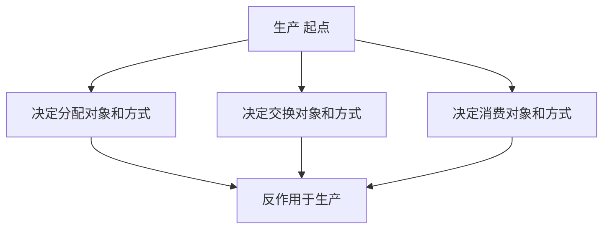
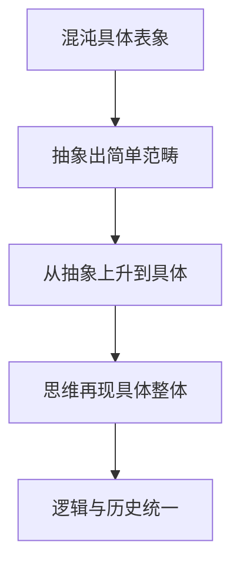

# 导论 · 考研真题集（首经贸 801）

<a href="../../../exam.html" target="_blank" style="display:inline-block;padding:6px 16px;background:#2563eb;color:#fff;border-radius:6px;text-decoration:none;font-size:14px;">📝 开始做题</a>

> 本章共收录：简答题 8 道（每题 15 分）｜论述题 3 道（每题 30 分）
> 配套选择题见 [[选择题集|本章选择题集]]
> 对应大纲：《马克思主义政治经济学概论》导论（研究对象、研究方法、创立与发展）

## 📋 本题集目录

### 简答题
1. [[#简答 1：简述政治经济学的研究对象及其相互关系。|简述政治经济学的研究对象]]
2. [[#简答 2：为什么研究生产关系必须联系生产力和上层建筑？|为什么研究生产关系必须联系生产力和上层建筑]]
3. [[#简答 3：为什么物质资料生产是政治经济学研究的出发点？|为什么物质资料生产是政治经济学研究的出发点]]
4. [[#简答 4：简述科学抽象法及其"两步走"。|简述科学抽象法及其两步走]]
5. [[#简答 5：为什么政治经济学不能用显微镜和化学试剂，而必须用抽象力？|为什么政治经济学不能用显微镜和化学试剂而必须用抽象力]]
6. [[#简答 6：简述马克思主义政治经济学的两大直接理论来源。|简述马克思主义政治经济学的两大理论来源]]
7. [[#简答 7：简述马克思的两大发现及其划时代意义。|简述马克思的两大发现及其划时代意义]]
8. [[#简答 8：比较马克思主义政治经济学与资产阶级古典政治经济学的根本区别。|比较马克思主义政治经济学与资产阶级古典政治经济学的根本区别]]

### 论述题
1. [[#论述 1：试述马克思主义政治经济学的研究对象、根本方法，并说明它与西方经济学的根本分野。|试述政治经济学的研究对象、根本方法及其与西方经济学的根本分野]]
2. [[#论述 2：运用唯物史观分析我国"规范资本无序扩张、促进共同富裕"政策背后的生产关系调整。|运用唯物史观分析我国"规范资本无序扩张、促进共同富裕"政策背后的生产关系调整]]
3. [[#论述 3：试述马克思主义政治经济学的创立过程及其中国化时代化的最新发展。|试述马克思主义政治经济学的创立过程及其中国化时代化的最新发展]]

---

## 一、简答题（每题 15 分，建议 450–700 字）

### 简答 1：简述政治经济学的研究对象及其相互关系。

**【建议字数】450–700 字 ｜ 【建议时间】15 分钟 ｜ 【题型】概念简答**

**【考什么】** 对应知识点 [[知识点/KP01_政治经济学的研究对象|KP01 政治经济学的研究对象]]，对应大纲导论第二节；题型属于概念简答。

**【答题框架】**
- 第 1 段：政治经济学的研究对象是什么（3 分）
- 第 2 段：生产关系的三方面内容（4 分）
- 第 3 段：生产关系与生产力、上层建筑的相互关系（5 分）
- 第 4 段：现实意义小结（3 分）

**【参考答案】**

一、政治经济学的研究对象
政治经济学的研究对象是**社会生产关系及其发展规律**。它不是研究"国家怎么管钱"，而是研究人们在物质资料生产过程中结成的、不依人的意志为转移的经济关系。马克思在《〈政治经济学批判〉导言》中明确指出，经济学研究的不是物，而是被物的外壳掩盖着的人与人之间的社会关系。

二、生产关系的三方面内容
生产关系包括：
(一) 生产资料归谁所有（所有制形式）；
(二) 人们在生产中的地位和相互关系（分工与交换关系）；
(三) 产品如何分配。
其中生产资料所有制是基础，决定后两者。

三、生产关系与生产力、上层建筑的相互关系
(一) **生产力决定生产关系**。生产力是人类改造自然的能力，由劳动者、劳动资料、劳动对象构成；生产力的性质和发展水平决定生产关系的性质和形式。
(二) **生产关系反作用于生产力**。适合生产力的生产关系促进其发展，不适合则阻碍。
(三) **经济基础决定上层建筑**。占统治地位的生产关系总和构成经济基础，政治、法律、意识形态构成上层建筑。
(四) **上层建筑反作用于经济基础**。国家通过立法、意识形态维护它所认可的生产关系。
因此，研究生产关系必须在生产力—生产关系、经济基础—上层建筑的矛盾运动中进行。

四、现实意义
今天讨论"国企改革""平台反垄断""共同富裕"，本质上都是在调整生产关系。政治经济学给我们一把穿透"物与物"关系、看到"人与人"关系的手术刀。

**【解析·得分点】** 采分点：①研究对象是生产关系及其发展规律（3 分）；②生产关系三方面内容（4 分）；③生产力决定生产关系、经济基础决定上层建筑（5 分）；④现实意义（3 分）。易丢分：只写"研究生产关系"一句话而不展开三方面；忘记生产关系要在与生产力、上层建筑的联系中研究。

**【生活实例】** 王老板开奶茶店，店面、封口机、茶叶归他所有（所有制）；你被雇来做奶茶、他监督你劳动（地位关系）；营业额扣完成本工资后利润归他（分配关系）。这三层合起来就是生产关系。

**【双链接】** 🔗 [[知识点/KP01_政治经济学的研究对象|回知识点]] ｜ 📖 [[../../../原文件/经济学/马克思主义政治经济学概论_全书|《概论》导论第二节]]

---

### 简答 2：为什么研究生产关系必须联系生产力和上层建筑？

**【建议字数】450–700 字 ｜ 【建议时间】15 分钟 ｜ 【题型】原因分析**

**【考什么】** 对应知识点 [[知识点/KP01_政治经济学的研究对象|KP01]]，题型属于原因分析。

**【答题框架】**
- 第 1 段：生产关系不是孤立存在的（2 分）
- 第 2 段：联系生产力的原因（5 分）
- 第 3 段：联系上层建筑的原因（5 分）
- 第 4 段：方法论意义（3 分）

**【参考答案】**

一、生产关系不能孤立研究
生产关系是社会有机体的一部分，它既同生产力组成生产方式，又同上层建筑组成社会形态。孤立地描述生产关系，无法说明它为什么产生、为什么变化、为什么必然被新的生产关系代替。

二、必须联系生产力研究生产关系
(一) 生产力决定生产关系的性质。手工作坊对应封建行会关系，机器大工业对应资本主义雇佣关系。
(二) 生产力决定生产关系的变化。生产力发展到一定阶段，便同现存生产关系发生矛盾，生产关系或慢或快地发生变革。
(三) 生产关系反作用于生产力。我国农村家庭联产承包责任制之所以解放生产力，就是因为它调整了不适应生产力发展的集体耕作关系。
(四) 判断一种生产关系优劣的标准，是看它促进还是阻碍生产力发展。

三、必须联系上层建筑研究生产关系
(一) 经济基础决定上层建筑。资本主义私有制决定了资本主义法律以保护私有财产为核心。
(二) 上层建筑对生产关系有反作用。资产阶级国家依靠军队、法庭、教育、舆论维护雇佣劳动关系。
(三) 生产关系的变革往往要通过上层建筑的变革才能实现。社会主义生产关系不可能在资本主义社会内部自发长成，必须通过人民民主专政建立。

四、方法论意义
只有在生产力—生产关系—上层建筑的矛盾运动中研究生产关系，才能把生产关系看成历史的、暂时的、必然被更高形态代替的关系，而不是资产阶级学者所说的"永恒自然秩序"。

**【解析·得分点】** 采分点：①生产力决定生产关系性质与变化（5 分）；②上层建筑由经济基础决定并反作用（5 分）；③孤立研究的错误（2 分）；④方法论意义（3 分）。易丢分：只答决定作用不答反作用；忘记"经济基础=生产关系总和"这个概念衔接。

**【生活实例】** 同样是开奶茶店，在封建社会你想雇人很难（行会不许），在资本主义社会雇人很自由（法律保护契约）——这就是上层建筑对生产关系的反作用。

**【双链接】** 🔗 [[知识点/KP01_政治经济学的研究对象|回知识点]] ｜ 📖 [[../../../原文件/经济学/马克思主义政治经济学概论_全书|《概论》导论第二节]]

---

### 简答 3：为什么物质资料生产是政治经济学研究的出发点？

**【建议字数】450–700 字 ｜ 【建议时间】15 分钟 ｜ 【题型】原因分析**

**【考什么】** 对应知识点 [[知识点/KP01_政治经济学的研究对象|KP01]]，题型属于原因分析。

**【答题框架】**
- 第 1 段：马克思的经典论断（3 分）
- 第 2 段：物质资料生产是人类社会存在的前提（5 分）
- 第 3 段：物质资料生产是其他一切活动的基础（4 分）
- 第 4 段：小结（3 分）

**【参考答案】**

一、马克思的经典论断
马克思指出："人们为了能够创造历史，必须能够生活。但是为了生活，首先就需要衣、食、住以及其他东西。因此第一个历史活动就是生产满足这些需要的资料，即生产物质生活本身。"

二、物质资料生产是人类社会存在的前提
(一) 人要生存就必须有食物、衣服、住房，这些不能从天上掉下来，必须通过生产获得。
(二) 一旦生产停止，社会在几周内就会灭亡。
(三) 物质资料生产是人类区别于动物的根本标志——动物只是采集自然，人类则能动地改造自然。

三、物质资料生产是其他一切社会活动的基础
(一) 只有当劳动生产率提高到人们生产的东西超过劳动者本人需要时，才可能让一部分人脱离物质生产，去从事政治、科学、艺术、宗教。
(二) 历史上出现的阶级分化、国家、法律，都是在物质生产发展到一定阶段、出现剩余产品以后才产生的。
(三) 因此，研究社会关系必须从生产关系入手，而不是从国家、法律、观念入手。

四、小结
物质资料生产是"一切历史的第一个前提"。政治经济学把生产关系作为研究对象，正是因为它抓住了社会历史的这一基础。这是唯物史观同唯心史观的根本分野——后者从观念、国家出发，前者从物质生产出发。

**【解析·得分点】** 采分点：①马克思原文论断（3 分）；②生产是存在前提（5 分）；③生产是政治科学艺术等活动的基础（4 分）；④与唯心史观对立（3 分）。易丢分：只写"人要吃饭"这种大白话，没上升到"第一个历史活动"的理论高度。

**【生活实例】** 你考研复习、谈恋爱、刷手机，前提是你妈给你做饭、你自己打工赚房租。没人生产粮食，所有这些活动一周内全停。

**【双链接】** 🔗 [[知识点/KP01_政治经济学的研究对象|回知识点]] ｜ 📖 [[../../../原文件/经济学/马克思主义政治经济学概论_全书|《概论》导论第一节]]

---

### 简答 4：简述科学抽象法及其"两步走"。

**【建议字数】450–700 字 ｜ 【建议时间】15 分钟 ｜ 【题型】概念简答**

**【考什么】** 对应知识点 [[知识点/KP02_政治经济学的研究方法|KP02 政治经济学的研究方法]]，题型属于概念简答。

**【答题框架】**
- 第 1 段：科学抽象法的定义（3 分）
- 第 2 段：第一步——从具体到抽象（5 分）
- 第 3 段：第二步——从抽象到具体（5 分）
- 第 4 段：《资本论》的示范（2 分）

**【参考答案】**

一、科学抽象法的含义
科学抽象法是唯物辩证法在经济学研究中的具体运用，指从大量经济现象的"感性具体"出发，经过去粗取精、去伪存真、由此及彼、由表及里的思维加工，抽象出反映事物本质的简单规定，再从这些抽象规定逐步上升，在思维中再现"丰富的具体"。马克思说："分析经济形式，既不能用显微镜，也不能用化学试剂。二者都必须用抽象力来代替。"

二、第一步：从具体到抽象
(一) 感性具体是混沌的表象：每天涨价、发工资、裁员、促销，乱成一锅粥。
(二) 思维通过抽象，撇开偶然的、次要的因素，抓住最普遍、最本质的规定。
(三) 例如从纷繁的资本主义经济现象中，抽象出"商品"这个最简单的经济范畴。

三、第二步：从抽象到具体
(一) 抽象的规定是片面的，必须逐步把现实的规定加回来。
(二) 《资本论》的叙述顺序正是如此：商品 → 货币 → 资本 → 剩余价值 → 利润 → 平均利润 → 生产价格 → 地租。
(三) 最后在思维中再现的"具体"，是许多规定的综合，是多样性的统一，而不是混沌的表象。

四、《资本论》的示范
《资本论》第一卷最抽象（先研究商品这个"细胞"），越往后越具体（资本积累、流通、分配）。这就是"从抽象上升到具体"的完整运用。

**【解析·得分点】** 采分点：①抽象力代替显微镜试剂（3 分）；②从具体到抽象的加工过程（5 分）；③从抽象到具体的上升过程（5 分）；④《资本论》示范（2 分）。易丢分：把科学抽象法等同于"凭空想"；忘记"从抽象再回到具体"这后半步。

**【生活实例】** 你想知道奶茶到底什么味，不能一口灌 50 种料，得先尝茶、再尝奶、最后尝糖——这就是抽象；尝完后你在脑子里拼出"一杯完整奶茶的味道"，这就是从抽象回到具体。

**【双链接】** 🔗 [[知识点/KP02_政治经济学的研究方法|回知识点]] ｜ 📖 [[../../../原文件/经济学/马克思主义政治经济学概论_全书|《概论》导论第三节]]

---

### 简答 5：为什么政治经济学不能用显微镜和化学试剂，而必须用抽象力？

**【建议字数】450–700 字 ｜ 【建议时间】15 分钟 ｜ 【题型】原因分析**

**【考什么】** 对应知识点 [[知识点/KP02_政治经济学的研究方法|KP02]]，题型属于原因分析。

**【答题框架】**
- 第 1 段：马克思原话破题（3 分）
- 第 2 段：经济研究无法控制实验（5 分）
- 第 3 段：经济关系是社会关系而非自然物质（4 分）
- 第 4 段：抽象法的具体要求（3 分）

**【参考答案】**

一、马克思的经典表述
马克思在《资本论》第一卷第一版序言中说："分析经济形式，既不能用显微镜，也不能用化学试剂。二者都必须用抽象力来代替。"

二、经济研究无法做可控实验
(一) 物理学可以在实验室控制温度、压力，观察气体体积变化。
(二) 经济学不能把一个国家切成两半，一半实行最低工资法、另一半不实行，然后对比结果。
(三) 经济过程是不可逆的、由亿万人有意识参与的社会过程，无法重复、无法隔离变量。
(四) 因此经济学只能在思维中进行"思想实验"，通过抽象力撇开次要因素，考察纯粹形态下的经济规律。

三、经济关系是社会关系而非自然物质
(一) 显微镜看到的是细胞，化学试剂分析的是分子；政治经济学要分析的是商品、货币、资本这些"物"背后的人与人的关系。
(二) 这种社会关系不能被肉眼看到，只能被思维把握。
(三) 例如"价值"看不见摸不着，你不能把一杯奶茶切开看里面"价值"多少克——它只能通过抽象劳动这个概念被把握。

四、抽象法的具体要求
(一) 从客观事实出发，不从概念出发；
(二) 撇开偶然的、次要的因素，抓住必然的、本质的联系；
(三) 在纯粹形态下揭示规律后，再逐步把现实的、具体的因素加回来。

**【解析·得分点】** 采分点：①马克思原话（3 分）；②无法做可控实验（5 分）；③经济关系是社会关系（4 分）；④抽象法要求（3 分）。易丢分：只说"经济学不能做实验"，不深入到"研究对象是社会关系而非自然物质"这一层。

**【生活实例】** 你不能为了研究"996 是不是剥削"，在实验室里找两群人，一群 8 小时、一群 12 小时，别的条件完全一样——人是活的，社会是复杂的。只能靠抽象：把房价、社保、家庭这些因素先放一边，看清剩余价值生产的本质。

**【双链接】** 🔗 [[知识点/KP02_政治经济学的研究方法|回知识点]] ｜ 📖 [[../../../原文件/经济学/马克思主义政治经济学概论_全书|《概论》导论第三节]]

---

### 简答 6：简述马克思主义政治经济学的两大直接理论来源。

**【建议字数】450–700 字 ｜ 【建议时间】15 分钟 ｜ 【题型】概念简答**

**【考什么】** 对应知识点 [[知识点/KP03_政治经济学的创立与发展|KP03 政治经济学的创立与发展]]，题型属于概念简答。

**【答题框架】**
- 第 1 段：总述（2 分）
- 第 2 段：德国古典哲学（6 分）
- 第 3 段：英国古典政治经济学（6 分）
- 第 4 段：马克思的革命改造（1 分）

**【参考答案】**

一、总述
马克思主义政治经济学不是凭空产生的，它有三大直接理论来源：德国古典哲学、英国古典政治经济学、英法空想社会主义。其中最直接的是前两者。

二、德国古典哲学
(一) 黑格尔的唯心辩证法：第一次系统地表达了辩证法的三个规律（对立统一、质量互变、否定之否定），但它是"头足倒置"的——观念决定现实。
(二) 费尔巴哈的唯物主义：批判了黑格尔的唯心主义，恢复了唯物主义的权威，但它是形而上学的、直观的。
(三) 马克思把辩证法从黑格尔的唯心主义外壳中解救出来，把它倒过来脚站在地上，创立了**唯物辩证法**——物质生产方式决定观念，而不是相反。

三、英国古典政治经济学
(一) 威廉·配第、亚当·斯密、李嘉图第一次把研究对象从"国家财富增长"转到"生产中人与人的关系"，提出了劳动价值论。
(二) 斯密提出了分工、交换、货币、利润、地租的初步分析；李嘉图把劳动价值论推到古典顶峰。
(三) 但古典政治经济学有两大缺陷：一是分不清"劳动"和"劳动力"，解释不了利润来源；二是把资本主义当成永恒的自然秩序。
(四) 马克思批判地继承了劳动价值论，创立了**剩余价值学说**，把古典政治经济学改造为无产阶级的政治经济学。

四、革命改造
马克思的贡献不是简单继承，而是在唯物史观基础上把劳动价值论推进到剩余价值论，使社会主义从空想变成科学。

**【解析·得分点】** 采分点：①黑格尔辩证法 + 费尔巴哈唯物主义 → 唯物辩证法（6 分）；②英国古典政治经济学劳动价值论 → 剩余价值论（6 分）；③总述（2 分）；④批判改造而非简单继承（1 分）。易丢分：漏掉空想社会主义这个第三来源；把黑格尔说成唯物主义者。

**【生活实例】** 斯密说"劳动创造价值"，但他解释不了老板利润从哪来；马克思说"不对，工人出卖的不是劳动而是劳动力，劳动力用起来能创造比自身更大的价值"——这一下就接上了。

**【双链接】** 🔗 [[知识点/KP03_政治经济学的创立与发展|回知识点]] ｜ 📖 [[../../../原文件/经济学/马克思主义政治经济学概论_全书|《概论》导论第四节]]

---

### 简答 7：简述马克思的两大发现及其划时代意义。

**【建议字数】450–700 字 ｜ 【建议时间】15 分钟 ｜ 【题型】概念简答**

**【考什么】** 对应知识点 [[知识点/KP03_政治经济学的创立与发展|KP03]]，题型属于概念简答。

**【答题框架】**
- 第 1 段：总述（2 分）
- 第 2 段：唯物史观（6 分）
- 第 3 段：剩余价值学说（6 分）
- 第 4 段：意义（1 分）

**【参考答案】**

一、总述
恩格斯指出，马克思一生有两大发现：**唯物史观**和**剩余价值学说**。这两大发现使社会主义从空想变成科学。

二、唯物史观
(一) 马克思发现：人们在自己生活的社会生产中发生一定的、必然的、不依他们意志为转移的关系，即同他们的物质生产力的一定发展阶段相适合的生产关系。
(二) 这些生产关系的总和构成社会的经济基础，即有法律的和政治的上层建筑竖立其上并有一定的社会意识形态与之相适应的现实基础。
(三) 物质生活的生产方式制约着整个社会生活、政治生活和精神生活的过程。不是人们的意识决定人们的存在，相反，是人们的社会存在决定人们的意识。
(四) 生产力发展到一定阶段，便同现存生产关系发生矛盾，于是社会革命时代到来。

三、剩余价值学说
(一) 马克思发现：工人出卖的不是劳动，而是劳动力。
(二) 劳动力的价值等于工人及其家庭所必需的生活资料价值（工资）。
(三) 但劳动力的使用即劳动，能创造出比劳动力自身价值更大的价值。
(四) 这个差额就是剩余价值，被资本家无偿占有。
(五) 剩余价值论第一次科学地说明了利润、利息、地租的共同源泉，揭露了资本主义剥削的秘密。

四、划时代意义
由于这两大发现，社会主义不再是空想家的臆想，而是从资本主义生产方式矛盾运动中必然产生的历史趋势。恩格斯说："这两个伟大的发现——唯物主义历史观和通过剩余价值揭开资本主义生产的秘密，都应当归功于马克思。由于这些发现，社会主义变成了科学。"

**【解析·得分点】** 采分点：①唯物史观基本原理（6 分）；②剩余价值学说核心（6 分）；③使社会主义从空想变科学（2 分）；④恩格斯评价（1 分）。易丢分：把两大发现写成"辩证法+唯物论"；忘记剩余价值论是政治经济学的基石。

**【生活实例】** 空想社会主义者（欧文、傅立叶）只是道德愤怒地骂资本主义坏；马克思说"别急，我告诉你它为什么必然灭亡、新社会为什么必然到来"——这就是科学社会主义。

**【双链接】** 🔗 [[知识点/KP03_政治经济学的创立与发展|回知识点]] ｜ 📖 [[../../../原文件/经济学/马克思主义政治经济学概论_全书|《概论》导论第四节]]

---

### 简答 8：比较马克思主义政治经济学与资产阶级古典政治经济学的根本区别。

**【建议字数】450–700 字 ｜ 【建议时间】15 分钟 ｜ 【题型】关系对比**

**【考什么】** 对应知识点 [[知识点/KP03_政治经济学的创立与发展|KP03]]，题型属于关系对比。

**【答题框架】**
- 第 1 段：共同点（2 分）
- 第 2 段：阶级立场不同（4 分）
- 第 3 段：理论深度不同（4 分）
- 第 4 段：历史观不同（3 分）
- 第 5 段：小结（2 分）

**【参考答案】**

一、共同点
两者都继承了劳动价值论传统，都把财富的生产和分配作为研究对象，都承认劳动在价值形成中的作用。

二、阶级立场不同
(一) 古典政治经济学（斯密、李嘉图）是上升时期资产阶级的意识形态，它代表资产阶级反对封建贵族，把资本主义看成符合"人性"的永恒自然秩序。
(二) 马克思主义政治经济学是无产阶级的意识形态，它站在工人阶级立场上，揭露资本主义剥削的本质，论证它的历史暂时性。

三、理论深度不同
(一) 古典派提出了劳动创造价值，但分不清具体劳动和抽象劳动，分不清劳动和劳动力，因此解释不了利润来源。
(二) 马克思创立了劳动二重性学说（"理解政治经济学的枢纽"），区分了劳动和劳动力，创立了剩余价值论，科学地说明了利润、利息、地租的本质。

四、历史观不同
(一) 古典派持唯心史观，把资本主义看成历史的终点。
(二) 马克思持唯物史观，把资本主义看成历史上过渡的、必然被社会主义代替的阶段。

五、小结
马克思主义政治经济学不是简单抛弃古典政治经济学，而是在唯物史观基础上对它进行了革命性改造。两者的根本区别，可以用一句话概括：古典派把资本主义当永恒，马克思把它当历史。

**【解析·得分点】** 采分点：①阶级立场（4 分）；②劳动二重性、劳动力商品等理论突破（4 分）；③历史观（3 分）；④共同点与小结（4 分）。易丢分：只说"马克思批判了古典派"，不具体说批判在哪、继承在哪。

**【生活实例】** 斯密看到奶茶店老板拿利润，说"这是他节欲、冒险的报酬，天经地义"；马克思说"不对，这是工人剩余劳动创造的，被老板无偿拿走了"——这就是立场差别。

**【双链接】** 🔗 [[知识点/KP03_政治经济学的创立与发展|回知识点]] ｜ 📖 [[../../../原文件/经济学/马克思主义政治经济学概论_全书|《概论》导论第四节]]

---

### 简答 9：（逻辑链·分析）简述政治经济学的研究对象，并说明生产、分配、交换、消费四环节之间的相互关系

**【建议字数】450–700 字 ｜ 【建议时间】15 分钟 ｜ 【题型】逻辑链分析**

**【考什么】** 对应知识点 [[知识点/KP01_政治经济学的研究对象|政治经济学的研究对象]]；题型属于逻辑链条分析。

**【答题框架】**
- 第 1 段：物质资料生产是出发点（5 分）
- 第 2 段：生产关系是研究对象，含四环节（5 分）
- 第 3 段：四环节相互关系（5 分）

**【参考答案】**

一、物质资料生产是人类社会存在和发展的基础。人们要吃穿住用，必须先生产，才能谈其他活动。

二、人们在生产中结成相互关系即生产关系。政治经济学的研究对象就是生产关系及其发展规律。生产关系包括生产、分配、交换、消费四个环节。

三、四环节关系：生产是起点，决定分配、交换、消费的对象和方式；分配、交换、消费反作用于生产。消费是生产的目的，分配影响再生产积极性。

**【解析·得分点】** 采分点：① 物质资料生产是出发点（5 分）；② 生产关系含四环节（5 分）；③ 生产决定、其他反作用（5 分）。易丢分处：把政治经济学说成研究物的自然属性或研究国家制度。

**【生活实例】** 奶茶店先做出奶茶（生产），再决定老板店员怎么分（分配），再卖给你（交换），你喝掉（消费）——生产是源头，你爱喝什么又反过来影响老板做什么。

---

## 二、论述题（每题 30 分，建议 900–1200 字）

### 论述 1：试述马克思主义政治经济学的研究对象、根本方法，并说明它与西方经济学的根本分野。

**【建议字数】900–1200 字 ｜ 【建议时间】30 分钟 ｜ 【题型】理论类**

**【考什么】** 跨 [[知识点/KP01_政治经济学的研究对象|KP01]] + [[知识点/KP02_政治经济学的研究方法|KP02]] + [[知识点/KP03_政治经济学的创立与发展|KP03]]，题型属于理论类。

**【答题框架】**
- 第 1 段：破题——为什么要先搞清楚研究对象和方法（4 分）
- 第 2 段：研究对象：生产关系及其发展规律（6 分）
- 第 3 段：根本方法：唯物辩证法与科学抽象法（6 分）
- 第 4 段：与西方经济学的根本分野（8 分）
- 第 5 段：现实意义（4 分）
- 第 6 段：小结（2 分）

**【参考答案】**

一、破题
任何一门科学首先要回答两个问题：研究什么、怎么研究。马克思主义政治经济学之所以是科学，就在于它正确回答了这两个问题，并由此与西方经济学划清了根本界限。

二、研究对象：生产关系及其发展规律
(一) 马克思主义政治经济学的研究对象是**社会生产关系及其发展规律**。物质资料生产是人类社会存在的前提，而人们在生产中必然结成不依意志为转移的关系。
(二) 生产关系包括三方面：生产资料所有制、人们在生产中的地位和相互关系、产品分配形式。其中所有制是基础。
(三) 研究生产关系不能孤立进行。必须在生产力—生产关系、经济基础—上层建筑的矛盾运动中研究。生产力决定生产关系，生产关系反作用于生产力；经济基础决定上层建筑，上层建筑反作用于经济基础。
(四) 政治经济学研究的不是物本身，而是被物的外壳掩盖着的人与人的关系。商品、货币、资本这些看似物的东西，背后都是社会关系。

三、根本方法：唯物辩证法与科学抽象法
(一) 政治经济学的根本方法是**唯物辩证法**。它要求从客观的物质生产方式出发，而不是从观念出发；用对立统一、质量互变、否定之否定的眼光看经济现象。
(二) 具体化为**科学抽象法**。马克思说："分析经济形式，既不能用显微镜，也不能用化学试剂。二者都必须用抽象力来代替。"
(三) 科学抽象法分两步：第一步从"感性具体"到"抽象规定"，通过去粗取精、去伪存真，抓住商品、价值、资本这些最本质的范畴；第二步从"抽象规定"再回到"思维中的具体"，逐步把现实的、具体的规定加回来。
(四) 《资本论》的叙述顺序（商品→货币→资本→剩余价值→利润→生产价格→地租）正是这一方法的示范。

四、与西方经济学的根本分野
(一) **研究对象不同**。西方经济学以"稀缺资源的配置"为研究对象，它问的是"生产什么、如何生产、为谁生产"的技术最优解；马克思主义政治经济学以"生产关系"为对象，它问的是"谁占有生产资料、谁创造价值、谁占有剩余"。
(二) **历史观不同**。西方经济学把资本主义当成永恒的自然秩序，供求、价格、边际效用这些范畴被看成超历史的；马克思主义政治经济学把资本主义看成历史上过渡的、必然被更高社会形态代替的阶段。
(三) **价值论不同**。西方经济学持效用价值论，认为价值由主观效用和稀缺性决定；马克思主义持劳动价值论，认为价值由社会必要劳动时间决定。
(四) **阶级立场不同**。西方经济学把利润看成资本的边际产出、把工资看成劳动的均衡价格，从而掩盖剥削；马克思主义把利润还原为剩余价值的转化形式，揭露资本主义剥削的秘密。

五、现实意义
今天讨论"996 是否违法""外卖骑手社保""平台反垄断""共同富裕"，西方经济学只能给出"供需决定工资""效率与公平权衡"的表面答案；马克思主义政治经济学则能穿透表象，看到背后的生产关系——谁占有生产资料、谁创造剩余价值、剩余价值被谁占有。这就是我们为什么要学政治经济学。

六、小结
研究对象（生产关系）和研究方法（唯物辩证法与科学抽象法）共同决定了马克思主义政治经济学的科学性质。它与西方经济学的根本分野，不在技术工具，而在立场、历史观和对"谁创造、谁占有"这一根本问题的回答。

**【解析·得分点】** 采分点：①研究对象三方面+两层矛盾运动（6 分）；②唯物辩证法+科学抽象法两步（6 分）；③与西经在对象、历史观、价值论、立场四方面对比（8 分）；④现实意义（4 分）；⑤结构完整（6 分）。易丢分：只罗列知识点不比较；忘记"被物的外壳掩盖的人与人的关系"这一经典表述。

**【生活实例】** 同样一杯奶茶卖 15 元，西方经济学问"供需怎么定这个价、店怎么选最优产量"；政治经济学问"茶叶机器是谁的、做奶茶的人创造了多少价值、扣掉工资后剩下的利润归谁"。前者看物，后者看关系。

**【双链接】** 🔗 [[知识点/KP01_政治经济学的研究对象|KP01]] ｜ [[知识点/KP02_政治经济学的研究方法|KP02]] ｜ [[知识点/KP03_政治经济学的创立与发展|KP03]] ｜ 📖 [[../../../原文件/经济学/马克思主义政治经济学概论_全书|《概论》导论]]

---

### 论述 2：运用唯物史观分析我国"规范资本无序扩张、促进共同富裕"政策背后的生产关系调整。

**【建议字数】900–1200 字 ｜ 【建议时间】30 分钟 ｜ 【题型】政策效应类**

**【考什么】** 跨 [[知识点/KP01_政治经济学的研究对象|KP01]] + [[知识点/KP03_政治经济学的创立与发展|KP03]]，题型属于现象类/政策效应类。

**【答题框架】**
- 第 1 段：破题——政策不是道德呼吁，是生产关系调整（4 分）
- 第 2 段：唯物史观基本原理（6 分）
- 第 3 段：分析"资本无序扩张"的生产关系含义（8 分）
- 第 4 段：分析"共同富裕"的分配关系调整（6 分）
- 第 5 段：社会主义市场经济中政府与市场关系（4 分）
- 第 6 段：小结（2 分）

**【参考答案】**

一、破题
近年来党中央提出"规范资本无序扩张""在高质量发展中促进共同富裕"。有人把它看成道德呼吁，有人看成政策松紧。用唯物史观看，这是在社会主义初级阶段对生产关系进行的主动调整，目的是让生产关系更好地适应生产力发展。

二、唯物史观基本原理
(一) 生产力决定生产关系，生产关系反作用于生产力。当生产关系适合生产力时促进其发展，不适合时阻碍其发展。
(二) 经济基础决定上层建筑，上层建筑反作用于经济基础。国家通过法律、政策、意识形态维护它所认可的生产关系。
(三) 生产关系不是静止的，它随生产力发展而调整。社会主义制度下，这种调整可以由国家自觉进行。

三、"资本无序扩张"的生产关系含义
(一) 资本不是物，而是一种生产关系——能带来剩余价值的价值，体现资本家与雇佣劳动者之间的关系。
(二) 在社会主义市场经济中，资本作为生产要素有积极作用：组织生产、技术创新、增加就业。
(三) 但资本的本性是追求价值增殖无限扩大。当它不受约束时，会出现：①平台资本通过算法压榨外卖骑手、网约车司机；②教育、医疗、住房等民生领域被过度资本化，加重群众负担；③大型平台"赢者通吃"，挤压中小企业；④金融资本脱实向虚，积累系统性风险。
(四) 这些现象的本质，是资本这种生产关系在某些领域越过了它应有的边界，与人民群众的根本利益、与社会生产力的可持续发展发生矛盾。
(五) "规范"不是消灭资本，而是给它划边界：资本可以在竞争性行业发展，但不能垄断、不能压榨劳动者、不能绑架民生。

四、"共同富裕"的分配关系调整
(一) 生产关系三方面中，分配关系是重要一环。资本主义分配按资分配，必然导致两极分化。
(二) 社会主义初级阶段实行按劳分配为主体、多种分配方式并存，这是由公有制为主体、多种所有制经济共同发展的基本经济制度决定的。
(三) 但在实践中，劳动报酬在国民收入分配中的比重偏低，资本收益偏高，城乡、区域、行业差距较大。
(四) 共同富裕政策的生产关系含义：①在初次分配中提高劳动报酬比重，规范最低工资、同工同酬；②在再分配中通过税收、社保、转移支付调节过高收入；③在三次分配中鼓励慈善事业；④规范平台企业用工，保障骑手、网约车司机的劳动权益。
(五) 这不是杀富济贫，而是让分配关系更适合"以人民为中心"的发展目的。

五、政府与市场关系
(一) 西方经济学认为市场自发调节最优，政府只是"守夜人"。
(二) 马克思主义政治经济学认为，价值规律有自发性、盲目性、滞后性，会导致两极分化和经济危机。
(三) 社会主义市场经济的特点是"让市场在资源配置中起决定性作用，更好发挥政府作用"。规范资本、促进共同富裕，正是"更好发挥政府作用"的体现。

六、小结
规范资本无序扩张、促进共同富裕，本质上是在社会主义条件下自觉调整生产关系，使其与生产力发展相适应、与共同富裕的社会主义本质相符合。这是唯物史观在当代中国的生动运用。

**【解析·得分点】** 采分点：①唯物史观两层矛盾运动（6 分）；②资本作为生产关系的本质+无序扩张表现（8 分）；③共同富裕的分配关系含义（6 分）；④政府与市场关系（4 分）；⑤结合当代案例（4 分）；⑥结构（2 分）。易丢分：把政策写成道德说教；忘记"资本不是物而是关系"这一马克思主义命题。

**【生活实例】** 外卖骑手感觉"跑得多却赚得少"，不是平台心坏，是算法这种生产关系工具在榨取相对剩余价值。规范算法、给骑手交社保，就是在调整这种关系。

**【双链接】** 🔗 [[知识点/KP01_政治经济学的研究对象|KP01]] ｜ [[知识点/KP03_政治经济学的创立与发展|KP03]] ｜ 📖 [[../../../原文件/经济学/马克思主义政治经济学概论_全书|《概论》导论]]

---

### 论述 3：试述马克思主义政治经济学的创立过程及其中国化时代化的最新发展。

**【建议字数】900–1200 字 ｜ 【建议时间】30 分钟 ｜ 【题型】理论类**

**【考什么】** 对应 [[知识点/KP03_政治经济学的创立与发展|KP03]]，跨导论与当代，题型属于理论类。

**【答题框架】**
- 第 1 段：破题（3 分）
- 第 2 段：理论来源（5 分）
- 第 3 段：马克思的创立：两大发现（8 分）
- 第 4 段：列宁、毛泽东的发展（5 分）
- 第 5 段：中国特色社会主义政治经济学与最新发展（7 分）
- 第 6 段：现实意义（2 分）

**【参考答案】**

一、破题
马克思主义政治经济学是开放的、发展的理论。它由马克思创立，经列宁、毛泽东发展，在中国改革开放和新时代得到中国化时代化的丰富。

二、理论来源
(一) 德国古典哲学（黑格尔辩证法 + 费尔巴哈唯物主义）→ 唯物辩证法。
(二) 英国古典政治经济学（配第、斯密、李嘉图的劳动价值论）→ 剩余价值论。
(三) 英法空想社会主义（圣西门、傅立叶、欧文）→ 科学社会主义。

三、马克思的创立：两大发现
(一) **唯物史观**：生产力决定生产关系、经济基础决定上层建筑；社会存在决定社会意识；社会形态由低级向高级发展。
(二) **剩余价值学说**：区分劳动与劳动力，发现利润、利息、地租的共同源泉是工人剩余劳动；揭露资本主义剥削秘密。
(三) 主要著作：1848 年《共产党宣言》、1859 年《政治经济学批判》、1867 年《资本论》第一卷。
(四) 恩格斯说：由于这两大发现，社会主义从空想变成科学。

四、列宁、毛泽东的发展
(一) 列宁在 20 世纪初研究垄断资本主义，写成《帝国主义是资本主义的最高阶段》，发展了马克思主义政治经济学关于垄断、金融资本、资本输出的理论。
(二) 毛泽东把马克思主义政治经济学与中国实际结合，写了《论十大关系》《关于正确处理人民内部矛盾的问题》，探索社会主义改造和社会主义建设道路。

五、中国特色社会主义政治经济学与最新发展
(一) 改革开放后，我们党创立了中国特色社会主义政治经济学：社会主义市场经济理论、社会主义初级阶段基本经济制度、按劳分配为主体多种分配方式并存、对外开放理论。
(二) 党的十八大以来，习近平新时代中国特色社会主义经济思想形成，主要内容包括：
1. 新发展理念（创新、协调、绿色、开放、共享）；
2. 新发展格局（以国内大循环为主体、国内国际双循环相互促进）；
3. 高质量发展；
4. 共同富裕；
5. 使市场在资源配置中起决定性作用，更好发挥政府作用；
6. 供给侧结构性改革；
7. 统筹发展和安全。
(三) 这些理论回答了"社会主义初级阶段如何解放和发展生产力""社会主义条件下如何搞市场经济""经济全球化新阶段如何应对"等马克思主义经典作家没有遇到的新问题。

六、现实意义
马克思主义政治经济学没有结束真理，而是在实践中不断开辟认识真理的道路。学习它，既要回到马克思的经典，也要关注它在中国的最新发展。

**【解析·得分点】** 采分点：①三大来源（5 分）；②两大发现（8 分）；③列宁毛泽东发展（5 分）；④新时代最新理论成果（7 分）；⑤现实意义（3 分）；⑥结构（2 分）。易丢分：只讲马克思不讲中国化；把新时代理论成果列不全（至少要列出新发展理念、新发展格局、高质量发展、共同富裕）。

**【生活实例】** 马克思在 1867 年的英国博物馆里不可能想到外卖骑手、平台算法、数字货币。但他的方法——从生产关系看问题、从生产力与生产关系矛盾运动看发展——仍然是分析这些新现象的钥匙。

**【双链接】** 🔗 [[知识点/KP03_政治经济学的创立与发展|KP03]] ｜ 📖 [[../../../原文件/经济学/马克思主义政治经济学概论_全书|《概论》导论第四、五节]]

---

### 论述 4：（逻辑链·大综合）试述马克思主义政治经济学的研究方法，并说明劳动二重性学说为什么是"理解政治经济学的枢纽"

**【建议字数】900–1200 字 ｜ 【建议时间】30 分钟 ｜ 【题型】逻辑链综合论述**

**【考什么】** 对应知识点 [[知识点/KP02_政治经济学的研究方法|研究方法]]、[[知识点/KP03_政治经济学的创立与发展|创立与发展]]；题型属于方法贯通。

**【答题框架】**
- 第 1 段：唯物辩证法与抽象法（6 分）
- 第 2 段：从抽象上升到具体（8 分）
- 第 3 段：逻辑与历史统一（6 分）
- 第 4 段：劳动二重性为什么是枢纽（10 分）

**【参考答案】**

一、唯物辩证法。马克思把辩证法运用到政治经济学，从生产力与生产关系的矛盾运动中研究经济现象。

二、从抽象上升到具体。从混沌的具体表象出发，抽象出最简单的经济范畴（商品、价值），再从抽象上升到具体，在思维中再现整个资本主义经济整体。

三、逻辑与历史统一。逻辑的展开是历史发展的抽象反映，是修正过的历史。

四、劳动二重性是枢纽。它第一次区分了具体劳动和抽象劳动，前者创造使用价值并转移 $c$，后者凝结形成 $v+m$。这就解开了：商品为什么有二因素、剩余价值从哪里来、不变资本和可变资本为什么不同——整个政治经济学的大厦由此立起来。

**【解析·得分点】** 采分点：① 唯物辩证法（6 分）；② 从抽象上升到具体（8 分）；③ 逻辑与历史统一（6 分）；④ 劳动二重性是枢纽（10 分）。易丢分处：把"从抽象上升到具体"理解成现实中从简单发展到复杂。

**【生活实例】** 先从无数买卖现象中提炼出"价值"，再推出货币、资本、剩余价值——最后整个资本主义经济在脑子里像积木一样搭起来。
