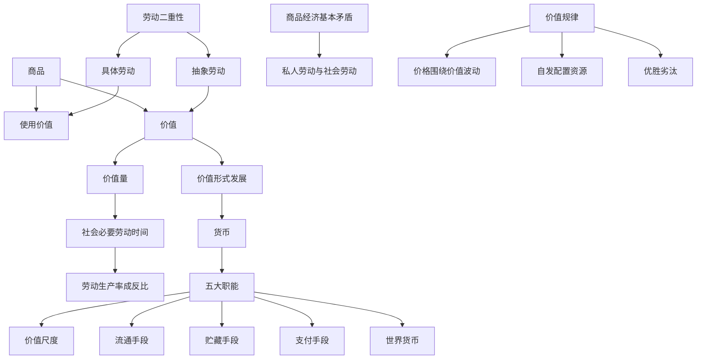

# 01 商品与货币 · 章节总结

> 对应原书：第一篇 商品和货币（第 1-3 章）
> 📖 原书原文：[[../../../原文件/经济学/马克思主义政治经济学概论_全书|《概论》第1-3章]]

## 这一篇在回答什么问题

马克思从资本主义经济的**细胞**——商品——开始解剖。要回答：

1. **商品为什么有价值？** → 因为它是劳动产品，劳动有二重性。
2. **价值量由什么决定？** → 社会必要劳动时间。
3. **货币从哪来？** → 价值形式长期发展的结果。
4. **货币流通遵循什么规律？** → 流通中需要的货币量 = 商品价格总额 / 货币流通速度。
5. **商品经济的基本规律是什么？** → 价值规律。

## 本篇框架图

## 核心公式

$$\text{单位商品价值量} \propto \frac{1}{\text{社会劳动生产率}}$$

$$\text{流通中所需货币量} = \frac{\text{待售商品价格总额}}{\text{同名货币流通次数}}$$

$$\text{商品价值量} = \text{社会必要劳动时间} \quad (\text{简单劳动为尺度，复杂劳动} = n \times \text{简单劳动})$$

## 核心概念速查

| 概念 | 一句话 | 详细 KP |
|---|---|---|
| 使用价值 | 物品的有用性（奶茶能喝） | [[知识点/KP01_商品二因素]] |
| 价值 | 凝结在商品中的无差别人类劳动（做奶茶花的社会必要劳动） | [[知识点/KP01_商品二因素]] |
| 具体劳动 | 做奶茶的具体动作（泡茶、加奶、封口） | [[知识点/KP02_劳动二重性]] |
| 抽象劳动 | 撇开具体形式的一般人类脑力体力消耗 | [[知识点/KP02_劳动二重性]] |
| 社会必要劳动时间 | 现有正常生产条件、平均熟练强度下制造使用价值所需时间 | [[知识点/KP04_商品价值量]] |
| 货币 | 固定充当一般等价物的商品 | [[知识点/KP05_货币的起源与本质]] |
| 价值规律 | 商品价值量由社会必要劳动时间决定，交换以价值量为基础等价交换 | [[知识点/KP08_价值规律]] |

## 思考题（原书）

1. 怎样理解商品二因素和生产商品的劳动二重性的关系？为什么说劳动二重性是理解政治经济学的枢纽？
2. 商品的价值量是由什么决定的？劳动生产率和价值量的关系怎样？
3. 货币是怎样产生的？它的本质和职能是什么？
4. 价值规律的内容、表现形式和作用是什么？

## 🔗 相关知识点

**本篇：** [[知识点/KP01_商品二因素]] ｜ [[知识点/KP02_劳动二重性]] ｜ [[知识点/KP03_私人劳动社会劳动与商品拜物教]] ｜ [[知识点/KP04_商品价值量]] ｜ [[知识点/KP05_货币的起源与本质]] ｜ [[知识点/KP06_货币的五大职能]] ｜ [[知识点/KP07_货币流通规律与通货膨胀]] ｜ [[知识点/KP08_价值规律]]

**跨章：** [[../02_资本主义经济制度与生产/00_章节总结|02 资本主义生产（货币如何变成资本）]]

**跨课对照：** 西方经济学用"效用价值论"解释价格（东西让我爽就值钱），政治经济学用"劳动价值论"解释（花了多少社会必要劳动时间）。这是两门课最根本的对立。
