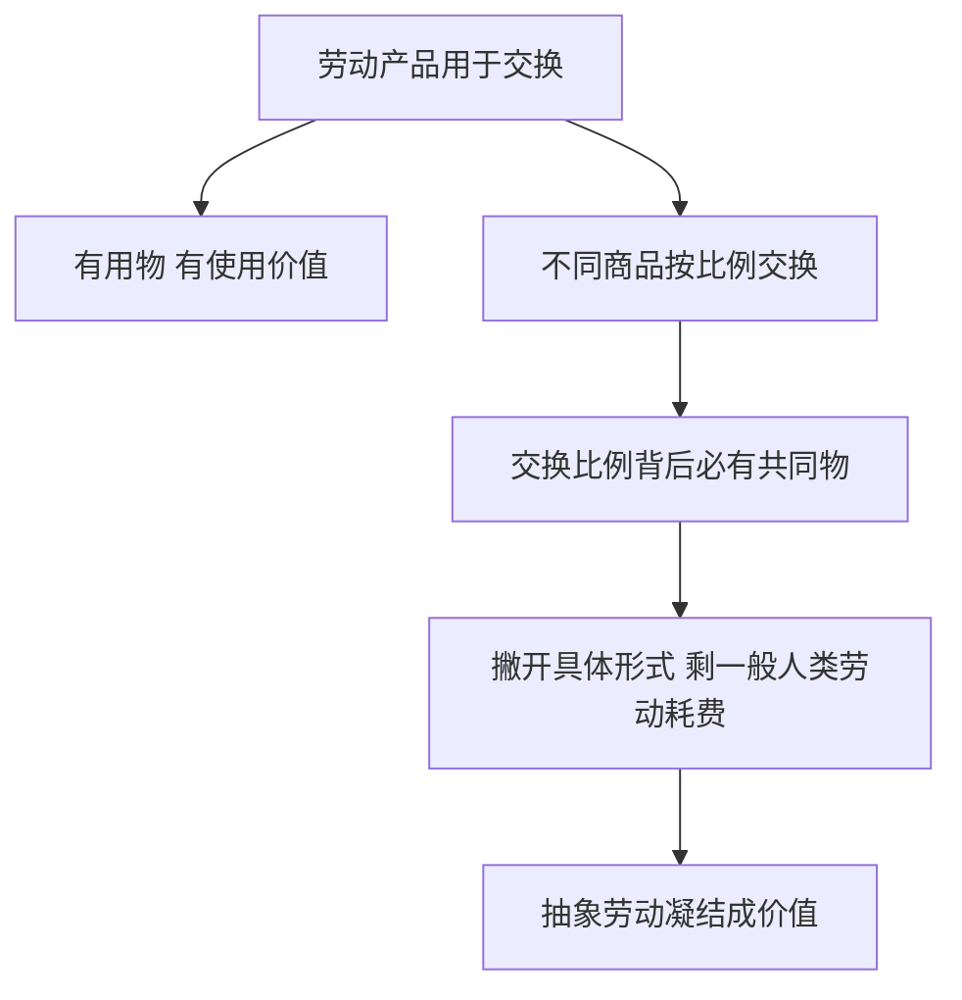

# KP01 · 商品二因素（使用价值与价值）

<a href="../../../../exam.html" target="_blank" style="display:inline-block;padding:6px 16px;background:#2563eb;color:#fff;border-radius:6px;text-decoration:none;font-size:14px;">📝 开始做题</a>

> 所属：[[../00_章节总结|第1章 商品]] ｜ 节：原书第一章第一节

## 1. 一句话先懂（小白版）

一杯奶茶，一方面能**解渴好喝**（这叫**使用价值**），另一方面能**卖 15 块钱**（这背后是**价值**）。任何商品都同时有这两副面孔——一个是"它能干啥"，一个是"它值多少劳动"。

**关键**：价值不是"它让我爽的程度"，而是"做它花了社会必要劳动时间"。这是马克思和西方经济学的根本分歧。

## 2. 严格定义

**商品**：用来**交换**的劳动产品。它必须同时具备两个因素：

| 因素 | 定义 | 性质 |
|---|---|---|
| **使用价值** | 物品能够满足人们某种需要的属性（物的有用性） | 商品的**自然属性**，构成社会财富的物质内容 |
| **价值** | 凝结在商品中的**无差别的一般人类劳动**（抽象人类劳动） | 商品的**社会属性**，是交换价值的基础 |

**交换价值**：价值的表现形式，首先表现为一种使用价值同另一种使用价值相交换的**量的关系或比例**。

> 例：1 杯奶茶 = 3 个包子。这个"3 个包子"就是奶茶的交换价值。
>
> **为什么会有这个比例？** 因为两边凝结的**抽象劳动量**相等——这就是价值。

## 3. 为什么（原理/机制）

### 使用价值和价值为什么是矛盾统一体？

**统一性**：
- 一个东西要成为商品，必须既有使用价值又有价值。
- 没有用的东西（比如你随手画的一张废纸），就算你花了劳动也没人要，没有价值。
- 有使用价值但不是劳动产品（比如空气、阳光），也没有价值。
- 有使用价值、是劳动产品，但**不拿来交换**（比如自家做的晚饭自己吃），也不是商品。

**斗争性**：
- 对同一个人来说，他不能同时占有同一个商品的使用价值和价值。
- 王老板卖奶茶：他要实现**价值**（拿到 15 元），就得把**使用价值**（奶茶本身）让渡给顾客；
- 顾客买奶茶：他要占有**使用价值**（喝到奶茶），就得支付**价值**（15 元）。
- 这个矛盾只有通过**交换**才能解决。

### 为什么说价值是"社会属性"？

因为一个东西**孤立地看没有价值**。你一个人在荒岛上做了一杯奶茶，它有使用价值（解渴），但没有价值——因为没有交换、没有社会关系。

价值本质上是**被物的外壳掩盖着的人与人之间的社会生产关系**。

## 4. 来源（理论怎么来的）

- **古典政治经济学**（配第、斯密、李嘉图）已经提出了劳动价值论，但他们说不清"是什么劳动创造价值"。
- **马克思的突破**：区分了**具体劳动**和**抽象劳动**（见 [[KP02_劳动二重性]]）。创造使用价值的是具体劳动，形成价值的是抽象劳动。这样二因素和二重性就对上了。

## 5. 怎么用（现实例子）

**判断下面这些是不是商品、有没有价值：**

| 东西 | 是劳动产品？ | 有使用价值？ | 用来交换？ | 是商品？ |
|---|---|---|---|---|
| 店里卖的奶茶 | 是 | 是 | 是 | ✅ 是 |
| 妈妈给你做的晚饭 | 是 | 是 | 否（自己吃） | ❌ 不是 |
| 海里的鱼（没捕捞） | 否 | 是 | 否 | ❌ 不是 |
| 空气 | 否 | 是 | 否 | ❌ 不是 |
| 你画了卖不出去的画 | 是 | 没人觉得有用 | 否 | ❌ 不是（无使用价值） |
| 假货假包 | 是 | 是 | 是 | ✅ 是（有价值，虽然违法） |

**关键洞察**：商品的"有用性"是自然属性，不是商品独有的；商品的"价值"才是社会属性，是商品经济独有的。

## 5.5 理论推导（一步步推）

> 本节补充：商品为什么必然有使用价值和价值二因素。

**假设起点**：
1. 劳动产品不是自产自消，而是拿来交换的（成为商品）；
2. 任何生产劳动都可以从"具体形式"和"脑力体力耗费"两个角度观察。

**推导过程**：
- 第一步：商品首先是个有用物，能满足人的某种需要（奶茶解渴、衣服保暖）→ 它具有**使用价值**（自然属性）。
- 第二步：交换要求不同商品按一定比例相交换（2 杯奶茶 = 1 个包子），这个比例不可能由使用价值本身决定（奶茶和包子用途不同，不可比）。
- 第三步：撇开一切具体有用形式，两种商品共同剩下的东西，只是"人类一般劳动的耗费"→ 这就是**抽象劳动**的凝结，即**价值**（社会属性）。
- 结论：商品 = 使用价值 + 价值。使用价值是价值的物质承担者；二者对立统一——生产者要实现价值，必须让渡使用价值。

## 5.6 数学推导（公式怎么来的）

> 每个符号第一次出现必须解释。

设商品的价值量由凝结其中的社会必要劳动时间度量。记：
- $W$ = 单位商品价值；
- $\bar t$ = 生产该商品的社会必要劳动时间。

则：
$$W = \bar t$$

两种商品等价交换，交换比例等于价值之比：

$$\frac{W_A}{W_B} = \frac{\bar t_A}{\bar t_B}$$

例如 $\bar t_A = 6$ 分钟（一杯奶茶），$\bar t_B = 12$ 分钟（一个包子），则 $2$ 杯奶茶 $= 1$ 个包子。

使用价值不可量化为价值——它是 $W$ 的物质载体，不是 $W$ 的组成部分。

## 6. 什么时候不能用（边界条件）

- 价值是**历史范畴**，不是永恒范畴。在原始社会、共产主义社会（按需分配），没有商品交换，也就没有价值。
- **不是所有有价格的东西都有价值**。比如处女地、股票、名人签名、文凭——它们没有凝结劳动，但有价格。马克思叫它们"没有价值的价格"。
- 数字经济时代的新问题：数据、算法、注意力有没有价值？这是当代劳动价值论要回答的新课题（原书第一章第三节专门讨论）。

## 7. 容易混淆什么

| 容易混 | 区别 |
|---|---|
| 使用价值 vs 价值 | 使用价值 = 能干啥（自然属性）；价值 = 凝结多少抽象劳动（社会属性）。 |
| 价值 vs 交换价值 | 价值是内容（劳动量）；交换价值是形式（1 杯奶茶 = 3 个包子）。价值是交换价值的基础。 |
| 价值 vs 价格 | 价值是本质（劳动量）；价格是价值的货币表现（15 元）。价格围绕价值波动。 |
| 政治经济学的"价值" vs 日常生活的"价值" | 日常说"这个项目很有价值"=有用；政治经济学里价值=凝结的抽象劳动。 |
| 劳动价值论 vs 效用价值论 | 前者：价值由劳动决定；后者（西方经济学）：价值由主观效用（让我爽的程度）决定。 |

## 8. 现实意义

- **为什么钻石比水贵？** 斯密当年就问过这个问题（"钻石与水悖论"）。马克思的答案：水的使用价值极大，但获取它的社会必要劳动时间少，所以价值小；钻石开采难、社会必要劳动时间多，所以价值大。（西方经济学用边际效用解释：水很多所以边际效用低，钻石稀缺所以边际效用高。）
- **为什么明星片酬那么高？** 按劳动价值论，明星表演本身是劳动，但片酬里大量是"没有价值的价格"——垄断地位、粉丝经济、稀缺性带来的。

---

## 🔗 相关知识点

**同章关联：** [[KP02_劳动二重性]] ｜ [[KP03_私人劳动社会劳动与商品拜物教]] ｜ [[KP04_商品价值量]] ｜ [[KP08_价值规律]]

**跨章关联：** [[../../02_资本主义经济制度与生产/知识点/KP04_劳动过程与价值增殖过程|剩余价值生产（价值增殖）]]

**跨课对照：** 效用价值论见 [[../../../06_西方经济学/README|06 西方经济学·效用论]]。

**📖 原书原文：** [[../../../../原文件/经济学/马克思主义政治经济学概论_全书#第一节 商品及其内在矛盾|《概论》第一章第一节]]

---

## 📝 考研真题（首经贸 801）

**配套主观题：** 见同目录 [[../考研真题集|本章考研真题集]]
**配套选择题：** 见同目录 [[../选择题集|本章选择题集]]

### 高频简答
- 简述商品二因素及其相互关系 → 见 [[../考研真题集#s1|真题集·简答 1]]
- 为什么说价值是商品的社会属性，而不是自然属性 → 见 [[../考研真题集#s2|真题集·简答 2]]

### 高频论述
- 试述劳动二重性学说及其在马克思主义政治经济学中的地位 → 见 [[../考研真题集#l1|真题集·论述 1]]

### 易错选择
- 本知识点选择题见 [[../选择题集#KP01 商品二因素|选择题集·KP01]]
