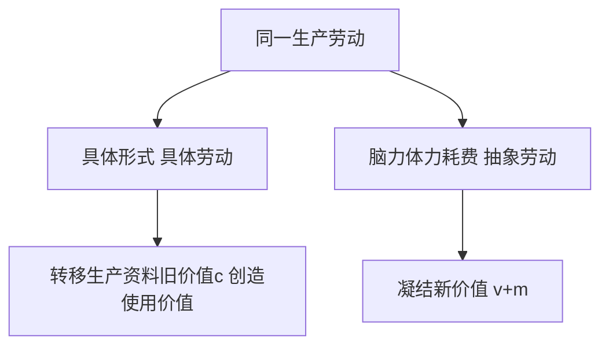

# KP02 · 劳动二重性（具体劳动与抽象劳动）

<div style="text-align:right;margin:10px 0;"><a href="../../../../exam.html" target="_blank" style="display:inline-block;padding:6px 16px;background:#2563eb;color:#fff;border-radius:6px;text-decoration:none;font-size:14px;">📝 开始做题</a></div>


> 所属：[[../00_章节总结|第1章 商品]] ｜ 节：原书第一章第一节
> ⭐ **马克思说："劳动二重性是理解政治经济学的枢纽。"**

## 1. 一句话先懂（小白版）

你做一杯奶茶，具体动作是"烧水、泡茶、加奶、封口"——这叫**具体劳动**。
但如果你把这些动作都撇开，只看"你花了一个小时脑力体力"——这叫**抽象劳动**。

**同一份干活，从两个角度看**：
- 看它"做了什么动作" → 具体劳动 → 创造**使用价值**；
- 看它"花了多少精力" → 抽象劳动 → 形成**价值**。

为什么这是枢纽？因为不区分这两种劳动，就解释不清"为什么不同的东西能按比例交换"——泡茶 1 小时和做包子 1 小时，动作完全不同，凭什么能比？因为撇开具体形式后，它们都是"一般人类劳动消耗"，可以通约。

## 2. 严格定义

| 二重性 | 定义 | 对应商品因素 | 性质 |
|---|---|---|---|
| **具体劳动**（有用劳动） | 生产目的、操作方式、劳动对象、生产手段和生产结果都各不相同的、在具体形式下进行的劳动 | 创造**使用价值** | 劳动的**自然属性**，人类生存的永恒条件 |
| **抽象劳动** | 撇开具体形式的、无差别的一般人类劳动力的耗费（脑力、筋肉、神经、手的生产性支出） | 形成**价值** | 劳动的**社会属性**，商品经济特有的历史范畴 |

> 公式链条：**劳动二重性 → 商品二因素**
> 具体劳动 → 使用价值
> 抽象劳动 → 价值

## 3. 为什么（原理/机制）——完整推导不跳步

### 问题：不同的具体劳动怎么能交换？

假设 1 杯奶茶 = 3 个包子。

- 泡茶和包包子，动作完全不同：一个用锅，一个用蒸笼；一个加热水，一个揉面。
- **具体劳动维度上，它们不可比**（你不能说"泡茶比包包子高级"）。
- 但交换就是在说它们相等。相等的东西必然有某种共同的东西。

### 马克思的解法

把具体形式全部抽象掉：

```
泡茶劳动（具体形式：手、茶叶、水、温度……）
包包子劳动（具体形式：手、面粉、馅、蒸笼……）
        ↓ 撇开一切具体形式
   都变成"人类劳动力的耗费"
   = 脑力 + 筋肉 + 神经 + 时间
        ↓ 这就是抽象劳动
   两者在"抽象劳动量"上可以比较
   泡茶 1 小时 = 包包子 1 小时（简化版）
```

**关键一步**：抽象劳动不是一个"物理事实"，而是一个**社会事实**——只有在商品交换关系中，人们才需要把不同劳动当作等同的东西。自然经济里，你种粮我织布，互相直接用，不需要"抽象"成等同的东西。

### 为什么抽象劳动是历史范畴？

- **鲁滨逊在荒岛上**：他做船、搭棚、捕鱼，都是具体劳动，没必要把它们"抽象"成等同的人类劳动——因为他不和别人交换。
- **共产主义社会**：大家按需分配，也不需要交换劳动产品，抽象劳动、价值这些范畴就消失了。
- **只有商品经济社会**：劳动产品要互相交换，才需要把不同劳动通约为"抽象劳动"。

## 4. 来源（理论怎么来的）

- **古典政治经济学的缺陷**：斯密、李嘉图虽然提出了劳动价值论，但他们不知道"是什么劳动创造价值"。他们有时说"一般社会劳动"，有时说"耗费的劳动"，概念含糊。
- **马克思的突破**：在《政治经济学批判》（1859）和《资本论》第一卷第一章明确提出劳动二重性。马克思自己说这是他"最好的地方"，是《资本论》"崭新的因素"。

## 5. 怎么用（现实例子）

**看你在奶茶店的一天：**

| 具体动作（具体劳动） | 对应的使用价值 |
|---|---|
| 烧水、泡茶 | 茶水 |
| 倒牛奶、加糖 | 奶茶液体 |
| 封口、贴标签 | 可携带的杯装奶茶 |
| 收银、擦桌子 | 门店服务环境 |

**但从抽象劳动看**：你今天干了 8 小时，就是 8 小时人类劳动力耗费。这个耗费不关心你做的是奶茶还是包子——它只是"干了 8 小时活"。

**为什么这能解释工资？** 王老板算工资时，不关心你做奶茶的动作多优美，他只关心你今天干了几小时——因为他在按"抽象劳动时间"买你的劳动力。

## 5.5 理论推导（一步步推）

> 本节补充：同一劳动为什么能同时创造使用价值和价值。

**假设起点**：
1. 生产商品的劳动总是有目的的具体活动（裁缝做衣、店员冲奶茶）；
2. 任何劳动都伴随人的脑力、肌肉、神经消耗。

**推导过程**：
- 第一步：从**具体形式**看，劳动是具体劳动——不同目的、不同工具、不同动作，把生产资料加工成新产品 → 创造**使用价值**。
- 第二步：同一劳动从**脑力体力耗费**看，撇开具体形式，都是人的一般生命力消耗 → **抽象劳动**。
- 第三步：具体劳动的作用是把茶叶牛奶这些生产资料的旧价值**转移**到新奶茶里（即不变资本 $c$ 的转移）。
- 第四步：抽象劳动的作用是**凝结**成新价值（即可变资本 $v$ + 剩余价值 $m$）。
- 结论：不是两次劳动，而是**同一劳动的两个方面**——具体劳动转移 $c$、创造使用价值；抽象劳动凝结 $v+m$、形成价值。这就是"理解政治经济学的枢纽"。



## 5.6 数学推导（公式怎么来的）

> 每个符号第一次出现必须解释。

新产品总价值：

$$W = c + v + m$$

其中：
- $c$ = 生产资料旧价值转移额（由具体劳动完成，不增殖）；
- $v$ = 可变资本（工人工资对应的价值）；
- $m$ = 剩余价值。

设一个工作日长度为 $L$，拆成两段：

$$L = a + b$$

- $a$ = 必要劳动时间（再生产工资 $v$ 所需）；
- $b$ = 剩余劳动时间（无偿为资本家创造 $m$）。

若单位劳动时间创造的价值为 $w$，则：

$$v = a \cdot w, \qquad m = b \cdot w$$

剩余价值率：

$$m' = \frac{m}{v} = \frac{b \cdot w}{a \cdot w} = \frac{b}{a} = \frac{\text{剩余劳动时间}}{\text{必要劳动时间}}$$


## 6. 什么时候不能用（边界条件）

- **具体劳动是永恒的，抽象劳动是历史的**。任何社会都要有具体劳动生产使用价值；但抽象劳动只有在商品经济下才形成价值。
- **复杂劳动 = 多倍的简单劳动**。你做奶茶 1 小时（简单劳动）可能 = 程序员写代码 15 分钟（复杂劳动 = 4 倍简单劳动）。这个比例是**社会过程**自发形成的，不是谁规定的。
- **科技劳动、管理劳动、服务劳动**（原书第一章第三节）：当代马克思主义政治经济学承认这些也是生产劳动，也创造价值——不能把抽象劳动窄化成"拧螺丝的体力劳动"。

## 7. 容易混淆什么

| 容易混 | 区别 |
|---|---|
| 具体劳动 vs 抽象劳动 | 具体 = 怎么做的（自然形式）；抽象 = 花了多少精力（社会等同性）。 |
| 具体劳动 vs 私人劳动 | 具体劳动是"劳动的自然形式"；私人劳动是"劳动的社会分工形式"（你为自己干）。 |
| 抽象劳动 vs 个别劳动时间 | 抽象劳动是"劳动的等同性"；个别劳动时间是"某个人实际花的时间"。 |
| 劳动二重性 vs 商品二因素 | 劳动二重性是原因，商品二因素是结果。具体劳动创造使用价值，抽象劳动形成价值。 |
| 抽象劳动 vs 普通的"脑力体力消耗" | 物理上任何劳动都消耗脑力体力；但**只有在商品交换关系中，这种消耗才被当作"等同的人类劳动"**，才形成价值。 |

## 8. 现实意义

- **为什么外卖骑手算法算的是"时间"而不是"动作"？** 平台把取餐、送餐、爬楼全抽象成"几分钟一单"——这就是抽象劳动在数字时代的体现。
- **为什么程序员和奶茶店店员可以用同一种货币发工资？** 因为两者的劳动都被抽象为"劳动时间"，用统一的尺度衡量。
- **马克思主义怎么看"996"？** 996 的本质是：资本家尽可能延长工人的抽象劳动时间（剩余劳动时间），榨取更多剩余价值。

---

## 🔗 相关知识点

**同章关联：** [[KP01_商品二因素]] ｜ [[KP03_私人劳动社会劳动与商品拜物教]] ｜ [[KP04_商品价值量]]

**跨章关联：** [[../../02_资本主义经济制度与生产/知识点/KP06_剩余价值率|剩余价值率（抽象劳动时间在资本主义下的分裂）]] ｜ [[../../02_资本主义经济制度与生产/知识点/KP07_绝对剩余价值与相对剩余价值|绝对剩余价值（延长抽象劳动时间）]]

**跨课对照：** 西方经济学没有"劳动二重性"这个概念，它把劳动当成和资本一样的生产要素，按边际产出分配。

**📖 原书原文：** [[../../../../原文件/经济学/马克思主义政治经济学概论_全书#第一节 商品及其内在矛盾|《概论》第一章第一节]]

---

## 📝 考研真题（首经贸 801）

**配套主观题：** 见同目录 [[../考研真题集|本章考研真题集]]
**配套选择题：** 见同目录 [[../选择题集|本章选择题集]]

### 高频简答
- 简述生产商品的劳动二重性及其与商品二因素的关系 → 见 [[../考研真题集#s3|真题集·简答 3]]
- 为什么说劳动二重性是"理解政治经济学的枢纽" → 见 [[../考研真题集#s4|真题集·简答 4]]

### 高频论述
- 试述劳动二重性学说的基本内容，并说明它为什么是"理解政治经济学的枢纽" → 见 [[../考研真题集#l1|真题集·论述 1]]

### 易错选择
- 本知识点选择题见 [[../选择题集#KP02 劳动二重性|选择题集·KP02]]
