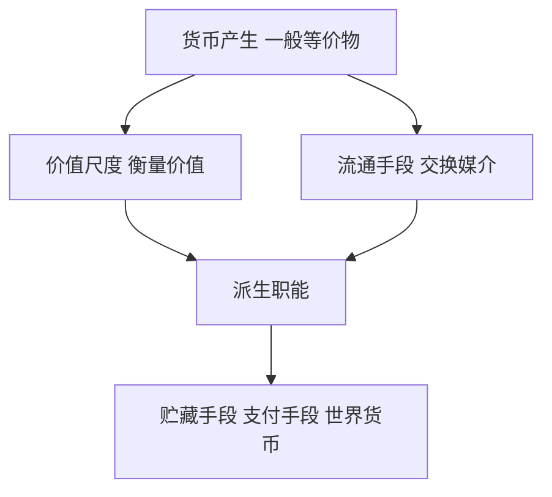

# KP06 · 货币的五大职能

<a href="../../../../exam.html" target="_blank" style="display:inline-block;padding:6px 16px;background:#2563eb;color:#fff;border-radius:6px;text-decoration:none;font-size:14px;">📝 开始做题</a>

> 所属：[[../00_章节总结|第2章 货币]] ｜ 节：原书第二章第一节

## 1. 一句话先懂（小白版）

货币有五个本事，一个比一个高级：

1. **它能说"这东西值多少钱"** → 价值尺度（标价签）；
2. **它能帮你买东西** → 流通手段（一手交钱一手交货）；
3. **它能存起来以后用** → 贮藏手段（压箱底的银子）；
4. **它能先拿货后给钱** → 支付手段（赊账、发工资、交税）；
5. **它能在国际上用** → 世界货币（美元、黄金）。

前两个（价值尺度、流通手段）是货币一诞生就有的，叫**基本职能**；后三个是商品交换发展后派生出来的，叫**派生职能**。

## 2. 严格定义

| 职能 | 定义 | 特点 | 例子 |
|---|---|---|---|
| **价值尺度** | 货币充当衡量商品所包含价值量大小的社会尺度 | 不需要现实货币，只需要观念上的货币（标签写 15 元就行） | 奶茶店菜单上写"15 元" |
| **流通手段** | 货币充当商品交换的媒介 | 必须是现实货币，但可以是不足值的（纸币） | 你扫码付 15 元拿走奶茶 |
| **贮藏手段** | 货币退出流通、被人们当作社会财富的一般代表保存起来 | 必须是足值的金属货币或金银条块 | 老太太藏的银元、国家黄金储备 |
| **支付手段** | 货币在延期支付时用于清偿债务、支付赋税、租金、工资 | 赊账、借贷、发工资 | 月底发工资、还房贷 |
| **世界货币** | 货币在世界市场上充当一般等价物 | 必须是足值的金、银（或被国际公认的货币如美元） | 国际贸易结算、央行黄金储备 |

## 3. 为什么（原理/机制）

### 价值尺度：为什么只需要"观念上的货币"？

奶茶店老板在菜单上写"15 元"，他不需要在菜单旁边放 15 元真钱。他只是在**标明这杯奶茶的价值量**——等于多少社会必要劳动时间，用货币来表达。

价格 = 价值的货币表现。一杯奶茶价值 = 1 小时社会必要劳动，1 小时社会必要劳动 = 15 元，所以奶茶价格 = 15 元。

### 流通手段：为什么纸币能代替金属货币？

作为流通手段，货币只是"一闪而过的媒介"——你拿 15 元换奶茶，王老板拿这 15 元去买茶叶，每个人都不关心这张钱本身值不值 15 元，只关心**别人认不认它**。

所以国家可以用纸币（本身不值钱）代替金属货币，只要大家都认。

### 支付手段：为什么这个职能会带来风险？

赊账和信用发展后，买卖变成了**链条**：
- A 欠 B 100 元；
- B 欠 C 100 元；
- C 欠 D 100 元。

如果 A 还不上，B 就还不上 C，C 还不上 D——**一个环节断裂，整个信用链崩溃**。这就是为什么经济危机首先表现为"支付危机"（见 [[../../04_经济危机与历史趋势/知识点/KP01_资本主义经济危机]]）。

### 世界货币：为什么是美元、黄金？

- 在金本位时代，世界货币就是黄金本身；
- 二战后布雷顿森林体系，美元和黄金挂钩，其他货币和美元挂钩；
- 今天美元虽然不兑现黄金，但靠美国的经济、军事、信用实力，仍然充当世界货币；
- 但这是不稳定的——这就是为什么各国推动"去美元化"、增持黄金。

## 4. 来源（理论怎么来的）

马克思在《资本论》第一卷第三章系统论述了货币的职能。他的顺序是：价值尺度 → 流通手段 → 货币（贮藏、支付、世界货币）。这个顺序不是随意的，而是**逻辑和历史一致**——先有标价，再有交换媒介，然后才有贮藏、赊账、世界市场。

## 5. 怎么用（现实例子）

**判断下面用了货币的哪个职能：**

| 场景 | 职能 |
|---|---|
| 商店标签写"这件衣服 599 元" | 价值尺度 |
| 你扫码付 599 元拿走衣服 | 流通手段 |
| 你把 1 万元现金放家里保险柜 | 贮藏手段 |
| 你月底收到 8000 元工资 | 支付手段 |
| 你还信用卡 3000 元 | 支付手段 |
| 企业交增值税 5 万元 | 支付手段 |
| 中国央行增持 100 吨黄金 | 世界货币/贮藏手段 |
| 中国买沙特石油用美元结算 | 世界货币 |
| 你把人民币换成美元存着 | 世界货币 |

**关键**：同一张钱在不同场景下扮演不同角色。你工资卡里的 8000 元，作为"工资金额"是支付手段；你拿去超市付款是流通手段；你存进定期不动是贮藏手段（纸币时代贮藏手段功能弱化）。

## 5.5 理论推导（一步步推）

> 本节补充：货币五大职能的先后逻辑。

**假设起点**：货币是固定充当一般等价物的商品。

**推导过程**：
- 第一步：货币一产生，就能衡量一切商品的价值大小 → **价值尺度**（给商品标价，只需观念上的货币）。
- 第二步：商品交换需要媒介，货币充当 $W-G-W$ 的中介 → **流通手段**（必须是现实货币）。
- 第三步：商品卖出后不立刻买，货币退出流通被保存起来 → **贮藏手段**（必须是足值金属货币）。
- 第四步：赊购赊销出现，到期还债时货币不再伴随商品同时交割，而是单方面转移 → **支付手段**（发工资、还债、交租、纳税）。
- 第五步：国际贸易发展，货币越出国界 → **世界货币**（贵金属或国际硬通货）。
- 结论：价值尺度和流通手段是货币一产生就有的**基本职能**；贮藏手段、支付手段、世界货币是商品经济发展后**派生**出来的。

## 5.6 数学推导（公式怎么来的）

> 每个符号第一次出现必须解释。

- **价值尺度**：商品价格 $P$ 是商品价值与货币价值的比值

$$P = \frac{\text{商品价值}}{\text{货币（金）价值}}$$

一杯奶茶社会必要劳动 6 分钟，1 克金社会必要劳动 600 分钟，则奶茶价格 $= 6/600 = 0.01$ 克金。

- **流通手段**：执行流通手段的货币量服从货币流通规律

$$M = \frac{P \times Q}{V}$$

（详见 [[KP07_货币流通规律与通货膨胀]]）

## 6. 什么时候不能用（边界条件）

- **纸币不能当贮藏手段**。纸币会贬值，今天的 100 元 20 年后可能只值今天的 30 元。所以普通人"存钱"不是真的贮藏手段，而是持有支付手段/流通手段的准备金。真正的贮藏手段是黄金、硬资产。
- **人民币还不是完全的世界货币**。它在周边国家、一带一路有使用，但还不能在全球自由结算。这就是为什么要推人民币国际化。
- **价值尺度职能要求货币本身价值稳定**。如果货币本身币值不稳（恶性通胀），它就没法准确衡量别的商品价值——价格信号全乱了。

## 7. 容易混淆什么

| 容易混 | 区别 |
|---|---|
| 价值尺度 vs 价格标准 | 价值尺度是"衡量商品价值"；价格标准是"国家规定的货币单位"（1 元 = 10 角）。前者是社会职能，后者是技术规定。 |
| 流通手段 vs 支付手段 | 流通手段 = 一手交钱一手交货（同时）；支付手段 = 延期支付（先货后钱或先钱后货）。 |
| 贮藏手段 vs 储蓄 | 贮藏手段是把足值金属货币退出流通；储蓄是把纸币存入银行，它仍然在银行体系里流转。 |
| 货币的职能 vs 货币的本质 | 本质是一般等价物；职能是本质在不同场景下的具体表现。 |

## 8. 现实意义

- **为什么央行要管理币值稳定？** 因为价值尺度职能要求货币本身稳定，否则价格信号失真，资源配置全乱。
- **为什么工资、税收、债务都用货币计价？** 这是支付手段职能的扩展。
- **为什么美联储加息会引发全球动荡？** 因为美元是世界货币，它的利率变化直接影响全球支付链。

---

## 🔗 相关知识点

**同章关联：** [[KP05_货币的起源与本质]] ｜ [[KP07_货币流通规律与通货膨胀]]

**跨章关联：** [[../../02_资本主义经济制度与生产/知识点/KP02_货币转化为资本|货币作为资本（G-W-G'）]] ｜ [[../../04_经济危机与历史趋势/知识点/KP01_资本主义经济危机|支付链条断裂引发危机]]

**跨课对照：** 西方经济学把货币职能简化为"交易媒介+计价单位+价值贮藏"，不分析支付手段和信用链风险。

**📖 原书原文：** [[../../../../原文件/经济学/马克思主义政治经济学概论_全书#第一节 货币的本质和职能|《概论》第二章第一节]]

---

## 📝 考研真题（首经贸 801）

**配套主观题：** 见同目录 [[../考研真题集|本章考研真题集]]
**配套选择题：** 见同目录 [[../选择题集|本章选择题集]]

### 高频简答
- 简述货币的五大职能及其相互关系 → 见 [[../考研真题集#s8|真题集·简答 8]]

### 高频论述
- 运用货币流通规律分析我国近年来通货膨胀的成因与治理 → 见 [[../考研真题集#l3|真题集·论述 3]]

### 易错选择
- 本知识点选择题见 [[../选择题集#KP06 货币的五大职能|选择题集·KP06]]
