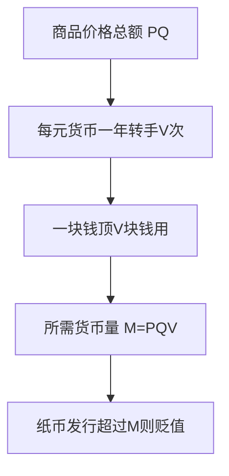

# KP07 · 货币流通规律与通货膨胀

<div style="text-align:right;margin:10px 0;"><a href="../../../../exam.html" target="_blank" style="display:inline-block;padding:6px 16px;background:#2563eb;color:#fff;border-radius:6px;text-decoration:none;font-size:14px;">📝 开始做题</a></div>


> 所属：[[../00_章节总结|第2章 货币]] ｜ 节：原书第二章第三节

## 1. 一句话先懂（小白版）

一个社会里到底需要多少钱在市面上流通？不是央行想印多少就印多少，而是由一个公式决定的：

$$\text{需要的货币量} = \frac{\text{所有商品的价格总额}}{\text{钱转手的次数}}$$

比如全国一年要卖 100 万亿的货，每块钱一年转手 5 次，那市面上只要 20 万亿就够了。
如果央行印了 40 万亿，多出来的 20 万亿没有对应商品，物价就会涨——这就是**通货膨胀**。

## 2. 严格定义

**货币流通规律**：一定时期内商品流通中所需要的货币量，取决于三个因素：
1. 待售商品总量；
2. 商品价格水平；
3. 同名货币的流通速度（次数）。

公式：

$$M = \frac{P \times Q}{V}$$

其中：
- $M$ = 流通中所需货币量；
- $P$ = 商品价格水平；
- $Q$ = 待售商品数量；
- $P \times Q$ = 商品价格总额；
- $V$ = 同一单位货币的平均流通速度（次数/年）。

**纸币流通规律**：纸币的发行量限于它象征地代表的金（或银）的实际流通量。如果纸币发行量超过这个限度，就会引起纸币贬值、物价上涨。

**通货膨胀**：纸币发行量超过流通中实际需要的货币量，引起纸币贬值、物价持续普遍上涨的经济现象。

**通货紧缩**：纸币发行量少于实际需要量，引起纸币升值、物价持续普遍下跌。

## 3. 为什么（原理/机制）——完整推导

### 为什么需要这个规律？

商品交换是"商品 → 货币 → 商品"（$W-G-W$）。每一块钱在一年内要被很多人用：
- 你用 15 元买奶茶；
- 王老板拿这 15 元买茶叶；
- 茶农拿这 15 元买衣服；
- 服装店老板拿这 15 元交房租……

一块钱一年转 5 次，就顶 5 块钱用。所以流通中需要的货币量，不是商品价格总额本身，而是它除以流通速度。

### 通货膨胀怎么产生？

```
假设社会实际需要 20 万亿货币
    ↓
央行多印了 20 万亿（总共 40 万亿）
    ↓
商品还是那么多（100 万亿货），但钱多了一倍
    ↓
同样的货对应更多的钱
    ↓
物价上涨一倍（100 万亿货对应 40 万亿钱，价格水平翻倍）
    ↓
每块钱的购买力下降一半 = 纸币贬值
```

**关键**：通货膨胀不是"某样东西涨价"，而是**物价总水平持续普遍上涨**。猪肉涨了但手机跌了，那不叫通胀；所有东西一起涨，才叫通胀。

### 通货紧缩为什么也不好？

物价持续下跌 → 大家觉得"再等等更便宜" → 不消费 → 企业卖不出去 → 裁员 → 大家更没钱 → 更不消费。这就是**通缩螺旋**，比通胀还难治（日本"失去的二十年"）。

## 4. 来源（理论怎么来的）

- 古典政治经济学（休谟、李嘉图）已经有货币数量论雏形；
- 马克思在《政治经济学批判》中系统表述了货币流通规律；
- 后来的货币主义（弗里德曼）说"通货膨胀无论何时何地都是一种货币现象"——和马克思的纸币流通规律在形式上一致，但马克思强调这是**商品经济的内在矛盾**，不是简单的"印多了"。

## 5. 怎么用（现实例子）——手把手算

**题目**：某国一年待售商品 100 亿件，平均每件价格 100 元，每元货币一年平均转手 5 次。求：
① 流通中需要多少货币？
② 如果央行实际发行了 2500 亿元，物价会怎么变？
③ 此时 1 元钱的购买力是多少？

**第一步：算商品价格总额。**

$$P \times Q = 100 \text{ 元/件} \times 100 \text{ 亿件} = 10000 \text{ 亿元}$$

**第二步：算需要的货币量。**

$$M = \frac{P \times Q}{V} = \frac{10000}{5} = 2000 \text{ 亿元}$$

**第三步：对比实际发行量。**

央行发了 2500 亿，比需要的 2000 亿多了 500 亿，超发比例：

$$\frac{2500 - 2000}{2000} = 25\%$$

**第四步：物价怎么变？**

商品还是 10000 亿元的货，但现在有 2500 亿元在流通。在商品总量不变的情况下：

$$\text{新价格水平} = \frac{2500 \times 5}{100 \text{ 亿件}} = \frac{12500}{100 \text{ 亿}} = 125 \text{ 元/件}$$

物价从 100 元涨到 125 元，**上涨 25%**。

**第五步：1 元钱的购买力。**

原来 1 元买 $1/100 = 0.01$ 件商品；
现在 1 元买 $1/125 = 0.008$ 件商品。

$$\text{购买力} = \frac{0.008}{0.01} = 0.8$$

即 1 元钱只值原来的 8 毛，**贬值 20%**。

> 你看：超发 25% 的货币，物价涨 25%，但购买力只贬 20%——这两个数不一样，因为物价涨幅和购买力跌幅不是一回事。

## 5.5 理论推导（一步步推）

> 本节补充：流通中需要多少钱，是怎么推出来的。

**假设起点**：
1. 商品流通 $W-G-W$ 连续不断；
2. 同一枚货币在一年内被多次使用。

**推导过程**：
- 第一步：一年内所有待售商品的价格总额 $= P \times Q$（$P$ 平均价格水平，$Q$ 待售数量）。
- 第二步：但同一枚货币不是只花一次——你付奶茶店 15 元，店老板拿这 15 元买茶叶，茶农又拿它买衣服……每块钱一年内转手 $V$ 次。
- 第三步：一块钱顶 $V$ 块钱用，所以完成 $PQ$ 的交易额不需要 $PQ$ 这么多现金，只需要它除以 $V$。
- 第四步：纸币是价值符号，发行量必须限于这个量；超过就贬值、物价上涨。



## 5.6 数学推导（公式怎么来的）

> 每个符号第一次出现必须解释。

设一年内全部商品交易总额为 $P \cdot Q$，每元货币年平均流通 $V$ 次。

流通中所需货币量 $M$ 满足"货币周转额 = 商品交易额"：

$$M \cdot V = P \cdot Q$$

故：

$$M = \frac{P \cdot Q}{V}$$

**纸币超发的后果**：设实际需要 $M_0$，央行发行 $M_s > M_0$，在商品总量不变下：

$$\text{单位纸币代表价值} = \frac{M_0}{M_s}, \qquad \text{新价格水平} = \frac{M_s}{M_0} \cdot P$$

例：$M_0 = 2000$ 亿，$M_s = 2500$ 亿，则物价涨 $2500/2000 = 1.25$ 倍（涨 25%），单位纸币购买力 $= 2000/2500 = 0.8$（贬 20%）。


## 6. 什么时候不能用（边界条件）

- **这个公式是金属货币流通规律**。在金本位下，多余的金币会自动退出流通变成贮藏（熔化成金块），所以物价自动稳定。
- **纸币时代没有自动调节机制**。纸币不能熔化成金块，超发了就只能靠物价上涨来"消化"。
- **当代经济更复杂**：还要考虑信用货币（银行存款）、货币乘数、国际资本流动、预期等。马克思的公式是**基础公式**，不是完整模型。
- **通胀不一定全是央行印多了**。成本推动型通胀（油价暴涨）、需求拉动型通胀（大家突然都有钱）、结构性通胀（某些部门瓶颈）都可能引发物价上涨。

## 7. 容易混淆什么

| 容易混 | 区别 |
|---|---|
| 通货膨胀 vs 物价上涨 | 物价上涨是现象；通胀是**持续普遍**的物价上涨。个别商品涨价不是通胀。 |
| 通货膨胀 vs 纸币贬值 | 两者是一体两面：物价涨 = 纸币贬。 |
| 货币流通规律 vs 货币数量论 | 马克思的规律以商品流通为出发点（$M=PQ/V$）；弗里德曼的货币数量论 $MV=PY$ 形式一样，但他强调货币供给外生。 |
| 通胀 vs 滞胀 | 滞胀 = 经济停滞 + 通胀并存，凯恩斯主义解释不了，是 1970 年代的难题。 |

## 8. 现实意义

- **为什么各国央行把 CPI 2% 当目标？** 既要防通胀（钱变毛），也要防通缩（大家不消费）。
- **为什么疫情后美国大通胀？** 美联储 2020-2021 年放水 5 万亿，对应商品没那么多，物价自然涨。
- **为什么中国 2023-2024 年担心通缩？** 居民不敢消费、企业不敢投资，货币周转速度 $V$ 下降，央行放的钱在银行体系空转。

---

## 🔗 相关知识点

**同章关联：** [[KP05_货币的起源与本质]] ｜ [[KP06_货币的五大职能]] ｜ [[KP08_价值规律]]

**跨章关联：** [[../../04_经济危机与历史趋势/知识点/KP01_资本主义经济危机|经济危机（货币信用危机是先导）]]

**跨课对照：** 货币主义（弗里德曼）见 [[../../../06_西方经济学/README|06 西方经济学·宏观部分]]。

**📖 原书原文：** [[../../../../原文件/经济学/马克思主义政治经济学概论_全书#第三节 货币流通量及其规律|《概论》第二章第三节]]

---

## 📝 考研真题（首经贸 801）

**配套主观题：** 见同目录 [[../考研真题集|本章考研真题集]]
**配套选择题：** 见同目录 [[../选择题集|本章选择题集]]

### 高频简答
- 简述货币流通规律，并说明通货膨胀的成因 → 见 [[../考研真题集#s9|真题集·简答 9]]

### 高频论述
- 运用货币流通规律分析我国近年来通货膨胀的成因与治理 → 见 [[../考研真题集#l3|真题集·论述 3]]

### 易错选择
- 本知识点选择题见 [[../选择题集#KP07 货币流通规律与通货膨胀|选择题集·KP07]]
