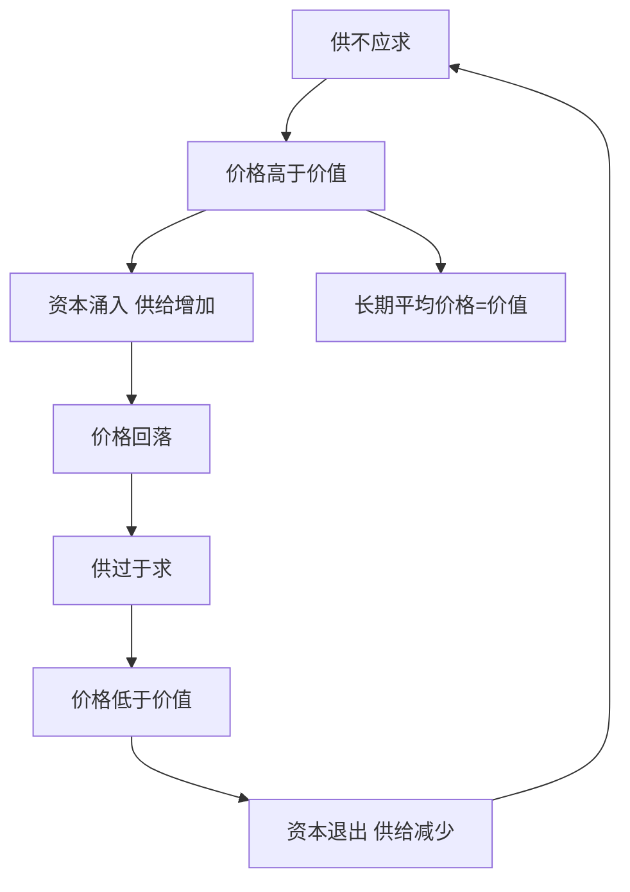

# KP08 · 价值规律

<a href="../../../../exam.html" target="_blank" style="display:inline-block;padding:6px 16px;background:#2563eb;color:#fff;border-radius:6px;text-decoration:none;font-size:14px;">📝 开始做题</a>

> 所属：[[../00_章节总结|第3章 市场经济和价值规律]] ｜ 节：原书第三章第二节

## 1. 一句话先懂（小白版）

价值规律就是商品经济的"地心引力"：

- **价值量由社会必要劳动时间决定**（一杯奶茶值多少劳动，是客观的）；
- **交换要等价**（不能一杯奶茶换一个房子）；
- **但实际价格不是固定的，它围绕价值上下波动**——东西少了涨价，东西多了跌价，像钟摆一样围着中心摆。

它是商品经济**最基本的、不以人意志为转移**的规律。你喜欢不喜欢它都在起作用。

## 2. 严格定义

**价值规律的基本内容**：
1. 商品的价值量由生产商品的**社会必要劳动时间**决定；
2. 商品交换要以价值量为基础，实行**等价交换**。

**表现形式**：价格围绕价值上下波动。
- 供不应求 → 价格高于价值；
- 供过于求 → 价格低于价值；
- 从长期看，涨落互相抵消，价格平均数等于价值。

**市场机制**：价格机制、供求机制、竞争机制、风险机制，它们共同作用使价值规律贯彻自己。

## 3. 为什么（原理/机制）——完整推导

### 为什么价格会偏离价值？

在私有制商品经济中，生产者各自为政，不知道社会需要多少：
- 大家看奶茶赚钱，一窝蜂都开奶茶店 → 供给过剩 → 价格跌破价值；
- 奶茶店倒了一批 → 供给减少 → 价格回到价值以上；
- 大家又看到奶茶赚钱，又一窝蜂去开……

这就是**价格围绕价值波动**的原因。

### 为什么说波动恰恰是价值规律的实现形式？

因为在私有制下，没有一个中央计划者告诉每个人"该做多少奶茶"。社会总劳动在各部门的分配，**只能靠价格波动这个"看不见的指挥棒"**来调节：
- 价格高于价值 → 告诉生产者"这里缺，快来"；
- 价格低于价值 → 告诉生产者"这里多了，快走"。

所以价格偏离价值不是对价值规律的否定，而恰恰是它**唯一可能的表现形式**——只有在波动中，社会必要劳动时间决定价值这一点才强行贯彻自己。

### 价值规律的三大作用

1. **自发调节生产资料和劳动力在各部门的分配**（资源配置）；
2. **自发刺激社会生产力发展**（谁改进技术、谁的个别劳动时间低于社会必要劳动时间，谁就赚钱）；
3. **自发引起商品生产者的两极分化**（赚钱的越做越大，亏的破产）。

## 4. 来源（理论怎么来的）

- 斯密最早系统描述"看不见的手"——每个人追求自己利益，结果被一只看不见的手引导，促进社会利益。
- 李嘉图把价值规律推到古典顶峰，但他不理解价格和价值的背离，认为这是"例外"。
- 马克思的突破：**价格围绕价值波动不是例外，而是价值规律在私有制下唯一可能的表现形式**。他还指出：到了资本主义自由竞争阶段，价值规律的表现形式变成了**生产价格规律**（不是市场价格围绕价值波动，而是围绕生产价格波动，见 [[../../03_资本流通与剩余价值分配/知识点/KP05_平均利润与生产价格]]）。

## 5. 怎么用（现实例子）

**用奶茶店看价值规律的作用：**

| 阶段 | 发生了什么 | 价值规律在干嘛 |
|---|---|---|
| 2018 年奶茶热 | 奶茶店赚钱，一杯净利 5 元 | 价格高于价值，吸引进入 |
| 2019-2020 年 | 全国新开 50 万家奶茶店 | 资源被吸引到奶茶行业 |
| 2021-2022 年 | 供给过剩，打价格战，9.9 元一杯 | 价格跌破价值，淘汰弱者 |
| 2023 年 | 倒闭 30 万家，只剩头部品牌 | 两极分化：头部规模扩大，尾部破产 |
| 2024 年 | 存活者重新找到利润空间 | 价格回到价值附近，均衡 |

**这就是价值规律的完整循环**：价格信号 → 资源流动 → 优胜劣汰 → 新均衡。

## 5.5 理论推导（一步步推）

> 本节补充：价值规律的内容、表现形式和作用机制。

**假设起点**：私有制商品经济，没有中央计划者分配社会劳动。

**推导过程**：
- 第一步：商品价值量由**社会必要劳动时间**决定（价值决定）。
- 第二步：商品交换以价值量为基础，实行**等价交换**（价值实现）。
- 第三步：但市场上供求不断变化，价格围绕价值上下波动。
- 第四步：价格高于价值 → 该部门利润高 → 其他部门资本涌入 → 供给增加 → 价格回落。
- 第五步：价格低于价值 → 亏损 → 资本退出 → 供给减少 → 价格回升。
- 结论：价格围绕价值上下波动，不是对价值规律的否定，而是它在私有制下**唯一可能的实现形式**——用价格涨落自发指挥社会劳动分配。长期平均价格等于价值。

## 5.6 数学推导（公式怎么来的）

> 每个符号第一次出现必须解释。

设商品价值（社会必要劳动时间决定）为 $V_0$，第 $t$ 期市场价格为 $P_t$。

短期：

$$P_t = V_0 + \varepsilon_t$$

其中 $\varepsilon_t$ 是供求波动项（供不应求时 $\varepsilon_t > 0$，供过于求时 $\varepsilon_t < 0$）。

长期平均：

$$\bar P = \frac{1}{n} \sum_{t=1}^{n} P_t = V_0$$

（涨落相互抵消，平均价格回归价值。）

**自发调节机制**：

$$P_t > V_0 \Rightarrow \text{利润} > \bar r \Rightarrow \text{资本流入} \Rightarrow S \uparrow \Rightarrow P \downarrow$$

$$P_t < V_0 \Rightarrow \text{利润} < \bar r \Rightarrow \text{资本流出} \Rightarrow S \downarrow \Rightarrow P \uparrow$$

## 6. 什么时候不能用（边界条件）

- **价值规律是商品经济的规律**。在非商品经济（自然经济、未来共产主义）中不起作用。
- **垄断会扭曲价值规律**。独家专利药、石油 OPEC 操纵，价格长期远离价值。
- **社会主义市场经济下，价值规律仍然起作用，但不是唯一调节者**。国家可以通过宏观调控、产业政策引导资源配置，克服它的自发性、盲目性、滞后性。
- **到了资本主义自由竞争阶段，形式升级为生产价格规律**：由于利润平均化，商品不再按价值出售，而按成本价格+平均利润（生产价格）出售——这不是否定价值规律，而是它的发展了的形式。

## 7. 容易混淆什么

| 容易混 | 区别 |
|---|---|
| 价值规律 vs 供求规律 | 价值规律是本质（社会必要劳动时间决定价值）；供求规律是表象（价格围绕价值波动）。供求规律是价值规律的表现形式。 |
| 价值规律 vs 看不见的手 | 斯密的"看不见的手"是对价值规律的现象描述；马克思的价值规律是对它的本质揭示。 |
| 价格围绕价值波动 vs 价格围绕生产价格波动 | 简单商品经济下是前者；资本主义自由竞争下是后者（利润平均化后）。 |
| 价值规律的作用 vs 市场失灵 | 价值规律能配置资源，但有自发性、盲目性、滞后性——这就是为什么需要政府调控。 |

## 8. 现实意义

- **为什么要"让市场在资源配置中起决定性作用"？** 就是要让价值规律充分发挥作用。
- **为什么还要"更好发挥政府作用"？** 因为价值规律有盲目性（一窝蜂）、滞后性（事后才调节）、分化性（两极分化），需要政府补位。
- **共同富裕为什么是社会主义的必然要求？** 因为价值规律自发作用必然导致两极分化，社会主义要在尊重价值规律的同时，用分配政策遏制分化。

---

## 🔗 相关知识点

**同章关联：** [[KP01_商品二因素]] ｜ [[KP04_商品价值量]] ｜ [[KP07_货币流通规律与通货膨胀]]

**跨章关联：** [[../../03_资本流通与剩余价值分配/知识点/KP05_平均利润与生产价格|生产价格规律（价值规律在资本主义下的转化形式）]] ｜ [[../../06_社会主义市场经济与发展/知识点/KP01_政府与市场关系|社会主义市场经济中政府与市场关系]]

**跨课对照：** 西方经济学的"看不见的手"和均衡价格论，是价值规律的现象描述。

**📖 原书原文：** [[../../../../原文件/经济学/马克思主义政治经济学概论_全书|《概论》第三章第二节]]

---

## 📝 考研真题（首经贸 801）

**配套主观题：** 见同目录 [[../考研真题集|本章考研真题集]]
**配套选择题：** 见同目录 [[../选择题集|本章选择题集]]

### 高频简答
- 简述价值规律的基本内容、表现形式和作用 → 见 [[../考研真题集#s10|真题集·简答 10]]

### 高频论述
- 试述价值规律的内容、作用，并结合我国新能源汽车行业价格战分析 → 见 [[../考研真题集#l2|真题集·论述 2]]

### 易错选择
- 本知识点选择题见 [[../选择题集#KP08 价值规律|选择题集·KP08]]
