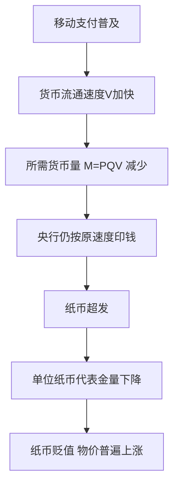
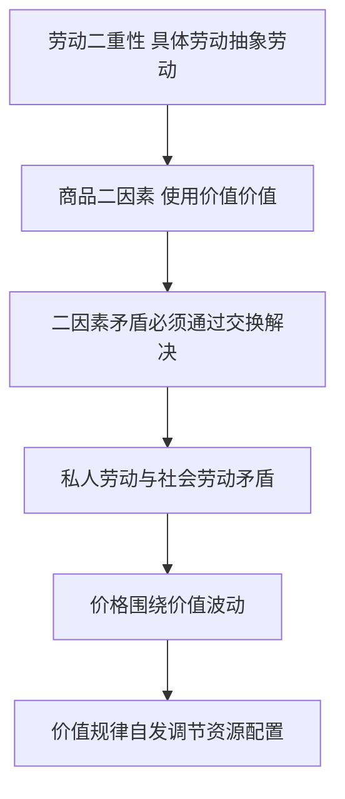

# 01 商品与货币 · 考研真题集（首经贸 801）

<div style="text-align:right;margin:10px 0;"><a href="../../../exam.html" target="_blank" style="display:inline-block;padding:6px 16px;background:#2563eb;color:#fff;border-radius:6px;text-decoration:none;font-size:14px;">📝 开始做题</a></div>


> 本章共收录：简答题 10 道（每题 15 分）｜论述题 4 道（每题 30 分）
> 配套选择题见 [[选择题集|本章选择题集]]
> 对应大纲：《马克思主义政治经济学概论》第一篇 商品和货币（第 1–3 章）

## 📋 本题集目录

### 简答题
1. [简述商品二因素及其相互关系](#s1)
2. [为什么说价值是商品的社会属性，而不是自然属性](#s2)
3. [简述生产商品的劳动二重性及其与商品二因素的关系](#s3)
4. [为什么说劳动二重性是"理解政治经济学的枢纽"](#s4)
5. [简述商品价值量的决定及其与劳动生产率的关系](#s5)
6. [计算题：社会必要劳动时间与价值量的计算](#s6)
7. [简述货币的起源和本质](#s7)
8. [简述货币的五大职能及其相互关系](#s8)
9. [简述货币流通规律，并说明通货膨胀的成因](#s9)
10. [简述价值规律的基本内容、表现形式和作用](#s10)

### 论述题
1. [试述劳动二重性学说及其在马克思主义政治经济学中的地位](#l1)
2. [试述价值规律的内容、作用，并分析我国新能源汽车行业价格战背后的价值规律](#l2)
3. [运用货币流通规律分析我国近年来通货膨胀的成因与治理](#l3)
4. [从商品拜物教理论分析数字经济时代的"平台神话"与算法崇拜](#l4)

---

## 一、简答题（每题 15 分，建议 450–700 字）

### 简答 1：简述商品二因素及其相互关系。 {#s1}

**【建议字数】450–700 字 ｜ 【建议时间】15 分钟 ｜ 【题型】概念简答**

**【考什么】** 对应知识点 [[知识点/KP01_商品二因素|KP01 商品二因素]]，题型属于概念简答。

**【答题框架】**
- 第 1 段：商品的定义（2 分）
- 第 2 段：使用价值（4 分）
- 第 3 段：价值与交换价值（5 分）
- 第 4 段：二者的矛盾统一（4 分）

**【参考答案】**

一、商品的定义
商品是用来交换的劳动产品。任何商品都具有二因素：使用价值和价值。

二、使用价值
(一) 使用价值是物品能够满足人们某种需要的属性，即物的有用性。
(二) 它是商品的**自然属性**，构成社会财富的物质内容。
(三) 使用价值是交换价值的物质承担者——没有用的东西没人要，谈不上交换。

三、价值与交换价值
(一) **交换价值**首先表现为一种使用价值同另一种使用价值相交换的量的关系或比例，例如 1 杯奶茶 = 3 个包子。
(二) 不同使用价值之所以能按一定比例交换，是因为它们之间存在某种共同的东西——这就是**价值**。
(三) **价值**是凝结在商品中的无差别的一般人类劳动（抽象人类劳动）。它是交换价值的基础，交换价值是价值的表现形式。

四、二者的矛盾统一
(一) **统一性**：一个物品要成为商品，必须同时具有使用价值和价值。没有使用价值的东西（如废品），即使花了劳动也没有价值；有使用价值但不是劳动产品（如空气、阳光），也没有价值。
(二) **斗争性**：对同一个人来说，不能同时占有同一商品的使用价值和价值。商品生产者要实现价值，就必须让渡使用价值；消费者要占有使用价值，就必须支付价值。
(三) 这一矛盾只有通过**交换**才能解决。

**【解析·得分点】** 采分点：①商品是用来交换的劳动产品（2 分）；②使用价值是自然属性（4 分）；③价值是凝结的抽象劳动、交换价值是其表现形式（5 分）；④矛盾统一（4 分）。易丢分：把价值和交换价值混为一谈；忘记"没有使用价值就没有价值"这个统一条件。

**【生活实例】** 一杯奶茶能解渴（使用价值），卖 15 元（价值的货币表现）。王老板要拿到 15 元，就得把奶茶递给你；你要喝到奶茶，就得付 15 元。这就是二因素的矛盾。

**【双链接】** 🔗 [[知识点/KP01_商品二因素|回知识点]] ｜ 📖 [[../../../原文件/经济学/马克思主义政治经济学概论_全书|《概论》第一章第一节]]

---

### 简答 2：为什么说价值是商品的社会属性，而不是自然属性？ {#s2}

**【建议字数】450–700 字 ｜ 【建议时间】15 分钟 ｜ 【题型】原因分析**

**【考什么】** 对应知识点 [[知识点/KP01_商品二因素|KP01]]，题型属于原因分析。

**【答题框架】**
- 第 1 段：破题（2 分）
- 第 2 段：使用价值是自然属性（4 分）
- 第 3 段：价值只有在交换关系中才存在（5 分）
- 第 4 段：价值是被物的外壳掩盖的社会关系（4 分）

**【参考答案】**

一、破题
商品二因素中，使用价值是商品的自然属性，价值是商品的社会属性。这一区分是马克思劳动价值论的关键。

二、使用价值是自然属性
(一) 使用价值由商品的物理、化学、生物性质决定，如奶茶能喝、衣服能穿。
(二) 这种有用性不依赖于社会关系——荒岛上的鲁滨逊做了一锅粥，它仍然能喝，具有使用价值。
(三) 使用价值是一切社会形态的财富都具有的属性，不是商品经济特有。

三、价值只有在交换关系中才存在
(一) 价值是凝结在商品中的无差别的一般人类劳动。但这种劳动之所以要被"抽象"为等同的东西，是因为商品要互相交换。
(二) 孤岛上的鲁滨逊，他做船、搭棚、捕鱼，都是具体劳动，没必要把它们通约为"抽象劳动"——因为他不和别人交换。
(三) 自然经济中，农民种粮、织布、自食自用，劳动产品不经过交换，也就没有价值。
(四) 共产主义社会按需分配，劳动产品不再作为商品交换，价值范畴也将消失。
(五) 因此价值是**商品经济特有的历史范畴**，不是永恒的。

四、价值是被物的外壳掩盖的社会关系
(一) 价值看起来是物（一杯奶茶）的属性，实际上它体现的是商品生产者之间互相交换劳动的社会关系。
(二) 马克思说："这只是人们自己的一定的社会关系，但它在人们面前采取了物与物的关系的虚幻形式。"
(三) 这就是商品拜物教的根源——人与人的关系被颠倒为物与物的关系。

**【解析·得分点】** 采分点：①使用价值由自然性质决定（4 分）；②价值只有在交换中才存在、是历史范畴（5 分）；③价值体现人与人的社会关系（4 分）；④破题与小结（2 分）。易丢分：把价值说成永恒范畴；忘记"价值是商品经济特有"这一历史观点。

**【生活实例】** 你妈妈给你做的晚饭，能吃（使用价值），但她没拿去卖，所以它没有价值。一旦你把它放到网上卖 30 元一份，它就成了商品，有了价值。

**【双链接】** 🔗 [[知识点/KP01_商品二因素|回知识点]] ｜ [[知识点/KP03_私人劳动社会劳动与商品拜物教|商品拜物教]] ｜ 📖 [[../../../原文件/经济学/马克思主义政治经济学概论_全书|《概论》第一章第一节]]

---

### 简答 3：简述生产商品的劳动二重性及其与商品二因素的关系。 {#s3}

**【建议字数】450–700 字 ｜ 【建议时间】15 分钟 ｜ 【题型】关系对比**

**【考什么】** 对应知识点 [[知识点/KP02_劳动二重性|KP02 劳动二重性]]，题型属于概念简答/关系对比。

**【答题框架】**
- 第 1 段：劳动二重性的定义（3 分）
- 第 2 段：具体劳动（4 分）
- 第 3 段：抽象劳动（5 分）
- 第 4 段：与商品二因素的对应关系（3 分）

**【参考答案】**

一、劳动二重性的定义
生产商品的劳动具有二重性：从一方面看是**具体劳动**，从另一方面看是**抽象劳动**。这是马克思首先批判地证明了的。

二、具体劳动
(一) 具体劳动是在一定具体形式下进行的劳动，它的目的、操作方式、劳动对象、生产手段和结果各不相同。
(二) 例如做奶茶的烧水、泡茶、加奶、封口，就是具体劳动。
(三) 具体劳动**创造使用价值**，它反映的是人与自然的关系，是人类生存的永恒条件。

三、抽象劳动
(一) 抽象劳动是撇开一切具体形式的、无差别的一般人类劳动力的耗费，即人的脑、肌肉、神经、手等的生产性支出。
(二) 例如泡茶 1 小时和包包子 1 小时，动作完全不同，但撇开具体形式后，都是"人类劳动力耗费 1 小时"。
(三) 抽象劳动**形成价值**，它是商品经济特有的历史范畴，体现商品生产者之间的社会关系。

四、与商品二因素的对应关系
(一) **具体劳动创造使用价值**——不同的具体劳动生产出不同的使用价值。
(二) **抽象劳动形成价值**——不同的具体劳动之所以能交换，是因为它们都被还原为等同的抽象劳动。
(三) 公式链条：
```
劳动二重性                商品二因素
具体劳动      ──────→    使用价值
抽象劳动      ──────→    价值
```
(四) 正是劳动二重性，才解开了"为什么不同的东西能按比例交换"这个古典政治经济学解不开的谜。

**【解析·得分点】** 采分点：①劳动二重性是马克思首先证明的（3 分）；②具体劳动创造使用价值（4 分）；③抽象劳动形成价值（5 分）；④对应关系（3 分）。易丢分：把具体劳动和抽象劳动当成两次劳动；忘记抽象劳动是历史范畴。

**【生活实例】** 你在奶茶店干 8 小时：从动作看（烧水、泡茶、封口）是具体劳动，做出奶茶（使用价值）；从时间看（8 小时人类劳动力耗费）是抽象劳动，凝结成价值。同一份干活，两个角度。

**【双链接】** 🔗 [[知识点/KP02_劳动二重性|回知识点]] ｜ [[知识点/KP01_商品二因素|商品二因素]] ｜ 📖 [[../../../原文件/经济学/马克思主义政治经济学概论_全书|《概论》第一章第一节]]

---

### 简答 4：为什么说劳动二重性是"理解政治经济学的枢纽"？ {#s4}

**【建议字数】450–700 字 ｜ 【建议时间】15 分钟 ｜ 【题型】原因分析**

**【考什么】** 对应知识点 [[知识点/KP02_劳动二重性|KP02]]，题型属于原因分析。

**【答题框架】**
- 第 1 段：马克思原话（3 分）
- 第 2 段：它解决了什么是创造价值的劳动（4 分）
- 第 3 段：它为劳动价值论奠定了科学基础（4 分）
- 第 4 段：它为剩余价值论等后续理论提供了钥匙（4 分）

**【参考答案】**

一、马克思原话
马克思在《资本论》第一卷中说："商品中包含的劳动的这种二重性，是首先由我批判地证明了的。这一点是理解政治经济学的枢纽。"

二、它解决了"什么劳动创造价值"的问题
(一) 古典政治经济学（斯密、李嘉图）虽然提出了劳动价值论，但他们不知道是什么劳动创造价值。
(二) 他们有时说"一般社会劳动"，有时说"耗费的劳动"，概念含糊。
(三) 马克思区分具体劳动和抽象劳动后明确：创造使用价值的是具体劳动，形成价值的是抽象劳动。这就把劳动价值论放在了科学基础上。

三、它为劳动价值论奠定了科学基础
(一) 区分了价值和交换价值、价值和使用价值。
(二) 说明了为什么不同具体劳动能通约为抽象劳动、按比例交换。
(三) 说明了价值量由社会必要劳动时间决定，而不是由个别劳动时间决定。

四、它为后续理论提供了钥匙
(一) **不变资本与可变资本的划分**：具体劳动转移生产资料价值（c），抽象劳动创造新价值（v+m）。
(二) **剩余价值论**：工人抽象劳动时间分为必要劳动时间和剩余劳动时间，后者创造剩余价值。
(三) **资本有机构成理论**：c:v 的提高，本质上是具体劳动（生产资料）比重增大、抽象劳动（活劳动）比重减小。
(四) **平均利润与生产价格理论**：不同部门的剩余价值通过竞争平均化，其基础仍是抽象劳动的等同性。
(五) 没有劳动二重性，这一切都无法理解。

**【解析·得分点】** 采分点：①马克思原话（3 分）；②解决"什么劳动创造价值"（4 分）；③为劳动价值论奠基（4 分）；④为 c/v、剩余价值、有机构成等理论提供钥匙（4 分）。易丢分：只说"重要"不说为什么重要；忘记它是"马克思首先批判地证明"。

**【生活实例】** 就像找到了一把万能钥匙：用它开"价值是什么"的锁，能开；用它开"剩余价值从哪来"的锁，也能开；用它开"机器为什么不创造利润"的锁，还能开。古典派因为没有这把钥匙，在迷宫里转不出来。

**【双链接】** 🔗 [[知识点/KP02_劳动二重性|回知识点]] ｜ 跨章：[[../02_资本主义经济制度与生产/知识点/KP05_不变资本与可变资本|c/v 划分]] ｜ 📖 [[../../../原文件/经济学/马克思主义政治经济学概论_全书|《概论》第一章第一节]]

---

### 简答 5：简述商品价值量的决定及其与劳动生产率的关系。 {#s5}

**【建议字数】450–700 字 ｜ 【建议时间】15 分钟 ｜ 【题型】因素影响**

**【考什么】** 对应知识点 [[知识点/KP04_商品价值量|KP04 商品价值量]]，题型属于概念简答/因素影响。

**【答题框架】**
- 第 1 段：价值量由劳动量决定（3 分）
- 第 2 段：社会必要劳动时间（5 分）
- 第 3 段：与劳动生产率的关系（5 分）
- 第 4 段：简单劳动与复杂劳动（2 分）

**【参考答案】**

一、价值量由劳动量决定
商品的价值是凝结在商品中的抽象劳动，因此价值量由生产商品所耗费的**劳动量**决定。劳动量由劳动时间（小时、天）计量。

二、社会必要劳动时间
(一) 决定价值量的不是个别劳动时间，而是**社会必要劳动时间**。
(二) 马克思定义：社会必要劳动时间是"在现有的社会正常的生产条件下，在社会平均的劳动熟练程度和劳动强度下，制造某种使用价值所需要的劳动时间"。
(三) 三个关键词：现有（今天的技术水平）、社会正常生产条件（大多数生产者用的技术）、社会平均熟练程度和强度（不是新手也不是老师傅）。
(四) 个别劳动时间高于社会必要劳动时间的部分不被社会承认，生产者亏损；低于的部分则带来超额收益。

三、与劳动生产率的关系
(一) 劳动生产率是劳动者生产使用价值的效率，用单位时间生产的产品量表示。
(二) **单位商品价值量与社会劳动生产率成反比**：
$$\text{单位商品价值量} \propto \frac{1}{\text{社会劳动生产率}}$$
(三) 社会劳动生产率越高，单位时间生产的使用价值越多，分摊到每个商品上的抽象劳动越少，单位商品价值量越小。
(四) 但**同一劳动在同样时间内创造的价值总量不变**——1 小时不管做 1 杯还是 10 杯，总价值都是 1 小时劳动。

四、简单劳动与复杂劳动
(一) 简单劳动是不需要专门训练的劳动；复杂劳动是需要专门训练的劳动。
(二) 少量复杂劳动等于多倍简单劳动：复杂劳动 $= n \times$ 简单劳动。
(三) 这个 $n$ 由社会过程自发形成，不是谁规定的。

**【解析·得分点】** 采分点：①价值量由劳动时间决定（3 分）；②社会必要劳动时间定义三要素（5 分）；③反比关系+总价值不变（5 分）；④复杂劳动是多倍简单劳动（2 分）。易丢分：把"价值量与劳动生产率成反比"误写成"价值总量与劳动生产率成反比"；忘记是"社会"劳动生产率而不是个别。

**【生活实例】** 新手做一杯奶茶 10 分钟，熟练工 5 分钟，老师傅 3 分钟。但一杯奶茶都卖 15 元——社会只承认 5 分钟的平均水平。老师傅 8 小时做 160 杯，新手做 48 杯，同样干 8 小时，老师傅被社会承认的劳动时间多，所以他赚得多。

**【双链接】** 🔗 [[知识点/KP04_商品价值量|回知识点]] ｜ 📖 [[../../../原文件/经济学/马克思主义政治经济学概论_全书|《概论》第一章第二节]]

---

### 简答 6（计算题）：某奶茶行业三个生产者一天 8 小时做奶茶情况如下。求：①每杯奶茶的社会必要劳动时间；②三人一天分别被社会承认的价值量；③若全社会引入自动化使每小时做 60 杯，每杯价值如何变化？ {#s6}

| 生产者 | 1 小时做的杯数 |
|---|---|
| 新手小李 | 6 杯 |
| 熟练小王（社会平均） | 12 杯 |
| 老师傅老张 | 20 杯 |

**【建议字数】450–700 字 ｜ 【建议时间】15 分钟 ｜ 【题型】分析推导**

**【考什么】** 对应知识点 [[知识点/KP04_商品价值量|KP04]]，题型属于分析推导/计算。

**【答题框架】**
- 第 1 步：社会必要劳动时间（4 分）
- 第 2 步：三人被承认的价值量（6 分）
- 第 3 步：自动化后的变化（5 分）

**【参考答案】**

一、社会必要劳动时间
社会必要劳动时间 = 社会平均生产条件下每杯所需时间。熟练小王代表社会平均水平：1 小时做 12 杯，即每杯 $\frac{60}{12} = 5$ 分钟。

二、三人一天被社会承认的价值量
(一) 小李：一天做 $6 \times 8 = 48$ 杯；每杯社会必要劳动时间 5 分钟；被承认价值量 $= 48 \times 5 = 240$ 分钟 $= 4$ 小时社会必要劳动。
(二) 小王：一天做 $12 \times 8 = 96$ 杯；被承认价值量 $= 96 \times 5 = 480$ 分钟 $= 8$ 小时。
(三) 老张：一天做 $20 \times 8 = 160$ 杯；被承认价值量 $= 160 \times 5 = 800$ 分钟 $\approx 13.33$ 小时。

**解读**：
- 小李实际干 8 小时，社会只承认 4 小时——他亏了 4 小时；
- 小王干 8 小时，社会承认 8 小时——不亏不赚；
- 老张干 8 小时，社会承认 13.33 小时——他多赚了 5.33 小时。

这就是技术好、效率高的生产者赚钱的原因：不是他的商品"更有价值"，而是他在同样时间里做了更多商品，每个商品都按社会必要劳动时间算价值。

三、自动化后的变化
(一) 自动化后每小时做 60 杯，即每杯 $\frac{60}{60} = 1$ 分钟。
(二) 新的社会必要劳动时间从 5 分钟/杯降到 1 分钟/杯。
(三) 每杯奶茶的价值量变为原来的 $\frac{1}{5}$。
(四) 但 1 小时劳动创造的总价值仍为 1 小时（原来 1 小时做 12 杯每杯 5 分钟 = 60 分钟；现在 1 小时做 60 杯每杯 1 分钟 = 60 分钟）。

**结论**：生产越发达，单位商品越便宜，但社会财富（使用价值）越来越多。

**【解析·得分点】** 采分点：①社会必要劳动时间 = 5 分钟/杯（4 分）；②三人被承认价值量 4/8/13.33 小时（6 分）；③自动化后每杯价值降为 1/5、总价值不变（5 分）。易丢分：把总价值也算成下降；忘记社会必要劳动时间是"平均"而非"最低"。

**【生活实例】** 手机为什么越来越便宜？因为造手机的社会劳动生产率飞速提高，单位手机价值量下降。但 1 小时造手机的劳动创造的总价值没变，只是分摊到更多手机上。

**【双链接】** 🔗 [[知识点/KP04_商品价值量|回知识点]] ｜ 📖 [[../../../原文件/经济学/马克思主义政治经济学概论_全书|《概论》第一章第二节]]

---

### 简答 7：简述货币的起源和本质。 {#s7}

**【建议字数】450–700 字 ｜ 【建议时间】15 分钟 ｜ 【题型】概念简答**

**【考什么】** 对应知识点 [[知识点/KP05_货币的起源与本质|KP05 货币的起源与本质]]，题型属于概念简答。

**【答题框架】**
- 第 1 段：货币不是天才发明，而是价值形式长期发展的产物（2 分）
- 第 2 段：价值形式发展的四个阶段（8 分）
- 第 3 段：货币的本质（5 分）

**【参考答案】**

一、破题
货币不是哪个天才发明的，也不是国家法律规定的，而是**商品交换矛盾长期发展的自发产物**。

二、价值形式发展的四个阶段
(一) **简单的或偶然的价值形式**：1 只羊 = 2 把斧子。一种商品的价值偶然地、简单地表现在另一种商品上。
(二) **总和的或扩大的价值形式**：1 只羊 = 2 把斧子 = 1 袋米 = 3 尺布 = ……一种商品的价值表现在一系列商品上。
(三) **一般价值形式**：2 把斧子 = 1 袋米 = 3 尺布 = …… = 1 只羊。一切商品的价值都表现在同一种商品（羊）上，羊成为一般等价物。
(四) **货币形式**：当一般等价物固定在贵金属（金、银）上时，就产生了货币。2 把斧子 = 1 袋米 = …… = 1 克金。

**为什么金银成为货币？** 因为金银具有体积小、价值大、便于携带、不易腐烂、可分割等自然属性，适合充当一般等价物。

三、货币的本质
(一) 货币是**固定地充当一般等价物的商品**。
(二) 它体现着商品生产者之间的社会关系。
(三) 货币出现后，整个商品世界分裂为两极：一极是商品（各种特殊使用价值），一极是货币（一切商品的一般价值）。
(四) 商品内在的使用价值和价值的矛盾，现在表现为商品和货币的外部对立。一切商品只有换成货币，才能实现自己的价值。

**【解析·得分点】** 采分点：①货币是价值形式长期发展产物（2 分）；②四个价值形式阶段（8 分）；③货币是固定充当一般等价物的商品（5 分）。易丢分：把货币说成"国家发明"或"约定俗成"；忘记货币是商品、有使用价值和价值。

**【生活实例】** 早期猎人用羊换米、用羊换布，羊慢慢成了"一般等价物"——大家都认它。后来发现羊不好分割、不好保存，就换成银子、金子。今天用纸币，本质上还是一般等价物，只是它由国家信用背书。

**【双链接】** 🔗 [[知识点/KP05_货币的起源与本质|回知识点]] ｜ 📖 [[../../../原文件/经济学/马克思主义政治经济学概论_全书|《概论》第二章]]

---

### 简答 8：简述货币的五大职能及其相互关系。 {#s8}

**【建议字数】450–700 字 ｜ 【建议时间】15 分钟 ｜ 【题型】概念简答**

**【考什么】** 对应知识点 [[知识点/KP06_货币的五大职能|KP06 货币的五大职能]]，题型属于概念简答。

**【答题框架】**
- 第 1 段：总述（2 分）
- 第 2 段：价值尺度与流通手段（8 分）
- 第 3 段：贮藏手段、支付手段、世界货币（5 分）

**【参考答案】**

一、总述
货币的本质体现在它的职能中。货币有五大职能：价值尺度、流通手段、贮藏手段、支付手段、世界货币。其中价值尺度和流通手段是基本职能，后三者是派生职能。

二、价值尺度与流通手段
(一) **价值尺度**：货币充当衡量商品价值量大小的尺度。货币执行价值尺度职能时，不需要现实的货币，只需要观念上的货币（如商品标价 15 元）。商品价值的货币表现就是价格。
(二) **流通手段**：货币充当商品交换的媒介。公式是**商品—货币—商品（W—G—W）**。执行流通手段必须是现实的货币，但可以是不足值的货币（如纸币）。
(三) 这两个职能是货币一产生就具有的基本职能。

三、贮藏手段、支付手段、世界货币
(一) **贮藏手段**：货币退出流通，被人们当作社会财富的一般代表保存起来。作为贮藏手段必须是足值的金属货币（金银条块）。在私有制下，它自发调节流通中的货币量。
(二) **支付手段**：货币在赊购赊销中用于延期支付，如还债、交租、纳税、发工资。这一职能是随商品经济矛盾（买卖脱节）发展起来的。
(三) **世界货币**：货币在世界市场上发挥一般等价物作用，主要是贵金属（今天是美元、欧元等国际储备货币）。用于国际支付、国际购买、财富转移。

四、相互关系
五大职能共同体现货币作为一般等价物的本质。价值尺度和流通手段是基本职能；贮藏手段、支付手段、世界货币是在商品交换发展中派生出来的。

**【解析·得分点】** 采分点：①五大职能名称（2 分）；②价值尺度是观念上的货币、流通手段是现实货币（4 分）；③后三个派生职能（5 分）；④基本与派生之分（4 分）。易丢分：把价值尺度和流通手段混为一谈；忘记贮藏手段必须是足值金属货币。

**【生活实例】** 奶茶店标价 15 元（价值尺度），你付 15 元拿走奶茶（流通手段），你把 15 元存进银行（贮藏手段），月底老板发工资 5000 元（支付手段），你出国旅游用人民币换美元（世界货币）。

**【双链接】** 🔗 [[知识点/KP06_货币的五大职能|回知识点]] ｜ 📖 [[../../../原文件/经济学/马克思主义政治经济学概论_全书|《概论》第二章]]

---

### 简答 9：简述货币流通规律，并说明通货膨胀的成因。 {#s9}

**【建议字数】450–700 字 ｜ 【建议时间】15 分钟 ｜ 【题型】原因分析**

**【考什么】** 对应知识点 [[知识点/KP07_货币流通规律与通货膨胀|KP07 货币流通规律与通货膨胀]]，题型属于概念简答/原因分析。

**【答题框架】**
- 第 1 段：货币流通规律公式（5 分）
- 第 2 段：纸币流通规律（4 分）
- 第 3 段：通货膨胀的成因（6 分）

**【参考答案】**

一、货币流通规律
(一) 流通中所需要的货币量，取决于三个因素：①待售商品总量；②商品价格水平；③同一单位货币的流通速度。
(二) 公式：
$$\text{流通中所需货币量} = \frac{\text{待售商品价格总额}}{\text{同名货币流通次数（速度）}}$$
(三) 商品价格总额 = 待售商品总量 × 价格水平。
(四) 在货币作为支付手段职能出现后，赊购商品价格总额要减去、到期支付总额要加回、互相抵消的支付要扣除。

二、纸币流通规律
(一) 纸币是由国家发行并强制流通的价值符号。
(二) 纸币的流通规律以金属货币流通规律为基础：**纸币的发行量限于它象征地代表的金（或银）的实际流通量**。
(三) 纸币发行过多，单位纸币代表的金量就减少，纸币贬值，物价上涨。

三、通货膨胀的成因
(一) **定义**：通货膨胀是纸币发行量超过流通中所需货币量，引起纸币贬值、物价普遍持续上涨的经济现象。
(二) **成因**：
1. **需求拉动型**：总需求过度膨胀（"太多货币追逐太少商品"），如政府过度发行货币、过度投资。
2. **成本推动型**：生产成本上升（原材料涨价、工资上涨）推动物价上涨。
3. **结构型**：经济结构失衡，部门间生产率提高速度不一致，导致价格轮番上涨。
4. **输入型**：进口原材料、能源涨价传导到国内物价。
(三) 马克思主义政治经济学认为，通货膨胀的根本原因是纸币发行过多，违背了货币流通规律。

**【解析·得分点】** 采分点：①货币流通规律公式（5 分）；②纸币流通规律（4 分）；③通货膨胀定义+四种成因（6 分）。易丢分：把 CPI 上涨等同于通货膨胀（要看是否普遍持续）；忘记货币流通速度这个分母。

**【生活实例】** 一个月全社会要卖 100 万元商品，货币一个月转手 2 次，那流通中只需要 50 万元。结果央行印了 100 万元，那 1 元纸币就只值原来 0.5 元，物价翻倍——这就是通货膨胀。

**【双链接】** 🔗 [[知识点/KP07_货币流通规律与通货膨胀|回知识点]] ｜ 📖 [[../../../原文件/经济学/马克思主义政治经济学概论_全书|《概论》第二章]]

---

### 简答 10：简述价值规律的基本内容、表现形式和作用。 {#s10}

**【建议字数】450–700 字 ｜ 【建议时间】15 分钟 ｜ 【题型】概念简答**

**【考什么】** 对应知识点 [[知识点/KP08_价值规律|KP08 价值规律]]，题型属于概念简答。

**【答题框架】**
- 第 1 段：价值规律的基本内容（4 分）
- 第 2 段：表现形式（4 分）
- 第 3 段：三大作用（7 分）

**【参考答案】**

一、价值规律的基本内容
(一) 价值规律是商品经济的基本规律。
(二) 基本内容：①商品的价值量由生产商品的**社会必要劳动时间**决定；②商品交换以价值量为基础，实行**等价交换**。

二、表现形式
(一) 价值规律的表现形式是**价格围绕价值上下波动**。
(二) 供不应求时，价格高于价值；供过于求时，价格低于价值。
(三) 从长期看，上涨和下跌互相抵消，价格平均数等于价值。
(四) 价格围绕价值波动不是对价值规律的否定，而恰恰是它在私有制商品经济中**唯一可能的表现形式**——因为没有中央计划者告诉每个生产者该做多少，社会总劳动的分配只能靠价格信号调节。

三、三大作用
(一) **自发调节生产资料和劳动力在各部门的分配**。价格高于价值，吸引资源流入；价格低于价值，迫使资源流出。这就是"看不见的手"。
(二) **自发刺激社会生产力发展**。谁率先改进技术、使个别劳动时间低于社会必要劳动时间，谁就获得超额剩余价值；大家都跟进，整个社会劳动生产率提高。
(三) **自发引起商品生产者两极分化**。在竞争中，生产条件好的生产者发财致富，生产条件差的破产倒闭。这在封建社会末期导致了资本主义生产关系的产生。

**【解析·得分点】** 采分点：①价值量由社会必要劳动时间决定+等价交换（4 分）；②价格围绕价值波动是表现形式（4 分）；③三大作用（7 分）。易丢分：把"价格围绕价值波动"说成"违反价值规律"；忘记价值规律是商品经济的基本规律，不是永恒规律。

**【生活实例】** 2018 年奶茶热，一杯奶茶净利 5 元（价格高于价值），全国一窝蜂开 50 万家店；2021 年供给过剩，9.9 元一杯（价格低于价值），倒闭 30 万家；2024 年剩下头部品牌重新有利润。这就是价值规律调节资源配置、优胜劣汰的完整循环。

**【双链接】** 🔗 [[知识点/KP08_价值规律|回知识点]] ｜ 📖 [[../../../原文件/经济学/马克思主义政治经济学概论_全书|《概论》第三章第二节]]

---


### 简答 11：（逻辑链·分析）运用货币流通规律 $M=PQ/V$，分析"移动支付普及"为什么会减少流通中所需货币量；若此时央行仍按原速度印钱，物价和单位纸币购买力会发生什么变化？画出完整逻辑链图 {#s11}

**【建议字数】450–700 字 ｜ 【建议时间】15 分钟 ｜ 【题型】逻辑链分析**

**【考什么】** 对应知识点 [[知识点/KP07_货币流通规律与通货膨胀|货币流通规律与通货膨胀]]、[[知识点/KP08_价值规律|价值规律]]；题型属于公式推导 + 逻辑链分析。

**【答题框架】**
- 第 1 段：写出货币流通规律公式，说明三个变量谁动谁不动（4 分）
- 第 2 段：移动支付使 $V$ 加快，推导所需货币量 $M$ 怎么变（6 分）
- 第 3 段：央行不相应收缩货币供给，推导物价与购买力变化（5 分）

**【参考答案】**

一、写出公式。一定时期内商品流通中所需货币量为：

$$M = \frac{P \times Q}{V}$$

其中 $M$ = 流通中所需货币量，$P$ = 商品价格水平，$Q$ = 待售商品数量，$P \times Q$ = 商品价格总额，$V$ = 同名货币的年平均流通速度（转手次数）。本题中待售商品量和价格水平不变，即 $PQ$ 为常数。

二、移动支付使 $V$ 加快。现金支付时代，一块钱一年大约转手 5 次；移动支付普及后，每块钱一年转手次数提高到 10 次。分母 $V$ 增大一倍，而 $PQ$ 不变，则：

$$M_1 = \frac{PQ}{V_1} = \frac{PQ}{5}, \qquad M_2 = \frac{PQ}{V_2} = \frac{PQ}{10}$$

即流通中实际需要的货币量从 $PQ/5$ 降到 $PQ/10$，减少了一半。

三、若央行仍按原来 $M_1$ 的速度印钱，而社会只需要 $M_2$，则超额发行部分没有对应商品。单位纸币代表的金量下降为 $M_2/M_1 = 1/2$，纸币贬值一半，物价水平普遍上涨约一倍。



**【解析·得分点】** 采分点：① 写出 $M=PQ/V$ 并解释每个符号（4 分）；② $V$ 上升使 $M$ 下降一半（6 分）；③ 超发导致纸币贬值、物价上涨（5 分）。易丢分处：把"所需货币量减少"和"央行印钱多少"混为一谈——前者是商品流通客观决定的，后者是央行政策决定的，二者不一致才产生通胀。

**【生活实例】** 以前你一周出门要揣 200 块现金，现在手机支付同样花销只放 50 块——钱转得快了，需要的现钱少了。如果这时候央行还按"需要 200 块"的印钞量放水，钱多货少，物价就涨。

---

## 二、论述题（每题 30 分，建议 900–1200 字）

### 论述 1：试述劳动二重性学说的基本内容，并说明它为什么是"理解政治经济学的枢纽"。 {#l1}

**【建议字数】900–1200 字 ｜ 【建议时间】30 分钟 ｜ 【题型】理论类**

**【考什么】** 跨 [[知识点/KP01_商品二因素|KP01]] + [[知识点/KP02_劳动二重性|KP02]] + [[知识点/KP04_商品价值量|KP04]]，题型属于理论类。

**【答题框架】**
- 第 1 段：破题——马克思的贡献（4 分）
- 第 2 段：劳动二重性基本内容（8 分）
- 第 3 段：与商品二因素、价值量的关系（6 分）
- 第 4 段：为什么是枢纽——为后续理论提供钥匙（8 分）
- 第 5 段：现实意义（4 分）

**【参考答案】**

一、破题
马克思在《政治经济学批判》（1859）和《资本论》第一卷（1867）中，首先批判地证明了生产商品的劳动具有二重性。他说："这一点是理解政治经济学的枢纽。"

二、劳动二重性的基本内容
(一) **具体劳动**：在一定具体形式下进行的劳动。它有特定的目的、操作方式、劳动对象和结果。例如木匠做桌子、裁缝做衣服、奶茶店做奶茶。具体劳动创造使用价值，反映人与自然的关系，是人类生存的永恒条件。
(二) **抽象劳动**：撇开一切具体形式的、无差别的一般人类劳动力的耗费，即人的脑、肌肉、神经、手等的生产性支出。例如木匠 8 小时和裁缝 8 小时，动作完全不同，但都是"人类劳动力耗费 8 小时"。抽象劳动形成价值，是商品经济特有的历史范畴。

三、与商品二因素、价值量的关系
(一) **具体劳动创造使用价值，抽象劳动形成价值**。这就解开了古典政治经济学解不开的谜：为什么不同的具体劳动能按比例交换？因为撇开具体形式后，它们都是等同的抽象劳动，可以通约。
(二) **价值量由社会必要劳动时间决定**。既然价值是抽象劳动的凝结，价值量就由抽象劳动量（劳动时间）计量。但不是个别劳动时间，而是社会必要劳动时间——在现有社会正常生产条件、平均熟练程度和强度下生产某种使用价值所需的时间。
(三) **劳动生产率与单位商品价值量成反比**。社会劳动生产率提高，同一时间生产的使用价值增多，分摊到每个商品上的抽象劳动减少，单位商品价值下降；但同一劳动在同样时间内创造的价值总量不变。

四、为什么是"枢纽"
(一) **为劳动价值论奠基**。古典派（斯密、李嘉图）提出了劳动创造价值，但说不清是什么劳动创造价值。马克思区分具体劳动和抽象劳动后，劳动价值论才成为科学。
(二) **为不变资本与可变资本划分提供钥匙**。具体劳动把生产资料价值（c）转移到新产品中；抽象劳动创造新价值（v+m）。没有劳动二重性，就分不清 c 和 v。
(三) **为剩余价值论提供钥匙**。工人的抽象劳动时间分为必要劳动时间（再生产劳动力价值 v）和剩余劳动时间（创造剩余价值 m）。剩余价值的秘密就藏在这里。
(四) **为资本有机构成理论提供钥匙**。c:v 的提高，本质上是具体劳动（生产资料）比重增大、抽象劳动（活劳动）比重减小。这就解释了为什么利润率有下降趋势、为什么会形成相对过剩人口。
(五) **为平均利润和生产价格理论提供钥匙**。不同部门的剩余价值通过竞争平均化，其基础正是抽象劳动的等同性。

五、现实意义
(一) 今天讨论"平台经济的价值创造"——外卖骑手的具体劳动（取餐、送餐）创造使用价值；他们的抽象劳动时间是平台算法计算的对象。算法把每一秒都抽象为"几分钟一单"，就是抽象劳动在数字时代的体现。
(二) 讨论"AI 是否创造价值"——AI、算法是生产资料（c），它们的具体劳动转移自身价值，但不创造新价值；新价值仍然由人的抽象劳动创造。
(三) 没有劳动二重性这把钥匙，这些当代问题都无法用马克思主义政治经济学回答。

**【解析·得分点】** 采分点：①具体劳动与抽象劳动定义（8 分）；②与二因素、价值量的关系（6 分）；③为 c/v、剩余价值、有机构成、平均利润提供钥匙（8 分）；④现实意义（4 分）；⑤结构（4 分）。易丢分：只答劳动二重性内容，不展开"为什么是枢纽"；忘记抽象劳动是历史范畴。

**【生活实例】** 同一个程序员写代码 8 小时：从动作看（敲键盘、调 bug）是具体劳动，做出软件（使用价值）；从时间看（8 小时脑力耗费）是抽象劳动，凝结成价值。为什么程序员工资比奶茶店高？因为他的劳动是复杂劳动，1 小时 = 多倍简单劳动。

**【双链接】** 🔗 [[知识点/KP02_劳动二重性|KP02]] ｜ [[知识点/KP01_商品二因素|KP01]] ｜ [[知识点/KP04_商品价值量|KP04]] ｜ 📖 [[../../../原文件/经济学/马克思主义政治经济学概论_全书|《概论》第一章第一节]]

---

### 论述 2：试述价值规律的内容、表现形式和作用，并结合我国新能源汽车行业价格战分析价值规律在当代的作用。 {#l2}

**【建议字数】900–1200 字 ｜ 【建议时间】30 分钟 ｜ 【题型】现象类**

**【考什么】** 跨 [[知识点/KP04_商品价值量|KP04]] + [[知识点/KP08_价值规律|KP08]]，题型属于现象类/政策类。

**【答题框架】**
- 第 1 段：价值规律基本内容（5 分）
- 第 2 段：表现形式（5 分）
- 第 3 段：三大作用（6 分）
- 第 4 段：结合新能源汽车价格战分析（10 分）
- 第 5 段：政府作用与中国实际（4 分）

**【参考答案】**

一、价值规律的基本内容
价值规律是商品经济的基本规律。其内容是：①商品的价值量由生产商品的社会必要劳动时间决定；②商品交换以价值量为基础，实行等价交换。这一规律不以人的意志为转移。

二、表现形式
价值规律的表现形式是价格围绕价值上下波动。供不应求时价格高于价值，供过于求时价格低于价值；从长期看，涨落互相抵消，价格平均数等于价值。价格围绕价值波动不是对价值规律的否定，而恰恰是它在私有制商品经济中唯一可能的表现形式。

三、三大作用
(一) 自发调节生产资料和劳动力在各部门的分配。
(二) 自发刺激社会生产力发展（谁改进技术谁获超额剩余价值）。
(三) 自发引起商品生产者两极分化。

四、结合新能源汽车价格战分析
(一) **第一阶段（2018–2020）：价格高于价值，吸引进入**。新能源汽车享受补贴、技术不成熟，单车利润高，价格高于价值。大量资本涌入，新势力（蔚来、小鹏、理想）和传统车企纷纷进入。
(二) **第二阶段（2021–2022）：资源配置扩大产能**。价格信号引导资本和劳动力流入，新能源汽车产能急剧扩张。这就是价值规律"自发调节资源配置"作用的体现。
(三) **第三阶段（2023–2024）：供过于求，价格战**。比亚迪率先降价，引发全行业价格战，部分车型降价 30%。此时价格低于价值，行业洗牌：尾部品牌（威马、高合）破产，头部品牌（比亚迪、特斯拉）扩大份额。
(四) **技术进步效应**：价格战迫使企业改进技术、降低个别劳动时间。比亚迪的刀片电池、垂直整合供应链，使其个别劳动时间低于社会必要劳动时间，从而在价格战中仍能盈利。这就是"自发刺激社会生产力发展"。
(五) **两极分化**：2024 年中国新能源汽车 CR5（前 5 家市场集中度）超过 60%，小品牌出局。这就是"自发引起两极分化"。

五、政府作用与中国实际
(一) 价值规律有自发性、盲目性、滞后性。价格战如果完全放任，会导致产能过剩、企业亏损、工人失业。
(二) 我国政府通过反内卷政策、新能源汽车产业规划、反垄断引导，让价值规律更好地服务于高质量发展。
(三) "让市场在资源配置中起决定性作用，更好发挥政府作用"——这正是对价值规律的辩证态度：尊重它，但不迷信它；利用它，但限制它的消极作用。

**【解析·得分点】** 采分点：①价值规律内容（5 分）；②表现形式（5 分）；③三大作用（6 分）；④新能源汽车案例分阶段分析（10 分）；⑤政府作用（4 分）。易丢分：只讲理论不讲案例；忘记价值规律是商品经济规律，不是永恒规律。

**【生活实例】** 奶茶行业 2018–2024 年的兴衰，和新能源汽车如出一辙：价格高于价值→一窝蜂进入→供给过剩→价格战→尾部倒闭→头部集中。价值规律像一只看不见的手，在每个行业重复这个循环。

**【双链接】** 🔗 [[知识点/KP08_价值规律|KP08]] ｜ [[知识点/KP04_商品价值量|KP04]] ｜ 📖 [[../../../原文件/经济学/马克思主义政治经济学概论_全书|《概论》第三章第二节]]

---

### 论述 3：运用货币流通规律分析我国近年来通货膨胀的成因与治理。 {#l3}

**【建议字数】900–1200 字 ｜ 【建议时间】30 分钟 ｜ 【题型】政策效应类**

**【考什么】** 跨 [[知识点/KP06_货币的五大职能|KP06]] + [[知识点/KP07_货币流通规律与通货膨胀|KP07]]，题型属于政策类。

**【答题框架】**
- 第 1 段：货币流通规律公式（5 分）
- 第 2 段：纸币流通规律与通货膨胀（5 分）
- 第 3 段：我国近年通胀成因分析（10 分）
- 第 4 段：治理措施（6 分）
- 第 5 段：评价（4 分）

**【参考答案】**

一、货币流通规律公式
流通中所需要的货币量 = 待售商品价格总额 / 同名货币流通速度。即：

$$M = \frac{P \times Q}{V}$$

其中 M 是所需货币量，P 是价格水平，Q 是待售商品总量，V 是货币流通速度。这一规律表明：流通中所需货币量与商品价格总额成正比，与货币流通速度成反比。

二、纸币流通规律与通货膨胀
(一) 纸币是国家发行并强制流通的价值符号。
(二) 纸币流通规律：纸币发行量限于它象征地代表的流通中所需金属货币量。
(三) 如果纸币发行量 M 超过流通中所需量，单位纸币代表的价值就下降，物价普遍持续上涨，即通货膨胀。
(四) 用公式反推：如果 M 增加过快而 Q、V 不变，P 必然上升。

三、我国近年通胀成因分析
(一) **需求侧：货币供应增长**。2020–2022 年为应对疫情冲击，我国实施积极的财政政策和稳健偏松的货币政策，M2 增速一度超过 12%。虽然大部分被储蓄和企业存款沉淀，没有直接转化为消费需求，但为通胀埋下隐患。
(二) **成本推动：输入型通胀**。2021–2022 年国际大宗商品（原油、铁矿石、粮食）价格暴涨，PPI（工业生产者出厂价格指数）一度超过 13%。这是典型的成本推动型/输入型通胀。
(三) **结构因素：猪肉周期与服务价格**。2019 年非洲猪瘟导致猪肉价格翻倍，带动 CPI 上涨；2023 年疫情后服务消费恢复，旅游、餐饮价格上涨。
(四) **货币流通速度变化**。疫情期间居民预防性储蓄增加，V 下降，部分抵消了 M 增长的通胀压力。这说明通货膨胀不能只看 M，还要看 V。
(五) **总体判断**：我国近年来 CPI 温和（多数年份在 2% 左右），没有出现恶性通胀，但 PPI 波动较大。这与欧美 2022 年 CPI 超过 8% 形成对比——我国货币政策相对克制、保供稳价措施有效。

四、治理措施
(一) **稳健的货币政策**：控制 M2 增速，保持流动性合理充裕，但不搞"大水漫灌"。
(二) **保供稳价**：对粮食、能源等重要商品建立储备调节制度，投放储备平抑价格。
(三) **人民币汇率弹性**：通过汇率浮动部分对冲输入型通胀。
(四) **结构性政策**：对受疫情冲击的行业定向支持，避免"一刀切"紧缩。

五、评价
(一) 马克思主义政治经济学的货币流通规律告诉我们：通胀本质上是货币现象，但治理不能只靠紧缩货币，还要看商品供应、流通速度、结构因素。
(二) 我国"稳健货币政策 + 保供稳价 + 结构性改革"的组合，体现了对货币流通规律的辩证运用。
(三) 与西方新自由主义"通胀就是货币太多、一律加息"相比，我国做法更符合发展中国家实际。

**【解析·得分点】** 采分点：①货币流通规律公式（5 分）；②纸币规律与通胀定义（5 分）；③我国近年成因分析（10 分）；④治理措施（6 分）；⑤评价（4 分）。易丢分：只讲西方经济学的通胀理论，不回到马克思的货币流通规律；忘记 V（流通速度）这个变量。

**【生活实例】** 一个奶茶店一个月卖 10 万元奶茶，一杯 15 元，货币一个月转手 2 次，那店里只需要 5 万元零钱周转。如果老板印了 10 万元零钱，那每杯奶茶就可能涨到 30 元——这就是通胀。

**【双链接】** 🔗 [[知识点/KP07_货币流通规律与通货膨胀|KP07]] ｜ [[知识点/KP06_货币的五大职能|KP06]] ｜ 📖 [[../../../原文件/经济学/马克思主义政治经济学概论_全书|《概论》第二章]]

---

### 论述 4：从商品拜物教理论分析数字经济时代的"平台神话"与算法崇拜。 {#l4}

**【建议字数】900–1200 字 ｜ 【建议时间】30 分钟 ｜ 【题型】现象类**

**【考什么】** 跨 [[知识点/KP03_私人劳动社会劳动与商品拜物教|KP03 私人劳动社会劳动与商品拜物教]] + [[知识点/KP05_货币的起源与本质|KP05]]，题型属于现象类。

**【答题框架】**
- 第 1 段：商品拜物教理论（6 分）
- 第 2 段：私人劳动与社会劳动的矛盾（5 分）
- 第 3 段：数字经济中的"平台神话"（10 分）
- 第 4 段：算法崇拜的本质（6 分）
- 第 5 段：现实意义（3 分）

**【参考答案】**

一、商品拜物教理论
(一) 马克思在《资本论》第一卷第一章第四节提出"商品拜物教"。
(二) 商品形式把生产者之间的社会关系，转化为劳动产品之间的物的关系。
(三) 本来是人手的产物（商品），现在看起来好像具有生命、彼此发生关系并同人发生关系的独立存在物。
(四) 人们崇拜商品，就像原始人崇拜图腾一样——这就是拜物教。
(五) 货币出现后，拜物教发展为**货币拜物教**：钱能买一切，好像钱本身具有神奇力量。

二、私人劳动与社会劳动的矛盾
(一) 在私有制商品经济中，生产者的劳动首先是私人劳动（自己决定生产什么），但社会分工使它又是社会劳动（要满足社会需要）。
(二) 私人劳动要转化为社会劳动，必须通过商品交换。
(三) 如果商品卖不出去，私人劳动就不被社会承认，生产者就破产。
(四) 这一矛盾是简单商品经济的**基本矛盾**——它决定了劳动二重性、商品二因素的矛盾，也决定了价值规律的自发作用。

三、数字经济中的"平台神话"
(一) 外卖平台、电商平台、社交平台，本来是人手（程序员、运营、骑手、商家）的产物。
(二) 但在数字时代，平台看起来像一个独立的"怪物"：它决定商家生死、决定骑手收入、决定用户看到什么。
(三) 商家说"离开平台活不了"，骑手说"算法不让我停下来"，用户说"我被算法拿捏了"。
(四) 这就是数字时代的**平台拜物教**——把人手的产物当成独立的、支配人的力量。
(五) 实际上，平台的权力来自它占有的生产资料（算法、数据、用户关系），以及它对骑手、商家剩余价值的榨取。看穿这一点，就看到了背后的生产关系。

四、算法崇拜的本质
(一) 算法被说成"客观""中立""高效"，好像它是自然规律。
(二) 实际上，算法是平台资本家设计的工具，目的是最大化剩余价值：
1. 它把骑手的劳动时间抽象为"几分钟一单"，最大化相对剩余价值；
2. 它通过用户画像、精准推送，最大化广告收入；
3. 它通过垄断数据，排挤竞争对手。
(三) 崇拜算法，就像原始人崇拜图腾——把人手的产物神化，看不到背后的社会关系。
(四) 马克思主义政治经济学的任务，就是揭穿这种拜物教，让人们看到：平台不是神，算法不是自然规律，它们是特定生产关系的产物，可以、也应该被调整。

五、现实意义
(一) 我国的平台反垄断、算法备案、骑手社保政策，本质上就是在打破平台拜物教，把被神化的平台拉回到"它是人创造的、应该为人服务"的位置。
(二) 学习商品拜物教理论，不是让我们悲观，而是让我们获得一双看穿表象的眼睛：凡是看起来"物统治人"的地方，背后都是人与人的关系。

**【解析·得分点】** 采分点：①商品拜物教定义（6 分）；②私人劳动与社会劳动矛盾（5 分）；③平台拜物教分析（10 分）；④算法崇拜本质（6 分）；⑤现实意义（3 分）。易丢分：把商品拜物教说成"人们迷信商品"这种浅层次理解；忘记它是"人与人的关系被颠倒为物与物的关系"。

**【生活实例】** 你刷抖音停不下来，觉得"算法太懂我了"。实际上是几百个工程师设计了让你上瘾的推荐机制，目的是让你多看广告。算法不是神，是工具——谁掌握这个工具，谁就掌握了让你上瘾的权力。

**【双链接】** 🔗 [[知识点/KP03_私人劳动社会劳动与商品拜物教|KP03]] ｜ [[知识点/KP05_货币的起源与本质|KP05]] ｜ 📖 [[../../../原文件/经济学/马克思主义政治经济学概论_全书|《概论》第一章第三、四节]]

---


### 论述 5：（逻辑链·大综合）试以"劳动二重性 → 商品二因素 → 私人劳动与社会劳动矛盾 → 价值规律表现形式"为逻辑主线，论述价值规律在商品经济中的作用机制，并与西方经济学"供求均衡价格理论"做简要比较 {#l5}

**【建议字数】900–1200 字 ｜ 【建议时间】30 分钟 ｜ 【题型】逻辑链综合论述**

**【考什么】** 对应知识点 [[知识点/KP02_劳动二重性|劳动二重性]]、[[知识点/KP01_商品二因素|商品二因素]]、[[知识点/KP03_私人劳动社会劳动与商品拜物教|私人劳动与社会劳动矛盾]]、[[知识点/KP08_价值规律|价值规律]]；题型属于跨知识点逻辑链贯通。

**【答题框架】**
- 第 1 段：从劳动二重性推出商品二因素（6 分）
- 第 2 段：二因素矛盾根源于私人劳动与社会劳动矛盾（6 分）
- 第 3 段：矛盾如何通过交换和价格波动实现——价值规律表现形式（10 分）
- 第 4 段：价值规律三大作用 + 与供求均衡论的异同（8 分）

**【参考答案】**

一、劳动二重性推出商品二因素。生产商品的同一劳动，从具体形式看是具体劳动，创造使用价值并转移生产资料旧价值 $c$；从脑力体力耗费看是抽象劳动，凝结形成新价值 $v+m$。于是商品天然具有二因素：使用价值和价值。

二、二因素矛盾的根源。在私有制下，劳动一方面是私人劳动（生产者自己决定生产什么），另一方面是社会劳动（社会分工要求产品满足社会需要）。这一矛盾决定了：商品必须通过交换，才能证明私人劳动具有社会性。交换成功，二因素矛盾解决；交换失败，使用价值让渡不出去，价值无法实现。

三、价值规律表现形式。商品价值量由社会必要劳动时间决定 $V_0$，交换以价值为基础实行等价交换。但私有制下没有中央计划者，价格只能随供求波动：

$$P_t = V_0 + \varepsilon_t$$

短期看 $P_t$ 偏离 $V_0$，长期看涨落抵消 $\bar P = V_0$。价格围绕价值上下波动，正是价值规律在私有制下唯一可能的实现形式——它用"看不见的指挥棒"自发调节社会总劳动在各部门的分配。



四、价值规律三大作用与比较。自发作用：①调节社会劳动在各部门分配；②刺激技术进步（个别劳动时间低于社会必要时间者获超额剩余价值）；③引起商品生产者两极分化。与西方供求均衡论比较：二者都承认价格随供求波动、长期趋向均衡；但马克思认为波动的"轴心"是社会必要劳动时间决定的价值，价格只是价值的货币表现；西方经济学只描述价格波动现象，不追问价格背后由什么社会劳动决定——这是本质区别。

**【解析·得分点】** 采分点：① 二重性→二因素推导（6 分）；② 矛盾根源于私人劳动与社会劳动（6 分）；③ 价格围绕价值波动的公式 $P_t = V_0 + \varepsilon_t$（10 分）；④ 三大作用 + 两派比较（8 分）。易丢分处：把价值规律说成"价格由供求决定"——马克思明确供求只使价格围绕价值波动，不决定价值本身。

**【生活实例】** 奶茶行业：有人率先用自动化把个别劳动时间压到 3 分钟/杯（社会必要时间 6 分钟），按社会价值卖就赚超额利润；跟风者涌入后供给爆炸、价格下跌、跟风者退出——价格围绕价值波动，同时完成了"刺激技术进步 + 优胜劣汰"。
