# 01 商品与货币 · 选择题集（首经贸 801 巩固用）

<a href="../../../exam.html" target="_blank" style="display:inline-block;padding:6px 16px;background:#2563eb;color:#fff;border-radius:6px;text-decoration:none;font-size:14px;">📝 开始做题</a>

> 每个知识点 8 道单选，共 64 道。
> 题目方向：概念辨析、公式计算、易混淆点、反向考法、结合现象。
> 配套主观题见 [[考研真题集|本章考研真题集]]

## 📋 目录
- [[#KP01 商品二因素|KP01]] — 8 题
- [[#KP02 劳动二重性|KP02]] — 8 题
- [[#KP03 私人劳动社会劳动与商品拜物教|KP03]] — 8 题
- [[#KP04 商品价值量|KP04]] — 8 题
- [[#KP05 货币的起源与本质|KP05]] — 8 题
- [[#KP06 货币的五大职能|KP06]] — 8 题
- [[#KP07 货币流通规律与通货膨胀|KP07]] — 8 题
- [[#KP08 价值规律|KP08]] — 8 题

---

## KP01 商品二因素（[[知识点/KP01_商品二因素|回知识点]]）

**1. 商品能够满足人们某种需要的属性是（　）。**
A. 价值
B. 使用价值
C. 交换价值
D. 价格

> **✅ 答案：B**
> **解析：** 使用价值是物的有用性，是商品的自然属性。价值是凝结的抽象劳动；交换价值是价值的表现形式；价格是价值的货币表现。

**2. 商品的价值是（　）。**
A. 物品的有用性
B. 凝结在商品中的无差别的一般人类劳动
C. 商品的交换比例
D. 商品的价格

> **✅ 答案：B**
> **解析：** 价值是凝结在商品中的抽象人类劳动，是商品的社会属性。A 是使用价值；C 是交换价值；D 是价值的货币表现。

**3. 下列物品中属于商品的是（　）。**
A. 空气
B. 农民自产自食的粮食
C. 商店里卖的奶茶
D. 阳光

> **✅ 答案：C**
> **解析：** 商品是用来交换的劳动产品。空气、阳光不是劳动产品；自产自食的粮食不用于交换。只有商店里卖的奶茶同时满足"劳动产品+用于交换"。

**4. 商品的二因素是（　）。**
A. 价值和交换价值
B. 使用价值和价值
C. 具体劳动和抽象劳动
D. 私人劳动和社会劳动

> **✅ 答案：B**
> **解析：** 商品二因素 = 使用价值 + 价值。C 是劳动二重性；D 是私有制商品经济的基本矛盾；A 中交换价值是价值的表现形式，不是独立因素。

**5. 交换价值的基础是（　）。**
A. 使用价值
B. 价值
C. 价格
D. 供求

> **✅ 答案：B**
> **解析：** 交换价值首先表现为一种使用价值同另一种使用价值相交换的量的比例，它的基础是价值。使用价值只是交换价值的物质承担者。

**6. 下列关于使用价值和价值关系的说法，错误的是（　）。**
A. 有使用价值的东西一定有价值
B. 有价值的东西一定有使用价值
C. 没有使用价值就没有价值
D. 使用价值是价值的物质承担者

> **✅ 答案：A**
> **解析：** 有使用价值的东西不一定是劳动产品或用于交换（如空气），因此不一定有价值。A 错误。其他三项都正确。

**7. 商品的本质属性是（　）。**
A. 使用价值
B. 交换价值
C. 价值
D. 价格

> **✅ 答案：C**
> **解析：** 使用价值是自然属性，是一切社会财富共有的；价值是社会属性，是商品经济特有的。价值体现商品生产者之间的社会关系，是商品的本质属性。

**8. "钻石比水贵"这一现象，马克思主义政治经济学的解释是（　）。**
A. 钻石的使用价值比水大
B. 钻石的稀缺性决定它贵
C. 开采钻石耗费的社会必要劳动时间远大于取水
D. 人们更喜欢钻石

> **✅ 答案：C**
> **解析：** 马克思用社会必要劳动时间解释：水的使用价值大但获取的社会必要劳动时间少，价值小；钻石开采难、社会必要劳动时间多，价值大。西方经济学用边际效用解释。
**9. （逻辑链·分析）关于商品二因素的矛盾运动，下列传导链正确的是（　）。**
A. 使用价值是价值的物质承担者 → 没有使用价值的东西，即使耗费了劳动也没有价值
B. 凡是有使用价值的东西就一定有价值
C. 价值是使用价值的物质承担者
D. 商品生产者生产商品时可以同时占有使用价值和价值

> **✅ 答案：A**
> **解析：** 使用价值和价值是同一商品的二因素，二者既统一又矛盾。统一性：使用价值是价值的物质承担者，没有用的东西没人买，价值就实现不了；矛盾性：商品生产者生产使用价值不是为了自己消费，而是为了让渡使用价值去实现价值——二者不可兼得。B 错在空气有使用价值但无价值；C 说反了；D 错在生产者必须卖掉商品（让渡使用价值）才能拿到价值。
>
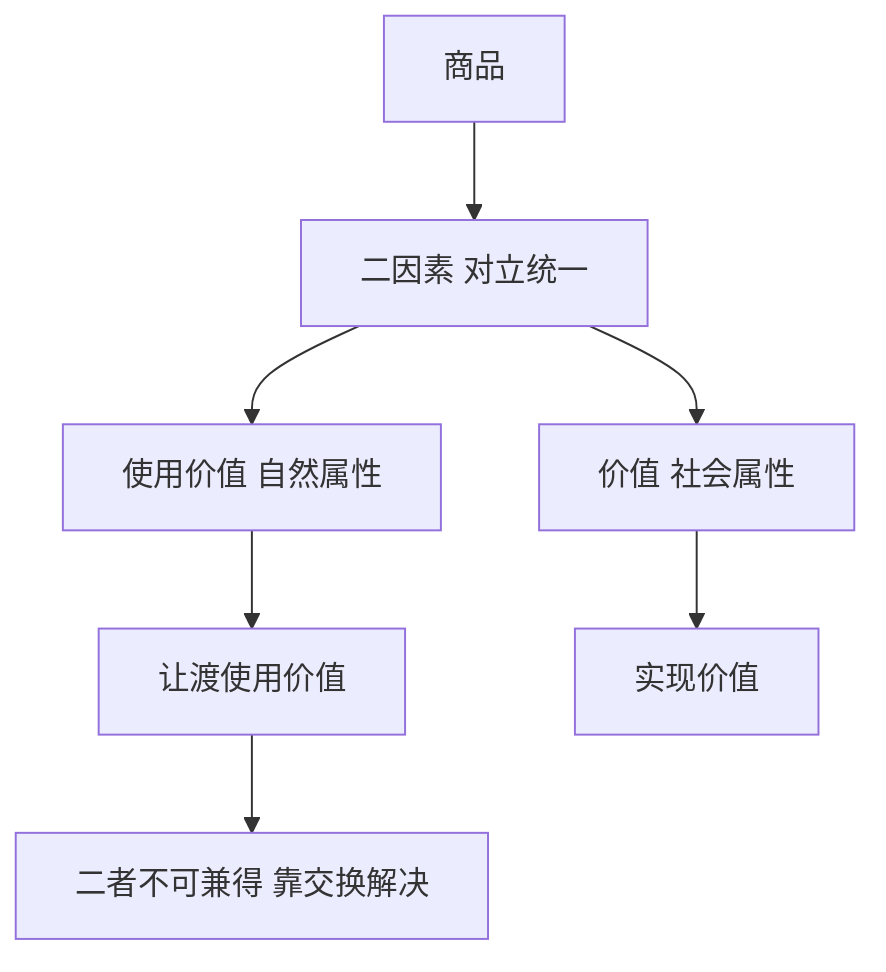
>
> **数学推导**：商品价值 $W = c + v + m$，其中 $c$ 是生产资料旧价值转移，必须依附在有使用价值的新产品上。若产品卖不出去，$c$ 也跟着报废——使用价值是价值的物质载体。
>
> **生活实例**：奶茶店做奶茶（创造使用价值）不是给老板自己喝，而是要卖给你；你付钱买到奶茶（使用价值归你），钱归老板（价值实现）。买卖完成那一刻，二者矛盾才解决。

**10. （逻辑链·判断）某奶茶店跟风研发了一款全新口味，但上市后无人问津、全部倒掉。用政治经济学分析，最准确的传导是（　）。**
A. 有使用价值就一定有价值，倒掉说明它没使用价值
B. 商品的私人劳动得不到社会承认 → 使用价值让渡不出去 → 价值无法实现 → 亏本
C. 味道不好导致价格曲线左移
D. 这是需求曲线右移的结果

> **✅ 答案：B**
> **解析：** 奶茶做出来了（有使用价值、耗费了劳动），但卖不出去 = 交换失败 = 私人劳动未转化为社会劳动 = 价值落空。这正是"商品的惊险跳跃"——跳跃失败，摔坏的不是商品而是商品生产者。A 错：奶茶有使用价值（能喝），但没人要；C、D 是西方经济学说法，且方向也不对。
>
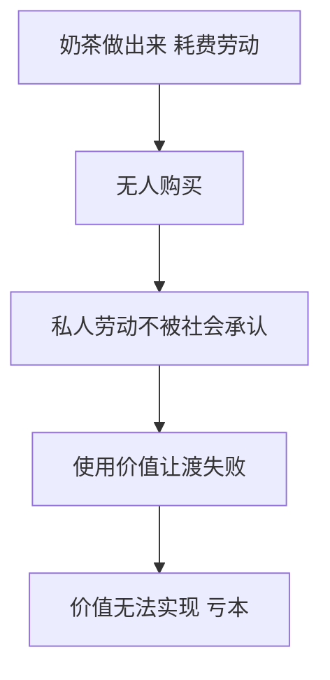
>
> **数学推导**：价值实现条件是 $W \to G$ 成功。若个别劳动时间 $t_i$ 对应的产品卖不出去，则被社会承认的价值量 $= 0$，而不是 $= t_i$——投入的 $c+v$ 全部沉没。
>
> **生活实例**：2023 年大量奶茶店跟风做"竹筒奶茶"，竹筒成本高、没人复购，三个月后纷纷倒闭——使用价值做出来了，价值没实现，老板血本无归。

---

## KP02 劳动二重性（[[知识点/KP02_劳动二重性|回知识点]]）

**1. 生产商品的劳动二重性是指（　）。**
A. 简单劳动和复杂劳动
B. 具体劳动和抽象劳动
C. 私人劳动和社会劳动
D. 必要劳动和剩余劳动

> **✅ 答案：B**
> **解析：** 劳动二重性 = 具体劳动 + 抽象劳动。A 是劳动的复杂程度；C 是私有制商品经济的基本矛盾；D 是资本主义下劳动时间的分割。

**2. 具体劳动（　）。**
A. 创造使用价值
B. 形成价值
C. 创造剩余价值
D. 转移生产资料价值

> **✅ 答案：A**
> **解析：** 具体劳动创造使用价值。抽象劳动形成价值。D 也是具体劳动的作用（转移 c 的价值），但最基本的是 A。单选题选最准确的。

**3. 抽象劳动形成（　）。**
A. 使用价值
B. 价值
C. 交换价值
D. 价格

> **✅ 答案：B**
> **解析：** 抽象劳动是撇开具体形式的一般人类劳动耗费，它形成价值。具体劳动创造使用价值。

**4. 劳动二重性学说的创立者是（　）。**
A. 亚当·斯密
B. 大卫·李嘉图
C. 马克思
D. 恩格斯

> **✅ 答案：C**
> **解析：** 马克思说"商品中包含的劳动的这种二重性，是首先由我批判地证明了的"。古典派提出了劳动价值论但没区分二重性。

**5. 马克思称劳动二重性为（　）。**
A. 马克思主义政治经济学的基石
B. 理解政治经济学的枢纽
C. 历史唯物主义的核心
D. 剩余价值学说的基石

> **✅ 答案：B**
> **解析：** 原文："这一点是理解政治经济学的枢纽。"注意区分：剩余价值学说是马克思经济理论的基石。

**6. 下列关于具体劳动和抽象劳动关系的说法，正确的是（　）。**
A. 它们是两次不同的劳动
B. 它们是同一劳动的两个方面
C. 具体劳动是永恒范畴，抽象劳动也是永恒范畴
D. 抽象劳动是自然属性

> **✅ 答案：B**
> **解析：** 具体劳动和抽象劳动不是两次劳动，而是同一劳动过程的两个方面。具体劳动是永恒的（任何社会都要生产使用价值），抽象劳动是历史的（只有商品经济才形成价值）。

**7. 复杂劳动和简单劳动的关系是（　）。**
A. 复杂劳动等于多倍简单劳动
B. 二者没有关系
C. 简单劳动等于多倍复杂劳动
D. 复杂劳动不创造价值

> **✅ 答案：A**
> **解析：** 少量复杂劳动等于多倍简单劳动。这个倍数由社会过程自发形成，不是谁规定的。程序员 1 小时 = 多倍奶茶店店员 1 小时。

**8. 下列关于抽象劳动的说法，错误的是（　）。**
A. 它是撇开具体形式的一般人类劳动耗费
B. 它形成价值
C. 它是商品经济特有的历史范畴
D. 它在一切社会形态下都存在

> **✅ 答案：D**
> **解析：** 抽象劳动只有在商品经济下才形成价值，是历史范畴。在自然经济和未来共产主义社会，产品不交换，抽象劳动、价值这些范畴都消失。D 错误。
**9. （逻辑链·分析）劳动二重性与商品二因素的对应关系，下列传导正确的是（　）。**
A. 具体劳动形成价值，抽象劳动创造使用价值
B. 具体劳动创造使用价值并转移生产资料旧价值，抽象劳动凝结形成新价值
C. 两次不同的劳动分别产出使用价值和价值
D. 抽象劳动创造使用价值

> **✅ 答案：B**
> **解析：** 同一劳动过程从两个方面看：具体劳动（有用劳动）把茶叶牛奶加工成奶茶，创造使用价值，同时把茶叶牛奶的旧价值转移到新奶茶上；抽象劳动（体力脑力耗费）凝结成奶茶的新价值。A、D 把二者说反了；C 错在不是两次劳动，而是同一劳动的两个方面。
>
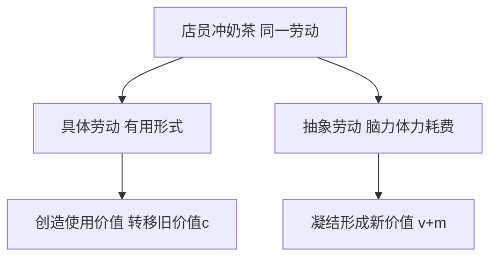
>
> **数学推导**：新产品价值 $W = c + v + m$。其中 $c$ 由具体劳动转移（机器折旧、茶叶牛奶消耗），$v+m$ 由抽象劳动新凝结（店员 1 小时劳动 $= v$ 工资 + $m$ 剩余价值）。
>
> **生活实例**：店员冲一杯奶茶，手的动作（具体劳动）把茶奶混合成饮品；同时他 10 分钟的脑力体力消耗（抽象劳动）凝结进这杯奶茶，构成新价值。

**10. （逻辑链·判断）奶茶店从手工冲调改成全自动奶茶机后，每杯奶茶的"新创造价值"主要来自（　）。**
A. 机器运转本身
B. 仍然是人的抽象劳动，机器只转移旧价值不创造新价值
C. 电力和原料
D. 奶茶本身的物理属性

> **✅ 答案：B**
> **解析：** 机器是不变资本 $c$，它在生产中只把自身折旧和电力价值转移到产品上，不增殖；新价值 $v+m$ 永远只能由活劳动（人的抽象劳动）创造。自动化程度越高，单个工人被榨取的相对剩余价值越多，但新价值的源泉仍然是活劳动。
>
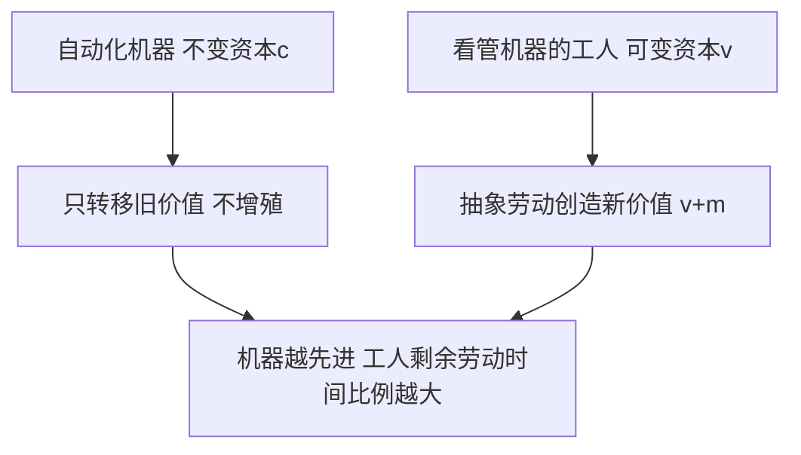
>
> **数学推导**：$W = c + v + m$。机器普及使 $c$ 占比上升、$v$ 占比下降，但 $m$ 仍由 $v$ 带来：剩余价值率 $m' = m/v$ 反而提高（必要劳动时间被压缩）。
>
> **生活实例**：全自动奶茶机一小时出 300 杯，但机器不"创造价值"——它只是把电费和折旧摊进每杯；真正让顾客愿意花 15 元的，是配方研发、品牌运营、服务人员这些人的抽象劳动凝结。

---

## KP03 私人劳动社会劳动与商品拜物教（[[知识点/KP03_私人劳动社会劳动与商品拜物教|回知识点]]）

**1. 简单商品经济的基本矛盾是（　）。**
A. 使用价值和价值的矛盾
B. 具体劳动和抽象劳动的矛盾
C. 私人劳动和社会劳动的矛盾
D. 个别劳动时间和社会必要劳动时间的矛盾

> **✅ 答案：C**
> **解析：** 私有制下，生产者的劳动既是私人劳动（自己决定生产什么），又是社会劳动（社会分工要求满足社会需要）。这一矛盾是简单商品经济的基本矛盾，决定了其他矛盾。

**2. 私人劳动要转化为社会劳动，必须通过（　）。**
A. 计划分配
B. 商品交换
C. 国家调拨
D. 自给自足

> **✅ 答案：B**
> **解析：** 在私有制商品经济中，私人劳动的社会性质只有通过商品交换才能体现。商品卖出去了，私人劳动才被社会承认。

**3. 商品拜物教是指（　）。**
A. 人们崇拜商品这种物
B. 商品形式把人与人的社会关系颠倒为物与物的关系
C. 商品具有神秘的生命力
D. 人们迷信货币

> **✅ 答案：B**
> **解析：** 商品拜物教不是指人迷信商品，而是指人与人的社会关系在商品形式下被颠倒为物与物的关系，好像物本身具有神秘力量。

**4. 货币拜物教是（　）。**
A. 商品拜物教的发展
B. 与商品拜物教无关
C. 比商品拜物教低级
D. 原始社会的现象

> **✅ 答案：A**
> **解析：** 货币出现后，一切商品都要换成货币才能实现价值，货币的权力扩大，商品拜物教发展为货币拜物教——好像钱本身具有买一切的神奇力量。

**5. 商品拜物教消失的条件是（　）。**
A. 商品经济高度发达
B. 商品交换消失、公有制基础上的计划生产
C. 货币消失
D. 国家干预

> **✅ 答案：B**
> **解析：** 拜物教根源于私人劳动和社会劳动的矛盾。一旦生产不再是私人的、产品不再交换，人与人的关系就不必采取物与物关系的虚幻形式。

**6. 下列现象中属于"数字时代拜物教"的是（　）。**
A. 人们崇拜黄金
B. 商家和骑手把平台算法当成不可抗拒的力量
C. 人们喜欢买名牌
D. 股票价格上涨

> **✅ 答案：B**
> **解析：** 平台本来是人手的产物，但在数字时代被当成独立的、支配人的力量。这是商品拜物教在数字时代的新形式——平台拜物教/算法拜物教。

**7. 私人劳动和社会劳动矛盾的根源是（　）。**
A. 社会分工和生产资料私有制
B. 生产力发展
C. 货币出现
D. 价值规律

> **✅ 答案：A**
> **解析：** 社会分工使劳动具有社会性；生产资料私有制使劳动具有私人性。二者结合产生私人劳动和社会劳动的矛盾。

**8. 下列说法错误的是（　）。**
A. 商品拜物教是历史现象
B. 商品拜物教根源于私有制
C. 商品拜物教可以通过道德说教消除
D. 马克思的拜物教理论揭示了物与物关系背后的人与人关系

> **✅ 答案：C**
> **解析：** 拜物教根源于私有制商品经济，不能通过道德说教消除，只能通过改变生产关系来克服。C 错误。
**9. （逻辑链·分析）私有制下简单商品经济基本矛盾的传导链，正确的是（　）。**
A. 私人劳动与社会劳动的矛盾 → 必须通过商品交换解决 → 交换成功=私人劳动被社会承认 → 交换失败=生产者破产
B. 矛盾由国家计划直接消除
C. 货币出现后矛盾自动消失
D. 矛盾表现为使用价值和价值的对立，与交换无关

> **✅ 答案：A**
> **解析：** 私有制下，生产者自己决定生产什么（私人劳动），但社会分工又要求产品满足社会需要（社会劳动）。这一矛盾只有通过交换才能解决：商品卖出去，私人劳动才算被社会承认；卖不出去，私人劳动白费，生产者亏本破产。它是简单商品经济的基本矛盾，决定了劳动二重性、二因素等一切矛盾。
>
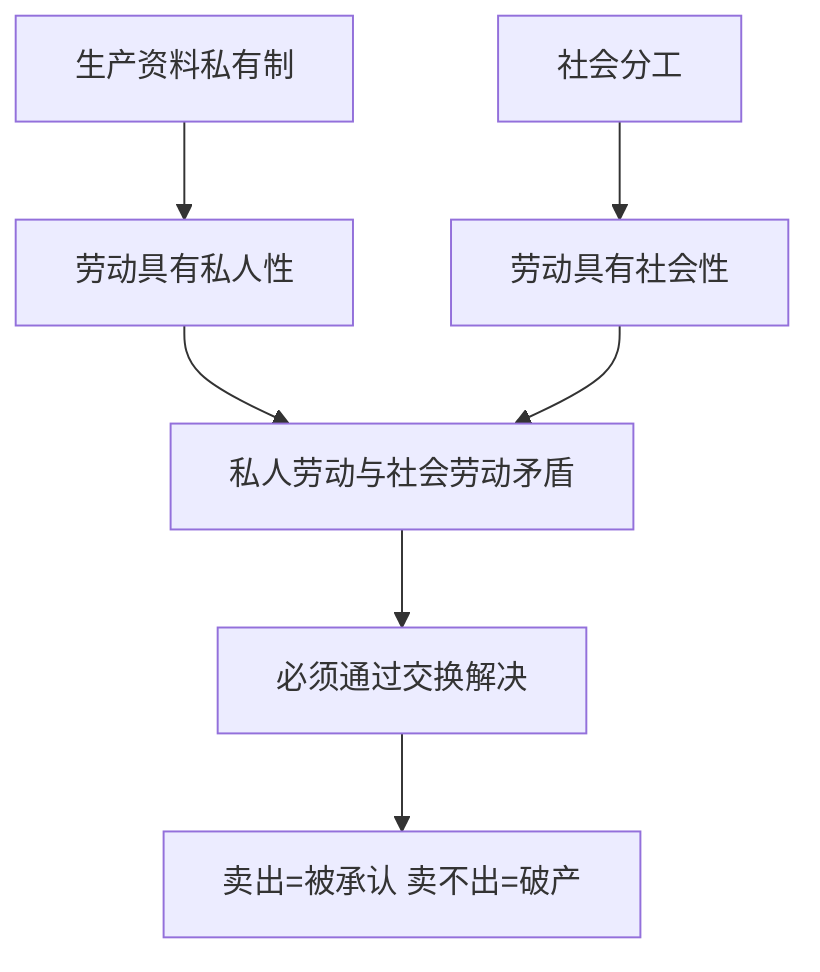
>
> **数学推导**：设社会必要劳动时间为 $\bar t$，个别劳动时间为 $t_i$。交换成功时社会承认价值 $= \bar t$；若产品卖不出去，承认价值 $= 0$。私人劳动能否转化，取决于产品是否符合社会需要。
>
> **生活实例**：你开个小作坊做网红款文具，做了一堆结果没人买——这就是私人劳动（你自己决定做什么）和社会劳动（社会并不需要这么多这款文具）的矛盾爆发。

**10. （逻辑链·判断）外卖骑手说"算法就是老天爷，它派什么单我就得跑什么单"。用商品拜物教理论分析，最准确的传导是（　）。**
A. 算法确实是客观自然规律，骑手应该服从
B. 人创造了平台和算法 → 平台反过来支配人 → 人与人的社会关系被颠倒为物（算法）与物的关系 → 平台拜物教
C. 骑手迷信思想严重
D. 技术进步决定一切

> **✅ 答案：B**
> **解析：** 平台、算法本来是程序员、运营、骑手、商家共同劳动的产物（人手的产物），但在资本主义生产关系下，它变成了独立于生产者、反过来支配生产者的力量——骑手被算法考核、被派单、被罚款。这就是商品拜物教在数字时代的新形式：人与人的关系（平台资本家和骑手的剥削关系）被颠倒为物与物的关系（算法和骑手的关系）。
>
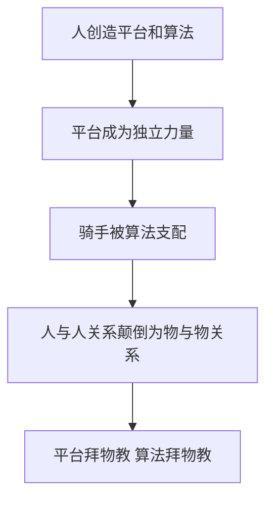
>
> **数学推导**：算法把骑手劳动时间抽象为"几分钟一单"，通过压缩必要劳动时间提高剩余价值率 $m' = m/v$；骑手看到的是算法派单（物的关系），看不到背后是资本家对活劳动的榨取（人的关系）。
>
> **生活实例**：你刷短视频停不下来，觉得"算法太懂我"——其实是几百个工程师设计了让你上瘾的推荐机制，目的是让你多看广告。算法不是神，是工具；谁掌握工具，谁就掌握权力。

---

## KP04 商品价值量（[[知识点/KP04_商品价值量|回知识点]]）

**1. 商品价值量的大小是由（　）决定的。**
A. 个别劳动时间
B. 社会必要劳动时间
C. 商品的有用性
D. 供求关系

> **✅ 答案：B**
> **解析：** 价值量由社会必要劳动时间决定，不是个别劳动时间。个别劳动时间高于社会必要劳动时间的部分不被社会承认。

**2. 社会必要劳动时间是指（　）。**
A. 全社会所有生产者的平均时间
B. 在现有社会正常生产条件、平均熟练程度和强度下制造某种使用价值所需时间
C. 最先进生产者的时间
D. 最落后生产者的时间

> **✅ 答案：B**
> **解析：** 马克思的定义三要素：现有社会正常生产条件、社会平均熟练程度、社会平均劳动强度。

**3. 单位商品价值量与社会劳动生产率的关系是（　）。**
A. 成正比
B. 成反比
C. 无关
D. 有时成正比有时成反比

> **✅ 答案：B**
> **解析：** 社会劳动生产率越高，单位时间生产的使用价值越多，分摊到每个商品上的抽象劳动越少，单位商品价值量越小。二者成反比。

**4. 同一劳动在同样时间内创造的价值总量（　）。**
A. 与劳动生产率成正比
B. 与劳动生产率成反比
C. 不变
D. 时而增加时而减少

> **✅ 答案：C**
> **解析：** 1 小时不管做 1 杯还是 10 杯，总价值都是 1 小时劳动。变化的只是单位商品价值量，不是价值总量。

**5. 某部门原来 1 小时生产 10 件商品，价值量共 10 小时；现在劳动生产率提高一倍，1 小时生产 20 件。此时（　）。**
A. 单位商品价值量不变，总价值量增加
B. 单位商品价值量降为原来一半，总价值量仍为 1 小时
C. 单位商品价值量不变，总价值量也不变
D. 单位商品价值量增加，总价值量增加

> **✅ 答案：B**
> **解析：** 原来每件价值 = 10/10 = 1 小时；现在每件价值 = 1/20 × 60 = 3 分钟 = 原来的 1/20？重新算：原来 1 小时 10 件，每件 6 分钟；现在 1 小时 20 件，每件 3 分钟。单位价值降为一半，总价值仍是 1 小时。选 B。

**6. 简单劳动和复杂劳动的关系是（　）。**
A. 复杂劳动等于多倍简单劳动
B. 二者等同
C. 简单劳动等于多倍复杂劳动
D. 复杂劳动不创造价值

> **✅ 答案：A**
> **解析：** 少量复杂劳动 = 多倍简单劳动。这个倍数由社会过程自发形成。

**7. 个别劳动时间低于社会必要劳动时间的生产者（　）。**
A. 会亏损
B. 获得超额收益
C. 不亏不赚
D. 被市场淘汰

> **✅ 答案：B**
> **解析：** 个别劳动时间低于社会必要劳动时间，商品按社会价值出售，生产者获得超额剩余价值/超额利润。这就是技术先进者赚钱的原因。

**8. 下列关于价值量的说法，错误的是（　）。**
A. 价值量由社会必要劳动时间决定
B. 价值量与社会劳动生产率成反比
C. 价值量与个别劳动时间成正比
D. 复杂劳动等于多倍简单劳动

> **✅ 答案：C**
> **解析：** 商品价值量由社会必要劳动时间决定，与个别劳动时间无关。个别劳动时间只影响个别生产者的盈亏，不影响单位商品价值量。
**9. （逻辑链·分析）全行业劳动生产率提高一倍后，单位商品价值量和同时间价值总量的变化传导，正确的是（　）。**
A. 单位价值量降为原来一半，价值总量不变
B. 单位价值量不变，价值总量增加一倍
C. 两者都不变
D. 单位价值量下降，价值总量也下降

> **✅ 答案：A**
> **解析：** 社会劳动生产率越高，单位时间生产的使用价值越多，分摊到每件商品上的抽象劳动越少——单位商品价值量与社会劳动生产率成反比。但同一劳动在同样时间内凝结的抽象劳动总量不变——价值总量不变。
>
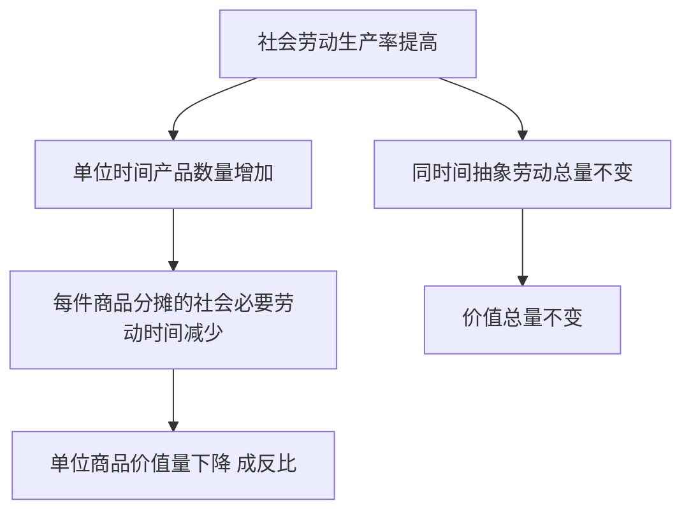
>
> **数学推导**：原 1 小时做 10 杯，每杯社会必要劳动时间 $t_1 = 60/10 = 6$ 分钟。生产率提高一倍后 1 小时做 20 杯，$t_2 = 60/20 = 3$ 分钟。单位价值量 $6 \to 3$（减半）；价值总量 $= 1$ 小时 $= 60$ 分钟抽象劳动，不变。
>
> **生活实例**：流水线普及后奶茶越做越快、越卖越便宜——单杯价值量降了，但工人一小时创造的总价值没变，变的只是老板摊到每杯里赚多少。

**10. （逻辑链·判断）某奶茶店老板率先用自动化设备，使自己每杯奶茶的个别劳动时间降到社会必要劳动时间的一半，他按社会价值出售产品，将会（　）。**
A. 亏损
B. 获得超额剩余价值（超额利润）
C. 不赚不赔
D. 被市场罚款

> **✅ 答案：B**
> **解析：** 商品按社会价值（由社会必要劳动时间决定）出售，而先进者的个别劳动时间低于社会必要劳动时间——他每杯实际耗费 3 分钟，却按 6 分钟的社会价值收钱，多得的 3 分钟就是超额剩余价值。这正是技术进步刺激和价值规律分化作用的体现。
>
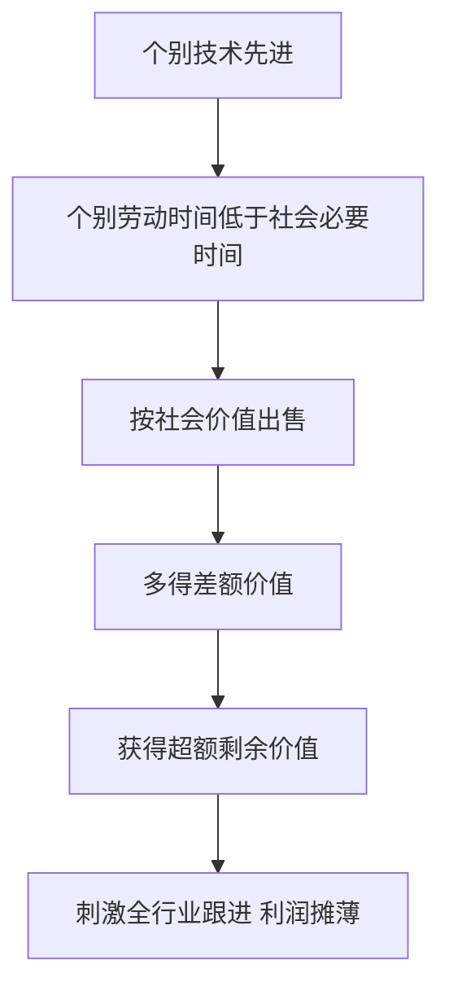
>
> **数学推导**：社会必要时间 $\bar t = 6$ 分钟/杯，个别时间 $t_i = 3$ 分钟/杯。每杯实现社会价值 $= 6$ 分钟，实际耗费 $= 3$ 分钟，超额剩余价值 $= 6 - 3 = 3$ 分钟/杯。
>
> **生活实例**：蜜雪冰城率先建集中供应链，把单杯成本压到同行一半，卖同样价格——每杯多赚的就是超额利润；等大家都学会供应链，超额利润就被摊薄成平均利润。

---

## KP05 货币的起源与本质（[[知识点/KP05_货币的起源与本质|回知识点]]）

**1. 货币的起源是（　）。**
A. 天才发明
B. 国家法律规定
C. 价值形式长期发展的自发产物
D. 人们协商约定

> **✅ 答案：C**
> **解析：** 货币不是谁发明或规定的，而是商品交换矛盾长期发展的自发产物——从简单价值形式到扩大价值形式、一般价值形式，最后固定在金银上成为货币。

**2. 价值形式发展的正确顺序是（　）。**
A. 货币形式→一般价值形式→扩大价值形式→简单价值形式
B. 简单价值形式→扩大价值形式→一般价值形式→货币形式
C. 扩大价值形式→简单价值形式→货币形式→一般价值形式
D. 简单价值形式→一般价值形式→扩大价值形式→货币形式

> **✅ 答案：B**
> **解析：** 四阶段：简单（1 只羊 = 2 把斧子）→ 扩大（1 只羊 = 一系列商品）→ 一般（一切商品 = 1 只羊）→ 货币（一切商品 = 金）。

**3. 货币的本质是（　）。**
A. 固定充当一般等价物的商品
B. 国家发行的纸币
C. 交换价值
D. 财富的象征

> **✅ 答案：A**
> **解析：** 货币是固定地充当一般等价物的商品。它本身有使用价值和价值（金银），体现商品生产者之间的社会关系。

**4. 金银天然不是货币，但货币天然是金银。这是因为（　）。**
A. 金银天生就是货币
B. 金银的自然属性适合充当一般等价物
C. 国家规定金银是货币
D. 人们喜欢金银

> **✅ 答案：B**
> **解析：** 金银体积小、价值大、便于携带、不易腐烂、可分割，这些自然属性使它最适合充当一般等价物。但金银本身不是货币，在没有商品交换的社会里它只是矿物。

**5. 简单价值形式是指（　）。**
A. 1 只羊 = 2 把斧子
B. 一切商品 = 1 只羊
C. 一切商品 = 金
D. 1 只羊 = 2 把斧子 = 1 袋米 = ……

> **✅ 答案：A**
> **解析：** 简单价值形式是一种商品的价值偶然地表现在另一种商品上。D 是扩大价值形式；B 是一般价值形式；C 是货币形式。

**6. 货币出现后，商品内在的使用价值和价值的矛盾表现为（　）。**
A. 商品和商品的对立
B. 商品和货币的外部对立
C. 具体劳动和抽象劳动的对立
D. 私人劳动和社会劳动的对立

> **✅ 答案：B**
> **解析：** 整个商品世界分裂为商品（特殊使用价值）和货币（一般价值）两极。一切商品只有换成货币才能实现价值。

**7. 下列关于货币的说法，错误的是（　）。**
A. 货币是商品
B. 货币有使用价值和价值
C. 货币的本质是一般等价物
D. 货币是国家发明的

> **✅ 答案：D**
> **解析：** 货币是价值形式长期发展的自发产物，不是国家发明的。国家只是发行纸币这种价值符号。

**8. 一般价值形式与扩大价值形式的区别在于（　）。**
A. 前者有一种固定的一般等价物，后者没有
B. 前者更简单
C. 前者没有货币
D. 二者没有本质区别

> **✅ 答案：A**
> **解析：** 扩大价值形式中，一种商品的价值表现在一系列商品上，没有统一的等价物；一般价值形式中，一切商品的价值都表现在同一种商品（如羊）上，出现了一般等价物。
**9. （逻辑链·分析）价值形式长期发展的四个阶段，正确传导顺序是（　）。**
A. 货币形式 → 一般价值形式 → 扩大价值形式 → 简单价值形式
B. 简单价值形式 → 扩大价值形式 → 一般价值形式 → 货币形式
C. 扩大价值形式 → 简单价值形式 → 一般价值形式 → 货币形式
D. 简单价值形式 → 一般价值形式 → 扩大价值形式 → 货币形式

> **✅ 答案：B**
> **解析：** 价值形式随交换发展自发演进：简单（1 只羊偶然换 2 把斧子）→ 扩大（1 只羊换一系列商品）→ 一般（一切商品都换成羊，羊成为一般等价物）→ 货币（一般等价物固定在金银上）。这不是谁设计的，是交换矛盾自发发展的结果。
>
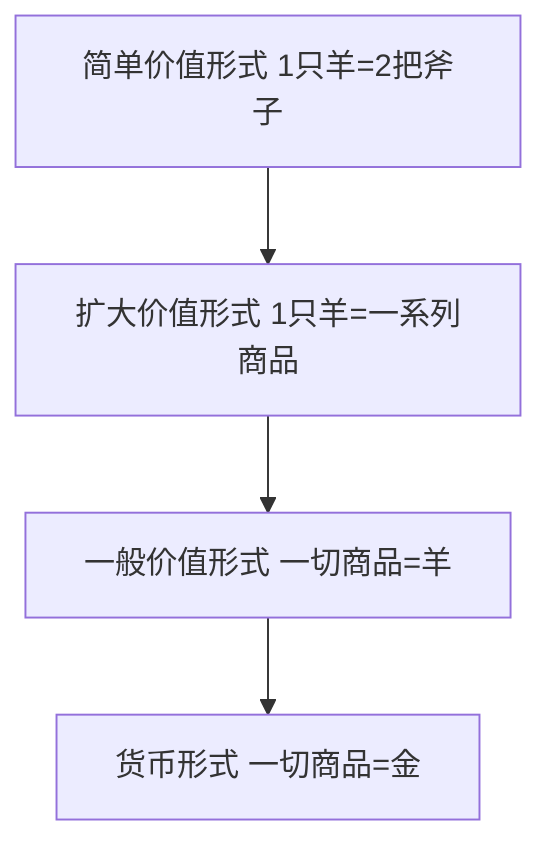
>
> **数学推导**：设商品集合 $\{X_1, X_2, \dots, X_n\}$。简单形式只解决一种交换比例；扩大形式有 $n-1$ 个比例但不统一；一般形式把所有商品价值表现在同一等价物上，比例统一为 $X_i = a_i \cdot G$。
>
> **生活实例**：早期赶集，你拿米换布、拿布换羊，换来换去太麻烦——后来大家都先用东西换羊，再用羊换自己要的（一般价值形式）；最后羊太重，换成金银（货币形式）。

**10. （逻辑链·判断）一切商品的价值都统一表现在同一种商品（羊）上。这一"一般价值形式"解决了什么核心矛盾？（　）**
A. 解决了扩大价值形式下等价物不统一、交换链条过长的矛盾，出现了固定的一般等价物
B. 矛盾从此消失
C. 羊立刻变成了货币
D. 国家规定了等价物

> **✅ 答案：A**
> **解析：** 扩大价值形式的缺陷：一种商品的价值表现在一系列商品上，没有统一等价物，交换要经过漫长的物物交换链条（米→布→羊→盐）。一般价值形式下，一切商品先换成羊，羊成为社会公认的一般等价物，交换一步完成。当一般等价物最终固定在金银上，就成了货币。
>
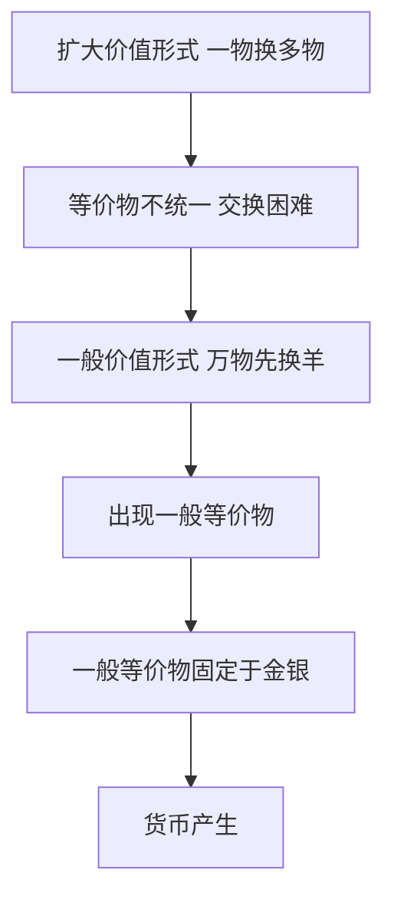
>
> **数学推导**：扩大形式下 $X_i$ 要与 $n-1$ 个交换比例分别匹配；一般形式下所有商品价值统一为 $X_i = a_i G$，只需 $n$ 个比例，交换成本骤降。
>
> **生活实例**：早期网游里点卡、金币、装备互相换算极麻烦；后来大家都认某一种稀有道具当"硬通货"——这就是从扩大价值形式走向一般价值形式的自发过程。

---

## KP06 货币的五大职能（[[知识点/KP06_货币的五大职能|回知识点]]）

**1. 货币的基本职能是（　）。**
A. 价值尺度和流通手段
B. 贮藏手段和支付手段
C. 支付手段和世界货币
D. 流通手段和贮藏手段

> **✅ 答案：A**
> **解析：** 价值尺度和流通手段是货币一产生就具有的基本职能；后三者是派生职能。

**2. 货币执行价值尺度职能时（　）。**
A. 必须是现实的货币
B. 只需要观念上的货币
C. 必须是金属货币
D. 必须是纸币

> **✅ 答案：B**
> **解析：** 商品标价 15 元，不需要把 15 元现金摆在那里，只需要观念上的货币。

**3. 货币充当商品交换媒介的职能是（　）。**
A. 价值尺度
B. 流通手段
C. 贮藏手段
D. 支付手段

> **✅ 答案：B**
> **解析：** 流通手段 = W—G—W 中货币充当交换媒介。你付钱、商家交货，货币就是流通手段。

**4. 货币退出流通、被人们保存起来的职能是（　）。**
A. 价值尺度
B. 流通手段
C. 贮藏手段
D. 支付手段

> **✅ 答案：C**
> **解析：** 贮藏手段是货币被当作社会财富的一般代表保存起来。作为贮藏手段必须是足值的金属货币。

**5. 货币在赊购赊销中用于延期支付的职能是（　）。**
A. 价值尺度
B. 流通手段
C. 贮藏手段
D. 支付手段

> **✅ 答案：D**
> **解析：** 支付手段是货币用于还债、交租、纳税、发工资等延期支付。发工资是典型的支付手段。

**6. 小王用信用卡先消费、后还款，这体现了货币的（　）职能。**
A. 价值尺度
B. 流通手段
C. 支付手段
D. 贮藏手段

> **✅ 答案：C**
> **解析：** 先消费后还款是延期支付，属于支付手段职能。

**7. 下列经济行为中，货币执行流通手段职能的是（　）。**
A. 一台电脑标价 8000 元
B. 小李用 8000 元买了一台电脑
C. 小李把 8000 元存入银行
D. 小李月底还信用卡 8000 元

> **✅ 答案：B**
> **解析：** A 是价值尺度（标价）；B 是流通手段（一手交钱一手交货）；C 是贮藏手段；D 是支付手段（还债）。

**8. 世界货币职能主要用于（　）。**
A. 国内商品交换
B. 国际支付、国际购买和财富转移
C. 国内工资发放
D. 银行存贷

> **✅ 答案：B**
> **解析：** 世界货币是货币在世界市场上发挥作用，主要是贵金属（今天是美元、欧元等国际储备货币），用于国际结算。
**9. （逻辑链·分析）货币五大职能的逻辑关系，正确的是（　）。**
A. 价值尺度和流通手段是货币一产生就有的基本职能，贮藏手段、支付手段、世界货币是在此基础上派生的
B. 五大职能是货币产生时同时具有的，没有先后
C. 世界货币是最基本的职能
D. 贮藏手段在流通手段之前产生

> **✅ 答案：A**
> **解析：** 货币一产生就执行两个基本职能：价值尺度（给商品标价）和流通手段（充当交换媒介）。商品经济发展后，才派生出贮藏手段（存钱防荒）、支付手段（赊账还债发工资）、世界货币（国际结算）。基本职能是源头，派生职能是延伸。
>
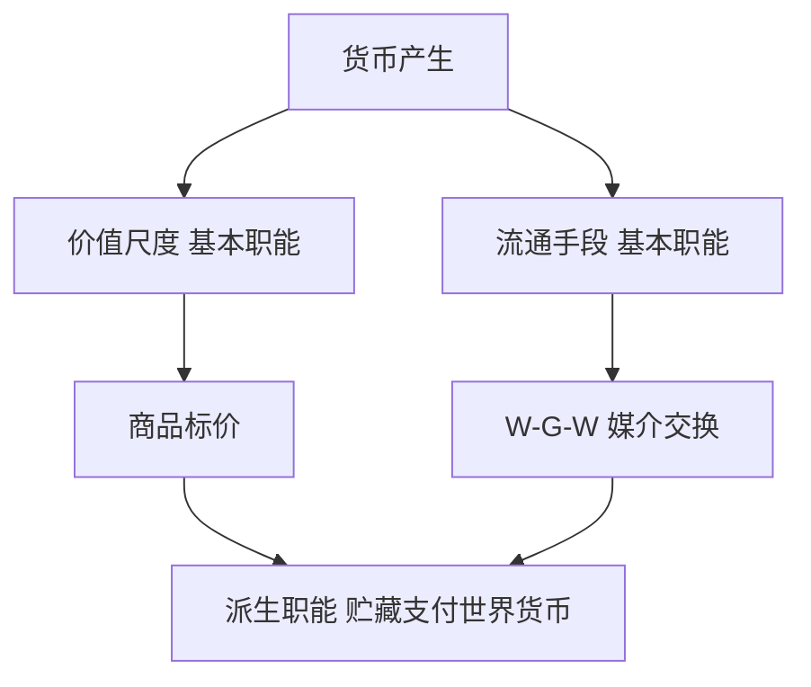
>
> **数学推导**：价值尺度只需观念上的货币（标价 15 元不必摆 15 元现金）；流通手段必须是现实货币；贮藏手段必须是足值金属货币；支付手段是货币作为独立价值单方面转移（还债）。
>
> **生活实例**：奶茶店门口挂个价目表（价值尺度）；你扫码付款拿走奶茶（流通手段）；你发了工资先存余额宝（贮藏手段）；月底还花呗（支付手段）——一次消费串起好几个职能。

**10. （逻辑链·判断）小王每月 10 号领工资、20 号还花呗。这两个行为中货币依次执行的职能是（　）。**
A. 流通手段、流通手段
B. 支付手段、支付手段
C. 价值尺度、流通手段
D. 贮藏手段、支付手段

> **✅ 答案：B**
> **解析：** 支付手段的典型场景：赊购赊销、还债、交租、纳税、发工资。共同特征是货币作为独立价值单方面转移——不是一手交钱一手交货（那是流通手段）。发工资是老板单方面把钱付给你；还花呗是你单方面把钱转给平台，都属于支付手段。
>
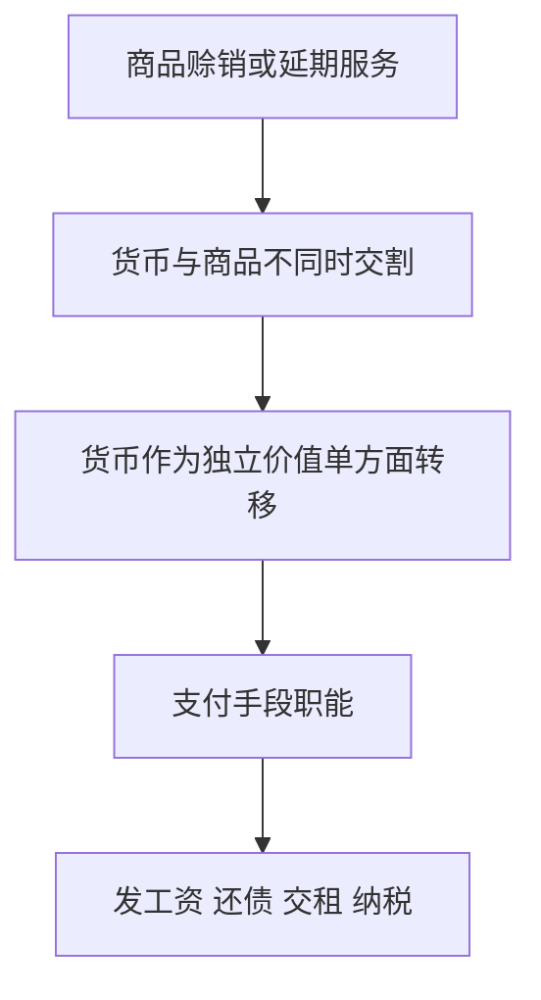
>
> **数学推导**：流通手段对应 $W-G-W$ 同时完成；支付手段对应 $G$ 在时间上与 $W$ 分离（先消费后付款，或先干活后拿钱）。
>
> **生活实例**：你先住酒店后退房结账（赊宿=支付手段）；老板月底才发你这个月工资（延期支付）；企业交税——钱和商品不在同一时刻交换，就是支付手段。

---

## KP07 货币流通规律与通货膨胀（[[知识点/KP07_货币流通规律与通货膨胀|回知识点]]）

**1. 流通中所需要的货币量等于（　）。**
A. 待售商品价格总额
B. 待售商品价格总额除以货币流通速度
C. 货币流通速度
D. 待售商品总量

> **✅ 答案：B**
> **解析：** M = PQ / V。流通中所需货币量与商品价格总额成正比，与货币流通速度成反比。

**2. 某国待售商品价格总额为 10000 亿元，货币一年流通 5 次，流通中所需货币量为（　）。**
A. 10000 亿元
B. 5000 亿元
C. 2000 亿元
D. 50000 亿元

> **✅ 答案：C**
> **解析：** M = 10000 / 5 = 2000 亿元。

**3. 通货膨胀是指（　）。**
A. 物价个别上涨
B. 纸币发行量超过流通中所需货币量，引起纸币贬值、物价普遍持续上涨
C. 货币升值
D. 物价下降

> **✅ 答案：B**
> **解析：** 通货膨胀的定义要点：①纸币发行过多；②纸币贬值；③物价普遍持续上涨。个别商品涨价不是通胀。

**4. 纸币流通规律是（　）。**
A. 纸币发行量可以任意
B. 纸币发行量限于它象征地代表的流通中所需金属货币量
C. 纸币发行量与物价无关
D. 纸币发行量越多越好

> **✅ 答案：B**
> **解析：** 纸币是价值符号，它的流通规律以金属货币流通规律为基础。发行过多就贬值。

**5. 引起通货膨胀的原因不包括（　）。**
A. 需求拉动
B. 成本推动
C. 货币发行过少
D. 输入型通胀

> **✅ 答案：C**
> **解析：** 货币发行过少会引起通货紧缩，不是通胀。其他三项都是通胀成因。

**6. 在商品价格总额不变的条件下，货币流通速度加快，则流通中所需货币量（　）。**
A. 增加
B. 减少
C. 不变
D. 先增后减

> **✅ 答案：B**
> **解析：** M = PQ / V。V 在分母，V 加快则 M 减少。比如原来 1 元转手 2 次，现在转手 4 次，同样的交易额只需要一半货币。

**7. 下列经济现象属于通货膨胀的是（　）。**
A. 猪肉价格上涨 10%
B. 某地房价上涨 20%
C. 一国 CPI 连续 12 个月上涨 5% 以上
D. 某品牌手机降价

> **✅ 答案：C**
> **解析：** 通胀是物价普遍持续上涨。A、B 是个别商品涨价；D 是降价。只有 C 符合"普遍持续"。

**8. 马克思主义政治经济学认为，通货膨胀的根源是（　）。**
A. 人民需求过旺
B. 纸币发行违背货币流通规律
C. 企业成本上升
D. 国际油价上涨

> **✅ 答案：B**
> **解析：** A、C、D 是具体成因，但最根本的是纸币发行过多、违背了货币流通规律。这是马克思主义的基本立场。
**9. （逻辑链·分析）移动支付普及后，1 元钱一年转手次数从 5 次提高到 10 次，其他条件不变，流通中所需货币量将（　）。**
A. 按 $M = PQ/V$，$V$ 提高一倍则 $M$ 减少一半
B. $M$ 增加一倍
C. $M$ 不变
D. $M$ 先升后降

> **✅ 答案：A**
> **解析：** 货币流通规律 $M = PQ/V$：流通中所需货币量与商品价格总额 $PQ$ 成正比，与货币流通速度 $V$ 成反比。同一块钱一年转手 10 次就顶 10 块钱用，所以完成同样交易额需要的现金少了一半。
>
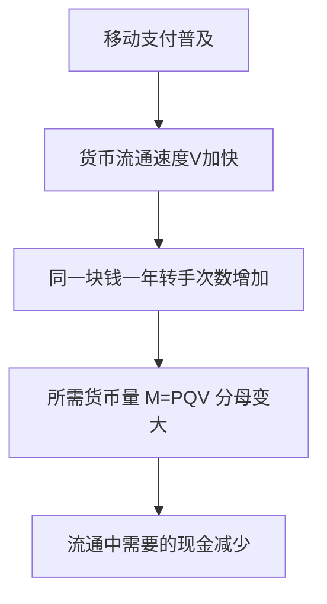
>
> **数学推导**：设商品价格总额 $PQ = 10000$ 亿元。原 $V_1 = 5$，$M_1 = 10000/5 = 2000$ 亿元；现 $V_2 = 10$，$M_2 = 10000/10 = 1000$ 亿元。所需货币量从 2000 亿降到 1000 亿。
>
> **生活实例**：以前你一周出门要揣 200 块现金，现在手机支付，同样一周的花销兜里可能只放 50 块——钱转得快了，需要的现钱少了。

**10. （逻辑链·判断）假设待售商品价格总额和流通速度都不变，央行多印了一倍纸币投入流通，传导结果是（　）。**
A. 物价上涨约一倍，单位纸币购买力降为一半
B. 物价不变，人们更富有
C. 出现通货紧缩
D. 商品数量增加一倍

> **✅ 答案：A**
> **解析：** 纸币是价值符号，发行量必须限于流通中所需金属货币量。实际需要 $M_0 = PQ/V$，却发行 $2M_0$，则单位纸币代表的金量降为原来一半——纸币贬值，物价普遍上涨一倍。这就是通货膨胀的根源。
>
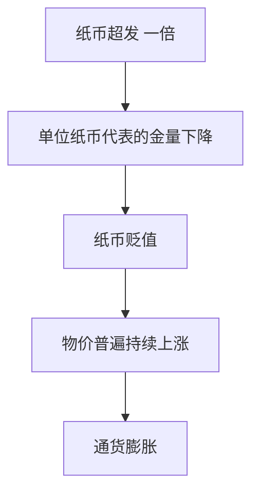
>
> **数学推导**：实际需要 $M_0 = PQ/V$。发行 $M_s = 2M_0$，在商品总量不变下新价格水平 $P' = M_s \cdot V / Q = 2P$；单位纸币购买力 $= M_0/M_s = 1/2$。
>
> **生活实例**：2021 年土耳其里拉大超发，一年贬值约 50%，物价翻倍，老百姓扛着成捆现金去买菜——这就是违背纸币流通规律的直接后果。

---

## KP08 价值规律（[[知识点/KP08_价值规律|回知识点]]）

**1. 商品经济的基本规律是（　）。**
A. 供求规律
B. 竞争规律
C. 价值规律
D. 剩余价值规律

> **✅ 答案：C**
> **解析：** 价值规律是商品经济的基本规律。剩余价值规律是资本主义的基本规律。

**2. 价值规律的基本内容是（　）。**
A. 商品价格由供求决定
B. 商品价值量由社会必要劳动时间决定，交换以价值量为基础等价交换
C. 商品价格由政府规定
D. 商品价值由使用价值决定

> **✅ 答案：B**
> **解析：** 价值规律两要点：价值量由社会必要劳动时间决定；交换等价。

**3. 价值规律的表现形式是（　）。**
A. 价格等于价值
B. 价格围绕价值上下波动
C. 价格长期高于价值
D. 价格长期低于价值

> **✅ 答案：B**
> **解析：** 价格受供求影响围绕价值波动，从长期看涨落抵消，价格平均数等于价值。

**4. 价格围绕价值波动是（　）。**
A. 对价值规律的否定
B. 价值规律在私有制下唯一可能的表现形式
C. 价值规律的例外
D. 国家干预的结果

> **✅ 答案：B**
> **解析：** 马克思认为，在私有制下没有中央计划者，社会总劳动的分配只能靠价格波动这个"看不见的指挥棒"。波动不是对价值规律的否定，而是它的实现形式。

**5. 价值规律的作用不包括（　）。**
A. 自发调节资源配置
B. 自发刺激技术进步
C. 自发消除两极分化
D. 自发引起商品生产者两极分化

> **✅ 答案：C**
> **解析：** 价值规律自发作用必然导致两极分化，不是消除分化。C 错误。

**6. 某生产者率先改进技术，使其个别劳动时间低于社会必要劳动时间，他将（　）。**
A. 亏损
B. 获得超额收益
C. 不亏不赚
D. 被淘汰

> **✅ 答案：B**
> **解析：** 个别劳动时间低于社会必要劳动时间，商品按社会价值出售，多得的部分就是超额剩余价值/超额利润。这刺激其他生产者跟进。

**7. 价值规律是（　）。**
A. 一切社会共有的规律
B. 商品经济特有的规律
C. 资本主义特有的规律
D. 社会主义特有的规律

> **✅ 答案：B**
> **解析：** 价值规律是商品经济的规律。在自然经济、未来共产主义社会，没有商品交换，就没有价值规律。

**8. 我国提出"让市场在资源配置中起决定性作用，更好发挥政府作用"。这一政策的政治经济学依据是（　）。**
A. 价值规律有自发性、盲目性、滞后性
B. 市场万能
C. 政府万能
D. 价值规律不存在

> **✅ 答案：A**
> **解析：** 价值规律能配置资源，但有盲目性（一窝蜂）、滞后性（事后调节）、分化性（两极分化），所以需要政府更好发挥作用来弥补。
**9. （逻辑链·分析）价值规律的表现形式"价格围绕价值上下波动"，其内在传导链是（　）。**
A. 供不应求 → 价格涨到价值之上 → 高利润吸引生产者涌入 → 供过于求 → 价格跌到价值之下 → 生产者退出 → 长期平均价格等于价值
B. 价格永远等于价值
C. 价格由政府决定
D. 波动是对价值规律的否定

> **✅ 答案：A**
> **解析：** 私有制下没有中央计划者，社会总劳动靠价格波动这只"看不见的手"分配：价格高于价值→资本涌入→供给增加→价格回落；价格低于价值→资本退出→供给减少→价格回升。短期看价格偏离价值，长期看涨落抵消，平均价格等于价值——波动不是对价值规律的否定，而是它的实现形式。
>
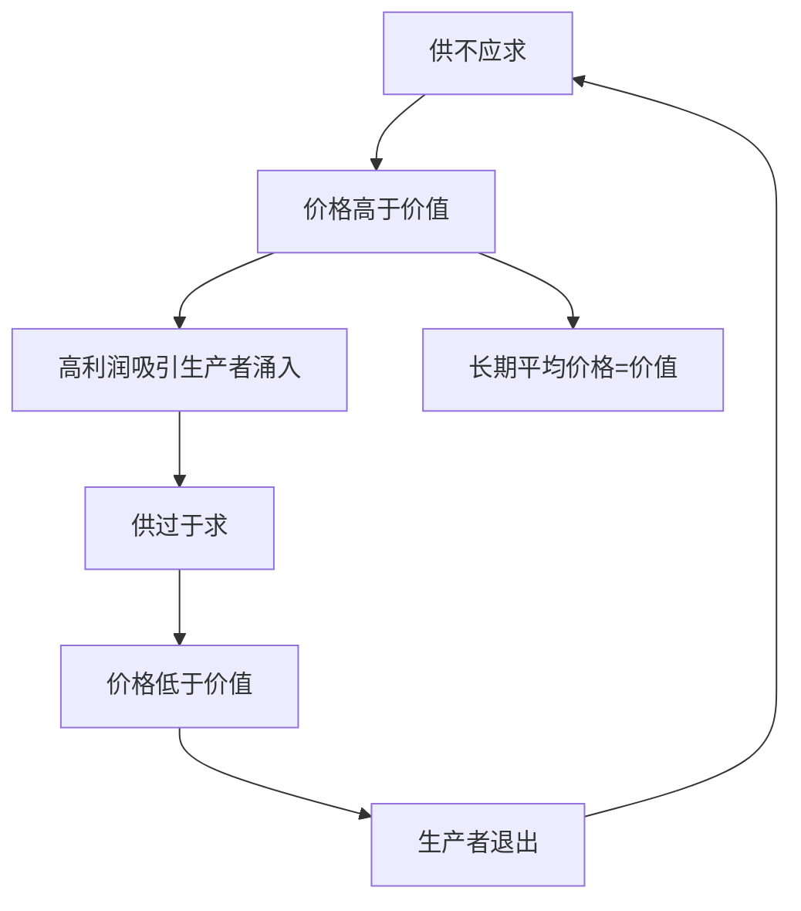
>
> **数学推导**：设某商品价值（社会必要劳动时间决定）为 $V_0$。短期价格 $P_t = V_0 + \varepsilon_t$，其中 $\varepsilon_t$ 是供求波动项。长期平均 $\bar P = \frac{1}{n}\sum P_t = V_0$（涨落抵消）。
>
> **生活实例**：共享单车风口时人人都做→供给爆炸→价格战→大量倒闭→剩下几家稳定盈利；烧烤网红城市爆火后又降温——价格围绕价值波动，短期偏离、长期回归。

**10. （逻辑链·判断）某商品连续涨价三个月，从政治经济学角度看，长期最可能发生的是（　）。**
A. 价格会永远涨下去
B. 高利润吸引资本涌入该部门 → 供给增加 → 价格回落到价值附近
C. 政府必然出手压价
D. 社会需求彻底消失

> **✅ 答案：B**
> **解析：** 价格长期高于价值，意味着该部门利润率高于社会平均水平，必然吸引其他部门的资本转移进来（部门间竞争），供给增加后价格下降，直到利润率回到平均水平——这正是价值规律"自发调节社会劳动分配"的作用机制。
>
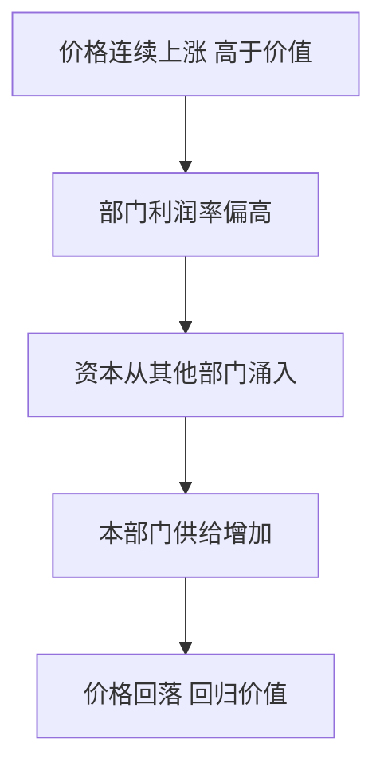
>
> **数学推导**：设该部门利润率 $r_1 > \bar r$（社会平均利润率）。资本流入使供给 $S$ 右移，价格 $P$ 下降，直到 $r_1 \to \bar r$。
>
> **生活实例**：2023 年淄博烧烤爆火，外地资本涌入、烧烤店遍地开，一年后热度退去、价格回归正常——这就是价值规律用价格涨落指挥资本进出。
