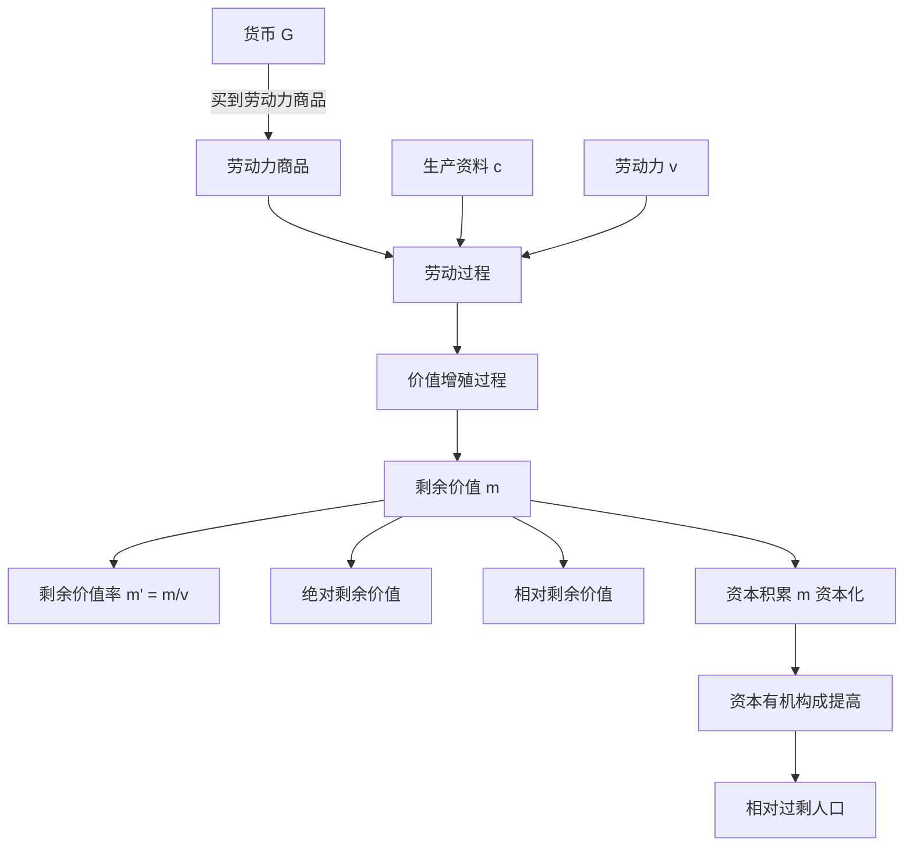

# 02 资本主义经济制度与生产 · 章节总结

> 对应原书：第二篇 资本主义经济制度及其演变、资本主义生产（第 4-5 章）
> 📖 原书原文：[[../../../原文件/经济学/马克思主义政治经济学概论_全书|《概论》第4-5章]]

## 这一篇在回答什么问题

这是全书的**心脏**。要回答：

1. **货币怎么变成资本？** —— 关键是买到了一种特殊商品：劳动力。
2. **剩余价值从哪来？** —— 劳动力的使用创造的价值，大于它自身的价值。
3. **资本家怎么提高剥削程度？** —— 绝对剩余价值（延长工作日）、相对剩余价值（提高劳动生产率）。
4. **资本怎么越滚越大？** —— 剩余价值资本化 = 资本积累。

## 核心框架图

## 核心公式

$$G—W—G' \quad (G' = G + \Delta G)$$

$$W = c + v + m$$

$$m' = \frac{m}{v} = \frac{\text{剩余劳动时间}}{\text{必要劳动时间}}$$

$$p' = \frac{m}{c+v}$$

## 核心概念速查

| 概念 | 一句话 | 详细 KP |
|---|---|---|
| 资本 | 能带来剩余价值的价值 | [[知识点/KP02_货币转化为资本]] |
| 劳动力商品 | 人的劳动能力，使用价值是劳动，能创造比自身价值更大的价值 | [[知识点/KP03_劳动力商品]] |
| 不变资本 c | 生产资料（机器、原料），价值不增殖 | [[知识点/KP05_不变资本与可变资本]] |
| 可变资本 v | 劳动力（工资），能创造剩余价值 | [[知识点/KP05_不变资本与可变资本]] |
| 剩余价值 m | 工人创造的、被资本家无偿占有的价值 | [[知识点/KP04_劳动过程与价值增殖过程]] |
| 剩余价值率 m' | 剥削程度 = m/v | [[知识点/KP06_剩余价值率]] |
| 绝对剩余价值 | 延长工作日长度生产的 m | [[知识点/KP07_绝对剩余价值与相对剩余价值]] |
| 相对剩余价值 | 提高劳动生产率、缩短必要劳动时间生产的 m | [[知识点/KP07_绝对剩余价值与相对剩余价值]] |
| 资本积累 | 剩余价值资本化 | [[知识点/KP09_资本积累]] |
| 资本有机构成 | c:v（技术构成决定的价值构成） | [[知识点/KP10_资本有机构成]] |

## 思考题（原书）

1. 为什么说劳动力成为商品是货币转化为资本的根本条件？
2. 剩余价值是怎样生产出来的？为什么说剩余价值学说是马克思经济理论的基石？
3. 资本的本质是什么？区分不变资本和可变资本有什么意义？
4. 资本积累的本质是什么？资本有机构成为什么有不断提高的趋势？

## 🔗 相关知识点

**本篇：** [[知识点/KP01_资本主义经济制度的形成]] ｜ [[知识点/KP02_货币转化为资本]] ｜ [[知识点/KP03_劳动力商品]] ｜ [[知识点/KP04_劳动过程与价值增殖过程]] ｜ [[知识点/KP05_不变资本与可变资本]] ｜ [[知识点/KP06_剩余价值率]] ｜ [[知识点/KP07_绝对剩余价值与相对剩余价值]] ｜ [[知识点/KP08_资本主义工资]] ｜ [[知识点/KP09_资本积累]] ｜ [[知识点/KP10_资本有机构成]]

**跨章：** [[../03_资本流通与剩余价值分配/00_章节总结|03 流通与分配（剩余价值怎么分）]]

**跨课对照：** 西方经济学把利润看成"资本的边际产出"，政治经济学把它看成"剩余价值的转化形式"。
